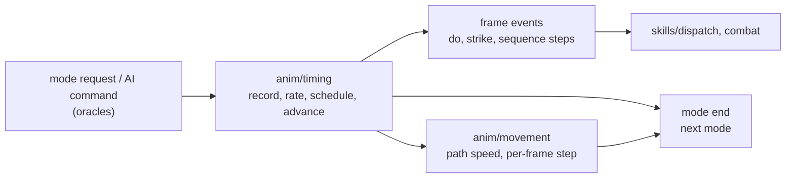

## Purpose

Every unit action the server runs is timed by its animation: the mode a unit enters has an animation record, a rate from the unit's stats and weapon, and frame events that run the do function, the melee strike and the sequence steps; its end starts the next mode. A moving unit's position advances once per game frame at a speed the same rate code sets. This subsystem specifies that timing, phase (4): the record lookup, the schedule and the per-frame advance, the mode machines of players, monsters and objects, the rates and the breakpoints they give, the gates that sit on the frame clock (the do frame, the skill delay, hit recovery, the block, the get-hit roll, the player's mode tests), and movement. Timing enters as frame counts and event frames; which cel is drawn, and the client's own clock, stay out.

## Files

| Spec | What |
|---|---|
| [anim/timing](../timing/) | the record, the mode start, the start frame, the schedule, the advance, sequences, the event queue and the frame order, the mode machines, the rate, the breakpoints, the gates, the draws |
| [anim/movement](../movement/) | the path speed, the run's stat, the monster speeds at load, the per-frame step, the snap, the collision walk, the run drain, knockback, the slowing states |

The research map's two rows, `anim/timing` and `anim/movement`, are kept as two files; movement depends on timing's
rate and mode machine.

## Entry points

| When | Tag |
| --- | --- |
| A unit's mode changes | [C] the animation start at every new-mode set, none at a same-mode one; [I] the null and type-5 return and the stat-list drop |
| A scheduled mode's events are queued | [C] |
| The unit event lists run, each game frame | [C] (families `tick` and `run`) |
| A unit's rate is (re)computed | [C] |
| A moving unit steps | [C] |

## Inputs

### Tables

| Anchor | Used for |
|---|---|
| `animdata.d2` | each mode's frames, speed and event bytes |
| PlrMode, MonMode, ObjMode, PlrType, ObjType, MonSeq, HitClass | the record names, sequences, hit-class codes |
| `CharStats.txt:WalkVelocity`, `MonStats.txt:Velocity`, `MonStats2.txt:A1mv`, `Skills.txt:seqnum`, `ItemStatCost.txt:Stat`, `Objects.txt:FrameDelta0` | speeds, the every-frame modes, sequences, the rate stats, the object start draw |

### Runtime state

| State | Type | Source |
|---|---|---|
| the unit's frame fields `+0x30`…`+0x50` | [timing § Inputs](../timing/#runtime-state) | the mode start and the rate |
| the path (`PathMove`) | [movement § Inputs](../movement/#runtime-state) | the planner and the step |
| the current game frame | `Game+0xA8` | the game loop |

### The boundary

| Input | Treatment | Tag |
|---|---|---|
| The catalogue's reschedules, its speed writers (Charge, Leap Attack), its queued kinds 2 and 12, a do's store to `+0x4E`; part 1's 124 dispatches after a cancel, whose logs lack the queue | taken as given where logged; the rest an uncompared catalogue path, not an oracle | [C] the 893 logged reschedules equal timing E3, and the 33 067 monster rate calls from `MonModeVelocity` reproduce with the stat 67 they carry; [I] the rest, an uncompared path |
| Everything else: the record, the start frame, the schedule, the advance, the rate, the speeds, the step and its snap and collision walk, the run drain, the knockback point and length, the gates, `GetHitRoll` and its draws, `PlayerModeAllowed`'s draw, the hit-class nibbles, the object operate end | modelled | [C] where compares it (the timing and movement sections say which), [I] otherwise |

## Algorithm

### A. The event kinds

| Kind | Inputs | Outputs | Draws | Tag |
|---|---|---|---|---|
| mode start | the mode, type, class, transform states, used skill, weapon items, record, stats, `T` | `+0x10`, the frame fields, the queued kind-0/1 events | an object's `RangeB` on its unit seed when `Sync` is 0 | [C] |
| frame event (kind 0) | the code and index | the mode's frame function: the do, the strike | the do's and the hit's (skills, combat), none of the animation's | [C] for a player: `PlrModeSkillFrame`'s closure under the modes scan's 19 stops draws nothing; [I] a monster's frame functions (`MonAttackFrame`, `MonSeqFrame`), which the second tool did not walk |
| mode end (kind 1) | the mode | the next mode and its start | the next start's, `PlayerModeAllowed`'s, the hand refresh's (`HandsRefresh`), the AI's | [C] for a player: `PlayerModeEnd`'s body draws nothing, its draws lie below `PlayerModeAllowed`, `PlrModeStartNeutral`, `PlayerDeathModeEnd` and `HandsRefresh`; [I] the monster ends' AI draws (under the stopped AI entry) |
| frame advance | every-frame monsters' frame fields | `+0x44`, `+0x4E` | none | [C] |
| rate change | the unit's display type, class, mode, record, stats, items, states | `+0x50`, `+0x4C`, `+0x3C`, the path speed | none | [C] |
| movement step | the path, its speed, the collision results | the position, the point index | none | [C] |
| get-hit decision | the packet, the defender's max HP and seed | get hit or not | 0–2 `RangePow2` on the defender's seed | [C] |

### B. Chaining

- B1. [C] The animation adds no seed of its own: under its 29 roots the one draw is the object start draw, on the
  object's unit seed `Unit+0x20`.
 [I] The get-hit draws on the defender's seed and the Concentration draw on the
  player's, between the defender's other draws in delivery order.

- B2. [C] The `GetHitRoll` draws chain: 102 consecutive pairs on one defender have the second's seed before equal to
  the first's after. [I] The object start draw and the
  Concentration draw have no chained pair in the run, so their place in their seed's order is as read.

### C. Branches

- C1. [C] **Two clocks**: scheduled modes (players' actions, get-hit, block, death; monsters' non-`*mv` A1–S2,
  get-hit, block, death) fix every event at their start; every-frame modes (monsters' walk, run, knockback, sequence
  and `*mv` modes; players' moves without an advance) run once per frame.
  (`SUNIT_ScheduleModeEvents`, `SUNIT_ModeEveryFrame`: 0 mismatches over
  every player and monster start)
- C2. [C] **Unit types**: players and monsters through the rate and the record; objects from their Objects row
  (no record lookup, a start draw, an operate end without an animation start); missiles and items get frame fields
  (timing C2, an emulation of those branches). [I] Missiles and items get no server advance (timing A2: that the low call sites are
  client code is the symbol names' reading).

## Outputs

- [C] The frame of every scheduled event and mode end, every-frame monsters' frame and event byte, the rate, and each
  moving unit's position per frame, as the two specs give them.

## Worked example

[I] See [timing § Worked example](../timing/#worked-example) (a cast's length, its do frame and its breakpoint) and
[movement § Worked example](../movement/) (a walk's and a run's step).

## Reimplementation notes

- [C] **A scheduled mode does not follow a rate change.** Its events stay where its start put them (72 014 logged
  events fire there, timing J7); only a catalogue reschedule moves them (the 893 logged ones equal timing E3, and the
  rate's callee closure reaches no queue, cancel or scheduler). An every-frame monster takes the new rate at its next
  advance (timing F1).
- [C] **The breakpoint tables count `N = n − 1`.** The schedule's end is at `T + n`; the server starts the next
  action in the frame its request arrives (after A1, a cast, a throw and a kick), and the stock client's held request
  for a normal action comes at `T + N` ([timing § L](../timing/#l-the-frame-events-as-gates),
  [timing](../timing/#reimplementation-notes) note 1).

## Evidence

- Plan: 0050. Upstream: [rng](../../spec-rng/overview/),
  [stats/aggregate](../../spec-stats/aggregate/). Downstream: [skills/dispatch](../../spec-skills/dispatch/),
  [combat](../../spec-combat/overview/), [objects](../../spec-objects/overview/), [monsters/stats](../../spec-monsters/stats/).
