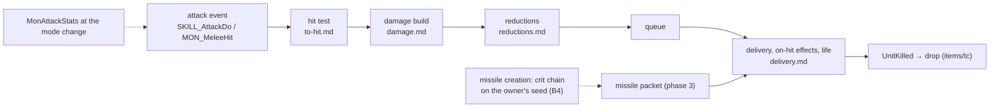
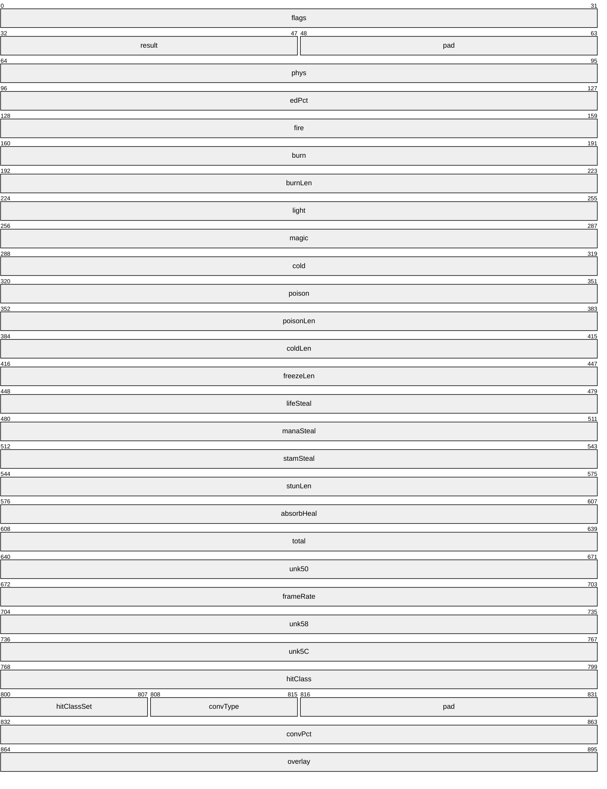
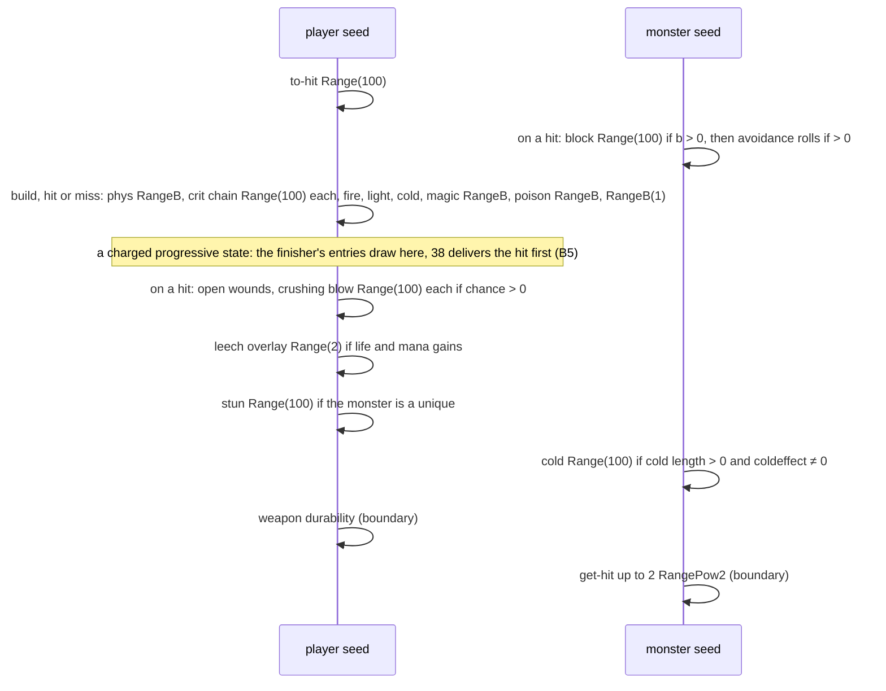
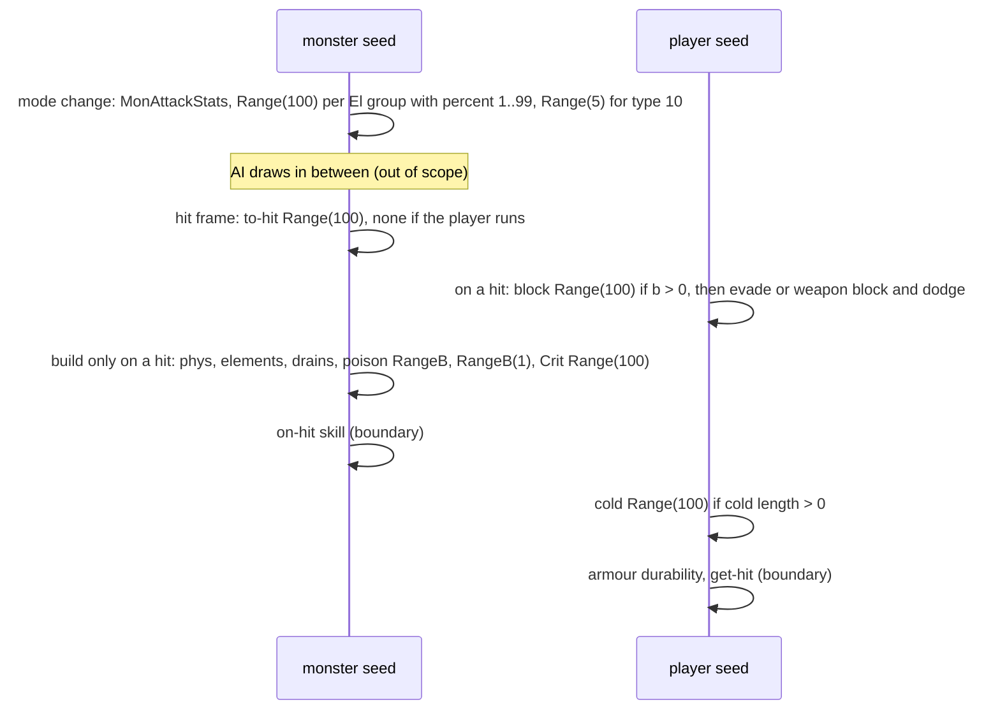
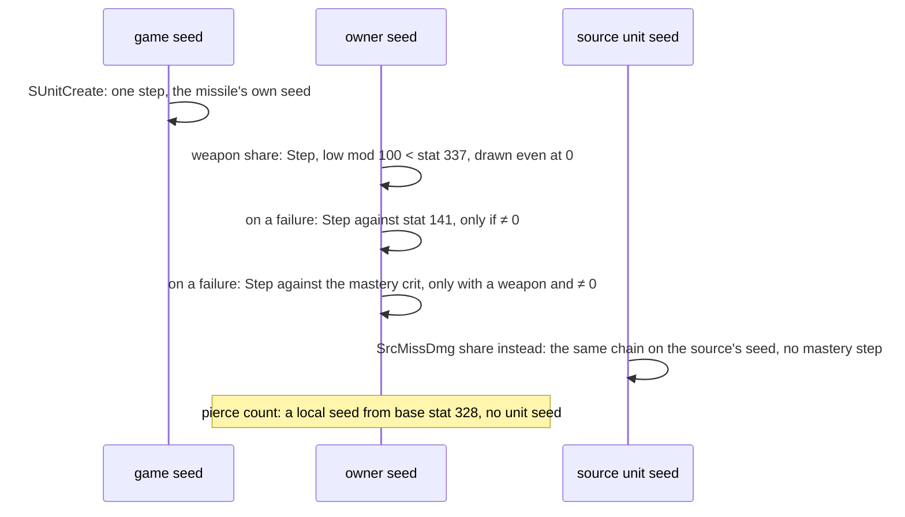
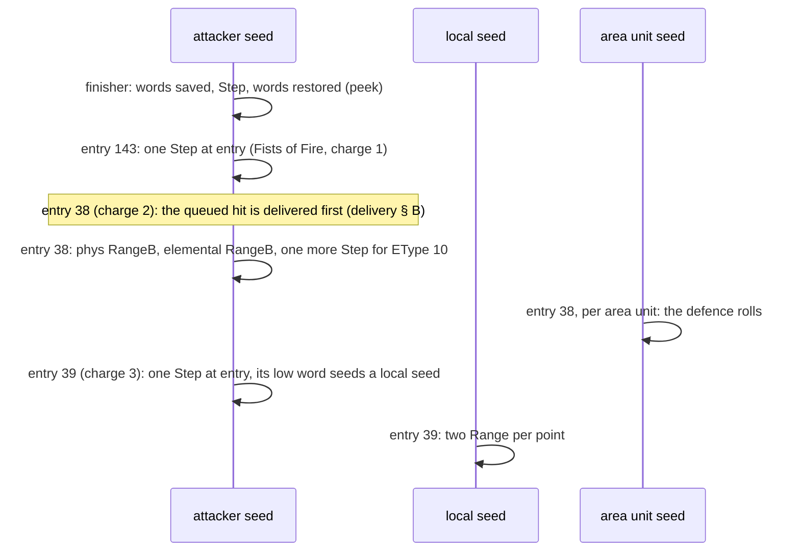

## Purpose

When one unit attacks another, the server tests the hit, builds the damage of each type, reduces it on the defender, applies it with the on-hit effects and changes the defender's life. This subsystem specifies that chain for a player's normal attack, a monster's or mercenary's plain attack and the defender's side of a missile hit, in every difficulty and in classic and expansion games, with every draw on the attacker's and the defender's unit seeds in order. It is the first simulation phase: a unit's **final stats** are inputs (phase (2) models how they add up), and a **skill's or missile's damage packet** is an input (phase (3) models how a skill builds it). This page gives the events, the packet, the draw order per event, the chaining of events on one seed, the branches and a full worked example; the formulas are in the four files below.



## Files

| File | Covers |
|---|---|
| [to-hit.md](../to-hit/) | the hit test, the chance to hit with `ToHitFactor`, defence, block, evade, weapon block, dodge, avoid |
| [damage.md](../damage/) | the damage build: physical roll, critical and deadly strike, elements, steal and drain fields, poison, the `RangeB(1)` step, conversion, the monster `Crit`; `MonAttackStats`' draws |
| [reductions.md](../reductions/) | the percent P, DR and MDR, resistances with the difficulty penalty, caps, immunity and pierce, absorb |
| [delivery.md](../delivery/) | queue and delivery, crushing blow, open wounds, leech, stun, cold, freeze, poison, the life change, the life tick |

Names of functions, structs and fields are ours; the server module is the binary's own `.\UNIT\SUnitDmg.cpp`. Primitives (`Step`, `Range`, `RangePow2`) are those of [rng](../../spec-rng/overview/); `RangeB` is the second compile of `Range`. `MulDiv(a, b, c)` is the helper of [monsters/stats § A](../../spec-monsters/stats/#a-muldiv-and-monlvlstats). Divisions are signed and truncate toward zero unless stated. Life, mana and damage fields are in 1/256 points.

## Entry points

| When | Function | Tag |
|---|---|---|
| A player's normal attack (Skills row 0, `srvdofunc` 1), at the hit frame | `SKILL_AttackDo` | [C] (2 030 events) |
| A monster's or a mercenary's plain attack, at the hit frame | → `MON_MeleeHit`, `COMBAT_DeliverQueued` | [C] (4 533 monster, 1 259 mercenary) |
| A monster skill's melee hit | → `MON_MeleeHit` | [C] |
| A monster enters an attack mode (its to-hit, damage and `El` stats) | — | [C] for the draws (5 060) |
| A missile that takes a weapon share is created (its critical chain, § B4) | — | [C] (one owner step per weapon-share creation, 984: 856 player, 128 monster, [skills/missiles C2](../../spec-skills/missiles/#c-the-damage-the-missile-carries)) |
| A missile's damage reaches a unit (the defender's side) | `MISSILE_ApplyDamage` | [C] (1 957 on the player or the mercenary, 519 Nova missiles) |
| A player skill's melee hit (packet and `SrcDam` from the skill) | — | [C] 32 call sites in 30 functions, start functions among them, no pointer |

## Inputs

### Tables

| Anchor | Used for |
|---|---|
| `CharStats.txt:ToHitFactor`, `BlockFactor` | [to-hit](../to-hit/) |
| `MonStats.txt:Crit`, `Drain`, `coldeffect`, `NoShldBlock`, `killable`, `boss`, `primeevil`, `demon`, `lUndead`, `hUndead`, `MonType`, `Velocity` | every file |
| `DifficultyLevels.txt:ResistPenalty`, `LifeStealDivisor`, `ManaStealDivisor`, `MonsterColdDivisor`, `MonsterFreezeDivisor`, `HireableBossDamagePercent` | [reductions](../reductions/), [delivery](../delivery/) |
| `Weapons.txt:StrBonus`, `DexBonus` | [damage](../damage/) |
| `ItemStatCost.txt:itemeventfunc1` | the stat events of [delivery § E](../delivery/#e-the-stat-events-crushing-blow-open-wounds-freeze) |
| `Skills.txt:srvdofunc`, `SrcDam`, `ToHit`, `LevToHit`, `ToHitCalc` | the event and the skill's percent |
| `Missiles.txt:SrcDamage`, `SrcMissDmg`, `Skill`, `MissileSkill` | whether a missile's creation draws the critical chain (§ B4) |
| `g_DamageResistTable` (binary) | [reductions § B](../reductions/#b-the-rows-g_damageresisttable) |

### Runtime state

| State | Type | Source |
|---|---|---|
| unit seed of each unit | `Seed` at `Unit+0x20` | [rng/seeds](../../spec-rng/seeds/) |
| unit stats | i32 values of the stat lists | value inputs (the boundary section) |
| hit queue | list at `Unit+0xAC` | [delivery § A](../delivery/#a-queue-and-delivery) |
| frame | `Game+0xA8` | timed states |
| game type | `Game+0x70`, 0 classic | game creation |
| difficulty | the game's difficulty, 0..2 | game creation |

### The damage packet



[C] The packet is 0x70 bytes, zeroed by the caller on its stack and copied whole onto the attacker's hit queue: `COMBAT_QueueHit` copies 0x1C dwords (`mov ecx, 0x1C; rep movsd`), 33 of the 36 packet functions zero it with `memset(&packet, 0, 0x70)`, do 67 with an `EAX` of 0, and the three others take theirs from those. [I] Its fields: `+0x00` flags, `+0x04` result (u16), `+0x08` physical, `+0x0C` enhanced-damage percent, `+0x10` fire, `+0x14`/`+0x18` burning damage and length, `+0x1C` lightning, `+0x20` magic, `+0x24` cold, `+0x28`/`+0x2C` poison per frame and length, `+0x30` cold length, `+0x34` freeze length, `+0x38`/`+0x3C`/`+0x40` life, mana and stamina steal, `+0x44` stun length, `+0x48` absorbed life, `+0x4C` total, `+0x54` damage frame rate, `+0x60` hit class, `+0x64` hit-class-set byte, `+0x65`/`+0x68` conversion type and percent, `+0x6C` overlay; `+0x50`, `+0x58` and `+0x5C` are not named. The checker predicted every damage field and the result word of the packet at the builder's return, after the reductions and at delivery. [C]

Flags at `+0x00`: `0x1` physical already set (skip the roll), `0x2` already built, `0x4`/`0x8`/`0x10` no
life/mana/stamina drain roll, `0x20` built (and forced at delivery), `0x80` no `domissiledamage` event, `0x100`/
`0x200`/`0x400` bypass resistances of undead, demons, others, `0x1000` hits non-hostile units. Result bits at
`+0x04`: `0x1` hit, `0x2` killed, `0x4` get-hit, `0x8` knockback, `0x10` blocked, `0x20` no events, `0x80` dodged,
`0x100` avoided, `0x200` evaded, `0x2000` doubled, `0x8000` weapon block; a missile's packet can also carry `0x4000`, the soft hit. [C] Of these the kept combat logs test flag `0x2` (set at the
builder's entry in all 6 901 player attacks, each building once, clear in the 4 050 monster and hireling attacks) and
results `0x1` (set exactly when the melee to-hit roll is below its chance, 9 594), `0x2` (exactly when the defender's
life is 0 after the delivery: 3 665 set, 17 141 clear), `0x4` (only with `0x1`, 20 806) and `0x2000` (with the
doubling).
The other flags and result bits are not tested: `0x8` is in delivered packets with its meaning not compared, `0x300`
is on 7, the rest are in no logged packet. [I]

### The boundary

| Kind | What | Tag |
|---|---|---|
| value inputs | every stat of both units at the event's entry, and their life, mana and stamina; the table cells named in each file | [C] |
| value oracles | the player's attack-rating percent (mastery included), `UnitBlockChance`'s shield test, `UnitIsMoving`, the weapon block chance and its skill check, the two-handed test, the weapon mastery's damage and crit, step 1's `edPct` | [C] |
| inputs (packets) | a skill's packet (any `srvdofunc` other than 1) and a missile's packet, taken at `ResolveAndQueue` or `ApplyDamage` entry | [C] |
| boundary oracles | stat-event handlers other than 15 and 16, `COMBAT_DurabilityLoss`, the knockback, `COMBAT_GetHit`, a monster's on-hit skill, a skill do-function's draws before the build, a delivery on a later frame than the hit test: entry seeds asserted, exit seeds taken | [C] |

[C] Under this boundary the combat run reproduced 15 358 logged events of 19 sessions with 0 mismatches, every logged seed asserted; with the resume-lane addendum the run list holds 40 logs and 40 655 events, still with 0 mismatches. [C] Under the same boundary the first shortfalls run (sessions built for the branches the first run met too rarely) reproduced 18 737 events of 31 logs with 0 mismatches, and the kept run list re-checks with the same checker at 0 mismatches over its 40 655 events. Its run list names the logs whose player holds no usable shield (`--no-shield-log`), which only sets the predicted block chance to 0, so a logged chance above 0 still fails. [C] Under the same boundary the second shortfalls run (flat absorb by element) reproduced 2 527 events of 3 logs with 0 mismatches, and both kept run lists re-check at 0 mismatches. Its checker takes the attacker's life after a defender's stat-event handler from the handler's logged life where it differs from the model's (a value oracle, as the handler is), so a leech that follows is predicted from that life. The progressive-charge hooks around the player's build and the finisher before delivery were dropped events by rule; none occurred. [I]

### Constants

| Name | Value | Anchor | Tag |
|---|---|---|---|
| normal attack `SrcDam` | 128 | `Skills.txt:SrcDam` | [C] |
| LCG multiplier of the inlined draws | `0x6AC690C5` | [rng](../../spec-rng/overview/) | [C] |

## Algorithm

### A. The attack events

```
A1. PlayerAttack(att):                                                [C] (SKILL_AttackDo, all of A1 except as tagged)
      if att wields a missile weapon: create a missile; return        ; [I], phase (3); its creation draws: § B4
      def ← att's target;  pkt ← 0x70 zero bytes
      pkt.result ← MeleeHitTest(att, def, arPct: stat(att, 325), rangeExtra: 0)       ; to-hit.md § C
      pkt.flags |= 0x2
      PrgHooksBeforeBuild(att, pkt);  BuildDamage(att, def, pkt, 0, 128);  PrgHooksAfterBuild(att, pkt)   ; damage.md, whatever the result
      ResolveAndQueue(att, def, pkt, 128)                             ; delivery.md § A: reductions on a hit
      if att has the `meleeonly` state flag: AttackDeliverMeleeOnly(att, def)        ; [C], skips the finisher; state flag 38, on States 139 wolf and 140 bear only
      else: PrgFinisher(att);  DeliverQueued(att, def)                ; delivery.md § A3: the finisher's own step peeks att.seed [C]; its srvprgfunc entries draw (§ B5) [I]

A2. MonsterAttack(att):                                               [C] (MON_MeleeHit, all of A2)
      ; earlier, at the mode change: MonAttackStats(att, newMode)     ; damage.md § E
      def ← att's target;  pkt ← 0x70 zero bytes
      pkt.result ← MeleeHitTest(att, def, arPct: 0, rangeExtra: 0)
      ResolveAndQueue(att, def, pkt, 128)                             ; the build runs here, only on a hit
      DeliverQueued(att, def)
```

- A1. **The player's damage is built on a miss**, so a missed swing still steps the attacker's seed through the
  build. [C] (`SKILL_AttackDo`: 386 misses)
- A1. A player skill's melee hit passes `SKILLS_GetToHit` as `arPct` and its own `SrcDam`; its packet is phase (3)'s
  input. [I]
- A2. A monster skill's do-function calls `MonAttackStats` itself, then `MON_MeleeHit` and the delivery; the plain
  attack frame relies on the call made at the mode change. [C]
- A2. **A mercenary is a monster on this path.** It differs where the code tests the hireling type: crushing blow
  divisor 10 against it, P = 25 against another hireling and `HireableBossDamagePercent` against a boss, leech by the
  player formula without the divisors, and no drain rolls in its build. [C] The mercenary's 1 259 attacks reproduced; in the kept logs 519 Hell leeches by the formula without the divisors, 1 787 builds with no
  drain draw, 79 hits on Andariel at P 35 and 25;
  P = 25 for two hirelings and the divisor 10 against a hireling defender emulated.

- A3. **Missiles.** `MISSILE_HitUnit` may roll the chance to hit, `MISSILE_BuildDamage` builds the packet from the
  missile's own stats on the missile's seed, and `MISSILE_ApplyDamage` rolls the knockback on the missile's seed,
  the defence on the defender's seed (block only with physical damage), and calls `ApplyDamage` with reductions.
  That path is phase (3); here its packet is an input. [C] The to-hit on the owner's seed (269 rolls) and the packet on
  the missile's seed (4 118 builds) are [skills/missiles E1, F1](../../spec-skills/missiles/) on the skills run; the
  knockback on the missile's seed in 8 638 missile events (7 with a knockback row), and no block draw on 10 387
  events with physical 0, 6 838 of them in logs where another missile was blocked.

- A3. **A missile's weapon terms are taken at its creation**, not at the hit: the weapon share, the enhanced damage
  and the critical strike's result are fixed when `MissileCreate` builds the damage block and are stored as the missile's own
  stats. [I] The
  critical chain draws then, on the owner's seed (§ B4). [C] (one owner step per weapon-share creation, 984)

### B. Draw order per event

**B1. A player's normal attack on a monster.**



[C] On the player's seed the order is: to-hit, the build (whatever the hit result), then on a hit the stat events, the leech overlay and the stun; on the monster's seed: the defence rolls (on a hit), then the cold draw at delivery. Each draw happens only under the condition given in its file. The weapon durability and the get-hit draws are boundary oracles (the boundary section). [C] Their seed steps match a draw model in the kept logs: durability, one step for a player attacker, three for a player defender, none for a monster or hireling (9 680 pairs but one), and a player defender's get-hit draws are `GetHitRoll`'s (25 669 of 25 669). [I] The roll values (the equipment is not logged), the one mode-14 attack that stepped neither seed, and a monster or hireling defender's get-hit, whose state tests the logs do not hold. Under a charged progressive state the finisher's entries draw on the player's seed after the build; when entry 38 runs it delivers the queued hit itself first, so the delivery's draws come before 38's and those of any later entry (B5); the other stat-event handlers draw on the seed of the unit that owns them (B6). [I] 

**B2. A monster's melee attack on the player.**



[C] On the monster's seed: `MonAttackStats`' `El` draws at the mode change, then at the hit frame the to-hit and, only on a hit, the build with the `Crit` draw last; on the player's seed: the defence rolls on a hit and the cold draw at delivery. A monster attacker's leech has no draw. [C] (`COMBAT_Leech`: 8 876 monster attacks with the attacker's seed unchanged at the leech, 276 of them draining)

B2 is the melee path. A monster's missile that takes a weapon share (an archer's arrow) builds its packet on the missile's seed at the hit (B3) and steps the monster's seed one to three times when it is created (B4). [C] (one step in 128 monster creations, classes 160, 161, 170; the second and third steps emulated)

**B3. A missile on the player.** The missile's own seed draws its packet and its knockback (phase (3)); the player's seed draws the defence (block only when the packet has physical damage, then avoid) and, at delivery, the cold draw. [C] for the player's seed (1 957 events); [C] for the missile's: the packet and the knockback asserted on it in 8 638 missile events

[C] At the hit, for a missile whose row has `ToHit`, the **owner's** seed draws the chance to hit first (its next
draw, 269 rolls), and a miss frees the missile; on a damaging hit `MISSILE_BuildDamage` draws `RangeB` on the
**missile's** seed once per bound pair with both bounds ≥ 1 (4 118 builds, [skills/missiles E1, F1](../../spec-skills/missiles/)).
 [I] The chance takes the missile's stat 19 as `arPct`; an `AlwaysExplode` row's hit function can keep a
missile that missed; the seven pairs come in this order: physical (stats 21, 22), fire (48, 49), magic (52, 53),
lightning (50, 51), cold (54, 55), poison (57, 58), burn (316, 317), which only 19 two-draw builds separate.


**B4. Missile creation (the owner's seed).** A new event, separate from the hit: `MissileCreate` builds the
missile's damage block, which draws the critical chain when the missile takes a weapon share.



```
B4. MissileCreate(params) → missile:                                  [C] (all of B4 except as tagged)
      m ← SUnitCreate(type 3, …)                                       ; one game-seed step: rng/seeds step 7a
      ; … path, range, marks; the damage block:
      if row.Skill < 1 and not row.MissileSkill:                       ; Missiles damage
        src ← row.SrcDamage;  srcMiss ← row.SrcMissDmg
      else:                                                            ; Skills damage
        src ← Skills[skill].SrcDam;  srcMiss ← 0
        if row.SrcDamage = 0xFF: src ← 0                               ; −1 cancels the weapon share
      if src ≠ 0:
        w ← owner's weapon (a player's, or a monster's when it has one), else none   ; [I] which weapon is passed: the S5fe emulation took it as an input (skills/missiles C1)
        crit ← CritChain(owner, w)                                     ; draws on owner.seed
      else if srcMiss ≠ 0 and params.source:                          ; [I] the branch's field test (skills/missiles C1)
        crit ← CritChain(params.source, none)                          ; draws on the source's seed
      ; crit sets the missile's stat 141 = 1: physical × 2 at the hit (MISSILE_BuildDamage)   ; [I]
      PierceCount(owner, m)                                            ; local seed, below

CritChain(u, w) → bool:                                              [C] (all of CritChain)
      Step(u.seed);  if (i32)(u.seed.low mod 100) < stat(u, 337): return true      ; draw, always
      if stat(u, 141) ≠ 0:
        Step(u.seed);  if (i32)(u.seed.low mod 100) < stat(u, 141): return true    ; draw
      if w and mc ← SKILLS_GetMasteryBonus(u, w, 0, 2) ≠ 0:
        Step(u.seed);  if (i32)(u.seed.low mod 100) < mc: return true              ; draw
      return false
```

- B4. The weapon-share test, the order and the stop at the first success are as above. The block is
  `MissileDamageBlock` and the chain `MissileCritRoll`; the steps are the inline LCG of
  [rng](../../spec-rng/overview/) step 1 on `Unit+0x20`, with the unsigned remainder compared signed. [C] `MissileCritRoll`
  emulated whole over 3 000 cases, 1 216 / 1 475 / 309 ending after one, two and three steps, 784 with a negative stat
  337 (an unsigned compare fails 1 142); with no used skill the mastery value is `SKILLS_GetMasteryBonus`' largest
  stat-344 entry for one of the weapon's item types, from 0.
  A used skill's mastery path (the throwable branch) was not reached. [I]
- B4. **It is not the melee build's chain** ([damage](../damage/) step 3, where 337 and 141 each draw only when above
  0): stat 337 draws even at 0, so every weapon-share missile steps its owner's seed at least once (an arrow, a
  javelin, a throw, a `SrcDam` skill missile, a monster archer's arrow): 984 weapon-share creations stepped it once
  with stat 337 at 0 and none twice. [C] The order differs too, the melee chain taking the mastery crit
  first. [I] (damage step 3)
- B4. A `SrcMissDmg` missile (a sub-missile taking a share of its source missile's damage) draws the chain on the
  **source unit's** seed, a missile's own, with no weapon and so no mastery step. [C] for the call: the site calls the
  chain with `ESI` = the block's third argument and a pushed weapon of 0, only when that argument is non-null, and a
  null weapon makes no mastery step (read by two tools; the chain's map).
  [I] that the site is the `SrcMissDmg` branch and the argument the source missile, the caller's reading.
- B4. The pierce count makes a **local** seed, `Init(baseStat(owner, 328))`, and steps it up to four times while
  `low mod 100 < stat 166 + stat 156`, for a player or monster owner and a `Pierce` row; no game or unit seed is
  drawn ([rng/seeds](../../spec-rng/seeds/), *Reimplementation notes*). [C] (`Missiles.txt:Pierce`: 1 066 `Pierce` creations, 856 with draws,
  [skills/missiles C4](../../spec-skills/missiles/#c-the-damage-the-missile-carries))

**B5. The progressive finisher (the attacker's seed).** A player's normal attack under a charged progressive state (an Assassin's charge-up skills) runs `COMBAT_PrgFinisher` between the queue and the delivery (A1); the run met none (the boundary section). Its own `RNG_Step` is a **peek**, but the `srvprgfunc` entries it calls **draw on the attacker's seed**; the full algorithm is [delivery § A3](../delivery/#a-queue-and-delivery). The assassin finishing moves (do 42, 46, 50, 52) also call the finisher, with their own queued hit, outside this attack event (delivery § A2).



- B5. **Entries 37, 39, 41 and 143 step the attacker's seed once at entry**, before any test, so the step happens
  even when the entry then does nothing (143 for Fists of Fire, whose `srvmissilea` is empty). 37 and 143 pass the
  stepped low word to a missile ring, 39 and 41 initialise a local seed with it (39 then draws two `Range` per
  try on it, up to its first creation). [C] (`prg_ass`)
  On stock data Fists of Fire runs 143, 38 and 39 at charges 1, 2 and 3: over Skills.txt `srvprgfunc1`–`3` are set on
  four rows only, 259 Fists of Fire (143, 38, 39), 269 (–, 36, 37) and 274 (–, 38, 39) with `prgstack`, and 280
  (40, 143, 41) without. [C] (`Skills.txt:srvprgfunc1`, `Skills.txt:prgstack`, full table)
  The missiles they create are re-seeded or drawn from that local seed, not from the attacker's, and with `prgstack`
  the finisher runs every entry up to the current count. [I]
- B5. **Entry 38 draws two or three times on the attacker's seed**: it first delivers the queued hit
  (`COMBAT_DeliverQueued`, so that hit's delivery draws of B1 come before 38's), then builds an area packet with
  `RangeB(att.seed, max − min)` for the physical damage and `SKILLS_RollElemDamage`'s `RangeB` for the elemental, plus
  one `RNG_Step` for `EType` 10; each unit of the area then draws its own defence rolls on its own seed, as a missile with no block (evade, weapon
  block or avoid only, [delivery § A3](../delivery/#a-queue-and-delivery)). [I]

- B5. Entries 36 and 40 draw nothing of their own; every entry that creates missiles adds the creations' draws (B4).
  The finisher's tail, `UnitMsgA3`, queues a client message carrying the peeked value: it allocates the
  message, links it into the unit's message list (`+0xEC`, `+0xF0`) and calls
  `UnitMarkUpdated`; it draws on no seed. [I]

**B6. The other stat-event handlers.** Besides crushing blow, open wounds and freeze, the handlers registered on stock data that draw do so on the **handler's unit**, the unit that owns the event. On the attacker's seed: its `do…` handlers 7 knockback, 8 howl and 9 stupidity, 20 skill on attack, hit or kill, and its `kill` handler 31 reanimate; on the defender's: 3 shiver armour (`attacked…`), 21 skill on get-hit (`damaged…`) and its `killed` handler 30. In the combat run these handlers were boundary oracles (the boundary section); the list and their draws are [delivery § E5](../delivery/#e-the-stat-events-crushing-blow-open-wounds-freeze). [C] for 7, 8 and 20 on the attacker, 9 on a monster attacker and 21 on the player defender: each call stepped its unit's seed once in the skills runs; [I] for 3, 30 and 31, which never fired. [C] In the recorded runs the handler unit's seed stepped by exactly the handler's own draws in 1 303 handler calls: one for 7, 8, 9, 15 and 16, one for 20 when its roll fails and at least one when its cast follows, at least one for 21, none for 5, 6, 13, 17, 19, 22, 28 and 29. [C] State 52 (prevent heal) is not a handler: the to-hit hook applies it, for 120 000 frames with stat 31 = 0, in 86 of 918 calls, exactly those with the player attacker's stat 117 non-zero, and draws on neither seed.

### C. Chaining events on one seed

[C] **The player's seed chains.** Consecutive in-scope events on the player's seed (its attacks, the monster attacks'
defence part, the missile defence, its Nova missiles) follow each other with no hidden draw between them on the paths
taken: chained pairs `pa` 1 796, `ma` 4 235, `md` 1 505, `pm` 519 (as first event), each ≥ 20 on both ends.
 A resynchronisation was needed where something out of scope drew in between (213 player
attacks).

[I] The run had no finisher events (they were dropped by rule and none occurred), so this chaining does not cover a charged progressive state: there the finisher's entries 37, 39, 41 and 143 add one draw each and 38 two or three on the player's seed inside the attack, besides the creation draws of the missiles they create (B5, B4), and the drawing stat-event handlers of B6 add theirs inside a hit or a kill. The recorded runs checked the handlers' draws (B6), and the finisher's entries stayed oracles in them.

[C] A weapon-share missile the player creates (a bow or crossbow attack, a javelin, a throw, a `SrcDam` skill
missile) inserts the 1–3 critical draws of B4 on the player's seed at its creation frame, between the player's other
events: one step in each of 856 player creations, the second and third steps emulated.
[I] Whether these draws account for any of the 213 resynchronisations is not established: no kept log holds a bow
attack recorded for both the combat and the skills checks.

[C] **A monster's seed chains only within one melee attack**: `MonAttackStats` at the mode change to the attack it opens (2 237 monster, 558 mercenary pairs). Between two attacks its AI draws on the same seed, out of scope, so each attack resynchronises. [I] A monster can also call `MonAttackStats` inside an attack, between the defence rolls and the build, on its running seed (`sandraider2` in mode 14, [damage § E](../damage/#e-a-monsters-attack-stats-monattackstats)); which attacks do is not read. [C] A monster's weapon-share missile (an archer's arrow) also steps the monster's seed, one to three times at its creation (B4). (one step in 128 monster creations; the second and third)

### D. Branches

| Branch | Where | What changes | Tag |
|---|---|---|---|
| classic against expansion | block | expansion only: `(dex − 15)·b / (2·lvl)`; classic `stat 20 + BlockFactor` | [C] |
| classic against expansion | resistance | classic −20 Nightmare / −50 Hell; expansion `ResistPenalty` 0 / −40 / −100 | [C] |
| classic against expansion | `MonAttackStats` | classic ×10/12 damage and ×10/15 to-hit in Nightmare and Hell, except an `Align` 1 class; expansion player-count bonus | [C] (600 classic calls reproduced, 562 separating); [I] the `Align` 1 exception (2 calls, all-zero stats, not separating) |
| difficulty | resistance penalty, leech divisors, cold and freeze divisors, MonStats `Drain` and `coldeffect` | per the tables | [C] for the penalty and leech; [I] for the freeze divisor |
| difficulty | to-hit, block, crushing blow, open wounds | none | [C] (`COMBAT_ToHitRoll`, `STATEVENT_CrushingBlow`, `STATEVENT_OpenWounds`: to-hit rolls N 12 019, NM 5 547, H 9 875, block 2 204 / 1 678 / 7 869, the stat-event calls 3 102 / 1 662 / 675, every chance and life by models with no difficulty term) |
| player count | crushing blow divisor | `k + MulDiv(k, PlayerHpPct(n), 100)` with the monster's creation count | [C] |
| player count | `MonAttackStats` damage | expansion, Nightmare and Hell: + `b/128` with `b = 8(n − 1)` for `2 ≤ n < 9` (the table), on the `El` length too | [C] |
| hireling | P, crushing blow, leech, drains | § A2 | [C] (§ A2) |
| player against player | P = 17 on every scaled field; stat events and leech with `D` = 100 | reached on physical and lightning only | [C] P = 17 at all 226 reductions of player against player, physical and lightning; [I] the other fields, the stat events and leech with `D` = 100 |

- D. "Players" means the monster's stat 100, the count frozen at its creation, not the current `/players`. [C]


## Outputs

The defender's life, mana and stamina, the attacker's life and mana after leech, the defender's timed states, the
result word (hit, killed, blocked…), the kill hand-off to `COMBAT_GetHit` and `UnitKilled`, and both
seeds advanced by the draws of § B. [C]

## Worked example

### Example 1: a melee hit in Hell with crushing blow and leech

`solo-h3`, frame 357, expansion Hell, `/players` 1. The attacker is the tool-built
`CombatSolo` Sorceress (level 85, strength 405, dexterity 420, stat 19 = 250, a Dimensional Blade;
stats 21/22 = 32/87, fire 3–6, cold 15–45, magic 50–120, poison 153 for 100 frames; deadly strike 15, open wounds 10,
crushing blow 20, life steal 5, mana steal 7). The defender is a `fallen2` (level 68, life 74776 of 479232,
defence 946, block 16, physical resistance 15, fire 110, cold 40, stat 100 = 1). Seeds `low:high`. [C]


| # | Seed | Draw | Value | Effect |
|---|---|---|---|---|
| 1 | player `4eb7ca01:65342f7a` → `0109323f:20d5284f` | to-hit `Range(100)` | 3 | AR `(420 − 7)·5 + 250 − 15` = 2300, DEF 946; `c` = `230000 ÷ 3246` = 70 → `70·85·2 ÷ 153` = 77; hit |
| 2 | monster `91336523:696c7d87` → `c5ef0176:3c8fe7bd` | block `Range(100)` | 30 | `b` = 16; not blocked; no dodge or avoid stat, no draw |
| 3 | player → `0be642ca:006e9c81` | physical `RangeB(71104)` | 50826 | phys `41369 + 50826` = 92195 |
| 4 | player → `fa6da1f3:04f69279` | deadly strike `Range(100)` | 83 | ≥ 15, no doubling |
| 5 | player → `465ee278:6873a378` | fire `RangeB(768)` | 120 | fire 888 |
| 6 | player → `c7ab69d0:1d59def4` | cold `RangeB(7680)` | 6608 | cold 10448 |
| 7 | player → `26a74c04:5347d94e` | magic `RangeB(17920)` | 9220 | magic 22020 |
| 8 | player → `9fdf9862:101f40ba` | `RangeB(1)` | 0 | burn 2 |
| — | — | reductions, no draw | — | phys 78365, fire 0 (immune), cold 6268, magic 22020, poison 153, cold length 60; total 106806; kill pre-test: result `0x7` |
| 9 | player → `4cb2a424:42ae9671` | open wounds `Range(100)` | 44 | ≥ 10, no wound |
| 10 | player → `a0532625:1ffd7581` | crushing blow `Range(100)` | 13 | < 20: life 74776 → 58886 |
| 11 | player → `180c9ffa:42dec8c5` | leech overlay `Range(2)` | 0 | phys capped to 58886; life + 731 (1540389 → 1541120) |
| — | — | life change | — | `58886 − 106806` < 256: 0, killed |
| 12 | monster → `fb92678b:528e7d64` | cold `Range(100)` | 79 | no shatter |
| — | player → `1dee8427:0a07e19b`; monster → `e7f85b5b:68edc05f` | durability, get-hit (boundary oracles) | — | exit seeds as logged |

Each step's arithmetic is in its file: [to-hit § Worked example](../to-hit/#worked-example) for the rule,
[damage § Worked example](../damage/#worked-example), [reductions § Worked example](../reductions/#worked-example),
[delivery § Worked example](../delivery/#worked-example). Draws 1–12 and every intermediate seed are the logged ones.
[C]

The per-difficulty examples are in the files: monster hits blocked in Normal, Nightmare, Hell and classic Hell, monster hits resisted in the same four,
crushing blow at `/players 8`. [C]

## Reimplementation notes

- **Two seeds per event.** The attacker's seed draws the to-hit, the build, the stat events, leech and stun; the
  defender's draws the defence rolls and the cold. Using one combat RNG desynchronises both units. [C]

- **Draws whose results are discarded still happen**: the player's build on a miss, the builder's `RangeB(1)`, the
  leech overlay `Range(2)`, the cold shatter roll on a monster that cannot shatter. [C]
- **Draws that do not happen**: a chance of 0 (block, dodge, deadly strike, crushing blow, open wounds) and a
  degenerate damage range draw nothing, on the paths the run checked: § B1, B2 and the player's side of B3. [C]
- **The finisher peeks; its entries draw.** Entries 37, 39, 41 and 143 step the attacker's real seed once at entry,
  before their record test (B5; [combat/delivery](../delivery/#reimplementation-notes) note 9). [C] `COMBAT_PrgFinisher` itself saves the attacker's seed words, steps
  the seed and writes the saved words back, so the seed leaves the peek as it entered; a reimplementation advances the
  seed for the entries and not for the peek. [C] (two tools)
  Entry 38 draws two or three times on the real seed. [I]
- **The missile creation's critical strike draws at 0.** A weapon-share missile steps its owner's seed once for stat
  337 even when it is 0 (B4): in the run, one step per creation of a row that takes weapon damage and none for any
  other row ([skills/missiles](../../spec-skills/missiles/#reimplementation-notes) note 3, C2). [C]
 Its deadly-strike step needs a
  **non-zero** stat 141 (a negative one steps the seed and cannot succeed), its mastery step, with no used skill, a value above 0
  (the value is a maximum starting at 0). [C] (565 cases
  with a negative stat 141 and a second step)
- **A monster attack and its `MonAttackStats` are two moments.** The `El` draws happen when the attack mode starts,
  the to-hit and build at the hit frame, with the monster's AI drawing in between. [C]

- **The community's 1/8 crushing blow on uniques and its player-count-free crushing blow do not hold in 1.14d**; nor
  does the class level bonus in the chance to hit, nor healing only from flat absorb. [C] Nor
  does the 1/8 on champions: 52 crushing blows on champions took 1/4. [C]

## Evidence

- §§ 11 (the conversion writers), 12 (the finisher's seed peek).
- §§ 2 (creation), 3 (the damage block, `MissileCritRoll`, the
  pierce count), 5 (the hit, the to-hit roll), 6 (`MISSILE_BuildDamage`'s draw order), 9 (draws per event), and the
  architect's ruling on the creation draws (review).
- Types:. Plan: 0037.
- Upstream: [rng](../../spec-rng/overview/), [rng/seeds](../../spec-rng/seeds/), [monsters/stats](../../spec-monsters/stats/),
  [player/creation](../../spec-player/creation/), [items/properties](../../spec-items/properties/), [data/calc](../../spec-data/calc/).
  Downstream: [items/tc](../../spec-items/tc/) (the drop at the kill).
