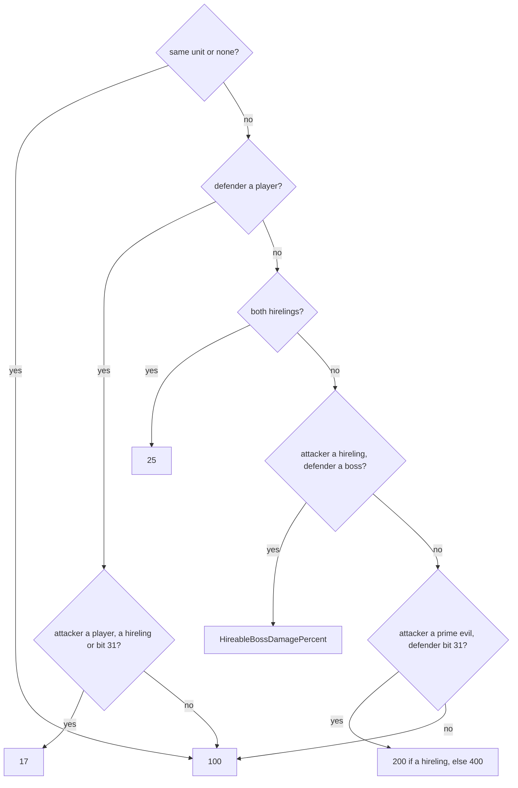

## Purpose

Between the damage build and the life change, the defender's side reduces each field of the packet: the
player-against-player and hireling percent, the absorb-damage stat events, the cold, freeze, poison and burn length
immunities, then per field the flat damage reduction (physical) or magic damage reduction (elements), the resistance
with its difficulty penalty, cap, pierce and immunity, the percent absorb and the flat absorb. The pass makes no
draw. Melee attacks run it inside the queue, before delivery; missiles run it at delivery. The order is fixed by one 12-row table in the binary.


## Entry points

| When | Function | Tag |
|---|---|---|
| A melee hit is queued (`doReductions` = 0 at delivery) | `COMBAT_ResolveAndQueue` → `COMBAT_ApplyReductions` | [C] |
| A missile is delivered (`doReductions` = 1) | `COMBAT_ApplyDamage` → `COMBAT_ApplyReductions` | [C] |
| One table row | `COMBAT_ReduceRow`, `COMBAT_ResistFor`, `COMBAT_Absorb` | [C] |
| The percent P | `COMBAT_DamagePercent` | [C] for 100 and the hireling-boss percent in Normal and Nightmare |

## Inputs

### Tables

| Anchor | Used for |
|---|---|
| `DifficultyLevels.txt:ResistPenalty` | the expansion resistance penalty of players and hirelings (B2) |
| `DifficultyLevels.txt:HireableBossDamagePercent` | P when a hireling hits a boss (A2) |
| `MonStats.txt:boss`, `primeevil`, `lUndead`, `hUndead`, `demon` | P, the bypass flags, sanctuary |
| `g_DamageResistTable` (in the binary, not a `.txt`) | the rows of § B |

### Runtime state

| State | Type | Source |
|---|---|---|
| packet | `DamagePacket` after the build (or a skill's or missile's packet) | [combat/damage](../damage/) |
| difficulty record | `DifficultyLevels` record of the game's difficulty, kept in the context | `DifficultyRec` |
| game type | `Game+0x70`: 0 classic | game creation |
| `attIsMon`, `defIsMon` | bool: a monster that is not a hireling | `HirelingType` |
| defender and attacker stats | i32 | value inputs |

Stat ids read: 34, 35 (DR, MDR), 36–46 (resistances and maxima), 110 (poison length reduction), 118 and 153 (half
freeze, cannot be frozen), 142–149 (absorb percent and flat), 327 (a missile's DR frame rate), 333–336 (pierce).
[C] The pushed ids of the four functions and the twelve table rows, read with a second tool, give exactly these 29.


### Constants

| Name | Value | Tag |
| --- | --- | --- |
| player and hireling resistance cap | `min(75 + max-resist stat, 95)`; physical 50; rows without a max stat 75 | [C] |
| resistance floor | −100 (below −99) | [C] (1 816 separating cases) |
| classic penalty | −20 Nightmare, −50 Hell | [C] |
| absorb percent cap | 40 | [C] |
| PvP percent; hireling against hireling | 17; 25 | [C] for 17 between two players, physical and lightning; for 17 from a hireling or bit-31 attacker, and for 25 |
| prime evil against a bit-31 unit | 200 (hireling defender) or 400 | [C] for 200 and 400 (111 cases) |

## Algorithm

### A. `COMBAT_ApplyReductions`

```
A1. ApplyReductions(att, def, pkt):                                   [C] (COMBAT_ApplyReductions, all of A1)
      ctx.diff ← DifficultyRec(game.difficulty)
      ctx.attIsMon ← att is a monster and not a hireling;  ctx.defIsMon ← def is a monster and not a hireling
      DR: i32  ← stat(def, 34) << 8
      if DR > 0 and pkt.frameRate > 0:  DR  ← MulDiv(DR,  pkt.frameRate, 1024)
      MDR: i32 ← stat(def, 35) << 8
      if MDR > 0 and pkt.frameRate > 0: MDR ← MulDiv(MDR, pkt.frameRate, 1024)
      ctx.reduce ← [0, DR, MDR]
      P: i32 ← DamagePercent(ctx)                                     ; § A2
      if P ≠ 100:
        for row in Rows: if row.scaled and pkt[row.field] > 0: pkt[row.field] ← MulDiv(pkt[row.field], P, 100)
      DispatchEvent(11 absorbdamage, unit: def, other: att, pkt)       ; [I]: handlers not read
      LengthImmunities(ctx)                                           ; § A3
      bypass: bool ← def is a monster ? ((undead and pkt.flags & 0x100) or (demon and pkt.flags & 0x200)
                                          or (not undead and not demon and pkt.flags & 0x400))
                                      : (pkt.flags & 0x400) ≠ 0
      for row in Rows (in table order, § B):
        if row.monsterOnly and not ctx.attIsMon: break
        ReduceRow(ctx, row, bypass)                                   ; § B1
      pkt.total ← pkt.phys + pkt.fire + pkt.light + pkt.magic + pkt.cold + pkt.poison
                  + (ctx.attIsMon ? pkt.lifeSteal : 0)
```

- A1. `frameRate` is packet `+0x54`, which the missile path sets from the missile's stat 327. [I]
 A melee packet has 0 there and takes DR and MDR whole. [C]
- A1. Event 11's handlers (energy shield, bone and cyclone armour by the community's account) were not read; no
  logged unit had one. [I]
- A1. The bypass flags are the attacker's "ignore resistances against undead / demons / beasts" bits that the build
  sets from stats 103, 104 and 106. [C]
- A1. `total` includes the life drain only for a monster attacker: a monster's drain field is damage, a player's is a
  percent. [C]

**A2. The percent P (`COMBAT_DamagePercent`).**



```
A2. DamagePercent(ctx) → i32:                                         [C] (COMBAT_DamagePercent, all of A2)
      if att = def or either is missing: return 100
      if def is a player:
        return (att is a player or a hireling or (att.flagsC4 & 0x80000000)) ? 17 : 100
      if att and def are both hirelings: return 25
      if att is a hireling and def is a boss: return ctx.diff ? ctx.diff.HireableBossDamagePercent : 100   ; a null record: 100
      if att is a prime evil and (def.flagsC4 & 0x80000000): return def is a hireling ? 200 : 400
      return 100
```

- A2. **P = 100** for every player and monster attack the run logged, and **`HireableBossDamagePercent`** for the
  mercenary hitting Andariel: 50 in Normal (2 events), 35 in Nightmare (78) and 25 in Hell (33), one read indexed by
  the difficulty. [C] Hell's
  25 is what tells this column from `MonsterCEDamagePercent` (20 in Hell): all 33 Hell events logged P = 25. [C]

- A2. The prime-evil 200 (Andariel against the mercenary) reproduced with 0 mismatches in 154 events. [C]
 The 400 against a non-hireling and the 25 % of hireling against
  hireling were not reached in the run; `COMBAT_DamagePercent` emulated over 2 500 cases returns A2's values, 400 in
  111 and 25 in 40, every branch separated. [C] `Unit+0xC4` bit 31's
  meaning is not named. [I]
- A2. "Boss" is MonStats `boss` (`+0x0C` bit 6), not a unique or superunique: 191 mercenary hits on champions,
  uniques and superuniques that are not MonStats `boss` took P 100, 79 on Andariel P 35 or 25. [C]


**A3. Length immunities (`COMBAT_LengthImmunities`).**

```
A3. LengthImmunities(ctx):                                            [C] (COMBAT_LengthImmunities, all of A3)
      if pkt.coldLen > 0 or pkt.freezeLen > 0:
        if stat(def, 153) ≠ 0: pkt.coldLen ← 0; pkt.freezeLen ← 0        ; cannot be frozen
        else if stat(def, 118) ≠ 0: pkt.coldLen ← pkt.coldLen ÷ 2; pkt.freezeLen ← pkt.freezeLen ÷ 2   ; half freeze duration
      if HasState(def, 133): pkt.poisonLen ← 0
      if HasState(def, 131): pkt.burnLen ← 0
```

- A3. Stat 153 zeroing the cold length reproduced (the `CombatSolo` characters carry it). [C]
 The stat-118 halving and states 131 and 133 were not
  met in the run; emulated, each test is on a field above 0 and the halving a signed `÷ 2` truncating toward zero
  (600 to 1 070 separating cases per test). [C]

### B. The rows (`g_DamageResistTable`)

| Row | Field | Resist stat | Max stat | Pierce stat | Absorb % / flat | Reduce by | Scaled by P |
|---|---|---|---|---|---|---|---|
| 0 Dam | `phys` `+0x08` | 36 | — | — | — | DR | yes |
| 1 Fire | `fire` `+0x10` | 39 | 40 | 333 | 142 / 143 | MDR | yes |
| 2 Ligt | `light` `+0x1C` | 41 | 42 | 334 | 144 / 145 | MDR | yes |
| 3 Cold | `cold` `+0x24` | 43 | 44 | 335 | 148 / 149 | MDR | yes |
| 4 Magc | `magic` `+0x20` | 37 | 38 | — | 146 / 147 | MDR | yes |
| 5 CLen | `coldLen` `+0x30` | 43 | 44 | 335 | — | — | no |
| 6 FLen | `freezeLen` `+0x34` | 43 | 44 | 335 | — | — | no |
| 7 PLen | `poisonLen` `+0x2C` | 110 | — | 336 | — | — | no |
| 8 Pois | `poison` `+0x28` | 45 | 46 | 336 | — | — | yes |
| 9–11 Life, Mana, Stam | `+0x38`, `+0x3C`, `+0x40` (monster attackers only) | — | — | — | — | — | yes |

The lengths of cold and freeze are reduced by **cold** resistance, and the poison length by stat 110, not by poison resistance. [C] 

```
B1. ReduceRow(ctx, row, bypass: bool):                                [C] (COMBAT_ReduceRow, all of B1)
      v: i32 ← pkt[row.field]
      if v ≤ 0: pkt[row.field] ← 0; return
      r: i32 ← ResistFor(ctx, row)                                    ; § B2
      if bypass: d: i32 ← v;  if r > 0: r ← 0
      else:      d ← v − ctx.reduce[row.slot]
      if d > 0 and r ≠ 0:
        r ← min(r, 100)
        d ← MulDiv(d, 100 − r, 100)
      if not bypass: d ← Absorb(ctx, row, d)                          ; § B3
      pkt[row.field] ← d                                              ; may be negative
```

- B1. **A field can end negative.** When DR or MDR exceeds the field, `d` is negative; the resistance is skipped
  (`d > 0` fails) and the negative value is stored and summed into `total`. [C] What the life change does with a negative total is in [combat/delivery § B](../delivery/#b-delivery-combat_applydamage).
- B1. A negative resistance raises the field: `100 − r` exceeds 100. [C]
- B1. Monster immunity is `r ≥ 100`, capped here to 100, so the field becomes 0 (fire 268, cold 158, lightning 72,
  poison 73 immune applications). [C] **Magic immunity**
  takes the same path: 36 applications of magic damage on monsters with magic resistance ≥ 100 (the Hell Lost City's
  Plague Bearers, `zombie5`, `ResMa(H)` 100), each giving the logged field. [C] (`COMBAT_ReduceRow`,
  `COMBAT_ResistFor`, `MonStats.txt:ResMa`(H))

**B2. The effective resistance (`COMBAT_ResistFor`).**

```
B2. ResistFor(ctx, row) → i32:                                        [C] (COMBAT_ResistFor, all of B2)
      r: i32 ← row.resStat ≥ 0 ? stat(def, row.resStat) : 0
      if row.pierceStat ≥ 0 and (r < 100 or not ctx.defIsMon):       ; pierce: emulated
        r ← r − stat(att, row.pierceStat)
      if not ctx.defIsMon and row.resStat ∉ {36, 37}:                 ; players and hirelings; not physical, not magic
        if game is classic:
          if difficulty = Nightmare: r ← r − 20
          if difficulty = Hell:      r ← r − 50
        else:
          r ← r + ctx.diff.ResistPenalty                              ; 0, −40, −100
      if r < 1:                                                       ; the floor: emulated
        return (r < −99) ? −100 : r
      if not ctx.defIsMon:
        cap: i32 ← row.maxStat ≥ 0 ? min(75 + stat(def, row.maxStat), 95) : (row is 0 ? 50 : 75)
        r ← min(r, cap)
      if row is 0 and HasState(att, 47) and def is undead: r ← 0      ; sanctuary, only for r ≥ 1
      return r
```

- B2. The penalty and the cap apply to **players and hirelings**; a monster's resistance is neither penalised nor
  capped. The classic penalty (−20 / −50) was logged on the player 138 and 208 times, the expansion `ResistPenalty`
  throughout. [C]
- B2. Physical (stat 36) and magic (stat 37) resistances take no difficulty penalty. [C]
- B2. The cap is one code path for every row; fire reached it 2 115 times and poison 692. [C] for the formula
 **Lightning** reached it 42 times (`CombatSorH`, resistance
  120 in Normal, so 75 applies), and **cold** 31 times over two runs (4, 27, both lists re-checked by the same checker revision with 0 mismatches), each giving the logged
  field. [C]
- B2. The magic row's cap was never reached and cannot be staged on stock data: no unique, set item, affix, runeword,
  gem, skill or state writes the player's magic resistance (stat 37), and the one writer, a crafted shield's 5–10,
  stays far below 75. The cap is the same code path as the other rows, read from the code. [I]

- B2. Pierce (stats 333–336) applies unless the defender is a monster at 100 or more; no logged attacker had pierce.
  Sanctuary (state 47) zeroes a **positive** physical resistance against undead: the test sits after the cap, inside
  the `r ≥ 1` branch, so a resistance of 0 or below is returned unchanged. Neither was met in a run; both are
  emulated (pierce 141 to 1 040 separating cases per test; sanctuary 41 and 34, and 11 cases that separate the
  test's place). [C]

**B3. Absorb (`COMBAT_Absorb`).**

```
B3. Absorb(ctx, row, d: i32) → i32:                                   [C] (COMBAT_Absorb, all of B3)
      if row.absorbPctStat < 0: return d                              ; rows without absorb
      p: i32 ← min(stat(def, row.absorbPctStat), 40)
      if p > 0:
        a: i32 ← MulDiv(d, p, 100);  pkt.absorbHeal += a;  d ← d − a
      f: i32 ← stat(def, row.absorbFlatStat) << 8
      if f > 0:                                                        ; fire, lightning; every row by the emulated map
        a ← min(f, d);  pkt.absorbHeal += a;  d ← d − a
      return d
```

- B3. **Both the percent and the flat absorbed amounts are healed** to the defender at delivery (`absorbHeal`,
  packet `+0x48`). 32 percent-absorb heals of the player reproduced; this contradicts, which
  heals from flat absorb only. [C] The flat amount is healed too: in
  the kept logs 794 absorb heals on the player match packet `+0x48` at delivery (flat fire 372, lightning 51, cold 1;
  percent 371). [C]
- B3. **Flat absorb** (fire and lightning): 113 fire hits on `CombatAbs` (*Hellmouth*, fire absorb 15) with the
  amount subtracted and the field asserted. [C] 51 lightning
  hits on `CombatAbs` (*Blackhorn's Face* and *Thundergod's Vigor*, 20 + 20), the same: 13 in the Nightmare Black
  Marsh, 25 in Travincal, 13 in the City of the Damned. [C]
  Cold flat absorb was hit once (*Spirit Ward* 11, Travincal: Travincal's cold rows that roll their element gave 13
  melee attacks, all misses). `COMBAT_Absorb` emulated is one map for every row, its stat ids taken from the row, so
  the cold row runs the same code: B3 as written (1 163 cases with a flat amount, 524 absorbing all of `d`). [C]

- B3. **Absorb runs on whatever `d` is, also a negative one**: the percent of a negative `d` is a negative absorbed
  amount, which delivery does not heal. 186 events where MDR left the field at or below 0 and percent absorb
  (`CombatDR`: *Dwarf Star* fire 15 %, *Raven Frost* cold 20 %) then found it negative and healed nothing. [C]


## Outputs

The packet with every field reduced, `absorbHeal` set, and `total` = the sum of the six damage fields (plus the
life drain of a monster attacker). No seed changes. [C]

## Worked example

**A monster hit resisted by the player, per difficulty**. The defender is the expansion
`CombatSolo`/`CombatSor` Sorceress (DR 8, MDR 12, physical resist 20, fire resist 115 with fire maximum + 10) or the
classic `CombatCls` Sorceress (MDR 1, fire resist 80, fire maximum + 10). Every attack has P = 100 and a zero frame
rate. Values in 1/256 life. [C]

| | Normal | Nightmare | Hell | classic Hell |
|---|---|---|---|---|
| session, frame | `sor-n-highlands` 1114 | `sor-nm-andariel` 825 | `solo-h-p3` 2901 | `cls-h-plains` 449 |
| attack | `imp1`'s missile `impmiss21` | `fallenshaman4`'s `shafire4` | `fallen1`, melee | `fallenshaman1`'s `shafire1` |
| fire in | 3302 | 9696 | 5444 | 37386 |
| − MDR | 3302 − 3072 = 230 | 9696 − 3072 = 6624 | 5444 − 3072 = 2372 | 37386 − 256 = 37130 |
| fire resist | 115 + 0 = 115 → cap 85 | 115 − 40 = 75 | 115 − 100 = 15 | classic: 80 − 50 = 30 |
| fire out | `MulDiv(230, 15, 100)` = 34 | `MulDiv(6624, 25, 100)` = 1656 | `MulDiv(2372, 85, 100)` = 2016 | `MulDiv(37130, 70, 100)` = 25991 |
| physical | — | — | 16878 − 2048 = 14830; × 80 % = 11864 | — |
| total, life | 34: 1549056 → 1549022 | 1656: 1549056 → 1547400 | 13880: 1265909 → 1252029 | 25991: 1526429 → 1500438 |

Normal shows the cap (115 above the 85 cap), Nightmare and Hell the expansion `ResistPenalty` (−40, −100), classic
Hell the classic −50, and the Hell melee hit physical damage through DR and the uncapped physical resistance 20. [C]


**A field driven negative.** In `sor-n-plains` frame 3249 (Normal) a `fallenshaman1` fire bolt carries fire 1018:
`1018 − 3072 = −2054`, the resistance is skipped, and the packet's fire and total are −2054. [C]

**A monster defender.** In [combat/overview § Example 1](../overview/#example-1-a-melee-hit-in-hell-with-crushing-blow-and-leech)
the `fallen2` (physical 15, fire 110, cold 40) takes physical `MulDiv(92195, 85, 100)` = 78365, fire 0 (immune, 110
capped to 100), cold `MulDiv(10448, 60, 100)` = 6268, the cold length `MulDiv(100, 60, 100)` = 60; magic 22020 and
poison 153 pass unreduced. No penalty and no cap apply to the monster. [C]

## Reimplementation notes

- **DR and MDR come before the resistance**, and a field they push negative skips the resistance and stays negative.
  [C]
- **Penalty, then floor, then cap**: a player's 115 % fire resist in Hell is 15 %, not `min(115, 85) − 100` = −15 %.
  [C] for the penalty before the cap and for the floor, which
  changed no logged value and is emulated. A resistance of 0 or below takes the floor
  only, never the cap or sanctuary (B2). [C]
- **Classic uses constants, not `ResistPenalty`.** Classic Nightmare −20 and Hell −50 differ from the expansion's −40
  and −100 in `DifficultyLevels`. [C]
- **Monsters are never capped**: a monster resistance above 100 is immunity, and pierce does not lower it. [C] for
  the immunity and for pierce
- **Cold and freeze lengths use cold resistance**; the poison length uses stat 110. [C]

- **The player-row loop stops at the first monster-only row**: for a player or hireling attacker rows 9–11 are never
  reached, so the steal percents are not scaled by P: 79 mercenary hits on Andariel at P 35 and 25 kept their steal
  fields unscaled. [C]
- **No minimum damage.** Nothing in this path keeps a hit above 0: 635 negative and 864 zero totals left life
  unchanged at delivery. [C]

## Evidence

- § 7 (the reductions, the table, P, the length immunities),
  § 13 (*Leads used*: the absorb heal contradicted, the reduction order held with refinement), § 15 (the confirmed
  raises and the below-the-floor bullet).
- Tables: DifficultyLevels, MonStats,
  ItemStatCost.
