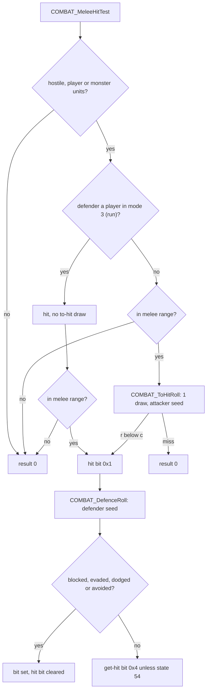
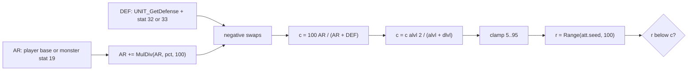
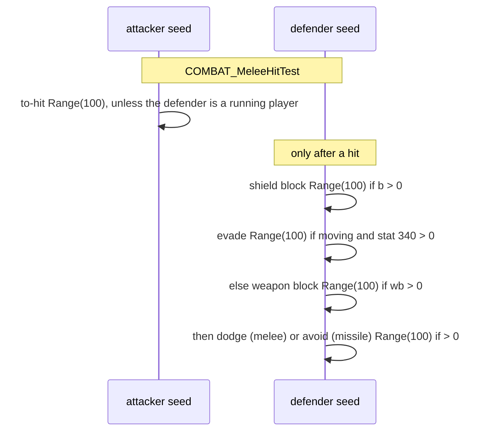

## Purpose

At the hit frame of a melee attack the server decides whether the attack connects: a range check, the chance to
hit with one draw on the **attacker's** seed, then the defender's block and avoidance rolls on the **defender's**
seed. The result is the packet's result word, which decides whether the damage build of a monster runs and whether
any damage is applied. Missiles reuse the chance to hit
and the defence roll with their own flags. The event that contains this test, its seeds and its chaining are in
[combat/overview](../overview/). Primitives (`Step`, `Range`) are those of rng; `RangeB` in our
symbol names is the second compile of `Range` and behaves the same.



## Entry points

| When | Function | Tag |
|---|---|---|
| A player's normal attack or a skill's melee hit, a monster's plain attack, at the hit frame | `COMBAT_MeleeHitTest` | [C] (the logged returns into `SKILL_AttackDo` 6 901, `MON_MeleeHit` 20 053 and four skill functions 1 303) |
| The chance to hit and its draw | `COMBAT_ToHitRoll` | [C] |
| The defender's block, then evade, weapon block, dodge or avoid | `COMBAT_DefenceRoll` → `COMBAT_AvoidRoll` | [C] for the block; [C] for evade, weapon block, dodge and avoid on a player defender |
| A missile reaching a unit (phase (3); the to-hit and defence calls only) | `MISSILE_HitUnit`, `MISSILE_ApplyDamage` | [C] `ToHitRoll`'s three call sites are `MeleeHitTest`, `MISSILE_HitUnit` and an unreferenced function; `DefenceRoll`'s are `MeleeHitTest`, `MISSILE_ApplyDamage` and the area hit |

## Inputs

### Tables

| Anchor | Used for |
|---|---|
| `CharStats.txt:ToHitFactor` | added to a player's attack rating (A2) |
| `CharStats.txt:BlockFactor` | added to a player's block (C2) |
| `MonStats.txt:NoShldBlock` | a monster may block without a shield (C2) |
| `MonStats.txt:MonType` | the stat-179 attack-rating bonus by monster type (A2) |
| `Skills.txt:ToHit`, `LevToHit`, `ToHitCalc` | a skill's attack-rating percent through `SKILLS_GetToHit` |

### Runtime state

| State | Type | Source |
|---|---|---|
| attacker and defender units | `Unit`, type 0 player, 1 monster, 3 missile | the attack event |
| attacker seed, defender seed | `Seed` at `Unit+0x20` | rng/seeds |
| `arPct` | i32, the caller's attack-rating percent | 0 for a monster's melee test, the missile's stat 19 for its line missile [I]; stat 325 for the player's normal attack, `SKILLS_GetToHit` for a skill |
| unit stats | i32 values of the unit's stat lists | value inputs; see the stat ids below |
| unit mode | the unit's animation mode | 2 walk, 3 run, 6 (player); 2, 15 (monster) |
| game type | `Game+0x70`, 0 classic, else expansion | game creation |

Stat ids read here: 0 strength is not read; 2 dexterity, 12 level, 16 and 171 defence percents, 19 attack rating, 20 block, 31 defence, 32 and 33 defence against missiles and melee, 115, 116, 119, 123, 124, 179, 182, 338 dodge, 339 avoid, 340 evade, 348 weapon block, and 350 and 351 from state 101's own stat list (the Holy Shield term of B1); 325 is read by the caller (`SKILL_AttackDo`) and passed as `arPct`. [C] Every stat-reader site in the ten functions resolved with a second tool

### Constants

| Name | Value | Tag |
| --- | --- | --- |
| to-hit clamp | 5 .. 95 | [C] |
| block cap | 75 | [C] |
| moving-player block divisor | 3 | [C] (48 events, all on a running player, mode 3) |
| attacker-monster range bonus | 2 | [I] |

## Algorithm

### A. The chance to hit (`COMBAT_ToHitRoll`)



```
A1. ToHitRoll(att, def, arPct: i32, isMissile: bool) → bool:          [C] (COMBAT_ToHitRoll, all of A1–A6)
      dlvl: i32 ← stat(def, 12);  alvl: i32 ← stat(att, 12)
      DEF: i32 ← Defense(def) + stat(def, isMissile ? 32 : 33)        ; § B
A2.   if att is a player:
        AR: i32 ← (stat(att, 2) − 7) × 5 + stat(att, 19) + CharStats[att.class].ToHitFactor
        TargetMods(att, def, AR, DEF)                                 ; § A7, [C]
        pct: i32 ← (not isMissile and att holds a weapon) ? masteryToHit(att, weapon) : 0
        pct ← pct + stat(att, 119) + arPct
        if def is a monster and MonStats[def.class].MonType > 0:
          for each (type, v) in att's stat-179 entries: if def's MonType matches type: pct ← pct + v
      else:
        AR ← stat(att, 19) + arPct + 5 × stat(att, 2)
        pct ← stat(att, 119)
A3.   AR ← AR + MulDiv(AR, pct, 100)
A4.   if DEF < 0: AR ← AR − DEF;  DEF ← 0
      if AR < 0:  DEF ← DEF − AR;  AR ← 0
      if DEF < 0: DEF ← 0
A5.   c: i32 ← (AR + DEF ≠ 0) ? (100 × AR) ÷ (AR + DEF) : 100
      c ← (c × alvl × 2) ÷ (alvl + dlvl)
      c ← (c ≤ 5) ? 5 : ((c ≥ 95) ? 95 : c)
A6.   r: u32 ← Range(att.seed, 100)                                   ; draw#1 (attacker), inlined LCG, low mod 100
      if r < c: PreventHealHook(att, def); return true
      return false
```

Step notes:

- A1–A6. Every division is signed 32-bit and truncates toward zero. `MulDiv(a, b, c)` is the overflow-guarded multiply-divide of
  [monsters/stats § A](../../spec-monsters/stats/#a-muldiv-and-monlvlstats). The percent `100·AR/(AR+DEF)` is truncated
  **before** the level factor, which is then one multiply and one divide. [C] (7 669 rolls in 7 822 melee events)
- A2. **`ToHitFactor` is an attack-rating term**, added before the percent; the level term uses plain stat 12 on both
  sides and has no class constant. Logged for the Sorceress (−15, 1 889 attacks) and the Barbarian (+20, 85). This
  contradicts, which calls the class constants a level bonus; keep the code's
  form. [C]
- A2. The player's percent `pct` (the weapon mastery's to-hit, stat 119, the caller's `arPct`, the stat-179 entries)
  was a logged value oracle in the run, so its composition is [I]; the formula from `pct` on is [C].

- A2. The monster's attack rating `stat 19 + arPct + 5·dex` with `pct` = stat 119 is [C]; a monster's stat 19 at
  that moment is the value `MonAttackStats` wrote at its mode change.
  [C]
- A2. **A monster's line missile counts stat 19 twice.** `SkillMissileCreate` sets flag `0x1000` with the owner's stat 19
  for a monster owner, which becomes the missile's stat 19;
  `MISSILE_HitUnit` passes that as `arPct` when the missile's record byte `+0x18B` is set, and without it there is no
  to-hit roll (§ C4); the monster formula above adds `arPct` to stat 19. So the factor is 2 on stat 19 only: the dexterity
  term is not doubled, the two stat 19s are read at the creation and at the hit, and `SkillMissileCreateLob` sets no
  flag. [I]
- A6. The draw is the inlined LCG on `att.seed` with the unsigned `low mod 100`, the same value as `Range(att.seed,
  100)`. Before the test the binary passes `c` and `r` to an empty debug stub. [C]
- A6. `PreventHealHook` tests for a player attacker (`*unit = 0`), so stat 117 on a mercenary's items applies no state:
  emulated with hireling and other attackers, it reaches `STATE_ApplyTimed` only for a type-0 attacker. [C]
  (row 27)
- A6. On a hit, `PreventHealHook` runs inside `COMBAT_ToHitRoll`'s success branch, after the draw: for a player
  attacker with stat 117 ≠ 0 and a monster defender whose class is outside 704–709 (a signed test), it applies state 52
  (`STATE_ApplyTimed`, its record the nine words attacker, defender, 0, 1, 120 000, 31, 0, 52, 0: 120 000 frames,
  stat 31 = 0, state 52). [C] (509 state-52 lines of length 120 000, stat 31, value 0, from a player attacker: the class bounds and the record emulated) **It draws nothing**, so the state
  is applied between the to-hit draw and the defence rolls: 271 state-52 lines of the attacker between the two, each
  with both seeds asserted after it and no step between, beside the code reading of the hook (no RNG call). [C]


**A7. Target modifiers (players only).**

```
A7. TargetMods(att, def, AR, DEF):                                    [C] (COMBAT_ToHitTargetMods, all of A7)
      if stat(att, 115) ≠ 0 and def is a monster, not boss, unique, superunique (type flags 0x0A) nor a hireling:
        DEF ← 0
      p: i32 ← stat(att, 116)
      if p > 0:
        if def is a player, or a monster that is a boss, a superunique (type flag 0x02) or a hireling: p ← p ÷ 2   ; signed
        p ← clamp(p, 0, 100);  DEF ← DEF − MulDiv(DEF, p, 100)
      if def is a demon:  AR ← AR + stat(att, 123)
      if def is undead:   AR ← AR + stat(att, 124)
```

- A7. Stat 115 is "ignore target defence", 116 the fractional target-defence reduction, 123 and 124 the
  attack-rating bonuses against demons and undead. No logged unit carried them; `COMBAT_ToHitTargetMods` emulated
  with them reproduces A7 as a map of the defender's type, the type-flag masks `0x0A` and `0x02`, `MONSTATS_IsBoss`,
  the hireling type, `IsDemon` and `IsUndead`, every test separated. The stat-116 block runs only for a positive
  stat, so the clamp's lower bound acts only on a halved 1; a defender of type 2 to 5 is neither zeroed nor halved.
  [C]
  Which monsters carry MonsterData `+0x16` bits `0x2` and `0x8`, read here as superunique and unique, is that
  field's own reading. [I]

**A8. Other attack-rating computations.** Two other functions compute an attack rating; neither is on an attack
path: `AttackRatingCalc`'s one call is in `SHRINE_StatValue` (the timed shrines' stat value), and
`ClientAttackRating` has no call, only a pointer in a `.rdata` table read by client code. A
reimplementation uses A2–A3. [C]
The shrine's formula adds `ToHitFactor` a second time; the client's uses plain `÷ 100` instead of `MulDiv`. [I]


### B. Defence (`UNIT_GetDefense`)

```
B1. Defense(u) → i32:                                                 [C] (UNIT_GetDefense, all of B1 except as tagged)
      d: i32 ← stat(u, 31) + stat(u, 2) ÷ 4                          ; signed ÷ 4
      p: i32 ← stat(u, 171) + stat(u, 16)
      if HolyShieldOn(u): p ← p + SKILLS_EvalCalc(u, rec.+0x138, s350, s351)   ; [I] the calc's value and its addition
      if d ≥ 1: d ← d + (d × p) ÷ 100                                ; 32-bit product, signed, toward zero
      else:     d ← d − (d × p) ÷ 100                                ; d ≤ 0: the percent moves d toward 0
      if stat(u, 182) ≠ 0: d ← d + MulDiv(d, stat(u, 182), 100)

    HolyShieldOn(u) → bool:
      true when HasState(u, 101), state 101's own stat list exists with base stats s350 = stat 350 and s351 = stat 351
      both > 0, rec ← SKILLS_GetRecord(s350) exists, and InvItemQuery finds a usable shield (C2's test)
```

- B1. The base term `stat 31 + dex ÷ 4` plus stat 33 reproduced the defence of the player defenders (every monster
  attack on the player) and of the monster defenders in the run. [C] The percent terms were zero for every logged unit; emulated, stats 171, 16 and 182 non-zero
  (2 515 cases) and the Holy Shield gate up to the `SKILLS_EvalCalc` call (137 cases at it) reproduce B1, and the
  `d ≤ 0` branch separates from the `d ≥ 1` formula in 648 cases. [C]
  The calc's value and its addition to `p` are after that boundary: the marked line.

### C. The hit test and the defence rolls



```
C1. MeleeHitTest(att, def, arPct: i32, rangeExtra: i32) → result: u16:            [C] (COMBAT_MeleeHitTest, all of C1 except as tagged)
      if att and def are not hostile, or either is not a player or a monster: return 0
      auto: bool ← def is a player and def.mode = 3                                ; running; [C] (47)
      reach ← (att is a monster ? 2 : 0) + 1 − (rangeExtra ≠ 0 ? weaponRange(att) + rangeExtra : 0)    ; [I] the hostility, reach and range tests, the line above, this and the next
      if not InMeleeRange(att, def, reach): return 0
      res: u16 ← auto ? 0x1 : (ToHitRoll(att, def, arPct, false) ? 0x1 : 0)       ; § A
      if res & 0x1:
        d ← DefenceRoll(def, isMissile: false, useBlock: true)                    ; § C2
        if d & 0x02: res |= 0x0100        ; avoided
        if d & 0x04: res |= 0x0080        ; dodged
        if d & 0x10: res |= 0x8000        ; weapon block
        if d & 0x01: res |= 0x0010        ; blocked
        if d ≠ 0: res &= ~0x1
      if res & 0x10: res &= ~0x1
      if (res & 0x1) and not HasState(def, 54): res |= 0x4                         ; get-hit
      return res
```

- C1. **A running player is hit without a to-hit roll**, and no draw happens on the attacker's seed; the block and
  avoidance rolls still run. Reproduced with 0 mismatches in 47 melee events on a player in mode 3: every one that
  reached a defence line had no to-hit draw logged, and none had one. [C]

- C1. The to-hit, the defence order and the result word reproduced over 27 441 to-hit events with 0 mismatches. [C]

- C1. The result bits are: `0x1` hit, `0x2` killed, `0x4` get-hit, `0x8` knockback, `0x10` blocked, `0x80` dodged,
  `0x100` avoided, `0x200` evaded (a missile whose row has `GetHit` or `KnockBack`, below), `0x2000` doubled by a critical or deadly strike, `0x4000` a missile's
  soft hit (below), `0x8000` weapon block. [C] for the bits delivered packets carry: melee `0x1`, `0x3`, `0x5`, `0x7`, `0x9`, `0xB`, `0xD`, `0xF`, `0x2005`, `0x2007`;
  missile `0x1`, `0x5`, `0xD` and `0x4001` (537 deliveries).
  [I] for `0x10`, `0x80`, `0x100`, `0x200` and `0x8000`: a blocked, dodged, avoided, evaded or weapon-blocked hit
  delivers nothing, so no logged packet carries them.
- C1. **`0x4000`, the soft hit.** Three writers on the missile path set it in the result word:
  1. Missile damage function 3 sets it after one step of the missile's seed, when `low & 0x7F` is below the row's
     `dParam1`. [C]

  2. `MISSILE_ApplyDamage`, on a hit (after it sets `0x1`), unless the defender is in state 54: the row's `GetHit`
     bit ORs `0x4`, else its `SoftHit` bit ORs `0x4000`; `GetHit` wins over `SoftHit`. The same state-54 test skips
     the knockback roll. [I]
  3. `MISSILE_ApplyDamage`, after `COMBAT_DefenceRoll`: when the roll's result has any of bits `0x1F` and the row has
     neither `GetHit` nor a non-zero `KnockBack`, `result ← (result & ~0x1) | 0x4000` and the roll's bits `0x1F` are
     cleared, so none of `0x10`, `0x100` or `0x200` is set. With bit `0x1` clear `COMBAT_ApplyDamage` is skipped;
     `COMBAT_GetHit` is still called. [I]
- C1. **The 537 logged `0x4001` deliveries** are 491 of row 457 (`firestorm`, `SoftHit` set, `GetHit` clear,
  `KnockBack` 0), all 491 of that row's deliveries, and 46 of row 240 (`meteorfire`, damage function 3), whose other
  211 deliveries carry `0x0001`; no other row's delivery carries `0x4000`. [C] for the counts and the row split. [I] that the 46 come from writer 1's roll: no other writer fits the row, but the roll is not
  reproduced per event; and writer 3 cannot give `0x4001`, since it clears `0x1`. Row 389, the only other `SoftHit`
  row, was not met.
- C1. The melee hit test turns an evade (defence result `0x08`) into "not hit" without a bit of its own. The missile
  caller sets `0x200` for an evade only when the row has `GetHit` or a non-zero `KnockBack`; for any other row an
  evade, avoid or block gives `0x4000` (writer 3). [I]
- C1. The range test is `InMeleeRange` with the reach above; state 54 is `uninterruptable`. [C]


**C2. Shield block.**

```
C2. DefenceRoll(def, isMissile: bool, useBlock: bool) → u32:                     [C] (COMBAT_DefenceRoll, all of C2)
      if useBlock:
        b: i32 ← BlockChance(def, game.expansion)
        if b ≥ 1:                                                                 ; tested once, before the divide
          if def is a player and IsMoving(def) and def.mode ≠ 2: b ← b ÷ 3          ; moving, not walking; mode 3 (48); the mode-2 exception and the order
          r ← Range(def.seed, 100)                                                ; draw (defender), also when b ÷ 3 = 0
          if r < b: return 0x01                                                   ; blocked
      return AvoidRoll(def, isMissile)                                            ; § C3

    BlockChance(u, expansion) → i32:                                              [C]
      if u is a player:
        if neither hand holds a usable shield: return 0                         ; the shield test, below: [C]
        b: i32 ← stat(u, 20) + CharStats[u.class].BlockFactor
        if expansion: b ← ((stat(u, 2) − 15) × b) ÷ (2 × max(stat(u, 12), 1))
      else:
        b ← (MonStats[u.class].NoShldBlock or u holds a shield) ? stat(u, 20) : 0
      return min(b, 75)
```

- C2. The checker sees no hand's item, so the shield test stays a value oracle, and names
  the logs whose player holds no usable shield (`--no-shield-log`). The flag only sets the predicted chance to 0: a
  logged chance above 0 still fails, and a block roll the game made would break the seed chain. Without it the run
  list gives 88 mismatches, all a player block chance of 0 against the formula: 70 on the claw Assassins, whose
  recipes hold no shield, and 18 on `CombatDR`, whose 0 is taken from the logs, so those 18 check nothing about the
  refusal above. [C]
- C2. **The dexterity form applies only in an expansion game**; classic uses `stat 20 + BlockFactor`. The divisor is
  `2·level` with level 0 and 1 both counting as 1. [C]
- C2. The draw is inlined on `def.seed`, `low mod 100`, and reported to `DEBUG_DefenceRollStub` before the test. [C]


**C3. Evade, weapon block, dodge, avoid.**

```
C3. AvoidRoll(def, isMissile: bool) → u32:                                       [C] for a player defender (COMBAT_AvoidRoll, all of C3 except as tagged)
      moving ← (def is a player and def.mode ∈ {2, 3}) or (def is not a player and def.mode ∈ {2, 15})   ; [C] for every type
      if moving:
        e: i32 ← stat(def, 340)
        if e > 0:
          r ← Range(def.seed, 100)                                                ; draw (defender)
          if r < e: return 0x08                                                   ; evaded
        return 0
      wb: i32 ← WeaponBlockChance(def)                                            ; stat 348 by the held weapon's item type
      if wb > 0 and CurrentSkillCheck(def) = 13:                                   ; [I] what 13 stands for
        if Range(def.seed, 100) < wb: return 0x10                                 ; draw (defender); weapon block
      ch: i32 ← isMissile ? stat(def, 339) : stat(def, 338)                       ; avoid : dodge
      if ch > 0:
        if Range(def.seed, 100) < ch: return isMissile ? 0x02 : 0x04              ; draw (defender)
      return 0
```

- C3. Each draw happens only when its chance is above 0, so a defender without these stats draws nothing here. That
  held for every logged event (the defence rolls were asserted by the defender's exit seed). [C]
- C3. **The four rolls reproduced on player defenders**, each a `Range(100)` on the defender's seed with success when
  `r < chance`: evade 46 rolls (31 successes), weapon block 50 (30), dodge 172 (109), avoid 103 (68), every roll's
  value and exit seed asserted. The weapon block chance was a value oracle. [C]
- C3. **The weapon-block skill check** gave 13 in every logged check of the two-claw `CombatAss`, which
  rolled weapon block 50 times, and 12 in the one check of the one-claw `CombatAssO`, which rolled none. So 13 goes
  with two claws in the hands; what the value stands for is not read. [I]

**C4. Missiles.** When the missile's record byte `+0x18B` is set, `MISSILE_HitUnit` calls `ToHitRoll(missile's
stat 19 as arPct, isMissile = true)`, which reads stat 32 and skips the weapon mastery. [I]
`MISSILE_ApplyDamage` calls `DefenceRoll(def, isMissile = true, useBlock = (physical ≠ 0))`, so a missile without
physical damage cannot be blocked: 10 387 missile events with physical 0 drew no block, 6 838 of them in the 30 logs
whose player blocked other missiles, and 2 503 block draws came with physical above 0. The missile path itself
belongs to phase (3). [C]
The defence draws of 1 957 missiles on the player or the mercenary reproduced. [C]

## Outputs

- The result word of the hit test (C1), carried in the packet at `+0x04`: a hit with or without get-hit, or one of
  blocked, dodged, avoided, evaded, weapon block, or 0; a missile's word can also carry `0x4000`, the soft hit (C1). [C] for the
  delivered words (C1's list); [I] for the blocked, dodged, avoided, evaded and weapon-block words, which deliver nothing

- The attacker's seed advanced by 0 or 1 draw, the defender's by 0 to 3 draws (block, then evade, or weapon block
  and dodge or avoid): in the kept logs the defender drew 0 (29 243 events), 1 (12 000) or 2 (61) times, and three
  draws (block, weapon block, dodge or avoid) are emulated for a player defender, every seed compared in 5 cases. [C]

  The draws on each seed
  that the two runs' characters allowed reproduced: the block, and each of evade, weapon block, dodge and avoid. [C]


## Worked example

**Monster attacks blocked by the player, one per difficulty**. The defenders are the
tool-built `CombatSolo` Sorceress (dexterity 420, level 85 or 86, stat 20 = 33, `BlockFactor` 20), the `CombatBar`
Barbarian (dexterity 420, level 86, `BlockFactor` 25) and the classic `CombatCls` Sorceress (level 85). Seeds are
`low:high` hex. [C]

| | Normal | Nightmare | Hell | classic Hell |
|---|---|---|---|---|
| session, frame | `bar-n-plains` 1306 | `solo-nm-p8` 448 | `solo-h-p3` 421 | `cls-h-plains` 419 |
| attacker (MonStats) | `fallen1`, level 1 | `corruptrogue1`, level 39 | `corruptrogue1`, level 68 | `fallen1`, level 54 |
| defender | Barbarian, **running** (mode 3) | Sorceress, mode 1 | Sorceress, mode 1 | Sorceress, mode 1 |
| AR, DEF | — (no roll) | 1479, 923 | 4038, 923 | 1263, 507 |
| `100·AR/(AR+DEF)` → `c` | — | 61 → `61·39·2/125` = 38 | 81 → `81·68·2/153` = 72 | 71 → `71·54·2/139` = 55 |
| attacker seed in → out | `aa2e63ff:678278de` unchanged | `31afbfe2:46bd8511` → `5bb74dfb:14b94f7b`, r = 7 | `eeeb6c86:43643019` → `f73e1337:63a6cc21`, r = 3 | `381d8151:0792795e` → `5daa8cb3:1767be19`, r = 27 |
| block chance `b` | `405·58/172` = 136 → 75 → `÷ 3` = 25 | `405·53/172` = 124 → 75 | `405·53/170` = 126 → 75 | classic: `33 + 20` = 53 |
| defender seed in → out | `d651eafd:4f86aa3d` → `d26cceee:596427db`, r = 22 | `14225c5d:18b8278b` → `dd0b8b1c:0865d834`, r = 44 | `ddecc595:116686fc` → `8afc62a5:5c902c70`, r = 33 | `c78b7d83:4aadff39` → `a0f14508:533a88b3`, r = 8 |
| result | blocked (`0x10`) | blocked | blocked | blocked |

DEF is `818 + 420 ÷ 4` = 923 for the expansion Sorceress and `407 + 400 ÷ 4` = 507 for the classic one. A monster
attack that is blocked runs no damage build, so the attacker's seed ends where the to-hit roll left it. The Normal
case shows the running defender: no to-hit draw, and a third of the capped block. [C]

## Reimplementation notes

- **`ToHitFactor` is not a level bonus.** Add it to the attack rating (A2); 1.14d has no class term in `2·alvl/(alvl
  + dlvl)`. [C]
- **Truncate the percent first.** `c = 100·AR/(AR+DEF)` is an integer before the level factor; computing
  `100·AR·2·alvl / ((AR+DEF)·(alvl+dlvl))` in one step gives different values. [C]
- **The clamp uses `≤ 5` and `≥ 95`**, so a hit is never certain and never impossible for a rolled attack. [C]

- **The block draw is on the defender's seed**, the to-hit draw on the attacker's: a reimplementation that keeps one
  combat RNG gets every later draw wrong. [C]
- **No difficulty branch** exists in the chance to hit or in the block chance; only the classic/expansion block form
  differs: per difficulty 12 019, 5 547 and 9 875 to-hit rolls and 2 204, 1 678 and 7 869 block rolls, under models
  with no difficulty term. [C]
- **Defence comes before the block.** A miss draws no block; a running defender skips the to-hit draw but still draws
  the block: 12 161 misses with no defence draw after them, 135 running-player defences with a block roll and no
  to-hit roll. [C]

## Evidence

- §§ 3 (to-hit, defence, target modifiers, 3.4 `ToHitFactor`),
  4 (hit test and defence rolls), 13 (*Leads used*: the `ToHitFactor` contradiction, the block formula held with
  refinement), 14 (the debug stubs), 15 (the confirmed raises), 16 (the shortfalls run: the four avoidance rolls,
  prevent-heal's no draw, the walking block, the shield test, `--no-shield-log`).
- Tables: CharStats, MonStats,
  ItemStatCost, Skills.
- Upstream: rng, [player/creation](../../spec-player/creation/) (the class's base attributes),
  [monsters/stats § H](../../spec-monsters/stats/#h-to-hit-and-damage-at-attack-time-reference-only) (a monster's stat 19 at
  attack time), [data/calc § G](../../spec-data/calc/#g-variables) (`SKILLS_GetToHit`).
