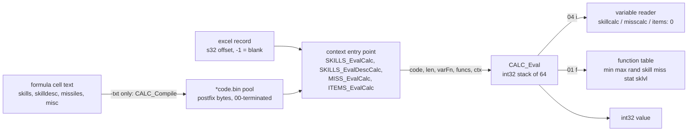
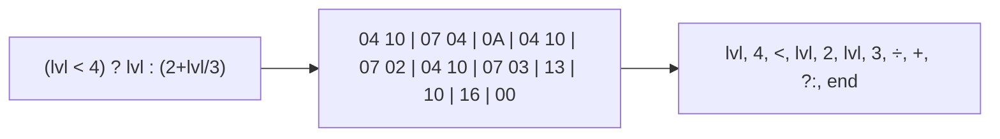
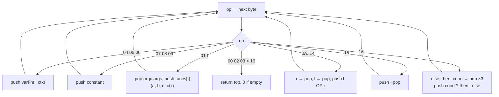
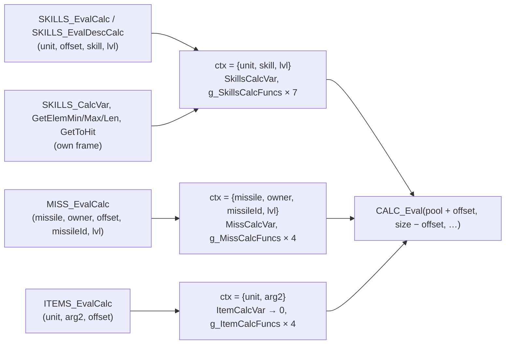

## Purpose

Some excel cells hold a formula rather than a number: a skill's damage or duration, a number in a skill
description, a missile's damage synergy, a potion's duration and strength. In the shipped data each formula is
already compiled into postfix bytecode, stored in one of four header-less pools (`itemscode.bin`, `misscode.bin`,
`skillscode.bin`, `skilldesccode.bin`), and the record holds an s32 offset into the pool, −1 when the cell is
blank. When the game needs the value, it runs a small stack machine over those bytes with a *context* (a unit, a
skill, a level), a *variable reader* and a *function table*. This spec gives the encoding, the evaluator, the three
contexts with their function tables and variables, and the compiler that writes the bytes under `-txt`. The
evaluator draws random numbers only through the `rand` function, which no stock formula reached in play.

What the formulas compute in combat (a skill's damage, a missile's synergy) is out of scope; this spec
is the machine that the in-scope consumers call.



## Entry points

| When | Function | Tag |
|---|---|---|
| `-txt` only: a formula cell of skills, skilldesc, missiles, or weapons/armor/misc is compiled | `SkillsCalcCell`, `SkillDescCalcCell`, `MissCalcCell`, `ItemCalcCell` → `CALC_Compile` | [C] |
| A skill formula (`skillscode`) is needed | `SKILLS_EvalCalc` (76 call sites seen) | [C] |
| A skill description number (`skilldesccode`) is shown | — | [C] |
| A skill's formula-valued variable, elemental synergy or to-hit formula is read | `CALC_Eval` called directly from `SKILLS_CalcVar`, `SKILLS_GetElemMin` / `SKILLS_GetElemMax` / `SKILLS_GetElemLen`, `SKILLS_GetToHit` | [C] |
| A missile formula (`misscode`) is needed | — | [C] |
| A stamina, antidote or thawing potion is drunk (`itemscode`) | `ITEMS_EvalCalc`, from `ItemUseTimedState` (its `len`, `calc1`, `calc2`), the `use` function of entry 9 of `g_ItemUseFns`, which entry 6's `use` also calls (§ E for how an item use reaches it) | [C] |

## Inputs

### Tables

| Anchor | Used for |
|---|---|
| `Skills.txt:calc1` and the other 35 formula columns of Skills.md | offsets into `skillscode` |
| skilldesc `ddam calc1/2`, `p1..3dmmin`, `p1..3dmmax`, `desccalca/b1..6`, `dsc2calca/b1..4`, `dsc3calca/b1..7` (no table doc) | offsets into `skilldesccode` |
| missiles `SrvCalc1`, `CltCalc1`, `SHitCalc1`, `CHitCalc1`, `DmgCalc1`, `DmgSymPerCalc`, `EDmgSymPerCalc` (no table doc) | offsets into `misscode` |
| `Misc.txt:len`, `Misc.txt:calc1`, `calc2`, `calc3`, `spelldesccalc` (the same columns, absent, in weapons and armor) | offsets into `itemscode` |
| `SkillCalc.txt:code` | variable names of skill and skilldesc formulas: row index = variable operand |
| `MissCalc.txt:code` | variable names of missile formulas: row index = variable operand |
| `Skills.txt:Param1` … `Param8`, `ToHit`, `LevToHit`, `ToHitCalc`, `mana`, `lvlmana`, `manashift`, `calc1..4`, `auralencalc` | read by the row-only and formula-valued skill variables (§ G) |
| the pools `itemscode.bin`, `misscode.bin`, `skillscode.bin`, `skilldesccode.bin` | the bytecode |

### Runtime state

| State | Type | Source |
|---|---|---|
| pool buffer and size | bytes, u32 | `DataTables+0x40` skillscode, `+0x4C` skilldesccode, `+0x60` misscode, `+0x98` itemscode (size after each) |
| skills context | `{unit, skill: i32, lvl: i32}` | built by the skills entry points |
| missile context | `{missile, owner, missileId: i32, lvl: i32}` | built by `MISS_EvalCalc` |
| item context | `{unit, arg2}` | built by `ITEMS_EvalCalc`; `arg2` not read |
| unit seed | Seed | `Unit+0x20`, used only by `rand` |

**Inputs that are unit state (value oracles).** The following values read the unit and are inputs to this spec, not derived by it. A reimplementation supplies them from its own skills and stats code; the run took them from the log (value oracles, no seed crosses them).

- [C] Functions: `skill(s, v)` (skills and missiles contexts), `miss(m, v)`, `stat(id, k)`, and `sklvl(s, v, w)`
  when `v` or `w` is a unit-reading variable.
- [C] Variables (21 `skillcalc` codes): `edmn edmx edln edns edxs enma exma enms exms m1en m1ex m2en m2ex m3en m3ex
  m1eo m1ey ulvl math madm macr`.

The run confirms only that these are inputs, consumed by the evaluator in code order; what each one computes is
stated in § F and § G, with its own tag, for orientation only.

### Constants

| Name | Value | Tag |
| --- | --- | --- |
| `STACK_SLOTS` | 64 int32 slots | [C] |
| `COMPILE_BUF` | 1 024 bytes per compiled cell | [C] |
| `MAX_OPERATORS` | 64 on the compiler's operator stack | [C] |
| `PREC[00..16]` | `17 01 02 03 09 09 09 09 09 09 0F 0F 0F 0F 0F 0F 11 11 13 13 14 15 16` | [C] |
| skills function table | 7 entries `{fn, argc}` | [C] |
| missiles function table | 4 entries | [C] |
| items function table | 4 entries | [C] |

The two smaller tables rest on the run's logs and the image: every missile (item) evaluation passed the table above with count 4, and the count dwords and the four `{fn, argc}` entries in the image agree. The two limits rest on emulation: 65 pushes leave 64 values (the 65th is dropped), and 64 nested `(` or `min(` compile where 65 fail.

## Algorithm

### A. Pools and formula columns

- [C] A formula column holds an s32 offset into its family's pool, or −1 when the cell is blank, the column is absent
  from the `.txt`, or the compile failed. The pool is the compiled cells' bytes appended in record order (weapons, then
  armor, then misc for `itemscode`), within a record in `.txt` column order, with no sharing: two equal texts are
  stored twice.
- [C] Within a record the cells present in the `.txt` are compiled in `.txt` column order, then the descriptor
  entries the `.txt` lacks, in descriptor order (they store −1). Stock data cannot tell the two orders apart; an
  edited `skills.txt` with `perdelay`, `skpoints` and `delay` all filled can. The emulation ran `EXCEL_ParseTxt` on
  618 synthetic rows with five calc columns (on the item calc cell callback) kept or dropped and shuffled per row: the
  pool holds each row's compiled cells in header order (a failed compile stores −1 and appends nothing), then the
  absent calc entries store −1, after the cells and in descriptor order; both other orders fail as negative controls.

- [C] Stock pool sizes: `misscode` 196, `skillscode` 5 891, `skilldesccode` 4 252, `itemscode` 158 bytes; 1 790
  compiled cells over 30 217 formula fields.
- [C] A run-time entry point evaluates only when `offset < size` (unsigned compare), so −1 yields 0 without calling the
  evaluator. Under emulation the four entry points returned 0 without evaluating for 722 offsets at or past the pool's
  size (−1, 0x80000000, `size`, `size + 1`, random) and evaluated the other 708 at `pool + offset` with length
  `size − offset`.

### B. The encoding



Postfix: the operands of an operator are pushed before it. One opcode byte, then a fixed operand.

| Byte | Operand | Meaning | Tag |
|---|---|---|---|
| `00` | — | end: the value is the top of the stack | [C] |
| `01` | u8 *f* | call function *f* of the context's table on the values pushed before it | [C] |
| `02` | — | an unclosed `(` flushed by the compiler; ends evaluation like `00` | [C] |
| `03` | — | ends evaluation like `00` (no compiler path emits it) | [C] |
| `04` | u8 *i* | push variable *i* (index read unsigned) | [C] |
| `05` | s16 *i* | push variable *i* | [C] |
| `06` | s32 *i* | push variable *i* | [C] |
| `07` | s8 | push constant | [C] |
| `08` | s16 | push constant | [C] |
| `09` | s32 | push constant | [C] |
| `0A` | — | `<` | [C] |
| `0B` | — | `>` | [C] |
| `0C` `0D` `0E` `0F` | — | `<=` `>=` `==` `!=` | [C] |
| `10` `11` `12` `13` | — | `+`, binary `−`, `×`, `÷` | [C] |
| `14` | — | `^` (power) | [C] |
| `15` | — | unary `−` | [C] |
| `16` | — | `?:` | [C] |
| > `16` | — | ends evaluation like `00` | [C] |

Multi-byte operands are little-endian. Tags: the bytes in stock pools are `[C]` by recompiling every stock cell byte for byte and by the run executing every one of them; the others by emulation, where every byte 0x00–0xFF ran alone between two pushes and each listed one in random programs, against.

- [C] Constants and variable indices take the narrowest form: −128..127 → `07`/`04` + 1 byte, −32 768..32 767 →
  `08`/`05` + 2 bytes, else `09`/`06` + 4 bytes. Stock data uses `07`, `08` and `04` only.
- [C] The opcodes present in the stock pools are exactly `00 01 02 04 07 08 0A 0B 10 11 12 13 15 16`; the item pool
  holds only constants (`00 07 08`).

### C. The compiler (`-txt` only)

A stock run never compiles: the pools ship compiled. A reimplementation that reads `.txt` sources must reproduce
this compiler to get the same bytes, and the same −1 where the game rejects a cell.

**C1. Tokens.** `CALC_NextToken` returns one token per call; a token the tokenizer cannot read ends the stream and
whatever follows is ignored.

- [C] Spaces and `"` characters are skipped (a spreadsheet-quoted `"min(24,ln12)"` reads as `min(24,ln12)`).
- [C] A digit starts an unsigned decimal number, accumulated as `value ← value × 10 + digit` in int32 with no overflow
  check.
- [C] A letter starts a name of letters and digits (`_` ends it). If the next non-space character is `(` and the
  context knows the name as a function, the token is a function call and the `(` is consumed; otherwise the name
  goes to the identifier callback (C2).
- [C] `'text'` takes everything up to the next `'` (at most 255 characters) and goes to the identifier callback;
  `.name` does too and always yields a constant (a negative callback result ends the stream).
- [C] Operators: `( ) , + - * / ? : ^ <= < > >= == !=`. A lone `!` or `=`, NUL and any other character end the
  stream.

**C2. Names, per context.** The identifier callback returns an index and a flag (1 = constant, 0 = variable); it knows
which function call, if any, encloses the name.

- [C] Function names, case-insensitive: skills and skilldesc `min`=0 `max`=1 `rand`=2 `skill`=3 `miss`=4 `stat`=5
  `sklvl`=6 (arity 3 for `sklvl`, else 2); missiles `min max rand skill miss` = 0–4 (arity 2); items `min max rand
  stat` = 0–3 (arity 2).
- [C] Skills and skilldesc identifiers: inside `skill(` or `sklvl(` a skill name becomes its skills row (constant),
  else the `skillcalc` code of the name's first four characters (space-padded) becomes that row (constant); inside
  `miss(` the same against missiles and `misscalc`; inside `stat(` an itemstatcost `Stat` name becomes its row, else
  `base` → 1, `mod` → 2, anything else → 0 (constants); elsewhere the `skillcalc` row, **as a variable**. Name
  lookups are case-insensitive and take the first matching row. (`SkillsCalcIdent`)
- [C] Missile identifiers: inside `skill(` a skill name (constant), else the `skillcalc` code; inside `miss(` a missile
  name, else the `misscalc` code; elsewhere the `misscalc` row as a variable. (`MissCalcIdent`)
- [C] Item identifiers: inside `stat(` as for skills; elsewhere variable 0. An unknown identifier anywhere compiles
  to the constant 0. (`ItemCalcIdent`)

**C3. Operator precedence.**

```
Compile(text, ctx) → bytes or FAIL:                                     [C]
  ops: stack of (op: u8, arg: i32)  ; at most 64 entries
  depth: i32 ← 0                    ; values the emitted code would leave on the stack
  operand: bool ← false             ; last token was a number, variable or function name
  hasVar: bool ← false
  for each token:
    "("      : push (2, 0)
    ")"      : if ops is empty: FAIL
               loop:
                 if top.op = 2: break
                 n ← Arity(top); if depth < n: FAIL
                 emit top.op; depth ← depth + 1 − n
                 if top.op = 1: emit (u8) top.arg; break      ; a call closes at its ")"
                 pop; if ops is empty: FAIL
               pop                                            ; the "(" marker or the call
    ","      : Flush(3)                                       ; pushes nothing; operand unchanged
    "-"      : Flush(operand ? 0x11 : 0x15); push it; operand ← false
    "?"      : Flush(0x16); push 0x16                         ; operand unchanged
    ":"      : Flush(0x17)                                    ; pushes nothing; operand unchanged
    other operator with opcode c : Flush(c); push c; operand ← false
    number   : EmitConst(value); operand ← true
    variable : EmitVar(index); operand ← true; hasVar ← true
    function : push (1, index); operand ← true; hasVar ← true
  Flush(0); if nothing was emitted: FAIL; emit 00               ; the final flush
  if not hasVar:                                                [C]
    v: i32 ← Eval(bytes, varFn: none, funcs: none)            ; constant folding
    bytes ← EmitConst(v) ++ 00
  return bytes                                                ; FAIL → the cell stores −1

Flush(c):
  while ops not empty and top.op ≠ 1 and c ≠ 1 and top.op < 0x17 and PREC[top.op] ≥ c:
    n ← Arity(top.op); if depth < n: FAIL
    emit top.op; pop; depth ← depth + 1 − n
```

Operator opcodes: `<` `0A`, `>` `0B`, `<=` `0C`, `>=` `0D`, `==` `0E`, `!=` `0F`, `+` `10`, binary `-` `11`, `*`
`12`, `/` `13`, `^` `14`, unary `-` `15`, `?` `16`. Arity: `0A`–`14` take 2, `15` takes 1, `16` takes 3, `01` the
function's arity, every other opcode 0. Note that the loop compares `PREC[top]` with the incoming **opcode**, not
with the incoming operator's precedence; with this table both give the same output.

- [C] Effect of the table: `+ −` pop `+ − × ÷ ^ neg ?:`; `× ÷` pop `× ÷ ^ neg ?:`; `^` pops `^ neg ?:` (left-associative);
  comparisons pop everything but `(` and calls; `?` pops only `?:`; `:` pops nothing `?` left behind. Every stock
  ternary has its condition in parentheses, and those reproduce. (`g_CalcPrecedence`)
- [C] The resulting quirks, which no stock cell exercises: unparenthesised `a < b ? c : d` compiles as `a b c d ?: <`
  (`lvl < 4 ? 1 : 2` → `04 00 07 04 07 01 07 02 16 0A 00`); an operator inside an unparenthesised then-branch fails the
  compile (`lvl ? 1+lvl : 3` → −1); an unparenthesised else-branch takes the whole ternary as its left operand
  (`lvl ? 2 : 3+lvl` is `(lvl?2:3)+lvl`); `-` after `,`, `?`, `:` or `(` that follows a function name is binary, so
  `min(-1,lvl)` and `a ? -1 : 2` fail; and two unary minus in a row fail (`- -5` → −1: the second `-` flushes the
  first, which has no operand yet). All 3 000 emulated texts (47 fixed, the rest random) gave the model's bytes or
  its failure. (`CALC_PushOperator`)
- [C] An unclosed `(` stays on the operator stack and the final flush emits it as byte `02`. Stock case: skills
  `Fire Wall` `EDmgSymPerCalc` = `(skill('Warmth'.blvl)*par8+skill('Inferno'.blvl)*par7` (no `)`), whose bytes end
  `… 12 10 02 00`. An unclosed function call is never flushed and is lost. (`CALC_PushOperator`)
- [C] A cell whose text yields no token (one space: skilldesc `revive` `desccalcb2`) emits nothing and fails: −1, no
  pool entry.
- [C] Folding: `-100` is stored as `07 9C 00` and `-37` as `07 DB 00`, not `07 64 15 00`.
- [C] Limits: more than 64 stacked operators, or more than 1 024 output bytes, fail the compile. Under emulation outputs
  of 1 002 to 1 023 bytes compiled and the next sizes (1 026 and up) failed, and no case wrote past the 1 024-byte
  buffer.

### D. The evaluator — `CALC_Eval`



```
Eval(code: bytes, len: u32, varFn, funcs, nFuncs: i32, ctx) → i32:      [C]
  stack: i32[64], empty
  p: u32 ← 0
  0. if (i32) len ≤ 0: return 0                                           [C]
  1. while p < len:
  2.   op: u8 ← code[p]; p ← p + 1
  3.   if an operand of op would start at or past len: return 0          [C]
  4.   switch op:
  4a.  case 04, 05, 06:                                                   [C]
         i ← u8 | s16 | s32 operand
         if varFn is none: return 0                                       [C]
         Push(varFn(i, ctx))                                              ; read now, in code order
  4b.  case 07, 08, 09: Push(s8 | s16 | s32 operand)                      [C]
  4c.  case 01:                                                           [C]
         f: u8 ← operand
         if f ≥ nFuncs: Push(0); continue                                 [C]; the arguments stay on the stack
         argc ← funcs[f].argc
         argc 3: c ← Pop(); b ← Pop(); a ← Pop()
         argc 2: b ← Pop(); a ← Pop(); c ← 0
         argc 1: a ← Pop(); b ← 0; c ← 0                                  [C]; no stock function has argc 0 or 1
         argc 0: a ← b ← c ← 0                                            [C]
         other : Push(0); continue                                        [C]
         Push(funcs[f].fn(a, b, c, ctx))                                  ; called now, in code order
  4d.  case 0A, 0B: r ← Pop(); l ← Pop(); Push(l < r | l > r ? 1 : 0)     [C]; signed
  4e.  case 0C..0F: r ← Pop(); l ← Pop(); Push(l <= r | l >= r | l = r | l ≠ r ? 1 : 0)   [C]; signed
  4f.  case 10, 11, 12: r ← Pop(); l ← Pop(); Push(l + r | l − r | l × r) [C]
         ; int32; on overflow the result wraps modulo 2^32               [C]
  4g.  case 13: r ← Pop(); l ← Pop()                                      [C]
         if r = 0: Push(0)                                                [C]
         else: Push(l ÷ r)                                                ; truncation toward zero (idiv)
         ; no guard for INT32_MIN ÷ −1: the idiv raises the x86 divide error [I]; step note 4g
  4h.  case 14: e ← Pop(); b ← Pop()                                      [C]
         Push(e ≤ 0 ? 1 : b multiplied by itself e − 1 times)             ; int32, wraps
  4i.  case 15: Push(−Pop())                                              [C]
  4j.  case 16: else_ ← Pop(); then_ ← Pop(); cond ← Pop()                [C]
         Push(cond ≠ 0 ? then_ : else_)
  4k.  case 00, 02: return stack empty ? 0 : Pop()                        [C]
  4l.  case 03, > 16: return stack empty ? 0 : Pop()                      [C]
  5. return 0                                                             [C]; ran past len

Push(x): if 64 values are on the stack, x is dropped; else push x        [C]
Pop(): 0 if the stack is empty; else pop                                  [C]
```

Step notes:

- 4a, 4c. [C] Every variable is read and every function called at its own opcode, in code order, whether or not the
  surrounding ternary keeps its value: the postfix code evaluates both branches. Raise Skeleton's `petmax` reads `lvl`
  three times at level 3 though only the then-branch is used, and Zeal's description at level 4 reads the
  else-branch's `lvl` and `par4` though it keeps the then-branch's 0 (worked examples 1 and 3). The replay requires
  the logged reads and calls, in order, for every one of the run's 386 ternary evaluations (150 else, 236 then), and
  the code has no jump opcode that could skip a branch.
- 4c. [C] The function is called with `a` in ECX, `b` in EDX and `c`, `ctx` on the stack; the logged function pointer
  for each index is the context table's entry.
- 4g. [C] Division truncates toward zero, not toward −∞: 25 logged evaluations divided a negative value inexactly and
  match `idiv`.
- 4g. [I] Between the zero test and `cdq; idiv` there is no other test, and `CALC_Eval` sets up no exception frame:
  `INT32_MIN ÷ −1` raises the processor's divide error instead of returning a value. No stock formula can produce
  it; a reimplementation that must not crash should treat it as undefined. This stays a reading of the instructions:
  emulated evidence leaves faults out (condition 5), and the emulator even returns 0 for this division where
  the processor traps; only an edited formula with a variable divisor reaches it.
- 4j. [C] The condition's pop is guarded separately: with fewer than three values on the stack the else-value wins
  (`07 03 07 04 16` gives 4, `07 03 16` gives 3, a lone `16` gives 0; 430 short ternaries under emulation).

- 4k. [C] `02` ends the evaluation with the top of the stack: Fire Wall's unclosed `(` returned at `02` in 100
  logged evaluations, the `00` after it never reached.

### E. Contexts



```
EvalSkill(pool, unit, offset: u32, skill: i32, lvl: i32) → i32:         [C]
  1. if offset ≥ pool.size: return 0                                      [C]; unsigned, so −1 → 0
  2. ctx ← {unit, skill, lvl}
  3. return Eval(pool.bytes + offset, pool.size − offset,
                 SkillVar, SKILLS_FUNCS, 7, ctx)
     ; pool = skillscode for SKILLS_EvalCalc, skilldesccode for SKILLS_EvalDescCalc

EvalMissile(missile, owner, offset: u32, missileId: i32, lvl: i32) → i32:   [C] (MISS_EvalCalc; step 4's "0 without data" [I])
  1. if offset ≥ misscode.size: return 0
  2. if missile ≠ none and missile is not unit type 3: return 0
  3. if missileId < 0: missileId ← missile's class (Unit+0x04)
  4. if lvl < 0: lvl ← s16 at +0x0C of the missile's data (Unit+0x14), 0 without data
  5. ctx ← {missile, owner, missileId, lvl}
  6. return Eval(misscode + offset, misscode.size − offset, MissVar, MISS_FUNCS, 4, ctx)

EvalItem(unit, item, offset: u32) → i32:                                  [C]
  1. if offset ≥ itemscode.size: return 0
  2. ctx ← {unit, item}                                                    ; unit: the user
     ; item: the used item, not logged and read by no stock formula        [I]
  3. return Eval(itemscode + offset, itemscode.size − offset, ItemVar, ITEM_FUNCS, 4, ctx)
     ; ItemVar returns 0 for every index
```

- [C] The length passed is the pool size minus the offset, not the cell's length: evaluation stops at the cell's
  `00` (or `02`). The direct callers (`SKILLS_CalcVar`, `SKILLS_GetElemMin`/`Max`/`Len`, `SKILLS_GetToHit`) build
  the same `{unit, skill, lvl}` context in their own frame and call `CALC_Eval` with the same reader and table.

- [C] The evaluator itself reproduced all 56 item-context evaluations of the run, all of them potion drinks; the
  missile context ran 1 044 times, every one with only `skill` calls and no variable read.
- [C] Hovering the potions of the H1a session evaluated nothing. The client caller ran while the pointer
  rested on them (7 hover lines, 4 records), every one with record word `+0xB4` = 0, and returned
  before its jump table (cases 1–4), which holds its three `ITEMS_EvalCalc` sites; none of them logged
  an evaluation, while the three drinks in the same window logged 8. (`ITEMS_EvalCalc`, row 19)
  Which records carry `+0xB4` in 1..4, and so evaluate on a hover, is not read. [I]
- [I] **The item context.** The callers are the item-use functions of `g_ItemUseFns` (`{test, use}` pairs indexed by
  the used item's `pSpell`, 31 entries), called from `ItemUse`; each passes **the user** as `unit` and
  **the used item** as the second argument. Since the item variable reader returns 0 and `rand`/`stat` read
  `ctx.unit`, no stock formula reads the item.
- [C] **The missile context, by emulation.** On the stock `misscode` pool and the 684 stock `missiles` records,
  `MISS_EvalCalc` evaluated the 13 distinct stock cells that need no unit at 9 levels each, once with no missile
  (`missileId` and `lvl` as given) and once with a missile unit (type 3, class = the row, level in its data `+0x0C`)
  and `missileId = lvl = −1`, so both came from the unit; a type-1 unit and an offset at the pool's end gave 0. 236
  calls, 0 mismatches against. The emulation covers the code's map from the bytes it reads: that the
  `s16` at `+0x0C` of a missile's data is the missile's level is not shown by it.


### F. Function tables

| Index | Skills / skilldesc | Missiles | Items | argc |
|---|---|---|---|---|
| 0 | `min` | `min` | `min` | 2 |
| 1 | `max` | `max` | `max` | 2 |
| 2 | `rand` | `rand` | `rand` | 2 |
| 3 | `skill` | `skill` | `stat` | 2 |
| 4 | `miss` | — (compiles as `miss`, index ≥ 4 at run time) | — | 2 |
| 5 | `stat` | — | — | 2 |
| 6 | `sklvl` | — | — | 3 |

- [C] The skills table has 7 entries in this order with these argument counts.
- [C] The missile and item tables have 4 entries each, in the order shown. A missile formula that calls `miss`
  compiles to `01 04` and, at run time, pushes 0 and leaves its two arguments on the stack (4c). No stock missile
  formula calls it. The run passed each table with count 4, and under emulation through the stock tables index 0 is
  `min`, 1 `max`, 2 `rand` and index 4 pushes 0 and leaves its arguments, in both.

```
min(a, b) → a < b ? a : b              ; signed                         [C]
max(a, b) → a > b ? a : b              ; signed                         [C]
rand(a, b):                                                             [C]
  if ctx is none: return 0
  if a ≥ b: return a                                    ; no draw
  return a + RNG.Range(seed: ctx.unit.seed (Unit+0x20), n: b − a + 1)    ; draw#1
sklvl(s, v, w):                                                         [C]
  L: i32 ← SkillVar(v, ctx.unit, ctx.skill, ctx.lvl)
  return SkillVar(w, ctx.unit, s, L)
skill(s, v)  → input: variable v of skill s at the unit's current level of s (bonuses included)   [I]
miss(m, v)   → input: missile variable v of missile m at ctx.lvl                                  [I]
stat(id, k)  → input: the unit's stat id; k = 1 base, k = 2 the second accessor, else the full value; id 19 the attack rating   [I]
```

- [C] `min` is computed and matched 979 times; `sklvl` 50 times where both its variables read only the row (§ G).
- [C] **`min`, `max` and `rand` of all three tables, by emulation**: 5 000 cases each (edge values `0`, `±1`,
  `INT32_MIN/MAX`, a range that wraps to `n ≤ 0`, a NULL context, then random), 45 000 calls, 0 mismatches. Each
  `rand` stepped its seed in 2 913 cases: the skills and items ones the seed at `ctx.unit + 0x20`, the missiles one the
  8 bytes at `ctx + 0x20`, and none touched the other copy. So `max` of row 326 (`BearSmite`) and `rand` of row 282
  (`Imp Inferno`), the only stock cells calling them, are these functions.
- [I] `skill(s, v)` takes the level through `SKILLS_FindUnitSkill` and `SKILLS_GetSkillLevel(unit, entry, 1)` (base
  plus bonus levels, clamped to `[0, max]`; the bonus is [skills/dispatch C8](../../spec-skills/dispatch/#c-the-request-checks-skills_canuse)), 0 when the unit lacks the skill, then `SkillVar(v, unit, s, level)`. The
  missile copy reads the context's `owner`.
- [I] `stat(id, k)`: no unit, `id < 0` or `id ≥` the itemstatcost count → 0; `id = 19` → the player's attack rating
  (fatal for a non-player); `k = 1` → `STATS_GetUnitBaseStat`, `k = 2` → `UnitGetStat`, else
  `STATS_GetUnitStat`. The item copy has the same body.
- [C] What `stat(id, k)` returns for an `id` other than 19 and `k` ≠ 1: the unit's cached full value (`+0x48`), as
  [stats/aggregate § F](../../spec-stats/aggregate/#f-reads) specifies; a calc that reads a stat stays a
  unit-state input of this spec. With `k = 1` it
  is the unit's own entry (`+0x24`). [I]
- [I] The missile `rand`'s seed `ctx + 0x20` (stepped as shown by the emulation above) is a stack address inside
  `MISS_EvalCalc`'s frame holding its offset and missile-id arguments, so the draw is a function of those two values
  and advances no game seed. No stock missile formula calls `rand`.

### G. Variables

**G1. Skills and skilldesc: `SkillVar(code, unit, skill, lvl)`** is `SKILLS_CalcVar`; `code` is the
SkillCalc row. A `skill` out of range gives 0. `rec` is the skill's record and `ParN`
its `ParamN`.

```
SkillVar(code, unit, skill, lvl) → i32:                                  [C]
  ln12 ln34 ln56 ln78  (0 2 4 6):  lvl < 1 ? 0 : ParA + (lvl − 1) × ParB          ; (A, B) = (1, 2) (3, 4) (5, 6) (7, 8)
  dm12 dm34 dm56       (1 3 5):    lvl < 1 ? 0 : DimReturns(lvl, ParA, ParB)
  par1 … par8          (8–15):     ParN
  lvl                  (16):       lvl
  toht                 (20):       lvl < 1 → 0
                                   rec.ToHitCalc = −1 → rec.ToHit + (lvl − 1) × rec.LevToHit
                                   else → Formula(rec.ToHitCalc)
  usmc                 (42):       ((rec.lvlmana × (lvl − 1) + rec.mana) << (rec.manashift & 31));  0 when lvl < 1
  mps                  (22):       (((rec.lvlmana × (lvl − 1) + rec.mana) × 25 ÷ 2) << (rec.manashift & 31)) >> 8;  0 when lvl < 1
  clc1 clc4            (55 58):    Formula(rec.calc1), Formula(rec.calc4)
  len                  (54):       Formula(rec.auralencalc)

Formula(offset) = EvalSkill(skillscode, unit, offset, skill, lvl)     ; one nested evaluation, same context

DimReturns(lvl, a, b) → i32:                                             [C]
  q: i32 ← lvl × 110 ÷ (lvl + 6)                                         ; truncation toward zero
  r: i32 ← q × (b − a) ÷ 100 + a                                         ; truncation toward zero
  return min(r, b)                                                       [C]; the cap
```

- [C] Those codes were computed from the skills record at the context's (skill, level) and matched 38 076 logged
  row-only reads; the formula-valued ones (`clc1 clc4 len`, `toht` with a formula) were each exactly one nested
  evaluation in the same context, 682 reads. `mana` is `s16` at `+0x18A`, `lvlmana` `s16` at `+0x18C`, `manashift`
  the byte at `+0x188`. The shift count is that byte masked to 5 bits (`& 31`): the byte reaches 255 and `shl eax, cl`
  masks it; the emulated `mps` and `usmc` calls on random records reproduce it.


- [I] **What `ToHitCalc` feeds.** `SKILLS_GetToHit` (the `toht` value: `ToHit + (lvl − 1) × LevToHit`, or the
  `ToHitCalc` formula) is the attack-rating **percent** a player skill's melee hit passes to the hit test as `arPct`;
  it is added to the item and mastery percents and applied as `AR + MulDiv(AR, pct, 100)`. The normal attack passes stat 325
  instead.

The confirmed rows ran under emulation on synthetic skills, skilldesc and missiles records (codes 7–72; codes 43–48): 5 000 calls of `SKILLS_CalcVar` against a model of our own at levels −5…120 and wide values, and 3 000 for codes 43–48, the code byte with garbage above it in part of each; the others are read from the code only:

| Codes (row) | Value | Tag |
|---|---|---|
| `dm78` (7) | `DimReturns(lvl, Par7, Par8)` with **no** `lvl < 1` test | [C] |
| `mana` (21) | `usmc >> 8`: `((lvlmana × (lvl − 1) + mana) << (manashift & 31)) >> 8`, the `>> 8` arithmetic (`sar`); 0 when `lvl < 1` | [C] |
| `clc2 clc3` (56 57), `rng` (59) | `Formula(rec.calc2)`, `Formula(rec.calc3)`, `Formula(rec.aurarangecalc)`; in these and the next two rows a field of −1, or an offset past the pool, gives 0 | [C] |
| `ast1`–`ast6` (60–65), `pst1`–`pst5` (66–70) | `Formula` of `aurastatcalc1..6`, `passivecalc1..5` | [C] |
| `pets` (71), `skpt` (72) | the `petmax` (`+0xC0`) and `skpoints` (`+0x170`) formula fields | [C] |
| `m1rn m2rn m3rn` (35–37) | description missile *k*'s `LevRange × lvl + Range`, with no level test; 0 when the skill's skilldesc row (`+0x194`) is outside the skilldesc table or description missile *k* (`+0x3C + 2k` of that row) outside the missiles table | [C] |
| `blvl` (41) | the unit's base points in the skill, 0 without it (unit state) | [I] |
| `m1el m2el m3el` (28 31 34), `edma` (51) | elemental lengths of the description missiles and the skill (unit state) | [I] |
| `m2eo m2ey me3o me3y` (45–48) | `MISS_GetElemMin` (`eo`) or `MISS_GetElemMax` (`ey`), in 256ths, of a description missile, as the two bullets below give | [C] |

- [C] The description-missile index of `m1eo`…`me3y` is `(code − 43) ÷ 3` for the `MISS_GetElemMin` codes (43, 45, 47)
  and `(code − 44) ÷ 3` for the `MISS_GetElemMax` codes (44, 46, 48), so `m2eo`/`m2ey` read the first description
  missile (as `m1eo`/`m1ey` do) and `me3o`/`me3y` the second. The division by 3 is the `imul 0x55555556` sequence. In the 3 000 emulated calls these codes return 0 at `lvl ≤ 0`,
  for a skill index out of range, a skilldesc index out of range or a description missile out of range; the negative
  control (`(code − 43) ÷ 3` for the max codes too) fails.
- [C] **`MISS_GetElemMin`/`Max`, by emulation.** The same calls ran the two functions on missiles records set per
  case: `x ← EMin` (`+0xE8`; `EMax`, `+0xEC`, for `Max`) `+ SKILLS_LevelBands(lvl, bands)` (the `MinELev1..5` bands
  from `+0xF0`; `MaxELev` from `+0x104`), every band edge run (levels 1, 2, 8, 9, 16, 17, 22, 23, 28, 29 and up);
  then, when `EDmgSymPerCalc` (`+0x118`) is not −1 and its formula's value `f` is not 0, `x ← x + MulDiv(x, f, 100)`
  (611 formulas evaluated; an offset at or past the pool's size gives 0 by `MISS_EvalCalc`'s offset test); then
  `x << (HitShift & 31)`, `HitShift` the byte at `+0x196`. `MulDiv` is the one of
  [monsters/stats § A](../../spec-monsters/stats/#a-muldiv-and-monlvlstats), here with `c = 100`. The case formulas read no
  unit; a stock formula that does (through `skill(…)`) makes the result a unit-state input, as listed under *Inputs*.


**G2. Missiles: `MissVar(code, missile, owner, missileId, lvl)`** is `MISS_CalcVar`, `code` a
MissCalc row.

- [C] **Codes 0–18 and 28–42, by emulation**: 5 000 calls of `MISS_CalcVar` on four random 0x1A4-byte records (and the
  code byte with garbage above it, codes 43 and 255, missile ids −1, 4, `0x7FFFFFFF`, a type-1 unit), levels −5…119
  plus wide ones, 0 mismatches, `ret 0x14` each time. Codes 19–27 call the elemental and physical damage getters and
  were not cased: they stay inferred as above.

**G3. Items.** [C] The item variable reader returns 0 for every index, and the item compiler turns every bare
identifier into variable 0, so an item formula's only inputs are its constants and `stat`/`rand`. All 45 stock item
cells are constants. Under emulation the reader returned 0 for 200 random calls, and `lvl`, `par3`, `anything`,
`(lvl)` and `'lvl'` compiled through the item callbacks to `04 00 00`.

## Outputs

One `i32` per evaluation. The caller decides what it means (a duration in frames, a percentage, a description number); this spec does not. A blank cell (−1) yields 0 at every entry point (§ A, `[C]`, `SKILLS_EvalCalc`).

## Worked example

**1. A stock skill formula: Raise Skeleton `petmax`** (skills row 70, `(lvl < 4) ?lvl:(2+lvl/3)`), `skillscode`
offset 1464, evaluated by the Necromancer sessions with ctx `{unit, skill 70, lvl 3}`, 52 times, result 3.

| # | Byte(s) | Action | Stack after |
|---|---|---|---|
| 1 | `04 10` | read `lvl` (row 16) → 3 | 3 |
| 2 | `07 04` | push 4 | 3 4 |
| 3 | `0A` | 3 < 4 → 1 | 1 |
| 4 | `04 10` | read `lvl` → 3 | 1 3 |
| 5 | `07 02` | push 2 | 1 3 2 |
| 6 | `04 10` | read `lvl` → 3 | 1 3 2 3 |
| 7 | `07 03` | push 3 | 1 3 2 3 3 |
| 8 | `13` | 3 ÷ 3 = 1 | 1 3 2 1 |
| 9 | `10` | 2 + 1 | 1 3 3 |
| 10 | `16` | else 3, then 3, cond 1 → then | 3 |
| 11 | `00` | return 3 | |

- [C] The game read `lvl` three times, in the order of rows 1, 4 and 6, though the else-branch's value was dropped,
  and returned 3.
- [C] The skill-description copy of the same text (`skilldesccode` offset 918, `desccalca2`) evaluated at level 4
  takes the else-branch: `2 + 4 ÷ 3` = 3, also logged as 3.

**2. A Misc `calc` cell: the potions drunk** (`ITEMS_EvalCalc`).

| Potion | Cell | Text | `itemscode` offset | Bytes | Value |
|---|---|---|---|---|---|
| Stamina (`vps`) | `len` | `750` | 3 | `08 EE 02 00` | 750 |
| Stamina (`vps`) | `calc1` | `5000` | 7 | `08 88 13 00` | 5000 |
| Antidote (`yps`) | `len` | `750` | 11 | `08 EE 02 00` | 750 |
| Antidote (`yps`) | `calc1` | `50` | 15 | `07 32 00` | 50 |
| Antidote (`yps`) | `calc2` | `10` | 18 | `07 0A 00` | 10 |

- [C] Each drink evaluated these cells in this order, `len` from the call and `calc1`/`calc2` from the call, with
  the item reader and table; each returned its constant (`08` reads `EE 02` as 750). The thawing potion (`wms`) has the
  same three texts at its own offsets. Note the pool order: `len` is stored before `calc1` because `len` precedes
  `calc1` in `misc.txt`, although its field (`+0xB0`) comes after `calc1`'s (`+0xA4`).

**3. A unit-state input: Zeal's description** (`skilldesccode` offset 1990,
`((lvl < 5) ? 0 : ((lvl-4) * par4) )+skill('Sacrifice'.blvl)*par8`), Paladin with Sacrifice at base level 2.

```
04 10 07 05 0A | 07 00 | 04 10 07 04 11 04 0B 12 | 16 | 07 60 07 29 01 03 | 04 0F 12 | 10 | 00
lvl 5 <          0       lvl 4 − par4 ×            ?:   96 41 skill        par8 ×      +    end
```

- [C] At level 4 the reads are `lvl` 4, `lvl` 4, `par4` 6, then `skill(96, 41)` (Sacrifice's row, `blvl`'s
  `skillcalc` row) taken from the unit → 2, then `par8` 12: `(4 < 5 ? 0 : 0·6) + 2·12` = 24. At level 5 the else-branch
  gives `(5 − 4)·6 + 24` = 30. Both match the log.

## Reimplementation notes

- **Both ternary branches run.** `?:` is an operator over three values already on the stack; every read and call in
  the unused branch still happens (§ D 4a). With `rand` in a branch, the draw happens either way: `0 ? rand(1,1000) : 7`
  and `1 ? 5 : rand(1,1000)` each return the chosen branch and step the unit seed once under emulation ([C] for `rand`,
  `SkillsCalcRand`).
- **Truncating division.** `÷` is C division (toward zero), and a zero divisor gives 0 rather than a fault (the zero
  test [C]: 522 zero divisors, `INT32_MIN ÷ 0` included). `INT32_MIN ÷ −1` still
  faults (§ D step note 4g).
- **Fire Wall's `02`.** Skills `Fire Wall` `EDmgSymPerCalc` ends in `02 00`; `02` must end the evaluation with the top
  of the stack, exactly like `00`.
- **The length is the rest of the pool.** Do not copy each cell into its own buffer with its own length unless the
  cell's `00` is kept; the evaluator stops at the first terminating opcode.
- **No sharing in the pools.** Rebuilding a pool must store every non-blank cell, duplicates included, in record and
  `.txt` column order, or the offsets of every later cell shift.
- **The compile can fail** where a permissive parser would succeed (`min(-1,lvl)`, operators in an unparenthesised
  then-branch, a lone space, `- -5`): the game stores −1 and the formula evaluates to 0. [C] (§ C,
  `CALC_PushOperator`; the lone space, a stock cell)
- **Variable index widths.** `04` reads its index unsigned (0–255), so a hand-made `04 80` is variable 128, not
  −128; the compiler itself writes indices above 127 as `05`.
- **`dm78`** lacks the `lvl < 1` guard of the other `dm` codes; at `lvl` 0 it gives `DimReturns(0, Par7, Par8)` =
  `min(Par7, Par8)` rather than 0. [C] (the calls below level 1 match, and the
  guarded negative control differs)
- **`manashift` is masked.** `mana`, `mps` and `usmc` shift by `manashift & 31`, the processor's own masking of a byte
  that can reach 255 (§ G1); a reimplementation in a language whose shifts are undefined or saturating past 31 must
  mask explicitly. [C]

## Evidence

- excel-bin.md § Calc columns: the s32 offset fields.
- Tables: SkillCalc, MissCalc, Skills,
  Misc.
- Upstream: [data/excel](../excel/) (loading, `.txt` compile order), [rng](../../spec-rng/overview/) (`RNG_RangeB`, for `rand`).
