## Purpose

At startup the game opens its MPQ archives, then loads every excel table from its compiled `.bin` into memory, builds a few lookup structures (item codes, treasure-class names) and derives the runtime treasure-class array. This spec defines, for a reimplementer who reads the shipped `.bin` files: which file a path resolves to, how records are addressed, how codes and names become indices, what the stored index values mean, and how the treasure-class index space is numbered. Nothing here draws random numbers.

## Entry points

| When | Function | Tag |
|---|---|---|
| Startup: file I/O mode from `-direct` | `InitGame` → `InitFileIO` | [C] |
| Startup: core archives | `MPQ_OpenCoreArchives` | [C] |
| Startup: game archives | `MPQ_OpenGameArchives` | [C] |
| On demand: video archive | `MPQ_OpenVideoArchives` | [C] |
| Command-line options applied (`-txt`) | `ApplyOptions` → `ApplyTxtOption` | [C] |
| Startup: every table, fixed order | `DATATBLS_LoadAll` | [C] |
| One table | `DATATBLS_LoadTable` | [C] |
| Item code → item | `ITEMS_GetByCode` → `EXCEL_FindCode` | [C] |
| TC name → TC index, at load | `EXCEL_FindName` on `g_TCLink`, from `TC_ParseItemCell` (G4), `TC_BuildChestTable` (G1) and, under `-txt`, the `.txt` parser | [C] |
| TC index → TC | `TC_GetByIndex` | [C] |

- [C] The H3b runs log the startup rows: `InitFileIO` once per run with the `-direct` byte, the 12 archive opens,
  `ApplyTxtOption` once with the `-txt` byte, and `DATATBLS_LoadAll` once, making the same 73 `DATATBLS_LoadTable`
  calls in the same order in every stock-mode run (91 under `-txt`). They log the video archive opened only
  from the main menu's *Cinematics* list, 1 147 item-code calls returning the code's combined position (29 of them in
  play) and 3 728 TC-name lookups returning the TC index of the name, or −1 for the 6 names that are no TC; in the stock
  run no TC name was looked up in play. `TC_GetByIndex` is items/tc § C's getter, whose replay of 9 390 stock calls has
  0 failures.
- [I] `TC_GetByName`, a name → TC wrapper, is dead code: no call, jump or pointer in the image names it and
  its breakpoint had no hit in the seven runs, but a computed call target is not excluded.

## Inputs

### Tables

| Anchor | Used for |
|---|---|
| `excel`-bin#bin | `u32 count` header and fixed-size record array of every `.bin` |
| `tbl` | string-table key → index scheme |
| `Weapons.txt:code`, `Armor.txt:code`, `Misc.txt:code` | item code key, record `+0x080` |
| `ItemTypes.txt:Code`, `ItemTypes.txt:TreasureClass` | auto item-type TCs (`+0x000`, `+0x01D`) |
| `TreasureClassEx.txt:Treasure` Class, Picks, group, Item1..10, Prob1..10 | runtime TC array |
| `MonStats.txt:Id`, TreasureClass1…TreasureClass4(H) | monster ordinal, TC references |
| `Levels.txt:mon1`… | monster references |
| `leveldefs.bin` | second half of `Levels.txt` |

### Runtime state

| State | Type | Source |
|---|---|---|
| `direct` | bool, config `+0x204` | command-line flag `-direct` (entry) |
| `compileTxt` | bool, `g_DataTblsCompileTxt` | command-line flag `-txt` (config `+0x215`, entry) |
| `loadBin` | u32, `g_DataTblsLoadBin` | initialised to 1, never written |
| archive list | list of `{priority: i32, …}`, head `g_StormArchiveList` | built by step A2 |
| language id | u8, first byte of `data\local\use` | selects the string-table directory (step I) |
| expansion game | bool | selects the `d2X*` archives (step A1) |

### Constants

| Name | Value | Anchor | Tag |
|---|---|---|---|
| excel directory | `DATA\GLOBAL\EXCEL\` | `DATATBLS_OpenExcelFile` | [C] |
| priority of `patch_d2` / `d2exp` / `d2X*` / others | 5000 / 3000 / 3000 / 1000 | `MPQ_OpenCoreArchives`, `MPQ_OpenGameArchives` | [C] |
| combined item record stride | `0x1A8` (424) | `ITEMS_LoadItemTables` | [C] |
| TC entry size (runtime) | `0x2C` | `TC_Alloc`, `TC_GetByIndex` | [C] |
| auto-TC levels | 3, 6, …, 96 (32 values) | `TC_BuildAutoTCs` | [C] |
| first TCEx index | 161 (= 1 + 5 × 32 in the shipped data) | `TC_LoadAll`, `MonStats.txt:TreasureClass1` | [C] |
| TC count limit | `0xFFFE` (more is fatal) | `TC_LoadAll` | [I] |
| name key length | 31 characters (node `char[32]`) | `EXCEL_FindName` | [C] |
| string index bases | `string.tbl` 0, `patchstring.tbl` 10000, `expansionstring.tbl` 20000 | `tbl` | [C] |
| "not found" string index | 5382 (`string.tbl` key `dummy`) | `tbl` | [C] |

## Algorithm

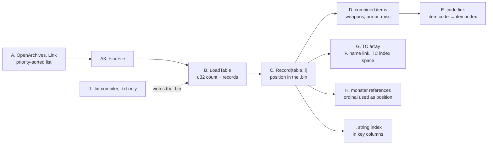

### A. Archives and file lookup

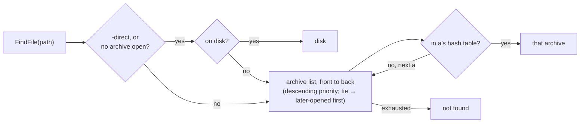

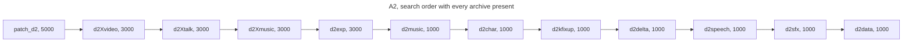

```
A1. OpenArchives(expansion: bool):                                   [C]
      for (name, prio) in [ (d2data,1000), (d2sfx,1000), (d2speech,1000),
                            (d2delta,1000), (d2kfixup,1000),
                            (patch_d2,5000), (d2exp,3000) ]:          ; core, this order
        if the file exists: a ← Open(name); a.priority ← prio; Link(a)
      for (name, prio) in [ (d2char,1000), (d2music,1000) ]: same     ; game archives
      if expansion:
        for (name, prio) in [ (d2Xmusic,3000), (d2Xtalk,3000), (d2Xvideo,3000) ]: same
      ; d2video (1000) is opened and linked later, on demand     [C]

A2. Link(a):                                                         [C]
      n ← first node of the list with n.priority ≤ a.priority        ; signed compare: [I] every priority is positive
      insert a before n (append when there is none)
      ; result: descending priority; on a tie, the later-opened archive is searched first

A3. FindFile(path) → source:                                         [C]
      diskAllowed: bool ← direct or (no archive is open)            ; [I] the no-archive half: no run shows a lookup before the first open
      if diskAllowed and path exists on disk (relative to the working directory):
        return disk                                                  ; checked before any archive
      for a in archive list, front to back:
        if a's hash table contains path: return a                    ; first hit wins
      return not found
```

Step notes:

- A1. The H3b runs make the 12 opens of A1 in this order with these priorities, all before the first string-table
  and excel load (`d2video` aside), in every run. [C]
- A1. `d2video` is opened from the main menu's *Cinematics* list: the five game archives are closed, `d2video.mpq` is
  opened at 1000 and linked, and after the film `MPQ_OpenGameArchives` opens the five again (call). [C]

- A1. Without `-direct`, startup fails unless `d2data`, `d2sfx` and `d2speech` opened (and, when the
  expansion is detected, `d2exp`); with `-direct` it continues regardless. [I] Only a broken install reaches it: every
  run had the core archives.
- A2. With every archive present, the search order is `patch_d2`, `d2Xvideo`, `d2Xtalk`, `d2Xmusic`,
  `d2exp`, `d2music`, `d2char`, `d2kfixup`, `d2delta`, `d2speech`, `d2sfx`, `d2data`. For files under
  `data\global\` this means **`patch_d2` > `d2exp` > `d2kfixup` > `d2delta` > `d2data`**.
  [C] for the ten archives the install holds: after every open the logged archive list equals A2's model. For
  `data\global\`, `patch_d2` > `d2exp` > `d2data` is also shown by content: a kept log reads each kind of file these
  archives hold with different bytes (excel `.bin`, DS1 maps, string tables) with 0 mismatches in that order and fails
  with the other copies.
  [I] for the places of `d2kfixup` and `d2delta`: our install ships neither, so only an added archive would show
  them.
- A2. The tie rule is live: `d2video`, opened after the 1000 band, is linked at its **front** (before `d2speech`,
  `d2sfx`, `d2data`). No stock file differs between two archives of one band (of the 6 files shared inside a band, 0
  differ), so no lookup's result depends on it. [C]
- A3. The game writes the direct flag only from the `-direct` byte, so in a stock run (archives open,
  no `-direct`) the disk is never read and a loose file never overrides an archive. Under `-direct`,
  a loose file beats every MPQ. [C] `InitFileIO` stores the `-direct` byte in both flags in all seven H3b runs; every
  `FindFile` inside a `FILE_LoadWhole` returns what A3 predicts from the archive list of that moment; without
  `-direct` no call returns the disk (the loose run's directory held three loose files, every buffer read was the
  archive copy), and with it the same kind of loose files were read from disk.
- A3. Every excel table and `data\local\use` go through `FILE_LoadWhole`, which calls this lookup
  with no archive restriction. [C] Every `DATATBLS_LoadTable` call is followed by one `FILE_LoadWhole` of its `.bin`,
  and `use` is read once per run the same way. The excel files read outside `DATATBLS_LoadTable` go through it too:
  `weapons`, `armor`, `misc`, `itemtypes` and `hitclass` `.bin` from the character-graphics copy of the loader (return
, before `DATATBLS_LoadAll`), and the four `*code.bin` (return).

### B. Loading one table

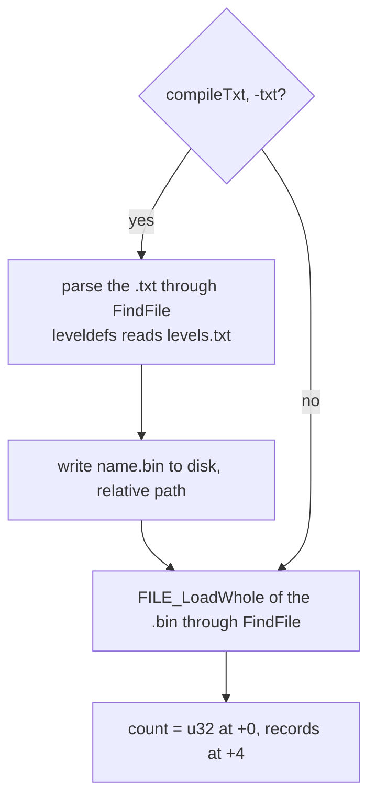

```
B1. LoadTable(name) → (records, count: u32):                         [C]
      if compileTxt:                                                 [C] (all of B1a–B1b; DATATBLS_SetCompileTxt)
B1a.    src ← (name equals "leveldefs", case-insensitive) ? "levels" : name
        parse FindFile("DATA\GLOBAL\EXCEL\" + src + ".txt"), fatal if absent
B1b.    write the records to DATA\GLOBAL\EXCEL\<name>.bin ON DISK (relative path)
      buf ← FILE_LoadWhole("DATA\GLOBAL\EXCEL\" + name + ".bin")    ; via A3; fatal if absent
      count ← u32 LE at buf+0
      records ← buf + 4
      return (records, count)
```

Step notes:

- B1. The `loadBin` branch is always taken: its flag is initialised to 1 and every one of its 30
  references only compares it. The alternative branch (parse `.txt` in memory) is dead. [C]
  (`g_DataTblsLoadBin`; corroborated by the record-size match of step C1)
- B1a–B1b. `-txt` writes freshly compiled `.bin` files to disk, and **then** loads the `.bin` through
  A3 like a stock run. Without `-direct` the disk copy is invisible, so `-txt` alone changes nothing
  that is loaded. Only `-direct -txt` makes the game run on `.txt` content. [C] Both `-txt` runs wrote the same 90
  `.bin` files (89 byte-identical to the archive copies, `monstats.bin` differing in two bytes). Under `-txt` alone
  every excel buffer loaded was the archive copy, `monstats.bin` included; under `-direct -txt` every `.bin` read after
  its write came from the disk, and the loaded `monstats` records carry the compile's two bytes. Earlier,
compiled a loose probe `cubemain.txt` into its own table.

- B1. In a stock run the five mixed-archive tables load from their `.bin` like every other table:
  `automagic`, `RarePrefix`, `RareSuffix` from `patch_d2`; `inventory`, `PlrMode` from `d2exp`. The pinned game's own
  `-txt` compile of the `.txt` the archives rank first gives `.bin` files byte-identical to these five, so either side
  gives the same records, and which one is authoritative has no observable on stock data. [C]

- B1. `TreasureClass.txt`, `Aiparms.txt`, `MonName.txt` and `WeaponClass.txt` have no loader.
  `cubemod.bin` and `cubetype.bin` ship but are never loaded (their names do not occur in
  `Game.exe`). [C] for both: the `-txt` compile writes a `.bin` for every table it loads and wrote none of the four,
  although all four `.txt` files are in the archives.
- B1. 15 small code-list tables (`playerclass`, `bodylocs`, `monmode` 4-byte form, …) and the
  2-byte `monstats`/`skilldesc` calls are loaded only under `-txt`; they serve the `.txt` compiler.
  A stock run never loads them **through `DATATBLS_LoadTable`**. A further `-txt`-only call, the 18th, is a 2-byte
  `sounds` load (the call, skipped by the `je` when `g_DataTblsCompileTxt` is 0). [C] No `DATATBLS_LoadTable` call names one of them in the four stock-mode H3b runs,
  and under `-txt` all 18 are called, with their small record sizes; the `-txt` compile wrote all 15.
- B1. **Who reads the last loaded tables**. Every table below loads in a stock run through its own
  loader; what reads its records decides whether a reimplementation needs it for a rule. The client-only and
  count-only verdicts are a reader search over both the absolute globals and their `g_DataTables + offset` form.

| Table | Read by | What a reimplementation needs | Tag |
|---|---|---|---|
| `MonItemPercent` | nothing: its record getter and table getter have no caller | nothing: no row is chosen, no draw is made, no seed steps | [C] loaded in every run; [I] no reader |
| `SkillDesc` | the client's skill tree; on the server `SkillPage`, the record count and the description missiles | `SkillPage` in the skill-level bonus; the count in `SkillHasDesc`; calc codes 43–48 | [I] |
| `Overlay` | client drawing; the server reads the count only | the row count, as the bound on an overlay id before one is set (`id < 0` or `id ≥ count` skips it) | [I] |
| `Arena` | the server's kill and death scoring, in every game | nothing for a core rule: the score it writes per player is read by no core-area rule in the reading, and the scoring makes no draw | [I] |
| `Composit`, `MonSounds`, `AutoMap` | client code only | nothing (presentation) | [I] |

- B1. `BodyLocs`, `PlayerClass` and `Events` are among the `-txt`-only code lists above: a stock run holds only the
  row indices the compiled tables store, read as plain numbers (body location 0..10, class 0..6, event id 0..12),
  with no lookup through the code list. Their uses are [items/inventory](../../spec-items/inventory/) I6,
  [player/creation](../../spec-player/creation/#inputs) and [skills/dispatch § K](../../spec-skills/dispatch/#k-stat-event-handlers). [I]

- B1. The four header-less `*code.bin` files (`itemscode`, `misscode`, `skillscode`, `skilldesccode`)
  are loaded whole as raw buffers, not through B1. Their contents are [data/calc](../calc/). [C] In all 44 529
  evaluations, the pool's offset + length equals its file size, the pool's base is
  constant within each (log, pool) pair, and the logged bytes are the file bytes at those offsets: the pool is the whole
  file, with no header.

### C. Addressing records

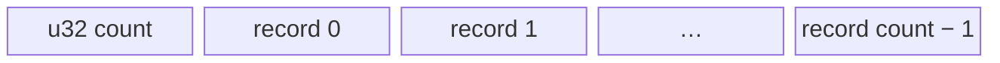

Step notes:

- C1. The `.bin` path ignores the record size passed by the caller, so the stride is fixed by each
  consumer's struct. For all 86 loaded tables that stride equals the file's record size (0
  mismatches), which is why `(fileSize − 4) ÷ count` is safe to use. Records are packed, with no
  alignment padding. [C]

  | Table | Records | Count | Lookup link |
  |---|---|---|---|
| `itemratio` | `g_pItemRatio` | — | — |
| `itemtypes` | `g_pItemTypes` | — | — |
| `weapons` / `armor` / `misc` | sub-ranges of the combined item array (step D) | — | — |
| combined items | `g_pItems` | `g_nItems` | `g_ItemCodeLink` (codes) |
| `monstats` | `g_pMonStats` | — | `g_MonStatsLink` |
| `levels` | `g_pLevels` | — | — |
| `leveldefs` | `g_pLevelDefs` | (= levels) | — |
| `treasureclassex` | freed after step G | — | runtime TCs: `g_pTreasureClasses`, `g_nTreasureClasses`, `g_TCLink` (names) |

### D. The combined item table

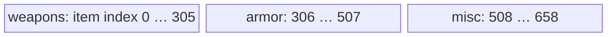

```
D1. LoadItems():                                                      [C]
      (W, nW) ← LoadTable("weapons"); (A, nA) ← LoadTable("armor"); (M, nM) ← LoadTable("misc")
      items ← W ++ A ++ M                                            ; one array, stride 0x1A8, in this order
      nItems ← nW + nA + nM
      weapons, armor, misc pointers ← the three sub-ranges of items  ; the file buffers are freed: [I] not logged
D2.   for i in 0 ..< nItems:                                          [C]
        AddCode(itemCodeLink, code: u32 ← item[i]+0x080 read as u32 LE)     ; step E2
D3. GetItemByCode(code: u32) → (record, index: i32):                  [C]
      index ← FindCode(itemCodeLink, code)                           ; step E1, −1 if absent
      record ← items + index × 0x1A8
```

The **item index** used everywhere else is the position in this combined array: weapons first, then armor, then misc. With the shipped counts (306, 202, 151) weapons are 0..305, armor 306..507, misc 508..658. [C] 4 999 logged (code, index) pairs, 282 distinct and in all three ranges (148 weapons, 84 armor, 50 misc), equal the code's combined position: the vendor stock creations, the quest drops and the d2s-io memory reads. In the H3b runs 1 147 `ITEMS_GetByCode` calls return the record `g_pItems + 0x1A8 × i` with index i, the code's first position; the 37 calls with a code that is no item return 0 with index 0.

The load also builds a **classic item index map**, a u16 list (`g_pClassicItemIndex`, `2 · nItems` bytes, zeroed): in item order, the combined index of every record whose `version` (`+0x0F6`, u16) is 0; entries past the last version-0 item stay 0, and the count is not stored.

### E. Code links (4-character codes)

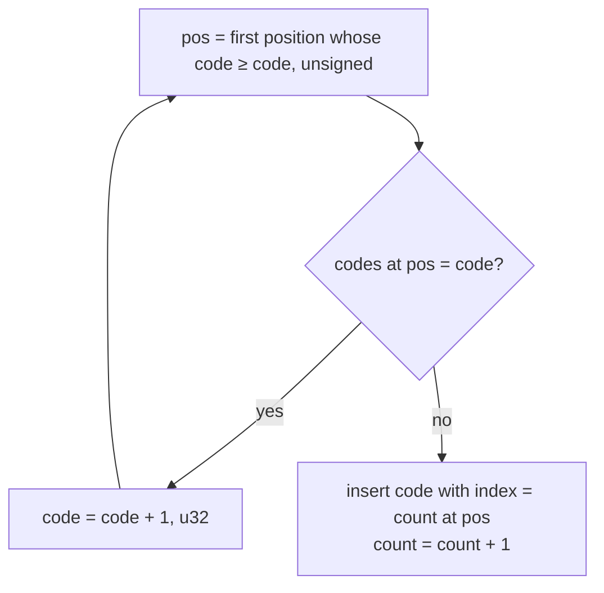

A link is a 16-byte object `{count: i32, capacity: i32, codes: *{code: u32, index: i32}, nameRoot}`
used either for codes or for names, never both (mixing is a fatal error). [C] Rule 1: every function that touches a
link reads this one layout (`LinkCreate` allocates and zeroes the 16 bytes; `FindCode`/`AddCode` use `+0`, `+4`, `+8`
and fail when `+0xC` is set; `FindName`/`AddName`/`AddNameIfAbsent` use `+0xC` and fail when `+8` is set).


```
E1. FindCode(link, code: u32) → i32:                                  [C]
      lo: i32 ← 0;  hi: i32 ← link.count
      while lo < hi:
        mid ← lo + (hi − lo) ÷ 2
        k ← link.codes[mid].code
        if code > k: lo ← mid + 1                                     ; UNSIGNED compare
        else if code < k: hi ← mid
        else: return link.codes[mid].index
      return −1

E2. AddCode(link, code: u32) → i32:                                   [C]
      grow codes by 64 entries when count ≥ capacity                 ; [I] the emulation never filled the array
      loop:
        pos ← first position whose code ≥ code (unsigned)
        if pos < count and codes[pos].code = code:
          code ← code + 1                                             ; u32, then retry
        else: break
      insert {code, index: count} at pos (shifting the tail up)
      count ← count + 1
      return count − 1
```

Step notes:

- E2. Under emulation 1 500 inserts (capacity above the count) bump 665 duplicates, 221 of them through `0xFFFFFFFF`
  → 0 → … chains, and the array, count and returned index match the model byte for byte. [C]
  The growth by 64 entries is read from the code: the capacity `+4` is compared with the count `+0` and grown by `0x40`
  (the link layout of rule 1), but every emulated insert had room, so no case grew the array. [I]
- E2. **Duplicate codes:** the first record keeps its code; a later record with the same code is
  registered under `code + 1` (or the next free value), so it is unreachable by its written code and
  reachable by an unrelated one. The index returned is still the insertion count. The shipped
  weapons/armor/misc have no duplicate codes (659 distinct), so this never fires on stock data. [C] for the rule by
  emulation; [I] for "never fires", which has no observable. (`EXCEL_AddCode`; data check in
  Weapons)
- E1. Item codes are **case-sensitive**: no case folding happens on this path. [C] Under emulation, 316 probes that
  differ from a stored code only in letter case find nothing (−1).

### F. Name links (TC names, monster Ids)

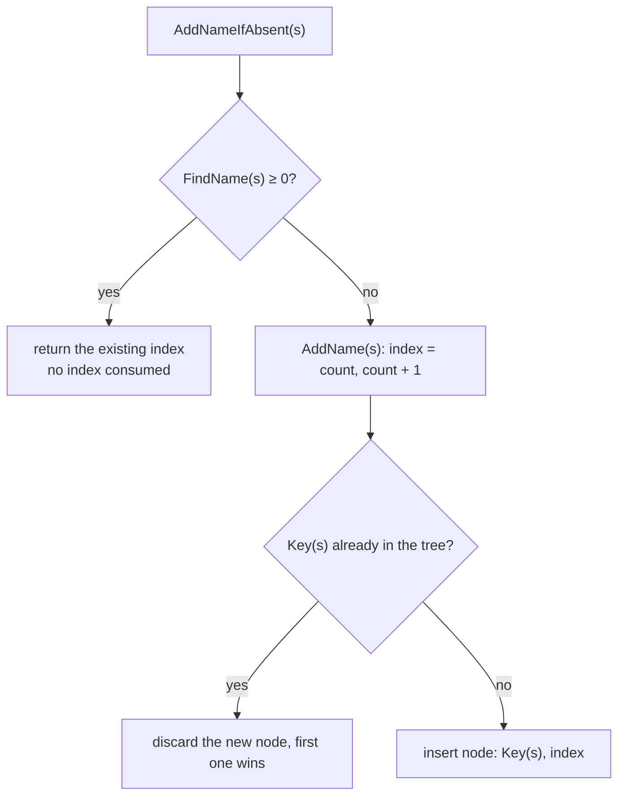

```
F1. Key(s) = lowercase(first 31 bytes of s)       ; only A–Z → a–z, all other bytes unchanged     [C] (STR_ToLowerN, table)

F2. FindName(link, s) → i32:                                          [C]
      walk the binary search tree from link.nameRoot comparing Key(s) to node.name
      with a byte-wise strcmp; equal → return node.index; fell off → return −1

F3. AddName(link, s) → i32:                                           [C]
      index ← link.count;  link.count ← link.count + 1               ; ALWAYS consumes an index
      if a node with Key(s) exists: discard the new node             ; first one wins
      else: insert node {name: Key(s), index} into the tree (unbalanced, insertion order)
      return index

F4. AddNameIfAbsent(link, s) → i32:                                   [C]
      i ← FindName(link, s)
      if i ≥ 0: return i                                              ; NO index consumed; the existing index
      else: return AddName(link, s)                                   ; the new index
```

Step notes:

- F1–F2. Names are **case-insensitive** (ASCII only) and only their first 31 characters count. With
  the duplicate rule of F3, a lookup returns the **first** record registered under that key. [C] Under emulation 1 500
  `FindName` calls on random trees cut the key to 31 bytes, lower-case it through the table (bytes ≥ 0x80 indexed as
  signed), and walk by unsigned `strcmp` (`<` left at `+0x24`, else right at `+0x28`): 435 keys longer than 31 bytes,
  57 of them found by their first 31, and an empty link returns −1. In the stock tables 11 name-lookup cells differ in
  case from their key and resolve to it, and the 736 name-lookup cells resolve in the survey of the game-compiled
  tables, the duplicated `cr_lancer8` and the repeated `monseq` values storing their first occurrence.

- F3 vs F4. The difference matters for numbering: `AddName` leaves a gap (the duplicate's index has
  no name), `AddNameIfAbsent` produces ordinals among distinct names. The TC loader uses `AddName`
  (step G); the compiler used `AddNameIfAbsent` for the monstats `Id` (step H). [C] The TC numbering of G5 holds
  for every TC index of the 9 390 replayed calls (`AddName`, one index per TC), and the monstats ordinals among distinct
  `Id`s hold in the game-compiled table (`AddNameIfAbsent`, no index for the duplicate).

### G. Treasure classes

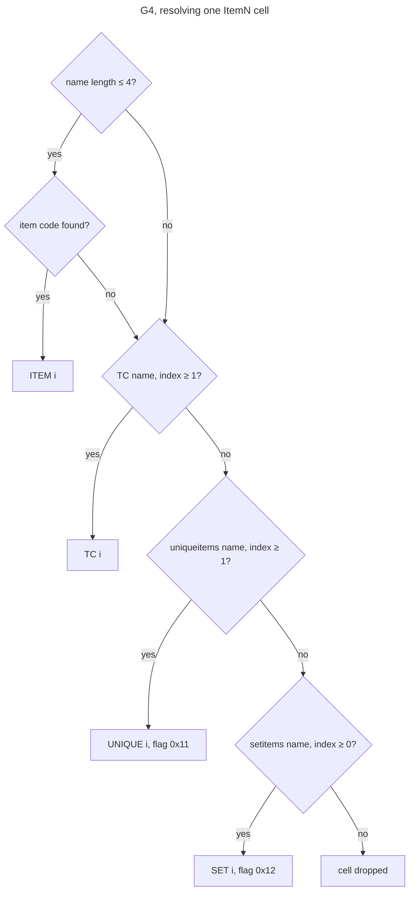

The live table is **`treasureclassex`**. `TreasureClass.txt` is never loaded; the string `treasureclass` in `Game.exe` is the name of an `itemtypes` column. [C] (`TC_LoadTreasureClassEx`; corroborated by the data check in G5)

G5. **The TC index space** that results, and that every stored TC reference uses: [C] (`TC_LoadAll`, `MonStats.txt:TreasureClass1`; data check over all 4362 non-blank `monstats` TC cells, 0 mismatches)

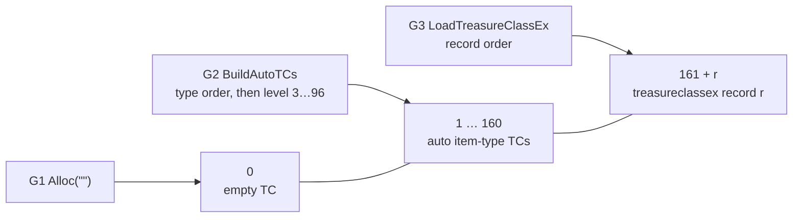

| Index | TC |
|---|---|
| 0 | the empty TC (empty name); a stored 0 means "no TC" |
| 1 … 160 | the auto item-type TCs of G2 (5 types × 32 levels) |
| 161 + r | `treasureclassex` record `r` (r = 0 … 851) |

Step notes:

- G1–G4. **The evidence.** A model of G1–G4 reproduces all 9 390 stock calls of the kept TC logs: every
  total, pick, selected entry and sub-TC index, over 425 distinct TC indices. Index 0 is the empty TC (752 drops with
  base 0 name no TC). 55 auto TCs were logged with their entries (type order, the level window, the rarity weights),
  302 logged TCs have a `group` and their upgrade walks reproduce, every logged entry resolves item code first and TC
  name second, and 81 quoted cells, 23 of them in logged TCs, reproduce. [C]
- G1a. `TC_BuildChestTable`'s 45 lookups (return; it is called from `TC_LoadAll`) are logged in
  every H3b run that loads the tables and return the TC index of each name; the store into `g_ChestTCs` was not logged.
  [C] for the lookups
- G2. **"Of type `t`" is the item-type test `ITEMS_IsType`**, defined in
  [items/tc § K](../../spec-items/tc/#k-the-item-type-test--items_istype-and-items_unitistype): the item's `type` and `type2`,
  each through the `Equiv1`/`Equiv2` closure, not a compare with the own `type` column; the `tpot` exclusion uses the same
  test. The `Rarity` weight alone reads the own `type`. [I]
- G2. The order inside 1…160 follows the loop: item type in `itemtypes` record order, then level
  ascending, so the auto TC for the `j`-th qualifying type (0-based) at level `L` is index
  `1 + 32 × j + (L ÷ 3 − 1)`. [C] The formula puts the 852 treasureclassex TCs at `161 + r`, and 369 of them were
  logged at those indices.
- G3. The shipped table's last record (852) has an empty name, so it ends the loop and 852 TCs are
  loaded: 1 + 160 + 852 = 1013 runtime TCs. [C] for the numbering up to the highest logged index, 993 (`Durielq (N)`);
  [I] for the count itself, since no logged index is above 993.
- G4. A name of up to 4 characters that is both an item code and a TC name resolves to the **item**.
  TC and unique/set names are case-insensitive (F1); item codes are case-sensitive (E1). [I] The lookups themselves
  are raised (E1, F1), but no stock cell is both, and the emulation cannot run the function: every resolved cell goes through
  `TC_AddEntry` → `TC_GrowEntries` and the pool allocator.
- G4. `uniqueitems` index 0 can never be named from a TC (the test is `≥ 1`); `setitems` index 0 can. [I]

- G4. **The two words of a unique or set entry.** `index` is the `items` record of the row's base code, through
  `ITEMS_GetByCode`'s out parameter, which writes 0 for a code that is no item code; the parser does not test the
  return. `aux` is the name-link hit `i` itself, not `i − 1`; the resolver hands it on as `uidx = aux + 1`, so item creation's `uidx − 1` is this row. Both are u16
  stores of 32-bit values. [I] for both: only an edited TreasureClassEx reaches a named cell, and the one run that does
  (`index` = the row's base and `aux` = the row, reproduces its 163 TC calls) edits the very cells the
  statement is about, so it agrees and does not raise.
- G. `TC_GetByIndex` applies a `group`/`level` upgrade walk when a TC is fetched; that belongs to
  `items/tc`, not to the load. [C]

### H. Monster references

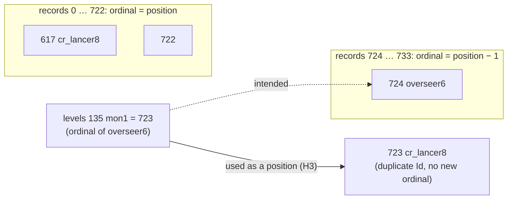

```
H1. Monster records are addressed by position:                        [C]
      MonStats(i) = g_pMonStats + i × 0x1A8, valid for 0 ≤ i < count
H2. Every stored monster reference (monstats BaseId, NextInClass, spawn, minion1/2;   [C]
    levels mon*, nmon*, umon*, cmon*) holds the ordinal of the referenced Id among
    DISTINCT monstats Ids (F4 numbering), which monstats.bin also stores at +0x000.
H3. The game uses that stored value directly as the record position of H1;           [C]
    nothing remaps it at load.
```

Consequence: `monstats.txt` repeats `cr_lancer8` (records 617 and 723). Ordinals and record positions agree for records 0…722 and diverge after, so a reference to any monster in records 724…733 reaches the record **one before** it. In the shipped data only three cells are affected: *Act 5 - Pandemonium 3* (`levels` record 135) `mon1`, `nmon1`, `umon1` name `overseer6` (record 724) and store 723, which is the second `cr_lancer8` record. [C] H2 by data; H3 by the pool run below and the position reads of H1. None searches the records by `Id`, so every stored monster reference is used directly as the position and never mapped back through the ordinal.

### I. String-table keys

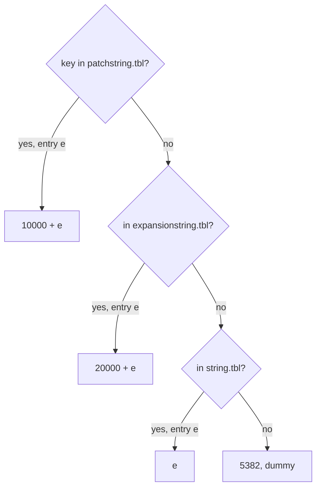

```
I1. Language: lang: u8 ← first byte of data\local\use (via A3)       [C]
      if lang > 13: lang ← 0                                          ; [I] the clamp
      code ← language table[lang] (0 ENG, 1 ESP, 2 DEU, 3 FRA, 4 POR, 5 ITA, 6 JPN,
             7 KOR, 8 SIN, 9 CHI, 10 POL, 11 RUS, 12 ENG/HAN)         [C]
      lang 13 matches no entry: it reads entry 13, the 0x18 bytes after the table   [C] the index map
      string tables: data\local\lng\<code>\string.tbl, expansionstring.tbl, patchstring.tbl

I2. Stored string index of a key column (namestr, spelldescstr, monstats NameStr/DescStr):   [C]
      if key is in patchstring.tbl at entry e:          index ← 10000 + e
      else if key is in expansionstring.tbl at entry e: index ← 20000 + e
      else if key is in string.tbl at entry e:          index ← e
      else (blank or unknown key):                      index ← 5382   ; string.tbl "dummy"
      stored as u16
    The compiler's converter is STRTABLE_KeyToIndex: it calls          [C]
    STRTABLE_GetByKey, which returns 0 for an empty or unknown key,
    and replaces 0 by 5382 (0x1506).

I3. Text of a stored index (u16) at run time:                          [C]
      if index ≥ 20000:
        if expansionstring.tbl is loaded: (file, e) ← (expansionstring, index − 20000)
        else: index ← 11078, then as below                           ; [C]; not reached on a stock install (I3)
      if index ≥ 10000 and patchstring.tbl is loaded and file unset:
        (file, e) ← (patchstring, index − 10000)
      else if file unset: (file, e) ← (string, index)
      if e ≥ file.count: e ← 500                                       ; [C] entry 500 of the same file; no stock index reaches it
      return the value of the node file.index[e] names                  ; an unused node is fatal
```

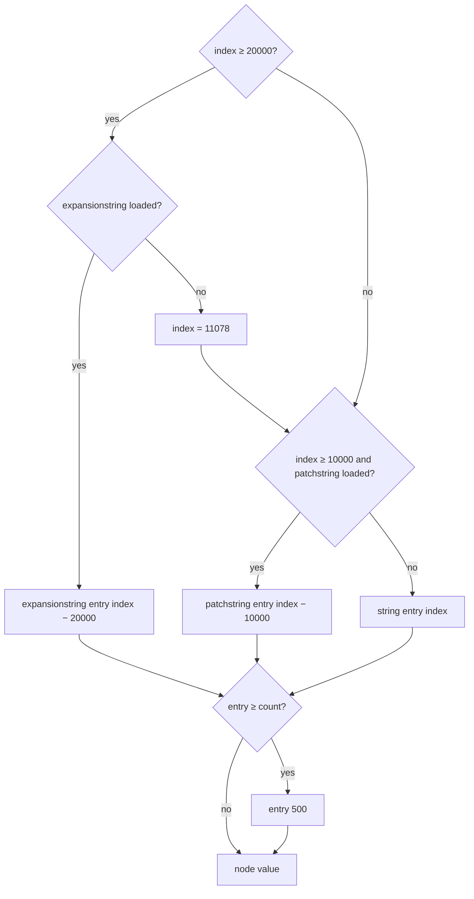

Step notes:

- I1. **The language byte.** In every H3b run the first `LNG_GetLanguageIndex` call reads `data\local\use` once
  through `FILE_LoadWhole` and returns its first byte: the archive copy's `00` (and a loose `00 00 00 00` under
  `-direct`) gives 0 and the tables load from `lng\ENG\`; the install's `Use_rus`, `0B`, copied over `Use` with
  `-direct` as its Russian launcher script does, gives 11, after which the loads use the `CYR` font charset (and the
  program ends, [data/strings § H](../strings/#h-language)). The byte is cached for the later calls. [C]

- I1. The clamp of values above 13 to 0 is reached only by a made-up `use` byte, which no shipped file holds. [I]

- I1. **Id 13 is not a fallback to `ENG`.** `LNG_GetLanguageCode` searches the 13 entries and sends only a count ≥ 14
  to entry 0 (`cmp ecx, 0xe; jl`), so ids 0–12 give their entry, ids ≥ 14 give entry 0 (a field other than 1, 2 or 3
  copies the code), and an unmatched id below 14, which from a `u8` `use` byte past the clamp is 13 alone, reads the
  0x18 bytes after the table. [C] for this index map under emulation (182 calls).
  What it reads there is run-time memory: the low words of the first three dwords are written at startup (each a
  default letter, or the single character of strings 0x14D1–0x14D3) and their high words are 0, so each "pointer" is
  below 0x10000, and a `use` byte of 13 would make the string-table load fault. Only an edited `use` file holds 13. [I]

- I1. The language byte affects only localisation (string tables, fonts, charset), never
  `data\global\` or any excel table. [I]
- I2. This is what the shipped `.bin` files contain, verified against the English tables over 2 278
  cells of the nine documented tables, and over 2 344 cells of all 28 laid-out tables (776 blank and 15
  non-blank unknown keys store 5382; each precedence pair is exercised: patchstring over string, patchstring
  over expansionstring, expansionstring over string). One exception: monstats `uberandariel`
  `NameStr = Lilith` stores 5382 although `Lilith` is entry 1154 (index 11154) of the shipped `eng`
  `patchstring.tbl`. The values are the English ones: the `deu` and `fra` `string.tbl`
  have fewer entries. [C]
  The `deu` and `fra` `string.tbl` hold 5 322 entries, `eng` 5 391; with either in place of `eng`, 1 505 (1 506) of
  the 4 548 string-key cells of the laid-out tables would compile to another index, while the `eng` tables explain them
  all. [C]
- I2. **The `Lilith` cell is the shipped file's, not the converter's.** The pinned game, compiling under `-direct -txt`,
  stores 11154 there (`patchstring` entry 1154, `Lilith`): the converter rule holds for this cell too, and it is one
  of the two bytes in which the game's `monstats.bin` differs from the shipped one. [C] That the shipped file was compiled against string tables without `Lilith` is
  an inference about how it was made. [I]
- I2. Entry 0 of `string.tbl` (key `WarrivAct1IntroGossip1`) also gets 0 from `STRTABLE_GetByKey`, so it
  would compile to 5382; no cell names it. [C] Under emulation `STRTABLE_KeyToIndex` returns 5382 for that key, as for
  the empty key and the keys found nowhere.
- I3. Text lookup is by entry position, and the key → index search `STRTABLE_GetByKey` is patchstring →
  expansionstring (when loaded) → string, the I2 order. [C] 336 logged index lookups go index → table, entry → node →
  text, and 3 928 logged key lookups search in that order.
  So a language whose `string.tbl` has other entries (the `deu` and `fra` files have 5322) shows other text for the
  same stored index, and an index past a file's count shows entry 500 (I3 above); the hash lookup is case-sensitive.
  [I] for the other languages' text, which needs non-`eng` tables, and for the case, which no logged key tests
  (no key is held by a table only under another case).
- I3. The game loads `string.tbl`, then `patchstring.tbl`, then `expansionstring.tbl` **whenever `d2exp.mpq`
  exists**, in a classic game too (the load flag is `HasExpansionMpq()`, not the game's mode), so on a stock LoD
  install the 11078 path is unreachable; a missing table is a crash, with no fallback to `eng`. [C] for the load
  condition, [I] for the crash
- I3. The whole run-time lookup (loading, index → text, key → index, hash probing, text conversion, fallbacks) is
  specified in [data/strings](../strings/); this section keeps the stored-index view.

### J. Compiling a `.txt` (`-txt` only)

Only a reimplementation that compiles `.txt` itself needs this section: the compiler is what produced the shipped `.bin` content, so the stored values of § Cell values follow from it. Each rule is `[C]` where a named cell of the 28 laid-out tables exercises it (7 425 records, 555 659 cells, 0 unexplained), else `[I]` from the code. Field types are the descriptor entry types.

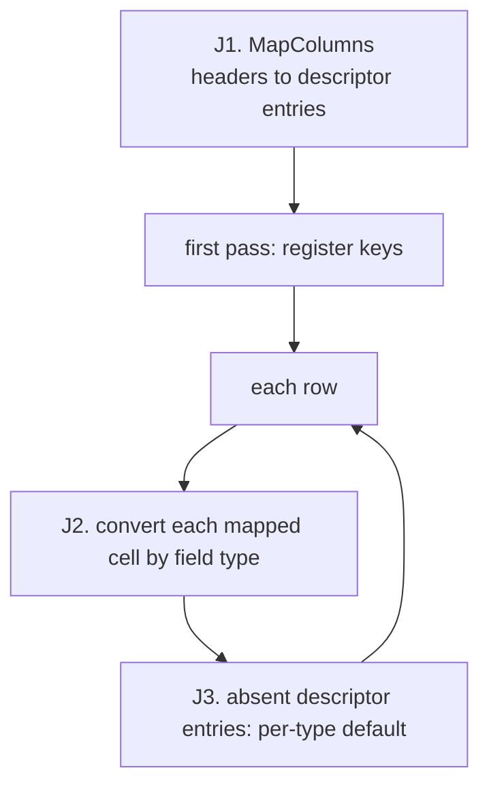

```
J1. MapColumns(headers, descriptor) → map:                             [C]
      for each header h, in column order:
        e ← the descriptor entry, not yet matched, whose column equals h ignoring case
        if e exists: map[col] ← e;  mark e matched                      ; a repeated header finds nothing
        else: map[col] ← 0x7FFF                                         ; the column's cells are skipped
      append every unmatched entry after the file's columns              ; these get J3

J2. Convert a cell by its field type (record zeroed before the row):
J2a. integer (types 2–6, 8, 0x1A):                                     [C]
       optional leading '-', then v ← v × 10 + (byte − 0x30) per byte   ; no validation
       store v truncated to the field width
J2b.   byte is sign-extended, so a byte ≥ 0x80 adds a negative digit;  [C]
       type 5 stores only a non-empty cell; type 0x1A sets or clears one bit
J2c. code lookup (0x0B dword, 0x0D byte, 0x0F word):                   [C]
       ; the sub-rules a named cell exercises (4-character cut, blank, duplicates): step notes
       key ← first ≤ 4 bytes of the cell, padded with spaces            ; blank → "    "
       store FindCode(link, key) at the field width                     ; −1 when absent
                                                                        ; [I] a found key at the byte and dword widths (no stock cell)
J2d. name lookup (0x13 dword, 0x14 word, 0x15 byte):                   [C]
       key ← first ≤ 31 bytes of the cell                               ; blank → ""
       store FindName(link, key) at the field width                     ; −1 when absent
                                                                        ; [I] a found key at the byte width (no stock cell)
J2e. string key (0x16): store STRTABLE_KeyToIndex(cell) as u16 (I2)    [C]
J2f. callbacks (0x17–0x19): link(cell, record, offset, len, row, col)  [C] the cell and record offset
                                                                        ; [I] the len, row and col arguments
       the item calc callback stores −1 for a blank cell or an           [C]
       expression that fails to compile, else the expression's offset

J3. After each row, for each appended (absent) entry, by type:          (jump table)
```

| Type | Default for an absent column | Exercised by | Tag |
|---|---|---|---|
| 1 string | 0 (empty) | misc `setinvfile` | [C] |
| 2, 3, 4, 6 integer | 0 | weapons `minac`, `pSpell`, `spelldesc`, `absorbs`, `spellicon`; misc `auto prefix` | [C] |
| 9 4-char code | four zero bytes | misc `normcode`, `ubercode`, `ultracode`; weapons `BetterGem` | [C] |
| 0x16 string key | word 0, no converter call | weapons/armor `spelldescstr` | [C] |
| 0x0D byte code lookup | `0xFF` | armor/misc `hit class`, automagic `classspecific` | [C] |
| 0x0F word code lookup | `0xFFFF` | magicsuffix/automagic `etype4`, `etype5` | [C] |
| 0x14 word name lookup | `0xFFFF` | weapons/armor `state`, `cstate1`/`2`, `stat1`–`3` | [C] |
| 0x19 calc callback | called with no cell → −1 | weapons/armor `calc1`–`3`, `len`, `spelldesccalc` | [C] |
| 5, 7, 8; 0x0A, 0x0C, 0x0E, 0x10–0x12 registrations | 0 at the field width: the byte for 5, 7, 0x0C, 0x10; the word for 0x0E, 0x11; the dword for 8, 0x0A, 0x12 | none | [C] |
| 0x0B, 0x13 dword lookups | the dword −1 | none | [C] |
| 0x15 byte name lookup | the byte `0xFF` | none | [C] |
| 0x17, 0x18 callbacks | called with no cell (ECX 0) and the record and field offset; the effect is the callback's | none | [C]; [I] for the len, row and col pushed with them |
| 0x1A bit flag | untouched (the record was zeroed, J3 note) | none | [C] |

Step notes:

- J1. **A header that occurs twice feeds its field from the first occurrence**; the second maps to
  `0x7FFF`. Matching is case-insensitive (`alternateGfx` / `alternategfx`), and a header the descriptor
  lacks (`HratliMagicLvl`) is ignored. The survey depends on all three (armor's second `mindam`/`maxdam`).
  [C]
- J2a. **No validation, truncation to the width:** misc `TMogMin`/`TMogMax` of the three Khalim parts hold a
  single space and store −16 (`0xF0`); misc `rarity` 999 stores 231 in a u8 (7 rows, the only out-of-range
  integer cells). [C]
- J2c. **The key is cut to 4 characters:** magicprefix `itype1` = `staff` finds `staf` (9 cells), magicsuffix
  `itype2` = `ring ` finds `ring` (3 cells). [C]
- J2c–J2d. **A blank cell is looked up**, not skipped: it gets the target row whose key is blank (itemtypes row
  0 for the item-type references, the empty-named TC 0 for monstats `TreasureClass*`), or −1 when the target
  has no blank key. [C] A non-blank key that matches nothing takes the same −1 path;
  no cell has one. [C] Under emulation 1 931 code-lookup and 1 258 name-lookup cells that match nothing store −1 at
  the field width (`0xFFFFFFFF`, `0xFFFF`, `0xFF`), and longer keys are cut to 4 (codes) and 31 (names) before the
  lookup.
- J2c–J2d. **A duplicated key resolves to its first row:** 15 443 blank itemtypes references store row 0, the
  first of the blank-code itemtypes rows (E2 keeps the first and bumps later duplicates); monstats
  `NextInClass` = `cr_lancer8` and the `Sk*mode` cells naming a repeated `monseq` value store the first
  occurrence's ordinal (F). [C]
- J2. Before any lookup, a first pass registers the keys of the registration columns (0x0A, 0x0C, 0x0E,
  0x10–0x12): codes through `EXCEL_AddCode` (an index above 255 / 65535 for a u8 / u16 field is fatal),
  names through `EXCEL_AddName` or `EXCEL_AddNameIfAbsent`. Callbacks run in `.txt` column order.
  [C] for registration before lookup (442 `monstats` `NextInClass` cells name a later row and resolve in the
  game-compiled table) and for the callback order (J2f–J3 note). [I] for the overflow fatal: no stock table reaches
  255 or 65535 entries.
- J2. The first pass's gate and loop count only the `.txt` columns (`mov eax, [ebx+0xc]`), so a
  registration entry with no column is never registered, only defaulted (J3). [I]
- J3. The record is zeroed before parsing, so a 0 default and "not written" give the same byte; the −1
  defaults are real writes. [C] The no-column and padding bytes are 0 in every record of the game-compiled files, and
  the absent-column −1 defaults (23 855 cells) are present in them.
- J3. **The rows "none" exercises.** Under emulation every type 1–0x1A was absent in 113 to 1 261 rows of synthetic
  tables, and after each row's last cell every absent entry was written through the jump table at its exact width, the
  bytes around it unchanged; the 0x17 and 0x18 entries called the callback with ECX = 0 and the record and field offset.
  All 618 rows reproduce. [C]
- J3. An absent callback entry (0x17–0x19) with no callback is skipped (`test ebx, ebx; je`), so its
  field keeps the record's zero. No emulated descriptor had one. [I]
- J2f–J3. **Callback order within a row.** The second pass walks the row's cells in `.txt` column order, and a
  type `0x17`–`0x19` entry calls its callback when its column is reached, so a formula's pool bytes are appended in
  header order, not descriptor order. After the row's last cell, the entries the `.txt` lacks run in descriptor
  order (J1 appends them that way) through the J3 jump table, where the three callback types call their callback
  with no cell (an absent `calc` column → −1). So the callback order is the `.txt` columns, then the absent entries.
  Stock `skills.txt` has `skpoints`, `delay`, `perdelay` in header order against the descriptor's `perdelay`,
  `skpoints`, `delay`; no stock row fills `perdelay` with either, so both orders rebuild the stock pools, but an
  edited row with all three filled puts `perdelay`'s bytes after `delay`'s. [C] Under emulation (300 calls) the present
  callback columns ran in shuffled header order and the absent entries after the row's last cell in descriptor order: an
  absent entry's default overwrote a present cell's value on the same field in every row, and two negative controls
  fail.
- J4. **Descriptor facts the data can't show.** `levels.txt` `camt1`..`camt4` are four descriptor entries that
  all write `+0x0DC` (s16), so the last `camt` column present lands in `+0x0DC` and `+0x0DE..+0x0E3` are never
  written, while the critter code reads `+0x0DC + 2k`; the stock cells are blank, so a stock run is unaffected.
  `levels` `Id` compiles as a u8. `LvlTypes` `Expansion` is an s32 read as a dword. [I]
- J4. **Record bytes no column fills.** Filled at load, after the table: items `+0x0F0` (`gemoffset`,
  rewritten by `GEMS_Load`), monstats `+0x02A` (first `MonEquip` row, `MONEQUIP_Load`), `+0x036`/`+0x038`
  (walk/run values) and `+0x04A`/`+0x04B` (class-chain length and position), levels `+0x033..+0x035` (the counts
  of leading non-negative `mon`, `nmon` and `umon` slots, at most 25 each) and `+0x16E`/`+0x1BE`
  (localised `LevelName`/`LevelWarp` text, `DRLG_LoadLevels`). Padding, no reader or writer found by a
  displacement search after the table's record getters: items `+0x123`, `+0x12E`, monstats `+0x00A` and
  `+0x00F` bits 5–7, levels `+0x00A`. Records reached through a cached pointer are outside that search.
  [C] In 60 dumps of the items, monstats, levels, charstats and gems arrays (at `DATATBLS_LoadAll`'s return and at the
  excel unload, six runs) the bytes that differ from the file lie only in these fields (the `-direct -txt` run's own
  compiled `monstats` aside), and where a value is modelled
  the dump holds it: items `+0x0F0` −1 on the first 68 records, then each gem row's index on its item's record;
  monstats `+0x02A` the class's first `monequip` row, else −1; levels `+0x16E`/`+0x1BE` the UTF-16 text of the key (40
  units, the 40th forced 0) and `+0x033..+0x035` the slot counts in all 137 records; no gems byte differs. The padding
  bytes equal the file in every dump, and each load dump equals its run's unload dump, so nothing wrote these records
  in between.
  The `+0x033..+0x035` writers: per record, three loops over the s16 slots at `+0x036`, `+0x068` and `+0x09A` stop at
  the first negative slot or after 25 and store the count as a byte. [C]
  for the counts and the stop at the first negative slot; [I] for the bound of 25 (`cmp eax, 0x19`): no
  stock record has more than 10 leading non-negative slots in any of the three lists.
  [I] for the values of monstats `+0x036`/`+0x038` and `+0x04A`/`+0x04B`, which the run does not model, for
  "never written" outside the load-to-unload window and through other pointers, and for "no reader" of the padding
  bytes, which a dump cannot show.
- J4. **More record bytes filled at load** (the 0 in the `.bin` is overwritten):
  - [C] gems `+0x02C`: `GEMS_Load` stores `STRTABLE_GetByKey` of a key built from `+0x28..+0x2A`, which hold the
    compiled item index of `code`, not its text; the lookup fails and every gem stores 0 (data/strings § D2). The 68
    logged keys are exactly those bytes of the 68 records, and every lookup returned 0.

  - [I] gamble `+0x04` (the base's `level`, item record byte `+0xFD` as a u32) and `+0x08` (the item index of `code`,
    `EXCEL_FindCode(g_ItemCodeLink, code)`); the records are then sorted in place by `+0x04`.

    [C] The gamble list built from these records (dumped once per process, the same 125 entries in every dump) holds
    exactly the gamble codes' combined positions in ascending base level, and its count up to each level L is the
    number of base levels ≤ L; only the record offsets themselves are not logged.
  - [C] charstats `+0x000..+0x01F`: the class's display name as UTF-16 (at most 16 units), looked up from the `class`
    text at `+0x20`. In all 12 dumps the 7 records' first 32 bytes are the text `STRTABLE_GetStringByKey` gives for the
    key, zero padded, and no other byte differs from the file.
    [I] for the fallback built from the key text when the key is not found: every class key was found.

  - [C] the merged rare-name records `+0x0C`: `STRTABLE_GetByKey(record + 0x26)`, the row's `name`. The 394 logged
    lookups from this loop carry the names at `+0x26` of the 201 merged records, and each logged index equals the
    model's.
  - [C] runes `+0x082` (u16): `STRTABLE_GetByKey(Name)`, looked up row by row, so the two rows named `Runeword95`
    share one string index (20600, logged once for rows 39 and 118).
    [I] `+0x084` is not written.

## Outputs

### Loaded state

- Per table: a record array and a count, at the globals of C1. [C]
- One combined item array with a code link; item index = combined position (D). [C]

- One runtime TC array (1013 entries of 0x2C bytes in the shipped data) with a name link; TC index
  space as in G5. [C] for the entry size and the numbering; [I] for the count, since no logged index is above 993 (G3).


### Cell values in a `.bin` record

What a reimplementer reading a stock `.bin` must know about stored values. All rows are [C] by data behaviour: applies them to every cell of the nine documented tables with no unexplained mismatch.

| Field kind | Stored value | Blank cell | Column absent from the `.txt` |
|---|---|---|---|
| integer (1, 2 or 4 bytes) | the parsed number truncated to the field width, no range check (`999` in a u8 → 231) | 0 | 0 |
| boolean | a whole byte, or one bit of a packed flags word (monstats `+0x0C..+0x0F`) | 0 | 0 |
| string (`char[N]`) | NUL-terminated, rest zero | empty | empty |
| 4-char code | 4 raw bytes, space-padded (`"hax "`) | four spaces | four zero bytes |
| reference to another table | the target's record index, first match on the key | index of the target's empty-key row if it has one (itemtypes: 0 = `None`), else −1 | −1 (all bits set at the width) |
| item-type reference | as above, key cut to 4 characters first (`staff` → `staf`) | 0 | `0xFFFF` |
| monster reference | distinct-Id ordinal (H2) | −1 | −1 |
| TC reference (monstats) | TC index (G5) = TCEx row + 161 | 0 | — |
| TCEx `Item1..10` | the cell text in `char[64]`, resolved at load by G4 | empty | — |
| string key | string index (I2) | 5382 | 0 |
| formula (calc) | s32 offset into the `*code.bin` buffer | −1 | −1 |

The compiler code behind each row is § J, with its own `[C]`/`[I]` split. Signedness is pinned only
where a column holds negative values; elsewhere the table docs mark fields `u`, which is [I].

## Worked example

1. **TC reference.** `monstats` record 0 (`skeleton1`) has `TreasureClass1` (`+0x086`, u16) = 430.
   430 ≥ 161, so it is `treasureclassex` record 430 − 161 = 269, named `Act 1 H2H A`. Its runtime
   index is 430, and `FindName(tcLink, "ACT 1 H2H A")` also returns 430 (case-insensitive).
2. **Monster reference.** `levels` record 135 (*Act 5 - Pandemonium 3*) has `mon1` = 723. The `.txt`
   names `overseer6`, which is record 724; record 723 is the second `cr_lancer8`. By H3 the game uses
   record 723.
3. **Item code.** The weapon code `hax` is stored at `+0x080` as `68 61 78 20`, the u32 `0x20786168`.
   It is `weapons` record 0, so `ITEMS_GetByCode(0x20786168)` returns item index 0.
4. **TCEx record 0** is `Gold`, `Picks` 1, `Item1` = `gld` (a 3-character code: G4 tries it as an
   item code first), runtime index 161.

## Reimplementation notes

- **Read the `.bin`, not the `.txt`.** The two agree for the stock data except where noted, but the
  `.bin` is what the game runs on. For the five mixed-archive tables (`automagic`, `RarePrefix`, `RareSuffix`,
  `inventory`, `PlrMode`) the game's own compile of the top-ranked `.txt` gives the shipped `.bin` byte for byte (B1).
- **Merge archives in priority order**, not open order: `d2exp` (opened last) still loses to
  `patch_d2`. Overlaying `d2data` → `d2exp` → `patch_d2` (later wins) reproduces the game for
  `data\global\`.
- **Record index ≠ `.txt` line.** Drop every `Expansion` marker row; a tab-only line is a record
  (`uniqueitems` record 401, `treasureclassex` record 852).
- **`leveldefs` has no count**; use `levels`' count.
- **The TCEx loop stops at the first empty name**, and the item loop at the first empty `ItemN`:
  an item in `Item5` after a blank `Item4` is ignored. `Picks` 0 becomes 1. A non-zero `group` is
  shifted by the number of auto-TC item types.
- **A blank item-type reference is 0, not −1**: it names `itemtypes` record 0 (`None`). Other
  blank references are −1. Check the target table before treating 0 as "none".
- **Monster references after the duplicate `cr_lancer8` are off by one.** Use the stored value as a
  record position; do not "fix" it by looking the name up.
- **Codes are case-sensitive, names are not.** A 4-character TC name that equals an item code
  resolves to the item.
- **Name keys are cut at 31 characters** before comparison.
- **Language 13 is not `ENG`.** Only a language id of 14 or more maps to entry 0; a `use` byte of 13 passes the clamp
  and reads past the language table (I1).
- **Duplicate codes shift to `code + 1`.** Harmless on stock data, but a modded table with a
  duplicate code makes the second record reachable only through a different code.

## Evidence

- Several lead-level statements in the format and table docs (`.bin` vs `.txt`, MPQ order, item index
  order, the 161 TC slots) predate the findings and are superseded by them; this spec follows the
  findings, and so do the format and table docs once updated.
