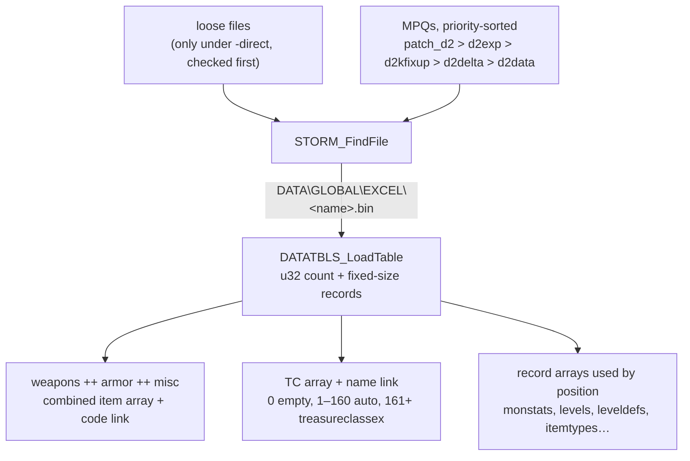

## Purpose

Every table-driven spec reads excel records. This subsystem says **which bytes those are**: which
archive a file comes from, which form of a table is loaded, how a record is addressed, and how a
code or a name in one table becomes a record index in another. It runs once, at startup, before any
game is created. It draws no random numbers.

## Files

| File | Covers |
|---|---|
| [excel.md](../excel/) | MPQ precedence and file lookup, `.bin` vs `.txt`, record addressing, code and name links, the treasure-class index space, monster references, string-table keys (stored indices), cell values, the `.txt` compiler |
| [calc.md](../calc/) | the formula bytecode in `*code.bin`: encoding and opcodes, the `.txt` compiler, the evaluator `CALC_Eval`, the skills/missiles/items contexts, their function tables and variables |
| [strings.md](../strings/) | string tables at run time: load order and condition, index → text, key → index, hash probing, UTF-8 → UTF-16, the 5382 rule, fallbacks and fatal paths |

Per-table record layouts are not specs. They live, one doc per table, and the container formats.

## Data flow

- [C] Every excel table is read from its compiled `.bin`; no `.txt` is parsed in a stock run.

- [C] File lookup searches the open MPQs by descending priority, so for excel data `patch_d2` > `d2exp` > `d2data`:
  a kept log reads each kind of file the archives hold with different bytes with 0 mismatches on that order, and with
  any other copy it fails. Loose files are consulted only under `-direct`, and then before every archive: the loose run's
  three loose files were never read, and the direct run, with only the switch changed, read all three from disk.

- [I] The optional `d2kfixup` and `d2delta` would sit between `d2exp` and `d2data` ([excel § A](../excel/#a-archives-and-file-lookup)
  A1, A2). Our install ships neither, so no run shows their place.
- [C] The live treasure-class table is `treasureclassex`. `TreasureClass.txt` is never loaded.

- [C] Each loaded `.bin` holds fixed-size records whose stride is the one the game's consumers use,
  for all 86 loaded tables.

## Entry points

| When | Function | Tag |
|---|---|---|
| Startup, before the excel load | `MPQ_OpenCoreArchives`, `MPQ_OpenGameArchives` | [C] |
| Startup, all tables | `DATATBLS_LoadAll` (fixed call sequence, one loader per table) | [C] |
| A consumer resolves an item code | `ITEMS_GetByCode` → `EXCEL_FindCode` | [C] |
| A TC name is resolved (at load) | `EXCEL_FindName` on `g_TCLink`, called from `TC_ParseItemCell`, `TC_BuildChestTable` (from `TC_LoadAll`) and, under `-txt`, the `.txt` parser | [C] |

- [C] The four rows are logged in the H3b runs: the 12 archive opens before the first string-table and excel load,
  one `DATATBLS_LoadAll` call with the same 73 table loads in the same order in every stock-mode run, 1 147 item-code
  calls that return the code's combined position, and 3 728 `EXCEL_FindName` calls on the TC link that return the TC
  index of the name (−1 for the 6 names that are no TC). In the stock run no TC name lookup ran in play.
- [I] `TC_GetByName`, the name → TC wrapper, is dead code: no call, jump or pointer in the image names it,
  and its breakpoint had no hit in the seven runs. A computed call target is not excluded.

## Downstream

- `items/tc` consumes the TC index space and the `ItemN` resolution in [excel.md](../excel/#g-treasure-classes).
- `monsters/*` and `drlg/*` index `monstats`, `levels` and `leveldefs` by record position.
- `data/strings` takes over at the string index stored in the records ([excel.md](../excel/#i-string-table-keys), then [strings.md](../strings/)).
- [data/calc](../calc/) takes over at the `*code.bin` offsets stored in formula columns.
