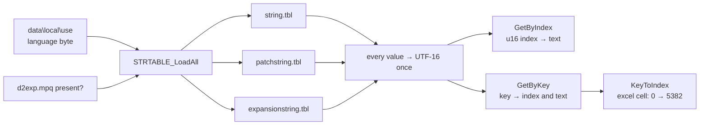
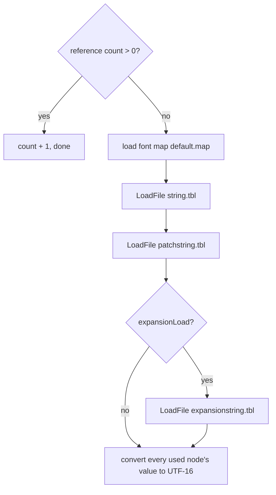
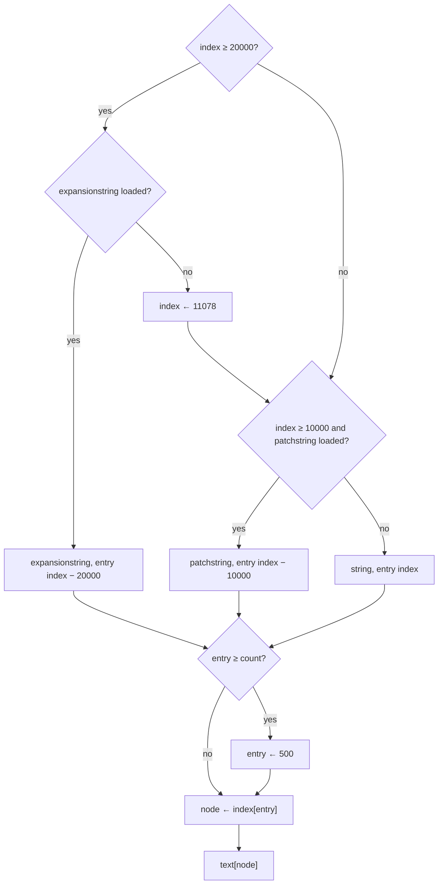
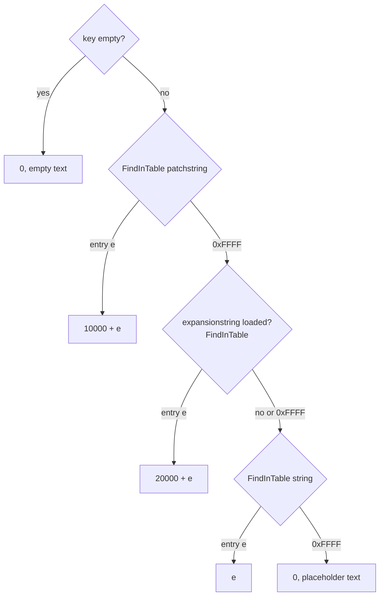
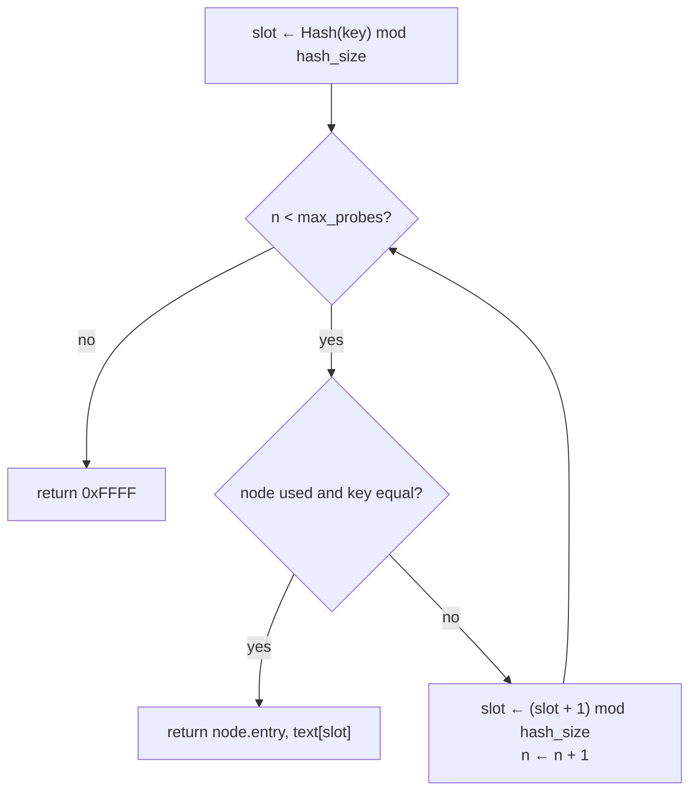

## Purpose

Excel records and game code name their text by a **string index** (a u16 stored in a record) or by a **string
key** (an ASCII name such as `GloomUM`). This spec says how the game loads the three `.tbl` string tables of the
configured language, how it turns an index into text, and how it turns a key into an index, through the hash table
and its probe walk. The output is a UTF-16 string; fonts, colour codes and rendering are out of scope.
The tables are loaded at program level, before any game is created, under a reference count. Nothing here draws a
random number.



## Entry points

| When | Tag |
| --- | --- |
| Program start, before any game (three callers) | [C] |
| One table file, from `LoadAll` | [C] |
| Any text shown for a stored index (UI, monster and item names) | [C] |
| A key looked up at run time (table loaders, e.g. `GEMS_Load`) | [C] |
| A key looked up for its text only | [C] |
| A `.txt` string-key cell compiled into a `.bin` (`-txt` only) | [C] |
| Release (reference count) | [C] for a release to 0; [I] for one that keeps the count above 0 |

- [C] The three `LoadAll` callers run at program level, before any game, and the run saw all three tables
  loaded from the main menu on, in both sessions.
- [C] `GetStringByKey` is a thin key → text call: it zeroes a local, calls `STRTABLE_GetByKey(key, &local)` and
  returns the local, the text. The 906 lookups logged from its return address (886 found, 20 not found) all equal the
  `GetByKey` model, text included.
- [C] **What a program run does with the tables** (the six runs of the data-load sweep that reach the menu): `LoadAll` from a
  first call site (count 0 → 1), `Unload` from a second (1 → 0), `LoadAll` from a third (0 → 1) before the excel load,
  and after the game is left `Unload` from a fourth (1 → 0) after the excel unload; the main menu loads again from the
  first site and the program exit unloads from the second. A fifth caller ran in none of the runs, and the count never
  went above 1. Each release to 0 leaves the three file buffers at 0.

## Inputs

### Tables

| Anchor | Used for |
|---|---|
| `tbl`#layout: `crc`, `count`, `hash_size`, `string_start`, `max_probes`, `file_size`, `index[]`, nodes | the three files' bytes |
| `tbl`#hash-table | the ELF hash, node placement by insertion, the CRC-16 |
| `MonStats.txt:NameStr`, `SuperUniques.txt:Name`, `UniquePrefix.txt:Name`, `Weapons.txt:namestr` | examples of stored u16 string indices, resolved by § C |
| `data\local\font\<charset>\default.map` | the font map behind the character count of § B |

### Runtime state

| State | Type | Source |
|---|---|---|
| language code | 3-letter code (`ENG`…) | first byte of `data\local\use`, [data/excel § I](../excel/#i-string-table-keys) I1; § H |
| `expansionLoad` | bool | `HasExpansionMpq()`: `d2exp.mpq` exists, § A |
| per table: file buffer | bytes or NULL | `g_pStringTbl`, `g_pPatchStringTbl`, `g_pExpStringTbl` |
| per table: text per node | UTF-16 string pointer per node | `g_StringTblText`, `g_PatchStringTblText`, `g_ExpStringTblText` |
| not-translated cache | list of (key, placeholder text) | filled |
| load reference count | i32 | — |

### Constants

| Name | Value | Tag |
| --- | --- | --- |
| index base `string` | 0 | [C] |
| index base `patchstring` | 10000 | [C] |
| index base `expansionstring` | 20000 | [C] |
| expansion index without `expansionstring` | 11078 | [C] |
| entry past `count` | 500 | [C] |
| excel "not found" index | 5382 (`0x1506`, `string.tbl` key `dummy`) | [C] |
| `FindInTable` give-up value | `0xFFFF` | [C] |
| placeholder suffix | `" -not xlated call ken w"` (23 bytes) | [C] |
| empty text | the empty UTF-16 string | [C] |
| CRC-16 table | `table[1]` = `0x1021`, MSB first, init `0xFFFF` | [C] |
| UTF-8 decode table | 6 rows {mask, value, result mask, minimum} | [C] |

- [C] The bases, the give-up value, the suffix, the empty text and the decode table are reproduced
  against the logged lookups, the CRC parameters by a loaded and a rejected file, and 5382 by every string-key cell of the shipped `.bin` tables.


## Algorithm

### A. Loading — `STRTABLE_LoadAll`, `STRTABLE_LoadFile`



```
A1. LoadAll(lang, expansionLoad):                                                [C]
      if refCount > 0: refCount ← refCount + 1; return                           ; loaded once; [I] no run reached it
      LoadFontMap("data\local\font\<charset>\default.map")                       ; § B3
      string      ← LoadFile("data\local\lng\<lang>\string.tbl")
      patchstring ← LoadFile("data\local\lng\<lang>\patchstring.tbl")
      if expansionLoad: expansionstring ← LoadFile("data\local\lng\<lang>\expansionstring.tbl")
      for each loaded table t, each used node n of t:
        t.text[n] ← Utf8ToUtf16(value of n, limit: CharCount(value, n.string_length) + 1)   ; § B
A2. expansionLoad ← HasExpansionMpq()   (d2exp.mpq exists; not the game's mode)  [C]
A3. LoadFile(path):                                                              [C]
      buf ← FILE_LoadWhole(path)                                                 ; NULL when the file cannot be opened
      crc: u16 ← CRC16(init 0xFFFF, buf[string_start ..< file_size])
      if crc ≠ header.crc: fatal                                                 ; "failed at (206)"
A4.   for each node: if key_offset ≥ file_size or string_offset ≥ file_size: fatal   [I]
A5.   if buf = NULL: the header read faults (access violation), no test, no eng fallback   [I]
```

Step notes:

- A1. Each of the 18 calls of the data-load sweep made with the count at 0 (three per run) loads, by `FILE_LoadWhole` and in this order,
  `data\local\font\LATIN\default.map`, then `data\local\lng\ENG\string.tbl`, `patchstring.tbl` and
  `expansionstring.tbl` (the expansion argument is 1, `d2exp.mpq` being present), returns 1 and leaves the count at 1
  with the three buffers the loads returned; every logged text is the model's UTF-16 conversion of its node. [C]

- A2. **`expansionstring.tbl` loads whenever `d2exp.mpq` exists, in a classic game too.** The callers push the result
  of `HasExpansionMpq()` as the stack argument of `LoadAll`, and the call runs before any game exists. In the run
  every logged line of both sessions, the classic one included, had the three tables loaded, and the classic session
  resolved 21796, 22730 and 22732 through `expansionstring` (character-select text). [C]

- A3. The CRC is CRC-16/CCITT-FALSE over `[string_start, file_size)`; a file whose stored `crc` differs halts the game
  at start-up, and one with a recomputed `crc` loads. [C]
- A5. With `d2exp.mpq` present, a missing `string.tbl`, `patchstring.tbl` or `expansionstring.tbl` crashes the game;
  the fatal paths after a NULL return in `LoadAll` (0x1C3, 0x1F6) are never reached for that reason. [I]


### B. Text conversion — `UNICODE_Utf8ToUtf16`

```
B1. Utf8DecodeOne(src, avail) → (u16 unit, bytes) or −1:                         [C]
      the first byte picks the row (mask, value): 80/00, E0/C0, F0/E0, F8/F0, FC/F8, FE/FC
      each continuation byte must be 10xxxxxx
      cp ← decoded value & row.resultMask                                        ; 7F, 7FF, FFFF, 1FFFFF, 3FFFFFF, 7FFFFFFF
      if cp < row.minimum (0, 80, 800, 10000, 200000, 4000000), a byte is bad, or the sequence is cut: return −1
      return (u16) cp                                                            ; truncated above U+FFFF, no surrogates
B2. Utf8ToUtf16(dst, src, limit):                                                [C]
      n: i32 ← 0
      while n < limit − 1 and src not at its end:
        r ← Utf8DecodeOne(src)
        if r = −1: n ← n + 1; break                                              ; the unit is counted, not written
        dst[n] ← r.unit; n ← n + 1; advance src by r.bytes
      dst[n] ← 0
B3. CharCount(str, maxBytes): i32                                                [C]
      if no font map is loaded: return strlen(str)                               ; [C] under emulation; a stock run always has the map
      count ← 0; walk at most maxBytes bytes up to the NUL:
        if IsWideByte(b): count ← count + 1, skip 2 bytes
        else: count ← count + 1, skip 1 byte
      IsWideByte(b) = b ≥ 0x20 and b lies in none of the font map's (lo, hi) ranges
```

Step notes:

- B1. The first byte is sign-extended before masking, which the mask makes harmless. [C]
- B2. **At a bad sequence one unit of `dst`'s old content survives**: the unit is counted, the terminator goes after
  it, and nothing is written in its place. The run saw three such units (keys `"\x80\x02"` …); one read as 0, giving an
  empty text. [C]
- B3. The font map is `data\local\font\<charset>\default.map` (`"KAMAP\n"`, a name ended by 0x1A, then at name end + 5
  a u16 `n`, a u8 range count `r`, `r` (lo, hi) byte pairs, `n` 4-byte pairs and `n` u16). The `eng` charset's
  `font/latin/default.map` has the ranges (0x20–0x7E) and (0xA0–0xFF), so bytes 0x7F–0x9F count as two-byte
  characters. [C] The model's parse of the shipped map gives these ranges, and with them every one of the 4 264 logged
  conversions reproduces; the key `"\x7f\x02"` gives 23 units for 25 bytes, as the two-byte count of 0x7F predicts.

- A1/B. **At load a value converts whole**: the limit is `CharCount(value, string_length) + 1`, and over all 9 388
  entries of the three `eng` tables the result equals a plain UTF-8 decode. [C]

### C. Index → text — `STRTABLE_GetByIndex`



```
C1. GetByIndex(index: u16) → UTF-16 text:                                        [C]
      if index ≥ 20000:
        if expansionstring loaded: return EntryToString(expansionstring, index − 20000)
        index ← 11078                                                            ; [C]; not reached on a stock install
      if index ≥ 10000 and patchstring loaded: return EntryToString(patchstring, index − 10000)
      if string not loaded: fatal 0x246                                          ; [I]
      return EntryToString(string, index)
C2. EntryToString(t, entry: u16):                                                [C]
      if entry ≥ t.count: entry ← 500                                            ; [C]; no stock index reaches it
      node: u16 ← t.index[entry]
      if node ≥ t.hash_size or not t.nodes[node].used or t.text[node] = NULL: fatal   ; [I] not reached
      return t.text[node]
```

Step notes:

- C1. The run logged 336 index lookups (201 distinct: 269 in `string`, 38 in `patchstring`, 29 in
  `expansionstring`), and the table, entry, node and text of each matched the model. [C]

- C1. **The 11078 path is unreachable on a stock install**: it needs `expansionstring` unloaded, which happens only
  when `d2exp.mpq` is absent (A2). [I]
  It lands on `patchstring` entry 1078, or on entry 500 when `patchstring` has 1078 entries or fewer. [C] Under
  emulation, 141 indices ≥ 20000 in three worlds without `expansionstring` went through 11078 and returned the stock
  `patchstring`'s entry 1078 (1 179 entries), or a 600-entry `patchstring`'s entry 500.
- C1. With `patchstring` not loaded, an index in 10000–19999 is looked up as a `string` entry, where it is past the
  end and falls back to entry 500. [C] In the `string`-alone world every index 10000–19999, and every index ≥ 20000
  through 11078, returned `string` entry 500.
- C2. Under emulation 218 calls landed on entry 500, in every table (stock and synthetic), with the 16-bit entry
  compared unsigned. [C]
- C2. Text lookup is by **entry position**: a language whose `string.tbl` has other entries (the `deu` and `fra`
  files have 5322) shows other text for the same stored index. [I]

### D. Key → index — `STRTABLE_GetByKey`



```
D1. GetByKey(key, out text) → u16:                                               [C]
      if string or patchstring not loaded: fatal 0x2BA / 0x2BB                  ; [I]
      if key = NULL: fatal 0x2C0                                                 ; [I]
      if key = "": text ← EmptyText; return 0                                    ; no search
      e ← FindInTable(patchstring, key);  if e ≠ 0xFFFF: return 10000 + e
      if expansionstring loaded:
        e ← FindInTable(expansionstring, key);  if e ≠ 0xFFFF: return 20000 + e
      e ← FindInTable(string, key);  if e ≠ 0xFFFF: return e
      text ← NotXlated(key); return 0                                            ; § D2
D2. NotXlated(key):                                                              [C]
      if the cache has key: return its text
      b ← key ++ " -not xlated call ken w"
      text ← Utf8ToUtf16(b, limit: CharCount(b))                                 ; no +1: the last character is lost
      add (key, text) to the cache; return text
```

Step notes:

- D1. The order is **`patchstring`, then `expansionstring`, then `string`**, and each `FindInTable` call returns the
  entry it found and also yields that node's text. The run logged 3 928 key lookups (1 964 distinct keys per session,
  79 found nowhere, 1 empty), each with every table searched, the index and the text as modelled. [C]

- D1. **Entry 0 of `string` cannot be told from "not found"**: both return 0. `string.tbl` entry 0 is
  `WarrivAct1IntroGossip1`. [C] for the index returned: under emulation that key and a synthetic table's entry-0 key
  return 0 with their text, as do keys found nowhere and the empty key, while every other key returns `10000 + e`,
  `20000 + e` or `e` in the D1 order. The index 0 is set after the not-translated helper returns (`xor ax, ax`).
  [I] for the text a key found nowhere returns on a cache miss of that helper, which allocates: only its cache hit was
  emulated (the run's D2 covers the text).
- D2. **The placeholder loses its last character**, because the limit is the character count without the `+ 1` of
  load time: `"funeralpire"` gives `"funeralpire -not xlated call ken "` (with a trailing space). A key byte in 0x7F–0x9F
  counts as two bytes in the `latin` map and loses one more character (`"\x7f\x02"` →
  `"\x7f\x02 -not xlated call ken"`), and a key starting with a bad UTF-8 sequence leaves a single unwritten unit (B2).
  [C]
- D2. The run's not-found keys were the 68 two-byte keys `GEMS_Load` builds on its stack (`"-\x02"` … `"\x82\x02"`,
  caller), `"Elite Uniques"` from `LoadUniqueItems`, and ten keys through `GetStringByKey` (`funeralpire`,
  `burninglogs`, `stma` …); the one empty key came from `LoadMagicAffixes`. [C]
- D2. **Why the 68 gems keys miss.** The key is bytes `+0x28..+0x2A` of the gems record (a space read as 0, then a
  NUL). The loop treats `+0x28` as the gem's 4-character `code`, but in 1.14d that field holds the item index the
  `code` column compiles to (557..642 for the 69 rows), which is where the two-byte keys come from. The lookup meant to
  give the gem's name string by its code finds nothing, and every gem stores 0 at `+0x2C`. [C] The 68
  distinct keys of the loop's 136 lookups are exactly those bytes of the 68 `gems.bin` records (a space turned
  into 0), and every lookup returned 0.
- **Rare names, a load-time key and a client-side index.** `LoadRareAffixes` fills `+0x0C` of each
  merged rare-name record (0x48 bytes: the suffix and prefix tables together) with `STRTABLE_GetByKey(record + 0x26)`,
  the row's `name`; the `.bin` holds 0 there. The client's item-name builder takes a rare item's two merged ids
  (`ITEMS_GetRareName1`, item data `+0x32`, and its second-name twin, `+0x34`), resolves each through `RAREAFFIX_GetRecord`
  and shows `STRTABLE_GetByIndex(record + 0x0C)` for each; when that index is 0 it shows the raw `name` between `(`
  and `)` instead. The two texts go to two separate buffers. [C] for the load-time key and the shown index: hovering
  four rare items made the client's two name calls show 7 indices, each equal
  to `STRTABLE_GetByKey` of the merged record's `name`, the `+0x0C` the load stored.
  [I] for the raw name shown when the index is 0: every hovered record had a found key.
  A missing record leaves its buffer empty. [I]
- **The rare name line is `RareFormat`.** Qualities 6, 8 and 9 share one case of the client builder, which then calls
  `ClientFormatArgs(out, STRTABLE_GetByIndex(1718), name1Text, name2Text, NULL)`; string 1718 is the key `RareFormat`.
  The formatter copies its NULL-terminated arguments into 400-byte slots in order, so `%0` is `name1`'s text and `%1`
  `name2`'s; `MagicFormat` (1714, `%0 %1 %2`) is called the same way with the prefix text, the base name and the suffix
  text. [C] for the format line's index: the data-load sweep's hovers used string 1718.
  [I] for the rest.
  [C] In the shipped English `string.tbl`, entry 1718 is `%0 %1` (a data check of the table file, tbl.md).
  [I] So an English rare name is `name1`, one space, `name2`: the order and the separator come from the string table,
  not the code, and another language's `RareFormat` may reorder them. This rests on `%n` naming the *n*-th argument,
  which the argument copy and the `MagicFormat` call support. The builder is fatal (error line `0x822`) when
  `len(name1) + len(name2) + len(base name) + 3` reaches its output size.

### E. Hash probing — `STRTABLE_FindInTable`, `STRTABLE_Hash`



```
E1. Hash(key, size): u32                                                         [C]
      h: u32 ← 0
      for each byte b of key up to the NUL:
        c: i32 ← sign-extend(b)                                                  ; movsx: bytes ≥ 0x80 are negative
        h ← (h << 4) + c                                                         ; u32 wrap
        g: u32 ← h & 0xF0000000
        if g ≠ 0: h ← h ^ (g >> 24)
        h ← h & ~g
      return h mod size
E2. FindInTable(t, key, out text) → u16:                                         [C]
      slot: u32 ← Hash(key, t.hash_size)
      for n in 0 ..< t.max_probes:
        if t.nodes[slot].used = 1 and strcmp(key at t.nodes[slot].key_offset, key) = 0:
          if t.text[slot] = NULL: fatal 0x296                                    ; [I] not reached
          text ← t.text[slot]; return t.nodes[slot].entry
        slot ← (slot + 1) mod t.hash_size                                        ; an unused node is skipped, not a stop
      return 0xFFFF
```

Step notes:

- E1. **The hash reads signed chars.** On the shipped tables no key has a byte ≥ 0x80, so signed and unsigned agree on
  every stored key; a looked-up key can still have one: for `"\x80\x02"` the game's home slot in `patchstring` is 361,
  the unsigned hash would give 869 (also `"\x81\x02"` 345 / 885, `"\x82\x02"` 329 / 901). [C]
- E2. **A miss always examines `max_probes` nodes**, through unused ones (1 179 in `patchstring`, 2 453 in
  `expansionstring`, 5 192 in `string` for the `eng` files). The run logged 5 688 such misses, each over all
  `max_probes` nodes. [C]
- E2. The match is an exact `strcmp`: every logged hit and miss is the model's. [C] It is case-sensitive: the compare is an inline byte loop with no case folding. [I] No logged
  key is held by a table only under another case, so the run cannot tell it from a case-folding compare
  (data/excel I3).

- E2. **A duplicated key returns its lowest entry**: the nodes were placed by inserting entries in order along the
  same probe chain, so the first used node with that key is the first entry. The run hit three: `Berserker's`
  (string 1826, not 2507), `Eschuta's temper` (expansionstring 1586, not 1620), `fire` (string 3272, not 3328). [C]

- E2. Hit chains can be long: 885 hits per session matched after more than one node, the longest after 5 159 nodes
  (`"not used"` in `string`, home 157 → slot 5315, entry 5384). [C]

### F. Excel string-key cells — the 5382 rule

```
F1. KeyToIndex(cell key) → u16:                                                  [C]
      i ← GetByKey(key)
      if i = 0: i ← 5382                                                         ; 0x1506, string.tbl key "dummy"
      return i
```

- [C] This is the stored value of every string-key cell in the shipped `.bin` tables (2 344 present cells; 776 blank
  and 15 unknown keys store 5382), with one exception in the shipped file: monstats `uberandariel` `NameStr = Lilith`
  stores 5382 although `Lilith` is a `patchstring.tbl` key. The pinned game's own compile stores 11154 there, so the
  rule holds for that cell too ([data/excel § I](../excel/#i-string-table-keys) I2). It runs only when a `.txt` is compiled;
  a stock run reads the stored indices.

### G. Index bases, fallbacks and fatal paths

| Case | Result | Reached on stock data | Needed by a reimplementation | Tag |
|---|---|---|---|---|
| index 0–9999 | `string` entry `index` | yes | yes | [C] |
| index 10000–19999 | `patchstring` entry `index − 10000` | yes | yes | [C] |
| index ≥ 20000 | `expansionstring` entry `index − 20000` | yes, classic games too | yes | [C] |
| index ≥ 20000, no `expansionstring` | index ← 11078 | no: needs `d2exp.mpq` absent | only for an install without `d2exp.mpq` | [C] |
| entry ≥ `count` | entry 500 of the same table | no stock index exceeds a count | only for edited or foreign-language tables | [C] |
| key empty | 0, empty text, no search | yes | yes | [C] |
| key found nowhere | 0, placeholder text | yes | yes, for the text (D2) | [C] |
| excel cell blank or unknown | 5382 | yes (in the shipped `.bin`) | only for a `.txt` compiler | [C] |
| `crc` mismatch | fatal at load | forced only | guards a corrupt file | [C] |
| node `key_offset`/`string_offset` ≥ `file_size` | fatal at load | no | guards a corrupt file | [I] |
| `index[entry]` names an unused node, or a NULL text | fatal | no | guards a corrupt file | [I] |
| matched node with NULL text | fatal 0x296 | no | guards a corrupt file | [I] |
| `string` not loaded at `GetByIndex`; `string`/`patchstring` not loaded or NULL key at `GetByKey` | fatal 0x246; 0x2BA / 0x2BB; 0x2C0 | no | guards a programming error | [I] |
| table file missing | access violation, no `eng` fallback | no | guards a broken install | [I] |

### H. Language

- [C] The language code comes from the first byte of `data\local\use` (I1 of [data/excel § I](../excel/#i-string-table-keys)).
  The shipped files hold 0x00 (`ENG`) in the MPQ copy and in the loose `Use` and `Use_eng`; the loose `Use_rus` holds
  0x0B (`RUS`) and is read only when copied over `Use` with `-direct`, as the install's Russian launcher script does.
  In every run of the data-load sweep the first `LNG_GetLanguageIndex` call reads `use` once and returns its first byte: `00` gives 0 and
  the tables load from `lng\ENG\`, the copied `Use_rus` gives 11, and the cached byte holds the value for every later
  call. No shipped file selects `pol`, `por` or any other language.
- [I] Values above 13 become 0 (the clamp): no shipped file holds such a byte, so only a made-up `use` file reaches
  it.
- [C] **`RUS` ends the program at the font map**, before any `.tbl`. With the byte 11 the loads use the `CYR` charset:
  `Font16.dc6` and `Font16.tbl` under `DATA\LOCAL\Font\CYR\` are not found (each lookup returns 0, the run going on),
  then `STRTABLE_LoadAll`'s load of `data\local\font\CYR\default.map` returns 0 and the process exits (code 0377)
  before any `.tbl` is read. `RUS` has no `.tbl` file anywhere in the install either.
  [I] for which test ends it, which the run did not follow.
- [C] **A `use` byte of 13 is not a fallback to `ENG`.** The clamp lets 13 through, and `LNG_GetLanguageCode` sends
  only an id of 14 or more to entry 0, so 13, which matches none of the 13 entries, reads entry 13: the 0x18 bytes
  after the table.
  [I] for what it reads there: run-time memory whose "pointers" are below 0x10000, so the string-table load would
  fault. Only an edited `use` file holds 13.
- [I] Any language other than `eng` whose font map and first tables load would also crash at `expansionstring.tbl`
  while `d2exp.mpq` exists, since only `eng` ships that file.

## Outputs

- `GetByIndex`: a pointer to a NUL-terminated UTF-16 string (u16 units, BMP only), shared, made once at load. [C]

- `GetByKey`: a u16 index (`0`, `entry`, `10000 + entry` or `20000 + entry`) and a text pointer (the node's text,
  the empty text or the cached placeholder). [C]
- `KeyToIndex`: the u16 a `.bin` cell stores. [C]

## Worked example

Source: the strings run, expansion session, and the same lookups through our reader of the table files (English
tables: `string` 5 391 entries / 5 393 nodes / `max_probes` 5 192, `patchstring` 1 179 / 1 181 / 1 179,
`expansionstring` 2 818 / 2 819 / 2 453).

**A key lookup with a probe chain longer than one: `GetByKey("of Amianthus")`.** [C]

| step | table | home slot | nodes examined | result |
|---|---|---|---|---|
| 1 | `patchstring` | 961 | all 1 179 (`max_probes`) | miss, `0xFFFF` |
| 2 | `expansionstring` | 34 | 3: slot 34 (`Shocking`, entry 709), 35 (`Consecrated`, entry 851), 36 (`of Amianthus`) | entry 925 |
| — | `string` | not searched | — | — |

Result: index `20000 + 925` = **20925**, text `of Amianthus`. Note that the patchstring miss costs 1 179 node visits
before the expansion hit.

**Index lookups.** [C] for the three rows: the first logged in the classic session, the third logged once
(`string` entry 5382, node 5313), and the second, on a path no stock install reaches, under emulation with the stock
`string` and `patchstring` and no `expansionstring`.

| index | tables loaded | table, entry | node | text |
|---|---|---|---|---|
| 21796 | `spx` (classic game, `d2exp.mpq` present) | `expansionstring` 1796 | 124 | `CHARACTER` |
| 21796 | `sp` (no `d2exp.mpq`) | `patchstring` 1078 (via 11078) | 469 | `Missing string` |
| 5382 | `spx` | `string` 5382 (key `dummy`) | 5313 | `an evil force` |

**A key found nowhere.** `GetByKey("funeralpire")` misses `patchstring`, `expansionstring` and `string`, each over
all its `max_probes` nodes, and returns 0 with `"funeralpire -not xlated call ken "`. [C]


## Reimplementation notes

- **What a reimplementation needs.** For names and UI text: § A's load order with `expansionLoad = d2exp.mpq
  exists`, § C's index bases (0 / 10000 / 20000), § B's UTF-8 → UTF-16 decode (a whole-value decode at load), and,
  where code looks keys up at run time, § D and § E (the table order, the duplicate rule, the empty-key and not-found
  returns, the placeholder text). The 5382 rule (§ F) matters only to a `.txt` compiler. [C]

- **What only guards corrupt files.** The CRC check, the offset checks, the node checks, the NULL-text fatal and the
  missing-file crash (§ G rows marked "guards"). A reimplementation that reads only the stock tables can drop them
  without changing any output. [I] The 11078 and entry-500 fallbacks behave as
  § C states under emulation. [C] They matter only to
  an install without `d2exp.mpq` or to edited tables. [I]
- **An exact-match map can replace the probe walk** if it returns the lowest entry of a duplicated key and `0xFFFF`
  for an absent key: every entry of every shipped file is found within `max_probes` nodes of its home slot, and the
  walk returns the first-inserted node of a key. [C] Over every distinct key of the three `eng` tables (8 949 keys,
  449 duplicate entries) the probe walk returns the lowest entry of the key within `max_probes`. (`not used`, the
  longest hit chain of § E, is held once, at 5384: no duplicate case.)
- **Signed hash.** Hash keys as signed chars: a key byte ≥ 0x80 (`GEMS_Load`'s keys) gives a different home slot than
  the unsigned ELF hash. On a miss the home slot does not change the result, since every miss walks `max_probes` nodes. [C]

- **Classic is not "no expansion table".** Do not unload or skip `expansionstring` in a classic game: a classic game on
  a LoD install resolves indices ≥ 20000 normally. [C]
- **Stored indices are language-bound.** The `.bin` indices are the English ones; another language's `string.tbl` may
  have other entries at the same position. [I]
- **Entry 0 of `string`** is indistinguishable from "not found" through `GetByKey`. [C]
- **`use` byte 13 is not `ENG`** (§ H): only 14 and above map to entry 0. [C]

## Evidence

- How the statements above were read: the table-file data check of entry 1718 and the worked example's lookups.
- [excel.md § I](../excel/#i-string-table-keys): the stored indices and the language table.
