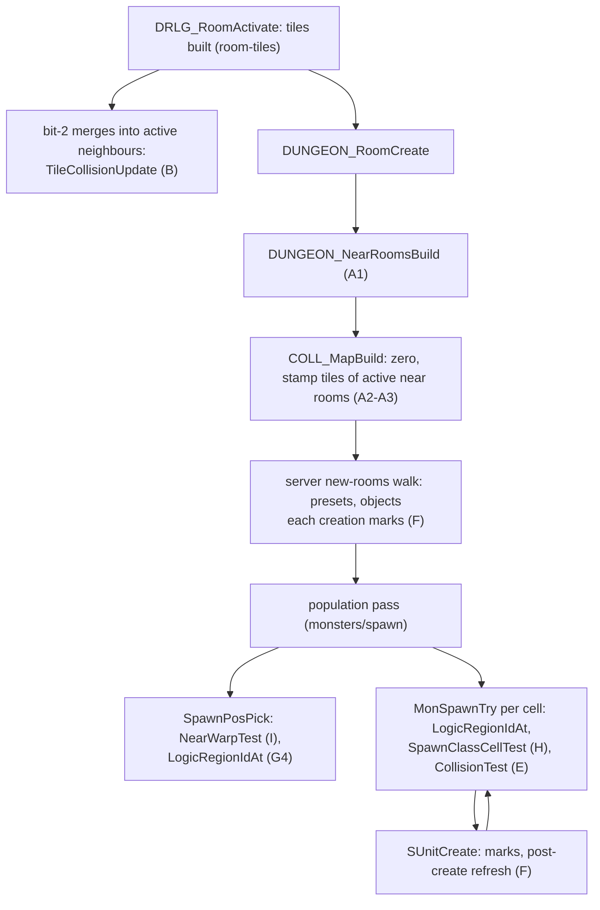
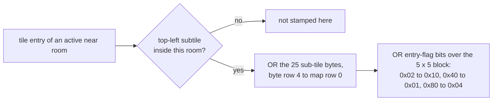
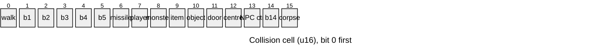
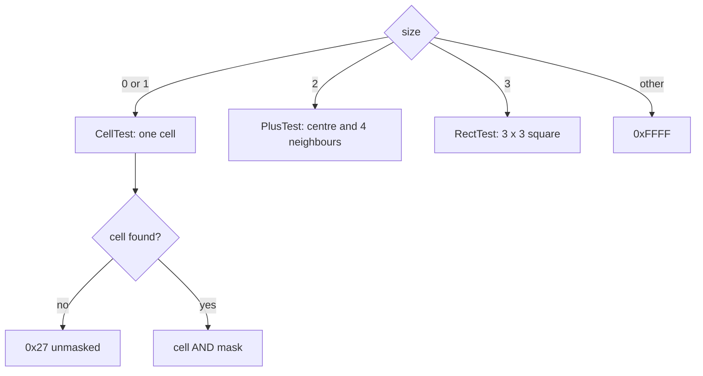
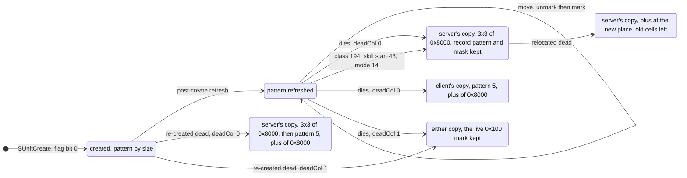
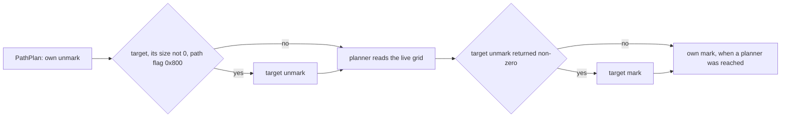
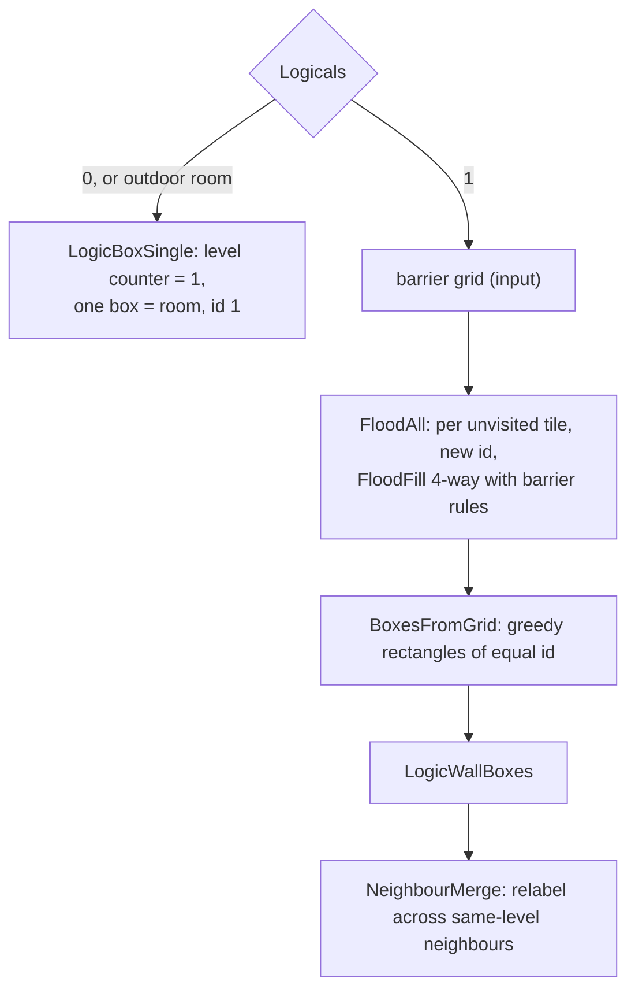
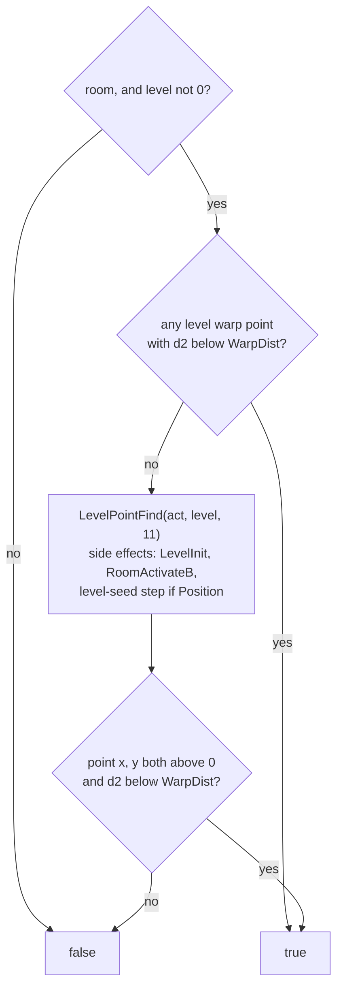
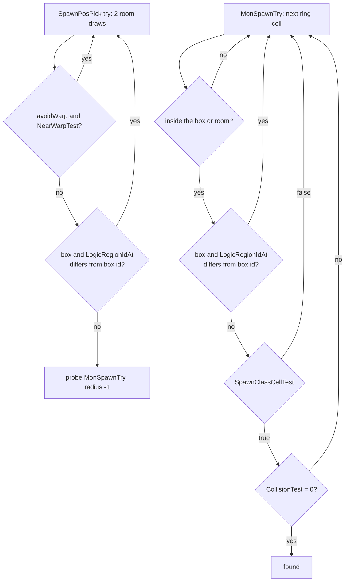

## Purpose

Every active room on the server owns a grid of u16 cells, one per subtile of its rectangle. The grid is
built once, when the room is activated, from the DT1 sub-tile bytes of the tiles that lie in the room. After
that, every unit that stands in the room marks its footprint into the grid and unmarks it when it moves or
leaves; a death is [§ F5](#f5-corpse-marks-by-copy-of-the-grid). This spec gives the build, the marks, the meaning of each bit as the spawn code reads it, and
the four position tests that the population pass of [monsters/spawn](../../spec-monsters/spawn/) calls:
`CollisionTest`, `LogicRegionIdAt`, `SpawnClassCellTest` and `NearWarpTest`. It also gives the `spawnCol` 1
tile placement `SpawnPosOnTile` and the logic regions that `LogicRegionIdAt` reads. None of the tests draws,
except `NearWarpTest` in one case (§ I) and `SpawnPosOnTile`, which makes one room draw. Movement, pathing and
line of sight read the same grid. They are named here, not specified.

## Entry points

| When | Function | Tag |
|---|---|---|
| Active room created at the end of `DRLG_RoomActivate`: near list, then the grid build | — | [C] |
| A bit-2 merge re-picks or hides a tile of an active neighbour | `TileCollisionUpdate` (from `Bit2TileMerge`) | [C] the call, with the active room (37 calls); [I] its write into an active neighbour, § B |
| A unit is created with create flag bit 0: its path and its mark | — | [C] |
| A monster's post-create pattern refresh | — | [C] |
| A monster dies (corpse mark), by copy of the grid: [§ F5](#f5-corpse-marks-by-copy-of-the-grid) | server: `MonDeathEvent` → `MonDeathCorpseMark` → `UnitCorpseColl`, 1 527 corpse-mark lines in the second path run; client: the same callee from two sites, 408 `deadCol`-test lines in the collision run of the two tests before them, over 202 unit addresses, lines, not deaths | [C] |
| A player dies (corpse mark), on the server | `UnitCorpseColl(unit, 1)`, which did not fire in the second path run | [I] |
| A preset room's logic regions, by `Logicals` | — | [C] |
| Position tests of the population pass | — | [C] |
| `spawnCol` 1 placement (the frog demons) | — | [C] |

- [C] `COLL_MapBuild` has one caller, `DUNGEON_RoomCreate`, the last step of `DRLG_RoomActivate` after the
  DRLG room's tiles are built. The grid lives until `DUNGEON_RoomFree` frees it through
  `COLL_MapFree`.
- [I] The client builds its own grids with the same code (`DUNGEON_RoomCreate` is shared), so the game holds a room's
  rectangle twice: in the seven logs, 357 of the 559 (level, rectangle) pairs are built under two
  DRLG rooms, exactly one of them with a pass-entry line, logged at the server's population pass. The objects logs were not recounted.
  (`DUNGEON_RoomCreate`)
- [I] Only the server grid, which the population pass reads, is in scope. The exception is [§ F5](#f5-corpse-marks-by-copy-of-the-grid), which states
  the corpse marks of both copies, because they differ and the first observations were read on the client's.


## Inputs

### Tables

| Anchor | Used for |
|---|---|
| `dt1`#sub-tile-flags | the 25 sub-tile bytes of a tile record (`+0x28`), OR-ed into the grid (§ A) |
| `MonStats2.txt:SizeX` | s8 `+0x08`: a monster's footprint size, for its test (§ E) and its mark (§ F) |
| `MonStats2.txt:spawnCol` | u8 `+0x0A`: the spawn test mask (§ D) and the tile placement (§ J) |
| `MonStats2.txt:deadCol` | `+0x06` bit 3: whether a monster's corpse call runs, on either copy |
| `MonStats.txt:BaseId` | `+0x02`: the five classes of `SpawnClassCellTest` (§ H), wraiths (38) at creation (§ F) |
| `MonStats.txt:npc`, `MonStats.txt:interact`, `MonStats.txt:inTown` | `+0x0D` bits 0, 1 and 2: the NPC footprint patterns 3 and 4 (§ F, F2) |
| `MonStats.txt:flying`, `MonStats.txt:opendoors` | `+0x0D` bit 6, `+0x0C` bit 3: the monster move mask (named only) |
| `Levels.txt:WarpDist` | `+0x0C`: the squared-distance limit of `NearWarpTest` (§ I) |
| `Levels.txt:Position` | leveldefs `+0x90`: the waypoint-point branch of `NearWarpTest` (§ I) |
| `LvlPrest.txt:Logicals` | which logic-region builder a preset room runs (§ G; the selection is in [preset.md](../preset/)) |
| Objects: `SizeX` `+0xD0`, `SizeY` `+0xD4`, `HasCollision0..7` `+0x120 + mode`, `IsDoor` `+0x13A`, `BlocksVis` `+0x13B`, `SubClass` `+0x167`, `BlockMissile` `+0x1B6` | an object's mark rectangle and mask (§ F) |
| Missiles: `Collision` `+0x184`, `Size` `+0x18A`, `CollideType`, `CanDestroy` | a missile's mark and its collide mask (§ F) |

### Runtime state

| State | Type | Source |
|---|---|---|
| active room rectangle | i32 x0, y0, w, h at active room `+0x4C`, subtiles; the DRLG room's tile rectangle × 5 | [room-tiles](../room-tiles/), `DungeonRoom+0x4C` |
| near list | active rooms, at active room `+0x00`, count `+0x24`, self included | § A step 1, `DungeonRoom+0x00` |
| collision map | `CollMap` at active room `+0x20`: `{x0, y0, w, h}` at `+0x00`, the tile rectangle at `+0x10`, `cells` (u16, `w·h`) at `+0x20` | § A, `CollMap+0x20` |
| tile entries | floor, wall and shadow arrays of the DRLG room's RoomTile, 0x30 bytes each: position `+0x08`/`+0x0C` (tiles, relative to the owning room), flags `+0x14`, tile `+0x18` | [room-tiles](../room-tiles/) step 8, `RoomTileEntry+0x14` |
| unit path | footprint pattern `+0x48`, mark mask `+0x4C`, move test mask `+0x50` | § F, `DynPathColl+0x48` |
| logic record | DRLG room `+0x64`: flags, box count, id grid `+0x08`, box grid `+0x1C`, box list `+0x30` | § G, `LogicRecord+0x1C` |
| level region counter | i32 level `+0x1DC` | § G |
| level warp points | x[9] level `+0x1E0`, y[9] `+0x204`, count `+0x228` | § I |
| level seed | `Seed` at level `+0x1C4` | [rng/seeds](../../spec-rng/seeds/) |

### Constants

| Name | Value | Anchor | Tag |
|---|---|---|---|
| `OUT_OF_ROOM` | `0x27` (bits 0, 1, 2, 5), returned unmasked for a footprint cell in no reachable room | — | [C] |
| `BAD_SIZE` | `0xFFFF`, `CollisionTest` with a size other than 0..3; no stock size reaches it (MonStats2 `SizeX` is 0–3 in all 609 rows) | `CollisionTest` | [I] |
| `g_CollPatternBySize` | size 2 → pattern 1, 3 → 2 | — | [C] |
| `g_CollPatternBySize` | size 0 → pattern 0, 1 → 1; any other size → 1, which no stock input reaches on the server (players 2, MonStats2 `SizeX` 0–3, Missiles `+0x18A` 0–3) | `g_CollPatternBySize`, `PATH_PatternFromSize` | [I] |
| spawn mask by `spawnCol` | 0 and 4+: `0x3C01`; 2: `0x3F11` | — | [C] |
| spawn mask by `spawnCol` | 1: `0x01C0`; 3: `0` | — | [C] |
| `g_SpawnTileOffsets` | (0, −3), (3, 0), (0, 3), (−3, 0) | — | [C] |
| `g_LogicFloodDirs` | (1, 0), (0, 1), (−1, 0), (0, −1) for d = 0..3 | — | [C] |
| `g_LogicFloodOrientRow`, `g_LogicFloodRules` | step G3 | `g_LogicFloodOrientRow`, `g_LogicFloodRules` | [C] the entries the floods read; [I] the two entries and three rows G3's note names |

- [C] The mask table is the one of [monsters/spawn § Constants](../../spec-monsters/spawn/#constants). All four masks are
  exercised: over the 1 330 kept logs of the earlier runs and the nine sessions,
  `MonSpawnTry`'s `CollisionTest` carried `0x01C0` on all 271 calls of a `spawnCol` 1 class, `0` on all 837 of a `spawnCol` 3
  class (the barricades 432–435, 524, 525), `0x3F11` on all 236 of `spawnCol` 2 and `0x3C01` on all 172 925 others. The 43
  mask-0 tests of the sessions were all predicted and returned 0.
- [C] Only classes 153 (`hellmeteor`) and 258–263 (the tentacles) reach the ring test with `0x01C0`: tests
  `spawnCol` = 1, and send every other `spawnCol` 1 class, the frog demons 247–249, to `SpawnPosOnTile`
  (§ J; 1 777 tile-placement lines, no mask-test line). [I] Classes 260 and 263 were not met; the range test covers them.


### Inputs and oracles

The reproduction works at boundary B. The tile half of the grid is modelled at activation and compared cell for cell. The marks made inside the population pass and the predicates are modelled on a grid snapshot taken at pass entry. The rest comes from the log as a boundary input. A reimplementation supplies each row from its owner. Every `[C]` of this spec holds under these inputs. [C]

| Input | Kind | What it holds | Owner | Tag |
|---|---|---|---|---|
| grid snapshot at pass entry | value oracle | the cells, rectangles and near lists of the pass room and of every room within two hops. It is the activation grid of § A plus every mark made before the pass: preset units and objects, players, monsters that walked in, items, the server's corpse marks. The non-gating R3 check: over 360 pass rooms the snapshot differs from the activation model in 1685 cells, 1620 of them explained by the logged preset and object marks; the 65 left in 15 rooms are unit bits (`0x80`, `0x1080`, `0x100`, `0x1100`), no tile bit. Still a value input of the composition (oracle 20): with every chain model in, the composed grid equals the snapshot in 4 723 of 4 883 pass rooms, the residue unit bits only | this spec (§ A, § F), `objects`, `drlg/preset`, runtime units | [C] |
| tile entries at activation: the tile of each entry and its entry flags | modelled, [drlg/room-tiles](../room-tiles/) | which DT1 tile each floor, wall and shadow entry holds (the rarity pick) and its flags `+0x14`. 5600 tile records were checked against their DT1 files, 0 differ. The flag word follows from the room's cells by [room-tiles step 9d](../room-tiles/#algorithm), which reproduces every entry of every activation dump (3 684 791 entries on the 40 logs with `OD0` and `LSUB` lines, 1 786 086 more on the objects run, 0 mismatches), so the flags are no longer a logged input of this spec | [drlg/room-tiles](../room-tiles/) | [C] |
| near list at activation | runtime state | which near rooms were active when the room was activated (§ A step 1), so the activation order | [drlg/overview](../overview/), [drlg/room-tiles](../room-tiles/), the game's room activation | [C] |
| logic-box grids of the snapshot rooms | DRLG state | the box list and box grid that `LogicRegionIdAt` reads. The flood that builds them (§ G) is checked separately at its exit, 378 floods | this spec (§ G), [drlg/preset](../preset/) (`Logicals`) | [C] |
| barrier grid of the flood | input | the `(w+1)·(h+1)` barrier cells of `LOGIC_BarrierGridBuild` | this spec (§ G2; the rule reproduces every logged grid, but the checker still reads it from the log) | [C] |
| level warp points | modelled, [drlg/warps § E](../warps/#e-warp-points) | the level's warp points (`level+0x1E0`, `+0x204`, count `+0x228`), predicted from the build's room flags at all 1646 `NearWarpTest` calls (levels 4, 29, 38, 44, 76, 77, 78, 106). At the 254 calls in levels 4 and 44 the outdoor room's point was logged until an earlier phase; it now follows from the out room's flags | [drlg/warps](../warps/); outdoor rooms' bits [drlg/outdoor](../outdoor/) | [C] |
| type-11 point | input | the level's waypoint point that `LevelPointFind` returns, logged at each `NearWarpTest` that reaches it | [drlg/warps § D](../warps/#d-room-flags-and-level-points-from-a-preset-instance) (the point list), `objects` (the waypoint fallback) | [C] |
| object marks and `COLL_WHTest` at the object call sites | modelled, this spec (§ E6, § F) and [objects](../../spec-objects/overview/) | the object marks of the presets/objects window and the results of `COLL_WHTest` at the object placers' call sites. Both are predicted on the grid model: the objects model of [objects](../../spec-objects/overview/) gives each object's class, position and mode, § F makes its mark and § E6 answers its tests. On the objects run all 5859 tests (5767 placer tests with boxes `size + 2`, `+ 6`, `+ 7` and masks `0x3F11`, `0xC01`, plus 92 1×1 gold-pile tests; 4816 blocked, 1043 free) and all 1847 object marks (1835 inside a window, 12 under preset monsters) are predicted, 0 mismatches. The marks that stay logged there are the monsters' (checked by the population model); the gold drop's items (`0x200`) are modelled now | this spec, [objects](../../spec-objects/overview/) | [C] |
| seed of another room at its first request in a pass | chain state (a seed oracle before) | a frog demon placed by `SpawnPosOnTile` on a near room's tile draws its group and minions from that room's seed: its predicted activation seed, or its seed after its last pass ([chain § Algorithm](../../spec-chain/overview/#algorithm) D6); both calls of the world logs predicted | [rng/seeds](../../spec-rng/seeds/) (that room's seed), [chain](../../spec-chain/overview/) | [C] |

- [C] The DT1 sub-tile bytes are not an input: the model reads them from the DT1 files,
  and every logged tile record matched its file.
- [C] The logs of the spawn run hold no snapshot, warp points or box grids. On them the four tests stay
  value oracles, except the 3887 `SpawnClassCellTest` calls of classes that pass without a test.

## Algorithm



### A. The grid build at activation



```
A1. NearRoomsBuild(R):                                            [C]
      R.near ← the DRLG room's near list (DRLG +0x08, count +0x2C), in order,
               keeping the entries whose active room (DRLG +0x30) exists
      ; the DRLG room's +0x30 is set before, so R is in its own list
      for each active neighbour N ≠ R in R.near:
        rebuild N.near the same way (it now holds R); N's grid is not touched

A2. MapBuild(R):                                                  [C]
      (x0, y0, w, h): i32 ← R's subtile rectangle                  ; = the DRLG room's tile rectangle × 5
      cells: u16[w·h] ← 0                                          ; cell (x, y) at cells[(y − y0)·w + (x − x0)]
      for N in R.near:                                             ; near-list order; self included
        (tx, ty) ← N's tile origin (N's CollMap +0x10, +0x14)
        StampList(R, N.floors, tx, ty)
        StampList(R, N.walls, tx, ty)                              ; every orientation not floor or shadow, roofs (15) included
        StampList(R, N.shadows, tx, ty)                            ; orientation 13

A3. StampList(R, entries, tx, ty):                                [C]
      for e in entries:                                            ; up to the used count
        sx: i32 ← (e.x + tx)·5;  sy: i32 ← (e.y + ty)·5            ; the entry's top-left subtile
        if not (x0 ≤ sx < x0 + w and y0 ≤ sy < y0 + h): continue   ; half-open
        b: u8[25] ← e.tile's sub-tile bytes                        ; DT1 record +0x28
        for r in 0 ..< 5, c in 0 ..< 5:
          cells[(sy − y0 + r)·w + (sx − x0 + c)] |= b[(4 − r)·5 + c]    ; rows reversed
        v: u16 ← (e.flags & 0x02 ? 0x10 : 0) | (e.flags & 0x40 ? 0x01 : 0) | (e.flags & 0x80 ? 0x04 : 0)
        if v ≠ 0: OR v into the same 5 × 5 cells
```

Step notes:

A1. [C] Only the near list's **active** rooms take part, so the grid depends on which neighbours were active when R was
activated.

A2. [C] There are no border cells: the grid is exactly the room's subtile rectangle. The allocation has `2·h` slack cells after
the grid, which no code read addresses. Nothing is skipped for its orientation or for the hidden flag `0x08`. Orientation
enters only through entry flag `0x02`.
[C] The overwrite form `COLL_SetTile` exists, but the build always passes 0 and takes the OR path. Each of the 5434
activation dumps whose tiles all have TL records equals the OR build; an overwrite build would differ in 3789 of them
(641 892 cells), so the logs tell the two forms apart.

A3. [C] An entry's position is relative to its **own** DRLG room, whose tile origin is read from that room's map. Rooms are
tile-aligned, so a tile whose top-left subtile is inside R lies wholly inside R, and the stamp needs no upper clip. The OR
order does not change the result. [C] The entry flags come from
`RoomTileSetFlags`: `0x02` for orientations 8–11 and for cell bit 28, `0x40` for cell bit 17, `0x80` for cell bit 16. The run
saw `0x40` (grid `0x01`) over 21 176 tiles and `0x02` (grid `0x10`) over 4962. [C] `0x80` ORs `0x04` over the tile: in Harrogath (109) two kept logs hold
88 entries with the flag in 16 activation dumps, and 1 044 cells of those dumps match only with the `0x04` OR; every dump is
exact cell for cell.

**Activation order.** A DRLG room's cell grids are (w+1)×(h+1): column `w` and row `h` are the border tiles, built unless
`KillEdge` applies. Their top-left subtile lies in the right or bottom neighbour. So:

- [C] R's grid holds R's own tiles at columns 0..w−1 and rows 0..h−1, plus the border tiles of each left or top neighbour that is
  **already active** when R activates.
- [C] A grid is never re-stamped when a neighbour activates later. If the right or bottom neighbour is already active when R
  activates, R's border tiles reach no grid at all: the run had 702 such rooms and 5970 border tiles stamped nowhere, 112 cells of
  the earlier rooms that those tiles would have changed. If that neighbour activates later, R's border tiles reach its grid when
  it builds.
- [C] A cell on R's first column or row can therefore hold a tile from R and one from the neighbour (the same DS1 or maze cell,
  built by both rooms), OR-ed together.

### B. Later tile writes

```
B1. TileCollisionUpdate(activeRoom, entry, newTile):              [I]
      r ← RoomAtSubtile(activeRoom, the entry's top-left subtile)  ; § C
      if r = none: return
      AND-NOT the 25 bytes of the entry's current tile (+0x18) into r's cells, rows reversed
      if newTile ≠ none: OR newTile's 25 bytes into the same cells
```

- [C] The only caller is `Bit2TileMerge`, at three call sites: two reference
  scans list the same three.
- [I] It runs during a new room's tile build, and only for a neighbour that is active. The three
  call sites: an orientation-3 entry merged into another orientation, whose orientation-4 partner becomes hidden and is cleared
  with no re-stamp; an entry turned into orientation 3, which gets `0xC008` and is cleared with no re-stamp, while the
  new orientation-3 tile goes to the building room; a re-picked tile, cleared and re-stamped.

- [I] The clear is a plain AND-NOT, so it also removes the same bits that another tile stamped into those cells (for example a
  floor's bit 0 under a wall). An entry that was already hidden when a later room stamps it is stamped in full.

- [C] The function is called from `Bit2TileMerge` with the active room, the entry and its old and new tiles. The collision run
  had 4 calls, each with the tile's top-left in no active room. The collision sweep had 37 (22 in the Jail), every one
  returning to the re-pick site, and in each no room reachable from the hint held the entry's top-left subtile.
  None of the 41 wrote anything, so its clear and re-stamp are unreached (Open questions).


### C. Cell access and the out-of-room values

```
C1. RoomAtSubtile(hint, x, y) → room | none:                      [C]
      if hint holds (x, y) (half-open): return hint
      for n in hint.near: if n holds (x, y): return n              ; near-list order
      return none

C2. Cell(hint, x, y) → u16 | none:                                [C]
      r ← RoomAtSubtile(hint, x, y)
      if r = none or r has no map or no cells: return none
      return r.cells[(y − r.y0)·r.w + (x − r.x0)]
```

- [C] A cell of an active room that is not in the hint's near list counts as "no room".
- [C] When no cell is found, the one-cell test returns `0x27` **unmasked**, and so does the rectangle test for a piece whose
  top-left has no room. The plus test returns **the mask** when its centre has no room. Writes to a missing cell are
  dropped.
- [C] Nothing writes `0x27` into a grid. It is only a return value.

### D. The u16 word, bit by bit



Writers and readers, as the code read names them. The readers are the spawn masks (`0x3C01` for `spawnCol` 0 and 4+, `0x01C0`
for 1, `0x3F11` for 2, `0` for 3), the out-of-room value `0x27`, and the move masks of § F, which are named only.

| Bit | Mask | Writers | Readers | Tag |
|---:|---|---|---|---|
| 0 | `0x0001` | DT1 sub-tile bit 0; entry flag `0x40` over the tile | `0x3C01`, `0x3401`, `0x1C09`, `0x3F11`; in `0x27` | [C] (`COLL_StampTileList`: 956 rejections) |
| 1 | `0x0002` | DT1 sub-tile bit 1; doors with `BlocksVis` | no spawn mask; in `0x27`; the line test (named) | [C] the writers (`COLL_StampTileList`, `UNIT_GetCollMask`: 195 834 tile cells, 12 `0x806` door marks) |
| 2 | `0x0004` | DT1 sub-tile bit 2; entry flag `0x80`; objects with `BlockMissile` | flying `0x1804`, wraith `0x804`; in `0x27` | [C] the writers (`COLL_StampTileList`, `UNIT_GetCollMask`: 1 446 257 tile cells, 21 `0x404` object marks; entry flag `0x80`, counted, § A3) |
| 3 | `0x0008` | none: no stock DT1 sub-tile has bit 3 and no writer's mask holds it (below) | player `0x1C09` | [I] |
| 4 | `0x0010` | DT1 sub-tile bit 4 (`tombsteps.dt1` only); entry flag `0x02` over the tile | `0x3F11` | [C] (`COLL_StampTileList`, `MonSpawnTry`: 775 275 cells) |
| 5 | `0x0020` | DT1 sub-tile bit 5 | no listed mask; in `0x27` | [C] (`COLL_StampTile`: 10 139 cells) |
| 6 | `0x0040` | missiles with Missiles `Collision` ≠ 0 | `0x01C0` | [C] (`PATH_SetMarkMask`, `MonSpawnTry`: 5850 mask changes, classes 69, 413, 423) |
| 7 | `0x0080` | players | `0x01C0` | [C] (`PATH_DynamicCreate`, `COLL_PatternMark`: 1162 whole pluses in the pass-entry snapshots) |
| 8 | `0x0100` | live monsters; `deadCol` 1 corpses, which keep the live mark | `0x01C0`, `0x3F11`, `SpawnPosOnTile`'s centre test | [C] live monsters; [C] `deadCol` 1 on the client's copy (12 `deadCol`-test lines) and on the server's for classes 403 and 404 (18 dead) |
| 9 | `0x0200` | ground items | `0x3F11` | [C] (`UNIT_GetCollMask`, `UNIT_CollMarkRect`: 271 item marks) |
| 10 | `0x0400` | objects (not portals) | `0x3C01`, `0x3401`, `0x1C09`, `0x3F11` | [C] (`UNIT_GetCollMask`: 12 rejections) |
| 11 | `0x0800` | doors with `BlocksVis` or `BlockMissile` | `0x3C01`, `0x1C09`, `0x1804`, `0x804`, `0x3F11`; not `0x3401` (`opendoors`) | [C] doors with `BlocksVis` (`UNIT_GetCollMask`: 12 `0x806` marks); [I] `BlockMissile` alone, which no stock door has |
| 12 | `0x1000` | players and monsters, patterns 1 and 2 | `0x3C01`, `0x3401`, `0x1C09`, `0x1804`, `0x3F11` | [C] (`COLL_PatternMark`: 306 rejections) |
| 13 | `0x2000` | patterns 3 and 4 (who takes them: F2, whose `MonIsNpc` parts carry their own tags) | `0x3C01`, `0x3401`, `0x3F11` | [C] (`COLL_PatternMark`: 2 336 marks, 1 581 unmarks) |
| 14 | `0x4000` | none: outside a tile byte, and no writer's mask holds it (below) | none | [I] |
| 15 | `0x8000` | corpses, by copy: on the client's, `deadCol` 0 monsters a plus; on the server's, `deadCol` 0 monsters and class 194 in mode 14 a 3×3, and a monster re-created dead the 3×3 then the plus; a monster relocated dead the plus and a dead player a 3×3, both the server's. Also portal objects | no listed mask | [C] the client's plus; [C] the server's 3×3; [C] the re-created sequence; [C] portals (`UNIT_GetCollMask`: 2 marks); [I] the relocated and the player's |

- [C] For the spawn test this means: tiles block through bit 0 only, or bits 0 and 4 under `0x3F11`. Earlier monsters block a
  default-mask (`0x3C01`) spawn **only through their `0x1000` cells**: the centre of a size-1 or size-2 monster, the plus of a
  size-3 monster. The monster bit `0x100` is not in `0x3C01`, so the rest of a footprint does not block. The run accepted 67
  placements whose footprint held a cell of exactly `0x100`.
- [C] Bits 1, 2 and 5 reach a spawn result only through the unmasked `0x27`: the run's 94 rejections with one of them were
  all from that value (83 results exactly `0x27`).
- [I] **Nothing writes bits 3 and 14 on stock data.** `COLL_StampTile` ORs the DT1 sub-tile byte unmasked, so bit 14 can never
  come from a tile, and bit 3 only from a sub-tile byte with bit 3, which no stock DT1 has (0 of 411 400 sub-tiles,
  dt1.md § Sub-tile flags survey); the entry-flag OR of
  `StampTileList` adds only `0x10`, `0x01` and `0x04`. None of the 103 call sites of the 16 grid writers passes a mask with
  bit 3 or 14, and `UNIT_GetCollMask` returns none (type 5 `0x1`, items `0x200`, objects `0x806`/`0x400`/`0x804`/`0x404`/`0x8000`,
  players, monsters and missiles the path's current mask, itself set by these calls). So the player move mask's bit 3 never
  meets a set cell, and bit 14 has neither writer nor reader.
- [I] The names in the diagram are the writers' names. What bits 1, 2, 3, 5 and 14 mean to movement, missiles and line of sight
  is for the readers, which are not read. No admissible community source numbers the DT1 bits beyond bit 0.


### E. `CollisionTest` by size



```
E1. CollisionTest(hint, x, y, size, mask: u16) → u16:             [C] sizes 2 and 3
      size 0, 1: return CellTest(hint, x, y, mask)                 ; [C] (36 tests)
      size 2:    return PlusTest(hint, x, y, mask)
      size 3:    return RectTest(hint, {x−1, y−1, x+1, y+1}, mask)
      other:     return 0xFFFF                                     ; [I] no stock size

E2. CellTest(hint, x, y, mask):                                   [C]
      v ← Cell(hint, x, y)                                         ; § C
      return 0x27 if v = none else v & mask

E3. PlusTest(hint, x, y, mask):                                   [C]
      r ← RoomAtSubtile(hint, x, y)
      if r = none or r has no cells: return mask
      edge: u32 ← (x = r.x0) | (y = r.y0) << 1 | (x = r.x0 + r.w − 1) << 2 | (y = r.y0 + r.h − 1) << 3
      if edge ∈ {5, 7, 10, 11, 13, 14, 15}: return mask             ; a room one cell wide or high
      res ← 0
      for (dx, dy) in (0, 0), (−1, 0), (1, 0), (0, −1), (0, 1):
        if the edge bit for that side puts (x+dx, y+dy) outside r:  ; bit 1 left, 2 top, 4 right, 8 bottom
          res ← res | CellTest(r, x+dx, y+dy, mask)                 ; another room, or 0x27
        else:
          res ← res | (r.cells at (x+dx, y+dy)) & mask
      return res

E4. RectTest(hint, Q = {left, top, right, bottom} inclusive, mask):   [C]
      r ← RoomAtSubtile(hint, Q.left, Q.top)
      if r = none or r has no map: return 0x27                    ; [I] the map's cell pointer is not tested: with a null
                                                                  ; one COLL_RectTestInMap reads 0 + 2·index,
                                                                  ; a fault in the game; whether a stock map has one is not read
                                                                  ; (family ffn)
      pieces ← RectSplit(Q, r);  if pieces is empty: return 0x27
      res ← OR over the cells of pieces[0] of (cell & mask)
      for k ≥ 1: res ← res | RectTest(r, pieces[k], mask)          ; recursive, hint = r
      return res

E5. RectSplit(Q, r):                                              [C]
      if Q.top > Q.bottom or Q.left > Q.right: return []
      p0 ← Q
      if Q.right ≥ r.x0 + r.w:  p0.right ← r.x0 + r.w − 1;  add {r.x0 + r.w, Q.top, Q.right, Q.bottom}
      if Q.bottom ≥ r.y0 + r.h: p0.bottom ← r.y0 + r.h − 1;  add {p0.left, p0.bottom + 1, p0.right, Q.bottom}
      return [p0, the added pieces in that order]

E6. WHTest(hint, x, y, w, h, mask) → u16:                         [C]
      if w ≤ 1 and h ≤ 1:                                          ; signed compares
        return CellTest(hint, x, y, mask)                           ; E2, through COLL_CellTestNb
      l ← x − (w >> 1);  t ← y − (h >> 1)
      return RectTest(hint, {l, t, l + w − 1, t + h − 1}, mask)     ; E4
```

- [C] A non-zero result rejects the cell in `MonSpawnTry`
  ([monsters/spawn § H](../../spec-monsters/spawn/#h-placement-spawnpospick-and-monspawntry), which also has the request flag `0x80` that skips the test). The run's 1764 calls were size 2 with
  `0x3C01` (1276), size 3 with `0x3C01` (478) and size 3 with `0x3F11` (10).
- [C] **Sizes 0 and 1 are one-cell tests.** In the presets window, 26 size-0 tests (classes 327,
  517 `catapultspotter2`, 545 `baaltaunt`; 17 results 0, 9 non-zero) and 10 size-1 tests (228 `sarcophagus`, 371; 9 and 1) were
  predicted by the one-cell test; in 4 size-0 cases and 1 size-1 case a plus test on the same cells would have given non-zero
  where the game gave 0. The pass's own sizes are 2 and 3.
- [C] The pool's footprints: over the 365 MonStats classes that the Levels `mon`, `nmon` and `umon` columns name, MonStats2
  `SizeX` is 2 for 240, 3 for 124 and 0 for `baaltaunt`. [I] A size-0 monster
  marks nothing (pattern 0, F2).
- [C] `WHTest` is the object placers' test. On the objects run it answered 5767
  placement tests (boxes `size + 2`, `+ 6`, `+ 7`; masks `0x3F11` and `0xC01`) and 92 1×1 gold-pile tests (`0x3F11`, the cell
  path) on the grid model, 4816 blocked and 1043 free, 0 mismatches.
- [C] **A rectangle test with a footprint cell in no room reachable from the hint returns `0x27` unmasked** through `WHTest`
  too: a rectangle result with `(r & 0x27) = 0x27` and bits outside the mask. The objects run held 514 of them, at four call sites in
  levels 3–125, and the second objects run 734 more, all predicted
  by the piece logic of E4: the first piece's room by `RoomAtSubtile` from the hint, the right and bottom pieces from that room.

- [I] Movement uses a second numbering, the pattern (path `+0x48`): `COLL_PatternTest` tests pattern 0 as one cell, 1, 3 and 5 as
  the plus, 2 and 4 as the 3×3 square, and returns `0xFFFF` for any other. `COLL_PatternTestBool` is its boolean form.


### F. Unit marks



```
F1. UNIT_CollMark(u):                                             [C] monsters
      player (0), monster (1): PatternMark(room(u), x, y, u.path.pattern, u.path.markMask)
      object (2):              RectOrWH(room(u), x, y, SizeX(u), SizeY(u), CollMask(u))      ; [C]
      types 3, 4, 5:           SizeMark(room(u), x, y, UNIT_GetSizeX(u), CollMask(u))        ; [C] missiles; [I] types 4 and 5

F2. PatternMark(r, x, y, p, m):                                   [C] patterns 1, 2, 5
      0: nothing
      1: PlusOr(m);    if m ≠ 0: CellOr(x, y, 0x1000)
      2: Square3Or(m); if m ≠ 0: PlusOr(0x1000)
      3: PlusOr(m);    if m ≠ 0: CellOr(x, y, 0x2000)              ; [C] (COLL_PatternMark: 2 330 marks)
      4: Square3Or(m); if m ≠ 0: PlusOr(0x2000)                    ; [C] (COLL_PatternMark: 6 marks)
      5: PlusOr(m)

F3. SizeMark(r, x, y, s, m):                                      [C] sizes 1 and 2; [I] the others
      1: CellOr(m);  2: PlusOr(m);  3: Square3Or(m);  else nothing

F4. RectOrWH(r, x, y, w, h, m):                                   [C]
      if w = 1 and h = 1: CellOr(x, y, m)
      else: l ← x − (w >> 1);  t ← y − (h >> 1)                    ; unsigned halving
            RectOr({l, t, l + w − 1, t + h − 1}, m)
```

Step notes:

F1. [C] **An item on the ground is not marked through the `SizeMark` branch at its creation.** Every logged item mark went through `UNIT_CollMarkRect`'s `RectOrWH` call with `w = h = 1` and mask `0x200`: 85 marks in the logged windows, and 271, whose before and after cells show each setting `0x200` on its one cell only. The `SizeMark` call of `UNIT_CollMark`, the other item path, was not reached.

F1. [C] Every OR and AND-NOT looks each cell's room up on its own through `RoomAtSubtile` with the unit's room as hint
(`PlusOr` makes five lookups; the rectangle forms split like § E5). A footprint therefore spans room edges, and its cells
outside every reachable room are dropped. Unmarking ORs nothing back: it is the same footprint with AND-NOT, and no bit is
reference-counted, so unmarking one unit clears a `0x1000` that an overlapping unit also set; [§ F7](#f7-no-bit-is-reference-counted-the-grid-is-the-result-of-its-operations-in-order) has the cases.

F2. [C] **Pattern from size** (`PATH_PatternFromSize`, at path creation, at the refresh and at revival): `g_CollPatternBySize`
(Constants), except that a monster for which `MonIsNpc` holds and MonStats flag 9 (`interact`, `+0x0D` bit 1, through
`MONSTATS_FlagTest`) is clear takes 3 instead of 1 and 4 instead of 2.
`MonIsNpc` holds when MonStats `+0x0D` bit 0 (`npc`) or bit 2 (`inTown`) is set, and otherwise when the unit's `+0xC4` bit 31
is set. Its three parts carry their own tags:

- [C] **The `inTown` half.** On every creation mark of the 1 339 logs (38 338 marks, wraiths' pattern 5 apart), this rule gives
  0 mismatches; reading `npc` alone misses 254, among them `cow` (179, `inTown` only, size 3 → pattern 4), `act3hire` (359),
  `act5barb1` (522) and `injuredbarb1`–`3` (567–569, pattern 3).
- [I] **The `npc` half.** Every upgraded class met has `inTown`, and the five stock rows with `npc` and without `inTown` (406
  `izualghost`, 527 `drehyaiced`, 537–539 `ancientstatue1`–`3`) all have `interact`, so an `inTown`-only reading also scores 0
  mismatches; the `npc` test (bit 0 of `+0x0D`) rests on the code read.
- [I] **The unit's `+0xC4` bit 31 branch**: no creation separated it.

**Footprints and masks by unit.** Sizes come from `UNIT_GetSizeX`: player 2, monster MonStats2 `SizeX` (s8), object Objects
`SizeX`, missile Missiles `+0x18A`, item 1, type 5 0; only objects read a Y size. [C] for every type but the player: monster
patterns by `SizeX` 0, 1 or 2 in 9213 compared creation marks, objects' `SizeX` × `SizeY` rectangles in the objects windows,
the missile path size equal to `+0x18A` in all 5850 mask changes, items 1 × 1, type 5 nothing. [I] The player's size 2: it cannot be told
from size 1, since both give pattern 1.

| Unit | Footprint | Mark mask | Move test mask (named) | Tag |
|---|---|---|---|---|
| player | pattern 1 (size 2) | `0x80` | `0x1C09` | [C] pattern and mark (`PATH_DynamicCreate`, `COLL_PatternMark`: 1162 pluses); the move mask is named only |
| monster | pattern by `SizeX` (F2); a wraith (`BaseId` 38) pattern 5 at creation, pattern by `SizeX` after the post-create refresh | `0x100` | `flying` `0x1804`, `opendoors` `0x3401`, else `0x3C01`; wraith `0x804` | [C] marks; [I] move masks |
| dead monster, MonStats2 `deadCol` 0, client's copy | pattern 5 (plus) | `0x8000` | — | [C] |
| dead monster, `deadCol` 0, server's copy | 3×3 square, `RectOrWH(x, y, 3, 3)`, from mode 0 on; the record's pattern and mask stay | `0x8000` in the cells; the record's mask stays `0x100` | — | [C] (1 527 corpse-mark lines) |
| dead monster, `deadCol` 1, either copy | unchanged: the corpse call is skipped and the live mark stays | `0x100` | — | [C] on the client's copy (12 `deadCol`-test lines); [C] on the server's for classes 403 and 404 (18 dead); [I] class 273 on the server's |
| monster re-created dead, `deadCol` 0, server's copy | the 3×3, then pattern 5 (plus); the record ends at pattern 5, mask `0x8000` | `0x8000` | — | [C] |
| monster relocated dead, server's copy, either `deadCol` | the plus alone at the new place, its old cells left | `0x8000` | — | [I] |
| class 194 (`maggotegg5`) in mode 14, server's copy | 3×3 square, the same call, so this row is not keyed on a mode | `0x8000` | — | [C] (35 corpse-mark lines) |
| dead player on the server's copy, or any other `UnitCorpseColl` call whose unit is not a monster | 3×3 square, `RectOrWH(x, y, 3, 3)` | `0x8000` | — | [I] |
| missile | `SizeMark` by size `+0x18A` | 0 at creation; `0x40` set at once by `PATH_SetMarkMask` when Missiles `Collision` ≠ 0 | 0 | [C] |
| item on the ground (mode 3; the cell is [items/inventory § J](../../spec-items/inventory/#j-the-ground-drops-cell)) | one cell, `RectOrWH(x, y, 1, 1)` (F1's note) | `0x200` | — | [C] (`UNIT_GetCollMask`, `UNIT_CollMarkRect`: 271 marks) |
| object, `IsDoor` 0 | `SizeX`×`SizeY` (F4), when `HasCollision[mode]`: at creation here, later as *The mark follows the mode's byte* below | `SubClass` bit 2 (the two `Portal` rows, ids 59 and 60): `0x8000`; else `0x400`, plus `0x4` with `BlockMissile` | — | [C] (`UNIT_GetCollMask`: `0x400` 1813, `0x404` 13, `0x8000` 2 marks) |
| object, `IsDoor` 1 | `SizeX`×`SizeY` (F4), when `HasCollision[mode]`: at creation here, later as *The mark follows the mode's byte* below | `BlocksVis`: `0x806`; else `BlockMissile`: `0x804`; else `0x400` | — | [C] `0x806` (`UNIT_GetCollMask`: 7 marks); [C] the door `0x400` (`UNIT_GetCollMask`: 73 marks of classes 13 and 14); [I] `0x804`: of the 25 `IsDoor` records, the 7 with `BlocksVis` 0 all have `BlockMissile` 0, so no stock door takes it |
| type 5 | size 0: nothing written | `0x01` | — | [C] (`UNIT_GetCollMask`, `PresetUnitDispatch`: 29 type-5 preset units, no mark call) |

- [C] **When a mark is made.** `SUnitCreate` with create flag bit 0 calls `SUnitPathCreate`: players, monsters and missiles mark
  through `PATH_DynamicCreate` as soon as the room is known; objects mark through `UNIT_CollMarkRect` when `HasCollision[mode]`
  is set; items mark only in mode 3. `MonSpawnTry` passes flags 1 or 3, and the object populators and the preset dispatch pass 1.
  So the objects of the preset units and of `RoomObjectsPopulate` are in the grid before the population pass, and every monster the
  pass creates marks before the next placement test.
- [C] **An object's mark.** `SUnitPathCreate` runs after `OBJ_ServerInit`, so the mode whose `HasCollision` byte
  (`+0x120 + mode`) is read is the mode after the object's InitFn and PreOperate. The mark is made only when that byte and both
  `SizeX` and `SizeY` are non-zero. All 1847 object marks of the objects run are predicted this way (1835 inside a
  window, 12 objects that preset monsters create under themselves, class 571 under the catapults), and the 742 creations whose
  mode has `HasCollision` 0 made none.
- [C] **The mark follows the mode's byte,** for the bits `0x400` and `0x800`. An object's rectangle is in the grid when
  `HasCollision[mode]` of its class is set: `SUnitPathCreate` and `UnitRelocate` test the byte before marking, and `UNIT_CollUnmark` tests it through `UnitCollActive`, with an override when its second argument is not 0. Computed this way, the server's predicted
  grid has 0 cells different from the live one in `0x400` and `0x800` over the 154 780 rooms of the 15 663 plans of a run taken
  after the rule was frozen; with the rule off, 64 229 and 1 572. This covers those two bits only: `0x2` and `0x4` keep 626 and
  3 708 differing cells of unnamed source.
- [I] **Who keeps it at a state change.** Each operate handler that changes the state calls `UNIT_CollMarkRect` or
  `UNIT_CollUnmarkRect` itself; the mode change does not.
- [C] **Classes with no mark in any mode.** Class 374 and the 16 waypoint rows (`SubClass` bit 6, 398 among them) have
  `HasCollision` 0 in all eight modes.
  [I] So bit 6 is not the cause: its only collision-related readers are the preset scan, and neither touches a
  mark.
- [C] **Portals mark early.** `OBJINIT_Portal` (InitFn 12) sets a portal in mode 0 to mode 1 and marks it at once, before
  `SUnitPathCreate` marks it again with `HasCollision1`; the second OR changes nothing. These are the two `0x8000` object marks
  of the run (class 60).
- [C] An object whose `SizeX` or `SizeY` is 0 while `HasCollision[mode]` is set makes no mark: class 523 (0 × 0, `HasCollision` 1
  in every mode) in Harrogath and the fissure 399 in the City of the Damned were created in mode 0 inside a logged window, and
  no mark line followed either.
- [C] **The marks of one creation in the pass**, seen on all 410 creations of the run:
  1. inside `SUnitCreate`, `UNIT_CollMark` runs **twice**, with the same pattern and `0x100` (both calls return to one site);
  2. then, before the pass tests for minions, the post-create alignment setter calls the refresh: `UNIT_CollUnmark` with the creation pattern,
     pattern ← `PATH_PatternFromSize(path +0x44)`, `UNIT_CollMark`.

  The double mark changes nothing, since OR is idempotent. `PATH_PatternFromSize` has no wraith case, so the refresh turns a wraith's
  pattern 5 into pattern 1 (4 of 4 `wraith2` creations). **A wraith the pass has created therefore blocks through its `0x1000`
  centre, like any size-1 or size-2 monster.** Only a size-0 monster blocks nothing.
- [I] **The two marks named.** The first `UNIT_CollMark` is `PATH_DynamicCreate`'s (when its room argument is
  non-null), reached through `SUnitPathCreate`'s monster case; the second is `MonSetMode`'s (when
returns 0), reached through `MonInitMode`, which the same case calls next. Both use
  the path's pattern and mask.
- [I] **The refresh runs on every server monster creation**, not only in the pass. Of the 53 `SUnitCreate` calls, only
  `MonSpawnTry` and `MERC_Create` pass type 1; `PresetUnitDispatch` sends type 1 to its own branch. `MonSpawnTry` calls `MonAlignSet` on each of its three alignment branches, and `MERC_Create` reaches it through
  `MERC_Init`; every spawner of [monsters/spawn](../../spec-monsters/spawn/) goes through `MonSpawnTry`. So the wraith
  pattern fix-up above applies to every server-created monster.
- [C] **A monster re-created by the revisit restore** marks the server's grid outside any window, through the same two marks
  and refresh when it comes back alive, and through the corpse sequence of [drlg/lifecycle § H5](../lifecycle/#h5-the-grid-marks-of-a-re-created-monster)
  when it comes back dead: 1 903 re-creations compared line for line.
- **Corpses** differ by copy of the grid: [§ F5](#f5-corpse-marks-by-copy-of-the-grid).
- [C] **Missiles.** Right after `PATH_DynamicCreate`, the missile creator tests Missiles `Collision` (`+0x184`) and calls
  `PATH_SetMarkMask(path, 0x40)` when it is set; that unmarks with mask 0 and marks with `0x40` by size. The run saw 5702
  `firewall` missiles (size 1) mark one cell each. 33 of 684 Missiles rows have `Collision` 1.
- [I] **The missile side of `0x40`** (input only; the placement masks stay as above). Missile do function 3
  (26 stock rows: the clouds, the blizzards, `plaguejavelin`) is a second writer: each frame its path is not moving, it ORs
  `0x40` into its own cell (`COLL_CellOrAt`). When a missile ends through `MISSILE_HitUnit` (an ending result with no pierce left, or the end of its
  life), it removes its mark by size with `COLL_SizeUnmark(…, 0x40)`; a missile that do function 1 frees without the hit
  function is not followed here. The only missile reader of the mark would be `CollideType` 7 (mask `0x40`, the target a
  missile whose row has `CanDestroy`), which no stock row uses.
- [I] **Moves and removal.** A move unmarks the old footprint, tests the new one with the move mask, and marks the new one, or the old
  one again when the move is refused (`COLL_SizeMove`, `COLL_PatternMove`). A mask change unmarks and re-marks. A revival through
  `UnitReviveColl`, which acts only when the mask is `0x8000` and whose only callers are the client's, marks `0x100` with the pattern by size (birds 157 and 158, the parrot 319 and wraiths get pattern 5). Room release goes through
  `DUNGEON_RoomFree`. None of these runs inside the population pass in the code read.

#### F5. Corpse marks, by copy of the grid

The game holds a room's grid twice, the server's and the client's (Entry points), and they take a corpse differently. A reimplementation of
the server needs the server's rows; the client's are stated because the first observations were read on that copy. Each statement
holds for the copy it names and the cases it counts.

```
F5a. UnitCorpseColl(u, arg):                                      [I] the steps in this order, read from the instructions; [C] each branch's cells, below
      path ← u.path
      if arg = 0 and u.type = 1 (monster):
        UNIT_CollUnmark(u, 1)
        path.pattern ← 5
        PATH_SetMarkMask(path, 0x8000)                             ; unmarks under the old mask, marks under the new
        UNIT_CollMark(u)                                           ; the same OR again
      else:
        if path ≠ 0: UNIT_CollUnmark(u, 1)
        RectOrWH(path.room, path.x, path.y, 3, 3, 0x8000)          ; pattern and mask stay as they were
      PathSnapToTileCentre(path)                                   ; both branches; marks nothing, below
```

- [I] **F5a's last call marks nothing.** `PathSnapToTileCentre(path)` sets the point to the middle of its subtile (the path's whole coordinates are subtiles; the name's "tile" is loose), `x = (path.x & 0xFFFF0000) + 0x8000` and
  `y` likewise, through `PathSetPoint`. That stores the point, recomputes the `>> 11` fields `+0x08`, `+0x0C` and, when the path has its unit and flag 1, calls
  `PathRoomUpdate`, which does nothing while the point's whole coordinates are inside the current room's rectangle and otherwise looks the room up and
  relinks the unit. None of the three calls a grid mark, unmark or clear; the "marked" of `RoomUnitAddMarked` is the frame's unit-list mark. So the call
  changes only the fraction of the corpse's position to one half and leaves the whole coordinates the cells were just written around: it moves no cell
  and, in practice, no room, since a room change needs a point outside the rectangle the unit was in. Not followed: the three room-list callees. No game ran.

- [C] **Server's copy, a monster's death, `deadCol` 0.** `MonDeathEvent` sets mode 0 (`SUNIT_SetMode`) and calls
  `MonDeathCorpseMark`, which tests `deadCol` (`edx` = 0x13, `+0x06` bit 3) and, when it is 0, calls
  `UnitCorpseColl(unit, 1)`: the live mark off and a 3×3 of `0x8000`, the record's mask and pattern unchanged, from
  mode 0 on, not only at mode 12. The drop follows (`MonDeathDrop`). All 1 527 corpse-mark lines at that call
  hold the full 3×3 in the 5×5 at the callee's return, centre included (616 exactly those 9 cells, 911 with further corpse cells of
  neighbours), 1 505 in mode 0 and 22 in mode 12; none holds only the plus. These are lines, not deaths; the site reached 277 at
  most in a game, under the cap of 300. The record keeps its mask and pattern: the 22 mode-12 lines hold mask `0x100` at the return, and
  section 13 of the second path run's check finds 1 474 distinct mode-12 monsters of the unit lists with the 3×3, mask `0x100` and pattern 1, 2 or 3.
- [I] **Server's copy, the second route to the same test.** The start of mode 12 calls `MonDeathCorpseMark` unless the
  unit is already in mode 0. That the 22 mode-12 lines came this way follows from the mode: a line does not hold the caller's return.

- [C] **Server's copy, `deadCol` 1, classes 403 and 404.** The `deadCol` test skips the call and the live mark stays: 18 distinct
  dead (`trappedsoul1` 8, `trappedsoul2` 10), each with no `0x8000` cell, the live mark kept and no line at the uncapped call.

  [I] Class 273 (`gargoyletrap`) was not seen dead in that run, so its server arm is read only. Of the 13 MonStats2 rows with `deadCol` 1, the two
  corpse runs met 273, 403 and 404, class 273 on the client's copy only; the other 10 are in neither, by the `deadCol`-test lines of
  the collision run and section 13 of the later run's check. [drlg/lifecycle § H5](../lifecycle/#h5-the-grid-marks-of-a-re-created-monster)'s
  re-created `deadCol` 1 cases are not split by class there.
- [C] **Client's copy, `deadCol` 0.** The client's monster state code tests `deadCol` at two sites and calls
  `UnitCorpseColl(unit, 0)` only when it is clear: F5a's first branch, the plus of `0x8000` at pattern 5.
  First source: 396 of the 408 `deadCol`-test lines of the collision run, which are lines of the two tests over 202 unit addresses, not
  deaths (most units die once and hit both); all 408 sit on the copy with no pass-entry line whose other copy has one. That split says which
  copy the lines were read on, not each call's side. Second source: the side-tagged corpse-mark lines of the second path run at the two sites,
  3 419 (1 505 and 1 914), each with argument 0 and all holding the plus; 1 467 and 1 862 without a full 3×3, 38 and 52 with one, by
  a neighbour.
- [C] **Client's copy, `deadCol` 1.** The call is skipped and the corpse keeps its live `0x100` mark, pattern and mask: the other 12 `deadCol`-test
  lines, of `gargoyletrap`, `trappedsoul1` and `trappedsoul2`. The later run has no break on the two tests and adds only a
  control: no corpse-mark line for class 273, 403 or 404 beside the 3 419 of other classes.
- [C] **Server's copy, the seventh caller.** Skill start 43 calls `UnitCorpseColl(unit, 1)` on class 194 (`maggotegg5`)
  while it stays in mode 14: 35 lines, all of that class and mode, each with the full 3×3 in `after` (24 exactly those 9 cells). So the
  corpse cells cannot be predicted from a unit's mode.
- [C] **Server's copy, a monster re-created dead.** [drlg/lifecycle § H5](../lifecycle/#h5-the-grid-marks-of-a-re-created-monster) gives the
  sequence in order: the one creation mark; with `deadCol` 0 the corpse call (unmark, the 3×3) and then `SUnitCreate`'s re-mark (unmark,
  pattern 5, mask `0x8000`, which unmarks under `0x100` and marks the plus); with `deadCol` 1 nothing more. Its cells are the 3×3 and its record
  pattern 5, mask `0x8000`. That is 134 `deadCol` 0 and 6 `deadCol` 1 cases compared line for line, and 3 distinct re-created units
  later hold that shape.
- [I] **Server's copy, `SUnitCreate`'s re-mark in general.** A monster in a death mode (mode 0 or 12, `MonIsDeathMode`) with `deadCol` clear at
  the end of `SUnitCreate` takes that re-mark (the test, the same bit); with `deadCol` set the live mark stays. H5 reaches it
  for record mode 12 only. A player created in mode 0 or 17 takes the same pattern-5 plus of `0x8000`, not the 3×3 of `UnitCorpseColl`'s other
  branch.
- [I] **Server's copy, a monster relocated dead.** `UnitRelocate`'s monster arm tests the dead state only through `MonIsDeathMode` (mode 0 or 12), and when
  that holds calls `UNIT_CollUnmark(unit, 1)`, sets pattern 5 and mask `0x8000`: the plus alone at the new place, its old cells left. The arm does not test
  `deadCol`, unlike `SUnitCreate`'s: no `MonStats2FlagTest` call lies in it, and none of its ten direct callees holds one of the image's four direct `deadCol`
  tests. So a monster with `deadCol` 1 relocated dead takes the same plus as one with `deadCol` 0. Its callees' own callees are not followed, and no such case
  is logged.
- [I] **`UNIT_CollUnmark(unit, f)`: the second argument.** A non-zero `f` also unmarks a player or monster in its dead mode and an object whose `HasCollision` is
  0; the code tests the mode and `HasCollision`, not the state of any mark. It returns 1 when it unmarked and 0 when it did not. Direct calls: `f` = 0 at 4 of
  15, `PathPlan`'s two and `UnitsLineBlocked`'s two; `f` = 1 at the other 11. So a plan that unmarks a dead player
  or monster leaves the cells alone, a corpse call, a creation and a relocation force the unmark, and an object a plan unmarks needs `HasCollision` set. Direct
  calls only: a call through a register or table is not seen.

  | Unit type | `f` = 0 | `f` ≠ 0 |
  |---|---|---|
  | player (0), mode 0 or 17 | returns 0, nothing unmarked | unmarks |
  | monster (1), mode 0 or 12 | returns 0, nothing unmarked | unmarks |
  | player or monster, any other mode | unmarks | unmarks |
  | object (2), `HasCollision[mode]` set | unmarks | unmarks |
  | object (2), `HasCollision[mode]` 0 | returns 0, nothing unmarked | unmarks |
  | types 3 and above | `f` is not read | `f` is not read |
- [I] **Server's copy, a dead player.** Player death calls `UnitCorpseColl(unit, 1)`: F5a's second branch, the 3×3. The call did
  not fire.
- [I] **Server's copy, the 3×3 has no paired clear.** `UNIT_CollUnmark` clears the record's pattern and mask, which are still the live ones, and
  `UnitReviveColl`, which acts only when the mask is `0x8000`, has only client callers. No routine read calls a clear with
  `0x8000`: the direct callers of `COLL_RectClearWH` are `UNIT_CollUnmarkRect` and `UNIT_CollUnmark`'s object branch, and the pattern
  unmarks are reached with the unit's own mask, which is `0x100` on such a corpse. So the cells
  outlast the corpse until the grid is rebuilt; this is the likely source of the 26 034 differing `0x8000` cells of the predicted grid on
  the second path run.
- [I] **Server's copy, a revival.** The corpse of a server death keeps mask `0x100`, so `UnitReviveColl`, whose callers are the client's in any case, does not meet it. The server routine read is `MonReviveInPlace`
  (self-resurrect, start 61; Resurrect, do 97): for a monster with a room it sets mask `0x100` (`PATH_SetMarkMask`), runs
  `PathPatternRefresh` (`UNIT_CollUnmark(unit, 1)`, the pattern from size, `UNIT_CollMark`) and then `COLL_PatternMark` with that pattern and `0x100`. `SkillReviveDo` and `SkillDo58Revive` also call `PathPatternRefresh`. Nothing in these routes clears the 3×3 of
  `0x8000`, so it stays after a revival by them. That holds for a record at mask `0x100`. A monster re-created or relocated dead holds mask `0x8000` at pattern 5, and `PATH_SetMarkMask` unmarks
  under the old mask first, so this routine takes that plus off and a re-created monster keeps the 3×3's four corners. `MonSetMode` is not given as a route: it calls `UNIT_CollMark` only when `UnitIsDead` is 0,
  before its handler call, and where the mode word is written was not located, so how a dead-to-alive mode set meets that test is not stated. Not
  followed: `MERC_Resurrect`, `AiFetishReviveCb`, `Pkt41Resurrect`, `SkillSt21Revive`, and the revive routines' callees `QUESTS_LevelHookMonster` and two unnamed ones.
  No server revival with its grid is logged.
- [I] **What this changes for the population pass:** nothing as far as read. `0x8000` is in no spawn mask (§ D) and in no immediate move mask scanned: among the
  immediates that reach a path's move mask through `PathSetCollMask` (19 direct calls) or a store at `+0x50` (34, most in unrelated records), 0 of 53 hold it, nor do the
  monsters' masks `0x1804`, `0x3401`, `0x3C01`, `0x0804`. A mask built in a register or read from a table was not scanned.

`UnitCorpseColl`'s seven callers. The copy is by the code's module and neighbours; the corpse-mark line counts are of the second path run,
where 0 of 4 981 lines came from an unlisted caller or went against this table. These are lines, not deaths.

| Argument | Function | Copy | Corpse-mark lines | Tag |
| ---: | --- | --- | ---: | --- |
| 0 | client room change | client | 0 | [I] |
| 0 | client monster state, after the `deadCol` test | client | 1 505 | [C] |
| 0 | client monster state, after the `deadCol` test | client | 1 914 | [C] |
| 0 | client, after the test | client | 0 | [I] |
| 1 | server player death | server | 0 | [I] |
| 1 | server monster death, after the `deadCol` test | server | 1 527 | [C] |
| 1 | skill start 43 (MaggotEgg), class 194, the unit in mode 14 | server | 35 | [C] |

#### F6. Marks around a plan, an act change and a reserved landing



The first row decides what the planner reads. The others are where a unit's cells differ from what its position alone would give, with the level change inside an act as the act change's control.

| Case | Operations, in order | Tag |
|---|---|---|
| The plan's target, path flag `0x800` | `PathPlan` unmarks its own unit. Then, when it has a target whose `UNIT_GetSizeX` is not 0 and the path has flag `0x800`, it unmarks the target, whatever its type. The target's `HasCollision` state decides through `UNIT_CollUnmark`. At the tail, the target is marked again when that unmark returned non-zero, and then a plan that reached a planner marks its own unit (`UNIT_CollMark`) | [C] a targeted object of size 1 or more: with the rule off, 274 `0x400` and 20 `0x800` cells differ and 35 more plans are wrong; with it on, 0 of those cells. [I] The size test's 0 branch, since every target of the kept logs has a size of 1 or more, and the other unit types as targets |
| The player after arriving in another act: unmarked | `PlayerChangeAct` moves the player twice through the wrapper `PathTargetRoomXY`, whose one call is `PathMoveWithMark`: to room 0 at (0, 0), then to the arrival. The first unmarks at the old place and its room word goes to 0 (flag 1, `PathRoomUpdate`'s store), which needs path flag `0x40000` clear: with it set, the store's guard returns before the room is touched and the second move would mark. The second reaches `COLL_PatternMoveAcross` with that old room, whose test returns before both its unmark and its `COLL_PatternMark`. The room and position are set and the cells hold no mark, until a later move through `PathMoveWithMark`, whose old room is now set, or the tail of a plan that reached a planner. No player's plan of the first path run has flag `0x40000` (0 of 1 486) | [I]: 7 of 7 act changes unmarked at the first other unit's plan that sees the unmoved player, and the control below 3 of 3, both short of the floors of 10. Nothing else in `PlayerChangeAct` after the second move marks the player, by a walk of direct calls to depth 3 from its nine callees (the two paths found, both under one callee, are a pet's mask and `MonSetMode` through `PetUnitRelease`); indirect calls are not followed |
| A level change inside an act: the mark is kept (the control) | `PlayerChangeLevel` takes the act branch only when the acts differ. Otherwise it calls `UnitTeleport`, whose single move has a non-zero old room: unmark there, mark here. The act change is the cause, not the waypoint | [I] |
| A pet whose act differs | The same two moves, then `PATH_SetMarkMask(path, 0x100)`, which marks, when returns 0 | [I]. That callee's branch is not separated by the logs |
| A reserved landing | Four skill starts mark the landing point before the flight, with `COLL_PatternMark` and the unit's pattern, at the point in the skill record `+0x18`/`+0x1C`: Whirlwind (`0x80` for a player, else `0x100`), Leap (`0x80`), Leap Attack (`0x80`), Jump (`0x100`). The flight of Leap or Leap Attack, one helper both skills call, sets the path mask to 0. No such call was found in the starts of Whirlwind or Jump, whose ends restore it. Landing unmarks the reserved cells and sets the mask back | [C] the calls for a player at the first three sites: 128, 237 and 109 lines, all on the server's side, unit type 0 and mask `0x80`, with 474 `L1U` releases. [I] That the reservation holds until its release (51 plans in the tie); Jump's site, which has no stock user; a monster's arm, which did not run, including Leap's constant `0x80` for a monster whose landing unmarks `0x100` |

#### F7. No bit is reference-counted: the grid is the result of its operations in order

The operations are § F's marks and unmarks as the game runs them: moves and mask changes, the corpse calls of § F5, and the plan, the act change
and the reserved landing of § F6. [path/overview § F](../../spec-path/overview/#f-the-grid-a-planner-reads) is what a planner takes from them.

- [C] **The grid at a planner call is the result of the marks and unmarks in order, not the union of the present holders.** An unmark is the same
  footprint with AND-NOT and nothing is counted, so it clears a shared bit that another holder also set (the F1 note). A reimplementation runs the
  operations.
- [C] The planners take the live grid: given the game's own cells at the planner call (`PLG`), 20 671 plans of the second path run reproduce with 0
  mismatches, each compared on its return, its first point words and its exit seed. Types 0, 1, 3, 11, 12 and 16 have no request in that run.

- [C] A prediction built as the union of the present holders is a different claim. With the rules frozen before that run (the object bits, the corpse
  calls in modes 0 and 12, the plan's target, the act change and the reserved landing; not the seventh caller, whose unit stays in mode 14), it is wrong
  in 11 of the 15 663 plans that have a built map, `0x1000` alone sufficing in all 11. The frozen test asked for 0 and failed by its terms; no rule was
  changed after it.
- [I] Eight of the 11 are cases of the first bullet, by the code read and the logged positions, chosen after the result and not tested on data they did
  not see.

| Whose unmark | Takes | Decisive cell, predicted to live | Plans | Tag |
|---|---|---|---:|---|
| `PathPlan`'s own unmark, the planning unit standing there (one of the four by its pattern 2's plus) | a reservation's `0x1000` | `0x1080` to `0x0080` | 4 | [I] |
| a unit that left the cell after the reservation was made | a reservation's `0x1000` | `0x1180` to `0x0180` | 1 | [I] |
| `PathPlan`'s target unmark, flag `0x800`, on the player | the player's plus, a reservation's bits at the player's own cell with it | `0x9080` to `0x8000` | 1 | [I] |
| `PathPlan`'s target unmark, flag `0x800`, on the player | a neighbouring monster's `0x1000`, from its pattern 2 plus | `0x1100` to `0x0100` | 1 | [I] |
| the player's mask set to 0 at the flight of Leap or Leap Attack, which unmarks under the old mask | the same neighbour's `0x1000` | `0x1100` to `0x0100` | 1 | [I] |
| **Total** | | | **8** | [I] |

- [I] In the five plans of the first two rows, the reservation's `0x80` is still in the live cell and only the centre bit is gone, so its
  release is not late.
- [I] The other 3 of the 11 are the seventh caller, not order: a class 194 unit in mode 14 that the prediction kept live, after
  the seventh caller's call had run (`0x1100` to `0x8000`), chosen after the result too.

### G. Logic regions

`PresetRoomTilesBuild` runs `LogicRegionsFromDs1` when the preset's `Logicals` is non-zero, and `LogicBoxSingle` otherwise;
type-1 (outdoor) rooms always run `LogicBoxSingle`. [C]



```
G1. LogicBoxSingle(R):                                            [C]
      record.flags |= 1
      level.+0x1DC ← 1                                             ; the level's region counter is reset
      one box: id ← level.+0x1DC (= 1), kind 0,
               both rectangles ← R's tile rectangle {x, y, x + w, y + h}

G2. LogicRegionsFromDs1(R, orient, floor, wall):                  [C]
      record.flags |= 2;  LogicWallGridFlag(R, wall)               ; wall cells of entries with flag 4 and no layer bits |= 8
      id: u32[(R.w+1)·(R.h+1)] ← 0                                 ; record +0x08
      if level.+0x1DC = 0: level.+0x1DC ← 1
      base: i32 ← level.+0x1DC;  next ← base
      barrier ← BarrierGridBuild(R)                                ; input (Inputs and oracles)
      for y in 0 ... R.h, x in 0 ... R.w:                          ; rows outer, border row and column included
        if id[x, y] & 0x10000000: continue
        next ← next + 1
        cur: u32 ← (next & 0x0FFFFFFF) | 0x10000000
        if (floor[x, y] & (0xF << 21 | 0xFF << 8)) = 0xF << 21 or floor[x, y] < 0 (as i32): cur ← cur | 0x20000000    ; kind 1
        FloodFill(x, y, −1)
      record.nBoxes ← next − base + 1
      level.+0x1DC ← level.+0x1DC + record.nBoxes
      record.+0x30 ← a zeroed array of nBoxes boxes
      BoxesFromGrid(R);  LogicWallBoxes(R);  NeighbourMerge(R)

G3. FloodFill(x, y, d):                    ; d = direction of arrival, −1 at a seed     [C]
      loop:
        if (R.x + x, R.y + y) is outside R's tile rectangle, inclusive of x + w and y + h: return
        if id[x, y] & 0x10000000: return
        if barrier[x, y] = 0:
          id[x, y] |= cur
          for k in 0 ..< 4: FloodFill(x + DX[k], y + DY[k], k)     ; g_LogicFloodDirs
          return
        o ← orient[x, y] if the orientation grid exists else 0
        b: u32 ← RULES[5·ROW[o] + d]                               ; d = −1 … 3
        if b & 0x01: id[x, y] |= cur
        if b & 0x02 and d ≠ 2: FloodFill(x + 1, y, 0)
        if b & 0x04 and d ≠ 3: FloodFill(x, y + 1, 1)
        if b & 0x08 and d ≠ 0: FloodFill(x − 1, y, 2)
        if b & 0x10 and d ≠ 1: FloodFill(x, y − 1, 3)
        if b & 0x20 = 0: return
        x ← x + 1;  y ← y + 1;  d ← −1                              ; diagonal step, same loop

G4. LogicRegionIdAt(room, x, y) → i32:                            [C]
      r ← RoomAtSubtile(room, x, y);  if r = none: return 0
      rec ← the logic record of r's DRLG room (+0x10 → +0x64)
      if rec.flags & 1: return rec's first box's id
      box ← rec.boxGrid[x ÷ 5 − tx, y ÷ 5 − ty]                     ; (tx, ty): the DRLG room's tile origin; ÷ truncates toward zero
      return box.id if box else −1
```

Step notes:

G1. [C] Because `LogicBoxSingle` resets the counter, a later flood room on the same level restarts its ids from 1. Following each
level's logic builds in tile-build order (a type-1 room or a `Logicals`-0 preset counts as a single box), the predicted flood base
is 1 after a single box or at the level's first build, else the previous flood's counter: it matches all 1475 flood entries,
76 of them right after a single box, and 74 single-box builds came after a flood. In the pass snapshots all 9333 single-box
records have first box id 1.

G3. [C] `ROW` (`g_LogicFloodOrientRow`, by orientation): 0 → −1, 1 → 0, 2 → 1, 3 → 2, 4 → 2, 5 → 0, 6 → 1, 7 → 3, 8 → 0, 9 → 1,
10 → 0, 11 → 1, 12 → 4, 13 → −1, 14 → 4, 15 and above → 0. `RULES` (`g_LogicFloodRules`) is indexed with d = −1 … 3, so each row reads
five dwords starting one before its base: row 0 `0x17, 0, 5, 0x15, 0x11`; row 1 `0xF, 3, 0, 9, 7`; row 2 `0x27, 0, 0, 5, 3`; rows 3
and 4 `0x1F` five times; row −1 reads the direction table before it, `0xFFFFFFFF, 0, 0, 0xFFFFFFFF, 0`, so every bit is set for
d = −1 and d = 2. The model reads the tables from the pinned `Game.exe`, and its flood reproduces all 1475 floods of
the collision run and the objects run (id grid, box count, level counter). The floods read all 30 `(row, d)`
entries (rows −1 … 4, d = −1 … 3) and met barrier tiles of 16 orientations (0–3, 5–12, 14, 16–18); flipping any one of bits 0–5
of an entry breaks a flood for 28 of the 30 entries, and moving any of the 16 orientations to another row breaks one too.

[I] The two entries the floods did not exercise, (3, −1) and (4, −1) (rows 3 and 4 are all `0x1F`), and the rows of orientations 4, 13
and 15, which no barrier tile had, rest on the read.
[C] The flood that reads them is reproduced on 378 floods (id grid, box count, level counter, box list).


G2. [C] **Barriers** (`LOGIC_BarrierGridBuild`): a tile is a barrier when one of the room's own wall entries there has layer bits `(flags & 0x1C000) = 0x4000` (wall layer 0), orientation ≠ 15 and no flag `0x800`, or when an entry of a near room's bit-2 merge node (kind 0) does, inside this room's tile rectangle (inclusive). A wall's `0x800` can come from its tile's flags16 bit 2. The reproduction's checker takes this grid as an input; applied to the room-tiles model's entries at each `Logicals`-1 build, the rule reproduces all 1475 barrier grids. 611 grids get barrier tiles only from a near room's bit-2 node (1578 tiles), and 641 walls are excluded only by their tile's flags16 bit 2.

G2. [C] **Boxes** (`LogicBoxesFromGrid`): scan the id grid rows outer. At each cell with no box yet, extend right while the id is
equal and unboxed, then down while the whole run matches. Write the box into every covered cell of the box grid and prepend it
to the list. The box's id is `cell & 0x0FFFFFFF` and its kind is cell bit 29. `rect0` is the absolute tile rectangle (end-exclusive). `rect`
(`+0x10`, the one the population pass reads) is `rect0` clipped to `x + w`, `y + h`, or all zero when it starts at or past the room's
right or bottom edge. The zeroed array allocated in G2 stays at the list's tail as one box with id 0.

G2. [C] **Neighbour merge** (`LOGIC_NeighbourMerge`): for each near DRLG room with a logic record and within one tile, `LOGIC_EdgeMerge`
runs twice per tile along the room's x and y spans. Where a tile lies in both rooms and both boxes have non-zero ids, the same level,
different ids and equal kinds, `LOGIC_RegionRelabel` renames every box with the other id, in same-level neighbours too,
recursively.
[C] The edge points are (x, R.y) and (x, R.y + R.h) for x = R.x … R.x + R.w, then (R.x, y) and (R.x + R.w, y) for
y = R.y … R.y + R.h, over near rooms N in R's near-list order (skipping R) that pass `RectGapTest(R, N, 1) = 0`. `EdgeMerge`
returns unless N's tile rectangle holds the point (inclusive); a single-box record contributes its first box and is never
renamed. A released room has no logic record (`RoomTilesRelease` frees it before `RoomTileFree`), so it is no merge partner until
its next tile build. Modelled this way, the merge reproduces the box ids after every one of the 1475 floods, 1349 of which
relabel the room, and every flood room's box grid in all 4478 snapshot records, renames by later rooms included; without the
release, 200 comparisons fail.

G4. [C] The run predicted 2665 `LogicRegionIdAt` calls, 1046 from `SpawnPosPick` and 1619 from the ring walk, on the logged box
grids. With no room it returns 0, and the pass never compares with a box of id 0 (it skips such boxes), so such a point always fails
the region test.

### H. `SpawnClassCellTest(class, room, x, y, flag)`

```
H1. SpawnClassCellTest(class, room, x, y, flag) → bool:           [C]
      b: i16 ← MonStats[class].BaseId, or −1 for an invalid class
      if b = 298 and flag ≠ 0: return true                         ; the pass always passes flag 1
      (dx, dy, mask) ← the row of b in the table below; none: return true
      r ← RoomAtSubtile(room, x + dx, y + dy);  if r = none: return false
      return CollisionTest(r, x + dx, y + dy, 2, mask) = 0
```

| `BaseId` | Class | Cell tested | Mask | Tag |
|---:|---|---|---|---|
| 206 | `crownest1` | (x, y + 3) | `0x3C01` | [C] (28 tests) |
| 228 | `sarcophagus` | (x, y + 2) | `0x3C01` | [C] (`SpawnClassCellTest`: 6 calls, flag 1 and 0) |
| 298 | `vilemother1` | passes when `flag` ≠ 0; else (x, y) | `0x3C01` | [C] the pass-through (71 calls); [C] the cell test (`SpawnClassCellTest`: 18 flag-0 calls) |
| 334 | `suckernest1` | (x − 2, y − 2) | `0x01C0` | [I] read only; no stock source creates a class of this `BaseId` (below) |
| 528 | `evilhut` | (x + 2, y + 4) | `0x3C01` | [C] (`SpawnClassCellTest`: 18 calls) |
| any other | — | none: passes | — | [C] |

- [C] The run predicted 1782 calls. The test makes no draw.
- [C] **228, 298 with flag 0, and 528.** From the 11 × 11 cells logged around each call, every result was predicted: 228 6 calls
  (flag 1 from `MonSpawnTry`, 4; flag 0 from the caller, 2), all true; 298 with flag 0 from the AI caller, 18 calls, 3 false and 15 true; 528 18 calls (13 false and 4 true with flag 1, 1 with flag 0). The
  offsets and masks are separated: for 228 the unit's own cell would have given the other result in 4 cases and mask `0x01C0` in
  2; for 528 the own cell in 14; for 298 mask `0x01C0` in 3.
- [I] **334 has no stock case.** No table names a class whose `BaseId` is 334 (classes 334–337) as a creation (Levels' class
  columns, MonStats `minion1`, `minion2` and `spawn`, MonPreset `Place`, SuperUniques `Class`, Skills `summon`), and none of the
  81 `.text` immediates 334–337 passes one to a creation. The one code path that passes 334 is the `MosquitoNest` AI, which runs only on classes 334–337 and calls `SpawnClassCellTest` then `MonAiUseSkill`.


### I. `NearWarpTest(game, room, x, y)` and its side effects



```
I1. NearWarpTest(game, room, x, y) → bool:                        [C]
      if room = none or its level id = 0: return false
      L ← the level of room's DRLG room (+0x58);  D: i32 ← Levels[L.id].WarpDist
      for i in 0 ..< L.+0x228:                                     ; at most 9
        if (x − L.wx[i])² + (y − L.wy[i])² < D: return true        ; i32, subtiles
      (px, py) ← ActLevelPointFind(act, L.id, 11)                   ; tiles; I2
      if px > 0 and py > 0 and (x − 5·px)² + (y − 5·py)² < D: return true
      return false

I2. LevelPointFind(act, level, type 11) — the waypoint point:      [C]
      ensure the level; if it is not initialised: LevelInit         ; drlg/overview
      if Levels[level].Position ≠ 0:
        n ← number of the level's points (+0x2C x, +0x30 y, +0x34 type; 12 bytes each, count +0x1D8)
            of type 11 or of the same group
        if n ≥ 1: r ← draw on the level seed (+0x1C4): mask for a power of two, else mod n
                  take match r + 1
        else: take entry 0
      else:
        find the waypoint object among the preset units of the level's rooms (Objects SubClass bit 6), with fallbacks
      RoomActivateB(the room that holds the point)                  ; builds and activates it if it is not active
      return the point
```

Step notes:

I1. [C] The warp points are **per level**, not per room. The run predicted 1645 calls, 543 of them near a warp point and 56 near the type-11 point. [C] They are built at the end of every `LevelInit` by `LevelWarpPointsBuild`, which walks the level's DRLG rooms and adds the centre tile `(x + w/2, y + h/2)` × 5 of each room whose flags `+0x28` have bits `0x30000`, or one of `0x10..0x800` with a valid `LevelWarpId`. The `0x30000` test is consumed per room; it does not carry to the next room (the earlier reading of § 9 is corrected). The rule and the room flags behind it are [drlg/warps § D–E](../warps/#e-warp-points).

I2. **The two side effects.** `NearWarpTest` is not a pure test: when no warp point is near, its waypoint lookup runs inside the
population pass.

- [C] **It can activate a room.** In both branches the lookup calls `RoomActivateB` on the room that holds the point. If that room is not
  active, it is re-seeded, its tiles are built and its grid is built (§ A) inside the call, and it joins the near list of its active
  neighbours in the middle of the pass. In the run this happened 17 times, in levels 4, 44, 76 and 106, all `Position` 0, with the
  level seed unchanged; once the new room joined a snapshot room's near list. A reimplementation must activate the room at this
  point, with every seed draw the activation makes, or later rooms' activation order and their grids
  diverge.
- [C] **It can step the level seed.** In a level with `Position` ≠ 0 and at least one matching point, each lookup draws once on the
  level seed `+0x1C4`. Tristram (38) stepped it exactly once on each of its 20 lookups. Around all 1646 calls the run asserted
  the level seed and the level's active rooms; nothing else changed. [C] The same holds in three more `Position` levels: point and seed were
  predicted at 100 lookups in the Canyon of the Magi (46), 554 in the Arcane Sanctuary (74) and 1 in level 125, all type 11
  with one match. A lookup with no match takes entry 0 and makes no draw (9 lookups of type 0 in the Act IV town, 103).

- [I] The draw's operand is the match count `n`: every lookup met had one match, so `n` ≥ 2 is not separated.


### J. `SpawnPosOnTile(room)` (`spawnCol` 1)

```
J1. SpawnPosOnTile(room) → (x, y) | (0, 0):                       [C]
      n: i32 ← number of room's floor entries
      i: i32 ← RangeB(room.seed, n);  if i = 0: i ← 1             ; one room draw
      for j ← i, i + 1, …, cyclically, stopping before entry i − 1   ; entry i − 1 is never tested
        e ← floor entry j
        if e has no tile or (DT1 flags16 of e's tile) & 0x02 = 0: continue
        (cx, cy) ← ((e.x + tx)·5 + 3, (e.y + ty)·5 + 3)             ; (tx, ty): the room's tile origin
        if CellTestAt(room, cx, cy, 0x100) ≠ 0: continue           ; a monster on the centre, or 0x27
        for (dx, dy) in g_SpawnTileOffsets:
          if CollisionTest(room, cx + dx, cy + dy, 2, 0x1C09) = 0: return (cx, cy)    ; the centre, not the offset cell
      return (0, 0)
```

- [C] Only the frog demons (`frogdemon1..3`, levels 77, 78, 93) reach this placement: `MonSpawnTry` excludes the other seven `spawnCol` 1
  classes by class number. The run predicted 195 calls in levels 77 and 78, with 15 creations.
- [C] The returned point can lie in a near room. The group and minions of that monster then use that room as hint and draw from its
  seed (Inputs and oracles).
- [C] The DT1 flags16 is the tile record's `+0x06` read as a u16: in memory the u16 at `+0x06` of
  every logged tile record (24 035 TL records, 7111 distinct tiles of 150 DT1 files) equals the file's `sound` and `animated`
  bytes.

### The predicate order in the population pass



- [C] Inside `SpawnPosPick` the order per try is `NearWarpTest` (when `avoidWarp`), then `LogicRegionIdAt` (with a box), then the probe.
  Inside `MonSpawnTry` the order per ring cell is the rectangle test (no call), `LogicRegionIdAt` (with a box), `SpawnClassCellTest`,
  then `CollisionTest`. A test that fails skips the later ones, so a reimplementation must not call them: `NearWarpTest`'s side
  effects (§ I) happen only for points that reach it.

### Readers only named

- [I] The planners read this grid through `COLL_PatternTestBool`: [path/search § A1](../../spec-path/search/#a1-a-cell-read-blocked), and [path/overview § F](../../spec-path/overview/#f-the-grid-a-planner-reads) for the live grid, the masks and the counted oracle.
- [I] Movement (`COLL_SizeMove`, `COLL_PatternMove`, the step), the free-spot searches (`COLL_FindFreeNear`,
  `COLL_FindFreeSpiral`, which `SpecialMonPlace` uses) and the line walk (`COLL_LineTest`) read the same grid. They wait on a
  `monsters/ai` or `player/movement` row.

## Outputs

- Per active room: its `CollMap` (§ A), changed afterwards by every mark and unmark (§ F) and by `TileCollisionUpdate` (§ B). [C]

- Per preset or outdoor DRLG room: the logic record (one box, or the flood's id grid, box grid and box list), and the level's
  region counter after it (§ G). [C]
- To [monsters/spawn](../../spec-monsters/spawn/): the results of the four tests and of `SpawnPosOnTile`; the room draw of
  `SpawnPosOnTile`; and, through `NearWarpTest`, a possible room activation and level-seed draw (§ I). [C]


## Worked example

Source: the collision run, its session 7 (`-seed 2026`, Normal, expansion), level 4 *Stony
Field*. The active room is the one at tiles (1032, 1024), a type-2 DRLG room of LvlType 2. Its subtile rectangle is (5160, 5120), 40 × 40,
which is the tile rectangle (1032, 1024), 8 × 8. The cells, test results and room seeds below are logged values, which
our grid model predicts (the log passes with 0 mismatches); the draws between the room seeds were recomputed with
our reference model of the primitives. Positions are subtiles, cells are hex.

### 1. One room's grid from its tiles

At activation the near list holds five active rooms: those at tiles (1024, 1016), (1024, 1024), (1032, 1016) and
(1040, 1016), and the room itself. The right neighbour at (1040, 1024) is not
active yet, and no room below is. Of all the entries of these five rooms, 89 have their top-left subtile in the room: its own
64 floors and 25 walls. None of the neighbours contributes a tile. The finished grid has 1600 cells: 699 are `0000`, 570 `0001`,
192 `0010`, 131 `0005` and 8 `0011`.

Three entries cover the window x 5170 … 5189, y 5150 … 5159:

| Entry | Top-left | Flags | Tile | Sub-tile bytes, byte rows 0 … 4 |
|---|---|---|---|---|
| wall, orientation 1 | (5175, 5150) | `0x4005` | `Act1\Outdoors\stonewall.dt1` #48 | each row `05 05 00 00 00` |
| floor | (5185, 5155) | `0x4107` | `Act1\Outdoors\Stones.dt1` #29 | `00 00 00 00 00`, `00 00 00 00 00`, `01 01 00 00 00`, `01 01 01 00 00`, `01 01 01 00 00` |
| floors (three) | (5180, 5150), (5185, 5150), (5180, 5155) | `0x4103` | `Act1\Town\Floor.dt1` #44, #39, #40 | all zero |

- The wall's bytes are `05` in the first two columns of every row, so cells x 5175 and 5176, y 5150 … 5154 are `0005`. Its flags
  have none of `0x02`, `0x40`, `0x80`, so nothing more is OR-ed.
- The Stones floor's byte row 4 goes to map row 0 (y 5155), byte row 3 to y 5156, and byte row 2 to y 5157. So cells
  (5185 … 5187, 5155), (5185 … 5187, 5156) and (5185, 5186, 5157) get `01`. Its flags have `0x02`, so `0010` is OR-ed over the whole
  block, which gives those cells `0011` and the other cells of the block `0010`.
- The town floors have zero bytes, but their flags `0x4103` hold `0x02` as well, so their blocks are `0010`. The floors at x 5170
  and 5175 have flags `0x4001` and stay `0000`.

```text
y \ x  5170 5171 5172 5173 5174 5175 5176 5177 5178 5179 5180 … 5184 5185 5186 5187 5188 5189
5150   0000 0000 0000 0000 0000 0005 0005 0000 0000 0000 0010 … 0010 0010 0010 0010 0010 0010
5154   0000 0000 0000 0000 0000 0005 0005 0000 0000 0000 0010 … 0010 0010 0010 0010 0010 0010
5155   0000 0000 0000 0000 0000 0000 0000 0000 0000 0000 0010 … 0010 0011 0011 0011 0010 0010
5156   0000 0000 0000 0000 0000 0000 0000 0000 0000 0000 0010 … 0010 0011 0011 0011 0010 0010
5157   0000 0000 0000 0000 0000 0000 0000 0000 0000 0000 0010 … 0010 0011 0011 0010 0010 0010
5158   0000 0000 0000 0000 0000 0000 0000 0000 0000 0000 0010 … 0010 0010 0010 0010 0010 0010
5159   0000 0000 0000 0000 0000 0000 0000 0000 0000 0000 0010 … 0010 0010 0010 0010 0010 0010
```

Rows 5151 … 5153 equal row 5150. The dumped grid matches the model cell for cell.

### 2. A contested placement

At the start of this room's population pass the snapshot equals the activation grid here, except for one object
the presets and objects window marked (`0x400` at (5164, 5147)). The room's logic record is a single box with id 1, rectangle
(1032, 1024)–(1040, 1032), so the bounds are x 5160 … 5199 and y 5120 … 5159. The snapshot near list of the room is the five rooms
above plus the right neighbour at (1040, 1024), and no room in it holds a subtile with y ≥ 5160.

An attempt's class pick returns `foulcrow1` (class 15), the `spawn` class of the pool's `crownest1`. Its `SizeX` is 2 and its `spawnCol` 0,
so it tests size 2 with mask `0x3C01`. Its leader is created at (5181, 5158). That footprint is all `0010`, and `0010 & 3C01 = 0`, so bit 4 does not block. The
creation marks a plus of `0100` around (5181, 5158) and `1000` on the centre, twice, and the refresh unmarks and marks it again with
pattern 1. The group has two members, each placed with `MonSpawnTry{near the leader, box, class 15, radius 3}` around (5181, 5158).

**Member 1**, room seed `FD112001:20B4FEA2` at entry, ring s = 3:

| Draw | Room seed low | Result |
|---|---|---|
| 1 | `ABA92F67`, odd | dx = s = 3, dy = `Range(3)`, direction (0, 1) |
| `Range(3)` | `FD12CBDE` | dy = 0 |
| 2 | `3370F564`, even | dx stays +3 |
| 3 | `BCDB2A05`, odd | dy = −0 = 0 |

The walk starts at (5184, 5158) and moves before each test:

| Cell | Inside? | `CollisionTest(size 2, 0x3C01)` | Why |
|---|---|---|---|
| (5184, 5159) | yes | `0027` | the bottom row: the plus's lower cell (5184, 5160) is in no reachable room, `0x27` unmasked |
| (5184, 5160) … (5184, 5161) | no | — | below the box; at (5184, 5161) = (r, b) the walk turns to (−1, 0) |
| (5183 … 5178, 5161), (5178, 5160) | no | — | at (5178, 5161) = (l, b) the walk turns to (0, −1) |
| (5178, 5159) | yes | `0027` | the same out-of-room lower cell |
| (5178, 5158) | yes | `0000` | → created, room seed `BCDB2A05:1574AC10` |

**Member 2**, ring s = 3: draw 1 `439CD1E9` odd → dx = 3, `Range(3)` on `60BBD402` → dy = 2, then `018AA5FB` odd → dx = −3,
then `A389B7EA` even → dy = +2. The start is (5178, 5160) with direction (0, 1). It moves to (5178, 5161), turns at (l, b) to (0, −1), and
passes (5178, 5160), both outside. Member 1 now stands at (5178, 5158): cells (5177 … 5179, 5158), (5178, 5157) and (5178, 5159) hold
`0100`, and (5178, 5158) holds `1100`.

| Cell | `CollisionTest` | Footprint cells that count |
|---|---|---|
| (5178, 5159) | `1027` | (5178, 5158) `1100 & 3C01 = 1000`, plus `0x27` for (5178, 5160) |
| (5178, 5158) | `1000` | its own centre `1100` |
| (5178, 5157) | `1000` | the lower cell (5178, 5158) `1100` |
| (5178, 5156) | `0000` | the lower cell (5178, 5157) is `0100`, and `0100 & 3C01 = 0` → created, room seed `A389B7EA:00A49AD5` |

Member 2 is placed with one cell of member 1's footprint inside its own footprint. Only member 1's `1000` centre blocked it. Such
an acceptance, a footprint overlapping a placed member's, is one the run was set up to catch: it had 67 of them. The spawn spec's worked example in
[monsters/spawn](../../spec-monsters/spawn/#worked-example) has the same shape: there (15559, 5615) = 39 = `0x27` and (15558, 5615) =
4096 = `0x1000`. Its log carries no snapshot, so it is not reproduced here.

## Reimplementation notes

- **`0x27` is not masked.** A footprint cell outside every reachable room makes the test return `0x27` or more, whatever the mask,
  so such a cell always rejects. This is what keeps monsters off the rows next to an inactive neighbour. [C]

- **But a plus whose centre is in no room returns the mask itself**, not `0x27`. A mask of 0 then accepts. [C]

- **"Reachable" means the hint room or its near list.** A cell in an active room outside the hint's near list is "no room".
  [C]
- **The grid depends on activation order.** Store, for each room, which near rooms were active at its activation. Never re-stamp
  a grid when a neighbour activates. Border tiles can end up in no grid at all. [C]
- **Rows are reversed.** Byte row 4 of the DT1 sub-tile bytes is the top row of the 5 × 5 block. [C]
- **The monster bit does not block a default spawn.** Only the `0x1000` centre bits do. A reimplementation that tests a monster's
  whole footprint places fewer monsters. [C]
- **Wraiths: pattern 5 lasts only until the refresh.** Mark the creation pattern, then run the refresh before the next test. A
  model that keeps pattern 5 lets the next member stand on the wraith's centre. [C]
- **Unmarks are not reference-counted.** Clearing one unit's footprint clears the shared bits of an overlapping unit. Run the
  marks and unmarks in the game's order; a union of the units present is not the grid. [C]

- **The two copies mark a corpse differently.** A server model takes the 3×3 at the death and keeps the record's pattern and mask;
  the plus at pattern 5 is the client's. [C]
- **`NearWarpTest` has side effects.** It can activate a room (with all its seed draws and its grid) and step the level seed. Call
  it exactly where the game does, and only when the earlier tests let the point through. [C]
- **`SpawnPosOnTile` never tests entry `i − 1`**, and `i = 0` becomes 1. It returns the tile centre, not the offset cell it tested.
  [C]
- **`LogicBoxSingle` resets the level's region counter.** Flood ids after a single-box room restart from 1. [C]


## Evidence

- Formats and tables: `dt1` § Sub-tile flags and its survey,
  MonStats2 § Footprint and collision columns,
  MonStats, Levels, LvlPrest.
- Upstream: [drlg/overview](../overview/), [drlg/room-tiles](../room-tiles/), [drlg/preset](../preset/), [rng](../../spec-rng/overview/).
  Downstream: [monsters/spawn](../../spec-monsters/spawn/), [objects](../../spec-objects/overview/) (its placers call `COLL_WHTest`; its
  creations make the object marks of § F).
