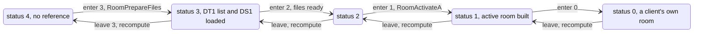
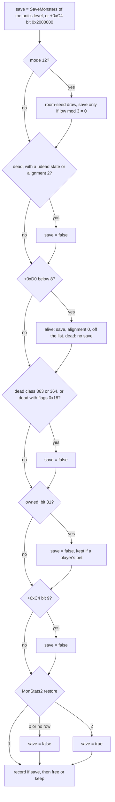
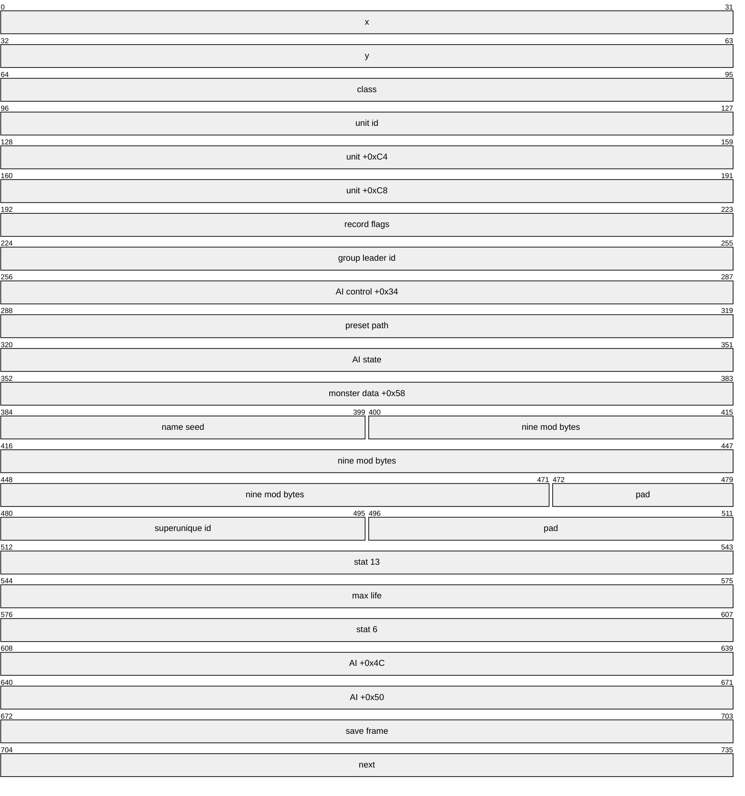
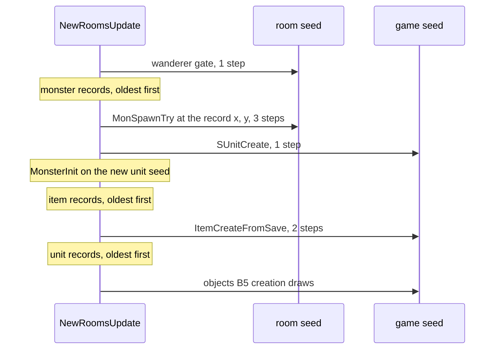
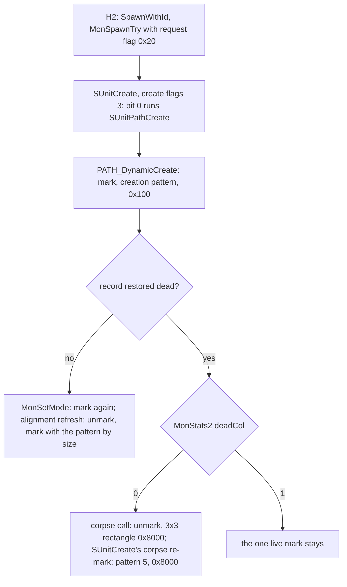
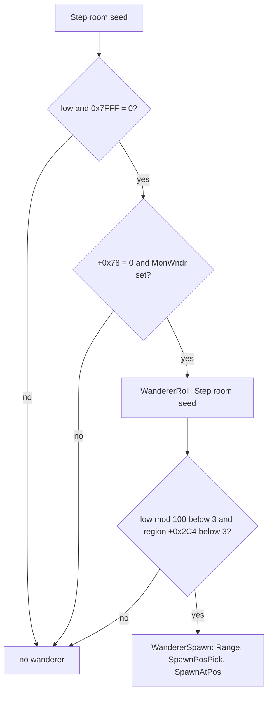

## Purpose

As players move, the server activates the rooms around them and releases rooms that no player has been near for
about 120 frames. A release saves some of the room's units as **inactive records** (monsters, objects, ground items)
and frees the rest. When the room is activated again, the units are re-created from those records instead of a new
population, with their own draws on the room seed and the game seed. This spec defines the reference counts that
drive activation, the client lists, the release timer and test, the save rule, the record layouts, the restore order
and its draws, the stats of a restored monster and the wanderer tick. The room build itself is
[room-tiles](../room-tiles/); the first population is [monsters/spawn](../../spec-monsters/spawn/) and
[objects](../../spec-objects/overview/). Primitives (`Step`, `Range`, `Init`) are those of [rng](../../spec-rng/overview/).

```mermaid
stateDiagram-v2
  direction LR
  unbuilt: DRLG room, no active room
  fresh: active, flags bit 0 clear
  live: active, populated or restored
  idle: active, +0x78 = 0, idle count rising
  released: released, records saved
  back: active again, flags bit 0 set
  [*] --> unbuilt
  unbuilt --> fresh: distance-1 reference, RoomActivateA
  fresh --> live: next new-rooms walk, presets, restore, objects, population
  live --> idle: last client's near set loses the room
  idle --> live: a pass sees a client again
  idle --> released: 11th client-free pass and the release test
  released --> back: distance-1 reference again
  back --> live: next new-rooms walk, restore only
```



## Entry points

| When | Function | Tag |
|---|---|---|
| Every game frame | — | [C] (5 500 frames, one tick each) |
| A client's room changes | — | [C] |
| A room gains its first distance-1 reference | — | [C] |
| A room is needed at once (warp, waypoint, level point, preset level build, a unit spawn at coordinates) | — | [C] |
| New rooms of an act, start of the next frame | — | [C] |
| Release pass, `frame mod 12 = 0` | — | [C] |
| Save test per unit of a released room | — | [C] |
| Restore of a re-activated room | — | [C] |
| Wanderer tick, per walked room | — | [C] |

## Inputs

### Tables

| Anchor | Used for |
|---|---|
| `Levels.txt:SaveMonsters` | leveldefs `+0x94`: the save rule's starting value (§ F); 0 only for levels 0, 1, 40, 50, 75, 103, 109 |
| `Levels.txt:MonWndr` | levels `+0x2E`: the wanderer gate (§ I) |
| `Levels.txt:Act` | levels `+0x03`: the wanderer list row (§ I) |
| `MonStats2.txt:restore` | `+0x130`, a byte, through `MonStats.txt:MonStatsEx`: 0 never save, 2 always save (§ F) |
| `MonStats.txt:flying` | `+0x0D` bit 6: creation flag `0x80` of a restored monster (§ H) |
| `MonStats.txt:Align` | the unit alignment `MonSpawnTry` sets (0 → 0, 1 → 2, 2 → 1), which the record keeps (§ G) |
| `States.txt:udead` | a dead monster with a `udead` state is not saved (§ F) |
| `Objects.txt:Restore`, `Objects.txt:RestoreVirgins` | the object save rule (objects § B4) |

### Runtime state

| State | Type | Owner offset | Source |
|---|---|---|---|
| game frame | `u32`, compared signed in `% 12` and the item expiry, unsigned in the 7500-frame test | game `+0xA8` | `GameTick` |
| game seed | `Seed` | game `+0xD0` | [rng/seeds](../../spec-rng/seeds/) |
| references per distance | 4 × `u16` | DRLG room `+0x0C + 2·d`, d = 0..3 | § B |
| status | `u8`, lowest d with a reference, 4 = none | DRLG room `+0x44` | § B |
| DRLG room flags | `u32`: `0x100000` built, `0x200000` released by the server, pinned | DRLG room `+0x28` | § E, [room-tiles](../room-tiles/#release-and-re-activation) |
| populated bit kept across a release | `u32`, bit 0 | DRLG room `+0x60` | § D |
| active room of the DRLG room | pointer, 0 while released | DRLG room `+0x30` | § E |
| idle count | `u32` | active room `+0x0C` | § E |
| active-room flags | `u32`: bit 0 populated, bit 1 inactive units restored, 4 client copy | active room `+0x34` | § D |
| client list, count | sorted pointers, `u32` | active room `+0x48`, `+0x78` | § C |
| room seed | `Seed` | active room `+0x6C` | [rng/seeds](../../spec-rng/seeds/) step 6 |
| unit list | newest first, next = unit `+0xE8` | active room `+0x74` | § E |
| act room list, new-rooms flag | list (next = room `+0x7C`), `u32` | DUNGEON act `+0x10`, `+0x54` | § D |
| DUNGEON act `+0x50` | `u32`; the constructor's client-act argument: 1 on a client act, 0 on a server act | DUNGEON act `+0x50` | § E |
| inactive room records | one list per act, ordered by x descending | game `+0xD8 + 4·act` | § G |
| region counts | wanderers `+0x2C4`; `+0x2C8`, `+0x2CC` | level region | § H, § I |

### Constants

| Name | Value | Tag |
| --- | --- | --- |
| release period | every frame with `frame mod 12 = 0` | [C] |
| idle threshold | release when the count exceeds 10 (the 11th pass) | [C] |
| dead-monster save draw | `low mod 3 = 0`, unsigned | [C] |
| life kept | 7500 frames, unsigned test | [C] |
| item expiry | frame + 15000, 30000 or 45000; 0 never | [C] for every branch, emulated to the return; logged in the game for the branches G1 counts |
| restored item expiry floor | frame + 15000 | [C] |
| wanderer gate | `low & 0x7FFF = 0` | [C], the mask's width under emulation (family `wtick`; § I) |
| wanderer roll | `low mod 100 < 3`, region `+0x2C4` < 3 | [C] for the draw and the `mod 100` ≥ 3 return, [I] for the region test and the pass below 3 |
| wanderer list | act I: class 270 (`rogue2`), start 0, count 1; other acts count 0 | [C] |

## Algorithm

### A. The frame

The whole frame, its passes named and its order evidence stated, is [sim/frame § B](../../spec-sim/frame/#b-gametick). This section keeps the rooms' part of it.

- [C] `NewRoomsUpdate` (rank 3, § D), the unit events, where players move (ranks 4 to 13), `ClientsRoomSync` (rank 14, § B, § C), `RoomsDeactivate` at `frame mod 12 = 0`
(rank 18, § E), the level-unload tick at `frame mod 11 = 0` (rank 19, § E5) and the sweep tick every frame (rank 20, below): 0 inversions over 58 678 ranked lines, and the 84 server releases of a walked act each after its frame's rank-18 line.

- [C] The remainders are taken on the incremented frame (every timer line at its due frames only, 5 500 frames). A room activated in frame N by the client sync is
populated or restored by `NewRoomsUpdate` at the start of frame N+1 (80 of 80). [I] The `%` is signed (no negative frame met).
- [C] The release pass runs on every frame with `frame mod 12 = 0` (15 614 passes), and the new active rooms of a
client's room change are walked at the start of the next frame.
- [C] Three other callers populate a room at once through `RoomUpdateOne` (the same body for one room): a unit spawn
at coordinates whose room was not active, the creation of a portal's other end at a level point
and a quest spawn in level 40; no jump or absolute reference names it.
- [C] **The other call of that pass, sweeps ground items in active rooms.** A type-4 unit with
item data `+0x24` non-zero and `≤` the frame (signed) is reached, in room order and each room's list order, up to the
first one reached; the emulation stops at `UnitGetRoom`, so the code after it stays `[I]`. (family `sweep`)
- [I] After that boundary the unit is unlinked, sent to every player and freed.

- [C] **A drop made through `DropCreateItem` has `+0x24` 0 at creation, 27 of 27**, and the 5 items followed stayed unswept
in an active room, 12 to 14 dumps each, 79 sightings. Scope: this path and that session; a longer life is not covered.

- [I] **Past that, a monster's or chest's drop has `+0x24` 0 until its room has deactivated.** `ItemCreate`, which makes these and
`DropGoldPile`'s piles, goes through `SUnitCreate`, which zeroes the item data, and neither calls `ItemGroundExpiry`; so in a room that stays active such an item is never
swept. The writer scan does not see a block copy, and `ItemCreate`'s deeper chains were not followed.

- [C] **A release's record takes `ItemGroundExpiry` afresh** (§ G), not the old `+0x24`, 45 of 45, and the restore (§ H) sets the
field to `max(saved, frame + 15000)`, both branches, 40 of 40, so from then on this sweep can free the item with the room
active: 22 of 22 restored copies resolved. A saved 0 staying 0 is not observed (§ H).
- [C] **`ItemPlaceOnGround` writes `ItemGroundExpiry` at once**: logged for qualities 1 to 8 and the filler, 80 of 80, and swept at the
first multiple of 1 500 at or past it for quality 2, 4 of 4.
- [C] `ItemPlaceOnGround` has 12 direct calls in 10 functions, no jump or pointer: `CursorDrop`; the two overflows, `BeltOverflow` and `CorpseOverflowDrop`; `DropGoldAmount`; `NPC_MenuAction` three times; `CubeDropEmptied`; `QUESTS_GiveItem`, `DropEar`, `PLAYER_CorpseCreate` and `TargetBeltItemToGround`. (`NPC_MenuAction`, `QUESTS_GiveItem`, `PLAYER_CorpseCreate`, the function count) [I] What each caller drops is the callers' reading.

### B. Activation: reference counts per near-list distance

Each DRLG room carries four reference counts, one per near-list distance d = 0..3, and a status. A client's room
holds one reference at distance 0; each room of its near list one at distance 1, and so on outwards to 3. Gaining a
status activates or prepares the room.



```
B1. ClientRoomChange(client, new: active room):                   [C]
      old ← client[+0x1B4]                                        ; the client's active room
      DrlgRefMove(old.drlg, new.drlg)                             ; B2
      client lists of old's and new's near sets                  ; § C

B2. DrlgRefMove(old, new: DRLG room):                             [C]
      if old = new: return
      if new: RefAdd(new, 0)
      if old and old.refs[0] ≠ 0:
        old.refs[0] ← old.refs[0] − 1
        Leave(old, 0)
        RefRemoveNear(old, 1)

B3. RefAdd(R, d):                                                 [C]
      RefAddNear(R, d + 1)
      EnterTest(R, d)
      R.refs[d] ← R.refs[d] + 1                                   ; u16, wraps

B4. RefAddNear(R, d):                                             [C]
      for N in R.near (the DRLG near list, in list order):
        if d < 3: RefAddNear(N, d + 1)                            ; recurse first
        EnterTest(N, d)
        N.refs[d] ← N.refs[d] + 1

B5. RefRemoveNear(R, d):                                          [C]
      for N in R.near, in list order, skipping null entries:
        N.refs[d] ← N.refs[d] − 1
        Leave(N, d)
        if d < 3: RefRemoveNear(N, d + 1)                         ; recurse after

B6. EnterTest(R, d):                                              [C]
      if R.status ≥ d and R.refs[0], …, R.refs[d] are all 0: Enter(R, d)

B7. Enter(R, d):                                                  [C]
      d = 0: R.status ← 0
      d = 1: if R has no active room and not (R.flags & 0x100000): RoomActivateA(R)
             R.status ← min(R.status, 1)
      d = 2: if R.flags & 0x1000000 and not (R.type = 2 and not (R.flags & 0x2000000)) and R.status > 2:
               R.status ← 2
               if R.refs[1] ≠ 0: Enter(R, 1)
      d = 3: RoomPrepareFiles(R)                                  ; DT1 list, DS1, then status 3 if higher

B8. Leave(R, d):                                                  [C]
      d < 3, or d = 3 with R.status ≠ 4: Recompute(R)
      d = 3 on a client act, status now 4: RoomTilesRelease(R, EDX 0)   ; the client copy only

B9. Recompute(R):                                                 [C]
      if R.status < 4 and R.refs[R.status] ≠ 0: return
      R.status ← the lowest d with R.refs[d] ≠ 0, else 4
```

- [C] The model above, replayed on the logged snapshot before each move with the near lists as `DrlgRefAddNear`
builds them, predicts every server callback in kind and room with the refs and status at its entry (634 982 callbacks
in 913 moves), the refs and status of every logged room after the move (52 119), and every activation:
`RoomActivateA` after an enter-1 call on a room with no active room and no `0x100000` (2 377). The status rule holds on
all of them. The order inside each walk (the add walk recurses before its enter test; the remove walk decrements, calls
the leave callback, then recurses, and skips null entries), the leave callbacks and `Recompute` are the instruction-level
reading.
- [C] A reference counts paths, not rooms: a room reached through several near lists at the same distance holds one
reference per path, so distance-3 counts in the tens are normal (the worked example's room had refs (0, 0, 4, 39) at
its enter-1 call). Over every logged move 253 936 of 253 936 (room, distance) deltas equal the walks counted per path; counted per room, 71 894 differ and the log differs from all of them.
- [C] On the server a client therefore activates every room of its room's near list (which holds the room itself): after each move every room of the new room's near list is active with status ≤ 1, 9 944 of 9 944. [I] It prepares the files of the
rooms at distance 2 and 3 (`+0x28`, not checked). With several clients the counts add up, so the activation set is the union of theirs; no
multiplayer game was logged.
- [I] `RoomActivateA` adds to the build of `DRLG_RoomActivate` only the neighbour step
when `+0x2C` = 0, the re-seed and type init, and two act counters (`+0x98` byte, `+0x08`); enter 1 also resets the
act's background countdown. [C] `DUNGEON_RoomCreate` prepends the active room to the act list (`act +0x10`), sets the act's
new-rooms flag `+0x54` = 1, and gives the room flags `+0x34` = 4 on a client act: the act lists modelled by the prepend equal all 23 later walks, a walk follows exactly the acts flagged (30), and the 85 rooms of client acts carry 4. [I] On a server act the flags are the DRLG room's `+0x60` bit 0 (the logged 0 or 1, 84, not compared with the bit).
- [C] `RoomActivateB` is the on-demand variant (warp destination, waypoint room, level point, preset level build, a unit
spawn at coordinates): it builds a room only when it is not active (a `DRLG_RoomActivate` follows exactly when `+0x30` = 0,
7 690 calls, 244 on an unbuilt room). A room activated this way gets **no reference**: one it built at status 4 that no
later move references is active at status 4 at the next release pass (158 of 158). [I] It also builds the
DT1 list and loads the DS1 when missing and returns the active room, and only the idle timer of § E releases such a room.

- [C] A room that `RoomActivateB` activates during the population pass, after the act's walk has passed it (callers
), is released before any walk reaches it if no new room arrives meanwhile (3 rooms). Its
`+0x60` bit 0 stays clear, so it is populated at its next activation.

### C. The client lists (`+0x78`)

```
C1. after the reference move, ClientRoomChange compares the near sets:   [C]
      Nnew ← DUNGEON_GetNearRooms(new);  Nold ← DUNGEON_GetNearRooms(old)
      for r in Nnew, in list order, r ∉ Nold: RoomClientEnter(r, client)   ; RoomClientAdd: r[+0x48] gains client, r[+0x78] + 1
      for r in Nold, in list order, r ∉ Nnew: RoomClientLeave(r, client)   ; RoomClientRemove: r[+0x78] − 1
```

- [C] The enter calls come first, then the leave calls (5 418 calls, `+0x78` before each). The near sets are
  `DUNGEON_GetNearRooms`' after the reference move. With one client, room `+0x78` is 1 exactly when the room is in the
  near list of the client's current room (180 132 room-passes).
- [I] In general `+0x78` is the number of clients whose current room's near list holds the room; the list `+0x48` is
  kept sorted by pointer.
- [C] A room just activated by a client already has `+0x78` ≥ 1 at its first walk, because the same `ClientRoomChange`
  fills the list: 3 111 of 3 111 rooms activated by a client's move; after `RoomActivateB` 118 of 153 have 0.


### D. The new-rooms walk: populate once, restore once per activation

```
D1. NewRoomsUpdate(game):                                         [C]
      for act in game.acts[0 ..< 5] with act[+0x54] ≠ 0:
        for room in the act's room list, head first:
          RoomWandererTick(game, room)                            ; § I, one room draw, always
          if room.flags & 1 = 0:
            RoomPresetUnits; RoomInactiveUnitsRestore; RoomObjectsPopulate; RoomPopulate
            room.flags ← room.flags | 1 | 2
          else if RoomRestoredGet(room) = 0:                      ; flags & 2
            RoomInactiveUnitsRestore(game, room)                  ; § H
            room.flags ← room.flags | 2
        act[+0x54] ← 0
```

- [C] Per walked room the wanderer tick comes first. A room with flags bit 0 clear is restored and populated (1 137); a
  room with bit 0 set and bit 1 clear is restored only (1 361); any other room is left alone. A re-activated room's DRLG
  `+0x60` bit 0, which becomes its flags bit 0, is 1 exactly when the room was walked or restored before its release
  (1 414 re-activations). So a re-activated room is **never populated again**: its units come back only from the
  records.
- [C] Every caller of `RoomRestoredSet` passes 1 (three calls, the third's `EBX` set to 1). [I] No other
  code clears bit 1, and it lives in the active room, which a release frees: the restore runs once per activation.
- [C] On a first activation the restore finds no record and draws nothing (no record and both seeds unchanged in 1 459
  first activations) ([objects § B](../../spec-objects/overview/#b-the-window-in-the-room-driver-and-the-revisit) B2);
  the presets, objects and population are [drlg/preset § 6](../preset/#6-handover-to-the-server-spawners-boundary),
  [objects](../../spec-objects/overview/) and [monsters/spawn § A](../../spec-monsters/spawn/#a-when-the-pass-runs-and-the-room-seed-before-it).


### E. Release

```
E1. RoomsDeactivate(game):                                        [C]
      for a in 0 ..< 5 with an act:
        room ← act's room list head
        while room:
          next ← room.next                                        ; read before the room may be freed
          room.idle ← 0 if room[+0x78] ≠ 0 else room.idle + 1     ; RoomIdleCount, u32
          if room.idle > 10 and RoomReleaseAllowed(act, room):
            for u in room.units, head first (next = u[+0xE8], read before the call):
              InactiveUnitSaveTest(game, u)                       ; § F
            ActiveRoomFree(act, room)                             ; E3
          room ← next

E2. RoomReleaseAllowed(act, room) → bool:                         [C]
      if act[+0x50] ≠ 0: fatal error                              ; [I] never taken, 0 on the server at every pass
      R ← room.drlg
      if R.flags & (1 << 22): return false                        ; pinned
      if R's act is a client act: fatal error                     ; [I] never taken
      if R.status < 2: return false
      if R's level is a town or level 120:
        if any DRLG room of the level has status < 2: return false   ; [I] for level 120, not reached
      return true

E3. ActiveRoomFree(act, room):                                    [C] the unlink and R[+0x30] ← 0: 3 212 freed rooms absent from the next pass's list, `+0x30` = 0 until re-activation; [I] the near-list removal, the unit bits and the order
      unlink room from the act list
      for each neighbour of room's near list but room itself: remove room (swap with the last entry)
      RoomReleaseWrap(R ← room.drlg, EDX ← act[+0x50], room.flags):
        R[+0x30] ← 0;  R[+0x60] ← room.flags & 1
        if R.flags & 0x100000: RoomTilesRelease(R, EDX ← (wrapper EDX = 0))   ; room-tiles § Release
      DUNGEON_RoomFree(room):
        for u still in room.units: u[+0xC4] |= (1 << 23); unless u[+0xC4] bit 22: u[+0xC8] |= 0x20; unlink u
        free the collision map, the tile lists and the room
```

- [C] **Frames.** The count rises only on passes with `+0x78` = 0 and drops to 0 on any pass that sees a client, so
a room is freed on the 11th client-free pass in a row: 120 frames after the first client-free pass, which falls 0 to 11
frames after the last client's room change **that a pass saw**. Of 2 440 releases, 2 224 came at the first eligible
pass, 120 to 131 frames after the last client left (every value from 120 to 131 seen); 82 came later (a test refused
the first eligible pass, or a visit fell between two passes) and 134 had no logged client leave before them. Every
room each pass frees is predicted.
- [C] **A visit between two passes does not reset the count.** A client whose room keeps the room in its near set
only between two passes leaves the idle count running (5 cases, each released 36 to 110 frames after that visit). The
model of E1 covers both cases.
- [C] The release test refused a pinned room 4 592 times and a town room 12 296 times in 19 328 tests; act `+0x50` was
0 at every pass. Once the count exceeds 10 the test is retried on every pass, so a refused room goes at the first later
pass that allows it. A new room starts at count 0.
- [I] **Pins.** `RoomPinSet(room, 0)` sets and `RoomPinSet(room, 1)` clears it (`RoomPinSet` passes the
DRLG room and its second argument to `DrlgRoomPinFlag`, its one caller). `PortalObjectCreate` sets it on the rooms of
both portal ends, and two sites that free an object unit clear it.
In the run the pin was an input: six set calls came from portal and object code, and no clear call was seen.

- [C] **DUNGEON act `+0x50` is 1 on a client act and 0 on a server act.** `DUNGEON_ActCreate` stores its third
argument there and builds the client form of the DRLG act when it is non-zero; the server's `ActCreate` passes 0 and
the client's `ClientActLoad` passes 1. The run gave the same values on both sides: 0 on the server at all 30 985
checks, and the negated value 0 at every one of the 8 277 client tiles releases. No other writer of `+0x50` was
scanned, so the values are covered for the run's window only, where neither side saw another.

- [I] **Level unload.** Every 11 frames on the server (every 13 ticks on the client) the level-unload tick unloads,
after a countdown of 10 ticks, a level with no level references (`+0x0C`) and built rooms (`+0x10`) when
`LevelUnloadCheck` allows, and otherwise re-arms the countdown. That path frees RoomTiles through `RoomFree` and
rebuilds the level.


**`0x200000` and the wrapper's `EDX`.**

- [C] Every server release calls `RoomTilesRelease` with `EDX` 1 and leaves `0x200000` set in the DRLG room's flags
  (2 440 releases); every client release has `EDX` 0 and leaves it clear (8 277). This follows from the wrapper, which
  passes the logical not of its own `EDX` (the DUNGEON act's `+0x50`, 0 on the server): `0x200000` reads "released by
  the server".
- [C] No reader of `0x200000` was found: the only `+0x28` access with that immediate is the write, and no
  register test of the bit is on a `+0x28` load.

### F. The save rule

Each unit of a released room, in list order (newest first), goes through `InactiveUnitSaveTest`. It is saved to a
record, kept (unlinked but alive), or freed.



```
F1. InactiveUnitSaveTest(game, u):                                [C]
      type 1 (monster): (save, kept) ← InactiveMonsterSaveTest(game, u)              ; F2
      type 2 (object):  (save, kept) ← objects § B4                                  ; F3
      type 4 (item):    save ← true;  kept ← false                                   ; 1 347 items
      type 5:           save ← true;  kept ← false                                   ; 59 units
      type 0 (player):  state 7 (playerbody) → save, kept; else nothing   ; [I] not reached
      type 3 (missile) and any other: free                                           ; 9 missiles
      if kept: (if save: record) and unlink u from the room without freeing it       ; [I] not reached
      else:    (if save: record) and free u
      record: InactiveRecordSave(u) → monster record, item record, or unit record    ; § G

F2. InactiveMonsterSaveTest(game, u) → (save, kept), in this order:   [C] where the order separates: 3 of 3 monsters whose mode-12 draw cleared `save` and whose `restore` is 2 were saved; [I] the rest, tests 3, 4, 6, 7 not reached
      lvl ← the level of u's current room
      save: bool ← Levels[lvl].SaveMonsters ≠ 0 or u[+0xC4] & 0x2000000      ; [C] when either is set; [I] when both are clear, never met
      kept: bool ← false
      dead: bool ← UnitIsDead(u)
      1. if u.mode = 12:                                          ; [C]
           Step(u.room.seed)                                      ; draw#1 per mode-12 monster, always
           if u.room.seed.low mod 3 ≠ 0: save ← false             ; unsigned
      2. if dead and (u has a state with the udead flag or u.alignment = 2): save ← false   ; [C]
      3. if u[+0xD0] < 8: (alive: save ← true, alignment ← 0, TargetListRemove)  (dead: save ← false)
      4. if dead and u.class ∈ {363, 364}: save ← false           ; necroskeleton, necromage
      5. if dead and MonTypeFlag(u, 0x18): save ← false           ; [C] monster flag 0x08 or 0x10
      6. if u[+0xC4] & 0x80000000:                                ; owned
           save ← false
           if the owner is a player whose pet list holds u: kept ← true;  u[+0xC8] |= 0x100
      7. if u[+0xC4] & 0x200: save ← false
      8. r ← MonStats2[MonStats[u.class].MonStatsEx].restore
         if r = 0 or no row: save ← false
         if r = 2: save ← true                                    ; [C] for r = 1 and 2, 30
      return (save, kept)
```

- [C] On the branches the run reached the rule predicts every decision: 4 401 monsters (3 086 saved alive, 413 saved
dead, 902 freed dead); the starting value from `SaveMonsters` and `+0xC4` bit `0x2000000`; the mode-12 draw, seed out =
`Step(seed in)` and `low mod 3`, chained unit to unit on the room seed (1 315 draws); the `udead` (1) and alignment-2
(12) tests on dead units; the `0x18` test on dead units (106); `restore` 1 and 2 (30). A record follows exactly the
units the rule saves.
- [I] Tests 3, 4, 6 and 7 and `restore` 0 were not reached (no pet or owned monster, no `+0xD0` < 8, no necromancer
summon, no `+0xC4` bit 9, no `restore` 0 class). Since `restore` 2 is tested last it overrides every earlier test, the
dead-unit tests included.
- [C] **Objects** follow [objects § B](../../spec-objects/overview/#b-the-window-in-the-room-driver-and-the-revisit) B4,
whose level flag is `Levels.SaveMonsters` (leveldefs `+0x94`): `save` starts as that flag or the preset flag
`0x2000000`; `Objects.Restore` = 0 or sparkle bit `0x02` → no; `RestoreVirgins` and mode ≠ 0 → no. The rule held on
3 023 objects (`Restore` 0: 15; `RestoreVirgins` on a used object: 30; the starting flag set on all of them, 653 by the
preset flag alone).
- [I] Not met for objects: the sparkle bit `0x02` (never set on a tested object) and a start with both flags clear,
so those two refusals are code readings. The object's type-1 timers are removed, and classes 59 and 60 (portals) are
always saved and kept (unit `+0xC8 |= 0x100`); no kept unit was met.
- [C] **No logged dead champion was saved.** `MonMarkSpecial` sets monster flag `0x08`; all 15 champions in 30 save
tests carried flags `0x0D` or `0x2D`, and the 6 dead ones were freed by test 5.
- [C] The `or` writes of the champion bit `0x04` to monster data `+0x16` are three, and no `and` or `btr` clears `0x08` there
(one in a CRT frame). [I] So a dead champion is not saved on stock data: each such write comes after `MonMarkSpecial` on the same unit, and no
whole-field write clears `0x08`. The three writes are
`SpecialModsRoll`, reached from `SpecialMonSpawn` only when `SpecialMonPlace` gave a unit and from
`MonMakeSpecial` after its own `MonMarkSpecial`; `SpecialMonRestore`, after `SpecialMonPlace`
returned a unit; and `ChampionMemberMark`, after `MonMarkSpecial`. `SpecialMonPlace` marks
every unit it creates, and `MonMarkSpecial` ORs `0x08` into any monster with monster data. This is a code reading: a block copy of monster data is not followed. (§ 11.1 (b))
- [C] A player's own room is always in its near set, so a released room holds no live player (0 of 12 476 save tests a
player's, no freed room the client's current room, every new client room in its own near list, 1 144); units that the walk
does not save and does not keep are freed with the room, and are gone for good (1 291 such monsters never met again).

### G. The records

All records of a released room hang off one 0x18-byte **room record**, found or inserted by the room's x and y in the act's list. Each save **prepends** to its list; since the unit walk is newest first, every list ends up in the walk's reverse, called "oldest first" below: the list's order, not the units' age (unit ids rise along 372 of 563 logged multi-record restores).

| Record | Size | Fields (offset: meaning) | Tag |
|---|---|---|---|
| room record | 0x18 | `+0x00` x, `+0x04` y (the key); `+0x08` item list; `+0x0C` monster list; `+0x10` unit list; `+0x14` next (x descending) | [C] (two inserters, each walk stopping at the first lower x; the three heads' writers and `InactiveRecordTake`; `InactiveRoomRec+0x00`) |
| unit record | 0x34 | objects § B4's record (x, y, type, class, mode, frame, `+0xC4`, `+0xC8`, `+0x20` unit id or shrine timer, `+0x24` sparkle or timer, `+0x28` interact, `+0x2C` unit `+0xB8`); also type 5 and a kept player corpse | [C] (3 037 records, `InactiveUnitRec+0x20`) |

**Monster record** (0x5C, `InactiveMonsterSave`):



| Offset | Field | Tag |
|---|---|---|
| `+0x00`, `+0x04` | x, y of the unit | [C] |
| `+0x08`, `+0x0C` | class, unit id (the id is reused at the restore) | [C] |
| `+0x18` | record flags, below | [C] |
| `+0x1C` | group leader id (AI control `+0x2C` when the AI link type `+0x30` is 1), else −1; read into `MonSetOwnerRestore` | [C] |
| `+0x20`, `+0x24`, `+0x28` | AI control `+0x34`, saved in the `+0x1C` branch (only when the link type `+0x30` is 1; else `+0x20` stays 0), after which the save clears AI control `+0x2C` to −1 and `+0x34` to 0; the preset path moved out of AI control `+0x38` (and moved back by the AI restore); the AI record's first dword, passed to `MonAiInit` | [C] |
| `+0x2C` | monster data `+0x58`, passed to `MonRegionUnitLeave` at the restore | [C] |
| `+0x30`, `+0x32`, `+0x3C` | name seed (`u16`); nine mod bytes; superunique id (`u16`); `+0x3B` and `+0x3E`–`+0x3F` are padding | [C] (for the mods; the writes and reads of all three, and no access to the padding) |
| `+0x40`, `+0x44`, `+0x48` | stat 13; `UnitGetMaxHp` (equal to stat 7 on all 3 499 records); stat 6 | [C] |
| `+0x4C`, `+0x50` | AI parameters (`InactiveMonAiSave`), read by the AI restore | [C] |
| `+0x54` | game frame at the save | [C] |
| `+0x58` | next record of the room's monster list | [C] |

Record flags `+0x18`: `0x1` placed by `SpecialMonPlace`, `0x2` champion, `0x4` mode 12 or 0 (dying or dead), `0x20`
minion, `0x40` monster data `+0x5C` bit 1, alignment `0x200` (0), `0x80` (1), `0x100` (2), `0x400` the unit is in a
target list (`+0xD0` ≠ 11; `+0xD0` < 8 is a fatal error), `0x800` superunique.

- [C] The 3 499 monster records hold the fields tagged `[C]` above as the unit had them at the save, with the flag bits
  `0x1`, `0x2`, `0x800`, `0x20` from the monster flags and the alignment, `0x400` and `0x4` bits as listed.

- [I] Before writing it, the save removes the states of the list at DataTables `+0x174` and the unit's type-2 timers,
  and moves the preset path out of the monster (`PtrMove`). The alignment numbers are those `MonSpawnTry`
  sets from MonStats `Align` (0 → 0, 1 → 2, 2 → 1).
- [C] **The record's `+0xC4` is the unit's value when reads it, after the state and timer removal**, not
  its value at the save test. 4 of 1 689 monster records (level 111,
  classes 454 `minion1` and 462 `suicideminion1`) hold `+0xC4` bit `0x2000` that the unit's save-test line lacked;
  every other field matches.
- [C] **What a monster loses**: any mode but "dying or dead" (alive records come back in mode 1, 2 726 of 2 726, 32 of
  them saved in mode 2, 4 or 5), any position but x and y, and its life after 7500 frames (§ H). [I] Its states and
  timers, which the log does not hold: a hit's stat or state is gone after a release.


**Item expiry** (`ItemGroundExpiry`, the record's `+0x04`):

```
G1. ItemGroundExpiry(item, frame) → u32:                          [C] (every line emulated to the return; counts logged in the game)
      if ItemBaseIsQuest(item): return 0                          ; never expires; not logged in a game
      q ← ITEMS_GetQuality(item)
      if q = 4: return frame + 30000                              ; magic (66)
      if 5 ≤ q ≤ 9: return frame + 45000                          ; (21)
      if ITEMS_GetBaseType(item) = 4:                             ; gold
        return frame + 45000 if stat 14 > 10000 else frame + 15000   ; the 45000 half not logged in a game; 15000 (437)
      if ITEMS_IsSocketFiller(item): return frame + 30000         ; (27)
      return frame + 15000                                        ; (796)
```

The additions wrap at 32 bits. Read signed, as the sweep of § A reads it, + 45000 at frame 2 147 438 648 is negative; that frame takes about 2.7 years of unbroken play at 25 frames a second. [C] (family `expiry`) Stat 14 is compared signed. [I]

### H. The restore



```
H1. RoomInactiveUnitsRestore(game, room):                         [C]
      InactiveMonstersRestore(game, room)                         ; H2
      recs ← InactiveRecordTake(room)                             ; unlinks the room record matched on room x, y
      InactiveItemsRestore(game, room, recs.items)                ; H4
      for rec in recs.units, oldest first:                        ; objects § B5
        if rec.flagsC8 & 0x100: UnitRelocate(the unit with id rec[+0x20], room)   ; [I] kept: portals, a player corpse, mode 17 else fatal
        else PresetUnitDispatch(rec.type, rec.class, rec.x, rec.y, rec.mode, rec.flagsC4)   ; every creation draw of objects § G
```

- [C] Monsters first, then the items, then the unit records, each list oldest first: 2 035 monster records, 876 item
records and 1 799 unit records (1 760 objects, 603 of them operated before the release) came back in that order; the unit
records through `PresetUnitDispatch` with their type, class and position, objects § B5 holding on every object.

- [C] **Paths and draws of the monster restore** (2 035 records: 1 836 exact, 144 minion, 55 special). The created unit
has the record's id and class; its mode is 12 for a flag-4 record on the exact path, else 1. The creation takes one
game-seed draw (`SUnitCreate`), and the unit's `+0x28` is the game seed's low word after it, so the restored unit gets a
**new unit seed** and a full `MonsterInit`. An exact placement takes 3 room draws and lands at the record's x, y
(1 808); the radius-5 fallback takes 7 room draws (31).
- [I] The path is picked by flag `0x20` before flag `1`, so a record with both goes to `MinionRestore`. The level-108 drop, the kept units, the alignment-1 half of the `0x400` drop (record bit
`0x80`, the sign test) and the failed creations were not reached; no stock monster the H7a
sessions met was saved with `+0xD0` ≥ 8 and alignment 1.

**Stats of a restored monster.**

- [C] Stats 13 and 7 are the record's, the first instance's values. Stat 6 is the saved life when fewer than
7500 frames passed since the save (1 931 restores) and the saved maximum after that (104); the test is unsigned on
`frame − saveFrame`. 255 of the restored monsters had been damaged before the release.
- [C] The restore never writes stat 12. On the exact path it is the [monsters/stats](../../spec-monsters/stats/)
model's level of the new `MonsterInit` (1 836 restores; classic Nightmare as `Level + 25·d`).
- [C] A restored **minion**'s stat 12 is the monsters/stats level plus the handlers of mods 1–4 and its saved
mods (144): a first instance at the pool level comes back 3 higher (`leveladd`; 2 seen), later restores unchanged (142).
Stat 12 does not tell which handler flag the minion path applies (the checker gives 0 mismatches with either); the
flag-0 reading of H2c rests on a second tool's reading of the calls (`[C]`).
- [C] A restored **champion**'s stat 12 is the result of the **flag-1** handlers: + 2 (`leveladd` + 3,
`champion` − 1); with flag 0 the checker gives 15 mismatches, one level high on each champion restore. A restored unique
comes back at + 3, which does not separate the flag.
- [C] **`SpecialMonRestore` applies the flag-1 handlers through its `SpecialModsApply` call**.
`SpecialModsApply` always calls the special's own handlers with flag 1, mods 1–4 and the saved list, and its group callback with flag 0. The code reading and the 15 champion restores above agree, and flag 0
gives 15 mismatches, so the run separates the two readings. (§ 11.1 (c); `g_UModAlwaysMods`)
- [C] **The 0 that `SpecialMonRestore` pushes is the `minions` argument** of `SpecialModsApply` (pushed,
read once, where a zero skips the call of `UniqueMinions`). [I] So the special is restored without new minions: that is the skipped callee's role by its name. § 6 first read that 0 as the handler
flag. The run does not separate "no minions" from another use of the argument.
- [C] **`MinionRestore` calls the handlers itself with flag 0** (mods 1–4, its nine saved mod bytes; `SpecialModsApply` pushes 1 in the same slot), after setting `0x10`. `rndname` (mod 1) steps the unit seed and writes the name seed only with
flag 1, so a minion restore takes no unit-seed step where flag 1 would take one; `resist` (8, 27, 28) also
acts only with flag 1. That difference would show outside stat 12 on every minion restore; it was not looked
for, and the kept lifecycle logs were not searched for a unit seed after the handlers.
- [C] The save copies unit `+0xC8` to record `+0x14`, and the restore sets the new unit's `+0xC8` bit `0x200` when the record's
has it, so the restore carries that bit over (§ 6). [I] That it is set
only there: 17 register stores to `[reg+0xC8]` are not resolved. The group link, the AI restore, the target lists and the mod
re-append are code readings; movement of a restored monster is a boundary oracle (phase 4), and what the restore keeps of its AI is [monsters/ai E9](../../spec-monster-ai/overview/#e-the-ai-state-on-the-unit).

- [I] **A dead special saved without `0x08` or `0x10` would come back alive**: `SpecialMonRestore` places the unit
in mode 1 whatever record flag 4 says, with stat 6 by the 7500-frame rule. By the dead-champion reading of § F (every
champion carries `0x08`) no stock case reaches it.
- [I] A `0x400` record with alignment 0 (the only one the drop lets through) reaches the fatal error `0x691`. A saved wanderer does not reach it: `WandererSpawn` creates `rogue2` through
`SpawnAtPos` with flags 0, so `MonSpawnTry` runs its `Align` switch, and `rogue2`'s MonStats `Align` 1 gives alignment 2
(§ I). Its record carries `0x400` with the alignment-2 bit `0x100`, and the restore drops it. No write that changes the
wanderer's alignment between its creation and the save test was followed.

```
H4. InactiveItemsRestore(game, room, recs), oldest first:         [C] except the lines tagged [I]
      for rec in recs:
        if rec.expiry ≠ 0 and (i32) frame > (i32) rec.expiry: drop    ; [C] 5 records, no item created
        it ← ItemCreateFromSave(rec.bytes) at the saved x, y      ; SUnitCreate (type 4)
              ; game seed: draw#1 the unit seed, draw#2 ItemSeedInit
        it[+0x28] ← the saved start seed for an item stored in full, 0 for a simple (compact) item
        it.unitSeed ← Init(it[+0x28])
        socketed children re-created with it                      ; [I] not logged
        it.expiry ← 0 if rec.expiry = 0                           ; [I] not reached
                    else max(rec.expiry, frame + 15000)           ; signed max
```

- [C] Two game-seed draws per item (876 of 876; one draw would fail every item). The start seed `+0x28` is the saved
one for an item stored in full (289) and **0** for a simple item, record flags bit `0x200000` (587: gold, potions, keys);
the unit seed is `Init(+0x28)` in both cases. The item comes back at its saved x, y (876), and its expiry is
`max(saved, frame + 15000)` (876). The bit layout of the bytes is [save/d2s § I](../../spec-save/d2s/#i-one-item).
- [C] **An item record whose non-zero expiry has passed is dropped at the restore**: 5 records in 2 restores of one
session at frame 19 158, with expiries 18 720 and 18 324 (four records); no item is re-created for any of them. A
record with expiry 0, kept by the same test, was not reached.

#### H5. The grid marks of a re-created monster



```
H5. the marks of one monster re-created by H2, in order:          [C] (1 903 re-creations compared line for line, the dead sequences on 140)
      m ← (the creation pattern of drlg/collision F2, mask 0x100) at the landing cell
      alive (record mode 1):                                     ; 1 729
        PatternMark(m); PatternMark(m)                           ; PATH_DynamicCreate, then MonSetMode
        PatternUnmark(m); PatternMark(pattern by size, 0x100)    ; the alignment refresh
      dead (record mode 12, oracle 25's a10):
        PatternMark(m)                                           ; no MonSetMode mark
        if MonStats2 deadCol = 0:                                ; 134 outside r2-xn1
          PatternUnmark(m); RectOrWH(x, y, 3, 3, 0x8000)         ; the corpse call
          PatternUnmark(m); PatternUnmark(5, 0x100); PatternMark(5, 0x8000)   ; SUnitCreate's corpse re-mark
        else: nothing more                                       ; 6 outside r2-xn1
```

- [C] **A re-created monster marks the grid like a pass creation**, outside any `RW` window: on run 2's nine logs, 1 942
  re-creations in 1 000 logged restore scopes, 1 903 with their logged marks equal to the prediction above line for
  line (cell, room, pattern or size, mask; 1 729 alive, 166 dead with `deadCol` 0, 8 dead with `deadCol` 1), 39 whose
  request made no unit, 0 different. `--cf recreation-off` (no marks) fails r2-xn1 with 63 mismatches, a floor, since
  the checker skips to the next window after each, and restores exactly run 1's two `COLL_WHTest` mismatches.

- [C] **The dead sequences** rest on the 140 dead re-creations of the eight run-2 logs other than r2-xn1 (134
  `deadCol` 0, 6 `deadCol` 1): the sequence was first predicted wrong from the code and corrected from r2-xn1's 34 dead
  cases, which are therefore not its evidence.
- [C] The marks are made from the record's class (MonStats size, MonStats2 `deadCol`), its unit id, its landing cell and
  its alive or dead state, which the check takes from the log: oracle 25, a simulation input (monster AI
  and movement), 7 290 re-creations in the run, 103 of which made no unit. The `[C]` covers the marks made from those
  values, not where or in what state a monster is restored.
- [C] On run 1's 28 logs, which log no restore scope, the same prediction entered the grid unchecked (5 284
  re-creations) and every later position test passed; that admits them for the run's result, not as evidence for the
  marks.
- [C] **The call path**, read with two tools: a room whose driver flag bit 0 is set gets no `RW` window;
  `RoomUpdateOne` and `NewRoomsUpdate` call `RoomInactiveUnitsRestore` directly, none of the
  three population calls. [I] Its monsters go through `SpawnWithId` to `MonSpawnTry` with request flags `0x62`, `0x6A` or `0xE2`. Flag `0x20` makes
  the create flags 3, and bit 0 runs `SUnitPathCreate`, whose monster branch marks through
  `PATH_DynamicCreate` and `MonSetMode`, both into `COLL_PatternMark`, then `MonSpawnTry`'s
  alignment refresh. A record restored dead has no `MonSetMode` mark (`UnitIsDead` tested);
  with `deadCol` 0 the corpse call (`RectOrWH` 3×3 `0x8000`) and `SUnitCreate`'s corpse re-mark
 follow.
- A worked example (two class-5 records, one alive, one dead) is in
  [chain § Worked example 4](../../spec-chain/overview/#4-two-revisit-re-creations-and-their-marks).

### I. The wanderer tick



```
I1. RoomWandererTick(game, room):                                 [C] for the first draw, the gate's tests, the roll's draw and its ≥ 3 return (the lines tagged), [I] for the spawn
      Step(room.seed)                                             ; room draw#1, always
      if room.seed.low & 0x7FFF ≠ 0: return                       ; [C]; the mask's width, family `wtick`
      if room[+0x78] ≠ 0 or Levels[level].MonWndr = 0: return     ; [C] (family `wtick`)
      WandererRoll:
        Step(room.seed)                                           ; room draw#2, [C]
        if room.seed.low mod 100 ≥ 3: return                      ; unsigned; [C]
        if region[+0x2C4] ≥ 3: return                             ; signed; [C] (family `wroll`)
      WandererSpawn:
        a ← Levels[level].Act;  (start, count) ← the bytes + 2·a     ; act I (0, 1), others (0, 0)
        r ← Range(room.seed, count)                               ; room draw#3 (none when count < 1)
        class ← the entry of the list picked by start and r   ; act I: 270
        (x, y) ← SpawnPosPick(no box, class, 0)                   ; monsters/spawn H1
        u ← SpawnAtPos(x, y, class, mode 1, radius −1, flags 0)   ; MonSpawnTry: Align 1 → alignment 2
        TargetListAdd(u, 8);  region[+0x2C4] ← region[+0x2C4] + 1
```

- [C] The gate's draw is one room-seed step per walked room, out = `Step(in)` (11 064 draws), and no roll follows a draw
  whose `low & 0x7FFF` ≠ 0 (11 064; 3 211 of them in rooms with `+0x78` = 0 and `MonWndr` ≠ 0). The tick runs before the
  population or restore of the same room (§ D).
- [C] That one pass does not separate the rest in the game, and the emulation does for the gate: the mask's width
  (bit 15 set with bits 0–14 clear passes to the roll, 32 cases; control `mask16`), the `+0x78` and `MonWndr` tests (controls
  `no78` 52, `nownd` 26) and the region `+0x2C4` test, signed (counts −1 to 4 and others; controls `unsignedcnt` 30, `cnt2` 22,
  `roll4` 55): families `wtick` and `wroll`, 300 cases each, 0 mismatches, the code's map. [I] The spawn
  (`WandererSpawn`, the emulation's boundary): no roll below 3 has been met in a game. Read from the code, the gate passes 1 in 32 768 draws and the roll 3 in 100: about 1.1 million room updates of an
  act I `MonWndr` level with `+0x78` = 0 and region `+0x2C4` < 3 per spawn.
- [C] `+0x78` ≠ 0 stops the tick (family `wtick`). [I] So, `+0x78` counting the clients near, wanderers can appear only in active rooms that no client is near: rooms kept alive by the idle
  timer of § E, or activated by `RoomActivateB` (§ B).

### J. The preset path and the preset list

- [C] The server's preset spawn moves the DS1 path out of the room's preset unit into the new monster:
  `PresetUnitSpawn` moves preset `+0x10` into the monster's AI control `+0x38` with `PtrMove` and leaves 0 behind (49
  moves). That is the server-copy half of the detach [drlg/preset § 5](../preset/#5-from-the-instance-to-the-room) note 4 saw.

- [C] The release moves the path into the monster record and the restore back into the new monster
. The client copy's detach was not found.
- [C] A re-activated room never re-dispatches its preset list: `RoomPresetUnits` runs only while flags bit 0 is clear
  (§ D): 408 of 408 `PresetUnitSpawn` lines in a populate walk, none in the 286 later restore-only walks of rooms that had
  one; the added objects and type-5 units come back from the unit records (H1). [I] Whether the list grows on
  a rebuild is not read.

### Draw order across the seeds

- [C] **Release** (`frame mod 12 = 0`; acts 0..4, rooms in list order, units in list order): one room-seed draw per mode-12
  monster of the room, on that room's seed; nothing else on the save path draws (1 315 draws).
- [C] **New-rooms walk**, per room in list order: the wanderer gate's room draw (I1); then, for a re-activated room, per
  monster record the placement's room draws (3 exact, 7 with the radius-5 fallback), one game-seed draw and
  `MonsterInit`'s unit-seed draws, the mod handlers for specials and minions; per item record two game-seed draws; per
  unit record the object creation draws of objects § G (game seed, object-region seed).

## Outputs

- Per room: its status and activation (§ B), its client count (§ C), whether a walk populates or restores it (§ D), the
  frame of its release (§ E) and the DRLG flags it leaves (`0x200000`, `+0x60` bit 0).
- Per released room: one room record with oldest-first lists of monster, item and unit records (§ G); the freed units are
  gone.
- Per restore: the re-created monsters (same id and class, new unit seed, stats 13, 7 and 6 from the record, stat 12 from
  `MonsterInit` and the mods), items (saved bytes, start seed or 0, new expiry) and objects (objects § B5), and the room
  and game seeds after them.

## Worked example

session `n-cold` (seed 4011, expansion Normal, Cold Plains, level 3): one DRLG room released and restored. Seeds are `low:high`.

**Release.**

| Frame | Event | Values |
|---|---|---|
| 5331 | `ClientRoomChange`; the room leaves the client's near set (`RoomClientLeave`) | `+0x78` 1 → 0 |
| 5340 | first client-free pass (9 frames later) | idle count 0 → 1 |
| 5352 … 5448 | passes 2 to 10 | idle count 2 … 10 |
| 5460 | 11th pass: count 11 > 10, release test passes | 129 frames after the leave |

The unit list, newest first, at frame 5460 (room seed in at the first draw `2774715a:35808a82`; `SaveMonsters` 1):

| Unit | Mode | Draw (room seed out) | `low mod 3` | Outcome |
|---|---|---|---|---|
| monster id 23, class 19 | 12 | `017a64c4:1074d14f` | 2 | freed |
| monster id 5, class 43 | 12 | `23ea9c23:009dd339` | 1 | freed |
| item id 122, class 334 | 3 | none | — | item record, expiry 5460 + 15000 = 20460 (quality 1, the "else" branch) |
| object id 134, class 2 | 0 | none | — | unit record (mode 0) |
| monster id 20, class 19 | 12 | `dd0daa28:0efb006a` | 0 | monster record |
| monster id 22, class 19 | 12 | `05257132:5c331e08` | 1 | freed |

The monster record: x 4773, y 5230, class 19, id 20, flags `0x204` (dead, alignment 0), stat 13 = 18, max life 512,
stat 6 = 0, frame 5460. Then `ActiveRoomFree`: `RoomTilesRelease` with `EDX` 1; the DRLG flags go from `0x05382000` to
`0x05282000` (`0x100000` cleared, `0x200000` set).

**Re-activation and restore.**

| Frame | Event | Values |
|---|---|---|
| 6569 | the client's move: enter 1 on the room at refs (0, 0, 4, 39), status 2 → `RoomActivateA`, `DRLG_RoomActivate` with `+0x60` bit 0 = 1 | flags bit 0 set |
| 6570 | walk: wanderer gate `a76720d5:0000029a` → `6b921683:45d28c06` | `low & 0x7FFF` = `0x1683`, no roll; `+0x78` = 1; bit 1 clear → restore only |
| 6570 | monster id 20: exact path, mode 12; room seed 3 draws → `cf2c6407:393e653d`; game seed `435998df:3f239997` → `0b8dad32:1c1756af` | at (4773, 5230); unit `+0x28` = `0x0b8dad32` |
| 6570 | stats after `MonsterInit` 6 = 7 = 1024; after the writes 13 = 18, 7 = 512, 6 = 0 (1110 frames < 7500), 12 = 1 | the corpse is back |
| 6570 | `MonRegionUnitLeave`: alignment 0, no flag `0x40` | level 3 region `+0x2CC` 246 → 245 |
| 6570 | item: game seed 2 draws → `b8da0560:25a03951`; stored in full, start seed `0x2e560a9d` (the saved one); unit seed `2e560a9d:0000029a` | at (4782, 5234); expiry max(20460, 6570 + 15000) = 21570 |
| 6570 | object class 2 through `PresetUnitDispatch`, mode 0: game seed 1 draw → `f0ac5c31:4d19a762` | at (4787, 5227) |

Each step checks against `Step`: for example `Step(2774715a:35808a82)` = `017a64c4:1074d14f`, and
`0x017a64c4 mod 3` = 2. The log shows the restored item under unit id 135 (122 at the save); the id rule of an item
restore is not specified here.

## Reimplementation notes

- **Releases are per room, not per level.** Rooms of one level are freed one by one as their own counts run out; the
  level unload (§ E5) is a separate, later path.
- **Count the passes, not the frames.** A visit that starts and ends between two passes leaves the idle count running
  (§ E). Releasing "120 frames after the player left" diverges on exactly those visits.
- **The mode-12 draw is taken for every dead monster of a released room**, before any other test, even when the other
  tests then decide; skipping it shifts the room seed of every later dead monster in the room.
- **A restored room is not populated again**, and units that the save rule frees never come back: a pool monster killed
  and freed is gone, a pool monster alive in a `SaveMonsters` level comes back unless a later test refuses it.
- **A restored monster is a new unit** with the old id and class: new unit seed, full `MonsterInit`, then stats 13, 7 and
  6 overwritten. Stat 12 comes from `MonsterInit` and the re-applied mods, so a minion's first restore raises it by 3 and a
  champion's comes out with the flag-1 handlers.
- **Item seeds**: two game-seed draws per restored item even though the start seed is then overwritten, and a simple item
  (gold, potions, keys) comes back with start seed 0 and unit seed `Init(0)`.
- **References count paths**, one per near-list route (§ B). The leave callbacks fire on every decrement; the enter
  callbacks only through the enter test.
- `0x200000` has no reader in 1.14d: setting it is only needed for bit-exact room flags.

## Evidence

-
: 3 sessions, 4 mismatches over 675 849 checks, all the record `+0xC4` bit `0x2000` of § G;
  the `0x400` drop's alignment-2 half and the expired-item drop; the 1 500-frame sweep; the town-follow recipes.
hold the static
  town-follow reads.
- [drlg/room-tiles § Release and re-activation](../room-tiles/#release-and-re-activation): what the tiles release frees.
- [objects § B](../../spec-objects/overview/#b-the-window-in-the-room-driver-and-the-revisit): the object save (B4) and
  re-creation (B5).
- [monsters/spawn](../../spec-monsters/spawn/) § A, § H and § K; [monsters/special](../../spec-monsters/special/);
  [monsters/stats](../../spec-monsters/stats/); [save/d2s § I](../../spec-save/d2s/#i-one-item); [rng](../../spec-rng/overview/).
- Tables: Levels, MonStats, MonStats2,
  Objects, States.
