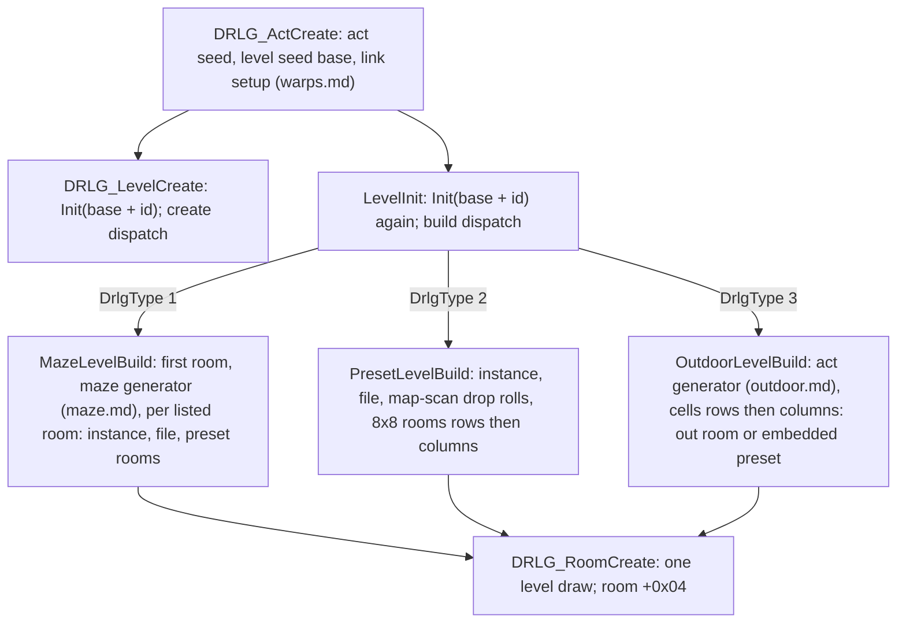
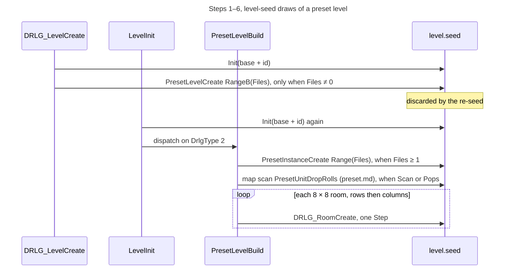
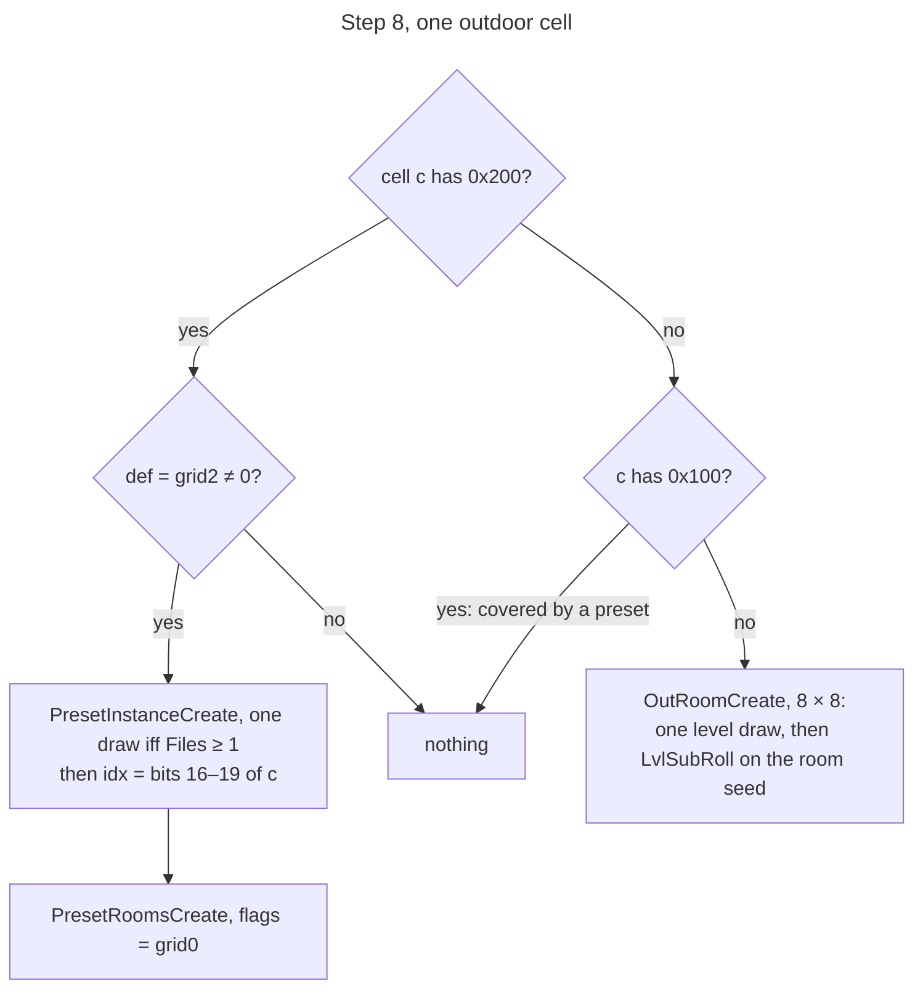
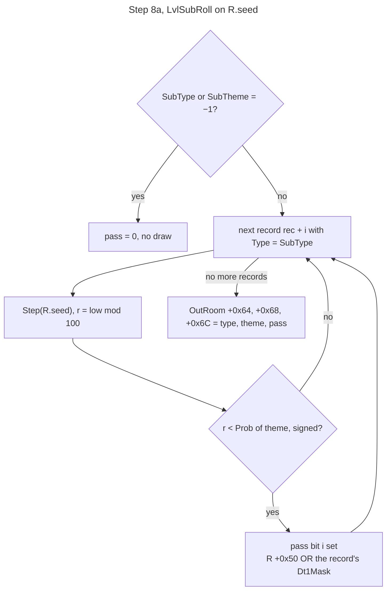
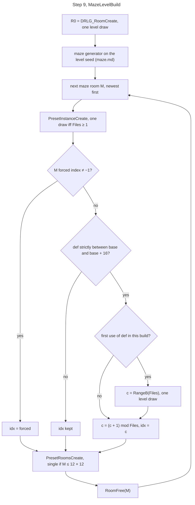

## Purpose

Given an act and a level id, this spec says how the game turns the level seed into DRLG rooms: the
two dispatches on `Levels.DrlgType`, every draw each generator makes on the level seed, the order in
which rooms are created (each creation is one level draw, so the order fixes every room's seed), and
how a preset's DS1 file is chosen. The maze generator that runs inside step 9 is specified in
[maze.md](../maze/), and the act's level links, the warp slots and the warp points built after every level
are in [warps.md](../warps/). The outdoor generators that run inside step 7 (the act layouts, the border pass,
the placements and the file rotation) are specified in [outdoor.md](../outdoor/). The preset-unit drop rolls, which also draw on the
level seed, are specified in [preset.md](../preset/). What happens when a
room is activated (its tiles and the k room-seed draws) is in room-tiles.md, and the active room's
collision grid, its logic regions and the spawn position tests are in collision.md. Which rooms
are active, when a room is released, and how its saved units are restored when it comes back is in
[lifecycle.md](../lifecycle/).
Primitives (`Step`, `Range`, `RangeB`, `Init`) are those of rng. The act and level
seeds are defined in rng/seeds steps 3–5.

## Entry points

| When | Function | Tag |
|---|---|---|
| Act created (server and client copy) | `DRLG_ActCreate` | [C] |
| Level record created and seeded | `DRLG_LevelCreate` | [C] |
| Level built (rooms created), lazily, on first need after each load | — | [C] |
| Maze level: create / build | — | [C] |
| Preset level: create / build | — | [C] |
| Outdoor level: create / build | — | [C] |
| One DRLG room created (one level draw) | `DRLG_RoomCreate` | [C] |
| Level unloaded (rooms and per-build state freed) | — | [C] |
| DRLG room activated (tiles, k, active room) | → `DRLG_RoomActivate`, see room-tiles.md | [C] |

## Inputs

### Tables

| Anchor | Used for |
|---|---|
| `Levels.txt:DrlgType` | both dispatches: 1 maze, 2 preset, 3 outdoor (leveldefs `+0x30`) |
| `Levels.txt:LevelType` | the level type (level `+0x1C0`): outdoor room DT1 mask, maze file-rotation base |
| `Levels.txt:SubType`, `Levels.txt:SubTheme` | `LvlSub` records rolled for each outdoor room (leveldefs `+0x38`, `+0x3C`) |
| `LvlPrest.txt:LevelId` | `LvlPrestByLevel`: the first record whose `LevelId` is the level's id |
| `LvlPrest.txt:Def` | `LvlPrestByDef`: the record of a preset def |
| `LvlPrest.txt:Files` | operand of the file-index draw (`+0x40`) |
| `LvlPrest.txt:File1` | `File1..6` (`+0x44 + 0x3C·i`): the DS1 of index i |
| `LvlPrest.txt:SizeX`, `LvlPrest.txt:SizeY` | preset instance size, when both are non-zero (`+0x28`, `+0x2C`) |
| `LvlPrest.txt:Scan`, `LvlPrest.txt:Pops` | map-scan gate before a preset's rooms are made (`+0x34`, `+0x38`) |
| `LvlPrest.txt:Dt1Mask` | every preset room's DT1 mask (`+0x1AC`), see room-tiles.md |
| `LvlMaze.txt:Level`, `LvlMaze.txt:SizeX`, `LvlMaze.txt:SizeY` | the first maze room's size |
| `LvlSub.txt:Prob0` | `Prob[SubTheme]` of each `SubType` record in the outdoor room roll (`+0x11C`) |
| `LvlSub.txt:Dt1Mask` | OR-ed into an outdoor room's DT1 mask when its record is picked (`+0x48`) |

### Runtime state

Offsets are byte offsets into the owner.

| State | Type | Owner offset | Source |
|---|---|---|---|
| level seed base | `u32` | act `+0x470` | rng/seeds step 3b |
| level seed | `Seed` | level `+0x1C4` | step 1, step 2 |
| level id, `DrlgType`, level type | `u32` | level `+0x1D0`, —, `+0x1C0` | leveldefs |
| preset level data: file index | `i32` | level data `+0x04` | step 3 |
| preset instances | list, prepended | level `+0x1B0` | step 4 |
| maze file-rotation counters | list of `{Def, Files, c, next}`, 0x10 bytes each | level `+0x1CC` | step 9 |
| level's rooms | list, prepended (next at room `+0x24`), count `+0x08` | level `+0x10` | step 5 |
| DRLG room first draw | `u32` | DRLG room `+0x04` | rng/seeds step 5 |
| DRLG room seed | `Seed` | DRLG room `+0x14` | rng/seeds step 5 |
| DRLG room type | `u32`: 1 outdoor, 2 preset | DRLG room `+0x48` | step 5 |
| DRLG room DT1 mask | `u32` | DRLG room `+0x50` | steps 6, 8 |
| preset instance | 0x58 bytes: `+0x04` file index, `+0x08` record, `+0x0C` DS1, `+0x3C` client-objects flag | — | step 4 |
| outdoor room SubType pass | `+0x64` type, `+0x68` theme, `+0x6C` mask | OutRoom (DRLG room `+0x20`) | step 8 |

### Constants

| Name | Value | Anchor | Tag |
|---|---|---|---|
| preset room block | 8 × 8 cells | — | [C] |
| maze room single-room limit | 12 × 12 | — | [C] |
| outdoor room DT1 mask by level type, checked types | 2 → `0x44103`; 16 → `0x1`; 21 → `0x4`; 31 → `0x11` | — | [C] |
| outdoor room DT1 mask by level type, other types | 22, 27, 28 → `0x1`; 30 → `0x11`; any other type → 0 | — | [I] |
| `MAZE_DEF_BASE` by level type | 3 → `0x34`, 4 → `0x6C`, 7 → `0xA7`, 8 → `0xCD`, 10 → `0x101`, 13 → `0x12D`, 17 → `0x19D`, 18 → `0x1E1`, 22 → `0x2F1`, 24 → `0x298`, 25 → `0x2C0`, 28 → `0x344`, 33 → `0x3EA`, 34 → `0x422`, 35 → `0x41C`; other types: no rotation | — | [C] |

- [C] The outdoor mask values are checked against the logged rooms for four level types: 2 in 56 Blood Moor rooms, 16 and 21 in 40 and 20 rooms, and 31 in 145 type-1 rooms of
  levels 111, 112 and 117, with the `SubType` masks ORed. No run logged a type-1 room of
  types 22, 27, 28 or 30, so the second row is read from the code only.

## Algorithm

`L` is the level, `L.seed` its seed, `base` the act's level seed base. Every `Range`, `RangeB` and
`Step` below on `L.seed` is a **level draw**, and the level seed has no other consumer outside the
sub-generators of § Sub-generator boundaries (the maze and outdoor windows, oracles of
the first runs, now modelled) and the preset drop rolls of step 5a.

Step notes:

1. The create-time dispatch makes at most one level draw (the preset level's index). [C]
   (`DRLG_LevelCreate`: 149 level creations) `DRLG_LevelCreate` also
   copies leveldefs `+0x34` (`LevelType`) to level `+0x1C0`, its only DRLG writer; the room DT1 list and
   the maze rotation read the type from there. [C] (`DRLG_LevelCreate`,
   `Levels.txt:LevelType`: every logged copy of `+0x1C0` over
   123 levels equals `LevelType`)
2. **The level seed is initialised twice with the same value.** Every level draw that creates rooms
   happens after `LevelInit`'s re-seed, so the create-time draw is discarded, and the room sequence
   doesn't depend on anything that ran between creation and build. [C]
   (32 builds) A level is built lazily.
   When the player leaves it, `LevelUnload` frees its rooms and its rotation list, and on
   re-entry `LevelInit` runs again on the same level object. [C] (188 unloads, 59
   rebuilds of an unloaded level object, no level built twice without an unload between) The rebuild repeats the same
   draws, files and rooms: in the owner's Catacombs entry levels 35 and 36 were built three times each
   and level 34 twice, all identical to the model. [C]
3. `PresetLevelCreate` uses `RangeB`, the second compile of the guarded range (rng
   step 2). With `Files = 0` the index is −1 and no draw is made. [C]

4. **`Files` is the operand, not the number of named files.** `PresetInstanceCreate` always passes
   `LvlPrest +0x40`. A power-of-two operand is reduced with a mask, any other with an unsigned `mod`,
   which give the same result (rng step note 2). [C]
   (960 instances, each
   loading exactly the predicted file) An index ≥ `Files` arises only from an override: the level's
   index (step 6), an outdoor cell's bits 16–19 (step 8) or a maze cell's forced index (step 9b). In the
   run that covered 9 of the 81 records whose `Files` and named count disagree. [C]
 The other 72 can only get their index through the
   same three overrides. [C]
   Neither record lookup tests `Expansion`. This has no stock observable: every `Expansion` 1 record is an Act V
   record, and a classic game builds no Act V level. [I]
5. **The map scan steps the level seed.** At build time `DRLG_PresetUnitDropRolls` runs from
   `PresetMapScan` on the level seed, between the instance draw and the first room creation: one level
   draw per drawing unit of the DS1 ([preset.md](../preset/) steps 2a and 3). With the rolls modelled the
   run replays with every seed asserted: 91 calls (52 in the five scripted logs, 39 in the owner's
   Catacombs log), 2 of which drew (both in Act II), 21 244 checks, 0 mismatches. [C]
 When the map scan has loaded the DS1, the
   activation-time DS1 load skips its own rolls on the room seed (room-tiles.md step 1,
   [preset.md](../preset/) step 2b). [C] The 8 × 8 split gives the Act I town (56 × 40) 35 rooms
   and a 24 × 24 preset 9, created rows outer, columns inner. [C]

7. The seed entering the outdoor generator is the re-seeded level seed. The generator itself, from the
   vertex ring to the cell grids, is [outdoor.md](../outdoor/#a-the-window): 522 windows of 29 levels
   reproduced, every level-seed step checked. [C] Level 134 takes the Act II generator. [I]

8. Every embedded preset in the run was followed by the cell override, and its instance loaded that
   file: 914 instances, 830 with a draw and 84 with `Files = 0`. The cell value, bits 16–19 included, is the
   outdoor generator's output. [C] `LvlSubRoll` draws on the **new room's** seed, right after the room's own
   creation draws (rng/seeds step 5), so these draws come before the activation re-seed and are not
   part of k. The rolled mask and the room seed are reproduced 466 times. [C]
 With `SubType` and `SubTheme` both −1 the
   roll returns a pass mask of 0 at once, with no draw: 1636 logged calls, seed unchanged. [C]
 With only one of them −1 the same return is taken; a `SubType`
   with no record also gives 0 and no draw; the theme index is not bounds-checked. None of the three has a stock
   case: only level 120 has one −1 and it has no out room, no level names a `SubType` without a record, and none has
   a `SubTheme` above 4. [I] Each room's position is
   `L.rect + 8·(cx, cy)`; an embedded preset gets the rect `{x, y, 0, 0}` and its rooms' size and position come from
   the preset (`drlg/preset`). The position changes no draw. [C] (every one of 11 516 out rooms has its
   logged rect and creation order, and the level seed matches after every window) The DT1 mask it produces (the
   level-type value OR the picked records' `Dt1Mask`) equals the room's `+0x50` in all 56 Blood Moor
   rooms. [C]
9. **Maze rooms become preset rooms.** The maze generator works with its own rooms. Afterwards each
   listed maze room is converted into a preset instance, which creates the level's real (type 2)
   rooms, and is freed. The seed entering the maze generator ([maze.md](../maze/), an oracle of the first
   run) is the seed after the first room's draw; the conversion order is the room list the generator leaves,
   newest first. [C]
   (Den of Evil, Sewers Level 1, Catacombs Levels 2–4) The generator's room
   count, positions, `Def`s, forced indices and list order are [maze.md](../maze/)'s; the conversion walks
   the list it leaves. [C] (230 windows)
   **Rotation counters are per build.** The list lives at
   level `+0x1CC`, nodes are prepended, and `LevelUnload` frees it and zeroes the field,
   so each build starts without counters. [C] (per-build counters
   reproduce 1648 first-use draws and 2424 rotations over 393 builds, rebuilds included;
   `LevelUnload` frees a non-empty list in 76 unloads) Every use, the first included, advances the counter before
   it is used: the first use of a def yields `(RangeB + 1) mod Files`. [C]
   (16 first uses and 18 rotations in
   the scripted entries, 42 and 73 in the owner's Catacombs entry)

### Act-seed consumers

- [C] Before any level is built, `DRLG_ActCreate` runs the per-act link setup, specified in
  [warps.md § A–C](../warps/#a-per-act-link-setup):
  `ActLinkInit` switches on the act index to one of `ActLinkAct1`,
  `ActLinkAct2`, `ActLinkAct3`, `ActLinkAct4`,
  `ActLinkAct5`, which run `LevelLinkBuild` and the `LinkPick` callbacks on a
  copy of the act seed. `LevelLinkBuild` creates each linked level (`LevelEnsure`), writes its
  position, writes the link value into the index of preset levels 1 and 40, and writes level 27's index
  from one act-seed draw while it handles level 6 when Black Marsh ends on side 1 or 3. Then `DRLG_ActCreate` creates the act's town level and
  calls `LevelInit` on it. Acts I, II, IV and V are reproduced (196 link builds);
  Act III's jungle layout steps the act seed itself and is [outdoor.md § J](../outdoor/#j-act-iii), reproduced. See also rng/seeds step 3d.

## Outputs

For each built level: its DRLG rooms, linked at level `+0x10` (newest first), each with its type (`+0x48`), rect, first draw `+0x04` (which seeds it at activation), DT1 mask `+0x50`, and for type 2 its preset instance with the chosen file index. For outdoor rooms also the SubType pass (`+0x64`–`+0x6C`) that their activation applies. The level seed ends where the last modelled draw leaves it. [C] (the seed at every build's end and the room count of every build checked)

## Worked example

`base = 015B2E77` (rng/seeds worked example). Level 8 is `DrlgType` 1, level type 3, so `MAZE_DEF_BASE` is `0x34` and defs 53–67 rotate.

| Step | Operation | Level seed after | Result |
|---|---|---|---|
| 2 | `Init(base + 8)` | `015B2E7F:0000029A` | |
| 9 | maze generator ([maze.md](../maze/#worked-example), example 1) | `334AA35A:02E00A8C` | list: def 98 at (1500, 1024), def 83 at (1524, 1000), def 58 at (1500, 1000), all 24 × 24, forced index −1 |
| 9a, 4 | def 98, `Files 1`: `Range(1)` | `12CE5ECE:1564B05F` | idx 0 (a draw even though n = 1) |
| 9b | 98 is outside (52, 68): kept | | `Act1\Caves\CaveNSpec.ds1` |
| 5 | 24 × 24 → 9 rooms, rows then columns | `42DB84E5:07D80981` … `F38BE870:3FC9280D` | first room `+0x04 = 88CC16D3` |
| 9a, 4 | def 83, `Files 2`: `Range(2)` | `83D2063D:6594D62E` | idx `0x83D2063D & 1 = 1` |
| 9b | 83 is outside (52, 68): kept | | `Act1\Caves\CaveWPre2.ds1` (`File2`) |
| 5 | first room of its split, at (1524, 1000), 8 × 8 | `0EE3F31F:36FB3592` | room `+0x04 = step(Init(0EE3F31F)).low = 8E258975` |
| 9a, 4 | def 58, `Files 2`: `Range(2)` | `35E895EF:42FA8C7C` | idx 1, then overridden |
| 9b | 58 is inside (52, 68), first use: `RangeB(2)` | `80265D67:167C1E75` | c = 1, then (1 + 1) mod 2 = 0 → idx 0, `Act1\Caves\CaveSE.ds1` |

The room with `+0x04 = 8E258975` is the worked example of room-tiles.md,
which takes it from creation to its active-room seed. The file the generator chose for it
(`CaveWPre2.ds1`) is the one whose grids the room-tile run reproduces.

## Reimplementation notes

- **Don't carry the create-time seed into the build.** Re-initialise the level seed in `LevelInit`; a
  model that continues from `PresetLevelCreate`'s draw is off by one draw for every preset level. [C]

- **`Range(1)` draws.** A preset with `Files = 1` still consumes one level draw, and `Files ≤ 0` consumes
  none. [C]
- **Overwritten draws still count.** An outdoor cell's preset index replaces the instance draw, and a maze
  rotation replaces it too, but the instance draw was made and stepped the level seed. [C]

- **The rotation starts one past the draw.** The first use of a rotating maze def yields
  `(RangeB + 1) mod Files`, not the drawn value. Reset the counters at every `LevelInit`; keeping them
  across a level's rebuilds breaks the rebuild (this was the 226-mismatch checker bug of the owner's run).
  [C]
- **The maze conversion walks a list that is newest first**, and the maze rooms themselves are freed: a
  maze level's activated rooms are all preset (type 2) rooms. [C] (every Catacombs room had `+0x48 = 2`)
- **`LvlSubRoll` uses the room seed, not the level seed**, and runs at creation, before the activation
  re-seed: its draws never count in k. [C]

## Evidence

- [maze.md](../maze/) and [warps.md](../warps/): the maze generator, the act links and the warp points.
- [outdoor.md](../outdoor/): the outdoor generators.
- rng/seeds: act, level and room seeds; rng: primitives.
- Tables: Levels, LvlPrest, LvlMaze,
  LvlSub, LvlTypes.
