## Purpose

When a DRLG room is activated, the game re-seeds it from `+0x04`, prepares its cell grids, builds its
floor, wall and shadow tiles, and then takes one more draw to seed the active room. Every tile pick whose
candidates have a positive rarity sum steps the room seed, and so do the `LvlSub` substitutions of an
outdoor room. The number of those steps is the **k** of [rng/seeds](../../spec-rng/seeds/) step 6b, and it fixes
the active-room seed. This spec defines the room's DT1 list, the tile pick, both grid prepares, the tile
build in call order and the activation draw, so that k (and the tile keys) can be computed from the
room's data and the state of its already built neighbours. How rooms come to exist is in
[the DRLG overview](../overview/). Primitives are those of [rng](../../spec-rng/overview/).

## Entry points

| When | Function | Tag |
|---|---|---|
| Room activated (both act copies) | — | [C] |
| Re-seed and grid prepare | → type 1, type 2 | [C] |
| Tile build | → type 1, type 2 | [C] |
| Activation draw, active room | `DRLG_RoomActivate` | [C] |
| DT1 list (before the window) | `DRLG_LevelDt1ListBuild` | [C] |
| RoomTile freed | — | [C] |
| Built room released (tiles and grids freed, bit `0x100000` cleared) | — | [C] |

## Inputs

### Tables

| Anchor | Used for |
|---|---|
| `LvlTypes.txt:File` 1 | `File 1..32` (stride 0x3C) of the level type: the room's DT1 files, by mask bit |
| `LvlPrest.txt:Dt1Mask` | a preset room's DT1 mask |
| `LvlPrest.txt:KillEdge`, `LvlPrest.txt:FillBlanks`, `LvlPrest.txt:Def` | the type-2 builder (`+0x18`, `+0x1C`, `+0x00`) |
| `LvlSub.txt:Prob0` | `Type`, `File`, `CheckAll`, `Prob0..4`, `Trials0..4`, `Max0..4` of the substitution records |
| `Levels.txt:SubWaypoint`, `Levels.txt:SubShrine` | the `LvlSub` type of the first two substitution passes (leveldefs `+0x40`, `+0x44`) |
| `Levels.txt:Warp0` | the level's 8 warp ids (leveldefs `+0x68`), unless the act overrides them |
| `LvlWarp.txt:Id` | `Id`, `LitVersion` (`+0x24`), `Tiles` (`+0x28`), `Direction` (`+0x2C`) of the warp records |
| `dt1`#tile-record-96-bytes | tile key (orientation `+0x14`, main `+0x18`, sub `+0x1C`) and `rarity` (`+0x20`, s32) |
| `ds1`#layers | a preset room's grids (views of its DS1 layers) and the substitution groups |

### Runtime state

| State | Type | Owner offset | Source |
|---|---|---|---|
| DRLG room seed, first draw | `Seed`, `u32` | room `+0x14`, `+0x04` | [rng/seeds](../../spec-rng/seeds/) step 5 |
| room rect | 4 × `i32`: x, y, w, h (cells) | room `+0x34`..`+0x40` | generator |
| room flags | `u32`; bits 12–15 SubShrine mask, 16–17 SubWaypoint mask, `0x40000` client copy, `0x100000` built, `0x200000` set by a server release (`EDX` 1) and left clear by a client release, `0x1000000` DT1 list built, `0x2000000` DS1 loaded | room `+0x28` | generator, step 1, § Release |
| neighbour list, count | room pointers, `i32` | room `+0x08`, `+0x2C` | `RoomNeighboursEnsure` |
| warp nodes | list, LvlWarp row at node `+0x10`, next `+0x04` | room `+0x4C` | `drlg/warps` |
| DT1 mask, DT1 list | `u32`, 32 slots | room `+0x50`, `+0x68` | [the DRLG overview](../overview/) steps 5, 8; step 2 |
| RoomTile | pointer; 0 = none | room `+0x54` | step 7 |
| level, level id, level type | — | room `+0x58`; level `+0x1D0`, `+0x1C0` | `DRLG_LevelCreate`: `+0x1C0` ← leveldefs `+0x34` (step note 2) |
| OutRoom grids (type 1) | orientation `+0x00`, wall `+0x14`, floor `+0x28`, each (w+1) × (h+1) `u32` | OutRoom = room `+0x20` | filled at step 5 from the room's flags (`+0x28`, [outdoor.md § B](../outdoor/#b-the-cell-grid-and-its-bits)); the fill before the first `LvlSub` pass is [outdoor.md § M](../outdoor/#m-the-out-room-grids-at-the-room-prepare-and-the-act-i-road-tiles) |
| OutRoom SubType pass | `+0x64` type, `+0x68` theme, `+0x6C` mask | OutRoom | [the DRLG overview](../overview/) step 8a |
| preset instance (type 2) | origin, size (`+0x18` w), record, file index, DS1 | room `+0x20` → `+0x08` | [the DRLG overview](../overview/) step 4 |

### Constants

| Name | Value | Anchor | Tag |
|---|---|---|---|
| fixed DT1 files, after the mask files | `DATA\GLOBAL\Tiles\Act1\Outdoors\Blank.dt1`, `…\Act1\Barracks\InvisWal.dt1`, `…\Act1\Barracks\Warp.dt1` | `DRLG_LevelDt1ListBuild` | [C] |
| mask-file prefix | `DATA\GLOBAL\TILES\` | `DRLG_LevelDt1ListBuild` | [C] |
| candidate cap | 40 tiles per pick (`push 0x28`); never binds on stock data, where no key has more than 28 candidates in any list a level type can build | `DRLG_PickTileByRarity` | [I] |
| filler floor cell | `0xF << 21`; `(0xF << 21) + 0x100` in level 74 | — | [C] |
| theme fill value by level type | 16 → `0x100`, 21 → `0x12 << 16`, 22 → `0x100000`, 27 → `0xA << 20`, 28 → `0x16 << 20`, 31 → `0x6 << 20` in level 117 else 0, other → 0 | — | [C] |
| merge row table | `s32[20]`, new orientation 0–19 → row 0–5, −1 keep, −2 no merge: `−1, 0, 1, 2, −1, 3, 4, 5, −2, −2, −1, −1, −1, −2, −1, −1, −1, −1, −1, −1` | `g_Bit2OrientRow` | [I] |
| merge orientation table | `s32[row·7 + old orientation]`, rows 0–5, old orientation 0–7 (43 cells; column 7 of row r is column 0 of row r + 1). Row 0 `0 1 3 3 4 1 3 1`, row 1 `1 1 2 3 4 3 2 2`, row 2 `2 3 3 3 4 3 3 3`, row 3 `3 1 3 3 4 5 6 1`, row 4 `1 3 2 3 4 3 6 2`, row 5 `2 1 2 3 4 1 2 7` | `g_Bit2OrientMerge` | [I] |

**`Orient89Unit`'s row tables.** Both are `.rdata` data in `Game.exe` that a reimplementation copies. The layouts,
the lookup and the values below follow the reading of the two tables.


- [C] `g_Orient89Levels` is 37 records of 12 bytes, `{s32 levelId, s32 firstRow, s32 lastRow}`
  with `lastRow` inclusive. The walk stops once a record's `lastRow` field would lie past a fixed bound, so the
  4-byte word right after the 37th record (a 38th `levelId` 0) is never a record.
- [C] `g_Orient89Rows` is 34 used records of 0x1C bytes from the word after that one, seven s32
  `{main, sub, is9, unitId, unitType, dx, dy}`; the bytes after row 33 are a string that no range reaches.
  `dx`, `dy` are in subtiles. Unit type 1 is a monster (`MONSTATS_ValidId(unitId)`, created with flag 1), type 2
  an object.
- [C] `Orient89RowFind(levelId, cell, is9)` walks the level records in order and, for a record with that
  `levelId`, scans `firstRow..lastRow` for the first row with `main = (cell >> 20) & 0x3F`,
  `sub = (cell >> 8) & 0xFF` and `is9` equal; it returns −1 when none matches. `Orient89Unit` takes the level id
  from `R+0x58 → +0x1D0` and sets `is9` = (orientation = 9).
- [C] The level ranges overlap (rows 5–6, 10–11 and 24 are reached from two level groups), and level 109's range
  ends on row 24, a type-1 row of the 111/112/117 group; the code takes them as they are. The run's marks came
  from rows 0–3 (or 10, for object 16), 19, 20, 22 and 24–33; the other rows rest on the same layout and the
  bytes.

| levels (id) | rows |
|---|---|
| 28, 29, 30, 31 | 0–3 |
| 26, 27 | 4–6 |
| 32, 33 | 5–9 |
| 34, 35, 36 | 10–11 |
| 37 | 10–12 |
| 51 | 13–14 |
| 52, 53, 54 | 15–18 |
| 55, 56, 57, 58, 59, 60, 61, 66, 67, 68, 69, 70, 71, 72 | 19–20 |
| 62, 63, 64 | 21–22 |
| 109 | 23–24 |
| 111, 112, 117 | 24–33 |

| row | main | sub | is9 | unit id | type | dx | dy | | row | main | sub | is9 | unit id | type | dx | dy |
|---:|---:|---:|---:|---:|---:|---:|---:|---|---:|---:|---:|---:|---:|---:|---:|---:|
| 0 | 7 | 0 | 1 | 14 | 2 | 5 | 0 | | 17 | 0 | 0 | 1 | 295 | 2 | 2 | 0 |
| 1 | 7 | 0 | 0 | 13 | 2 | 0 | 5 | | 18 | 0 | 0 | 0 | 294 | 2 | 0 | 2 |
| 2 | 5 | 0 | 1 | 16 | 2 | 0 | 0 | | 19 | 2 | 4 | 1 | 92 | 2 | 1 | 0 |
| 3 | 5 | 0 | 0 | 15 | 2 | 0 | 0 | | 20 | 2 | 1 | 0 | 91 | 2 | 0 | 2 |
| 4 | 6 | 0 | 1 | 27 | 2 | 5 | −2 | | 21 | 0 | 1 | 1 | 229 | 2 | 0 | 0 |
| 5 | 4 | 0 | 1 | 24 | 2 | 1 | 2 | | 22 | 0 | 1 | 0 | 230 | 2 | 0 | 0 |
| 6 | 4 | 0 | 0 | 23 | 2 | 0 | 0 | | 23 | 3 | 3 | 0 | 449 | 2 | −2 | 4 |
| 7 | 4 | 3 | 1 | 25 | 2 | 1 | 0 | | 24 | 2 | 1 | 0 | 435 | 1 | 1 | 2 |
| 8 | 1 | 2 | 0 | 62 | 2 | 0 | 3 | | 25 | 2 | 1 | 1 | 435 | 1 | 2 | 1 |
| 9 | 1 | 2 | 1 | 63 | 2 | 3 | 0 | | 26 | 2 | 6 | 0 | 435 | 1 | 1 | 1 |
| 10 | 0 | 0 | 1 | 16 | 2 | 0 | 0 | | 27 | 2 | 2 | 0 | 433 | 1 | 0 | 1 |
| 11 | 0 | 0 | 0 | 64 | 2 | 0 | 0 | | 28 | 2 | 3 | 1 | 432 | 1 | 1 | 0 |
| 12 | 2 | 0 | 1 | 47 | 2 | 5 | 0 | | 29 | 26 | 0 | 0 | 434 | 1 | 0 | 1 |
| 13 | 0 | 1 | 1 | 291 | 2 | 2 | 0 | | 30 | 2 | 4 | 1 | 524 | 1 | 0 | 0 |
| 14 | 0 | 1 | 0 | 290 | 2 | 0 | 2 | | 31 | 2 | 4 | 0 | 525 | 1 | 0 | 0 |
| 15 | 5 | 0 | 1 | 293 | 2 | 2 | 0 | | 32 | 29 | 0 | 1 | 60 | 2 | 2 | 0 |
| 16 | 4 | 0 | 0 | 292 | 2 | 0 | 2 | | 33 | 29 | 0 | 0 | 60 | 2 | 0 | 2 |

## Algorithm

`R` is the room being activated, `L` its level, `R.seed` its seed `+0x14`. **Every `Step`, `Range` and
pick draw below is on `R.seed` unless it names another room.** Cell positions `(x, y)` are map cells;
grid indices are relative to the room origin. A *cell* is a `u32` DS1-style cell: bit 0 wall, bit 1 floor,
bit 2 border/merge, bit 7, bits 8–15 sub index `s`, bits 18–19 layer value, bits 20–25 main index `m`, bit 27
shadow, bit 31 hidden.

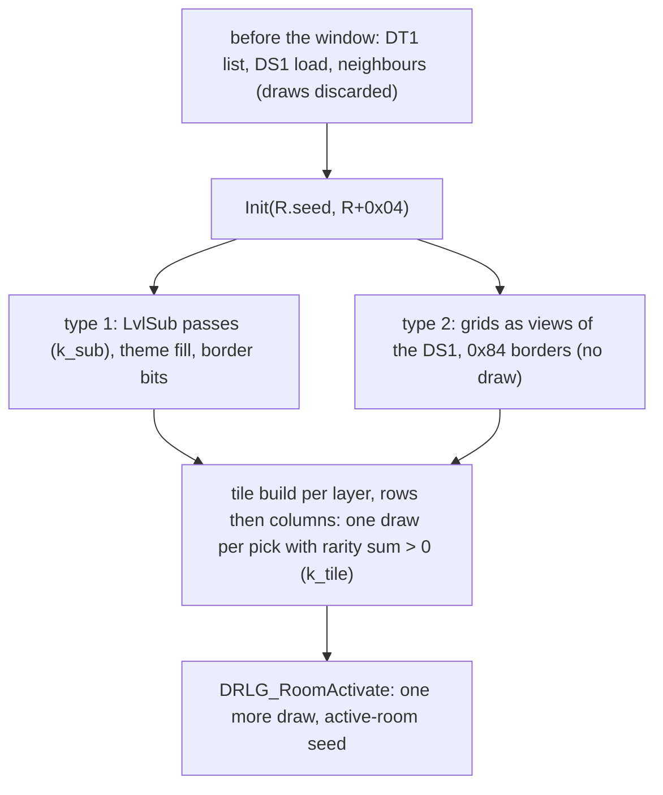

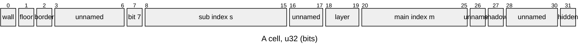

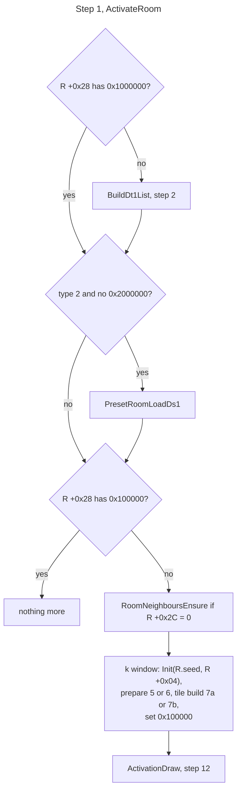

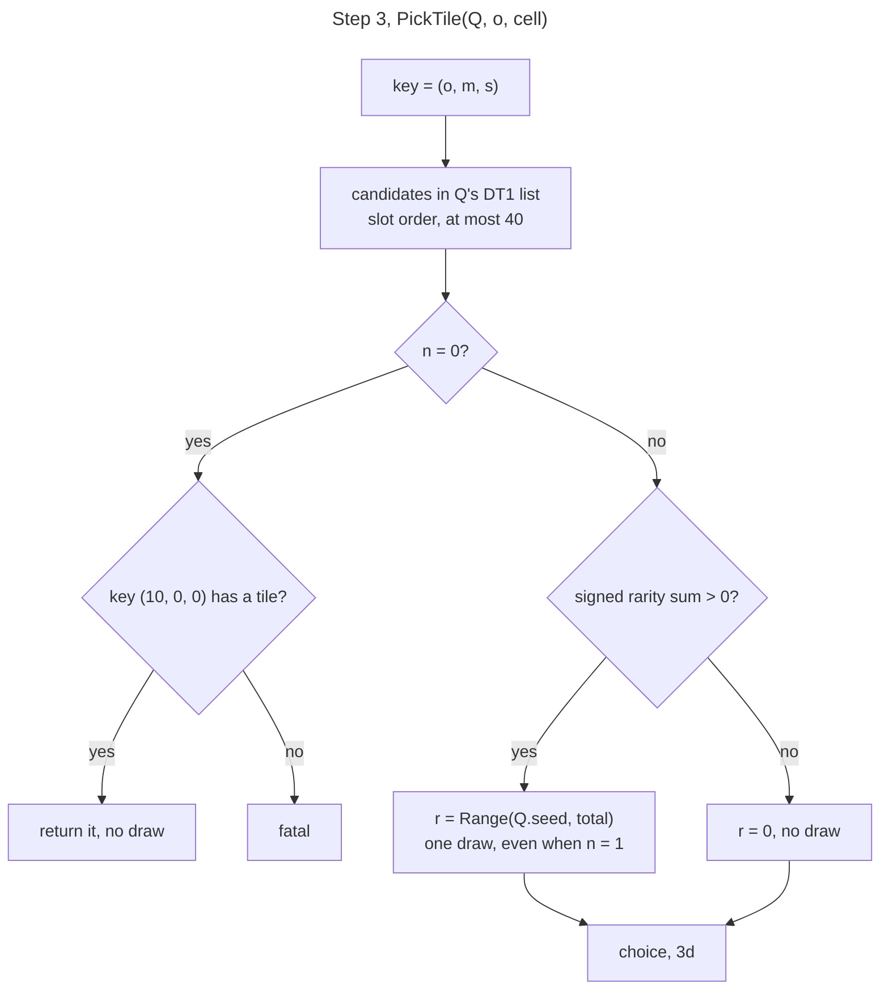

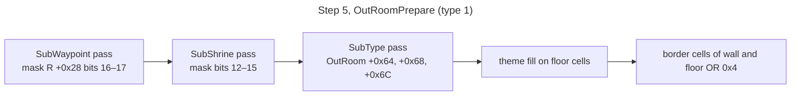

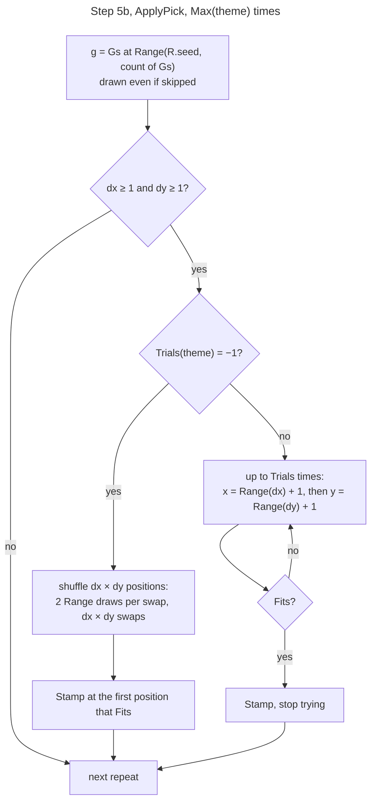

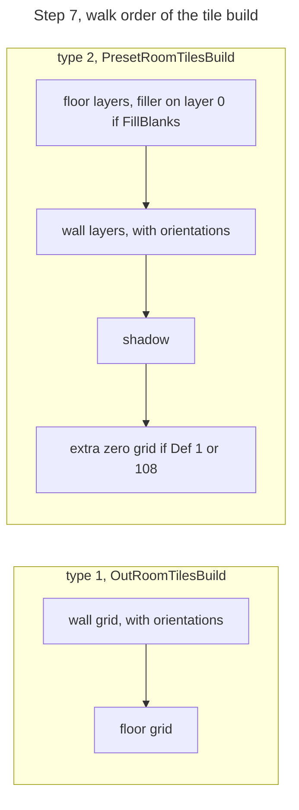

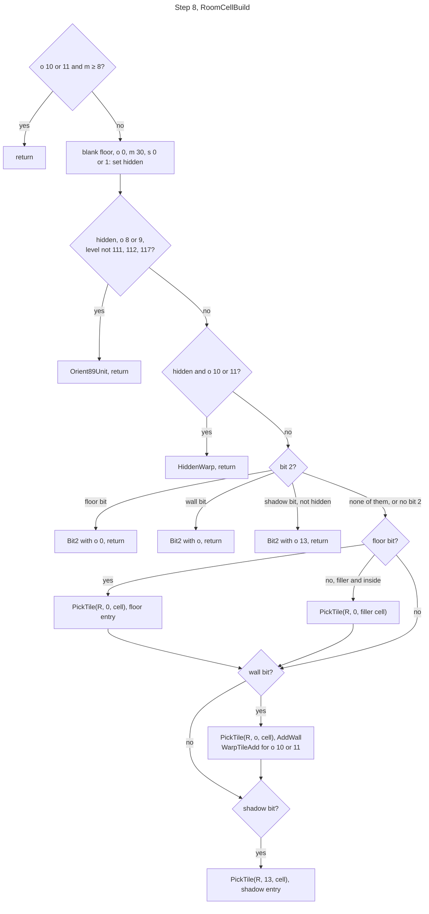

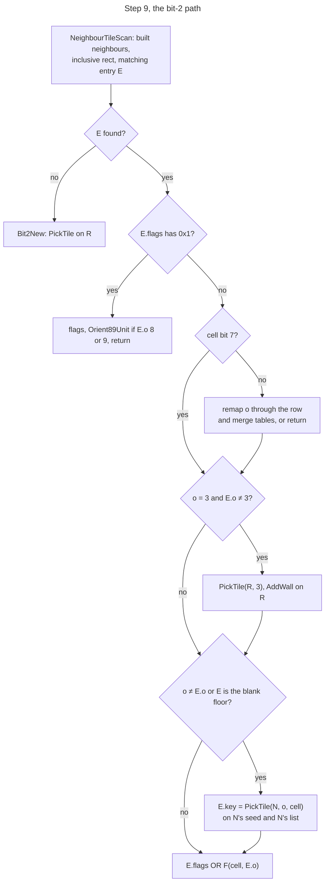

```
1. ActivateRoom(R):                                                   [C]
     if not (R[+0x28] & 0x1000000): BuildDt1List(R)                   ; step 2
     if not (R[+0x28] & 0x2000000) and R.type = 2: PresetRoomLoadDs1(R)  ; see step note 1
     if not (R[+0x28] & 0x100000):
       if R[+0x2C] = 0: RoomNeighboursEnsure(R)                       ; may create neighbours and levels
                                                                      ; its order against the DS1 load, and
                                                                      ; RoomActivateA's path: [I]
       ── the k window ──                                             [C]
       Init(R.seed, R[+0x04])                                         ; rng/seeds 6a
       type 1: OutRoomPrepare(R) (5);   type 2: PresetRoomPrepare(R) (6)
       type 1: OutRoomTilesBuild(R) (7a); type 2: PresetRoomTilesBuild(R) (7b)
       R[+0x28] |= 0x100000
       ── end of window ──
       ActivationDraw(R)                                              ; step 12
     RoomActivateA runs only the last block (from the 0x100000 test).

2. BuildDt1List(R):                                                   [C]
     T ← LvlTypes[L[+0x1C0]]                                          ; L = R[+0x58], the room's level
     for i in 0 ..< 32, while the remaining mask ≠ 0:                 ; bit order
       if R[+0x50] bit i: append name(T.File(i+1))
     name(c) = c longer than one character ? "DATA\GLOBAL\TILES\" + c with '/' → '\' : c   ; "0" stays "0"
     append the three fixed files (Constants)
     R[+0x28] |= 0x1000000
   The list holds 32 slots; adding to a full list is fatal.          [I]
   The prefix is applied once, when LvlTypes is loaded, and only to cells longer than one
   character (three callers, the LvlTypes, LvlPrest and LvlSub loaders; 520 logged lists):
                                                                      [C] (DRLG_LoadLvlTypes)
   the list build tests no name, so a mask bit on a "0" cell adds the string "0".
                                                                      [I]

3. PickTile(Q, o: i32, cell: u32) → key:                              ; Q = the room whose seed and list are used
   3a. candidates:                                                    [C]
         key ← (o, (cell >> 20) & 0x3F, (cell >> 8) & 0xFF)          ; sub index: & 0xFF
         buf ← the tiles with that key in Q's DT1 list: files in slot order, within a file newest-indexed
               first, at most 40 in all;  n ← |buf|            ; the cap of 40 is inferred only (§ Constants)
   3b. if n = 0:                                                      [C] (DRLG_PickTileByRarity; step note 3)
         if key (10, 0, 0) has a tile: return it                      ; NO draw
         else fatal                                                   [I] (DRLG_PickTileByRarity; met in no log)
   3c. total: i32 ← Σ rarity(buf[i]), wrapping                        [C]
       r: u32 ← 0
       if total > 0:                                                  ; signed
         r ← Range(Q.seed, total)                                     ; ONE draw on Q, even when n = 1
   3d. choice:                                                        [C] (DRLG_PickTileByRarity: 1 852 097 entries' tiles)
         i: u32 ← 0;  c: i32 ← r + 1
         if total ≠ 0:
           while n > 1 (unsigned) and c > 0 (signed): c ← c − rarity(buf[i]); i ← i + 1
         return buf[i ≠ 0 ? i − 1 : 0]

4. Range(Q.seed, n) in this spec is the rng spec's guarded range:     [C]
     n ≤ 0 (signed) → 0, no draw; otherwise one draw, low & (n − 1) for a power of two, else low mod n
     (unsigned). So Range(1) draws.

5. OutRoomPrepare(R)  (type 1; k_sub):                                [C]
     grids G ← the OutRoom orientation, wall and floor grids          ; input (Open questions); flags from outdoor.md § B
     allocate R's RoomTile (no draw)
     if (m ← (R[+0x28] >> 16) & 3) ≠ 0: LvlSubApply(Levels.SubWaypoint, theme 0, m)
     if (m ← (R[+0x28] >> 12) & 0xF) ≠ 0: LvlSubApply(Levels.SubShrine, theme 0, m)
     LvlSubApply(OutRoom[+0x64], OutRoom[+0x68], OutRoom[+0x6C])     ; the SubType pass rolled at creation
     v ← theme fill value (Constants)
     for every floor cell f of the (w+1) × (h+1) grid: if f & (0x3F << 20 | 0x1FF << 7) = 0: f |= v
     wall and floor grids: border cells (row 0, row h, column 0, column w) |= 0x4
   5a. LvlSubApply(type, theme, mask):
         if type = −1: return
         rec ← the first LvlSub record with Type = type
         for each bit i of mask, from bit 0:                          ; bit i = record rec + i
           if bit set: load rec+i's DS1 on first use (no draw)
                       rec+i.CheckAll ≠ 0 ? ApplyAll (5c) : ApplyPick (5b)
   5b. ApplyPick(rec, theme):                                         [C]
         Gs ← the DS1's groups (x, y, w, h), in file order
         if |Gs| = 0 or Max[theme] ≤ 0: return                        ; signed
         repeat Max[theme] times:
           g ← Gs[Range(R.seed, |Gs|)]                                ; drawn even if g is then skipped
           dx: i32 ← R.w − g.w;  dy: i32 ← R.h − g.h
           if dx < 1 or dy < 1: continue
           if Trials[theme] = −1:
             nn: i32 ← dx × dy;  list[i] ← (i mod dx, i ÷ dx) for i in 0 ..< nn
             repeat nn times: a ← Range(R.seed, nn); b ← Range(R.seed, nn); swap list[a], list[b]   ; 2·nn draws
             the first i with Fits(g, list[i].x + 1, list[i].y + 1): Stamp(g, that position)
           else:
             repeat Trials[theme] times (none if ≤ 0):
               x ← Range(R.seed, dx) + 1;  y ← Range(R.seed, dy) + 1  ; x before y
               if Fits(g, x, y): Stamp(g, x, y); break
   5c. ApplyAll(rec, theme)  (CheckAll ≠ 0; no shipped record):       [I]
         for g in Gs:
           W ← R.w − g.w + 1;  H ← R.h − g.h + 1;  if W ≤ 0 or H ≤ 0: continue
           DS1 tag_type 1: for y in 1 ..< H: for x in 1 ..< W: if Fits(g, x, y): Stamp(g, x, y)   ; no draw
           DS1 tag_type 2: for y in 0 ..< H: for x in 0 ..< W:
             if Matches(g, x, y):
               Step(R.seed); r: u32 ← R.seed.low mod 100
               if Prob[theme] < (i32) r:  v ← Range(R.seed, g[+0x14]); Stamp(g, x, y, offset (g.w + 1)·(v + 1))
   5d. Fits(g, x, y) and Stamp(g, x, y), over the group's cells row-major, sub = the record's DS1 cell,
       room = G at (x + i, y + j):                                    [C]
         Fits:  for each cell with sub.floor & 0x2, or (the DS1 has a wall layer and sub.wall0 & 0x1):
                  false if room.floor & (0x3F << 20 | 0xFF << 8), or not room.floor & 0x2, or room.wall & 0x1
                true
         Stamp: for each cell:
                  f ← sub.floor (0 if the DS1 has no floor layer);  if f & 0x2: room.floor ← f | 0x80
                  if the DS1 has a wall layer:
                    w ← sub.wall0; if w & 0x1: room.wall ← w
                    q ← sub.orient0; if q ≠ 0: room.orient ← q
                  sh ← sub.shadow;  if sh & 0x8000000: PickTile(R, 13, sh)   ; draw site
                then the record's preset units (no draw)

6. PresetRoomPrepare(R)  (type 2; no draw):                           [C]
     ps ← R's preset instance;  D ← its DS1 (File(ps.idx + 1))
     view origin (R.x − ps.x, R.y − ps.y), size (R.w + 1) × (R.h + 1), row stride ps.w + 1
     wall[i], orient[i] ← views of D's wall and orientation layer i, for each wall layer
     if D has a wall layer: wall[0] border cells |= 0x84
     wall[i], i ≥ 1: every cell |= i << 18
     floor[i] ← view of floor layer i; every cell |= i << 18
     shadow ← view of the shadow layer
     every floor[i] border |= 0x84;  shadow border |= 0x84
     the preset's units inside the room move to the room (no draw)

7a. OutRoomTilesBuild(R):                                             [C]
     RoomCellsBuild(R, G.wall, orient = G.orient, filler false, kx false, ky false)
     RoomCellsBuild(R, G.floor, orient = 0,       filler false, kx false, ky false)
     T[+0x18], T[+0x20], T[+0x28] ← wall, floor, shadow entries used  ; no draw after the passes

7b. PresetRoomTilesBuild(R):  P = ps.rec                              [C]
     kx ← P.KillEdge ≠ 0 and R.x + R.w = ps.x + ps.w
     ky ← P.KillEdge ≠ 0 and R.y + R.h = ps.y + ps.h
     for each floor layer f: RoomCellsBuild(R, floor[f], orient 0, filler = (f = 0 and P.FillBlanks ≠ 0), kx, ky)
     for each wall layer w:  RoomCellsBuild(R, wall[w], orient = orient[w], filler false, kx, ky)
     RoomCellsBuild(R, shadow, orient 0, filler false, kx, ky)
     if P.Def ∈ {1, 108}: RoomCellsBuild(R, an extra grid)            ; zero-filled: no pick [C] for Def 1 (620 rooms),
                                                                      ; [I] for Def 108, never built
     counts as in 7a; the animated-tile passes make no draw          [C] (187 Animate rooms)
     if P.Animate: AnimTilesBuild(R)                                  [C]
       for each animated entry E: E keeps its flags and takes the tile of its rarity-0 frame;
       each frame k ≥ 1 becomes a new entry of E's kind, built by that kind's flag rule (9d) on the cell of
       E's layer grid ((E.flags >> 14) & 7) − 1, then flags |= 0x8

7c. RoomCellsBuild(R, grid, orient, filler, kx, ky):                  [C]
     for j in 0 ..< R.h + (ky ? 0 : 1):                               ; rows outer
       for i in 0 ..< R.w + (kx ? 0 : 1):                             ; columns inner
         RoomCellBuild(R, grid[i, j], orient = (orient ? orient[i, j] : 0), R.x + i, R.y + j, filler)

8. RoomCellBuild(R, cell: u32, o: i32, x, y, filler):                 [C]
     m ← (cell >> 20) & 0x3F;  s ← (cell >> 8) & 0xFF
     if o ∈ {10, 11} and m ≥ 8: return
     if o = 0 and m = 30 and s ∈ {0, 1}: cell |= 0x80000000          ; the blank floor is hidden
     hidden ← cell & 0x80000000 ≠ 0
     if hidden and o ∈ {8, 9} and L.id ∉ {111, 112, 117}:
       Orient89Unit(R, cell, tile none); return                       ; step 11
     if hidden and o ∈ {10, 11}: HiddenWarp(R, cell, o, x, y); return ; step 10
     if cell & 0x4:                                                   ; the bit-2 path, step 9
       if cell & 0x2:  Bit2(R, x, y, 0, (m = 30 and s ∈ {0, 1}) ? cell & ~0x80 : cell); return
       if cell & 0x1:  Bit2(R, x, y, o, cell); return
       if cell & 0x8000000 and not hidden: Bit2(R, x, y, 13, cell); return
       ; none of the three: fall through
     if cell & 0x2:  PickTile(R, 0, cell); add a floor entry
     else if filler and R.x ≤ x < R.x + R.w and R.y ≤ y < R.y + R.h:  ; exclusive
       PickTile(R, 0, filler floor cell (Constants)); add a floor entry
     if cell & 0x1:
       PickTile(R, o, cell); AddWall(R, x, y, cell, o)
       if o ∈ {10, 11} and L.id ≠ 133: WarpTileAdd(R, that entry, cell, o)   ; step 10
     if cell & 0x8000000: PickTile(R, 13, cell); add a shadow entry
   8a. AddWall(R, x, y, cell, o):                                     [C]
         add a wall entry E;  SetWallFlags(E, cell, o)                ; step 9d; for o ∈ {8, 9} it runs Orient89Unit first
         if o = 3: PickTile(R, 4, cell); add the orientation-4 partner entry   ; draw site
                   the partner gets the same flags; the caller then ORs layer(cell) and CellBits again (no change)   [C]

9. The bit-2 path. Entries added here also go on a node list of R's RoomTile: one node for floors
   (kind 1) and one for walls and shadows (kind 0), created and prepended on first use; entries are
   prepended. Entries added by step 8 directly are on no list.       [C]
   A list is a chain through each entry's link `+0x20` (node head first, then each entry's `+0x20`), and an
   entry is in one chain at a time. The warp steps re-link entries into a warp node's list (10a, 10b): the
   entry's `+0x20` is re-set, so the entries that followed it in the RoomTile node's chain are no longer
   reachable from that node.                                          [C]
   Bit2(R, x, y, o, cell):
     (N, E) ← NeighbourTileScan(R, o = 0 ? kind 1 : kind 0, x, y, cell)
     E found ? Bit2Merge(R, N, E, o, cell, x, y) : Bit2New(R, o, cell, x, y)
   9a. NeighbourTileScan:                                             [C]
         for N in R's neighbour list (+0x08, count +0x2C), in order, skipping R:
           skip unless N has a RoomTile (+0x54 ≠ 0) and N.x ≤ x ≤ N.x + N.w and N.y ≤ y ≤ N.y + N.h   ; inclusive
           for each entry E of N's node of that kind, from the node's head along the `+0x20` links:
             if E is at (x, y) and E.o ≠ 4 and (E.o = 13 or not cell & 0x8000000)
                and (E.flags & 0x1C000 = 0 or ((E.flags >> 14) & 7) − 1 = (cell >> 18) & 3):
               return (N, E)
         return none
   9b. Bit2New(R, o, cell, x, y):                                     [C]
         if o ∈ {10, 11} and not (R.x ≤ x < R.x + R.w and R.y ≤ y < R.y + R.h): return   ; no pick
         PickTile(R, o, cell)                                         ; draw site
         o = 0: floor entry;  o = 13: shadow entry;  else AddWall (8a), its entries on the list
         if o ∈ {10, 11}: WarpTileAdd(R, the entry, cell, o)
   9c. Bit2Merge(R, N, E, o, cell, x, y):  E is N's entry             [C]
         if E.flags & 0x1:
           if E.o ∈ {8, 9}: SetWallFlags(E, cell, E.o)                ; Orient89Unit first, then the flags OR
           return
         ; from here to the 0x8 line below: the remap, row −2, the 8/9 edge rule and both orientation-3 branches,
         ; unreachable on stock data (step note 9); the reading is that of edited data
         if not cell & 0x80:                                          ; cell bit 7 skips this block [C]
           Tr: i32 ← g_Bit2OrientRow[o];  remap ← true                ; Constants; Tr = −1 keeps o [C]
           if o ∈ {8, 9}:   if x = R.x or y = R.y: remap ← false      [I]
           else if E.o ∈ {8, 9}: if x = N.x or y = N.y: return
           if remap:                                                  [I]
             if Tr ≥ 0 and E.o ≤ 7 (signed): o ← g_Bit2OrientMerge[Tr·7 + E.o]
             else if Tr ≠ −1: return                                  ; Tr = −2 (o 8, 9, 13), or E.o > 7: no merge
         if E.o ≠ 3 and o = 3:                                        [I]
           E.flags |= 0xC008
           PickTile(R, 3, cell); AddWall(R, x, y, cell, 3) on R's kind-0 node   ; a draw site, + the o-4 partner
         if E.o = 3 and o ≠ 3: (the entry at E.+0x20).flags |= 0x8     [I]
         if o ≠ E.o or E's key is the blank floor (0, 30, 0):          [C]
           E.key ← PickTile(N, o, cell)                               ; the merge draw site: N's SEED and N's list
           E.o ← o
         SetWallFlags(E, cell, E.o)                                   ; ORs onto E's word; bit 0x8 follows cell bit 31 again
   9d. Entry flags, the whole word `+0x14`:                           [C]
         CellBits(f, cell, tile):  the shared tail of the three writers
           if cell & 0x80:        f |= 0x001                          ; bit 7
           if cell & 0x10000000:  f |= 0x102                          ; bit 28 (collision reads 0x002)
           if cell & 0x20000:     f |= 0x040                          ; bit 17
           if cell & 0x10000:     f |= 0x080                          ; bit 16
           if cell & 0x8:         f |= 0x004                          ; bit 3
           if cell & 0x80000000:  f |= 0x008  else  f &= ~0x008       ; bit 31
           if cell & 0x4000000:   f |= 0x20C                          ; bit 26
           if cell & 0x20000000:  f |= 0x800                          ; bit 29
           if cell & 0x4:         f |= 0x2000                         ; bit 2
           t ← TILE_GetFlags16(tile) (tile +0x06):  if t & 1: f |= 0x004;  if t & 4: f |= 0x800
           return f
         layer(cell) = (((cell >> 18) & 3) + 1) << 14                 ; 0x4000, 0x8000, 0xC000 or 0x10000
         SetWallFlags(E, cell, o)  (RoomTileSetFlags; walls, and every merge of 9c):
           if o ∈ {8, 9}: Orient89Unit(R, cell, tile = E)             ; step 11, before the flags
           f ← E.flags | (o ≠ 13 ? layer(cell) : 0) | (o = 14 ? 0x4 : o ∈ 8..11 ? 0x2 : 0)
           E.flags ← CellBits(f, cell, E's tile)
         floor entry (TileEntryInit's floor branch, RoomFloorAdd, the hidden-warp floors of 10b):
           flags ← CellBits(layer(cell), cell, tile)
         shadow entry (RoomShadowAdd):  flags ← CellBits(0, cell, tile)
         later bits:  Orient89Unit's 0x20 (step 11);  | 0x8 on 10a's lit wall and on 10b's four floors;
                      | 0x8 on every animation frame entry (7b)
10. Warps. The warp node of a cell: id ← the level's warp ids[m] (the act's override list at act
    +0x90, else Levels Warp0..7); the first node of R's list (+0x4C) whose LvlWarp row has that Id.
    Fit(node, o): if the row's Direction is neither 'b' nor d (d = 'r' for o = 11, 'l' for o = 10),
    replace it by the first row with that Id whose Direction is 'b' or d.   [C]
    UnitOk(cell, o, x, y): fatal if no LvlWarp row fits (id, d); true unless x − R.x = R.w or
    y − R.y = R.h (no draw).                                          [C]
    10a. WarpTileAdd(R, entry, cell, o)  (visible):                   [C]
           node ← the warp node of cell (fatal if none)
           if s ∈ {0, 4} and not UnitOk(cell, o, x, y): return
           Fit(node, o)
           re-link the entry into the warp node's list: entry.+0x20 ← node.+0x0C        ; [C]
           if row.LitVersion ≠ 0: PickTile(R, o, cell | (row.Tiles << 8)); add a wall entry, flags | 0x8   ; draw site
    10b. HiddenWarp(R, cell, o, x, y):                                [C]
           UnitOk(cell, o, x, y)                                      ; only its fatal test matters here
           node ← the warp node of cell; if none: return
           Fit(node, o)
           if row.LitVersion ≠ 0:
             for i in 0 ..< 4: PickTile(R, 0, ((s << 12) | i | 4) << 8)    ; key (0, s & 0x3F, 4 + i); draw site
               a floor entry at (x − 1, y − 1) + g_HiddenWarpOfs[i] = (0,0), (1,0), (0,1), (1,1);
               flags by the floor rule (9d) | 0x8                       ; [C]
             then every floor entry of R whose tile is (main s, sub < 4) is re-linked into the
             warp node's list the same way                            ; [C]

11. Orient89Unit(R, cell, tile)  — its unit is a preset unit, created later ([I], note 11); the step:   [C]
      ; with tile none, the steps below run without the 0x20 skip and without the mark
      if tile ≠ none and tile.flags & 0x20: return
      row ← Orient89RowFind(L.id, m, s, o = 9)                       ; § Constants: the first row of L's range in g_Orient89Levels
                                                                      ; whose (main, sub, is-9) match; −1 → return
                                                                      ; is-9: the orientation (the entry's, or the hidden cell's) is 9
      (sx, sy) ← ((x − R.x)·5 + row.dx, (y − R.y)·5 + row.dy)         ; the unit's subtile
      if not (0 ≤ sx < R.w·5 and 0 ≤ sy < R.h·5): return
      the row's unit (a preset unit of R, created in the presets window); but for unit type 2 with id 91 or 92:
        u ← Range(R.seed, 3)                                          ; 0 → no unit
      if tile ≠ none: tile.flags |= 0x20

12. ActivationDraw(R)  = DRLG_RoomActivate:                           [C]
      if T[+0x18] = 0 and T[+0x20] = 0: return none                   ; no draw
      Step(R.seed);  activeRoom.seed ← Init(R.seed.low)               ; rng/seeds 6c
```

Step notes:

1. **What happens before the window doesn't count.** The DT1 list, the DS1 load and the neighbour
   creation run before the re-seed. The DS1 load (`DRLG_PresetRoomLoadDs1`) runs
   `DRLG_PresetUnitDropRolls` on the room seed the first time an instance's DS1 is loaded, and
   those draws are discarded by the re-seed; when the build-time map scan has loaded the DS1 already, it
   skips them ([preset.md](../preset/) step 2b). [C] (`DRLG_PresetRoomLoadDs1`,
   `DRLG_PresetUnitDropRolls`, `DRLG_PresetMapScan`, with its 571 room-seed rolls on the creation seed) The DS1 is `File(idx + 1)` of the instance; nothing is drawn
   to choose it here ([the DRLG overview](../overview/) step 4). [C] (`DRLG_PresetRoomLoadDs1`:
   all 56 422 PRC lines of the drlg and objects runs load `File(idx + 1)`)
   The window holds exactly four RNG-bearing functions, all on room `+0x14`: `DRLG_PickTileByRarity`,
   `Orient89Unit`, `LvlSubApplyAll` and `LvlSubApplyPick` (657
   functions walked, none unclassified; a second walk of the decoded instructions finds the same four functions and
   11 sites). [C]

2. **The DT1 list equals the logged list in all 520 rooms of the run** (56 type 1, 464 type 2). No mask
   bit in the run selected a `"0"` file cell. [C] The level type is `+0x1C0` of the room's level (room `+0x58`), which
   `DRLG_LevelCreate` writes once from leveldefs `+0x34` (`LevelType`); no other DRLG code stores to it. [C]
   (`DRLG_LevelDt1ListBuild`, `DRLG_LevelCreate`,
   `Levels.txt:LevelType`: every logged copy over 123 levels
   equals `LevelType`) `LvlTypes` `Expansion` and `Act` are read only by two DT1 preloads outside the
   build (at start-up, which stops at the first `"0"` cell and skips `Expansion` types without the expansion
   archive, and per act); neither is on the level-build path, and the room's list has no such test. [C]
   (`LvlTypes.txt:Expansion`, `LvlTypes.txt:Act`; the three `+0x780`/`+0x784` operands of `.text`, the third in a
   wrapper nothing references) The mask comes from creation: `LvlPrest.Dt1Mask` for every preset room,
   maze rooms included (464 rooms), and for an outdoor room the level-type value OR the `Dt1Mask` of the
   SubType records its creation roll picked ([the DRLG overview](../overview/) step 8a). [C]

   A `"0"` in the list does not stop the build: `DT1_LoadCached` cannot open it, logs `"Error opening file: %s"`
   (not fatal), allocates 0 bytes and hands the empty buffer to `DT1_Relocate`, which reads the DT1 header from it.
   What that read finds is heap content, so the outcome (a crash, a garbage tile list or an empty one) is not
   determinable statically. [I] No
   checked stock room has such a bit: for the 251 `LvlPrest` records whose level type the data fixes, and for every
   `LvlSub` record against the outdoor levels that use its `Type`, each set `Dt1Mask` bit names a file that is not
   `"0"`; the outdoor anchors and the maze specials outside the rotation ranges are not covered. [I]
   (`LvlPrest.txt:Dt1Mask`, `LvlSub.txt:Dt1Mask`, `LvlTypes.txt:File` 1)
3. **The draw rule.** A pick draws iff its primary key has at least one candidate and the signed sum of
   their rarities is > 0, even for a single candidate; a sum of 0 means no draw and the first candidate.
   The run made 39652 picks with a draw and 14154 with candidates but a zero sum. [C]
 When the primary key has no
   candidate, the pick returns the `(10, 0, 0)` tile and makes no draw: over the 36 logs with tile and activation
   lines, 1 280 picks had no candidate for their primary key,
   the model took the fallback with no draw in each, and every room's k matched (the room seed is checked at
   activation, so a draw in any of the 1 280 would have moved that room's k). met none. [C]
 The fatal branch, where neither the key nor `(10, 0, 0)` has a
   candidate, was met in no log. [I] Which
   candidate is returned (3d) does not change k: every entry of every activation dump names its tile, and the model's
   choice equals it on 1 852 097 entries, while candidates in file order would differ on 781 380. [C]

5. **Order of the substitution passes**: SubWaypoint, SubShrine, SubType, each over its records in
   mask-bit order. All shipped `LvlSub` records have `CheckAll = 0`, so 5c is never reached with stock
   data. 11 records have `Trials0 = −1`; records 6 and 9 took the shuffle in the run (5 passes). [C] for 5b, [I] for 5c
 The modelled stamping, theme fill and border bits equal the
   next pass's grids and the grids the tile build walks, in every type-1 room. [C]
 `Stamp` picks a tile for every
   stamped shadow cell **inside the prepare**, so those picks are part of k. [C]
 The group DS1's wall layers i ≥ 1
   get `i << 18` at load; only wall layer 0, orientation layer 0, floor layer 0 and the shadow are read. [C]

6. **The type-2 grids are views, not copies.** The prepare writes into the DS1 that `DS1_LoadCached` keeps
   once per path for the whole process, which every instance of the file and both act copies share. [C]
 Every write is an OR that each room repeats on
   its own borders, and a shared buffer and a fresh buffer per room gave identical grids in all 464
   type-2 rooms of the run, so a reimplementation may apply the prepare to a private copy. [C]
 No shipped DS1 is cut two
   ways: every file that two records name is used by records of the same kind and size, so each cell's `0x84`
   border state is the same in every view, and the shared-cache writes cannot show on stock data. [I]
 The view's stride is the
   preset width + 1, which equalled the DS1 row length in every room. [C]
   (an off-by-one stride gives 1393
   mismatches) The client-only `DRLG_PresetClientObjects`,
   which runs before the window, reads floor layer 0 and adds object preset units; it writes no grid, and
   the client grids match the same prepare. [C] for the code (a walk of the decoded instructions finds no store into a grid cell), [C] for the grids
7. **Type 1 walks the wall grid, then the floor grid; type 2 walks floors, walls, shadow.** The extra
   pass of preset defs 1 and 108 walks a zero-filled grid and picks nothing: for Def 1, 620 Act I town rooms with k
   checked. [C] No
   Def 108 room was built in any run. [I] `KillEdge` drops
   the last column or row only on the preset's own right or bottom edge. Without it, the walk covers the
   whole (w+1) × (h+1) grid, so each room also builds the cells it shares with its right and bottom
   neighbours. [C]
8. **Every room border carries bit 2**, so the bit-2 path is the common case: type 1 gets `0x4` in step 5,
   type 2 gets `0x84` in step 6. [C] The level exceptions of
   step 8 hold where reached: a hidden orientation-8/9 cell is built as a wall in levels 111 (51 cells), 112 (4) and
   117 (57), and level 74's filler floors take `0xF << 21 | 0x100` (2973 floors), every such room matching. This is
   `RoomCellBuild`'s level test, not the merge's 8/9 edge rule of 9c. [C] Level 133's warp exception is read from the code; level 133 is
   unreachable. [I]
9. **The bit-2 path reads the neighbours' state, so k depends on activation order.** Only neighbours
   already built in the same act copy count. The run made 11768 new and 6835 merge decisions. [C]
 The merge re-pick of 9c
   steps the **neighbour's** seed with the neighbour's DT1 list, not R's: it is not in R's k.
   354 such re-picks in the run, each checked through the neighbour's seed at a later room's start. [C]
 The run reached three exits
   of 9c before the re-pick: an entry with flag `0x1` (6481 merges), a cell with bit 7 (44) and row −1 with
   orientation 0 kept (310). Those branches are `[C]`. [C] The remap through the merge table, the row −2 return, the orientation 8/9
   edge tests and the orientation-3 branch were not reached in 50 586 logged merges (39 096 replayed from the drlg
   and objects logs, 11 490 in seven walled levels of the room-k sweep), so they are read from the code
   only. [I]
 By the row table, walls of orientation
   1, 2, 3, 5, 6, 7 remap through rows 0–5, orientations 0, 4, 10–12 and 14–19 keep theirs, and 8, 9 and 13
   return without a merge unless cell bit 7 or the 8/9 edge rule skips the lookup. [I]
 Type-2 borders carry bit 7 (step 6), so preset-to-preset
   wall merges end at flag `0x1`. [I]
   **These branches are unreachable on stock data**, outdoor rooms included. Every wall and shadow cell of the
   2077 DS1s a room can read (the 2043 `LvlPrest` files and the 34 `LvlSub` files) carries bit 7. [C]

   No grid writer adds a wall or shadow without it or clears it on one, so every kind-0 entry has flag `0x1`
   and a wall or shadow merge returns at the flag test, before the bit-7 test; a floor (o 0) merges only into
   kind-1 entries, which are orientation-0 floors whose row −1 keeps o, so the 8/9 and orientation-3 tests are
   false for it too. The remap, the row −2 return, the 8/9 edge rule and both orientation-3 branches therefore
   run only on edited data; 9c keeps them as the code reading of that case. [I] The logs agree merge by merge: over the 11 logs of the room-k sweep,
   1797 wall and 406 shadow merges, all into an entry with flag `0x1`, and 43 floor merges into an unflagged
   entry. [C]
   **The chains decide which entries a scan sees.** When a warp step re-links an entry that sat in a node's
   chain, the older entries behind it drop out of the scan, and a later neighbour's bit-2 cell on one of
   them builds a new entry (9b) instead of merging. In `monstats-s5` (level 53, a Palace Cellar 3 preset
   room) a warp wall of orientation 11 cut five older walls off its node, and the left neighbour then made
   its own wall at (8, 0) through `Bit2TileNew`. The logs hold 28 such cuts; k changed on none of them, but
   which entry a merge rewrites does. [C]
   **The flag word of 9d is reproduced on every entry of every logged activation dump**: on the 40 logs
   with `OD0` and `LSUB` lines, 12 974 activations and 44 291 room dumps (the activating room and its near
   rooms), 3 684 791 entries (2 875 733 floors, 183 136 shadows, walls of orientations 1–19), position,
   orientation and flags, 0 mismatches; 1 786 086 more entries on the 29 logs of the objects run.
   The cell bits occur: `0x2` on 490 979 entries, `0x40` on 258 219, `0x80` on 1164; 293 entries were
   rewritten by a merge. [C]
   These bits are not the build's and are not part of 9d: `0x20000` and `0x40000`, which neighbours' entries
   carry at a later room's dump but never at their own room's, and the `0x8` of an animation frame, which the
   running animation toggles to show one frame. For `0x20000` the writers are five client sites beside the wall
   cut-away, none in the build. [C] `0x40000` is
   the client automap's "added" mark: `AutomapTileAdd` returns at once on an entry that has it, else sets it and
   adds the tile to the automap, so each entry is added once. Neither bit is read by the DRLG build or the
   collision stamp, so neither changes k or the grid. [I]
   `0x400` is not the build's either: it is the client wall fade's "faded out" mark. The fade moves an entry's
   alpha byte (`+0x28`) over 500 ms, sets `0x400` when the alpha reaches 0 and clears it otherwise, and its draw skips
   an entry with `0x400` or `0x8`. Its only immediate writers are the two `or`/`and` pairs of that client code, none
   in the build; a computed store of the whole word is not excluded. [I]
   In the council log the bit is on 33 entries, all wall entries of one near room in the dumps of other rooms
   (151 dumps, none on a room's own dump), so the checker treats it like `0x20000` and `0x40000` on a near room and
   keeps comparing it on a room's own dump. This holds for that log alone, not for every log. [C]

   No writer of the animation `0x8` was found. [I]

   Not reached: a merge into or out of orientation 3 (the `0xC008` and the `0x8` on E's next entry; unreachable
   on stock data, above), and an animated wall or shadow (a shadow frame reads floor layer 1, index −1 below the shadow grid). [I]

10. 24 visible and 15 hidden warp cells in the run. Hidden-warp picks use orientation 0 (`EDX = 0`). [C]
 The four hidden-warp floors
    were reached on the later logs (524 entries) and match 10b with their `0x8`. [C]

11. `Orient89Unit`'s row tables are data in `Game.exe` (layouts and values in § Constants),
    so when its `Range(3)` happens follows from the level, the cell and the entry. In the 40 logs it set `0x20` on 912 entries (unit type 1: the catapults
    432–435 and 524–525; type 2: objects 13–16, 60, 91, 92 and 230), found no row in 855 calls, put the unit
    outside the room in 41, met an entry that already had `0x20` 14 times, and drew 3 times, each draw
    predicted. [C] What it makes at activation is a **preset unit** of the
    room, not a unit: the classes its rows flag are created later in the presets window through `PresetUnitDispatch`,
    whose creations the chain models ([chain § Algorithm](../../spec-chain/overview/#algorithm) D2); the code that adds the
    preset unit is not read. [I] A draw that returns 0 creates no unit: in Halls of the Dead 2 (level 57) the
    tomb-door rows drew 44 times, `Range(3)` returned 0 ten times with no unit created, and the entry got `0x20`
    either way. [C]
12. `T[+0x18]` and `T[+0x20]` are the wall and floor entry counts after the build (the builder copies the
    used counters over the capacities, `+0x08` → `+0x18` and `+0x0C` → `+0x20`, and `DRLG_RoomActivate` tests
    both). [C] (`DRLG_RoomActivate`:
    2066 activations equal the model's counts, 5 exceed them by animation frames) So the activation draw happens
    iff the room got at least one wall or floor entry, whether or not any pick drew; a room with no entry was not
    reached. [I] No room without tiles occurred in the run. [C]


### k

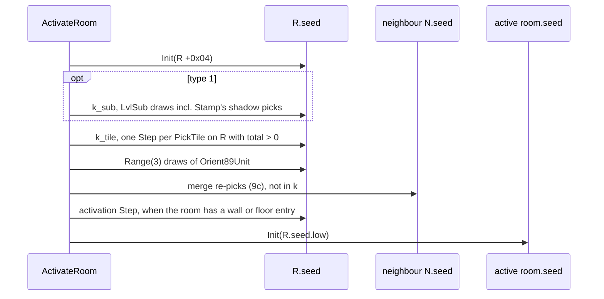

```
k(R) = number of Step(R.seed) between step 1's Init and step 12      [C]
     = k_sub(R)                                                       ; type 1 only: the draws of 5b (and 5c), incl. Stamp's shadow picks
     + k_tile(R)                                                      ; 7–10: one per PickTile on R with total > 0
     + the Range(3) draws of Orient89Unit                             ; step 11
   not counted: the merge re-picks of 9c, which draw on a neighbour
activeRoom.seed = Init(Step^(k+1)(Init(R[+0x04])).low)               ; when step 12 draws
```

- [C] **k is predicted bit-exact for every room activated in the run**: 520 activations, server and client
  copies, outdoor (type 1), preset and maze (type 2) rooms, k = 0..388, 0 mismatches over 11208 checks (11 734
  with a later phase's checks). The inputs the model takes from that run are run-time state made by other rows: the
  type-1 grids before the first `LvlSub` pass (its logs have no outdoor lines), the neighbour lists and which
  neighbours are built (activation order), the warp nodes and the level's warp ids (`drlg/warps`), and a preset
  room's file index ([the DRLG overview](../overview/) step 4). The type-2 grids and the DT1 list are rebuilt from data and checked.

- [C] **The type-1 grids are predicted where the logs allow it.** On the 40 logs that carry both the outdoor
  lines (`OD0`) and the `LvlSub` lines (`LSUB`), the k model runs on the out-room grids that
  [outdoor.md § M](../outdoor/#m-the-out-room-grids-at-the-room-prepare-and-the-act-i-road-tiles) predicts (the fill,
  Act I's road tiles included): 2884 type-1 rooms, 12 974 activations, 434 721 checks, 0 mismatches.

- [C] Only the bit-2 path and `LvlSub` read state that earlier draws change, so order matters only there.
  Every other pick's draw is a function of the cell and the DT1 list alone.

- [C] **A built room's seed keeps moving.** After R's own activation, a later neighbour whose bit-2 cell
  merges into one of R's entries may re-pick it on R's seed (9c). R's active-room seed is already
  taken by then, but R's `+0x14` is not the activation value any more, and any later re-pick on R starts
  from the moved value.
- [C] **Server and client copies can get different k** for the same DRLG room, because their activation
  orders differ and so do the built neighbours the bit-2 path sees. The same model predicts both; no
  client-only branch inside the window was needed.

### Release and re-activation

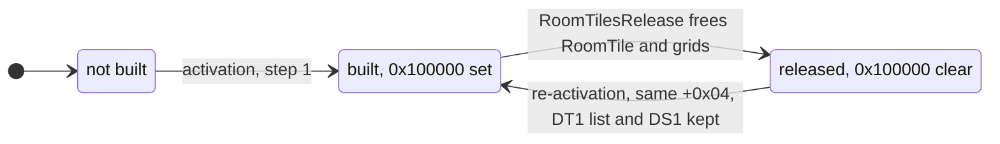

A built room can be released while its level stays loaded, and activated again later. The room-k sweep
logged 1516 releases, compared field by field, and 235 re-activations.

- [C] `RoomTilesRelease` is called through the wrapper `RoomReleaseWrap` (from `ActiveRoomFree`)
  for a built room; the wrapper first writes `R[+0x60]` ← the active room's flags bit 0. Every call, built room or
  not, then runs in this order: if its `EDX` argument is 0 and `R[+0x30]` is set, it frees the active-room object at
  `R[+0x30]` (`ActiveRoomFree`, where the call nests, below); it zeroes `R[+0x30]`; it frees the room's logic record
  (`R[+0x64]` was 0 at the exit of all 374 calls whose log line recorded it, 267 of which freed a record); on
  an unbuilt room that is all (539 calls; the order read from the code). If `R[+0x28] & 0x100000`: it clears that bit, adds 1 to `act[+0x468]`, frees the RoomTile
  (`RoomTileFree`: the three entry arrays, the node lists, `R[+0x54] ← 0`), frees the type's grids
  (type 1 the OutRoom grids, type 2 the preset room's grid data), zeroes `+0x0C` and `+0x14` of every warp node of
  `R[+0x4C]`, and sets `0x200000` in `R[+0x28]` iff its `EDX` argument is non-zero (626 of 1516). **The call
  nests:** a release with `EDX` 0 frees the active room through `ActiveRoomFree`, whose wrapper calls
  `RoomTilesRelease` again on the same room (its `EDX`: next bullet); the inner call does the freeing,
  and the outer one then finds `0x100000` clear and changes nothing more (890 nested pairs).

- [C] **The `EDX` the wrapper passes.** `ActiveRoomFree` calls the wrapper with `EDX` = the DUNGEON act's `+0x50`, and
  the wrapper passes its logical negation to `RoomTilesRelease` (`test edx, edx`, `sete al`).
  On a server release `+0x50` is 0 (`RoomReleaseAllowed` makes any other value fatal), so the tiles release gets `EDX` 1
  and sets `0x200000`; a client release gets `EDX` 0 and leaves it clear. The lifecycle run logged `EDX` 1 with
  `0x200000` set after it on all 2 440 server releases, and `EDX` 0 with the bit clear on all 8 277 client releases, so
  `0x200000` reads "released by the server".
- [I] No reader of `0x200000` was found: the only `+0x28` access with that immediate is the write.

- [C] The release keeps `0x1000000` (DT1 list), `0x2000000` (DS1 loaded), the neighbour count `R[+0x2C]`
  and the seed base `R[+0x04]`. The next activation (step 1) therefore skips the DT1 list, the DS1 load and
  the neighbour step, re-seeds from the same `+0x04`, prepares the grids again, rebuilds the tiles and takes
  the activation draw: 235 re-activations, each rebuilt as the k model predicts. `R[+0x2C]` is also cleared by
  `LevelUnloadCheck` for the rooms of levels linked to one it unloads, so such a room runs the
  neighbour step again.

- [C] **k can differ on the rebuild.** The room's own draws restart from the same seed, but the bit-2 path
  (step 9) sees whichever neighbours are built at that moment, and the merges the first build made into
  neighbours' entries (their orientation, tile and seed steps) are not undone. While released, the room's
  own entries are gone from its neighbours' scans (`R[+0x54] = 0`, step 9a). Of the 235 re-activations, k equalled
  the first build's in 183 and differed in 52.
- [C] The level unload frees RoomTiles through `RoomFree` instead (48 built rooms); that path rebuilds
  the level ([the DRLG overview](../overview/) step note 2).

## Outputs

- The active-room seed (step 12), or no active room when the room has no wall and no floor entry. [C]

- The room's RoomTile: floor, wall and shadow entries (0x30 bytes each; position, tile, flags) and the
  bit-2 node lists that later neighbours scan, as chains through `+0x20` (step 9). The flag word (step 9d) is
  what [collision.md](../collision/) stamps at activation. [C] [C] The entry layout is read from the allocator, and every entry of every activation
  dump is decoded with it and compared field by field with the model (1 852 097 entries).

- Side effects on other rooms: re-picks on built neighbours' seeds and entries (step 9c). [C]


## Worked example

**A Den of Evil room, map seed 12345, client copy, k = 15.** Source: the room-k run's Blood Moor log of seed 12345, reproduced by our
tile model, which prints the activation's `k model 15`, the active room, the DT1 list and mask checks, all `ok`. The room's creation is the worked example of [the DRLG overview](../overview/#worked-example)
(map seed 12345; that run is a separate game entry of the same seed, and the room has the same
`+0x04 = 8E258975` in both logs): Den of Evil (level 8, level type 3), the first room of preset def 83,
whose file index `Range(level seed, 2) = 1` selects `Act1\Caves\CaveWPre2.ds1`; the room-tile run reproduces
that file's grids and no other. Seeds are `low:high`, hex; all values below were logged and are recomputed
by our reference model of the primitives.

| Item | Value |
|---|---|
| room rect, preset rect | (1524, 1000, 8 × 8) in (1524, 1000, 24 × 24): view origin (0, 0), stride 25 |
| `LvlPrest` 83 | `Files 2`, `KillEdge 1`, `FillBlanks 1`, `Dt1Mask 0x1`; one wall, one floor layer |
| kill edges | none: 1524 + 8 ≠ 1524 + 24, so all 9 × 9 cells of every layer are walked |
| DT1 list | `DATA\GLOBAL\TILES\Act1\Caves\Cave.dt1` (`LvlTypes` 3 `File 1`), then the three fixed files |
| `+0x04`, re-seed | `8E258975` → `8E258975:0000029A` (the type-2 prepare draws nothing) |
| neighbours built before it | one of its six neighbours; no bit-2 cell found an entry there (14 bit-2 decisions, all new) |

Picks, in call order. Pass 1 is floor layer 0 (with filler), pass 2 wall layer 0 with its orientations,
pass 3 the shadow (no pick).

| Pass | Cells | Key | n, rarity sum | Draws |
|---|---|---|---|---|
| 1 | (0, 0), cell `905200C6`, bit-2 new floor | (0, 5, 0) | 9, 13 | 1 |
| 1 | border cells `0x84` and empty interior cells inside the room: filler | (0, 30, 0) | 1, 0 | 0 |
| 1 | 26 floor cells of rows 4–8 with keys (0, 3, 8…17), (0, 21, 0…3), (0, 2, 12…23), (0, 0, 10…11) | one each | 1, 0 | 0 |
| 1 | (5..8, 6), (3..8, 7), (3..6, 8): floor cells / | (0, 5, 0) | 9, 13 | 14 |
| 2 | (3, 5), cell `80001581`, hidden warp (orientation 10/11, warp id 4, `LitVersion ≠ 0`) | (0, 21, 4…7) | 1, 0 each | 0 |
| 2 | (6, 8), cell `00000185`, bit-2 new wall | (12, 0, 1) | 1, 0 | 0 |

The 15 draws (the rarities of the nine `Cave.dt1` tiles of key (0, 5, 0) are 1, 2, 1, 2, 2, 1, 1, 2, 1, in file
order):

| Draw | Room seed after | Draw | Room seed after |
|---|---|---|---|
| 1 | `42B299A3:3B49CC55` | 9 | `42354902:02B0BF1C` |
| 2 | `5737B6C4:1BD1AF78` | 10 | `3A4F0DA6:1B9D6AE2` |
| 3 | `1417944C:2460B817` | 11 | `BC844BA0:1851F5C4` |
| 4 | `08B89693:08615901` | 12 | `526A27E4:4EA1003E` |
| 5 | `E6D1E820:03A3320B` | 13 | `B319F2B2:225FE13A` |
| 6 | `7E7CD2AB:6045F2FE` | 14 | `F787C434:4AB3A9D7` |
| 7 | `AB164095:34C1CB4D` | 15 | `6CC2E5DB:673E363A` = logged seed at the activation draw |
| 8 | `06734DF6:475BEAB4` | act. | `2FE647C1:2D5D0F6C`; active room `2FE647C1:0000029A`, flags 4 (client) |

So k = 15 and the active-room seed is `Init(2FE647C1)`. [C]

**Server and client k of one room.** In the room-k run's town log of seed 12345, the Act I town room with
`+0x04 = F923BEE2` (room 3 of level 1, the [rng/seeds](../../spec-rng/seeds/#worked-example) example) gets k = 64 on
the server and k = 55 on the client: the client copy found more entries of built neighbours, so 25 of its bit-2
decisions were merges against 12 on the server, and the floor pass made 48 draws against 56. Same grids,
same DT1 list. [C]

## Reimplementation notes

- **Count the draw, not the choice.** A pick with one candidate of positive rarity still draws; a key whose
  candidates all have rarity 0 doesn't. Precompute `(n, Σ rarity)` per key per DT1 list. [C]

- **Sum at most 40 candidates**, in DT1-list slot order. The cap has no stock observable: no key has more than 28
  candidates in any list a level type can build. [I]
- **`Range(1)` draws** in the `LvlSub` group pick; `Range(n ≤ 0)` doesn't. A group draw is made even when the
  group is then too big for the room. [C]
- **`Act1/Outdoors/Trees.ds1` is 12 bytes short.** `LvlSub` record 11 (`Type` 6) loads it, and
  `DS1_Parse` reads its last group's y, w and h past the end of the file buffer, which `FILE_LoadWhole`
  allocates at the exact size: the original reads uninitialised heap. [I] **A reimplementation reads the missing bytes as zeros.** Zeros reproduce every
  draw seen: of the 27 logged loads, 26 held `(0, 0, 0, 0)` for that group, and the group was drawn 4 times,
  always with w = h = 0 (`Fits` holds trivially, `Stamp` writes nothing, and the pass consumes the group draw
  plus one x and one y draw). The one load that held garbage, `(0, 229120, 245560, 1)`, made no draw of that
  group. [C]
- **The neighbour re-pick moves another room's seed.** Keep every built room's seed and entries live after
  its activation; the merge re-pick of 9c steps them. [C]
- **Activation order is an input.** Server and client copies, or two players' walks, give different k for
  the same room. Gameplay uses the server copy ([rng/seeds](../../spec-rng/seeds/) step note 6). [C]

- **The walk includes the shared edge.** Without `KillEdge` a room walks (w+1) × (h+1) cells, so cells on its
  right and bottom edges are built by both rooms that share them; the bit-2 scan is what turns the second
  build into a merge. [C]
- **The filler test is exclusive** (`x < R.x + R.w`) and the neighbour test inclusive (`x ≤ N.x + N.w`). [C]

- **The merge table has stride 7 but 8 columns.** Index it as `row·7 + old orientation` with old orientation
  0–7, so column 7 of a row is column 0 of the next; a stride-8 array of six rows gives wrong values. Test
  `Tr ≥ 0` and `E.o ≤ 7` signed. [I]
- **A released room is not a fresh room.** Keep its DT1 list, neighbour list and `+0x04`, but not its
  entries; neighbours keep what its first build merged into them: 3264 near-room entries last rewritten by a merge
  of a room released afterwards were unchanged at later dumps. [C]
- **Hidden-warp picks are floor picks** (orientation 0, key `(0, s & 0x3F, 4 + i)`), whatever the warp
  cell's orientation. [C]
- **Keep real chains, not lists of entries.** A scan follows the `+0x20` links, and the warp steps re-set
  them. A model that keeps each node's entries as an array merges into entries the game no longer reaches.
  [C]
- **Bit `0x8` is cleared as well as set.** `CellBits` clears it when cell bit 31 is clear, and a merge runs
  `CellBits` again on the old word, so bit `0x8` follows the merging cell's bit 31. [C]


## Evidence

- The 2026-10-15 addenda: runs the k
  passes on the predicted out-room grids and compares every entry.
- [rng/seeds](../../spec-rng/seeds/) step 6, [rng](../../spec-rng/overview/), [the DRLG overview](../overview/).
- Formats and tables: dt1, ds1, LvlTypes,
  LvlPrest, LvlSub, LvlWarp,
  Levels.
