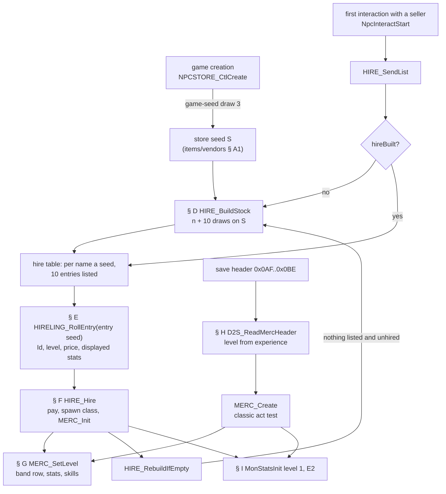
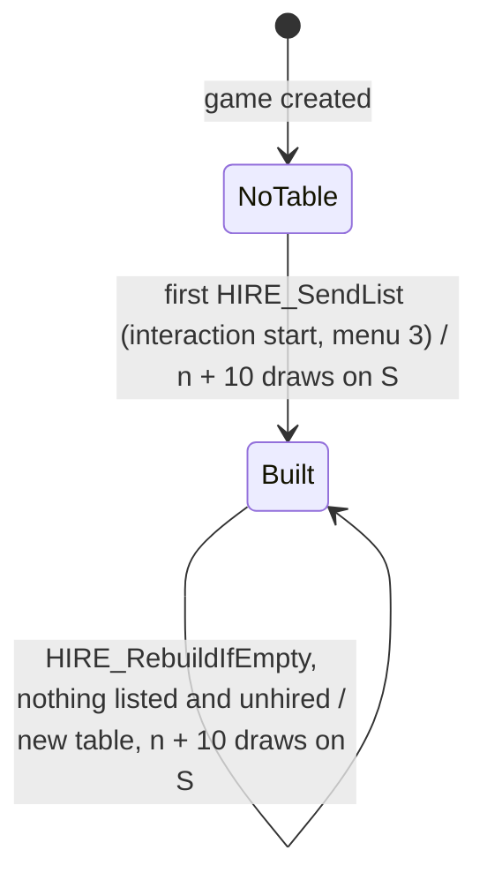
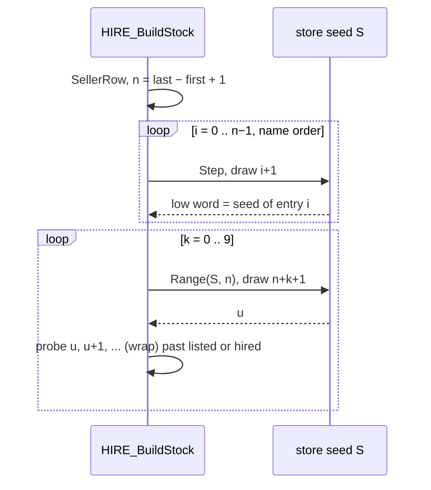
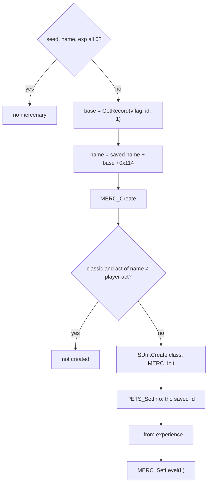

## Purpose

Four town NPCs hire out mercenaries: Kashya (Act I), Greiz (Act II), Asheara (Act III) and Qual-Kehk (Act V). The
first time a player talks to one of them in a game, the server builds that NPC's **hire table** from the store seed:
one seed per name of the seller's name range, then 10 names picked into the list. Each listed entry's seed decides
its type (a `Hireling.txt` `Id`) and its level offset; the player's level at that moment decides the rest. A hire
stores `{seed, name, Id}` with the player and creates the mercenary, whose level and stats then follow from
`Hireling.txt`, its level and its experience. A saved mercenary is recreated from the same three values plus its
experience. This spec gives the build and its draw order, the entry roll, the hire, the stats per level, the load
from a save, the levelling in play, the monster class and level path, and the mercenary's magic find. § K gathers
the free mercenary, resurrection (specified in items/economy) and death; item restrictions are named only there, and combat AI and skill use are [monsters/ai/machinery § T61](../../spec-monster-ai/machinery/).

Names of functions, structs and fields are ours. Column names are those of Hireling and HireDesc.

Notation. `S` is the **store seed** of [items/vendors § A](../../spec-items/vendors/#a-store-records-and-the-store-seed-game-creation),
`NpcControl+0x08`; the "NPC seed" of the hireling records is the same object, and this spec defines no second seed. `Step`, `Init`
and `Range` are the primitives of [rng](../../spec-rng/overview/#algorithm): `Init(x)` makes `{x, 666}`; `Range(s, n)` is 0
with no draw when `n < 1` (signed), else one step and `low mod n` (unsigned). `vflag` is the game's expansion flag
(`Game+0x70`): rows with `Version` 100 are used when it is set, rows with `Version` 0 otherwise. `difficulty` is
`Game+0x6D` (0..2). `d = L − row.Level` for a mercenary of level `L` and a `Hireling` row. "÷" truncates toward zero,
`>>` on a signed value is arithmetic (a floor).



## Entry points

| When | Function | Tag |
|---|---|---|
| Game creation: the store seed `S` the hire tables draw from | `NPCSTORE_CtlCreate` | [C] |
| A seller starts interacting with a player: the hire table is built if it has none | → `HIRE_SendList` → `HIRE_BuildStock` | [C] |
| NPC menu action 3 (open the hire list) | `NPC_MenuAction` → `HIRE_SendList` | [C] |
| Trade opened at a seller whose `trader` byte is set (Asheara): the interaction start has already built the table, so `NPC_OpenStore`'s hire test reads `hireBuilt` = 1 and builds nothing (§ C) | `NPC_OpenStore` | [C] |
| Hire request | `HIRE_Hire` | [C] |
| After a hire, the list is empty: rebuild | `HIRE_RebuildIfEmpty` | [C] |
| Quest gift, Act I (Kashya's talk with Act I quest word 2 bit 1 set and bit 0 clear), expansion | → `HIRE_GiveFreeMerc` | [C] |
| Quest gift, Act III (Asheara, word 19 bit 7) | → `HIRE_GiveFreeMerc` | [I] |
| A save with a mercenary header is loaded | `D2S_ReadMercHeader` → `MERC_Create` | [C] |
| A save older than version 92 (versions 87 and 71 run) | → → `MERC_Create` | [C] |

## Inputs

### Tables

| Anchor | Used for |
|---|---|
| `Hireling.txt:Version`, `Hireling.txt:Id`, `Hireling.txt:Level` | row identity: `(Version, Id)` groups of 1–3 rows, one per level band, in `Level` order (§ A) |
| `Hireling.txt:Act`, `Hireling.txt:Difficulty` (both 1-based) | the type draw's rows (§ E) |
| `Hireling.txt:Seller`, `Hireling.txt:Class` | the seller's name range and the spawned MonStats class (§ D, § F, § I) |
| `Hireling.txt:NameFirst`, `Hireling.txt:NameLast` (string indices at `+0x114`/`+0x116`) | the name range (§ D) |
| `Hireling.txt:Gold`, `Hireling.txt:Exp`/Lvl | price and experience (§ E, § G) |
| `Hireling.txt:HP`, `Hireling.txt:HP`/Lvl, `Hireling.txt:Def`/Lvl, `Hireling.txt:Str`/Lvl, `Hireling.txt:Dex`/Lvl, `Hireling.txt:AR`/Lvl, `Hireling.txt:Dmg`/Lvl, `Hireling.txt:Resist`/Lvl and their base columns | the stats per level (§ E, § G) |
| `Hireling.txt:Skill1`, `Hireling.txt:Mode1`, `Hireling.txt:Level1`, `Hireling.txt:LvlPerLvl1` (slots 1..6) | the skills per level (§ G) |
| `Hireling.txt:HireDesc` (a row of `HireDesc.txt:Code`) | copied into the list entry (§ E) |
| `Skills.txt:reqlevel` | a skill is given only from its required level (§ G) |
| `experience.txt` `MaxLvl`, Amazon column (99) | the load's level cap (§ H) |

### Runtime state

| State | Type | Source |
|---|---|---|
| store seed `S` | Seed | `NpcControl+0x08`, seeded once per game |
| NPC record | 0x44 bytes per NPC class | `hireBuilt`, `pHireTable`, `act` (`+0x22`), `trader` (`+0x23`) |
| hire table | 69 × `HireEntry` (16 bytes) | `HireEntry+0x0` `nameIdx` u16, `+0x4` `seed` u32, `+0x8` `hired` u32, `+0xC` `listed` u32 |
| mercenary info | `MercInfo` (12 bytes) in the player's pet list, pet type 7 | `MercInfo+0x0` `seed` u32, `+0x4` `nameIdx` u16, `+0x8` `hirelingId` u32 |
| `playerLevel` | i32 | the player's stat 12, read at each entry roll |
| `vflag`, `difficulty` | bool, u8 | `Game+0x70`, `Game+0x6D` |

### Constants

| Name | Value | Anchor | Tag |
|---|---|---|---|
| sellers (MonStats rows) | Kashya 150, Greiz 198, Asheara 252, Qual-Kehk 515 | `HIRE_SendList` | [C] |
| `LIST_SIZE` | 10 picks per build | `HIRE_BuildStock` | [C] |
| hire table layout | 16-byte slots, slot `i` the name `first + i`, every slot past the seller's range zero | `HIRE_BuildStock` (stride 16), `HIRE_SendList`, `HIRE_RebuildIfEmpty` | [C] |
| hire table size | 0x450 bytes, 69 slots; no stock range has more than 67 names, so the bound never binds | `HIRE_BuildStock` | [I] |
| name ranges (string indices, English tables) | Rogue 3411..3451 (41), Act II 1019..1039 (21), Act III 1040..1059 (20), Barbarian 10835..10901 (67) | `STRTABLE_GetByKey`, `Hireling.txt:NameFirst` | [C] |
| pet type of a mercenary | 7 | `PETS_Add` | [C] |
| level floor of a list entry | 2 | `HIRELING_RollEntry` | [C] |
| skill level cap | 32 | `MERC_SetLevel` | [C] |
| level cap of a loaded mercenary | 99 (`ExpMaxLevel(0)`) | — | [C] |

- [C] The name ranges are those the run's tables hold: every logged table's `nameIdx` runs over the seller's range.
  They are string indices of the loaded string tables, so another language's tables could move them; the spec's
  algorithm uses `+0x114`/`+0x116` as loaded, never these numbers.

## Algorithm

### A. Table lookups

```
GetRecord(vflag, id: i32, L: i32) → row | none:                          [C]
A1. if id > 255: return none                                             [I]; no stock call passes one
A2. i ← g_HirelingFirstById[(vflag ≠ 0) × 256 + id]
    if i < 0: return none                                                [I]; every stock (version, Id) has a row
A3. prev ← none
    for each row r from i to the end of the table:
      if r.Id = id and r.Version = (vflag ≠ 0 ? 100 : 0):
        if prev ≠ none and L < r.Level: return prev
        prev ← r
      else if id < r.Id: return prev
    return prev

NextByActDiff(vflag, act, diff, prev) → row | none:                      [C]
A4. the next row after prev (from the first row when prev = none) with Version of vflag,
    Act = act + 1, Difficulty = diff + 1 and, when prev ≠ none, Level = prev.Level

TypeRows(vflag, act, diff) → list of rows:
A5. chain NextByActDiff from none: the rows of the first Level band only, one row per type   [C]

SellerRow(vflag, seller) → row:
A6. HIRELING_NextBySeller(vflag, seller, 0, none): the first row of that seller            [C]
    with Difficulty 1 (its Normal row), whatever the game's difficulty

GetAct(vflag, 0, name) → i32:
A7. Act − 1 of the first row whose name range (+0x114 .. +0x116) holds name, else 0       [C]
```

Step notes:

- A3. [C] `GetRecord` returns the matching row with the greatest `Level` ≤ `L`, or the first row of the Id when `L` is
  below every band. In all 60 (version, Id) groups of the stock table (120 rows, `Version` only 0 and 100) the rows
  stand in strictly increasing `Level` order, and the walk of A3 gives exactly that row for all 7 326 inputs tried
  (both version flags, Ids 0–30, 255 and 256, `L` −5..105); the same walk reproduces the 72 `MERC_SetLevel` and 723
  `RollEntry` calls.
- A2. [C] The loader sets both halves of `g_HirelingFirstById` to −1, then stores at `(Version < 100 ? 0 : 1)·256 + Id`
  the index of the first row of each (version, Id), skipping `Id` ≥ 256; `GetRecord` reads the slot at
  `(vflag ≠ 0)·256 + id`. The loader fills `+0x114`/`+0x116` from `NameFirst`/`NameLast` with `STRTABLE_GetByKey`, and
  `HIRE_GetNameRange` reads them; the 53 logged hire tables hold the names `first + i` with `first` the string index
  of `NameFirst`.
- A2. [I] In an expansion install the loader stops with a fatal error when the first index is 0, when last ≤ first,
  or when `Id` > 255; no stock row takes one of these branches. The writer indexes by `Version > 99` and the reader
  compares `Version` with exactly 100 or 0; on stock data (only 0 and 100) the two agree.
- A5. [C] On stock data `TypeRows` has 2 or 3 rows: the two Rogue types (fire, cold), the three types of Act II and of
  Act III, the two Barbarian Ids (24/25, 26/27, 28/29, identical except for `Id`).

### B. The store seed

- [C] `HIRELING_RollEntry` draws on a seed object of its own (§ E), never on `S`. where
  no trade or gamble window was opened, `S` chained from game creation through all 53 builds with no other draw
  between.

### C. When the table is built and rebuilt



```
SendList(npc):                                                           [C]
C1. if npc.class ∉ {150, 198, 515, 252}: return
C2. if rec(npc).hireBuilt = 0: BuildStock(rec(npc))                      ; § D
C3. send every entry with listed ≠ 0 and hired = 0

RebuildIfEmpty(npc):                                                     [C]
C4. if no entry has listed ≠ 0 and hired = 0:
      free the table; pHireTable ← none; hireBuilt ← 0
      BuildStock(rec(npc))                                               ; another n + 10 draws on S
```

Step notes:

- C2. [C] `SendList` is called from `NpcInteractStart` (an NPC begins interacting with a player), from
  `NPC_MenuAction` command 3 and after a hire. So the table is built at the first talk with each seller in a game:
  all 52 first builds of the run came from `HIRE_SendList` at the first interaction.

- C2. [C] **A trade does not build the table.** With the trade opened first at Asheara (the seller whose `trader` byte
  is set), the table was built by `HIRE_SendList` at the interaction start, and `NPC_OpenStore`'s hire test then read
  `hireBuilt` = 1 and did not call `HIRE_BuildStock`.
- C2. [I] `NPC_OpenStore`'s own build (after the vendor stock) runs only while `hireBuilt` is 0, and no
  stock sequence leaves it 0 at a trade: `NpcInteractStart` calls `HIRE_SendList` on every
  new interaction once its early tests pass, returning before it only on its refusals and for a player already
  interacting (the loop), and `HIRE_SendList` builds whenever `hireBuilt` is 0. So the first interaction
  always builds the table, and this build has no stock case.
- C4. [C] `RebuildIfEmpty` runs after each hire. The run's one rebuild came after the 10th hire at Qual-Kehk emptied
  the list, from the chained `S`, and the list opened after it showed the new table. Nothing else clears the table
  during a game.
- C4. [C] It also runs after a free mercenary (§ K): after the Act I gift `HIRE_RebuildIfEmpty` ran (called) with 9 entries still listed and unhired, so it did not rebuild.
- [I] The table lives in the game's NPC record, so all players of a game share it.

### D. The stock build (`HIRE_BuildStock`)



```
BuildStock(rec):                                                         [C]
D1. if rec.hireBuilt ≠ 0: return
    rec.hireBuilt ← 1
    if rec.pHireTable ≠ none: return                                     [I]; no stock case (step note D1)
D2. t ← 69 entries of 16 bytes, all zero;  rec.pHireTable ← t
D3. row ← SellerRow(vflag, rec.class);  first: i32 ← row[+0x114];  last: i32 ← row[+0x116]
    n: i32 ← last − first + 1
D4. for i in 0 ..< n while first + i ≤ last:
      t[i].nameIdx ← first + i
      Step(S);  t[i].seed ← S.low                                        ; draw i+1 on S
      t[i].hired ← 0;  t[i].listed ← 0
D5. for k in 0 ..< 10:
      u: u32 ← Range(S, n)                                               ; draw n+k+1 on S
      v ← u
      while t[v].listed ≠ 0 or t[v].hired ≠ 0:                           ; the probe never draws
        v ← v + 1;  if v ≥ n: v ← 0
        if v = u: return                                                 [I]; a full table: no stock n is below 10
      t[v].listed ← 1
```

Step notes:

- D3. [C] The name range is that of the seller's **Normal** row in every difficulty, so a seller offers the same
  names in Nightmare and Hell.
- D3. [I] `HIRE_GetNameRange` treats a range whose `last − first + 1` is −1 as fatal; no stock row comes near it.

- D4. [C] Every name index gets a seed, picked or not, and all the seeds are drawn before any pick: one build is
  exactly `n + 10` draws on `S` (Kashya 51, Greiz 31, Asheara 30, Qual-Kehk 77 on the English tables). The run
  reproduced 53 builds and 2625 draws on `S`.
- D5. [C] On a fresh table nothing is listed or hired, and every stock `n` is ≥ 20, so the 10 picks list 10 distinct
  names; a pick that lands on a listed entry steps +1 with wrap to the next free one, without a draw.

- D1. [I] A build for a record that already holds a table (`pHireTable` set) only sets `hireBuilt` and draws nothing;
  `RebuildIfEmpty` clears both before it rebuilds, so on the paths read this does not happen.

### E. An entry (`HIRELING_RollEntry`)

The entry's seed alone decides its type and its level offset. The player's level at the time of the roll decides
the level; the rest follows from the type's first-band row.

```
RollEntry(vflag, playerLevel: i32, seed: u32, act: i32, diff: i32) → out | 0:   [C]
E1. s ← Init(seed)                                                       ; a seed of its own, not S
E2. rows ← TypeRows(vflag, act, diff);  k: i32 ← |rows|
    if k = 0: return 0                                                   [I]; no draw; no logged roll returned 0
E3. row ← rows[Range(s, k)]                                              ; entry draw 1
E4. Step(s);  L: i32 ← playerLevel + (i32)(s.low mod 5) − 5              ; entry draw 2; unsigned mod
    if L < 2: L ← 2
E5. d: i32 ← L − row.Level
    out.id       ← row.Id
    out.level    ← L
    out.life     ← max(40, row.HP + row.HP/Lvl × d)
    out.str      ← max(10, row.Str + ((row.Str/Lvl × d) >> 3))           ; floor
    out.dex      ← max(10, row.Dex + ((row.Dex/Lvl × d) >> 3))
    out.price    ← max(row.Gold, ((15 × d + 100) × row.Gold) ÷ 100)      ; signed, truncating
    out.exp      ← max(0, (L + 1) × row.Exp/Lvl × L × L)                 ; i32
    out.defense  ← max(0, row.Defense + row.Def/Lvl × d)
    out.dmgMin   ← max(0, row.Dmg-Min + ((row.Dmg/Lvl × d) >> 3))
    out.dmgMax   ← max(1, row.Dmg-Max + ((row.Dmg/Lvl × d) >> 3))
    out.share    ← max(0, row.Share);  out.resist ← max(0, row.Resist)
    out.hireDesc ← row.HireDesc;  out[+0x34] ← 1;  out[+0x38] (u16) ← 0
    return 1
```

Step notes:

- E1–E4. [C] Every one of the 723 logged calls (530 from the client's list window, 49 from `HIRE_Hire`, 72 from
  `MERC_Init`, 72 from the client's mercenary init) reproduces from its seed, act, difficulty and player level alone,
  expansion and classic rows.
- E2. [C] The caller passes `act = GetAct(vflag, 0, entry.nameIdx)` (A7), so a list shows its own act's types, and
  `diff` = the game's difficulty.
- E4. [C] A list entry is 1 to 5 levels **below** the player, never above: the 530 client list entries of the run lie
  at player level −5 .. −1 (−5: 109, −4: 92, −3: 112, −2: 107, −1: 110).
- E4. [C] **The floor of 2 binds.** At player level 3, 12 rolls whose unclamped `playerLevel − 5 + (low mod 5)` was −2,
  −1, 0 or 1 (7 list draws, 1 `HIRE_Hire`, 2 `MERC_Init`, 2 client mercenary inits) came out at 2.

- E4. [C] The level follows the player's **current** level at each roll; the client rolls the entry to draw the list
  and the server rolls it again at the hire.
- E4. [C] So a level-up between opening the list and the hire changes the mercenary bought: a list drawn at player
  level 30 showed the entry of seed 1 515 150 068 at level 29, price 490; after a kill took the player to 31, the
  hire's rolls (`HIRE_Hire`, then `MERC_Init`) gave level 30, price 505, which was paid.
- E5. [C] The price is `Gold` raised 15 % per level above the band start, never below `Gold`; the run's 49 hires paid
  exactly `out.price`.
- E5. [C] The displayed stats use the **first band's row** with **floor** division for the eighths and no
  per-level resistance, while the stats in the world (§ G) use the row of the mercenary's own band with truncating
  division. The two agree only while `L` is inside the first band and `d ≥ 0`.
- E5. [C] The client draws name index 1057 (`Lharhad`) as string 11021 (`Jarulf`, `0x2B0D`), both in the list window
  (3 games) and in the client's mercenary init (a hire of 1057); every other name of the 122 logged draws is drawn as
  itself.
- E5. [I] **`Share` has no effect.** `RollEntry` copies `max(0, Share)` into the entry at `+0x28`, but none of its four
  callers (`MERC_Init`, `HIRE_Hire`, the client's mercenary init and the list window) reads `+0x28`. The equipment
  columns `Head`, `Torso`, `Weapon` and `Shield` (record `+0x68`…`+0x74`) and `Share` (`+0x4C`) are read by none of
  the code that holds a `Hireling` record: the loader, `HIRELING_FreeTable`, the five getters and their 19 callers,
  none of which passes a record on.
- E5. [I] **The description text is a hard-coded string.** The list window takes the entry's `HireDesc` (`+0x30`) and
  calls `HIRELING_DescString(index)`, which for an index 0..8 with a non-zero word returns
  `STRTABLE_GetByIndex(g_HireDescStrIdx[index])`, and none otherwise; the window appends it to the row's line.
  `hiredesc.bin` plays no part in the text.
- E5. [C] **The table matches every `HireDesc` row by data.** Its nine u16 are 0, 3371, 3372, 11090, 11088, 11089,
  3377, 3376 and 3375, which in the English tables read none, "Fire Arrow", "Cold Arrow", "Combat", "Defensive",
  "Offensive", "Fire", "Cold" and "Lightning": the rows `None`, `farw`, `carw`, `comb`, `def`, `off`, `fire`, `cold`
  and `ltng` in order. So row 0 (the Barbarians) shows no description.

### F. The hire (`HIRE_Hire`, `MERC_Init`)

Step notes:

- F1. [C] **The gates' reads and passes.** `VENDOR_StockLevel` returned `min(level, {12, 20, 28, 36, 45}[act])` in all
  17 hires of the run, every one in Normal (Kashya 3, 8 and 12 for player levels 3, 8 and 30; Greiz 20; Asheara 28;
  Qual-Kehk 30), so Kashya's gate is "player level below 8". Quest word 2 was read only below 8: at level 3, after the
  quest gift, its bit 0 read 1 and the hire went on; it was not read at levels 8 and 30. Qual-Kehk read word 36 (bit 0
  1, the hire went on); Greiz and Asheara read no quest word.
- F1. [I] `VENDOR_StockLevel` returns the level unchanged outside Normal; that branch was not met.

- F1. [C] **In the three states observed, the stock client sent no hire the quest gates refuse.** With word 2 open at player levels 3 and 7
  Kashya's menu had two lines (talk, cancel), and with word 36 open so did Qual-Kehk's; no hire request left the
  client, so the two refusal tails (lines 0x654 and 0x65F) ran in no session.
- F1. [I] **The two quest refusals are server checks the stock client did not send in the states observed.** They are what `HIRE_Hire` does
  with such a request (read from the code).
- F1. [I] **The client's hire line matches the server's gates for every value of the inputs both read.** At each
  interaction the client loads the packet's quest bytes into its quest record, resets the menus (Kashya's and
  Qual-Kehk's to talk and cancel), then opens the menu with `ClientNpcMenuOpen`, from its two callers
  only. The open walks the quest gate table `g_ClientNpcMenuQuestGates`: Kashya (class 150) gets the hire line when
  word 2 bit 0 is set, Qual-Kehk (515) when word 36 bit 0 is set; then Kashya gets it also when the client player's
  stat 12 is 8 or more, and Qual-Kehk has no level test. `VENDOR_StockLevel`'s caps are all at least 12, so
  `StockLevel(L) < 8` exactly when `L < 8` in every difficulty, and both sides read the same stat, word and bit.
  Within one interaction the client's copy can only lag the server's: stat 12 only rises, and no write read clears a
  set bit 0. So no stock state was found in which the client offers the line and the server refuses; a quest-bit
  clear outside the writes read would be one.
- F2. [I] The refusals (a name outside the range, a slot holding another name or already hired) were met by no hire.
  A hire of an entry that is in the table but not listed would pass this test; no logged hire sent one.

- F3. [C] **The stash pays the rest; a short total refuses.** With 100 gold carried and 2 410 in the stash, an Asheara
  hire priced 2 500 took the 100 and 2 400 of the stash (10 left); a second, priced 2 650, had `PayGold` return 0,
  went to the refusal tail (line 0x6AE, code 12) and paid nothing, with no `MERC_Init`. In all 17 hires of the run
  `PayGold`'s price was the hire roll's, and its result was `gold + stash ≥ price`.
- [C] **`HIRE_Hire` returns no value.** The refused hire left `EAX` at 15; a hire is made exactly when `MERC_Init`
  runs inside `HIRE_Hire`, and a reimplementation should not read a result from it.
- F3–F5. [C] In the 49 hires: the price paid is `RollEntry`'s, taken from inventory gold; `MERC_Init` gets the entry's
  `{name, seed}`; the spawned class is the `Class` of the seller's Normal row (271, 338, 359 or 561); the mercenary's
  level is `RollEntry`'s level. Hires at Kashya, Asheara and Qual-Kehk.
- [C] **Greiz and classic hires.** A Greiz hire (expansion, Normal, name 1019) and classic hires at Kashya (3414) and
  Asheara (1044) reproduce in the same way: table, roll, price, `MERC_Init`'s `{name, seed}`, the seller's Normal-row
  class (338, 271, 359) and the stats; the classic lists use the `Version` 0 rows.
- [I] A classic hire at Greiz takes the same code; it was not made (the pilot never reached him in four launches).

- F8. [C] Both `RollEntry` calls of a hire (F3 and F8) draw on their own seed object, so a hire costs no draw on `S`
  unless `RebuildIfEmpty` rebuilds.
- F8. [C] **The saved header.** `D2S_WriteMercHeader` writes this pet info and the unit's experience: for a mercenary
  hired in play at Kashya, *Save and Exit* wrote seed 2 573 073 805, name 0 (the name id minus `+0x114`), Hireling Id 1
  and experience 52 424 400, each equal to its source (mercenary info `+0x00`, the name, info `+0x08`, stat 13), and
  the reload recreated the mercenary from those bytes. Tool-built headers and a mercenary killed in play (mode 12,
  dead bit set) separate the fields and the dead flag. The layout is [save/d2s § D](../../spec-save/d2s/#d-header-fields).


### G. The stats per level (`MERC_SetLevel`)

`MERC_SetLevel(merc, L)` takes `row ← GetRecord(vflag, info.hirelingId, L)`, the row whose `Level` band holds `L`,
and `d: i32 ← L − row.Level`. All arithmetic is i32. [C]

| Stat (id) | Value | Division | Clamp | Tag |
|---|---|---|---|---|
| `level` (12) | `L` | — | — | [C] |
| `nextexp` (30) | `ExpForLevel(L + 1, row.Exp/Lvl)` if `L < 98`, else 0 | — | — | [C] |
| `experience` (13) | `max(current, ExpForLevel(L, row.Exp/Lvl))` | — | — | [C] |
| `strength` (0) | `Str + (Str/Lvl × d) ÷ 8` | ÷ 8, truncating | min 10 | [C] |
| `dexterity` (2) | `Dex + (Dex/Lvl × d) ÷ 8` | ÷ 8, truncating | min 10 | [C] |
| `maxhp` (7), `hitpoints` (6) | `(HP + HP/Lvl × d) × 256` (life in 1/256) | — | min 40 × 256 | [C] |
| `armorclass` (31) | `Defense + Def/Lvl × d` | — | min 0 | [C] |
| `tohit` (19) | `AR + AR/Lvl × d` | — | min 0 | [C] |
| `secondary_mindamage` (23) | `Dmg-Min + (Dmg/Lvl × d) ÷ 8` | ÷ 8, truncating | min 0 | [C] |
| `secondary_maxdamage` (24) | `Dmg-Max + (Dmg/Lvl × d) ÷ 8` | ÷ 8, truncating | min 1 | [C] |
| fire, lightning, cold, poison resist (39, 41, 43, 45) | `Resist + (Resist/Lvl × d) ÷ 4`, one value for all four | ÷ 4, truncating | min 0 | [C] |
| `hpregen` (74) | `maxhp ÷ 2000`, `maxhp` in 1/256 | ÷ 2000, truncating | min 0 | [C] |

```
ExpForLevel(L: i32, e: i32) → i32 ← (L + 1) × L × L × e                 [C]

Skills(merc, row, L, d):                                                [C]
G1. for i in 1 ... 6:
      if row.Skill_i < 1 or row.Skill_i ≥ skill count or row.Mode_i > 15 (signed): stop
      if Skills[row.Skill_i].reqlevel > L: continue
      slvl: i32 ← min(32, row.Level_i + ((row.LvlPerLvl_i × d) >> 5))  ; floor
      if slvl ≥ 1: add skill row.Skill_i at level slvl
```

Step notes:

- [C] The whole table, the band row included, holds for the 72 logged `MERC_SetLevel` calls (49 hires, 23 loads):
  rows of every band, `d` from −41 to 27, the clamps reached (life 40, AR and defence 0) and the stat list compared
  entry for entry.
- [C] **Negative `d` truncates.** Below the first band (a clvl 30 player hiring in Nightmare or Hell) the product
  `column × d` is negative, and `MERC_SetLevel` divides toward zero: 17 logged levels give a different strength,
  dexterity or damage under floor division, and every one matches truncation. `RollEntry` (§ E) floors the same
  product, so the list and the world differ there.
- [C] **Resistances are quarters.** 32 logged levels where `Resist/Lvl × d ÷ 4` and `÷ 8` differ all match `÷ 4`
  (for example a Normal Rogue, `Resist/Lvl` 8, band 3, at L 27: 48).
- [C] **A stat clamped to 0 leaves no entry.** AR and defence that clamp to 0 are absent from the mercenary's stat
  list rather than present with value 0 (16 such stats in the run).
- [C] For a non-negative product the strength, dexterity, life, defence and damage arithmetic and the skill level
  have a second code path: `HIRELING_RollEntry` reads the same offsets with the same operation and clamps, and the
  client's mercenary init computes `min(32, Level_i + (LvlPerLvl_i × d >> 5))` from the same bytes (with `d`
  clamped at 0 and no `reqlevel` test).
- G1. [C] The skill loop stops at the first empty slot or `Mode_i > 15` but only skips a skill whose `reqlevel` is
  above `L`. On stock data slots 4–6 are always empty and slot 3 is used only by the Cold Eastern Sorcerors.


#### Levelling in play (`MERC_AddExp`)

```
MercKillAward(victim, killer, merc, owner):                              [C] the call path from XP_OnMonsterKill's entry, as the code's map; before the party share, whatever it does: player/creation G6 note
G2. L: i32 ← merc's level
    gain: i32 ← XP_Compute(victim's experience, at level L), ending in MERC_CapExpGain(merc, gain, L)   ; G4
G3. if merc ≠ killer: gain ← (gain × 86) ÷ 256                           [C]; i32, truncating
    MERC_AddExp(gain, merc, owner, L)                                    ; G5

MERC_CapExpGain(unit, gain, L) → i32:                                    [C]
G4. if unit is a player: return gain
    owner ← MonsterOwner(unit);  info ← PETS_GetInfo(owner, unit);  row ← GetRecord(vflag, info.hirelingId, L)   ; the band row of L
    if owner is none or not a player, or info or row is none: return 0   [I]; not separated by the run
    cap ← (ExpForLevel(L + 1, row.Exp/Lvl) − ExpForLevel(L, row.Exp/Lvl)) >> 6   ; shr: the unsigned width [I]
    return min(gain, cap)                                                ; jbe: the unsigned compare [I]

MERC_AddExp(gain, merc, owner, L):                                       [C]
G5. if gain ≤ 0: return
    info ← PETS_GetInfo(owner, merc);  row ← GetRecord(vflag, info.hirelingId, L)   ; the band row of the old L
    if info or row is none: return                                       [I]; not separated by the run
    if L ≥ owner's level (stat 12): return
    M: i32 ← ExpMaxLevel(0) − 1                             [I]; class 0's MaxLvl − 1: 98 on stock data
    if L ≥ M: return                                                     [I]; before the experience write
G6. stat 13 ← stat 13 + 2 × gain                                         ; (the write)
G7. i: i32 ← L                                                          ; row: G5's, the band row of the old L
    while ExpForLevel(i + 1, row.Exp/Lvl) ≤ stat 13 and i < M: i ← i + 1  ; the bound M [I]
    if i ≠ L: MERC_SetLevel(merc, i)                                     ; § G
```

Step notes:

- G3. [C] **A kill by another unit gives the mercenary `·86 >> 8` of its gain** (signed, truncating toward zero: `imul
  0x56; cdq; and edx, 0xFF; add; sar 8`): 39 awards for another unit's kill were `gain·86/256` truncated, and 3 for
  the mercenary's own kill were the full gain.
- G4. [C] `MERC_CapExpGain` returns a player's gain unchanged (207 calls) and a mercenary's as
  `min(gain, (ExpForLevel(L + 1) − ExpForLevel(L)) >> 6)` with the `Exp/Lvl` of the band row of `L` (39 calls: 4 capped, at L 3 to 68 and at L 4
  to 109 from 356; 35 below the cap).
- G4. [I] The shift and the compare are unsigned (`shr`, `jbe`); this is read, not separated, as no logged gain or
  difference was negative.
- G5–G7. [C] **The mercenary gains twice the gain**, and only while it is below its owner's level. Of 42
  `MERC_AddExp` calls, 3 with `gain ≤ 0` changed nothing, 33 with the mercenary's level not below its owner's (L 85
  under owners of 80 and 81, gains 77 to 113) changed nothing, and 6 added `2·gain` to stat 13 (`lea ecx, [esi +
  ebx·2]`); two of these levelled up, 3 → 4 and 10 → 11, through the loop on the band row of the old `L` and one
  `MERC_SetLevel` at the new level.
- G5, G7. [I] **The bound `M`.** `M` is `ExpMaxLevel(0) − 1`: class 0's `MaxLvl` record of
  Experience, 99 in stock data, so `M` = 98, a table value, not a constant. It is tested
  before the experience write, so a mercenary at `L ≥ M` gains no experience at all (the three gains of the level-99
  load were 0, so they do not separate this return), and the level loop stops at `M`, not at the owner's level (each
  logged level-up moved one level).

### H. The mercenary from a save (`D2S_ReadMercHeader`, `MERC_Create`)



```
ReadMercHeader(save):                                                    [C]
H1. flags: u32 ← save[0x0AF]; seed: u32 ← save[0x0B3]; name: u16 ← save[0x0B7]; id: u16 ← save[0x0B9]; exp: u32 ← save[0x0BB]
H2. if seed = 0 and name = 0 and exp = 0: return none                                     [C]
H3. base ← GetRecord(vflag, id, 1)
    name ← name + base[+0x114]                                                             ; widths: step note H3
    if name > base[+0x116]: name ← base[+0x114]                                            [C]
H4. dead ← flags & 0x10000                                                                 [C]
H5. merc ← MERC_Create(name, seed, id, base.Class, dead);  if none: return none
H6. PETS_SetInfo(merc, {seed, name, id})                                                   ; the saved Id wins
H7. stat 13 ← max(stat 13, exp)
H8. L: i32 ← 1
    while L + 1 ≤ 99 and ExpForLevel(L + 1, GetRecord(vflag, id, L).Exp/Lvl) ≤ exp: L ← L + 1
H9. MERC_SetLevel(merc, L)                                                                 ; § G
H10. if dead: PETS_OnDeath marks the pet dead; unit flag 0x10000, mode 12                 [C]

MERC_Create(name, seed, id, class, dead):                                                  [C]
H11. a ← GetAct(vflag, 0, name)
     if vflag = 0 and (a < 0 or a ≠ the player's act): return none                        ; classic only
H12. if the seller's hire table exists and the entry of name is not listed: mark it hired  [I]; not reached (step notes)
H13. row ← GetRecord(vflag, id, 1)
     if id = 0xFFFF: row ← the first NextByActDiff(vflag, act, difficulty) row          [I]; the act dependence: step notes
H14. merc ← SUnitCreate(type 1, row.Class, …, mode = dead ? 12 : 1)
     MERC_Init(merc, id, {name, seed}, dead)                                               ; § F, no SetLevel there (id ≠ 0xFFFF)
```

Step notes:

- H8. [C] **The cap binds at 99.** A Rogue with experience 150 000 000 loaded at level 99, where `ExpForLevel(100, 100)`
  = 101 000 000 and the loop without the cap would go on to 114; `MERC_SetLevel` ran at 99. Five other loads gave 3,
  10, 30 (twice) and 85 as the loop says.
- H11. [C] **The classic act test.** In a classic game the mercenary is created only when the act of its name's row
  equals the player's act (`Client+0x1AC`); an expansion game creates it in any act. In the run, 10 classic loads in
  the Act IV town were not created, the 9 in the mercenary's own act were, and all 14 expansion loads (Act IV) were.

- H6. [C] The seed is carried in the pet info and rolled once more inside `MERC_Init` (F8), whose Id `PETS_SetInfo`
  then overwrites with the saved one. So the seed does not reach a loaded mercenary's stats: its level and stats come
  from the experience and the saved Id.
- H2. [I] A header whose seed alone or experience alone is 0 was not met (a hired mercenary has experience, and a seed
  of 0 is one value in 2³²).
- H3. [C] **A name past the range is reset to the first name.** A saved name id of 50 (a tool-built save; the Rogue
  range is 0..40) gave `3411 + 50 = 3461 > 3451` and was reset to 3411, which `MERC_Create` and `MERC_Init` received;
  the five in-range loads (names 3, 5, 6 and 7) kept `3411 + name`.
- H3. [I] **The widths are read, not separated** (a name of 50 gives the same result under any width): `add dx, cx` is
  a u16 add and `jbe` an unsigned compare, so a name equal to `+0x116` is kept, and a saved name past `0xFFFF − first`
  wraps. For the Rogue (first 3411), 62 124 still fits (`3411 + 62 124 = 65 535`, which is reset); 62 125 gives 0, which
  is ≤ `+0x116` and is kept as string 0.
- H4, H10. [C] **A dead mercenary loads dead.** The header's `0x10000` reached `MERC_Create` as its dead argument, the
  unit was made in mode 12, `PETS_OnDeath` (called) set bit 0 of the pet node, and the unit kept flag
  `0x10000`; the five living loads had neither.
- H12. [I] **The third caller is reached by no stock writer.** `PlayerPlaceInAct` walks the player's
  corpse list (inventory `+0x34`): a node with its flag set is a corpse, moved to the new act's town; the
  `MERC_Create(word, id, 0xFFFF, 0, 0)` branch needs flag 0 and a non-zero word. The list's nodes are
  made only by `InvCorpseAdd`, whose three callers (two corpse readers at a load, `PLAYER_CorpseCreate`
  at a death) all add flag 1 and word 0, so no stock game type reaches the branch; a node edited outside those three
  writers would. Row 29 (`MERC_Create` with a table present) is **d-none** (review): a second
  client adds no writer, since each of the three calls pushes the constants flag 1 and word 0, so the branch has no observable in any stock game type, not one that two clients would reach.
- [C] The mercenary's items are read after the header, into the unit `MERC_Create` returned: loading a save whose
  mercenary holds three items, the mercenary list's reader was called with the cursor at the file's `jf` (the end of
  the corpse list) and read the file's items in order, and the write held the same mercenary list.
- [C] **Saves older than version 92** go through `ReadMercOldSave`, in two forms told apart by the
  version (the run loaded versions 87 and 71; versions 72–86 and 88–91 are the code's reading). A version-87 file's 0x12-byte record (then the mercenary's item list) gave its seed and Id to
  `MERC_Create` (seed 12345, Id 1, the name word 3414 = the Rogue's first name 3411 + 3), and the game's write-back
  held seed 12345, Id 1, name 3, alive, and the built item on the mercenary. A version-71 file's record holds only the
  seed and the name (8 bytes: `JM`, the seed, the name); they went to `MERC_Create` as (name 3, seed 12345, Id `0xFFFF`), and the
  write-back held seed 12345.
- H13. [C] **A version-71 mercenary is created with Id `0xFFFF`** and comes back as Id 1: both version-71 files (one
  in Act I, header byte `0x80`; one in Act II, `0x81`) were loaded with Id `0xFFFF`, `MERC_Create` returned a unit,
  and the write-back held Id 1 both times.
- H13. [I] **That the row follows the act** (the first `NextByActDiff(vflag, act, difficulty)` row) is read from the
  code: the two files gave the same Id 1, and the act the lookup used, the owner's at the call, is not logged (the
  Act II file's act byte was written back unchanged).
- [C] **The version-87 experience is converted.** `MercExpFromOldSave` was called once, with (Id 1,
  experience 100 000), and returned 546 210, which the write-back held as the mercenary's experience. A version-71
  record holds no experience and no Id, and the function is not called for it.
- [I] **The conversion's cutoff and arithmetic** are read from the code: versions 89 and below convert, 90 and above
  do not, and no file of version 88 to 91 was loaded (a version-92 file goes to `D2S_ReadMercHeader`);
  the conversion's arithmetic is not modelled.

### I. Monster class and the monster level

| Seller | `Class` | MonStats | `Level` / `Level(N)` / `Level(H)` | MonStatsInit level |
|---|---|---|---|---|
| Kashya | 271 | `roguehire` | 1 / 34 / 67 | 1 in every difficulty |
| Greiz | 338 | `act2hire` | 1 / 34 / 67 | 1 in every difficulty |
| Asheara | 359 | `act3hire` | 1 / 34 / 67 | 1 in every difficulty |
| Qual-Kehk | 561 | `act5hire2` | 1 / 1 / 1 | 1 |
| (none) | 560 | `act5hire1` | — | no `Hireling` row: no hire, gift or load creates it |

- [C] Every hire, free-mercenary and load path takes the class from a `Hireling` row (the seller's Normal row, or
  the saved Id's row), and the stock `Class` column holds only 271, 338, 359 and 561, in all 120 rows of both
  versions. So class 560, which `HirelingType` also recognises, is never created as a mercenary on stock
  data; the 49 hires and 23 loads of the run all made the row's class. Whether any non-hireling path could create
  class 560 is outside this claim.
- [C] The four classes take step E2 of [monsters/pool](../../spec-monsters/pool/#e-the-monster-level-monstatsinit)
  (`d` ← 0): every mercenary creation of the run, the four classes in the three difficulties (expansion; 271, 338 and
  359 also classic), was made at MonStats `Level` 1 with `d` 0 (10 788 of 10 788).

- [C] Whatever level MonStatsInit gave, `MERC_SetLevel` overwrites stat 12 and the stats of § G right after the
  creation: in `MERC_Init` for a hire, in `D2S_ReadMercHeader` for a load.
- [C] **The stats `MonStatsInit` leaves.** A mercenary is a type-1 unit, so `MonStatsInit` runs for it as for any
  monster. Its step B5 writes 68 `attackrate` = 100,
  67 `velocitypercent` = 75, 69 `other_animrate` = 100, 352 `last_sent_hp_pct` = 128 and 100 `monster_playercount` =
  `max(1, players)`; `MERC_SetLevel` writes none of them. All 72 logged `MERC_SetLevel` blocks hold exactly these
  values, with 100 = 1 (every session was single player).
- [C] **The Rogues' skill 336 (`RogueMissile`) is the MonStats skill of `MonStatsInit` step B10**, from the `roguehire`
  row (`Skill1` `RogueMissile`, `Sk1lvl` 1). Its level is `Sk1lvl` + DifficultyLevels `MonsterSkillBonus` (0, 3, 7), so
  1 in Normal, 4 in Nightmare and 8 in Hell; the hireling's `d` = 0 does not touch this bonus. The logs agree in every
  Rogue block: 22 at level 1 (Normal), 6 at 4 (Nightmare), 2 at 8 (Hell). `act2hire` has `Skill1` `Jab` the same way;
  the Act III and Act V rows have no MonStats skill.
- [C] Hirelings have `Align` 1, so the player-count bonus of [monsters/stats](../../spec-monsters/stats/) does not apply
  to them: in a game started with `/players 8` still set, the `roguehire` hireling (class 271) of a loaded save was
  created with `MonPlayerBonus` record players 1 and HP and XP percent 0.

### J. Magic find on a mercenary's kill

- [C] `MERC_Init` sets the mercenary's owner to the hiring player (`MonSetOwner` writes `monsterData+0x28`
  → `+0x2C` id, `+0x30` type), which is what `MonsterOwner` reads in `ITEMS_DropMagicFind`. So a mercenary's kill
  counts its own stat 80 plus its owner's: three kills by the `MercMF` Rogue read 0 for the mercenary and 40 for the
  player (the full stat list, with the gloves' bonus), total 40. The roll itself is
  [items/quality § C](../../spec-items/quality/#c-shared-terms-and-magic-find) (M3).

### K. Named only

- [C] **Free mercenary.** At Kashya's talk with Act I quest word 2 bit 1 set and bit 0 clear (expansion, no
  mercenary), `A1Q2_NpcMessage` called `HIRE_GiveFreeMerc(150)`: the dead-or-alive pet test found none,
  the pick was table index 5 (name 3416), the first entry in name order with `listed = 1` and `hired ≠ 1` (indices 0–4
  unlisted), and it became hired, spawned and initialised as a hire (`MERC_Init` with id `0xFFFF` and the entry's
  `{name, seed}`) with no payment and no quest gate; then `RebuildIfEmpty` ran. After it word 2 bit 0 read 1.

- [I] The gift is given only when the player has no mercenary (expansion: none, dead or alive; classic: no living one) and the seller's table exists. The classic test, the expansion refusal with a mercenary present, the case without a table and the Act III gift (Asheara, from the quest code, word 19
  bit 7) were not run.
- [C] **Resurrection** is specified in [items/economy § G](../../spec-items/economy/#g-gold-payment-caps-piles-and-the-death-loss)
  (G13): `MERC_Resurrect` costs `MERC_ResurrectCost = min(50000, (L² ÷ 2) × 15)` with `L` the mercenary's level
  (unsigned compare), paid with `PayGold` like a hire; a refused payment pays nothing. Resurrections were run at
  Qual-Kehk and at Kashya: a dead level-30 mercenary cost `min(50 000, (30·30 ÷ 2)·15)` =
  6 750, paid from gold, and the unit's flag `0x10000` was cleared and its mode went 12 → 1.

- [I] That Greiz, Asheara and Tyrael (367) offer it too is read from the code (items/economy
  § Entry points).
- [C] **Death.** `PETS_OnDeath` sets bit 0 of the mercenary's pet node (pet type 7), at a dead load and at three deaths
  in play (from `UnitKilled`), and the node stays in the pet list: at the dead load `MERC_Resurrect` found
  the mercenary through it.
- [I] **Combat skill choice** (`DefaultChance`, `Chance_i`, `ChancePerLvl_i`, `Mode_i`) is `MERCAI_PickSkill`, in
  [monsters/ai/machinery § T61](../../spec-monster-ai/machinery/). What a mercenary may equip is an inventory rule, not specified here.

## Outputs

- [C] Per seller and game, a hire table of `n` entries (`nameIdx`, `seed`, `hired`, `listed`), 10 of them listed, and
  `S` advanced by `n + 10` draws per build.
- [C] Per list entry, `RollEntry`'s record: Id, level, life, strength, dexterity, price, experience, defence, damage,
  `Share`, `Resist`, `HireDesc`.
- [C] Per hire or load, a monster unit of the row's class with pet info `{seed, name, Id}` (pet type 7), owner = the
  player, the stats and skills of § G, and the stats and skill `MonStatsInit` leaves (§ I).

## Worked example

### 1. A hire list (session 3302, expansion, Normal, player level 30)

The tour starts in the Act IV town and reaches Qual-Kehk first; his table is the game's first build, so `S` at entry
is the store seed as created: `9c65f9a3:0000029a`. Qual-Kehk's Normal row has `n` = 67 (names 10835..10901).

| Draws on `S` | What | Result |
|---|---|---|
| 1 .. 67 | one `Step` per name index, in order | entry seeds: 10835 `48f6cd09`, 10836 `8972609b`, 10837 `1fac5052`, …; `S` = `3f740843:4739f7fa` |
| 68 .. 77 | `Range(S, 67)` × 10 | 5, 48, 20, 1, 4, 55, 29, 19, 16, 57: no collision, no probe |
| — | listed names | 10840, 10883, 10855, 10836, 10839, 10890, 10864, 10854, 10851, 10892 |
| — | `S` after the build | `7514f408:4ba7d295` (the logged exit value) |

The list window then rolls each listed entry (act 4, difficulty 0; `TypeRows` = Ids 24 and 25, `Level` 28, `Gold`
9000, `Exp/Lvl` 120, `HP` 288 + 18/level, `Str` 101 + 15/8, `Dex` 63 + 10/8, `Defense` 180 + 10, `Dmg` 16–20 + 6/8,
`Resist` 56):

| Name | Seed | Draw 1 → Id | `low mod 5` → L | `d` | Price | Life | Str | Dex | Exp |
|---|---|---|---|---:|---:|---:|---:|---:|---:|
| 10836 | 2305974427 | 1 → 25 | 3 → 28 | 0 | 9000 | 288 | 101 | 63 | 2 728 320 |
| 10839 | 2531727144 | 0 → 24 | 4 → 29 | 1 | 10 350 | 306 | 102 | 64 | 3 027 600 |
| 10892 | 1450181092 | 0 → 24 | 0 → 25 | −3 | 9000 | 234 | 95 | 59 | 1 950 000 |

The other seven entries are at L 26, 27 (five) and 29. Entry 10892 shows the traps of § E and § G: its price
`(15·−3 + 100)·9000 ÷ 100` = 4950 is raised to `Gold`; its list strength floors `−45 >> 3` = −6 (95), while
`MERC_SetLevel` at the same L would truncate `−45 ÷ 8` = −5 (96), and likewise dexterity 59 against 60, minimum
damage 13 against 14, and resistances 56 (no per-level term in the list) against `56 + (7·−3) ÷ 4` = 51.

### 2. A mercenary loaded from a save (session 3330, `MercNova`, expansion, Normal)

Header bytes from `0x0AF`: flags 0, seed 12345, name 3, Id 0, experience 2 790 000.

1. `base` = `GetRecord(1, 0, 1)`: the Id 0 row of band 3 (`Fire - Normal`, `Exp/Lvl` 100); name = 3 + 3411 = 3414.
2. MonStatsInit creates class 271 at level 1 with `d` 0 (E2).
3. Level loop: `ExpForLevel(30)` = 31·900·100 = 2 790 000 ≤ 2 790 000; `ExpForLevel(31)` = 32·961·100 = 3 075 200 >
   2 790 000, so L = 30.
4. `MERC_SetLevel(30)`: `GetRecord(1, 0, 30)` is still the band-3 row (the next starts at 36), `d` = 27:

| Stat | Arithmetic | Value |
|---|---|---:|
| level, experience, nextexp | L; `max(2 790 000, ExpForLevel(30))`; `ExpForLevel(31)` | 30; 2 790 000; 3 075 200 |
| strength | 35 + 270 ÷ 8 | 68 |
| dexterity | 45 + 432 ÷ 8 | 99 |
| life | (45 + 9·27)·256 | 288 (73 728) |
| defence | 15 + 8·27 | 231 |
| AR | 10 + 12·27 | 334 |
| damage | 1 + 54 ÷ 8, 3 + 54 ÷ 8 | 7–9 |
| resistances | 0 + 216 ÷ 4 | 54 |
| hpregen | 73 728 ÷ 2000 | 36 |
| skills | Inner Sight, Fire Arrow: 1 + (10·27 >> 5) | 9, 9 |

The logged stat list after `MERC_SetLevel` holds exactly these values (plus the stats and the Rogue skill that
MonStatsInit leaves, § I). The same mercenary block in `MercMF` showed level 30, next level 3 075 200, life 288 and resistances 54
on the in-game screen.

## Reimplementation notes

- **One seed for vendors and hirelings.** The hire build draws on the store seed; opening a trade or gamble window
  before talking to a seller changes that seller's list, and the reverse. [C]
- **Seeds for every name, before any pick.** A build always costs `n + 10` draws, whatever is picked; drawing a seed
  only for the listed names shifts every later store-seed draw. [C]
- **Two different rows.** `RollEntry` always uses the first band's row of the type (the list's price and stats);
  `MERC_SetLevel` uses the row whose `Level` band holds the mercenary's level. [C]
- **Two different divisions.** `RollEntry` floors (`>> 3`), `MERC_SetLevel` truncates (`÷ 8`, `÷ 4`); they differ for a
  negative product, which every stock row gives below its first band. The skill level uses `>> 5` (floor) in both.
  [C]
- **The name range is the Normal row's.** A Nightmare or Hell list uses the same names; only the type draw uses the
  game's difficulty. [C]
- **The list level is below the player.** `playerLevel − 5 + (low mod 5)`, floor 2: 1 to 5 levels below, never
  above. [C]
- **The experience curve is cubic.** `(L + 1)·L²·Exp/Lvl`, not quadratic. [C]
- **One resistance pair, in quarters.** 1.14d has a single `Resist`, `Resist/Lvl` pair applied to the four
  resistances, divided by 4. [C]
- **`HireDesc` is a row index**, a u8 into the `hiredesc` code list, not a string key. [C]

- **Clamped-to-zero stats vanish.** An AR or defence of 0 is not in the stat list at all. [C]

- **A loaded mercenary's Id is the saved one.** `MERC_Init` derives an Id from the seed and the current difficulty,
  and `PETS_SetInfo` overwrites it; reading `MERC_Init` alone suggests the Id follows the difficulty. [C]

- **Classic mercenaries stay in their act.** A classic save's mercenary is not created outside its act; the header is
  kept in the save. [C]
- **A mercenary's gain is doubled, after the share.** Another unit's kill gives `(gain × 86) ÷ 256` (truncating), the
  mercenary's own kill the full gain, and `MERC_AddExp` then adds twice that; a mercenary at or above its owner's
  level gains nothing. [C]
- **`HIRE_Hire` has no result.** A refused hire leaves a stale `EAX`; count a hire by its `MERC_Init`. [C]


## Evidence

- Tables: Hireling, HireDesc, Skills,
  MonStats.
- Specs: upstream [rng](../../spec-rng/overview/), [items/vendors § A](../../spec-items/vendors/#a-store-records-and-the-store-seed-game-creation),
  [monsters/pool § E](../../spec-monsters/pool/#e-the-monster-level-monstatsinit), [monsters/stats](../../spec-monsters/stats/),
  [data/strings](../../spec-data/strings/); downstream [items/quality § C](../../spec-items/quality/#c-shared-terms-and-magic-find)
  (the owner's magic find), [save/d2s § D](../../spec-save/d2s/#d-header-fields) (the header).
