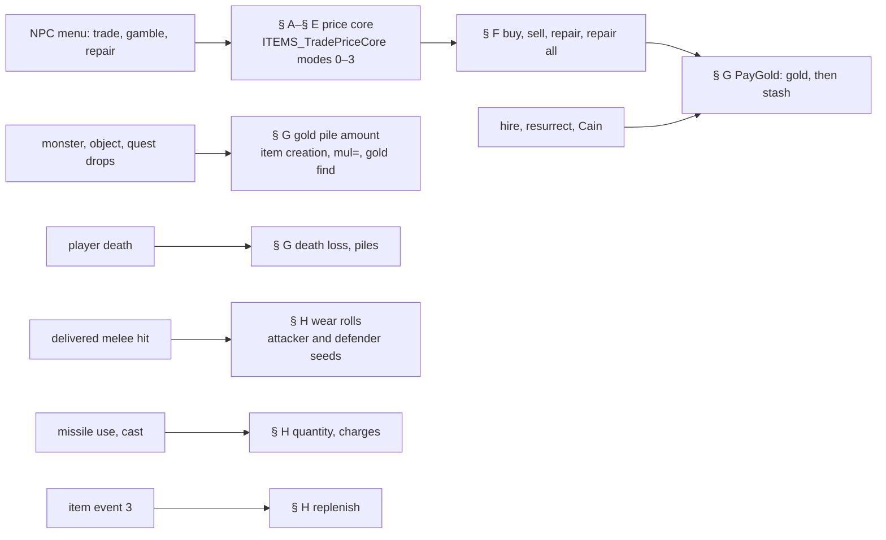
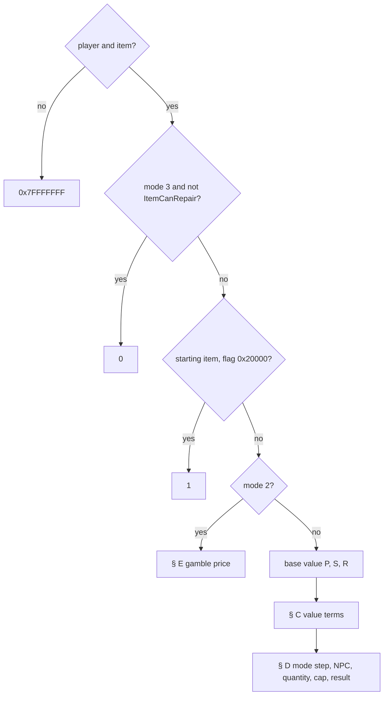
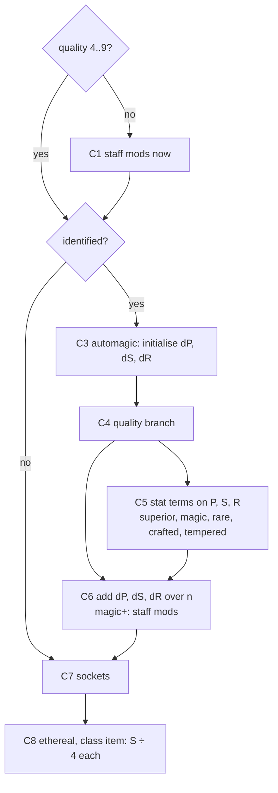
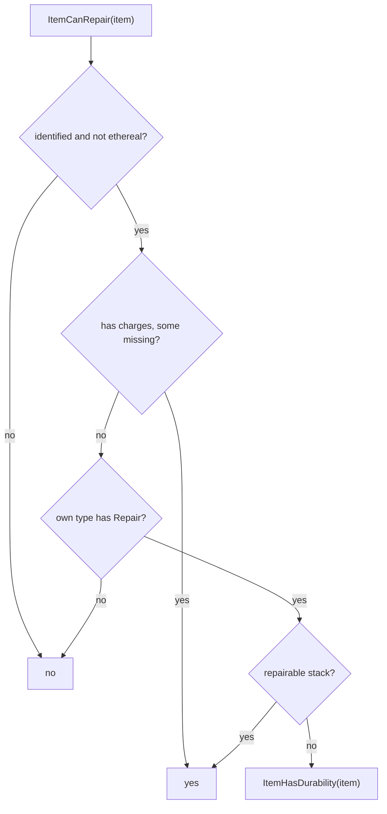
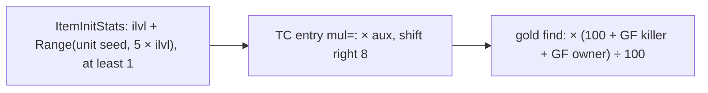
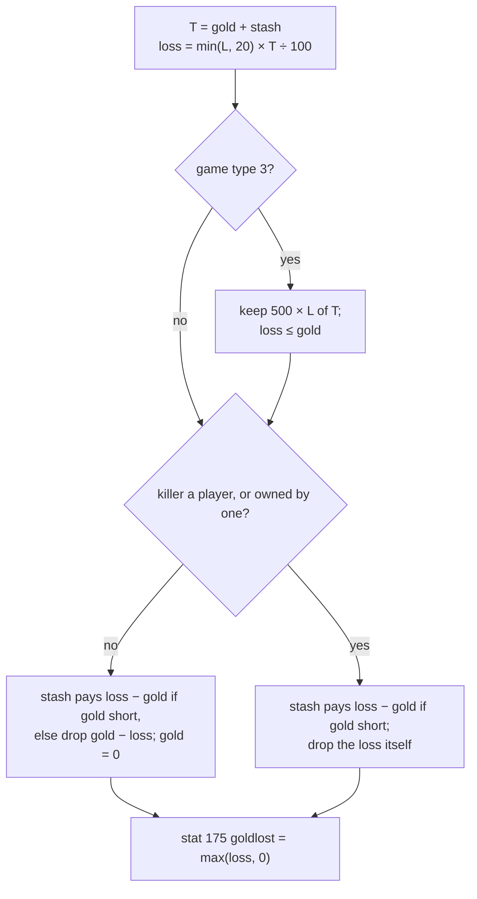
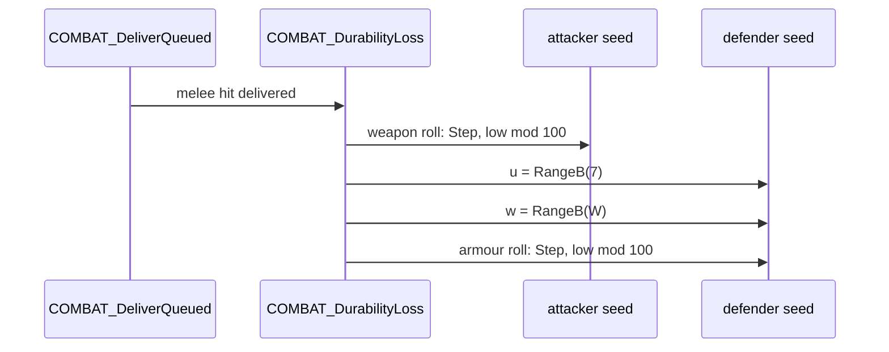

## Purpose

This spec gives what an item costs to buy, sell, gamble and repair; what hiring, resurrecting and identifying cost;
how much gold a pile holds, what caps hold gold and what a player loses on death; and how items lose durability,
quantity and charges in use and get them back. One function prices everything an NPC trades. The gold, cost and
price paths draw nothing of their own: only the wear rolls and the count of Wirt's piles draw, and gold piles and
the store's copy of a sold item draw through the item creation that makes them. Names of functions, structs and fields are ours.

Notation. All arithmetic is signed 32-bit (`i32`) with wrap-around on multiplication, and `÷` truncates toward zero,
unless a step says otherwise. `Range` and `Step` are the primitives of rng; `RangeB` is
the second compile of `Range`, with the same result. `MulDiv(a, b, c)` is the helper of
[monsters/stats § A](../../spec-monsters/stats/#a-muldiv-and-monlvlstats). "Stat *n*" is an ItemStatCost row id; `full(n)`
is the value in the unit's full-stat cache, `own(n)` the item's own entry.
`base` is the item's Weapons, Armor or Misc row. `IsType(item, t)` walks the ItemTypes `Equiv` closure
(`ITEMS_UnitIsType`); "own type" is the item's own ItemTypes row with no walk. `L` is the player's stat 12 (character
level) unless a section names another unit. `D`, `M` and `q` are an item's durability (stat 72), maximum durability
(`ItemMaxDurability`) and quantity (stat 70).



## Entry points

| When | Function | Tag |
|---|---|---|
| A price is needed (trade window, purchase, sale, repair, corpse choice) | → `ITEMS_TradePriceCore` | [C] |
| The player buys or gambles (packet) | `NPC_BuyItem` | [C] |
| The player sells (packet) | `NPC_SellItem` | [C] |
| The player repairs one item or all (packet bit 31) | — | [C] |
| A quest service (Charsi's imbue, Larzuk's socket, Anya's personalization) finishes its item | `NPC_MenuAction` → | [C] |
| Hire, resurrect, identify at Cain | `HIRE_Hire`, `MERC_Resurrect`, `NPC_CainIdentify` | [C] |
| A gold item is created; a monster's gold drop is scaled | — | [C] |
| Wirt's body is operated (object 268; one object event 7 per pile) | — | [C] |
| An amount is dropped as piles (Baal, overflow, death) | — | [C] |
| A player dies | `PLAYER_DeathGoldLoss` | [C] |
| A melee hit is delivered | `COMBAT_DeliverQueued` → `COMBAT_DurabilityLoss` | [C] |
| A missile weapon or throwing stack is used | `PLAYER_UseAmmo` → | [C] |
| A charged skill is cast | — | [I] |
| Item event 3 fires (replenish) | `g_ItemEventFuncs` → `ITEMEVENT_Replenish` | [C] |

- [C] **The client copy's call sites.** The client calls the same price and repair-cost functions: six call sites
  of the price wrapper and two of
  `RepairCost`, by two tools' scans, with no absolute reference to either function.

  [I] It calls them with its own difficulty and quest record, so the displayed prices are the same arithmetic on the
  client's copies of the units; the server's call decides what is paid.

## Inputs

### Tables

| Anchor | Used for |
|---|---|
| `Weapons.txt:cost` (`+0xE0`, i32), the same in `Armor.txt:cost` and `Misc.txt:cost` | the base value (§ B), the socket term (§ C7), the gamble average (§ E) |
| `Weapons.txt:gamble` cost (`+0xD4`) | the gamble price of `rin`, `amu` and version-0 items only (§ E) |
| `Armor.txt:maxac` (`+0xD0`), `Armor.txt:minac` (`+0xCC`) | the armour scaling (§ B) |
| `Weapons.txt:minstack` (`+0xE4`), `maxstack` (`+0xE8`), `stackable` | the stack divisor `n` (§ B), the quantity step (§ D), the gamble average stack (§ E) |
| `Weapons.txt:ubercode` (`+0x88`), `ultracode` (`+0x8C`), `normcode` (`+0x84`), `level` (`+0xFD`, u8) | the gamble price (§ E) |
| `Weapons.txt:nodurability`, `Weapons.txt:durability` | `ItemHasDurability` (§ D, § F, § H) |
| `ItemTypes.txt:Repair` (`+0x08`), `StaffMods` (`+0x1F`), `Class` (`+0x21`), `Throwable`, `Quiver` | the repair test (§ F), the staff-mod skip (§ C), the class-item quarter (§ C8), the throwing and quiver branches |
| `ItemStatCost.txt:Multiply` (`+0x10`), `Add` (`+0x14`), `ValShift` (`+0x18`), `Encode` (`+0x30`, u8) | the per-stat terms (§ C5) |
| `MagicPrefix.txt:multiply` (`+0x88`), `add` (`+0x8C`), the same in MagicSuffix and AutoMagic | the affix terms (§ C3, § C4) |
| `SetItems.txt:cost` mult (`+0x38`), `cost add` (`+0x3C`) | the set term (§ C4) |
| `UniqueItems.txt:cost` mult (`+0x7C`), `UniqueItems.txt:cost` add (`+0x80`) | the unique term (§ C4) |
| `Skills.txt:cost` mult (`+0x234`), `cost add` (`+0x238`), `Skills.txt:reqlevel` (`+0x174`, i16) | the skill-based stat terms, the staff-mod term, the recharge cost |
| `Npc.txt:sell` mult, `buy mult`, `rep mult`, `Npc.txt:questflag` A..C, `Npc.txt:questsellmult` A..C, `questbuymult`, `questrepmult`, `max buy` (`+0x40 + 4·d`) | the NPC scaling and the cap (§ D) |
| `Books.txt:CostPerCharge` (`+0x14`) | the tome base (§ B) |
| `MonStats.txt:Level` (`+0xAA + 2·d`, i16) | the body-part base (§ B) |
| `Hireling.txt:Gold` | the hire price, [hirelings § E](../../spec-hirelings/overview/#e-an-entry-hireling_rollentry) |

- [C] **Not read by the price path:** ItemStatCost `Divide` (`+0x0C`), the affix `divide` (`+0x84`) and Books
  `BaseCost` (`+0x10`); every divisor is the constant 1024, or 4096 for the sell value in the skill-based terms. The
  claim is scoped to the functions of § A–§ E (no image-wide reader scan); the run's 26 525 price results reproduce
  without those cells.
- [C] QualityItems and RarePrefix/RareSuffix carry no price cell the code reads: quality enters only through the
  branches of § C4 (the uncompiled cells are listed in MagicPrefix § Price).
  (jump table)

### Runtime state

| State | Type | Source |
|---|---|---|
| `mode` | i32 | 0 buy (what the player pays), 1 sell (what the NPC pays), 2 gamble, 3 repair; any other value returns the buy value |
| `d` | i32 | the difficulty argument: server callers pass `Game+0x6D` (0 Normal, 1 Nightmare, 2 Hell) |
| quest record | bytes | the player's quest record of that difficulty; word *w* bit *b* tested by `QUESTRECORD_GetState` |
| `npcClass` | i32 | the NPC unit's MonStats class, looked up with `NpcGetByClass` |
| item flags | u32 | `ItemData+0x18`: `0x10` identified, `0x100` broken, `0x10000` ear, `0x20000` starting item, ethereal |
| item version | u16 | `ItemData+0x30`: 0 for an old-format item |
| automagic id | u16 | `ItemData+0x36` |
| `q`, `r`, `L` | i32 | `max(1, own stat 70)`; `min(99, player stat 87 item_reducedprices)`; player stat 12 |
| full-stat cache | `{key, value}` list | the item's extended list `+0x48`, at most 511 entries |
| gold, stash | i32 | the player's stat 14 and stat 15 |
| game type | u8 | `Game+0x6A` (3 in single player, § G) |
| expansion | u32 | `Game+0x70` |
| unit seed | Seed | `Unit+0x20` of the attacker or defender (wear, § H) |

### Constants

| Name | Value | Anchor | Tag |
|---|---|---|---|
| `FIXED` | 1024: every multiplier is over 1024 | — | [C] |
| `FIXED_SKILL_S` | 4096: the sell value's divisor in the skill-based terms | — | [C] |
| `LARGE` | 0xFFFF: above it a scaling divides first (`Scale`, § A) | — | [C] |
| `NO_PRICE` | 0x7FFFFFFF (no player, no item, not an item) | — | [C] |
| `R_CAP` | 99 (`item_reducedprices` cap; a signed compare, so a negative stat passes unchanged) | — | [C] |
| `GOLD_PER_LEVEL` | 10 000: carried gold cap = `L × 10 000` (`imul`, 32-bit) | — | [C] |
| `STASH_CAP` | 2 500 000, not by level | `PLAYER_StashGoldCap` | [C] |
| `PILE_MAX`, `PILES_MAX` | 2 000 000 000 per pile, 32 piles | — | [I] |
| `DEATH_PCT_CAP`, `SP_KEEP` | 20 %; 500 per level kept in single player | `PLAYER_DeathGoldLoss` | [C] |
| `RES_FACTOR`, `RES_CAP` | 15; 50 000 (unsigned compare) | `MERC_ResurrectCost` | [C] |
| `CAIN_COST` | 100 per unidentified item | `NPC_CainIdentify` | [I] |
| `CORPSE_MAX` | 16 corpses (`cmp eax, 0xF; jbe`) | — | [I] |
| wear chances | armour 10, weapon 4, expansion throwing weapon 10 (percent) | `ITEMS_DurabilityLossRoll` | [C] |
| `g_ArmorWearSlots` | 7 pairs {bodyloc, weight}: (1, 3) head, (3, 5) torso, (4, 4), (5, 4) the two hands, (8, 2) belt, (9, 2) feet, (10, 2) gloves; count 7 | `g_ArmorWearSlots` | [C] |
| `REPLENISH_BASE`, `REPLENISH_MIN` | 2500 frames; requeue floor 125 frames (`ReplenishStep`'s; the first timer has no floor, § H7) | `ITEMEVENT_Replenish` | [C] the base in `ItemReplenishDurTimer`; [I] the base and floor in `ReplenishStep`, after its stat write |

## Algorithm

### A. The scaling primitive

Every multiplier step of the price core uses one form. The test value `t` is usually `m` itself; § C and § D name
the steps where it is not.

```
Scale(v: i32, m: i32, t: i32) → i32:                                  [C]
  if v > 0xFFFF and t ≠ 0: return (v ÷ 1024) × m                      ; "large form": divide first
  return (m × v) ÷ 1024                                               ; i32 product, then signed ÷
```

- [C] `÷ 1024` is `cdq; and edx, 0x3FF; add; sar 10`, a signed division truncating toward zero, in every term of
  § B–§ D.
- [C] The run separates the large form at the NPC step and in the stat terms: with it the 26 525 price calls
  reproduce, and with the small form alone reports 1 846 mismatch lines (NPC step) and
  2 737 (stat terms) on the same logs (architect review, 2026-10-19).
- [C] At the other steps that have it the large form holds under emulation: `AddTerm` tests `P` for all three sums
  of the affix, set and unique terms (1 047 large-form terms; the small form alone fails 156), the staff-mod term
  divides the multiplier first (231 entries; fails 77), and the recharge cost tests `T = K × 10 000` (133 entries in
  the price, 73 direct; fails 99 and 60). No logged result separates them: removing the large form from `AddTerm`
  changes none.

### B. The price core: early returns and the base



`ITEMS_TradePriceCore(player, item, d, questRecord, npcClass, mode)` keeps three running values to the end: `P` (the
buy value), `S` (the sell value) and `R` (the repair value), and returns one of them.

```
B1. if player = none or item = none or item is not an item: return 0x7FFFFFFF      [C]
B2. if mode = 3 and not ItemCanRepair(item): return 0                              [C]
B3. if item.flags & 0x20000: return 1                    ; every mode                [C]
B4. q: i32 ← max(1, own stat 70);  r: i32 ← min(99, player stat 87);  L: i32 ← player stat 12   [C]
B5. if mode = 2: return GamblePath(item, L, r)            ; § E                      [C]
B6. R ← 0;  n: i32 ← 1                                                              [C]
    if item.flags & 0x10000:            P ← S ← ItemData.earLevel × base.cost         ; ear
    else if IsType(item, 40 body):       P ← S ← base.cost + 8 × MonStats[fileIndex].Level[d]   ; no record: base.cost
    else if IsType(item, 18 book):       P ← S ← Books[suffix 0].CostPerCharge × q + base.cost
    else if ItemTypeQuiver(item):        P ← S ← (base.cost × q) ÷ 1024;  R ← (MaxStack(item) × base.cost) ÷ 1024
    else:                                P ← S ← R ← base.cost
                                         if base.stackable and MaxStack(item) ≥ 2: n ← MaxStack(item)
B7. if IsType(item, 50 armo) and base.maxac − base.minac ≠ −1 and base.maxac ≠ 0:   [C]
      P ← S ← R ← (base.cost × base stat 31 armorclass) ÷ base.maxac                ; imul, cdq, idiv
```

Step notes:

- B6. [C] The run reproduces the `cost` base, the stack divisor `n = MaxStack`, the quiver base and the tome base.
  `MaxStack(item)` is `min(511, base.maxstack + stat 254)`.
- B6. [C] The ear (`earLevel` at `ItemData+0x48`) and body-part bases were not priced; under
  emulation the ear base is `earLevel × cost` (307 cases) and the body part `cost + 8 × Level[d]` (517) or `cost`
  without a record (588). A suffix 0 at or past the Books count reaches the error routine
  with 0xBBA (17), through the tail that D3's missing Npc row (0xCDC) shares.

  [I] What the error routine does after the call (a fatal error) is not covered.
- B6–B7. [C] The ear, body-part and tome bases leave `R` at 0 (setting `R = P` fails 17 and 142 cases), and the
  armour step overwrites all three values, so it replaces an ear, body-part or tome base on an item that is also
  armour (46 over an ear; keeping those bases fails 74).
  [I] No stock item is both (no table check).
- B6. [C] The tome base is `CostPerCharge × q + cost`, with `cost` the Misc row's; the result does not depend on
  Books `BaseCost` (`+0x10`): taking it for `cost` fails 163 emulated cases (592 tome cases). On stock data `BaseCost`
  equals the tomes' `cost`, so no stock case separates the two.

### C. The value terms (modes 0, 1, 3)



```
C1. if not ItemQualityMagicPlus(item):            ; quality not 4..9              [C]
      (P, S, R) ← StaffModTerm(item, P, S, R, n)   ; C9
C2. if not (item.flags & 0x10): goto C7            ; unidentified                  [C]
C3. dP, dS, dR: i32 ← 0, 0, 0                                                       [C]
    if automagic id ≠ 0: AddTerm(a.multiply, a.add)      ; a = its affix record
C4. by quality (jump table, quality − 1):                                 [C]
      1 low:                (dP, dS, dR) ← (−(P ÷ 2), −(S ÷ 2), −(R ÷ 2))   ; replaces C3
      2 normal:             nothing
      3 superior, 9 tempered: terms ← true
      4 magic:              AddTerm for prefix 0, then suffix 0;  terms ← true
      6 rare, 8 crafted:    for i in 0 ..< 3: AddTerm for prefix i, then suffix i;  terms ← true
      5 set:                AddTerm(SetItems[fileIndex].cost mult, .cost add)
      7 unique:             AddTerm(UniqueItems[fileIndex].cost mult, .cost add)   ; no record: as 4 magic
C5. if terms: (P, S, R) ← StatTerms(item, P, S, R, n)    ; table below          [C]
C6. P ← P + dP ÷ n;  S ← S + dS ÷ n;  R ← R + dR ÷ n     ; signed idiv           [C]
    if ItemQualityMagicPlus(item): (P, S, R) ← StaffModTerm(item, P, S, R, n)
C7. for each child in the item's own inventory (socketed gems, runes, jewels):     [C]
      h ← child.base.cost ÷ 2;  P ← P + h;  S ← S + h;  R ← R + h
C8. if item.flags &: S ← S ÷ 4                  ; ethereal               [C]
    if ItemTypes[own type].Class < 7: S ← S ÷ 4          ; class item, again

AddTerm(m, a):                                     ; the test is on P for all three  [C]
  if P > 0xFFFF and m ≠ 0: dP += (P ÷ 1024) × m + a;  dS += (S ÷ 1024) × m + a;  dR += (R ÷ 1024) × m + a
  else:                    dP += (m × P) ÷ 1024 + a;  dS += (m × S) ÷ 1024 + a;  dR += (m × R) ÷ 1024 + a
```

Step notes:

- C3–C4. [C] The run reproduces qualities 1–7 (the low halving, the set row's terms in 66 inputs, the rare item's
  six affixes in 18), the automagic, magic and unique terms over 1024, and unidentified items (no terms).

- C4. [C] Quality 8 (crafted) takes the rare branch: 55 distinct crafted price inputs reproduce in Hell (sale 35,
  repair 17, purchase 3, the last the store copies of crafted items sold), with prefixes and suffixes in slots 0 and 1
  through `AddTerm` and the stat terms of C5. The items were tool-built (quality 8 with affixes, no recipe mods), a
  state the cube's crafting does not make.
- C4. [C] A unique with no file index or no record (a file index negative or at or past the UniqueItems count) was
  not priced in either run; under emulation it takes the magic branch, prefix 0, suffix 0 and then the stat terms (287
  cases; giving it no terms fails 100).
- C4. [C] Unique items (with a record) and set items get no per-stat terms; superior items do: over 33 901 logged
  price calls, a control adding terms to sets fails on 196 lines, one adding them to uniques on 375 and one taking them
  from superior items on 1 135, the stock model on none. (jump table)
  [I] Tempered items (quality 9) take the terms as superior items do; no such item was priced and no stock source of
  one is known. (jump table)
- C5–C6. [C] The stat terms are computed on `P`, `S` and `R` as they stand **before** the affix sums enter, and are
  added first, with an **unsigned** division by `n`; the affix sums follow with a signed division.

- C7. [C] Each socketed child adds half its base `cost`, whatever its own quality (10 socketed inputs in the run).

- C8. [C] An ethereal item sells for a quarter of its value, and a class item (own type `Class` < 7) for a quarter
  again; neither touches `P` or `R` (68 distinct ethereal sale inputs).

**The per-stat terms (`StatTerms`).** For each entry of the item's full-stat cache (at most 511), in cache order:

```
StatTerms(item, P, S, R, n):                                                         [C]
  sP, sS, sR: i32 ← 0
  for each cache entry (stat id, param, full) while index < 511:
    v: i32 ← full − own value of the same stat and param      ; UnitStatDelta
    if v = 0: continue
    v ← v >> ISC[stat].ValShift                                 ; arithmetic shift
    choose (m, a, x, divS) by ISC[stat].Encode (table below)
    if P × x > 0xFFFF and m ≠ 0:
      sP += ((P × x) ÷ 1024) × m + a;  sS += ((S × x) ÷ divS) × m + a;  sR += ((R × x) ÷ 1024) × m + a
    else:
      sP += (m × P × x) ÷ 1024 + a;    sS += (m × S × x) ÷ divS + a;    sR += (m × R × x) ÷ 1024 + a
  return (P + (u32) sP ÷ (u32) n, S + (u32) sS ÷ (u32) n, R + (u32) sR ÷ (u32) n)   ; unsigned div
```

| `Encode` | `m`, `a` | `x` | `divS` | Tag |
|---|---|---|---|---|
| 0, and 5 or more | ISC `Multiply`, `Add` | `v` | 1024 | [C] |
| 1 (param is a skill) | the skill's Skills `cost mult`, `cost add` | `v` | 4096 | [C] |
| 2, 3 (skill on event, charged; skill = param `>>` the data tables' `+0xC6C`, level = param & their `+0xC70`, read, 6 and 63 in all 8 logged games) | the skill's Skills `cost mult`, `cost add` | the **level** from the param; the charge count does not enter | 4096 | [C] |
| 4 (by time) | ISC `Multiply`, `Add` | `(lo + hi) ÷ 2` (signed) of the two values `STAT_ByTimeValue(v, 0, 0, …)` writes: `lo = ((v >> 2) & 0x3FF) − 256`, `hi = ((v >> 12) & 0x3FF) − 256` | 1024 | [C] (jump table, `STAT_ByTimeValue`) |

- [C] `a` is added once per entry. A stat whose `Multiply` and `Add` are both 0 adds 0. A `ValShift` 8 stat (7, 9,
  11: life, mana, stamina) is priced in whole points.
- [C] No stock item with an Encode 4 stat was priced; the emulation prices 2 410 such
  entries with `STAT_ByTimeValue` run whole (pricing them as Encode 0 fails 197). (jump table)

**The staff-mod term (`StaffModTerm`).** Skipped when the item's own type has `StaffMods` = 7 (no stock type has it:
the bytes are 1..6 or 255). For each stat 107 (`item_singleskill`) entry with skill row `k` and value `v`:

```
StaffModTerm(item, P, S, R, n):                                                      [C]
  tP, tS, tR: i32 ← 0;  c: i32 ← 2 × v − 1;  m ← k.cost mult;  a ← k.cost add
  if P > 0xFFFF and m ≠ 0:                      ; the large form divides the multiplier
    tP += ((m ÷ 1024) × P + a) × c;  tS += ((m ÷ 4096) × S + a) × c;  tR += ((m ÷ 1024) × R + a) × c
  else:
    tP += ((m × P) ÷ 1024 + a) × c;  tS += ((S × m) ÷ 4096 + a) × c;  tR += ((R × m) ÷ 1024 + a) × c
  return (P + (u32) tP ÷ (u32) n, S + (u32) tS ÷ (u32) n, R + (u32) tR ÷ (u32) n)
```

- [C] For every stock skill `cost mult` ≤ 896 (a full-table check: 357 Skills rows, the `.bin` at `+0x234` and the
  `.txt` agreeing, maximum 896, minimum 0), so the large form reduces to `cost add × (2v − 1)`.
  (`Skills.txt:cost` mult, `ItemTypes.txt:StaffMods`)

### D. Mode steps, the NPC row, quantity and the result

```
D1. if mode = 1 and item.flags & and ItemHasDurability(item) and M ≠ 0 and D ≤ 0:   [C]
      S ← 0                                              ; a broken ethereal item
D2. if mode = 3 and not ItemTypeQuiver(item) and not Throwable(item) and ItemHasDurability(item):   [C]
      if M = 0 or D ≥ M:     R ← 0
      else if own stat 252 ≠ 0: R ← (D < M − 1) ? ((M − 1) × R) ÷ M : 0     ; item_replenish_durability
      else:                  R ← ((M − D) × R) ÷ M
D3. rec ← NpcGetByClass(npcClass);  if rec = none: fatal error 0xCDC               [C]
    P ← Scale(P, rec.sell mult, rec.sell mult)
    S ← Scale(S, rec.buy mult,  rec.sell mult)            ; the test is sell mult
    R ← Scale(R, rec.rep mult,  rec.rep mult)
    for k in A, B, C:
      if rec.questflag k ≠ 0 and (QuestBit(word rec.questflag k, bit 0) or QuestBit(word rec.questflag k, bit 1)):
        P ← Scale(P, rec.questsellmult k, same);  S ← Scale(S, rec.questbuymult k, same);  R ← Scale(R, rec.questrepmult k, same)
D4. if not IsType(item, 18 book) and not ItemTypeQuiver(item):                       [C]
      P ← P × q
      if base.stackable and ItemCanRepair(item):
        Ms: i32 ← MaxStack(item)
        if q < Ms and own stat 253 = 0: R ← R × (Ms − q);  S ← Ms × S − R
        else:                          S ← S × Ms;  R ← 0
      else: S ← S × q
D5. if mode = 3 and not (item.flags &): R ← R + RechargeCost(item)          [C]
D6. S′ ← min(S, rec.max buy[d])                                                       [C]
D7. if mode = 1: return max(S′, 1)                       ; "S′ < 1 → 1"             [C]
    if mode = 3: if r ≠ 0: R ← R − MulDiv(R, r, 100);  return R < 1 ? 1 : R
    if r ≠ 0: P ← P − MulDiv(P, r, 100);  return P < 1 ? 1 : P       ; mode 0 and any other mode

RechargeCost(item):                                                                   [C]
  total: i32 ← 0
  for each stat 204 (item_charged_skill) entry with current c = value & 0xFF < max x = value >> 8:
    k ← Skills[param >> 6];  lvl ← param & 0x3F             ; the same two globals as Encode 2, 3
    K: i32 ← lvl + 2 × (k.reqlevel ÷ 6) + 2;  T: i32 ← K × 10000
    t: i32 ← (T > 0xFFFF and k.cost mult ≠ 0) ? (T ÷ 1024) × k.cost mult : (k.cost mult × T) ÷ 1024
    total ← total + ((x − c) × (t + k.cost add)) ÷ x
  return total
```

Step notes:

- D1. [C] No broken ethereal item was sold; under emulation a mode-1 ethereal item with
  durability, `M ≠ 0` and `D < 1` sells for `S = 0` before the NPC step (17 cases; without the step 7 fail).

- D2. [C] The plain durability fraction `((M − D) × R) ÷ M` is reproduced (107 distinct inputs)
  met no repair input at full durability or with stat 252, and the emulation runs those two branches: `R = 0` at full
  durability (173 cases; keeping `R` fails 72), and with stat 252 `((M − 1) × R) ÷ M` below `M − 1`, else 0 (116; the
  plain fraction fails 51).
- D2. [C] The repair price in Hell reproduces: 25 distinct mode-3 inputs at `d` = 2 (Larzuk, Halbu, Charsi) and the
  repair-all sums of those windows, so with the first run's Normal and Nightmare inputs mode 3 is covered in all three
  difficulties.
- D3. [C] The NPC multipliers of 15 classes and quest groups A and B, each both on and off, reproduce. Quest group C
  is set by no stock Npc row, so it is unreachable on stock data. (`Npc.txt:questflag` A)
- D3. [C] `S`'s large form tests `sell mult ≠ 0`, not `buy mult` (`test ecx, ecx`, ECX the sell
  multiplier; testing `buy mult` fails 73 emulated cases); every stock row has both non-zero (`sell mult` 960..2048,
  `buy mult` 512), so the quirk has no stock effect. (`Npc.txt:sell` mult)
- D4. [C] A repairable stack below its maximum sells for the full stack less the cost of refilling it:
  `S = Ms × S − R × (Ms − q)` (53 distinct inputs).
- D5. [C] The recharge cost is added **after** the NPC, quest and quantity steps, so `rep mult` and the quest groups
  do not scale it. No recharge case was met; under emulation 270 non-zero recharge costs
  are added there (adding them before the NPC step fails 225), and `RechargeCost` reproduces directly (154 small-form
  and 73 large-form entries, 287 skipped).
  [I] D5's ethereal test never decides: in mode 3 an ethereal item has already returned 0 at B2 (`ItemCanRepair`
  refuses it).
- D6. [C] `max buy` caps the sell value only, per difficulty, after the NPC, quest and quantity steps and before the
  floor.
- D7. [C] `item_reducedprices` lowers the buy and gamble prices (Gheed's Fortune, 376 inputs).
- D7. [C] It lowers the repair price too: no repair input with `r ≠ 0` was logged, and under emulation mode 3 takes
  `R − MulDiv(R, r, 100)` (316 cases; without it 131 fail).

### E. The gamble price (mode 2)

```
E1. GamblePath(item, L, r):                                                          [C]
      if item version = 0: return Items[NormBase(item)].gamble cost        ; no reduction
      G: i32 ← GamblePrice(item, L)
      if r ≠ 0: G ← G − MulDiv(G, r, 100)
      return G                                             ; no NPC, no quest multiplier, no floor
E2. GamblePrice(item, L):                  b ← NormBase(item) = the normcode base, else the code base   [C]
      if b.code = 'rin ' or b.code = 'amu ': return b.gamble cost
      avgStack: i32 ← max(1, (b.minstack + b.maxstack) ÷ 2)
      x, e, xc, ec: i32 ← 0
      if b.ubercode ∉ {0, '0   '} and u ← ByCode(b.ubercode) exists:  x ← max(0, ((L − u.level) × 100) ÷ 2 + 1);  xc ← u.cost
      if b.ultracode ∉ {0, '0   '} and t ← ByCode(b.ultracode) exists: e ← max(0, ((L − t.level) × 100) ÷ 4 + 1);  ec ← t.cost
      avgCost: i32 ← ((10000 − e − x) × b.cost × avgStack + ec × e + xc × x) ÷ 10000
      L2: i32 ← max(L, 5)                              ; the upgrade weights above use L, not L2
      lv: i32 ← (b.level ≥ 45 ? b.level − 45 : 0) − b.level ÷ 2 + L2
      return ((lv × 250) ÷ 3 + avgCost) × ((2 × L2 + 1) ÷ 3 + 20) ÷ 15
```

- E2. [C] The run reproduces 272 distinct gamble inputs in all three difficulties, with and without
  `item_reducedprices`, rings and amulets included. `gamble cost` is read only for `rin`, `amu` and version-0 items;
  every other gamble price is computed.
- E2. [C] The `+1` and the floor at 0 apply after the division (`sar 1`, `sar 2`, then `add 1`, `jns`): adding 1
  before fails 116 emulated cases, and without the floor 225 fail. The dividend is a multiple of 100, so the shift and
  a truncating division agree. `x + e` is not capped, so `10000 − e − x` goes negative at high `L` (68 inputs at levels
  150 to 2 000; capping the sum at 10 000 fails 68). `÷ 10000` and `÷ 15` are magic-number divisions (`0x68DB8BAD`
  `sar 12`, `0x88888889` `sar 3`).
- E2. [C] The floor `L2 = max(L, 5)` holds below level 5: 125 distinct gamble prices of a level-3 character (Gheed,
  Anya, Jamella and Alkor, ten windows) reproduce with `L2` = 5.
- E1. [C] No version-0 item was gambled in the runs; under emulation a version-0 item (the u16 below 1, `cmp ax, 1;
  jb`) returns its normcode row's `gamble cost` through `EXCEL_FindCode` (305 cases; computing it fails 306).
 [I] None is expected on stock data.

### F. Callers: buy, sell, repair



Step notes:

- F1. [C] The test reads the item's **own** ItemTypes row. On stock data the `Equiv` closure gives the same set of
  repairable bases (a full-table check over the 659 bases of Weapons, Armor and Misc: 472 repairable and 187 not by
  either rule, none differing), so the choice has no stock effect. 13 bases of a `Repair` type have `nodurability` 1:
  the 12 crossbows (type `xbow`) and the Phase Blade `7cr` (type `swor`); `bow` and `tpot` have `Repair` 0.

  [I] Those 13 bases are refused unless charged, and so are bows and `tpot` (`ItemCanRepair`'s charge branch, no
  charged item repaired).
- F3. [C] In 14 purchases checked, `PayGold`'s amount is a multiple of the purchase price. The permanent-stack count
  rule is read from the code only.
- F4. [C] In 43 sales checked, the gold given equals the lower of the two sale prices computed inside `NPC_SellItem`.

- F4. [I] The other four tests (`Cracked`, base type 7, flag `0x1000000`) were not reached; that they refuse the copy is read from the code. `ItemIsCarry1Unique` is true for an item unit of quality 7 with a file
  index ≥ 0 whose UniqueItems record has the `carry1` bit (the flag byte `+0x2C` AND the byte, 4),
  read from the code.
- F5. [C] 138 repair-all sums equal the sum of the mode-3 price calls made inside them.

- F6. [C] `NpcRepair` with one item (flags word 0; repair-all has bit 31) reproduces in 4 calls: two partial
  repairs, gold 300 for a cost of 14 464 (durability 1 → 2) and gold 7 936 for 14 208 (2 → 34), each taking all the
  carried gold (stat 14 alone, through a second `PayGold`) with `k` and `D` as above; one refused at gold 0, item
  unchanged; one paid repair of a broken cap in Hell (flag `0x100` cleared, durability 0 → 12). The stock client's
  repair box asks for the full cost even when the gold is short, and both partial repairs were reached through it.

- F6. [I] The entry refusals, the partial branch's tests other than `gold > 0` (the bounds on `k`, "not broken") and
  the rounding of its two divisions (two cases fit them but do not separate it) are read from the code.

- F6. [C] **An ethereal item:** the server's own refusal is `ItemCanRepair`'s, which returns false for an ethereal
  item (190 direct emulated cases, and the price core's 1 012 B2 returns include them).
  [I] The client shows no repair box for it, so no packet and no `NpcRepair` call came (two attempts).

- F7. [C] `ItemRepairAll` leaves the game and player seeds unchanged (3 115 calls in the first run, 894 in the
  second). It restores the durability to the maximum: the quest services' two caps went from 1 to 12 of 12 and the
  broken cap from 0 to 12 with flag `0x100` cleared, one case each. It repairs one item per call: each of the 4 009
  logged calls dumps one item, the repair-alls change exactly the items of their calls, one call per item (7, 7, 7;
  the fourth, at gold 0, none), and a single repair changes only the requested item. The quantity and charge refills
  are read from the code.
- F7. [C] **No quest script repairs.** A call-site scan of the six repair functions, repeated with a second tool (22
  sites: 21 rel32 calls and the thunk's `push`), finds `ItemRepairAll` called only from `NpcRepair`
  (directly and, for repair-all, through the thunk `ItemRepairAllThunk`), the store and gamble stock
  builders and the three services above; of 651 quest functions (642 at the first scan, the same filter over today's
  symbols) only the NPC packet's dispatch to `NpcRepair` reaches a repair function, and that is the repair
  window itself. Direct calls and the thunk's push; indirect calls not followed.

- [C] **The store record's bytes `+0x24..+0x26` are not read in the windows played.** A read watchpoint on
  Charsi's `NpcStoreRec` `+0x24..+0x27`, with a control watch on `+0x00` writing to the end of each session, fired 5
  times, each at `NPC_TradeOpen`'s compare of the byte `+0x27` (the stale byte of
  items/vendors § C), and never on `+0x24..+0x26`. The windows: Charsi's trade, sale,
  single-item and partial repairs, repair-all and imbue; Gheed's trade and gamble; Akara; Kashya's list; Larzuk,
  his socket service, Anya, her personalization and Malah in Normal; Larzuk, Malah, Anya, Halbu and Charsi in Hell;
  ten gamble windows. In session 4505 the watch was set at frame 1769 as the first Gheed gamble window opened and
  the control's first line is at 2729, so that window is bracketed by the two rather than holding a control line. Other NPC
  actions and game states are not covered.
- [C] `D2S_WriteCorpses` calls `ItemTradePrice(player, item, 3, quest word, 0x201, 0)`: difficulty
  **3**, class 513 (Malah), mode 0; it adds the return to `EBX`. Difficulty 3 indexes past `Level(H)`
  and `max buy (H)`: the price core reads `max buy [3]` (`rec + 0x4C`, past the record) in every mode that
  reaches the NPC step, mode 0 included, and uses it in mode 1 only (bounding `P` by it in mode 0 fails 514 emulated
  cases), and it reads the `Level` column past `(H)` for a body part only. So neither enters mode 0's result for an
  ordinary item.
  [I] The sum serves to choose the most valuable corpse.

### G. Gold: payment, caps, piles and the death loss

- G1. [C] 54 calls (hires, purchases, resurrections) reproduce, including 4 refusals with gold and stash unchanged.

- G3. [C] 97 adds below the caps reproduce, where no add went over a cap. Under emulation
  to the write: `v < 0` writes 0 (387 cases), a player's stat 14 over `GoldCap` (63) or stat 15 over 2 500 000 (51)
  writes 0, and the rest add `delta` (395); writing the cap instead fails 101 cases, and the caps without the type
  test fail 68.
- G4. [I] In a party with another member in the level, a pickup goes through `PartyGoldShare` (a split by the party
  count). Where gold stands in a pickup's order: items/inventory § I.

**The pile amount.** A gold pile's amount is fixed when the gold item is created, then a monster drop is scaled:



```
G5. amount: i32 ← ilvl + Range(item unit seed, 5 × ilvl);  if amount < 1: amount ← 1    [C]
      ; one draw, none when 5 × ilvl < 1; a creation record quantity > 0 overrides (items/properties A1)
G6. monster drop: amount ← (amount × aux) >> 8 when the TC entry has mul=               [C] at mul=1280; [I] 1536, 2048 and the order (items/tc H8, ITEMS_UnitIsType)
G7. monster drop, own type exactly 4 gold: amount ← amount × (100 + full(79, killer) + full(79, killer's owner)) ÷ 100   [C]
G8. ilvl of other gold creators:                                                       [C]
      DropGoldPile (OBJINIT_GoldPiles): the level's monster level − 1 when that is above 1
        (LevelMonLvl: MonLvl or MonLvlEx by the expansion flag)
      DropItemAtUnit (Wirt's piles): LevelMonLvl of the body's level, at least 1         ; notes G8, G8a; the floor code only
      DropItemCodeAt (the quest chests' piles): UnitDropLevel of the source              ; code only, note G8
G8a. Wirt's gold (A1Q4_WirtGold, on Wirt's body, object 268):           [C]
      on its first event 7 (latch +0x90): count +0x8C ← RandLoHi(questSeed, 10, 20)      ; draw: 10 … 19
      each event 7, every 10 frames, while count > 0:
        DropItemAtUnit(gold, quality 2, ilvl passed 0);  count ← count − 1               ; an item creation (G5)
```

- G5. [C] 545 amounts at creation reproduce with the seed after the draw; this is the A1 step of
  [items/properties § A](../properties/#a-base-stats-on-the-unit-seed).
- G6–G7. The `mul=` and gold-find steps are [items/tc § H](../tc/#h-item-pick-and-hand-off) H8–H9. [C] 433 gold-find
  scalings reproduce (gold find 0 in 207, above 0 in 226; Normal 228, Nightmare 140, Hell 65); the scaling has no
  difficulty term.
- G8. [C] 102 object piles take the level's monster level minus 1 as ilvl, all in levels whose monster level is
  above 1.
- G8. [I] The case "monster level 1 or less", the floor of 1 on `DropItemAtUnit`'s ilvl
  and the ilvl of the quest chests' piles were not met.
- G8, G8a. [C] **Wirt's gold**, one game (Normal, expansion): operating the body ran `A1Q4_WirtGold` 18 times, one
  event 7 every 10 frames. The first drew the count, `RandLoHi(questSeed, 10, 20)` = 18, matched by the quest seed's
  logged step; each event made one pile with `DropItemAtUnit` and moved the game seed 2 steps (18 of 18). The 18
  piles have ilvl 6 (`LevelMonLvl` of Tristram), and each amount reproduces as G5. `RandLoHi` and the quest seed are
  those of [items/quest-drops § E](../quest-drops/#e-quest-items).
- G8. [I] Which Levels column `LevelMonLvl` read for Wirt's piles is not separated: Tristram's `MonLvl1` and
  `MonLvl1Ex` are both 6.

**Dropping an amount (`DropGoldAmount`).**

```
G9. DropGoldAmount(unit, amount, out, maxPiles = 32):                                 [I]
      split amount into piles of at most 2 000 000 000, at most maxPiles
      for each pile: create a gold item at the unit       ; an item creation: its draws (G5)
                     set its stat 14 to the pile's share  ; the created amount is overwritten
```

- G9. [C] Each call in the run moved the game seed by 2 steps (10 of 10), the unit constructor's two draws for one
  created pile. The split rule above 2 000 000 000 is read from the code only.
- G9. [C] Baal's quest gold and every overflow drop use
  this function: by two tools' scans `DropGoldAmount` has 5 direct callers (`PlayerDropGold`, `DropGold`,
  `PlayerGiveGold` twice, `CorpseDropGold`) and `DropGold` 2 (`GoldPickup`, `A5Q6_BaalDeath`), with no
  absolute reference; the 3 logged overflow drops enter.

**The death loss.** `PLAYER_DeathGoldLoss` runs for every player death, before the experience loss.



```
G10. PLAYER_DeathGoldLoss(player, killer):                                           [C]
       T: i32 ← gold + stash;  loss: i32 ← (min(L, 20) × T) ÷ 100
       if game type = 3:                                       ; single player
         if T − loss < 500 × L: loss ← max(0, T − 500 × L)
         loss ← min(loss, gold)
       pvp ← killer is a player, or a monster owned by a player
       if not pvp:
         if gold < loss: stash ← max(0, stash − (loss − gold))
         else: PlayerDropGold(gold − loss)
         gold ← 0
       else:
         if gold < loss: stash ← max(0, stash − (loss − gold));  gold ← loss
         PlayerDropGold(loss)                                   ; the rest stays carried
       stat 175 goldlost ← max(loss, 0)
G11. PlayerDropGold(amount):                                                          [I]
       if amount > gold or amount > the carried cap: return 0  ; drops nothing
       DropGoldAmount(player, min(amount, 2 000 000 000), 32); take each pile's stat 14 from the carried gold
```

- G10. [C] 20 softcore single-player deaths reproduce gold, stash and stat 175 after the call (12 with the total above
  `500 × L` after the loss, 8 below, levels 5 to 99). A death moved the game seed by 2 steps exactly when it dropped a
  pile (7 of 20), so it draws only through that item creation.
- G10. [I] PvP deaths, game types other than 3 and hardcore were not met. Hardcore is not tested by the function.
  Every stat write in the path goes through the cap test of G3, so the PvP `gold ← loss` writes 0 when the loss is
  above `L × 10 000`, and that loss then drops nothing (G11). In type 3 the loss never exceeds gold, so the stash
  branches are reachable only in the other game types.
- G10. [C] **The game type** is stored at game creation: `GameCreate` stores the byte from the creating
  client's create message (type 0x67), which the client builds from `g_ClientGameMode`: 0 → 3, 6 → 1, 8 → 2, any
  other value → 0 (two tools). The single-player client runs with `g_ClientGameMode` = 0, so every logged
  single-player game has type 3 (all 20 logged deaths).
  [I] It is written only there: the one other byte store at `+0x6A` is the client's record copy, and a
  displacement search cannot see a store through another base.
- G10. [I] **The switches.** `-gametype N` is a source of `g_ClientGameMode` (launcher and multiplayer code write it too).
  `-arena N` stores into the config block at `+0x207`, a dword that overlaps the low word of the block's `+0x209`.
  `ClientGameCreateMsg` tests the block's `+0x209` against 0 and, if 0, writes `4 | 0x100000` there; it then copies the
  block's low word at `+0x207` to the create message's `+0x25` and the block's `+0x209` to the message's `+0x27`.

- [I] **The corpse.** When the corpse is made, the remaining carried gold (0 after a non-PvP death) is dropped as
  piles by `CorpseDropGold`; with 16 corpses the items and gold are dropped instead (`CorpseOverflowDrop`).


**Costs.**

```
G12. hire: PayGold(the listed entry's price)              ; price: hirelings § E      [C]
G13. resurrect (MERC_Resurrect, mercenary level L_m = its stat 12):                   [C]
       c: i32 ← ((L_m × L_m) ÷ 2) × 15;  if (u32) c > 50 000: c ← 50 000
       if PayGold(c) = 0: return                          ; pays nothing
       revive the mercenary
G14. Cain's identify: cost ← 100 × CountUnidentified(player)                          [I]
       unless quest word 4 has bit 0 or bit 1 in the player's record of the difficulty (then free);
       then every unidentified item on page 0 or 3 is identified
```

- G12. [C] The 22 hires' payments reproduce, and the price is `HIRELING_RollEntry`'s.
- G13. [C] 34 resurrect-cost calls at mercenary levels 1 to 99 reproduce, the cap reached at 82, 85 and 99; 10
  resurrections paid it, and in the 4 where `PayGold` refused, gold and stash are unchanged at the exit.

- G13. [I] A refused resurrection also revives nothing: the test jumps to the common exit,
  and the revive (the `+0xC4` bit `0x10000` cleared, then) lies only
  on the paid path. The run did not log the mercenary after the call.
- G14. [I] One paid identify was met in the run (100 for one item, quest word 4 cleared); one case decides nothing.

- [C] `NpcHealDead` would charge `L × ((ΔHP >> 8) + (Δmana >> 8)) >> 2` for a heal, but no call, jump
  or 4-byte pointer reaches it (a second tool's scan: 0 rel32 and 0 abs32 references; `HealCost`'s callers are
  `NpcHealDead` and the client's menu builder, and of `PayGold`'s 10 callers none is a heal path but `NpcHealDead`):
  1.14d heals for free.

### H. Wear: durability, quantity, charges, replenish



```
H1. COMBAT_DurabilityLoss(att, def), on a delivered melee hit:                         [C]
      if att is a player: DurabilityLossRoll(game, att, att's weapon)       ; attacker's seed
      if def is a player with an inventory:
        W: i32 ← Σ weight over the 7 g_ArmorWearSlots pairs whose slot holds an armo item
        if W > 0:
          u ← RangeB(def.seed, 7)                       ; draw on the defender's seed
          w ← RangeB(def.seed, W)                       ; draw
          k ← u;  loop: if slot k holds armo: (if w < weight k: break; w ← w − weight k);  k ← (k + 1) mod 7
          DurabilityLossRoll(game, def, item in slot k)  ; defender's seed
H2. DurabilityLossRoll(game, owner, item):                                              [C]
      if not (IsType(item, armo) or IsType(item, weap)) or not ItemHasDurability(item): return   ; no draw
      chance ← armo ? 10 : (Throwable(item) ? 10 : 4)
      if weap and Throwable(item) and game.expansion = 0: return             ; classic: no draw
      Step(owner.seed);  roll: u32 ← owner.seed.low mod 100                  ; draw, inline LCG
      if roll ≥ chance: return
      D′ ← D − 1
      if D′ ≥ 1: D ← min(D′, M);  arm the replenish timer
      else if not IsType(item, weap) and not broken: ItemBreak               ; an armo item
      else if version ≠ 0 and q ≥ 2: q ← q − 1;  D ← M;  timer if MaxStack(item) > 0   ; a throwing stack refills
      else if version ≠ 0: D ← 0;  q ← 0;  refresh the hands;  timer if MaxStack(item) > 0
      else: D ← 0                                                         ; version 0
```

Step notes:

- H1. [C] In all 975 events with the slot list logged, `W` is the sum of the weights 3/5/4/4/2/2/2 over the slots
  holding an `armo` item (`W` 18 in 802, `W` 10 in 162; 11 with `W = 0` and no draw); `u` and `w` reproduce, and the
  cyclic pick names the slot whose item is then rolled in 964 of 964 picks, the roll drawing next on the same seed.

- H1. [C] The function has one call site, in `COMBAT_DeliverQueued` (two tools), and all 1 415 logged
  calls return there.
  [I] Only a melee delivery reaches `COMBAT_DeliverQueued`, so a missile or a spell causes no wear here
  ([combat/delivery § A](../../spec-combat/delivery/#a-queue-and-delivery)'s claim).
- H2. [C] 1 061 rolls reproduce: no draw without durability (50, see the next note), one step of the owner's seed with
  `roll = low mod 100` (unsigned), a loss when below 10 (armour, 914 rolls), 4 (weapon, 90) or 10 (an expansion
  throwing weapon, 7), and `D′ = D − 1` kept when ≥ 1 (81 losses).
- H2. [C] **An indestructible item makes no draw.** All 50 rolls without a draw were on two items with stat 152 = 1
  in their full-stat cache (a set `xtb`, 12 rolls, and a unique `uit`, 38, session 4381), whose bases have
  `nodurability` 0, `durability` 18 and 86 and whose maximum is not 0, so only stat 152 makes `ItemHasDurability`
  false; every roll on an item without stat 152 drew (architect review, 2026-10-19).
- H2. [I] A melee weapon whose durability reaches 0 gets `D = 0` and quantity 0 but no `ItemBreak`; `HandsRefresh`
  calls `ItemBreak` only for a stackable or throwable `weap` of quantity ≤ 0, magic or better, without stat 125. The
  one weapon taken to 0 in the run had no broken flag at the roll's exit.

```
H3. PLAYER_UseAmmo(player), from the missile-launch functions:                          [I]
      bow or crossbow: the stackable or throwable item in the right hand, else the left (the quiver)
      any other weapon: the weapon itself when stackable, throwable or with stat 125 item_throwable
      ItemConsumeOne(that item)
H4. ItemConsumeOne(item): q ← max(q − 1, 0);  arm the quantity timer;  D ← M;  refresh the hands   [C]
H5. UseCharge(caster, skill, level): the item carrying that charged skill and level:    [I]
      current ← min(max(current − 1, 0), max)             ; no draw
H6. SkillWeaponWear, with the skill's calcs +0x13C chance and +0x140 amount:   [I]
      a non-stackable weapon (type 45) with durability: Step(caster.seed);  if low mod 100 < chance:
        it loses amount (breaks when nothing is left)
      a stackable one with q > 0: Step(caster.seed);  if low mod 100 < chance: PLAYER_UseAmmo
      ; no draw when the weapon passes neither test
```

- H4. [C] 130 thrown uses (a throwing axe, through 142 `PLAYER_UseAmmo` calls) write `q − 1` with no draw.

- H3. [I] Bows, crossbows and quivers were not met in the run.
- H3. [I] **The missile gates: the use.** With `useAmmo` set and a player owner, `PLAYER_UseAmmo` must return ≥ 1 or
  no missile is made; `SKILL_AttackDo` passes 1 unless the unit's ranged missile is 27 `magicarrow`. Which functions
  hold the six monster-code sites is not settled (the padded blocks). A `decquant` skill uses one through
  `SKILLS_SrvDo`'s own `PLAYER_UseAmmo` call, made after the missile when `SKILLS_SrvDo` runs with its `pay` argument
  set and the unit is a player or a monster (the use acts only for a player). In the creators the
  ammunition use acts only for a player owner.

- H5–H6. [I] No charge was used and no skill wear was met in the run.
- H6. [C] **Wear is Impale's.** `SkillWeaponWear` has one caller, in start function 7 (Impale), with no
  absolute reference (two tools).
  [I] Impale calls it after its hit when the weapon has durability, with `chance = calc2` and `amount = calc3`.

```
H7. timer: when none is queued, queue item event 3 at frame + 2500 ÷ r + 1   ; signed 32-bit idiv, no floor   [C] the durability timer; [I] the quantity timer
      ; the durability timer queues nothing when stat 252 is 0 or a type-3 event with +4 > 0 is on the item's list
      armed by a durability loss, a quantity use, socketing and an item copy
H8. ITEMEVENT_Replenish(item):                                                          [C]
      r ← own stat 252 item_replenish_durability
      if not broken and ItemHasDurability(item) and r ≠ 0:
        if D < M: D ← D + 1;  requeue at frame + max(125, 2500 ÷ r + 1)      ; at maximum: no requeue
      else if base.stackable and stat 253 item_replenish_quantity ≠ 0:   ; only when the first path does nothing
        q ← q + 1 up to MaxStack;  requeue as above
        if broken and the owner's client is found: ItemRepairBroken
```

- H8. [C] 287 ticks leave the game and player seeds unchanged, and consecutive ticks on one item are `2500 ÷ r + 1`
  frames apart (501 at `r = 5`, 131 pairs; 834 at `r = 3`, 76 pairs).
- H7. [C] A store item's first tick comes `2500 ÷ r + 1` (truncating) frames after its creation, 78 of 78 (`r` 3, 5
  and 10); the arming sites are 7 durability and 6 quantity calls (two tools). Under emulation the durability timer
  queues at `2500 ÷ r + 1 + frame` with a 32-bit `idiv` for `r` from −49 to 5 000 (602 cases; without the `+1` 602
  fail, a floor of 125 there fails 359) and queues nothing when stat 252 is 0 (109) or a type-3 event with `+4 > 0` is
  already on the item's event list `+0xDC` (89).
  [I] The quantity timer's none-queued test and division are read from the code.
- H8. [C] The value written per tick, to `ReplenishStep`'s write: an unbroken item with durability and stat 252 ≠ 0
  writes stat 72 = `D + 1` when `D + 1 ≤ M` (90 cases); at the maximum nothing is written, the quantity path included
  (84; running the quantity path fails 19), so an item with both stats gains durability only; otherwise a stackable
  base with stat 253 ≠ 0 writes stat 70 = `q + 1` up to `MaxStack` (210; at the maximum 148, nothing).

  [I] The floor of 125 frames on the requeue (it binds only above `r = 20`) and the quantity path's repair of a broken
  item come after that write and are read from the code only.

### I. Draws and seeds per event kind

| Event kind | Draws | Tag |
|---|---|---|
| price (modes 0–3), gamble price, `RepairCost`, `ItemRepairAll`, `NpcRepair`, `PayGold`, `UnitAddGoldStat`, resurrect cost and `MERC_Resurrect`, Cain, replenish tick, `ItemConsumeOne`, `PLAYER_UseAmmo` | none: game and player seed unchanged from entry to exit | [C] |
| buy (`NPC_BuyItem`) | the store copy's creation only: game seed +2 (15 of 15) | [C] |
| sell (`NPC_SellItem`), copied or refused by flag `0x100`, flag or `carry1` | the store copy's creation only: game seed +2 when copied, even when no store page takes it (6 of 6), +0 when refused (5 of 5); +4 with a gold re-drop (3 in the first run); the first run's 41 at +2 and 2 at +0 agree | [C] |
| sell, refused by the gamble-view test or one of the four tests not reached (F4) | none (the refusal skips `ItemCopy`) | [I] |
| `PlayerGiveGold` | +2 in 3 of 46 (a re-drop over the cap: each the nested `DropGoldAmount`'s +2, 0 steps before or after it); +0 in the 54 others | [C] |
| `DropGoldAmount`, death loss | one item creation per pile (+2 each); a death draws only when it drops a pile | [C] |
| Wirt's gold (G8a) | one `RandLoHi(questSeed, 10, 20)` on the first event; one item creation per pile (game seed +2, 18 of 18) | [C] |
| gold pile created | `Range(item unit seed, 5 × ilvl)` (G5) | [C] |
| hire | from the hireling entry seed, not the game seed | [C] |
| weapon wear | one step of the attacker's seed (none without durability or for a classic throwing weapon) | [C] |
| armour wear | `RangeB(7)`, `RangeB(W)` on the defender's seed, then one step when the item has durability; none when `W = 0` | [C] |
| skill wear (Impale) | one step of the caster's seed when the weapon has durability or quantity | [I] |
| charge use | none (no drawing callee within depth 6) | [I] |

- [C] The wear kinds draw on the player's seed only; the melee event's step count on the player is 3 (two picks and
  a roll), 2 (picks and an item without durability) or 1 (the weapon roll), as the code reads. The wear draws share
  the unit seed with combat, so two deliveries on one defender put the armour-wear draws between the to-hit and
  get-hit draws.

## Outputs

- A price: one `i32`, at least 1 for modes 1 and 3 and for mode 0 (except the early returns 0x7FFFFFFF, 0 and 1);
  the gamble price has no floor. [C]
- Gold and stash after a payment, a sale, a death or a pickup; stat 175 after a death; gold items (piles) on the
  ground, each a created item whose stat 14 holds its share. [C]
- An item's durability and quantity after a repair, a wear event, a use or a replenish tick, and its broken flag
  after a repair: [C] the item dumps of 4 009 `ItemRepairAll`, 1 064 wear-roll, 130 use and 299 tick exits reproduce. Its charges after a use, and the broken flag after a wear roll to 0 (H2's open question): [I].

## Worked example

Seeds are `low:high` in hex. Halbu is class 257 (`sell` / `buy` / `rep mult` 1024 / 512 / 128, `max buy` Normal 20 000).

### 1. A magic amulet with an all-resistance prefix, sold to Halbu (session 4311, Normal, `k` = `b3e5b26e3c7cb331`)

The amulet (`amu`, `cost` 2400, quality 4, identified) has one prefix with `multiply` 1280 and `add` 16000 and four
stats in its cache with no own entry: 39, 41, 43, 45 (the resistances), each 7. ItemStatCost gives each `Multiply`
20, `Add` 43, `ValShift` 0, `Encode` 0.

| Step | Computation | `P` = `S` |
|---|---|---|
| B6 base | `cost` | 2400 |
| C4 prefix | `dS = (1280 × 2400) ÷ 1024 + 16000 = 3000 + 16000` | (accumulator 19 000) |
| C5 stat terms | per stat `(20 × 2400 × 7) ÷ 1024 + 43 = 328 + 43 = 371`; four stats 1484; `÷ 1` | 3884 |
| C6 accumulators | `3884 + 19000 ÷ 1` | 22 884 |
| D3 NPC | `S = (512 × 22884) ÷ 1024` | `S` = 11 442 |
| D4 quantity | not stackable: `S × 1` | 11 442 |
| D6, D7 | `min(11442, 20000)` | **11 442** (logged 11 442) |

The stat terms were computed on 2400, not on the value after the prefix (step note C5–C6).

### 2. An ethereal war javelin stack, sold to Halbu (session 4311, Normal, `k` = `a583ed2bdcdff789`)

`7ja`, `cost` 211, `maxstack` 100 (so `n` = 100), quality 2, ethereal, quantity 40, durability 10. B6: 211. C8:
`S = 211 ÷ 4 = 52`. D1: durability above 0, `S` kept. D3: `S = (512 × 52) ÷ 1024 = 26`. D4: the item is stackable
but `ItemCanRepair` fails (ethereal), so `S = 26 × 40 = 1040`. D6–D7: **1040** (logged 1040). The community lead
"an ethereal throwing weapon is always worth 1 gold" does not hold in 1.14d (*Open questions*).

### 3. Two repair prices at Halbu (session 4311, Normal)

- A Shako (`uap`, `cost` 56 307, `maxac` 141, defence 141), `D` 3 of `M` 12 (`k` = `a1850f5b5900b344`). B7:
  `(56307 × 141) ÷ 141 = 56307`. D2: `((12 − 3) × 56307) ÷ 12 = 506763 ÷ 12 = 42230`. D3:
  `(128 × 42230) ÷ 1024 = 5278`. D5: no charges. Result **5278** (logged 5278).
- Throwing axes (`tax`, `cost` 11, `maxstack` 130), quantity 50 (`k` = `cf3242f5828f1ed1`). D2 is skipped
  (throwable). D3: `R = (128 × 11) ÷ 1024 = 1`, `S = (512 × 11) ÷ 1024 = 5`. D4: a repairable stack below its maximum,
  stat 253 absent: `R = 1 × (130 − 50) = 80`, `S = 130 × 5 − 80 = 570`. Result **80** (logged 80).

### 4. A gambled small shield, Jamella, Hell, clvl 75 (session 4332, `k` = `b1bcddf538b8ce5a`)

`sml`: `cost` 410, `level` 5, no stack (`avgStack` 1), `gamble cost` 5512 (unread). Exceptional `xml`: `level` 37,
`cost` 15 451. Elite `uml`: `level` 61, `cost` 57 189.

```
x = ((75 − 37) × 100) ÷ 2 + 1 = 1901;   e = ((75 − 61) × 100) ÷ 4 + 1 = 351
avgCost = ((10000 − 351 − 1901) × 410 × 1 + 57189 × 351 + 15451 × 1901) ÷ 10000 = 52622370 ÷ 10000 = 5262
L2 = 75;  lv = 0 − 5 ÷ 2 + 75 = 73;  (73 × 250) ÷ 3 = 6083;  (2 × 75 + 1) ÷ 3 + 20 = 70
price = ((6083 + 5262) × 70) ÷ 15 = 52943            ; logged 52943; r = 0
```

### 5. Death losses (sessions 4351 and 4359, Hell, single player, game type 3)

| Save | `L` | gold | stash | `T` | loss before / after the type-3 rule | Dropped (computed) | Logged after: gold, stash, stat 175 |
|---|---:|---:|---:|---:|---|---:|---|
| EconK1 | 30 | 199 250 | 500 000 | 699 250 | 139 850 / 139 850 (`T − loss` = 559 400 ≥ 15 000) | 59 400 | 0, 500 000, 139 850 |
| EconK9 | 30 | 14 000 | 1000 | 15 000 | 3000 / 0 (`T − loss` = 12 000 < 15 000, so `max(0, 15000 − 15000)`) | 14 000 | 0, 1000, 0 |

In both the stash is untouched: in type 3 the loss is at most the carried gold.

### 6. A resurrection (session 4353, Hell)

A level-50 mercenary: `(50 × 50) ÷ 2 × 15 = 1250 × 15 = 18 750` (logged 18 750). At level 82 the product is
`3362 × 15 = 50 430`, above 50 000, so the cap applies.

### 7. A gold pile from a monster (session 4391, Normal, gold find 440)

`ilvl` 5, the pile's unit seed `9665208e:0000029a`. G5: one `Step` gives `97f5efe0:3eba86be`; `0x97f5efe0 mod 25 = 19`,
so the amount is `5 + 19 = 24`, unchanged by `mul=`. G7: the killer's stat 79 is 440 and it has no owner:
`(24 × (100 + 440)) ÷ 100 = 12960 ÷ 100 = 129` (logged 129).

### 8. One melee hit taken and one given (session 4381, Normal, a Barbarian)

- **Armour (frame 1161).** The defender wears `armo` items in bodylocs 1, 3, 5, 8, 9 and 10 (bodyloc 4 holds none):
  `W = 3 + 5 + 4 + 2 + 2 + 2 = 18`. Defender seed `61fb426e:125a8087`: `Step` → `bb267f2d`, `u = 0xbb267f2d mod 7 = 4`
  (index 4, bodyloc 8, the belt); `Step` → `d3d536e0:4e0f1a44`, `w = 0xd3d536e0 mod 18 = 0`. From index 4 the belt
  holds `armo` and `0 < 2`, so the belt is rolled. `Step` → `714054a4:585a976c`, `roll = 0x714054a4 mod 100 = 80`,
  not below 10: no loss (durability stays 4). Three steps of the defender's seed.
- **Weapon (frame 859).** The Barbarian's axe (`D` 3 of 24): attacker seed `d1712f2d:0b0beb6e`, `Step` →
  `:575b5184`, `roll = 51`, not below 4: no loss. One step of the attacker's seed.

## Reimplementation notes

- **Three running values, one result.** `P`, `S` and `R` are carried through every step, including the ones whose
  value the mode discards; a wrong order of terms changes the result through the later truncations. [C]

- **"Sell mult" is the buy price.** Npc `sell mult` (and `questsellmult`) scales `P`, what the player pays; `buy mult`
  scales `S`, what the NPC pays. [C]
- **Two divisors for `S`.** The skill-based terms (Encode 1–3, staff mods) divide `S` by 4096 and `P`, `R` by 1024;
  everything else divides all three by 1024. Do not read the table `Divide`/`divide` columns. [C]
- **Signed and unsigned divisions by `n`.** The stat and staff-mod sums are divided by `n` unsigned, the affix
  accumulators signed. With `n` > 1 a negative stat sum is divided as a large unsigned value, not as a negative
  one. [C]
- **The low quality replaces, it does not add.** Quality 1 overwrites the automagic accumulators with the halves.
  [C]
- **The sale takes the lower of two prices** when the item enters the store, so a damaged item does not sell for
  more than its repaired copy. [C]
- **A sale's copy draws even when it is thrown away.** The copy is created (2 game-seed steps) before a store page
  is sought, so a copy no page takes still moves the seed; a refused copy moves nothing. [C]
- **A gold add over a cap writes 0**, not the cap. [C]
  The callers clip first, so a reimplementation that clamps instead differs only on paths that skip the clip (the
  PvP death write). [I]
- **The armour pick is cyclic from a random start**, not a plain weighted pick: `u` chooses the start slot, `w` the
  offset, and empty slots are skipped without consuming weight. Both draws happen whenever `W > 0`, even if the
  chosen item then has no durability. [C]

## Evidence

- Tables: Weapons § Economy,
  Armor § Economy, Misc § Economy,
  ItemTypes,
  ItemStatCost § Price,
  MagicPrefix § Price,
  UniqueItems § Price, SetItems § Price,
  Npc § Multipliers, Books,
  Skills § Charge cost columns,
  Hireling § Costs.
- Specs: upstream rng, [items/properties § A](../properties/#a-base-stats-on-the-unit-seed),
  [items/tc § H](../tc/#h-item-pick-and-hand-off), stats/aggregate,
  [monsters/stats § A](../../spec-monsters/stats/#a-muldiv-and-monlvlstats), [hirelings § E](../../spec-hirelings/overview/#e-an-entry-hireling_rollentry);
  downstream items/vendors § I, [hirelings § K](../../spec-hirelings/overview/#k-named-only),
  [items/quest-drops D6](../quest-drops/#d6-baals-first-kill), [combat/delivery § F](../../spec-combat/delivery/#f-the-boundary-at-delivery).
- Plan: 0043.
