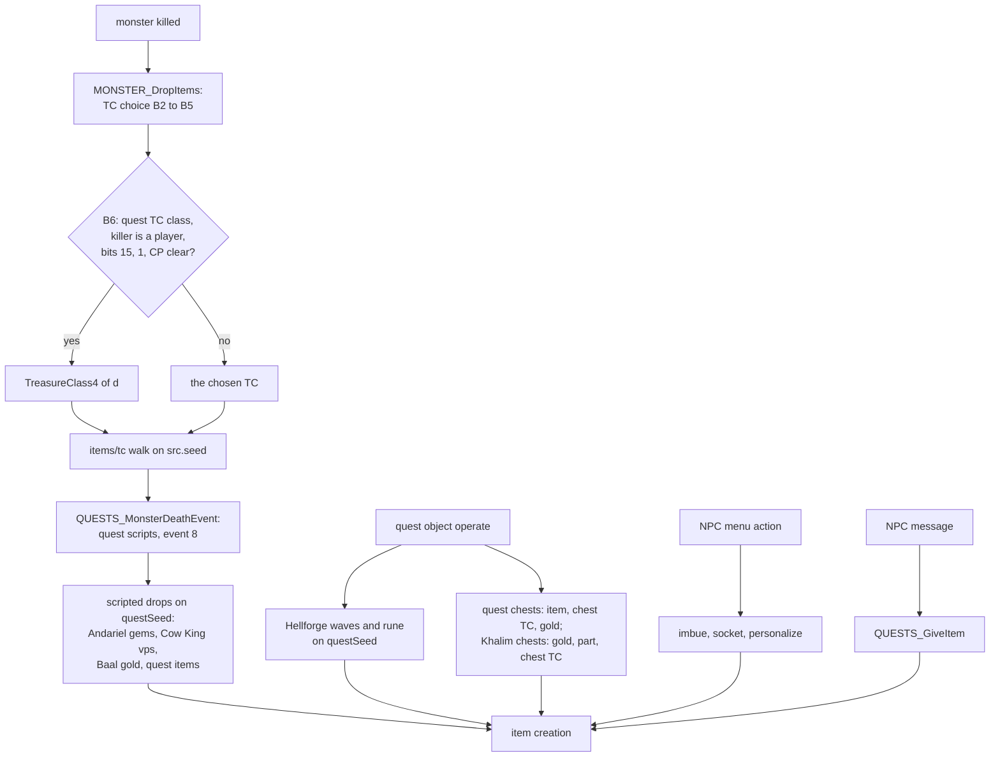
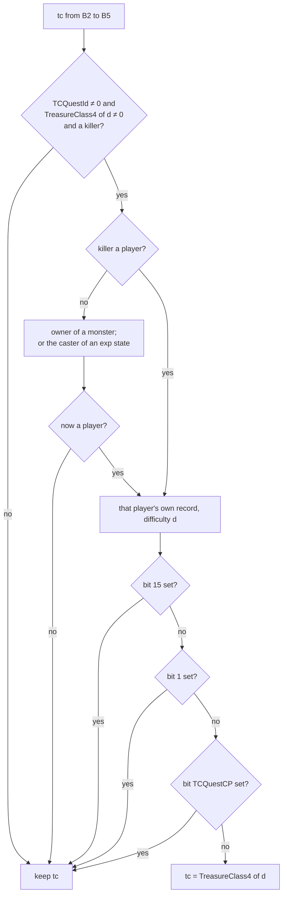
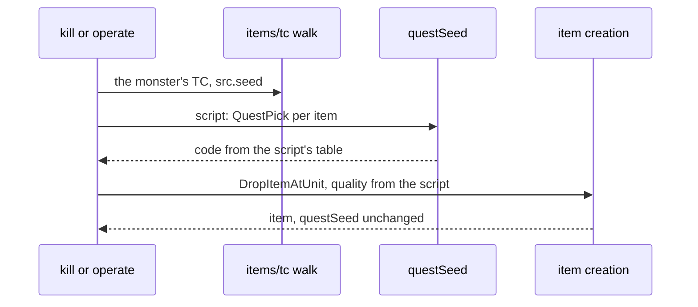
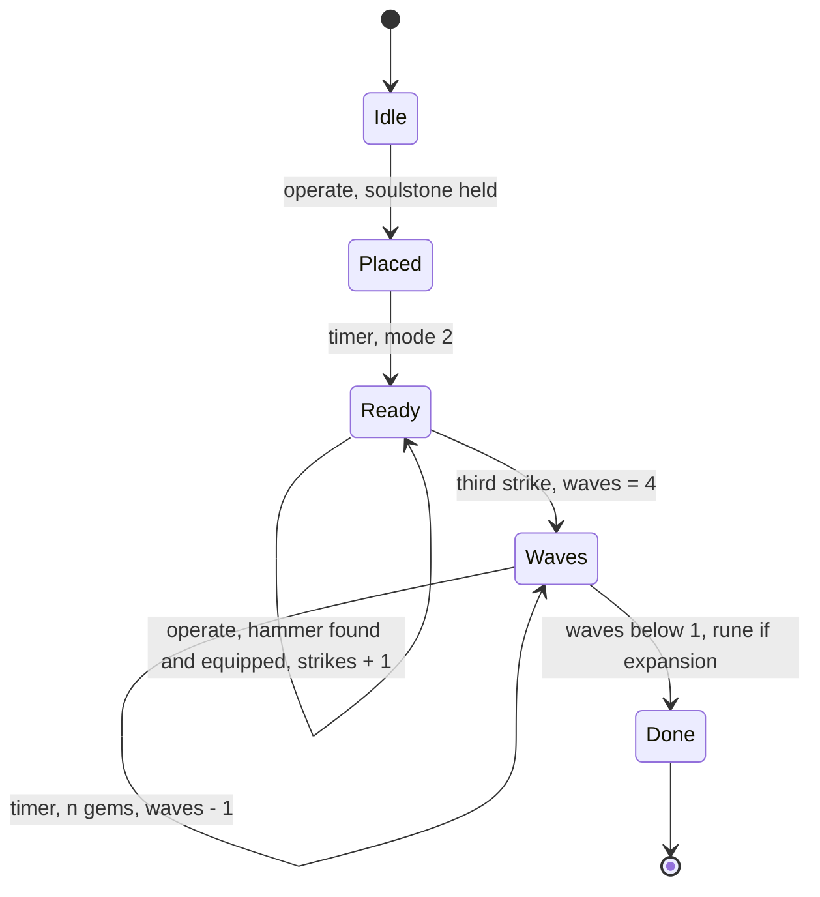
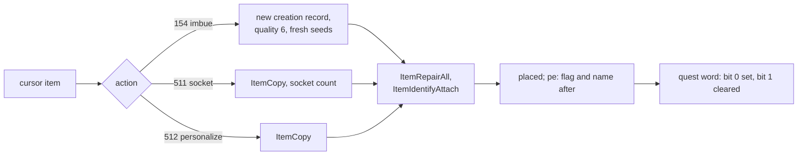
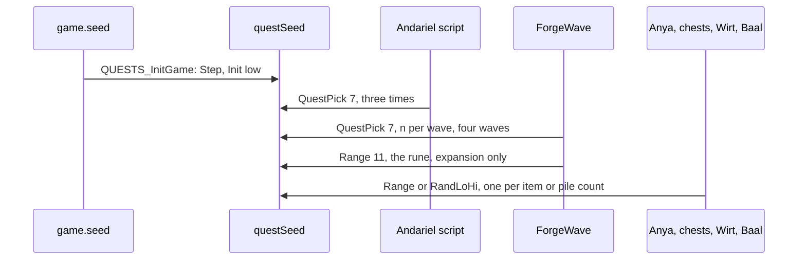

## Purpose

Quest state changes item creation in three places. (1) A kill of one of five act bosses drops from the boss's
`TreasureClass4` column instead of its usual TC while the killer's quest record says the quest is not done (step B6 of
[items/tc](../tc/#b-monster-drop-which-tc--monster_dropitems)). (2) Quest scripts create items outside the TC path:
special drops (Andariel's gems, the Hellforge's gems and rune, the Cow King's potions, Baal's gold), quest items (the
Horadric parts, Wirt's Leg, the scrolls) and gold from quest chests. Their draws are on a game-wide **quest seed**. (3)
Three NPC services rebuild an item the player hands over: Charsi's imbue, Larzuk's socket and Anya's personalization.
Other NPCs give fixed items. This spec covers what each path reads, which seed it draws, and what it hands to item
creation. When a quest bit gets set (dialogue, timers, who stands where) is game simulation and an input
here; which event sets each bit is [quests/progression](../../spec-quests/progression/).

## Entry points

| When | Function | Tag |
|---|---|---|
| A monster dies: TC choice, then the quest TC switch | → → → `MONSTER_DropItems` | [C] |
| The same death, after the drop: the quest scripts' death event (event 8) | `QUESTS_MonsterDeathEvent` → `Quest+0xC0` of each quest the monster is hooked to | [C] |
| Game creation: the quest objects and the quest seed | `QUESTS_InitGame` | [C] |
| A quest object is operated (the Hellforge, quest chests, the altar, item objects): the quest script is the object's `OperateFn` slot itself | `OBJ_OperateDispatch` → `g_ObjOperateFns[OperateFn]` (slots in § E and § D4) | [I] (§ 9) for the altar (24), the Malus (21) and the orifice (25); [C] the Hellforge's slot 49 (the only reference to `ForgeOperate`), and the slots logged on the operates: 33 Wirt's body, 12 the Inifuss tree, 28 the tome, 39–41 the cube, scroll and staff chests, 57–59 the heart, eye and brain chests |
| Object event 7, a timer some operate slots and scripts queue on a quest object (the forge's waves, Wirt's gold piles): dispatch by object class | — | [C] for classes 268 (Wirt's body →, 18 events) and 367 (the Kurast sewer lever →, one event), the logged chain; the Hellforge's (376) [C] below; [I] the other classes' targets (§ 9) |
| The Hellforge's timer, after the third strike | `QUESTS_ObjectEvent` → | [C] (the only references in the image force the event-7 route, § 9) |
| An NPC menu action: imbue (Charsi), socket (Larzuk), personalize (Anya) | `NPC_MenuAction` | [C] |
| An NPC message that gives an item (Akara, Ormus, Alkor, Meshif, Qual-Kehk, Malah, Anya) | the act scripts' NPC message callbacks → `QUESTS_GiveItem` | [C] (20 calls, each NPC's from its handler's call site) |

## Inputs

### Tables

| Anchor | Used for |
|---|---|
| `MonStats.txt:TCQuestId` (`+0x9E` u8), `MonStats.txt:TCQuestCP` (`+0x9F` u8) | the quest word and the checkpoint bit B6 tests |
| `MonStats.txt:TreasureClass4` (`+0x8C + 8·d`, u16) | the quest TC of difficulty `d` |
| `MonStats.txt:boss`, `MonStats.txt:noRatio` (`+0x00C` bits 6 and 2) | the monster-level exception of [monsters/pool § E](../../spec-monsters/pool/#e-the-monster-level-monstatsinit) (§ G) |
| `states.txt` column `exp` (flag bit 30 → bit-set `DataTables+0x144`; States) | the states whose caster takes the kill (§ B) |
| `Misc.txt:quest` (`+0x12A`), `Misc.txt:questdiffcheck` (`+0x12B`), and the same columns of Weapons and Armor | quest item identity and the difficulty check (§ E) |
| `Weapons.txt:bitfield1` (`+0xDC` bit 0), `Weapons.txt:compactsave` (`+0x143`), `Armor.txt:nameable` (`+0x145`) | the imbue and personalize tests (§ F) |
| `SuperUniques.txt:TC` | the Countess's and the Cow King's own drops (ordinary superunique TCs) |
| `Levels.txt:MonLvl2Ex`, `Levels.txt:MonLvl3Ex` | the area level a `boss` class does **not** take (§ G), and the ilvl of an object's scripted drop |

### Runtime state

| State | Type | Source |
|---|---|---|
| quest record of a player | 768 bits for the game's difficulty: `PlayerData+0x10 + 4·Game+0x6D`; "word *q*, bit *s*" is bit `16q + s` | `QUESTS_PlayerRecord` |
| `questSeed` | `Seed` at `QuestControl+0x18`, `QuestControl` = `Game+0x10F4` | `Game+0x10F4`, `QUESTS_GetSeed` |
| `game.seed` | `Seed` at `Game+0xD0` | rng/seeds |
| `d` | difficulty, u8 at `Game+0x6D` |  |
| `game.expansion` | `Game+0x70` |  |
| `game.type` | `Game+0x6A` (3 in every logged single-player game) | [items/tc](../tc/#inputs) |
| kill context | `ctx`, its killer at `ctx+8` | `MONSTER_DropItems` |
| `clvl` | the player's base stat 12 (`level`) | |
| `unit+0xB8` | the item code a scripted drop creates at a source unit (0 = a random base) | `Unit+0xB8` |
| per-player counts | how many players a script credits (the forge's `n`, Baal's and the chests' loops) | the quest scripts; an input (§ Inputs and oracles) |

### Constants

| Name | Value | Anchor | Tag |
|---|---|---|---|
| `ANDARIEL_CHIPPED` | `gcv gcr gcb gcy gcg gcw skc` | `g_AndarielChippedGems` | [C] |
| `STANDARD_GEMS` | `gsv gsr gsb gsy gsg gsw sku` (Andariel's third gem and the forge's last wave) | `g_AndarielStdGems`, `g_ForgeGemsStandard` | [C] |
| `FORGE_PERFECT` | `gpv gpr gpb gpy gpg gpw skz` | `g_ForgeGemsPerfect` | [C] |
| `FORGE_FLAWLESS` | `gzv glr glb gly glg glw skl` | `g_ForgeGemsFlawless` | [C] |
| `FORGE_RUNES[0]`, `[1]` | `r01`…`r11` (Normal), `r12`…`r22` (Nightmare) | `g_ForgeRunesNormal`, `g_ForgeRunesNightmare` | [C] |
| `FORGE_RUNES[2]` | `r15`…`r25` (Hell) | `g_ForgeRunesHell` | [C] (owner-played session 3507: entry 4 → `r19`) |
| `QUAL_KEHK_RUNES` | `r07 r08 r09` | `g_QualKehkRunes` | [C] (given in that order) |
| `ANYA_REWARDS[d]` | per class row (§ F5) | `g_AnyaRewardsNormal`, `g_AnyaRewardsNightmare`, `g_AnyaRewardsHell` | [C] (the three arrays read from the image against their reader, § S2c qd 47; each difficulty's table, the code read from it by the logged draw) |
| `INIT_HIGH` | 666 (`0x29A`), the high word of every `Init` | rng step 5 | [C] |

### Inputs and oracles

| Thing | Kind | Detail | Tag |
|---|---|---|---|
| the quest bits a test reads | input | when a script, an NPC or the save loader sets them is game simulation; the tests on them are modelled | [C] (1431 quest-bit writes, each "old" word as the earlier writes left it) |
| the per-player counts of a script | input | the forge's `n`, the players a death or chest loop credits | [I] |
| the quest seed on entry to a scripted drop | boundary oracle | quest code that creates no item also draws it, so a reimplementation asserts the seed at each drop; its start value is modelled (A1) | [C] (28 fetches, every entry seed the one the model held, no oracle value taken) |
| the item created | modelled | through the ordinary item creation of [uniques-sets](../uniques-sets/), [affixes](../affixes/) and [properties](../properties/) | [C] |

## Algorithm



### A. The quest record and the quest seed

```
A1. QUESTS_InitGame(game):                                         [C]
      for each g_QuestDescs row: a 0xF8-byte quest object (id at +0x00, callbacks at +0xA0 + 4·event)
      Step(game.seed)                                              ; one game-seed draw
      Init(questSeed, game.seed.low)                               ; questSeed ← {low, 666}
A2. QuestPick(n: u32) → u32:                                       [C]
      Step(questSeed)                                              ; draw; the LCG step inlined in the scripts
      return questSeed.low mod n                                   ; unsigned
A3. GetState(rec, q, s) = bit 16q + s of rec                        [C]
```

Step notes:

- A1. [C] In every logged game the quest seed's start was `{low, 666}` of one game-seed step taken at
  `QUESTS_InitGame`, and every scripted drop of the run found the quest seed where the model's previous draw left it.
  (`QUESTS_InitGame`: 53 starts, 28 fetches)
- A1. [C] **The step is game-seed draw 4.** Game creation steps the game seed in `MonRegionsInit` (draw
  1), `OBJRGN_Create` (draw 2), `NPCSTORE_CtlCreate` (draw 3, the store seed of [items/vendors](../vendors/)) and then
  `QUESTS_InitGame`: in all 53 sessions of the run, and in the 7 owner-played ones, the game seed at `QUESTS_InitGame`'s
  entry was exactly three steps past `Init(N)` of the session's seed (rng/seeds step 7a).

- A1. [C] `g_QuestDescs` (37 records) gives each quest object its record word at `+0x14`; object id and word are equal
  for Act I (objects 0–6) and differ after (7 → 8 … 13 → 14, 14 → 16 … 20 → 22, 21 → 24 … 24 → 27, 25 → 29, 26 → 30,
  27 → 31, 28 → 32, 29 → 33, 30 → 41, 31 → 35 … 36 → 40). This is the word `QuestsPlayerJoin` uses: it
  walks the records and reads `+0x14` as the word of its `GetState(…, 0)`, `GetState(…, 15)` and the game record's
  `SetState(…, 15)`. (`g_QuestDescs`, qd 8)
- A1. [C] **The scripts' own word is not always the table's.** Each object's init function stores a word at
  `Quest+0xE0`, and it equals `+0x14` for 35 of the 37 objects; object 28 (Act III, table word 32) stores **16**, and
  object 30 (Act I, table word 41), which shares its init function with object 25, stores **29**.
  (`QUESTS_InitGame`, qd 8)
- A2. [C] The scripts write the step inline (`s ← lo·0x6AC690C5 + hi`, the compiler's multiply-shift for `mod 7` and
  `mod 5`) or call `RNG_Range`/`RNG_RandLoHi` on the quest seed; all are `Step` then `low mod n` of
  rng step 2, and `RandLoHi(s, lo, hi)` is `lo + Range(s, hi − lo)`. The run's 28 scripted draws reproduce so; every
  inline multiply-shift constant of a quest-seed function is an exact `/ 5` (`0xCCCCCCCD`, 8 sites) or `/ 7`
  (`0x24924925`, 5 sites); `RandLoHi`'s form reproduces 7 513 store-seed draws. (`RNG_Range`,
  `RNG_RandLoHi`, qd 9)
- A3. [C] On a player's record bit 15 of a word is set by the save loader alone, from a saved bit 1 (words 0–41), and
  only word 9's script clears it; the one record-function set of bit 15 is the join's, on the game record.
  So bit 15 means "this character saved the game while bit 1 was set". The loaded quest saves of the run came back
  with exactly that bit 15 added, and the 1 626 logged writes set bit 15 only on the game record. The "only" is a
  closure over every call of the five record functions (the 378 sites, the 45 register operands read one by one, the
  12 steps clears, which stop at bit 11). Its limits: a store to a record outside those functions (the loader aside)
  is not covered, and the A3Q4 party bit is bounded by the stores in its quest's code window (bits 2, 4 and 1).


### B. The quest TC switch (items/tc B6)



```
B6. QuestTcSwitch(game, mon, ctx, tc: u16) → u16:                  [C]
      d: u8 ← game.difficulty
      row ← MonStats[mon.classId]
      q: u8 ← row.TCQuestId
      if q = 0 or row.TreasureClass4[d] = 0 or ctx = none or ctx.killer = none: return tc
      k ← ctx.killer
B6a.  if k.type ≠ 0:                                                [C] (a hireling and a summon)
        p ← MonsterOwner(k)                                         ; unit type 1 only; else none [I] (every logged non-player killer was a monster)
        if UnitHasExpState(k):                                      [I] (these three lines)
          sl ← StatListFindFlag(k, 0x800)
          if sl ≠ none: p ← GameFindUnit(game, sl.ownerType (+0x08), sl.ownerGuid (+0x0C))
        if p ≠ none: k ← p
B6b.  if k.type ≠ 0: return tc                                      [I]
      r ← QuestRecord(game, k)                                      ; k's own record for difficulty d
      if r = none: return tc
B6c.  if GetState(r, q, 15) = 1: return tc                          [C] (QUESTRECORD_GetState, all of B6c)
      if GetState(r, q, 1) = 1: return tc                           ; the tests stop at the first set bit
      if GetState(r, q, row.TCQuestCP) = 1: return tc
      return row.TreasureClass4[d]
B7.   TC_DropByIndex(game, mon, ctx.killer, tc, …)                  [C]; the unresolved killer
```

Step notes:

- B6. [C] **`TCQuestId` is the record word.** Andariel's `TCQuestId` 6 read record word 6 in every B6 group, so the
  value is used as the word number with no offset.
- B6. [C] **The drop runs before the quest scripts see the death.** `UnitKilled` sets the death mode
  first; the mode's start function drops the items at once; only then does it dispatch the
  quest death event. In every boss kill the B6 and drop lines came before the death script's bit writes
  (Andariel's `SetKilled`, Duriel's bit 5). So the bits a boss's own script sets for a
  kill never hide the quest TC of that kill.
- B6a. [C] **A pet's or hireling's kill reads the owner's record.** A hireling (the Rogue Scout, class 271) and a
  summon (the player's Hydra, `hydra2`, class 352) each killed Andariel in Normal: `MonsterOwner` gave the player, B6
  read the player's word 6 (`0x0018`, then `0x0019`) with `GetState` 15, 1, 1 all 0, and the TC was `Andarielq`
  (833) both times. Step B7 then passed the **unresolved** killer (the hireling, the Hydra) to `TC_DropByIndex`, and
reproduces both drops.
- B6a. [I] The `exp`-state path: a killer carrying a state of the `exp` bit-set (`states.txt` rows 53 `conversion`,
  57 `attract`, 59 `confuse` in the shipped data) is replaced by the owner of its first stat list with flag `0x800`,
  found by stored type and GUID. A missile is never resolved here (`MonsterOwner` answers for type 1 only). Neither
  ran: no logged killer had such a state, and in every Nova kill the killer was the player unit.

- B6a. [C] **The death event resolves the killer the same way**, so the owner gets the quest credit and the scripted
  drops. `QUESTS_MonsterDeathEvent` gives its event the player behind a monster killer: `MonsterOwnerRef`
  reads the record MonsterData `+0x28` points to and returns the owner's GUID (`+0x2C`) and type (`+0x30`) when that
  record's `+0x28` is non-zero, else GUID −1, and the event looks the unit up only for type 0,
  a player. On the hireling's kill the event's player was the owner, Andariel's script set
  the owner's word 6 bits 13 and 1 and dropped the three gems (D1).
- B6b. [I] Only the resolved player's own record is read; no other party member's record enters. No party was run,
  and no non-player killer that no step resolves (every logged one had an owner), so B6b's return is not met either.


**The quest-dependent TCs.** Exactly five classes have a `TCQuestId`, and each has all three `TreasureClass4` cells.
[C]

| class (`hcIdx`) | word | `TCQuestCP` | quest TC: Normal / Nightmare / Hell | bits the kill sets (script) | B6 tests | Tag |
|---|---|---|---|---|---|---|
| `andariel` (156) | 6 | 1 | `Andarielq` / `Andarielq (N)` / `Andarielq (H)` | 13, 1 on the killer when bits 0 and 1 are clear (`A1Q6_SetKilled`) | 15, 1, 1 | [C] |
| `duriel` (211) | 14 | 5 | `Durielq` … | 5 on the killer when bits 0, 3, 4, 5 are clear | 15, 1, 5 | [C] |
| `mephisto` (242) | 22 | 0 | `Mephistoq` … | 13, 0, 11 (`A3Q6_SetDone`) | 15, 1, 0 | [C] (returns: the fresh kill) |
| `diablo` (243) | 26 | 0 | `Diabloq` … | — | 15, 1, 0 | [I] |
| `baalcrab` (544) | 40 | 0 | `Baalq` … | — | 15, 1, 0 | [C] (returns: the fresh kill) |

**What each state of the word gives.**

| class | killer's word | TC | Tag |
|---|---|---|---|
| Andariel | clear (fresh) | quest TC | [C] (Normal) |
| Andariel | bit 0 only, bit 1 clear (reported to Warriv) | quest TC, in every later game | [C] (Normal and Hell; the game after the report) |
| Andariel | bit 1 (killed in this game, not yet reported) | normal TC | [I] |
| Andariel | bits 1 and 15 (saved before the report) | normal TC for good | [C] (the test stops at bit 15) |
| Duriel | clear, or bit 0 only | quest TC | [C] |
| Duriel | bit 5 (after the first kill) | normal TC | [C] |
| Mephisto | clear | quest TC | [C] |
| Mephisto | bit 0 (after the first kill) | normal TC (`Mephisto` 848, not `Mephistoq` 851), and no `mss` | [C] (owner-played: word 22 = `0x0001`) |
| Baal | clear (word 40 `0x0004`) / bit 0 (`0x0401`, `quests: all`) | quest TC (`Baalq` 884) / normal TC (`TreasureClass` 881, no write of word 40 at the kill) | [C] |
| Diablo | clear / bit 0 | quest TC / normal TC | [I] (not killed in any run) |

- [C] **Andariel's quest TC comes back.** Warriv's message (npc 155, `0xB7`) with bit 1 set clears bit 1 and sets bit
  0, and nothing else writes bits 0, 1 or 15 of word 6. With `TCQuestCP` 1 the test is "bits 15 and 1 clear", so after
  the report every later game gives the quest TC again; a save between the kill and the report sets bit 15 at the next
  load and ends it. After a kill (word 6 `0x201A`) the talk to Warriv cleared bit 1 (return) and set bit 0
  (return): `0x201A` → `0x2018` → `0x2019`; the save the game wrote held `0x2019`, the next game from it
  loaded `0x0019` (no bit 15, bit 1 having been clear at the save), and B6 gave `Andarielq` again.

- [C] **Duriel's bits stay.** Duriel's bit 5 is never cleared and his bit 1 is never set through the record functions:
  no constant site clears word 14 bit 5 or sets bit 1, no register site writes word 14 and no steps clear is on it, by
  the closure of A3; the only route outside those functions is the save loader. A whole-record reset outside the five
  functions is not covered.
- [I] For Diablo the "until the first kill" rests on that set site and the shared B6 path; he was not killed.

- [C] **No quest TC.** The Countess (`corruptrogue3`), the Cow King, Nihlathak (`nihlathakboss`) and every other
  class have `TCQuestId` 0: B6 never applies and their drop is their ordinary (superunique) TC. MonStats has exactly
  the five rows above with a `TCQuestId`, and the owner-played Countess and Cow King kills reached no B6 test.


### C. The two creators of scripted items

```
C1. DropItemAtUnit(game, source, quality, …):                      [C] (the monster and object sources, the code's base)
      ilvl ← source is a monster ? its stat 12
           : source is a player  ? its base stat 12                 [I] (no player source logged)
           : the area level of the object's level (Levels monster level of d and the game type), min 1
      index ← source+0xB8 ≠ 0 ? ITEMS_GetByCode(source+0xB8) : a random base   ; the random base [I]
      rec ← {ilvl (+0x0C), index (+0x14), quality (+0x30)}, at a free cell near the source   ; the free cell [I]
      ItemCreate(rec)                                              ; no quest-seed draw
C2. QUESTS_GiveItem(game, player, code, ilvl, quality, dropIfFull): [C] (QUESTS_GiveItem, ITEMS_CreateForStore: 20 calls)
      if ilvl = 0: ilvl ← clvl
      item ← ITEMS_CreateForStore(index of code, quality, ilvl)    ; kind 4, noEthereal 1
      durability ← maximum, when positive                          [I] (no given item has durability)
      into the inventory                                           ; placed
      if it does not fit and dropIfFull: dropped at the player     [I] (the inventory was never full)
```

Step notes:

- C1. [C] A creation through `DropItemAtUnit` leaves the quest seed as it found it: every scripted creation of the run
  had the same quest seed on entry and on exit; the item's own seeds come from the game seed as for any creation.
- C1. [C] The object case: the Hellforge's gems and rune took the area level of the forge's level (27 in Normal), and
  a monster's drop took the monster's level (Andariel 12, Hephasto 28 in Normal). In Hell the forge's drops took ilvl
  85, `MonLvl3Ex` of level 107, and the Cow King's potions his level 31. Over the run, 25 creations from a monster
  (Andariel's gems, the hammer, the eight `vps`, `j34`, `mss`) have the ilvl of that monster's own TC drop, and 30
  forge creations have Levels row 107's `MonLvl1Ex`/`MonLvl2Ex`/`MonLvl3Ex` (27, 57, 85) of the difficulty.
  (`Levels.txt:MonLvl1Ex`, `Levels.txt:MonLvl3Ex`,
qd 21)
- C1. [I] **An object with no level record.** For a source that is neither monster nor player, the level is
  `LevelMonLvl(level of the source's room, difficulty, expansion)`: it returns 1 for a difficulty ≥ 3, a level id ≤ 0
  or past the `Levels` count, or no record, else `MonLvl` or `MonLvlEx` of the difficulty; a unit with no room gives
  level id 0, and any value below 2 becomes 1. So an object in a level with no `Levels` record, or with a monster level
  of 0 or 1 (the towns), drops at ilvl 1.
- C2. [C] Every `QUESTS_GiveItem` creation is a fresh store-path creation (`ITEMS_CreateForStore`), as
  [items/vendors](../vendors/) uses: all 20 logged calls created their item through it (kind 4, noEthereal 1) and placed
  it in the inventory. The calls with ilvl 0 (Qual-Kehk, Malah, Alkor, Meshif) made their items at the player's
  clvl, 80.

### D. Special drops

Every special drop below is made by a quest script after the TC drop of B6/B7 (§ B, order note); each draw is one
`QuestPick` (A2) on the quest seed.



#### D1. Andariel's gems

```
D1. AndarielDeath (event 8, quest active, killer present):          [C] (all of D1)
      if killer word 6 bit 0 or bit 1 is set: no gems
      SetKilled(killer)                                            ; word 6 bits 13, 1
      repeat 2:
        i ← QuestPick(7)                                           ; draw
        Andariel+0xB8 ← ANDARIEL_CHIPPED[i]; DropItemAtUnit(quality 2, source Andariel)
      i ← QuestPick(7)                                             ; draw
      Andariel+0xB8 ← STANDARD_GEMS[i]; DropItemAtUnit(quality 2); Andariel+0xB8 ← 0
```

- D1. [C] One kill with bits 0 and 1 clear drew two chipped picks and one standard pick (`gcy`, `skc`, `gsg`); the
  kills with bit 0 or bit 1 set drew nothing. The gems' ilvl is Andariel's level.
- D1. [C] The same in the four difficulty and game-type states run: the script has no difficulty or expansion test, and each fresh
  kill drew two chipped picks and one standard pick, one `low mod 7` step each, in expansion Normal (three kills, one
  by the hireling: the owner's gems, B6a), Nightmare and Hell and in classic Normal. All six games started from one map
  seed and so one quest seed, and all drew `gcr`, `gcy`, `gsb`; the ilvl was Andariel's level of the difficulty (12,
  49, 75). The Hydra's kill on a reported word (bit 0 set) drew none.
- D1. [I] Later per-player callbacks set bits 13 and 1 for players in level 37 and the killer's Act I party without
  drawing; no party was run.

#### D2. The Countess

- [C] Her death script (`A1Q5_CountessDeath`, quest hook 5) creates no item and makes no quest-seed draw.
  Her drop is her superunique TC, whose tree holds the rune picks, and no quest state enters it: one owner-played kill
  in each of the four states (word 5 clear or bit 0 set, Normal and Nightmare) dropped from `Countess` (1004) in both
  Normal games and `Countess (N)` (1005) in both Nightmare games, with no B6 test reached (class 45 has `TCQuestId` 0),
  no quest-seed fetch and no scripted creation, every drop reproduced.

- [C] In the not-done games word 5 got bits 13 and 0 and a clear of bit 1 **after** the drop, from the per-player code, which tests word 5 bit 0 and the player's level (25); in the done games word 5 was not
  written.
- [I] Hell (`Countess (H)`) is the same by the code (her class's `TCQuestId` 0 holds in every difficulty); not run.


#### D3. The Cow King and the cows

- D3. [C] One owner-played kill by a qualifying player (word 40 bit 0 set, word 4 bit 10 clear): the Cow King's own
  superunique TC (`Cow King`) dropped first, as for any kill; then killer word 4 bit 10 was set, the
  per-player code set it again, and eight `DropItemAtUnit` calls with code `vps ` and quality 0 ran on an
  unchanged quest seed. The potions came out with **quality 2** and ilvl 31, the Cow King's level: the quality-0
  request yields a quality-2 item.
- D3. [I] **Why quality 2.** Quality 0 in the record makes `ItemRollQualityCreate` run its drawing body (its early return
  needs a non-zero `+0x30`): it draws on the item seed, reads `ITEMRATIO_Select`, and writes its result first. Then the
  pre-switch overrides run: `vps` is of type `spot`, whose
  `Normal` is 1, so the last override writes 2 whatever the roll gave, and the switch takes case 2, the normal builder.
  The roll's draws are checked by no log.
- D3. [I] `done` is bit 0 of the word: the bit Diablo's death script sets in word 26 and Baal's in word 40 (§ B), so a
  killer qualifies once Diablo (classic) or Baal (expansion) is killed in that difficulty. The two refusals (bit 10
  already set; Baal not done), the no-killer case and the classic word 26 test were not run. Word 4 bit 10 is the bit `CUBE_CowPortalOpen` refuses on.


#### D4. The Hellforge



```
D4. ForgeOperate(forge, player), word 27 bits 0 and 1 clear:       [C] (all of D4)
      if forge mode 0 and PlayerFindItemByCode(player, 'mss '): remove it; forge → mode 1 (a timer brings mode 2)
      else if forge mode 2 and PlayerFindItemByCode(player, 'hfh ') and the right-hand weapon is 'hfh':
        strikes += 1
        if strikes = 3:
          remove 'hfh'; player word 27 bits 13, 1; waves ← 4; n ← 1
          for each other player in Act IV with word 27 bits 0 and 1 clear: bits 13, 1; n += 1     ; input count
          timer 7 after Objects+0xE4 >> 8 frames
D5. ForgeWave (timer), forge active:                               [C] (all of D5)
      table ← waves = 4 ? FORGE_PERFECT : waves ≥ 2 ? FORGE_FLAWLESS : STANDARD_GEMS
      repeat n:
        i ← QuestPick(7)                                           ; draw
        forge+0xB8 ← table[i]; DropItemAtUnit(quality 2, source forge)
      if any item was created:
        waves ← waves − 1
        if waves < 1:
          forge inactive
          if game.expansion:
            r ← Range(questSeed, 11)                               ; draw
            forge+0xB8 ← FORGE_RUNES[d][r]; DropItemAtUnit(quality 2)
        else: timer 7 after 20 frames
```

- D4. [C] The strike test needs both: `PlayerFindItemByCode('hfh ')` finds a hammer, and the equipped right-hand weapon
  is `hfh`. `hfh` has `questdiffcheck` 1, so a hammer whose stat 356 is below the difficulty is not found: in Nightmare
  a stat-356-0 hammer counted no strike and a stat-356-2 hammer did.
- D4. [C] **The boundary is `≥`.** In the owner-played Hell session (difficulty 2) a soulstone and a hammer with stat
  356 = 2 were both found: the soulstone was placed and three strikes counted. That equality rules out `>`; the
  Nightmare cases (356 = 2 found, 356 = 0 refused) rule out `=` and no test. It is the code's signed
  `difficulty ≤ stat` jump on the inventory walk; the cursor branch has the same compare.

- D4. [I] **The two branches test different flags.** The cursor item, when its code matches, is returned unless its
  record has `quest` ≠ 0 **and** its stat 356 is below the difficulty; `questdiffcheck` is not tested there. A cursor
  item that fails falls through to the inventory walk, which skips page 1 and returns a match when `quest` = 0, or
  `questdiffcheck` = 0, or stat 356 ≥ the difficulty. A missing stat reads as 0 (no stat list, a stat out of range or
  with no record, no entry). So a quest item with neither `questdiffcheck` nor stat 356 counts on the cursor only in
  Normal: the cube (`box`, the only stock `quest` row with `questdiffcheck` blank) held on the cursor is found in Normal
  and not in Nightmare or Hell, while in the inventory it counts in every difficulty. An item with `questdiffcheck`
  carries stat 356 = its difficulty, so both branches agree for it.
- D5. [C] Six operations (three Normal, two Nightmare, one Hell, one player each, so `n` = 1) made 24 waves in the
  order perfect, flawless, flawless, standard and six runes from the difficulty's table (`r03 r07 r10` Normal, `r13
  r19` Nightmare, `r19` Hell: `Range(11)` = 4, the fifth entry of `r15`…`r25`), all quality 2. So the rune table is
  chosen by the difficulty in all three.
- D5. [I] A classic game gets no rune; with more than one credited player each wave makes `n` gems, one draw each.
  Neither was run.
- D4. [C] **The hammer.** Hephasto's death callback (`A4Q3_HammerDrop`, quest active) drops `hfh` with
  quality 7 and makes no quest-seed draw: 11 hammers in the scripted sessions, one in the owner-played Hell session.

#### D6. Baal's first kill

```
D6. BaalDeath, killer present, killer word 40 bit 0 clear:          [C] (one player, Normal)
      for each qualifying player counted by the per-player callbacks (+0x88):      ; input count
        amount ← RandLoHi(questSeed, 6000·d + 1500, min(6000·d + 3000, 0xFFFF))   ; draw: 6000d + 1500 … 6000d + 2999; d > 0 [I] (Normal only)
        DropGold(amount) at Baal                                   ; up to 32 piles; one for any Baal amount [I] (one pile logged)
```

- D6. [I] `DropGold` is `DropGoldAmount(amount, 32)`: piles of at most 2 000 000 000, at
  most 32, each a gold item made by `ITEMS_CreateForStore` whose stat 14 is set to its share, so each
  pile draws as an item creation ([items/economy § G](../economy/#g-gold-payment-caps-piles-and-the-death-loss), G9).
  Any Baal amount (at most 15 000) is therefore one pile; Nightmare and Hell and several players were not run.


#### D7. Scripts that create nothing, and Uber Tristram

- [C] Diablo's death script and the Nihlathak and Ancients scripts (a5q4, a5q5) call none of the item creators: the
  direct-call walk from Diablo's death function and from every callback of the a5q4 and a5q5 objects, stopped at the
  engine entries they call (`MonSetMode`, `PortalObjectCreate`, `SUnitCreate`, `UnitKilled`, `PLAYER_LevelUp`),
  reaches no item creator. Through those engine entries it does reach creators (a new monster's equipment, room
  restores, a level-up's items), which are not the scripts' drops. (qd 28)
- [I] So their drops are their TCs (Diablo's through B6); Diablo was not killed in any run, and no kill of the others
  is compared here.
- [C] **The death handler's class map** (mod 22, event 1, `g_UModEventFns[6·22 + 1]` =): over all 734 classes in mode 0, classes 704, 705 and 709 and no other reach `UberTristramDrop`; the classes 156, 229, 242, 256, 267, 479 and 540–542 have their own callee, the rest none; any other mode none. Each case ends at the arm's callee or the return, and the handler's byte and jump tables are read from the image, so this is the code against its own tables with the arms' call sites as the check.
- [C] **The drop's flags and first call:** class 709 sets `Game+0x1DE8`, 705 `+0x1DEC`, 704 `+0x1DF0`; while any of the three is zero it returns; with all three non-zero the unit's `+0xB8` becomes `cm2 ` and `DropItemAtUnit(game, unit, 7, &ilvl, 0, −1, 0)` runs; any other class, and a null unit, takes the fatal line path 0xE6. The case ends at that call. Neither `[C]` above implies reach, and neither covers `DropItemAtUnit` itself.
- [I] After that call: `cm2`'s quality 7 means charges refilled, and `Game+0x8C` copies of `std` with quality 2 follow. The portals to those levels cannot open
  in this `Game.exe`, and no creator of the three classes was found in this image, within the limits
  of [monsters/special § J](../../spec-monsters/special/#j-other-entry-paths-and-pre-existing-mods), so on this reading stock play does not reach it.


### E. Quest items

| item | source | the script's gate | count | quality asked (created) | draws | Tag |
|---|---|---|---|---|---|---|
| `leg` | its object's operate | object not yet used (mode 0) | 1 | 2 | — | [C] the creation in mode 0, on the unchanged quest seed; [I] the used-object half (no second operate was reached) |
| gold | Wirt's body (object 268) | first operate | `RandLoHi(questSeed, 10, 20)` piles (10–19), one per timer ([items/economy](../economy/#g-gold-payment-caps-piles-and-the-death-loss) G8a) | 2 | 1 | [C] (18 piles on another quest seed, the count `RandLoHi` gives on it) |
| `bks` | the Inifuss tree | word 4 bits 0, 1 clear, no `bks`/`bkd` held | 1 | 2 (7) | — | [C] the creation with word 4 clear and neither held, no draw; [I] the refusals |
| `bkd` | Akara (npc 148), for `bks` | — | 1 (`GiveItem`) | 2 | — | [I] |
| `hdm` | the Malus object | word 3 bits 0, 1 clear, clvl ≥ 8 | 1 | 2 | — | [I] |
| `ass` | Radament's death | per player with word 9 bit 5, no `ass` held | per player | 2 (7) | — | [C] the creation at Radament's death; [I] the gate's refusals |
| `tr1` | its chest | per player with word 10 bits 0, 3 clear | per player (identified) | 7 | chest § E1 | [C] the creation, identified, quality 7, item flag `0x10`; [I] the word-10 refusals |
| `msf` | its chest | per player with word 10 bit 0 clear, no `msf`/`hst` | per player (identified) | 7 | chest § E1 | [C] the creation in Normal, and in Nightmare with a Normal staff held; [I] the refusals by word 10 or a held `msf`/`hst` of the difficulty |
| `box` | its chest | per player without `box` | per player | 2 | chest § E1 | [C] created without a cube, refused with one in the inventory |
| `vip` | the altar (object 149 `taintedsunaltar`, operate slot 24) | not (word 11 done and (word 10 done or `vip`/`hst` held)) | per player (identified) | 7 | chest § E1 | [I] |
| `bbb` | its object | word 17 bit 0 clear | 1 | 2 (7) | — | [C] the creation with word 17 clear, on the unchanged quest seed; [I] the word-17 refusal and a used tome |
| `qhr`, `qey`, `qbr` | their chests | per player holding neither the part nor `qf2` | per player | 2 | chest § E1b | [C] all three, the gate passing; [I] the refusal of a held part or `qf2` (read) |
| `g33` | a dying monster (unique or flagged) | quest flag armed | 1 | 2 | — | [I] |
| `j34` | a dying monster | killer word 19 bit 0 clear | 1 | 2 (7) | — | [C] five creations at kills by a player with word 19 = 0; [I] the refusal |
| `g34`, `xyz` | npc 264 (Meshif) for `j34`; Alkor (npc 254) for `g34` | word 20 states | 1 each (`GiveItem`, clvl) | 2 (`g34` 7) | — | [C] `g34` given with `j34` held (Nightmare), `xyz` with word 20 bit 1 set, each at clvl; [I] the other word-20 states |
| `qf1`, then `box` | the council's deaths | counted players | per player | 7, 2 | — | [I] |
| `mss` | Mephisto's death | killer word 22 bit 0 clear (+ counted players) | per player | 2 (7) | — | [C] the fresh kill created it, the kill with the quest done none (return) |
| `hfh` | Hephasto's death callback | quest active | 1 | 7 | — | [C] |
| `ice`, `tr2` | Malah (messages) | word 37 states; no `ice` held | 1 each (`GiveItem`, clvl) | 2 (`tr2` 7) | — | [C] `tr2` in Normal, Nightmare and Hell; [I] `ice` (offered only in a quest state no run reached, F4) |

- [C] **The quality column is the asked quality.** `ass`, `bks`, `bbb`, `j34`, `mss`, `tr2` and `g34` are asked at
  quality 2 and come back at 7 (the creation's `ICQ` line: rq 2, q 7); `box`, the Khalim parts, `leg` and `xyz` come
  back at the asked 2.
- [C] The 7 is the base `unique` pre-switch override of `ItemCreateByQuality` (every base that came back 7 has Misc
  `unique` 1) for `j34` and `mss` (us 13) and for `tr2` and
  `g34`, which `xyz` separates from the `quest` column: a `ques` item with `quest` 19 and `unique` 0, it kept 2.

- [I] For `ass`, `bks` and `bbb` the override is the cause by the same reading; their runs logged the 7, not a
  separating case.

```
E1. An Act II quest chest's or the altar's operate (tr1, msf, box, vip):   [C] tr1, msf, box; the altar [I]
      the quest item(s) of the table row                           ; one per player the gate passes
      ObjectChestDrop(…)                                           ; the chest's ordinary TC drop, objects § J3
      k ← 5 + QuestPick(5)                                         ; draw: 5 … 9
      repeat k: DropItemCodeAt('gld ', quality 2)
E1b. A Khalim chest's operate (qhr, qey, qbr):                     [C] all three
      k ← 5 + QuestPick(5)                                         ; draw: 5 … 9, first
      repeat k: DropItemCodeAt('gld ', quality 2)
      n ← players holding neither the part nor qf2                 ; the refusal [I]
      repeat n: DropItemAtUnit(part, quality 2)
      ObjectChestDrop(…)
```

Step notes:

- E1. [C] **The Act II chests: the item, then the chest drop, then the gold.** Five operates with the chest in mode 0
  logged, in this order, the quest item's `DropItemAtUnit` when its gate passed, `ObjectChestDrop`, one
  `QUESTS_GetSeed`, then `k` gold piles, `k` being `5 + QuestPick(5)` on the logged quest seed: 9 for `tr1`, 5 twice
  for `box`, 9 twice for `msf` (three distinct seeds). A player the gate refuses does not stop the rest: with a cube
  held, `box` was not made and the chest drop and the 5 piles still ran. The operate slots are 39 (`box`, class 354),
  40 (`tr1`, 355) and 41 (`msf`, 356).
- E1b. [C] **The Khalim chests draw their gold first.** Each logged `QUESTS_GetSeed`, `k` gold piles (the count on its
  logged seed: 8 for the heart, 5 for the eye, 7 for the brain chest), the callback's `PlayerFindItemByCode` for the
  part and for `qf2` (neither found), the part (quality 2, created at 2), then `ObjectChestDrop`; slots 57 (heart,
  class 405), 58 (eye, 407) and 59 (brain, 406). E1's order does not hold for these three.
- E1b. [I] The callbacks count a player who holds neither the chest's part
  (`qhr`, `qey`, `qbr`) nor `qf2` (Khalim's Will); no session held either, so the refusal is this reading.
- E1. [I] **A quest chest opens once.** Every chest script (`box`, `tr1`, `msf`, the three Khalim chests) first calls
, which stops the script when the object's mode (`+0x10`) is not 0 and otherwise sets the mode to 1 or
  2. So a chest reopened in the same game creates nothing, gold included.
- [C] **Duplicates and the difficulty.** A quest item (`quest` ≠ 0) whose base has `questdiffcheck` counts only when
  its stat 356 is ≥ the game's difficulty. So a Normal staff does not stop a Nightmare chest from making a
  new one: with a Normal `msf` (stat 356 = 0) held in a Nightmare game, the chest's `PlayerFindItemByCode('msf ')`
  read 0 against difficulty 1 and found none, and the chest made a new `msf`. The cube (`box`, `questdiffcheck`
  blank) does stop one: a held cube refused `box` in Normal.
- [I] **Duplicates** are refused only by each script's own test: its quest bits, or "the player already has the item".
  That test is `PlayerFindItemByCode`, over the cursor item and the inventory (not page 1). The "only",
  the cursor branch and the cube in Nightmare or Hell were not run. `ItemInitStats` gives every created
  item with `quest` ≠ 0 and `questdiffcheck` ≠ 0 stat 356 = the difficulty, so an item made in a difficulty counts
  there; the held staff of the run came from a tool-built save, so that write is this reading.

- [C] **`quest` − 1 is a quest object id, not a record word.** Every reader subtracts 1 and looks the object up by id
  (`QuestsInvItemEvent` sends event 9 to it; `ItemQuestHook` hooks the item to it), and the
  pair table `{word, quest}` of `ItemQuestGate` matches `g_QuestDescs` for all four pairs. So `hfh`
  (`quest` 25) names object 24, word 27; `mss` (23) names object 22, word 25, not Mephisto's word 22.
- [I] **The item-move gate** `ItemQuestGate` refuses, for the player's record of the game's difficulty: a
  unique quest item whose unique row has `+0x2C` bit 2 when returns non-zero; `ass` while word 9 bit 5
  is clear; `j34` once word 20 bit 0 is set; `xyz` while word 20 bit 5 is clear; `g33` once word 19 bit 7 or 8 is set;
  `tr2` while word 37 bit 8 is clear or once bit 7 is set; then by object `quest − 1`: object 9 when word 10 bit 0 is
  set (not `box`), object 4 when word 4 bit 0 is set, otherwise the pair table's word bit 0; finally when
  is non-zero for this or any other player. Its four callers are item-move paths, the ground pickup among them (the
  call, after the test that the item lies on the ground). The cases above do not tell which word each
  branch reads (every word bit 0 was set); the `xyz`, `g33` and `tr2` tests, the unique-row branch and the tail's
  other-player half did not run.
- [I] ** is "the inventory already holds this quest item or this carry-one unique".** It walks the
  inventory, skipping the item X itself, and returns 1 for: when X is a unique whose `UniqueItems` row has `carry1`, an
  item of quality 7 with the same row (not on page 1); or an item not on page 1 whose `quest` equals X's (non-zero) and
  whose code is X's, or pairs with it: `j34`/`g34`, `bks`/`bkd`, `d33`/`g33`, `hst`/`msf`, `hst`/`vip` (either way), or
  `qf2` with `qf1`, `qhr`, `qey` or `qbr`. So the gate refuses a second copy, and a quest item whose finished form (the
  Horadric Staff, Khalim's Will) is held.
- [I] Per-player loops (`GameForEachUnit`) visit every player unit of the game except one in state 7
  (`playerbody`), wherever it stands; party loops (`PartyForEach`) visit one party.
- [C] Placing the Horadric Staff: `A2Q6_StaffPlaced` sets word 10 bit 0, then bit 13 (returns; the constant sites); it worked in a game whose word 14 bit 0 was already set.

- [I] The orifice operate opens the one-item box when the player holds `hst` (no operate without `hst` was logged),
  and `StaffPlaced` credits the party.

### F. NPC item services and given items

`NPC_MenuAction(game, action, npcGuid, itemGuid)`, player in EDX; the item is the player's cursor item, consumed by `CursorItemConsume`. [C] (`NPC_MenuAction`: in all 18 services the consumed item was the player's cursor item, `[[player+0x60]+0x20]`, and the call returned 1)

- [I] The client code refuses an unidentified item, then calls the test of the window's NPC
  (154, 511, 512); these are the tests' only callers besides `NPC_MenuAction`,
  so a refused item never reaches the server in stock play.



#### F1. Charsi's imbue (action 154, word 3 bit 1 set)

```
F1. Imbue(player, item):                                          [C] (NPC_MenuAction: the `ilvl > 5` bound and the ethereal flag; all of F1 but the refusal and the personal name)
      if not ItemCanImbue(item): refuse (message 7), the item goes back   [I] (not reached: the client refuses first)
      rec ← ItemCreateRecFromItem(item)                            ; same base index, quality, flags +0x44, durability, …
      rec.flags80 |= 0x20 | (item is ethereal ? 0x04 : 0x02)       ; staff-mod bonus; force ethereal / no ethereal roll
      keep the personalized name if item flag 0x1000000            [I] (NPC_MenuAction; no logged imbue had a personalized item)
      CursorItemConsume(item)
      rec.quality ← 6
      ilvl: i32 ← max(clvl, 1)
      if ilvl > 5: ilvl ← ilvl + 4
      rec.ilvl ← ilvl
      new ← ItemCreate(rec)                                        ; restore 0: unit and item seeds from game.seed
      repair, identify (F0); place in the inventory or drop      ; the repair is a no-op when the new item is unidentified (F0)
      ImbueDone: word 3 bit 0 set, bit 1 cleared
```

- F1. [C] **The `ilvl > 5` bound and the ethereal flag.** An ethereal normal `cap` imbued at clvl 5 got record ilvl 5
  (no + 4) and flags `+0x80` = `0x24`, and the new rare (quality 6, ilvl 5) was ethereal; Wirt's Leg imbued at clvl 6
  got ilvl 10 and flags `0x22`, not ethereal. With the clvl-80 imbues (ilvl 84) the bound is met on both sides.

- F1. [I] On stock data the Malus needs clvl ≥ 8 (§ E), so the `clvl ≤ 5` branch is reached only by an imbue state
  made otherwise (the run's saves were tool-built). Flag `0x02` skips the ethereal roll and `0x04` forces it; `0x20` gives staff mods a bonus of the ilvl.
- F1. [C] **`ItemCanImbue`'s refusals, in code order:** a base without `bitfield1` bit 0 (`key`, `hdm`),
  a quest item other than `leg` (`qf1`; `leg` passes), an item holding an item (a `cap` with a socketed gem), a
  socketed item (`0x800`), and qualities 4–8 (magic, set, rare, unique, crafted); low and superior `cap` (1, 3) pass. An
  item failing two tests stops at the first (the `cap` holding a gem has `0x800` too; `hdm` stops before the quest
  test). The throwable test is skipped for every logged item: each had unit `+0xC8` bit 25 set, no call of
  `ItemTypeThrowable` was made, and throwing knives (`tkf`) passed. (`Weapons.txt:bitfield1`: 22 imbue tests)
- F1. [I] The test also refuses `ITEMS_GetType` 4, item flag `0x1000`, quality 9 and, when unit `+0xC8` bit 25 is
  clear, a throwable (ItemTypes `+0x10`); none was reached, and what sets bit 25 is not read. So only low, normal and
  superior bases (1–3) are imbued.
- F1. [I] **`ITEMS_GetType` = 4 is `gold`**: it returns the record's own `type` (`+0x11E`), and ItemTypes row 4 is
  `gold` (rows 5–7, `bowq`, `xboq`, `play`, are the types the personalize test refuses). **Item flag `0x1000` marks a
  monster's own equipment**: `ItemCreate` copies it from the creation record, and `MonEquipItemCreate` sets it on each
  item it makes and equips on a monster; besides the three service tests, the trade test refuses a non-quest item with
  it.
- F1. [I] **The imbue record's `+0x40` reaches no builder.** In the creation path only the set pick and the unique
  builder read record `+0x40`; `ITEMS_BuildRare` reads the record for its staff mods and forced affixes but not `+0x40`
  (an operand scan of the creation, fallback, staff-mods, affix and rare-name code finds no other reader). The imbue
  writes quality 6, which an override can change only to 4 or 7. [C] No imbued item takes the unique path: every stock base with the `unique` flag is a
  `quest` item other than `leg` or has `bitfield1` bit 0 clear (`std`), so `ItemCanImbue` refuses it. (data check,
  `Weapons.txt:unique`, `Misc.txt:bitfield1`)
- F1. [C] The service tests word 3 bit 1 only: the imbue branch makes one quest test, `GetState(rec, 3, 1)`, and the run's reward saves had bit 15 beside bit 1 (the loader's copy) and were served 17 times.


#### F2. Larzuk's socket (action 511, word 35 bit 1 set)

```
F2. QuestSocket(player, item):                                    [C]
      if not ItemCanQuestSocket(item): refuse                      [I] (not reached: the client refuses first)
      copy ← ItemCopy(item)                                        ; two game-seed steps, items/cube § K
      CursorItemConsume(item); copy.flags |= 0x800
      max: i32 ← ItemMaxSockets(copy)
      q ← copy.quality
      if q = 4:      n ← 1 + RangeB(copy.itemSeed, min(max, 2))     ; one draw, made even when the bound is 1
      else if 5 ≤ q ≤ 9: n ← 1                                     ; set, rare, unique, crafted, 9 (max ≥ 1); 9 [I], no stock item
      else:          n ← max                                       ; low, normal, superior
      ITEMS_SetSockets(copy, n)                                    ; sockets-runewords § F1 caps
      repair, identify (F0); place
      SocketDone: word 35 bit 0 set, bit 1 cleared
```

- F2. [C] The magic branch: 15 sockets of magic caps (`max` 2), one `RNG_RangeB(item seed, 2)` each on the copy's
  item seed `{start, 666}`, `n = 1 + r` (1 eight times, 2 seven times), and stat 194 after `ITEMS_SetSockets` equal
  to `n`.
- F2. [C] The other branches, one socket each on a `max`-3 base: low, normal (a `ghm` and Wirt's Leg) and superior
  got `n` = 3; set (*Sigon's Visor*), rare, unique (*Howltusk*) and crafted got 1, with no draw on the item seed. So a
  crafted item asks for 1, and Larzuk does not reach the crafted cap of
  [sockets-runewords § F](../sockets-runewords/#f-socket-counts-the-two-setters) above 1.
- F2. [C] `ItemCanQuestSocket` refused, in code order, a quest item other than `leg` (`qf1`; `leg`
  passes), a broken item (`0x100`), an item holding an item, a socketed item (`0x800`) and a base with
  `ItemMaxSockets` 0 (`lbl`, `aqv`).
- F2. [I] It also needs no item flag `0x1000`, `ITEMS_GetType` ≠ 4 and 0 sockets now; none was reached (no stock state
  has sockets with flag `0x800` clear).

#### F3. Anya's personalization (action 512, word 38 bit 1 set)

```
F3. Personalize(player, item):                                    [C] (NPC_MenuAction, all of F3 but the refusal)
      if not ItemCanPersonalize(item): refuse                      [I] (not reached: the client refuses first)
      copy ← ItemCopy(item); CursorItemConsume(item)
      repair, identify (F0); place the copy
      copy.flags |= 0x1000000; copy.name (ItemData+0x4A) ← the player's name   ; after the placement
      PersonalizeDone: word 38 bit 0 set, bit 1 cleared
```

- F3. [C] 15 personalizations: each copy got flag `0x1000000` and the player's name, written after the copy was placed;
  no affix or seed is touched by the service itself.
- F3. [C] `ItemCanPersonalize` refused base types 5 and 6 (`aqv`, `cqv`), a broken item (`0x100`), an
  item already personalized, a `compactsave` base (`gsv`) and a base with `Nameable` 0 (`jew`), and accepted the rest.

- F3. [I] It also needs no flag `0x1000`, `ITEMS_GetType` ≠ 4 and base type ≠ 7 (ears); none was reached.


#### F0. The shared tail

- [C] Before the result is placed, each of the three services calls `ItemRepairAll`, then
  `ItemIdentifyAttach`, in that order (18 of each; a scroll's identify, which also ends there, is [items/use H1](../use/#h-the-other-kinds)). The repair refilled a throwable stack to its maximum
  (throwing knives 20 → 160 and 30 → 160, `maxstack` 160) and the durability (1 → 4, 2 → 4 of 4); the identify left
  every item identified.
- [I] The repair also refills charges and clears the broken flag, and the identify attaches socketed children; the
  run's one gem-holding item carried its child into the call already, so these are not separated.

  66. Why the leg's rare is identified at creation is not read.

#### F4. Given items (`QUESTS_GiveItem`)

| NPC (quest word) | item | ilvl | quality | draws | Tag |
|---|---|---|---|---|---|
| Akara (npc 148, word 4) | `rin` | 7 / 30 / 60 (Normal / Nightmare / Hell) | 4 / 6 / 6 | — | [C] |
| Ormus (npc 255, word 19) | `rin` | 21 / 35 / 75 | 6 | — | [C] |
| Qual-Kehk (npc 515, word 36) | the first *n* of `r07 r08 r09` | clvl | 2 | — | [C] |
| Malah (npc 513, word 37) | `ice`, `tr2` | clvl | 2 (`tr2` created 7, § E) | — | [C] `tr2` in the three difficulties; [I] `ice` (note below) |
| Anya (npc 512, word 37) | a class item (F5) | clvl | 6 | one `Range(questSeed, count)` | [C] |

- F4. [C] Qual-Kehk: `n` = 2 when word 36 bit 6 is set, else 1 when bit 7 is set, else 3; given once word 36 bit 1 is
  set (then bit 0 set, bit 1 cleared). Bit 6 gave 2 runes, bit 7 one, neither (bit 5) three, in the order of the
  table, and bit 0 was set and bit 1 cleared each time.
- F4. [C] Akara's and Ormus's rings take a fixed ilvl per difficulty, not the player's level: 7 / 30 / 60 and 21 / 35
  / 75 for a clvl-80 player.
- F4. [I] The Ancients and Nihlathak give no item: their scripts call no item creator (D7), and no talk to them was
  run.
- F4. [I] **Malah's potion is offered only in quest state 4.** Her talk table offers message 3 (the potion) only when
  the quest object's state `+0x0C` is 4, no `ice` is held and the potion count `+0xD8` is 0; with word 37 clear the three talks gave other messages and no potion. What sets state 4 is
  not read.

```
F5. Anya's Prison-of-Ice item: word 37 bit 1 set, bits 0 and 10 clear:   [C] (game type 3)
      t ← Normal
      if d = 1 and (game.type = 3 or clvl > 45): t ← Nightmare    ; the clvl halves [I]
      if d = 2 and (game.type = 3 or clvl > 65): t ← Hell
      row ← ANYA_REWARDS[t][player class 0..6]
      code ← row[Range(questSeed, count of row)]                  ; draw
      QUESTS_GiveItem(code, ilvl clvl, quality 6)
```

- F5. [C] Rows: Normal `am1`–`am5`, `ob1`–`ob5`, `ne1`–`ne5`, `pa1`–`pa5`, `ba1`–`ba5`, `dr1`–`dr5`, and `ktr wrb axf
  ces clw btl skr`; Nightmare the `…6`–`…a` codes and the `9…` katars; Hell `…b`–`…f` and the `7…` katars (the three
  arrays read from the image against their reader). `game.type` is 3 in every logged single-player game, so single
  player always takes the difficulty's table: in each difficulty the logged table was that difficulty's, the code was
  entry `r` of the Sorceress row (5 entries), and `r` = `Range(questSeed, 5)` on the logged seed (3, 2, 0); then word
  37 bits 9, 0 and 10 were set and bit 1 cleared.
- F5. [I] The `clvl > 45` / `> 65` halves apply only to a game type other than 3, which single player does not give.


### G. The `boss` level exception (monsters/pool E4)

- [C] A class with MonStats `boss` keeps `Level(N)`/`Level(H)` in an expansion Nightmare or Hell game, by the byte
  test `MonStats+0x00C & 0x40` next to the `noRatio` test `& 0x04`: Andariel was created at
  level 49 in Nightmare (`MonLvl2Ex` of level 37 is 43) and 75 in Hell (`MonLvl3Ex` 73)
  reproduced both with every other monster level of those games. The rest of the level step is
  [monsters/pool § E](../../spec-monsters/pool/#e-the-monster-level-monstatsinit).
- [C] The other `boss` classes take the same test. In expansion Nightmare games four more kept `Level(N)` where the
  area level differs: Blood Raven 43 (`MonLvl2Ex` 36), Radament 49 (44), Mephisto 59 (55) and Nihlathak 70 (64), with
  Andariel 49 (43) again; five of the 25 classes with the flag (156, 211, 229, 242, 243, 250, 256, 267, 333, 365, 526,
  544, 546–550, 559, 570, 704–709) are met. The instruction tests the class's own flag byte with no class compare, and
  Hell takes the same branch (its other tests are the expansion word and `d` > 0), logged for Andariel at 75 above.

- [I] The levels the unmet classes would show (expansion, `Level(N)`/`(H)` vs `MonLvl2Ex`/`MonLvl3Ex`): `duriel` in 73
  55/88 vs 49/80, `diablo` in 108 62/94 vs 58/85, `griswold` in 38 39/84 vs 39/76; and the Hell levels of `mephisto`
  (87 vs 83 in 102) and `bloodraven` (88 vs 80 in 17).

### Draw order on the quest seed



- [C] The quest seed is drawn only by quest code, one step per pick, in the order the scripts run; in the run no
  non-item quest code drew between `QUESTS_InitGame` and a scripted drop.
- [C] Non-item quest code also draws it (each draws after
  its `QUESTS_GetSeed` call and calls no item creator; 22 call sites in 17 functions in all), so in general its state
  at a drop depends on the game's quest history and is asserted, not derived (§ Inputs and oracles). Baal's death
  (`RNG_RandLoHi`) draws it too, for its gold piles, which are items (D6).
  (`QUESTS_GetSeed`, qd 49)
- [C] No scripted drop's item creation steps the quest seed; the created items draw the game seed and their own seeds
  like every item.

## Outputs

- A TC index for the monster drop: the class's `TreasureClass4` of the difficulty or the TC chosen before B6, handed to
  [items/tc § C](../tc/#c-level-upgrade--tc_dropbyindex-and-tc_getbyindex). [C]
- Creation records for scripted items: an item code (`source+0xB8`), a quality (0, 2 or 7 from the script) and the
  source's ilvl. [I]
- For given items: a code, an ilvl (fixed per difficulty, or clvl for 0) and the asked quality, which a base with
  Misc `unique` 1 turns into 7 (§ E). [C]
- For the services: a new rare of the same base (imbue), a copy with `n` sockets (Larzuk) or a copy with flag
  `0x1000000` and a name (Anya), each identified, and the service's quest word moved from bit 1 to bit 0.
  [C] The socketed and personalized copies are also
  repaired; the imbued item only when `ItemCreate` returns it identified (F0). [C]
- The quest seed, advanced by one step per pick. [C]

## Worked example

Seeds are `low:high` in hex. A `Step` row's result is the low word after the step.

### Example 1: Andariel's first kill, quest TC (session 3344)

- [C] **Inputs.** Expansion, Normal, single player, a level-80 Sorceress (`QuestFresh` save) kills Andariel (class 156,
  type flags `0x08`, level 12) with Nova; the kill context's killer is the player unit (type 0). The killer's word 6
  is `0x0018` (bits 3 and 4; bits 0, 1 and 15 clear). B2–B5 chose `TreasureClass3` 830 `Andariel` (unique column).
  Quest seed at `QUESTS_InitGame`: game seed `42d5289c:02eff907` → `Step` → low `5877f913`, quest seed
  `5877f913:0000029a`.
- [C] **B6.** `TCQuestId` 6, `TCQuestCP` 1, `TreasureClass4` 833 `Andarielq` ≠ 0; killer a player; `GetState(word 6,
  15)` = 0, `(…, 1)` = 0, `(…, 1)` = 0 → tc = 833.
- [C] **The walk** on Andariel's seed `15f0aaf7:5ff70efe`:
  `Andarielq` has 7 picks, `NoDrop` 19 (one player) and 22 in entries, so each pick is `Range(41)`. Pick 1: roll 27 →
  `Act 2 Equip A` (221), roll 38 of 66 → `Act 1 Equip C` (220), roll 34 of 36 → `weap12` (36), roll 7 of 26 → `crs`;
  the quality roll gives 6 (rare, [items/quality](../quality/)). Picks 2–7: rolls 8, 17, 2, 8, 15, 16, all below 19,
  so NoDrop. One item.
- [C] **The death script, after the drop.** `SetKilled` writes word 6 bit 13 then bit 1;
  word 6 becomes `0x201A`. Then the gems on the quest seed (D1), which no other quest code had drawn yet:

| # | seed | before | draw | range | result |
|---|---|---|---|---|---|
| 1 | quest | `5877f913:0000029a` | chipped gem | `mod 7` | `131f5e39` mod 7 = 3 → `gcy`, quality 2, ilvl 12 |
| 2 | quest | `131f5e39:24e64bf4` | chipped gem | `mod 7` | `fb1fddd1` mod 7 = 6 → `skc` |
| 3 | quest | `fb1fddd1:07f9d216` | standard gem | `mod 7` | `4deb13eb` mod 7 = 4 → `gsg` |

- [C] Quest seed at the end `4deb13eb:68bdfa81`. Each gem's creation left it unchanged; the gems' unit and item seeds
  came from the game seed.

### Example 2: Charsi's imbue of a normal cap (session 3311, Normal)

- [C] **Inputs.** The cursor item: `cap` (item index 306), quality 2, ilvl 30, flags, item seed start
  `7103e9b3`; the player's clvl 80; word 3 has bits 1 and 15. The created record: index 306, quality 6, ilvl
  80 + 4 = 84, flags80 `0x22`. Game seed at the call `c4763324:169bee5b`.

| # | seed | before | draw | result |
|---|---|---|---|---|
| 1 | game | `c4763324:169bee5b` | `SUnitCreate` step | low `382d890f`: unit seed `382d890f:0000029a` |
| 2 | game | `382d890f:51f153b2` | `ItemSeedInit` step | low `61ae3c3d`: start seed; item seed `61ae3c3d:0000029a`; game seed now `61ae3c3d:176e6dbd` |
| 3 | item | `61ae3c3d:0000029a` | rare name, prefix side, 38 candidates | 37 → rare id 194 |
| 4 | item | `0624ad8b:28bde8f1` | rare name, suffix side, 12 candidates | 0 → rare id 47 |
| – | item | `4c17a4e8:028ff3b3` … | affix count, then five picks at alvl 84 | count 5: prefix 892, prefix 1136, suffix 402, suffix 329, prefix 1051 (merged ids) |
| – | item | … `0b1f0a95:47fcf4cf` | property rolls; ethereal step | flags80 `0x02`: the ethereal step draws nothing |

- [C] **End state.** A rare `cap` (index 306), ilvl 84, start seed `61ae3c3d`, a different seed from the old item's
  `7103e9b3`; game seed `61ae3c3d:176e6dbd`. Then `ImbueDone`: word 3 bit 0 set (old `0x8002`), bit 1 cleared.


### Example 3: one Hellforge operation (session 3315, Normal, one player)

- [C] **Inputs.** Expansion, Normal; quest seed `55fe31de:0000029a`, its start value (Hephasto's hammer drop before
  did not draw). The third strike sets `waves` 4 and `n` 1; the gems' ilvl is the forge's area level 27.


| # | seed | before | wave | range | result |
|---|---|---|---|---|---|
| 1 | quest | `55fe31de:0000029a` | 4, perfect | `mod 7` | `a65d4270` mod 7 = 0 → `gpv` |
| 2 | quest | `a65d4270:23ddf3e1` | 3, flawless | `mod 7` | `61a11411` mod 7 = 5 → `glw` |
| 3 | quest | `61a11411:4563a7b8` | 2, flawless | `mod 7` | `90c7a8cd` mod 7 = 5 → `glw` |
| 4 | quest | `90c7a8cd:28b86c1a` | 1, standard | `mod 7` | `51dea1db` mod 7 = 2 → `gsb` |
| 5 | quest | `51dea1db:3c62f831` | rune | `Range(11)` | `5522b5b8` mod 11 = 6 → `FORGE_RUNES[0][6]` = `r07` |

- [C] All five quality 2; quest seed at the end `5522b5b8:2225af82`.

### Example 4: Larzuk's socket of a magic cap (session 3311, Normal)

- [C] The copy: `cap` (306), quality 4, ilvl 30, `ItemMaxSockets` 2; its item seed `a02949bd:0000029a`.
  `RangeB(seed, min(2, 2))`: `Step` → `c36e110b:42cd5309`, `c36e110b` mod 2 = 1 → `n` = 2; stat 194 after
  `ITEMS_SetSockets` = 2.

## Reimplementation notes

- **The first kill always gets the quest TC.** The drop runs inside the death mode change, before the quest scripts
  receive the death; checking the boss's "killed" bit after the script has run gives the wrong TC. [C]

- **Bit 0 is not one of Duriel's tested bits.** A character with Duriel's quest done (bit 0) but no bit 5 still gets
  `Durielq`: a `quests: all` save did. Only bit 5 (set at the kill) ends it. [C]
- **`TCQuestId` is the word itself**, not word + 1; a data guide's Act I labels are one off (Andariel is word 6). The
  Misc/Weapons `quest` column is different again: quest object id + 1 (§ E). [C]
- **The quest seed is separate from every unit seed.** Scripted drops do not draw the dying monster's seed; the TC walk
  does not draw the quest seed. Seed it from one game-seed step at game creation and keep it across the game. [C]

- **Larzuk draws even when the bound is 1.** A magic item with `max` 1 still costs one item-seed step (`RangeB(…, 1)`
  steps for `n` ≥ 1): a magic Buckler (`buc`, `max` 1) had its item seed stepped once, `r` 0, `n` 1. [C]
  (`RNG_RangeB`, rng step 2)
- **The Khalim chests are not the other chests.** Their gold piles come first and their part after; the Act II chests
  give the item, then the chest drop, then the gold (E1, E1b). [C]
- **The quality a script asks for is not always the item's.** A base with Misc `unique` 1 comes back at 7 (§ E). [C]

- **The imbue does not reuse the old seeds.** It is a fresh creation on two game-seed steps; only the base, the
  ethereal state and a personal name carry over. [C]
- **The forge's gem count is per credited player.** Each wave makes `n` gems; the rune is one per game. The hammer is
  found only with stat 356 ≥ the difficulty and must be equipped. [I] for `n` > 1; [C] for the rest, the 356 boundary included
- **Personalize writes the name last**, after the copy is placed. [C]

## Evidence

- § 3: the TC choice B6 follows.
- Tables: MonStats § Quest TCs, Misc,
  Weapons, Armor, States,
  TreasureClassEx, SuperUniques.
- Upstream: rng, rng/seeds, [items/tc](../tc/),
  [items/cube § K](../cube/#k-the-copys-seeds--itemcopy) (the copy's seeds). Downstream:
  objects (the quest objects), [monsters/pool](../../spec-monsters/pool/) (E4).
