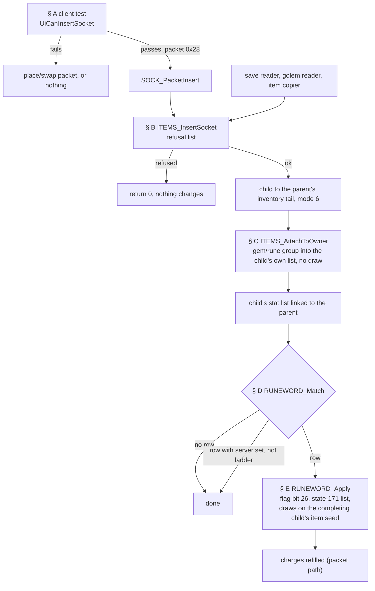
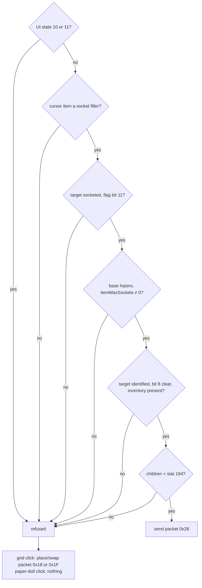
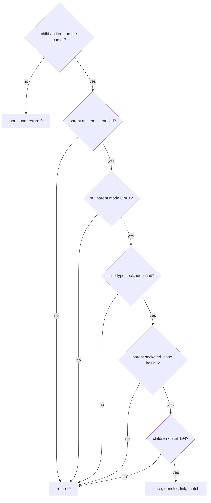
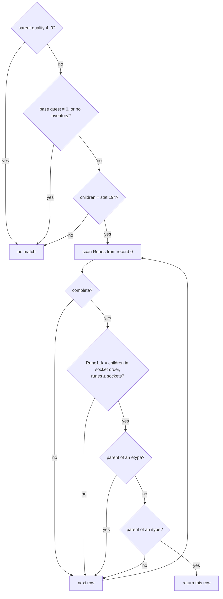
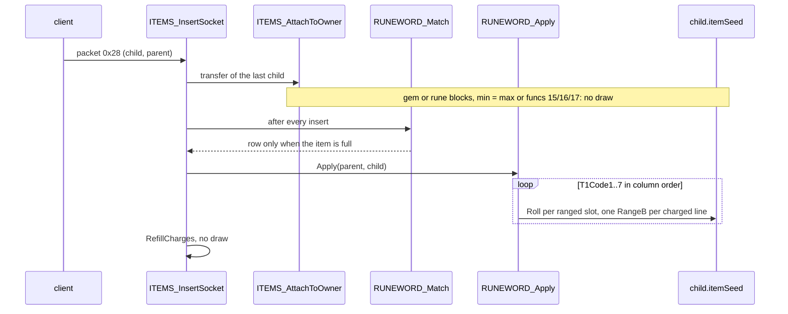

## Purpose

A player puts a gem, rune or jewel (the **child**) into a socketed item (the **parent**). This spec says what the client
tests before it sends the request, what the server tests and in which order, what the child brings to the parent, when
the children make a runeword, and which draws on which seed roll the runeword's properties. It also gives the two
socket-count setters, the creation one with its quality clamps and the load one without them. The number of sockets a
drop gets is in [items/properties § F](../properties/#f-ethereal-and-sockets); the bits a socketed item and a runeword
leave in a save are in [save/d2s § I](../../spec-save/d2s/#i-one-item).

Names of functions and fields are ours. "Item seed" is the seed at `ItemData+0x04` (`ITEMS_GetSeed`), not the unit
seed at `Unit+0x20`. Item flags are `ItemData+0x18`: bit 4 (`0x10`) identified, bit 11
(`0x800`) socketed, bit 26 (`0x4000000`) runeword. Item unit modes: 0 stored, 1 equipped, 4 on the cursor, 6 socketed.
Item types are `ItemTypes` row indices: 20 `gem`, 45 `weap`, 53 `sock`, 74 `rune`.



## Entry points

| When | Function | Tag |
|---|---|---|
| The player clicks a cursor item onto an item (client) | — | [C] |
| Client packet `0x28` (9 bytes) reaches the server | `SOCK_PacketInsert` → `ITEMS_InsertSocket` with option flags 1, 1, 1, 1 | [C] |
| A socketed item is read from a save | `ITEMS_ReadInventoryList` path (call) → `ITEMS_InsertSocket` with 0, 0, 0, 0, once per child | [C] |
| The item copier rebuilds a socketed item (Anya's personalize) | → the insert with 0, 1, 0, 0, once per child | [C] |
| The golem reader rebuilds a socketed item | `D2S_ReadGolem` → the insert with 0, 1, 0, 0 | [I] |
| An item gets a socket count at creation: the drop roll, the cube's `sock=`, Larzuk's socket | `ITEMS_SetSockets` | [C] |
| An item gets a socket count from its creation record's forced count | `ITEMS_SetSockets` (call) | [I] |
| A saved socket count is restored | `ITEMS_SetSocketsOnLoad` | [C] |

- [C] Every packet insert of the run arrived as client packet `0x28` and reached the insert with the option flags 1,
  1, 1, 1; the five children pre-filled in a loaded save reached it from the inventory reader's call with
  0, 0, 0, 0.
- [C] Creation sets the count through `ITEMS_SetSockets`: the drop socket roll (5 calls in the stock drop logs), the
  cube's `sock=` (3 calls) and Larzuk's socket (15 calls), each with the count the model gives. The
  creation record's forced count was not reached.

## Inputs

### Tables

| Anchor | Used for |
|---|---|
| `Gems.txt:code` | the gem's or rune's item; `GEMS_Load` writes the row index into that item's `gemoffset` |
| `Weapons.txt:gemoffset` | read from the **child's** base record (`+0x0F0`): its `gems` row |
| `Gems.txt:weaponMod1Code`, `Gems.txt:helmMod1Code`, `Gems.txt:shieldMod1Code` | the three 3-block groups at `+0x30`, `+0x60`, `+0x90` (16-byte `code`/`param`/`min`/`max`) |
| `Gems.txt:nummods` | **not read** by the socket path |
| `Weapons.txt:gemapplytype`, `Armor.txt:gemapplytype` | the parent base's group selector (`+0x13E`) |
| `Misc.txt:quest` | `+0x12A` of the parent base: a quest base never makes a runeword |
| `hasinv`, `invwidth`, `invheight` | base `+0x137`, `+0x10F`, `+0x110` |
| `Runes.txt:complete` | `+0x80`: the row can match |
| `Runes.txt:server` | `+0x81`: the row applies only in a ladder game |
| `Runes.txt:Name` | its string index is stored at `+0x82` (u16) by `RUNES_Load` (the saved runeword field); the two `Runeword95` rows share one index |
| `Runes.txt:itype1`, `Runes.txt:etype1` | `itype1..6` (`+0x86` … `+0x90`, u16, 0 ends) include; `etype1..3` (`+0x92`, `+0x94`, `+0x96`) exclude |
| `Runes.txt:Rune1` | `Rune1..6` (`+0x98`, s32 item index, < 1 ends): the runes in socket order |
| `Runes.txt:T1Code1`, `Runes.txt:T1Param1`, `Runes.txt:T1Min1`, `Runes.txt:T1Max1` | lines 1..7 at `+0xB0` + 16·(k−1); `T1Param` compiled by `PropParamCell` (below) |
| `Gems.txt:letter` | `+0x020`, 8 bytes: **not read** by the socket path; the client's item description shows at most 5 UTF-16 units of it (below) |
| `Properties.txt:func1` | the handler per property slot |
| `ItemTypes.txt:Equiv1` | type equivalence for `itype`/`etype` (`ITEMS_UnitIsType`) |

The record layouts are `GemsRec+0x30` and `RunesRec+0x80`; the `.bin` layouts are in Gems and Runes.

Load-time details of these columns:

- [C] **`itype`/`etype` slots.** The stock `runes.bin` holds `itype1..6` as six u16 from `+0x86` and `etype1..3` as
  three from `+0x92`, equal to the `.txt` columns resolved to ItemTypes rows on all 169 rows, and the 50 matches and
  the wrong-type refusals of the run reproduce through `itype1..3` at those offsets.
- [I] `RUNEWORD_Match` reads six i16 from `+0x86` and three from `+0x92`, so its reads of `itype4..6` are `+0x8C`,
  `+0x8E`, `+0x90` and of `etype1..3` `+0x92`, `+0x94`, `+0x96`; no stock row has a value in those columns.

- [C] **`T1Param` cells** go through the descriptor callback `PropParamCell` (type `0x19`, field
  `+0xB4 + 16·k`): a cell starting with `-` or a digit is `atol`; otherwise the name is looked up with `EXCEL_FindName`
  (lower-cased), first match wins, in the `skills` name link, then the `montype` link, then the `states` link; an
  empty cell or a name in none of them stores 0. So a skill name gives its `skills` row, case-insensitively, which is
  what the 109 stock named cells hold. Data check: all 152 non-empty stock cells (109 named) equal in `runes.bin` the
  value this rule gives.
- [C] **`Name` → `+0x82`.** `RUNES_Load` stores the u16 `+0x82` (`STRTABLE_GetByKey(Name)`) one row at a time, so the
  two rows named `Runeword95` (*Passion*, *Patience*) get the same string index, 20600: the game-written *Steel* save
  holds `0x509F`, which is `STRTABLE_GetByKey("Runeword134")` = 20639 computed from the shipped tables.

- [I] That store is `RUNES_Load`'s only one into the record after the table load; `+0x084` is not written.

- [I] **The save maps the shared index to no row.** `ITEMS_ReadFull` stores the 16 runeword bits of an item with flag
  bit 26 unmapped at `ItemData+0x38` and looks no row up; `ITEMS_WriteFull` does not save `+0x38` but calls
  `RUNEWORD_Match(item)` and writes that row's `+0x82`, or `0xFFFF` with no row. The row of a loaded runeword is always
  re-derived by `RUNEWORD_Match` from its socketed runes (§ D). `+0x38` is also a rare item's first prefix slot; a
  runeword's quality is never 4–9, so the two uses do not meet.
- [C] **Patience never matches on stock data.** *Passion* has `complete` 1, *Patience* `complete` blank (0), and
  `RUNEWORD_Match` skips every row with `complete` 0, so the shared index 20600 only ever comes from *Passion*.
  (`Runes.txt:complete`, `Runes.txt:Name`, data check)
- [I] **Gems `letter`** is read by the client's item-description builder `ItemDescRuneLetters`: for an
  item whose socketed children include runes (`ITEMS_UnitIsType(child, 74)`), it writes string 0x501A once and then
  each rune's `letter` through `UNICODE_Utf8ToUtf16(dst, letter, 6)`, i.e. at most 5 UTF-16 units of the field.


### Runtime state

| State | Type | Source |
|---|---|---|
| child, parent | item units | the packet's two unit ids, or the reader's rebuilt units |
| child mode, parent mode | unit `+0x10` | 4 on the cursor, 0 stored, 1 equipped, 6 socketed |
| item flags | u32, `ItemData+0x18` | bits 4, 11, 26 as above |
| quality | `ItemData+0x00` | 1 low … 8 crafted, 9 |
| stat 194 `item_numsockets` | base stat of the parent | the socket count |
| parent inventory | `Unit+0x60`, item list, count at `+0x28` | the children in socket order |
| child item seed | Seed | `ItemData+0x04` of the child; `{startSeed, 666}` for a rune loaded from a save |
| ladder | `Game+0x74` | gate for `server` rows |
| option flags `p4..p7` | four i32 | per caller (§ B) |

### Constants

| Name | Value | Anchor | Tag |
|---|---|---|---|
| runeword list state, flags | 171 (`0xAB`), `0x40` | `RUNEWORD_Apply` | [C] |
| gems group offsets | `+0x30`, `+0x60`, `+0x90` for group 0, 1, 2; 3 blocks of 16 bytes each | — | [C] |
| insert packet | opcode `0x28`, 9 bytes: opcode, child unit id (u32), parent unit id (u32) | `SOCK_PacketInsert` | [C] |
| `PACK_SHIFT`, `PACK_MASK` | 6, 63 (func 19's param) | [items/properties § Constants](../properties/#constants) | [C] |

## Algorithm

### A. The client test



The client tests first and sends `0x28` only when every test passes. The server's list (§ B) is the authority: the
client test is a filter in front of it, and it hides most server refusals from clicks.

```
A1. UiCanInsertSocket(cursor, target) → bool:          ; order as the table below      [C] (all of A1–A2)
      for each test t in the table, in order:
        if t fails: return false
      return true                                       ; then send 0x28(child id, parent id)
A2. on false: a click on an item in a grid sends the ordinary place/swap packet
      (0x18 or 0x1F) and the two items change places; a click on a paper-doll item sends nothing
```

| # | The client refuses when | Tag (as a refusal) | Anchor |
|---:|---|---|---|
| 1 | the UI state word is 10 or 11 | [I] | — |
| 2 | the cursor item is not a socket filler (type 53 `sock`) | [C] | — |
| 3 | the target lacks the socketed flag (bit 11) | [C] | — |
| 4 | the target base has `hasinv` 0 | [C] | — |
| 5 | `ItemMaxSockets(target)` is 0 | [C] | — |
| 6 | the target is not identified (bit 4) | [I] | — |
| 7 | the target has flag bit 8 (`0x100`) | [C] | — |
| 8 | the target has no inventory | [I] | — |
| 9 | the target's children already number its stat 194 (full) | [C] | — |

Step notes:

- A1. **The order.** 357 client verdicts of the first run (346 passed; 4 not a socket filler, 5 not socketed, 2 full)
  and 37 of the second, which logged the value each step reads, reproduced from the logged inputs; in the second run
  each failing step was the last step logged. The refusals seen are rows 2, 3 and 9, and rows 4, 5 and 7 (below).
  [C]
- A1. **`hasinv` and `ItemMaxSockets` (rows 4, 5).** On targets whose save builder set bit 11, the client stopped at
  the `hasinv` test for gloves (`lgl`, `ItemBaseHasInv` 0) and at the `ItemMaxSockets` test for a ring (`rin`,
  `hasinv` 1, `ItemMaxSockets` 0), before the later tests both also fail. `ItemBaseHasInv` equalled the base's `hasinv`
  in all 39 calls and `ItemMaxSockets` equalled `min(gemsockets, MaxSock by ilvl)` in all 38. These are tool-built
  saves on stock tables: the tag covers the test's order and its two refusals on a target with
  bit 11, not how an item gets that bit. [C]
- A1. **No stock item reaches refusal 4 or 5.** A stock item does not get bit 11 on such a base: at creation
  `ITEMS_SetSockets` writes bit 11 only with a cap of at least 1, so `ItemMaxSockets` ≥ 1 (F1), and no weapon or
  armour row with `gemsockets` > 0 lacks `hasinv`; only a loaded save brings the flag past those clamps (F2). [I]

- A1. **Flag `0x100` (row 7).** A broken socketed cap (durability 0, client flags) passed the socketed,
  `hasinv`, `ItemMaxSockets` (2) and identified steps and stopped at flag `0x100`. A broken item is a state stock play
  reaches (B6 note). [C]
- A1. **The client does not test the child's identified flag**, so an unidentified jewel reaches the server, which
  refuses it (§ B). [C]
- A1. That every unidentified socketed item's client copy lacks bit 11, and what sends the flag at identification
  (the identify routine sets `0x10` and bit 0; not followed), are not shown. [I]
- A1. The client test has no level, item-class, quality or game-type test either: a rune onto a helm in a classic game
  was sent and accepted. [C]

### B. The server insert: the refusal list



Tests short-circuit in this order; a refusal returns 0 and changes nothing. This list is the authority; the client
test of § A stands in front of it.

| # | The server refuses when | Tag (as a refusal) | Anchor |
|---:|---|---|---|
| 1 | the child unit is not found | [I] | `ITEMS_InsertSocket` (not found) |
| 2 | the child is not an item | [I] | `ITEMS_InsertSocket` |
| 3 | the child is not on the cursor (mode ≠ 4) | [I] | `ITEMS_InsertSocket` (not found) |
| 4 | the parent unit is not found | [I] | `ITEMS_InsertSocket` (not found) |
| 5 | the parent is not an item | [I] | `ITEMS_InsertSocket` |
| 6 | the parent is not identified (bit 4) | [I] | `ITEMS_InsertSocket` |
| 7 | `p6` ≠ 0 and the parent's mode is not 0 (stored) or 1 (equipped) | [I] | — |
| 8 | the child is not a socket filler (type 53 `sock`) | [I] | `ITEMS_IsSocketFiller` |
| 9 | the child is not identified (bit 4) | [C] | — |
| 10 | the parent lacks the socketed flag (bit 11) | [I] | `ITEMS_InsertSocket` |
| 11 | the parent base has `hasinv` 0 | [I] | `ITEMS_InsertSocket` |
| 12 | the parent has no inventory and none can be created | [I] | `ITEMS_InsertSocket` |
| 13 | the parent's inventory count ≥ `stat 194 & 0xFF` (full) | [I] | `ITEMS_InsertSocket` |

```
B1. InsertSocket(game, player, childId, parentId, p4, p5, p6, p7) → i32:            [C] order
      notFound ← 0
      for each test t in the refusal list above, in order:   ; C short-circuit
        if t fails:
          if t is 1, 3 or 4: notFound ← 1                 ; "not found"                [I]
          return 0                                        ; nothing changed
B2. place: remove the child from the cursor; append it at the TAIL of inv             [C]
      child.x ← count(inv) before the append; child.y ← 0; body location ← −1        [C]
      count(inv) += 1                                                                 [C]
      if p5 ≠ 0 and player: clear the player's cursor slot  ; already empty (B2 note)  [I]
B3. Transfer(game, child, parent)                       ; § C                         [C]
B4. child.mode ← 6 (socketed)                                                         [C]
B5. row ← Match(parent)                                 ; § D, after EVERY insert     [C]
    if row ≠ none and not (row.server ≠ 0 and game.ladder = 0):
      Apply(parent, child)                              ; § E                         [C]
      the stat 252 replenish timer (E4)                                               [C]
      then the stat 253 replenish timer (E4)                                          [C]
      if p7 ≠ 0: RefillCharges(parent)                  ; § E5                        [C]
    else if p4 = 0: return 1                            ; readers: no parent update   [C]
B6. parent.flags |= 0x1; parent.flags &= ~0x4000                                      [C]
    queue a client update when a player is given                                      [I]
    return 1
```

Step notes:

- B6. **The flag bits the insert touches**, from a survey of every `ITEMS_CheckFlags`/`ITEMS_SetFlag` call site by
  mask:
  - [I] Bit 0 (`0x1`) is "changed, send an update": set by every server routine that moves an item or changes its state
    (26 move sites, `ITEMS_InsertSocket` among them, and the identify routine), never cleared through `ITEMS_SetFlag`,
    tested only by `ItemFlagUpdateSend`.
  - [I] Bit 14 (`0x4000`) is "equipped, requirements not met": `EquipReqRefresh` sets it on an equipped item that fails
    `ItemUsableBy` (stats 0, 2, 12 against the requirements with stat 91, plus the quiver test) and clears it on one
    that passes; every move routine clears it with bit 0.
  - [I] Bit 8 (`0x100`), which the client test of § A refuses, is "broken": `ItemBreak` sets it and durability (stat 72)
    to 0, `ItemRepairBroken` clears it and sets bit 9, and `ItemCreate` copies it from the creation record.

  - [I] Bit 2 (`0x4`) marks an item whose use is in progress (`ItemUse` sets it before the use function and
    `InvClearUseMark` clears it on failure); the insert does not read it: it tests only `0x10` and `0x800`.


- B1. **Authority and tags.** The server list is what decides; the client test (§ A) stands in front of it and
  screens every server refusal but one from clicks. The run saw the whole chain pass in this order 350 times, and saw
  one refusal, an unidentified magic jewel stopped at the child's identified test, with return 0 and nothing changed.
  So the order and the "child unidentified" refusal are `[C]`; every other line is `[I]` **as a refusal** (read in
  the code, seen passing, never failing) until a forged `0x28` packet reaches it. [C]
- B1. **Not tested** by the insert: the parent's quality, its item class (`gemapplytype`), the game type. Inserts into
  low, magic, rare and crafted parents, into weapons, armour, helms and shields, and a rune in a classic game were all
  accepted. [C]
- B1. **No level-requirement test** for the child. A level-1 Barbarian inserted 24 runes up to `levelreq` 65 (*Jah*;
  *Ber* 63, *Sur* 61, *Lo* 59, *Ohm* 57, *Mal* 49) into stored and equipped parents, and each passed the client test and
  every server test. [C]
- B1. No ethereal or item-version test either. [I]
- B1. The parent-mode test applies only with `p6` set, so the save reader's inserts pass it untested. [C]

- B1. **The packet handler's own checks**, before the call: the packet is exactly 9 bytes (else error return 3); the
  child id is the player's cursor item; a parent in mode 0 or 1 is in the player's own inventory; when the player's
  interaction target is a player (a trade), the insert is skipped silently. A "not found" from the insert becomes
  error return 3; the other refusals are ignored. [I]
- B2. **Socket order is insertion order.** After each of 350 inserts the parent's child list was its list before plus
  the child at the tail, the count grew by one and the child's mode was 6. `INV_GetFirstItem` → `INV_GetNextItem`
  walks the children in that order, which is the order § D compares with `Rune1..6`. [C]
- B2. **x, y and body location.** In all 35 inserts of the second run (27 packet, 6 reader, 2 copier) the child's x
  was the inventory count at the call, which equals the parent's children before the insert (x > 0 in 20), y was 0
  and the body location −1. So x = 0, 1, 2, … in socket order. [C]
- B5–B6. **The parent update.** The five reader inserts of the first run (option flags 0, 0, 0, 0, no runeword) left
  the parent's bit 0 clear; the reader insert that completed *Steel* in the second run (`p4` 0, a matched row) made
  the update. All 345 successful packet inserts set bit 0 (294 without a runeword, 51 with), and the 18 parents that
  had bit 14 had it cleared; the refused insert changed nothing. [C]
- B5. **A `server` row in a non-ladder game makes no runeword, and the insert still succeeds** (*Spirit* in the run).
  [C]
- B5. In a ladder game (`Game+0x74` ≠ 0) the row applies. No ladder game ran. [I]

| caller | p4 | p5 | p6 | p7 | Tag |
|---|---|---|---|---|---|
| `SOCK_PacketInsert` | 1 | 1 | 1 | 1 | [C] |
| the inventory reader's call | 0 | 0 | 0 | 0 | [C] |
| `ItemCopy` | 0 | 1 | 0 | 0 | [C] |
| the other inventory readers, the golem reader | 0 | 1 | 0 | 0 | [I] |
| — | caller's | 0 | 1 | 0 | [I] |

- B. The other sites did not run: the version-71 list reader's two, the corpse reader's
  branch (`ReadCorpseLegacy` passes 1 as the list reader's fourth argument), the
  golem reader, whose two callers, `TradeMoveItems`
  (unfollowed), copy with the copier's second word 0 first. [I]
- [C] `p4` = 1 makes the parent update of B6 happen without a runeword (the packet inserts; with `p4` 0 only a matched
  row reaches it); `p6` is the parent-mode test (the copier's parent, in mode 4, was accepted with `p6` 0); `p7` is the
  charge refill (the three packet runewords of the second run were refilled, the reader's *Steel* was not).

- [I] `p5` clears the player's cursor slot; on every path seen the slot is already empty (B2 note).

### C. What a gem, rune or jewel brings

| Parent base `gemapplytype` | `gems` group (record offset) | Stock bases with sockets | Tag |
| --- | --- | --- | --- |
| 0 | `weaponMod1..3` (`+0x30`) | every socketable weapon type | [C] |
| 1 | `helmMod1..3` (`+0x60`) | `tors`, `helm`, `circ`, `pelt`, `phlm` (body armour takes the helm group) | [C] |
| 2 | `shieldMod1..3` (`+0x90`) | `shie`, `ashd`, `head` | [C] |
| ≥ 3 | fatal | none on stock data | [I] |

- [C] The group is chosen by the **parent's** `gemapplytype`; the run applied each of the 35 gems into each of the
  three groups (105 of 105) and 159 runes across the three.
- [C] The stock bases column is a data check over the 422 weapon and armour rows (265 weapons, 157 armours; 418
  spawnable) with `hasinv` and `gemsockets` > 0: `gemapplytype` is 0 for every weapon type, 1 for `tors`, `helm`,
  `circ`, `pelt`, `phlm`, 2 for `shie`, `ashd`, `head`; no belt, boot or glove type has such a row.

- [I] A group ≥ 3, or a block index ≥ 3, is fatal; no stock row has one.

```
C1. Transfer(game, child, owner):                                                   [C] (ITEMS_AttachToOwner, all of C1–C3)
      if IsType(child, 20 gem) or IsType(child, 74 rune):
        if owner is not an item: return                 ; gems and runes act only inside an item   [I]
        g ← Gems[ItemRecord(child).gemoffset]           ; the CHILD's base +0x0F0
        if g = none: return                                                        [I]
        mode ← 2 (gem) or 5 (rune)                       ; the two behave the same
        grp ← owner base gemapplytype                    ; 0, 1, 2
        for i in 0 ..< 3:
          b ← g + {0x30, 0x60, 0x90}[grp] + 16·i
          if b.code < 0: break                           ; the first blank block ends the group
          ApplyBlock(mode, item = child, target = child's main list (state 0, flags 0x40), b)
      else:                                             ; a jewel (quality 4 or 6)
        nothing applied                                  ; its own list was rolled at creation
C2. Link(owner, child): the child's stat list (Unit+0x5C) is attached to the owner
C3. the owner's own stat lists are not written
```

Step notes:

- C1. **No draw on stock data.** Every gem and rune block has `min = max` (the roll returns `min` without a step), or
  uses func 15/16 (no draw), or func 17 with `par` ≠ 0 (Thul 75, Tal 125; no draw). The only `min ≠ max` blocks, Ral
  `dmg-fire` 5–30, Ort `dmg-ltng` 1–50 and Thul `dmg-cold` 3–14 in `weaponMod1`, are funcs 15/16/17. So an insert
  that makes no runeword never moves any seed. [C]
- C1. The run reproduced 337 gem and rune transfers slot by slot with the child's seed unchanged; 13 jewels applied
  nothing. [C]
- C1. **The child is the handlers' item and target.** `ApplyBlock` gets 0 as its target unit, which `PROP_WriteStat`
  reads as "the item itself", so every handler that looks at the item sees the gem or rune: Pul's `ac%` (func 2)
  resets nothing; Ith's `dmg-max` and Sol's `dmg-min` (funcs 6, 5) take the non-weapon branch and write stats
  22/24/160 or 21/23/159, clamped against the rune's own base bytes, which are 0; Ohm's `dmg%` (func 7) writes 17 and
  18. The parent sees these only through the link. The child lists of Pul (3 inserts), Ith (4), Sol (6) and Ohm (6)
  reproduce with the rune as the handlers' item and target. [C]
- C1. Zod's `indestruct` (func 20) adds stat 152 to the rune's own list; no Zod was inserted. [I]

- C1. `nummods` (`+0x2E`) is not read; the group's length is set by its first blank block. In 160 of the 337
  transfers the group's blocks before the first blank differ in number from the row's `nummods`, and every transfer
  reproduces without reading it. [C]
- C1. **`gemoffset` is the child's.** `GEMS_Load` writes each `gems` row's index into `+0x0F0` of the item it names,
  and the transfer reads `+0x0F0` of the child's base; no parent offset is read. No `gems` row names a socketable
  base, so a parent's `+0x0F0` is 0; in 327 of the 337 transfers the child's row is not 0, and each applied the
  child's row, where reading the parent's would have applied row 0. [C]
- C2. **The link.** After each insert the parent's lists were its lists before plus the child's own stat list (seen
  from the parent as a state-0 list with flags `0x80000000`). When the list already belongs to the owner, only its
  enable bit `0x40000000` is toggled. The child's flag `0x100` would suppress the link when the call's own flag is 0,
  which it is on this path. [C] for the link (the link branch in all 35 inserts, for stored, equipped and cursor
  parents); the toggle and the `0x100` case are [I], and no stock case reaches them on the socket path: in every
  logged insert the child's list had owner 0 before the link, and no socket filler has durability (69 `sock` rows),
  so none can carry `0x100`, which `ItemBreak` sets with durability 0
- C1. **The client** runs the same transfer in its own copy, fatal instead of silent on a missing row; two further
  client functions apply a row in mode 5 or mode 2 to a scratch unit for an item description. [I]


### D. The runeword match



```
D1. Match(parent) → Runes row or none:                                               [C] (RUNEWORD_Match, all of D1–D4)
      if parent.quality ∈ 4..9: return none              ; u32 (quality − 4) < 6: low, normal, superior pass
      if ItemRecord(parent).quest ≠ 0: return none
      if parent has no inventory: return none                                        [I]
      kids: i32[6];  n: i32 ← 0
      for c in parent.inventory in socket order: kids[n] ← c.classId;  n ← n + 1
      s: i32 ← (stat 194 of parent) & 0xFF
      if s ≠ n: return none                               ; only a full item can match
D2.   for r in 0 ..< RunesCount:                         ; record 0 included
        R ← Runes[r]
        if R.complete = 0: continue
        k: i32 ← 0
        while k < 6 and R.rune[k] ≥ 1:
          if n < k or kids[k] ≠ R.rune[k]: goto next     ; NOTE: k = n compares kids[n] (see D2 note)
          k ← k + 1
        if k < s: continue                                ; fewer runes than sockets
D3.     for e in 0 ..< 3 while R.etype[e] ≠ 0:            ; no stock row reaches the body   [I]
          if IsType(parent, R.etype[e]): goto next
D4.     for t in 0 ..< 6 while R.itype[t] ≠ 0:
          if IsType(parent, R.itype[t]): return R
      next:
      return none
```

Step notes:

- D1. **The match runs after every insert, but only a full item matches.** Before the last socket is filled, `s ≠ n`
  returns none. The run's model agreed with the logged row after all 350 inserts: 50 runewords from 29 rows, 60 full
  items with no runeword. [C]
- D1. **Quality.** Magic, set, rare, unique, crafted and quality 9 never match; a low-quality and a superior base
  matched in the run, and magic, rare and crafted bases did not. Ethereal is not tested; an ethereal normal base made
  *Steel* in a game-written save. [C]
- D1. **`quest`.** *Wirt's Leg* (base `leg`, `quest` 1) made no runeword. [C]
- D2. **Rune order** is the insertion order: the wrong order (*Lum Eth* in a shield) and the wrong type
  (*Splendor*'s runes in a helm) matched nothing. [C]
- D2. **One rune more than the sockets.** The bound test is `n < k`, not `n ≤ k`, so for a row with exactly one rune
  more than the sockets the loop reaches `k = n` and compares `kids[n]`, a stack slot this call never wrote; such a
  row matches only if that stale word equals the extra rune's item index. Two or more extra runes never match. The
  run's one case (a 3-socket armour with the first three runes of *Bramble*) matched nothing; the slot held 638, not
  614. [I] The slot lies in `RUNEWORD_Match`'s own frame, so its value is
  what the last code to use that stack address left, which depends on the call chain (the insert, the two readers,
  the cube's socket paths, the client's description code). A slot written by an earlier `RUNEWORD_Match` call on a
  fuller item at the same depth holds that item's `n`-th child class, so a stale match needs such an earlier call, not
  chance. [I]
- D2. **Scan order.** The first matching row from record 0 wins. On stock data no two `complete` rows share a rune
  sequence and none is a one-shorter prefix of another (data check over the 78 `complete` rows), so the order changes
  no stock result. [C]
- D3. `etype` excludes through `ITEMS_UnitIsType`; no stock `complete` row uses it, so the run does not test it. [I]

- D4. `itype` includes through `ITEMS_UnitIsType`, so equivalences count (`weap` covers every weapon; `hamm` and
  `mace` are both `blun`, neither the other). [C]
- D1. A classic game has no runeword because no stock row is classic-legal: every rune is a version-100 item. [I]


### E. The runeword: flag, list and rolls

```
E1. Apply(parent, child) → i32:                         ; child = the filler whose insert completed the word   [C]
      R ← Match(parent)                                  ; matched again
      if R = none: return 0                                                           [I]
      if parent already holds a stat list of state 171: return 0   ; state alone      [C]
      parent.flags |= 0x4000000                          ; flag bit 26                [C]
E2.   for i in 0 ..< 7:                                  ; T1Code1..7 in column order  [C]
        b ← R.t1[i]
        if b.code < 0: break                             ; the first blank ends the lines   [I]
        ApplyBlock(mode 6, target = parent, item = child, b, state 171, flags 0x40)
      return 1
E3. inside ApplyBlock, per items/properties § C–E:                                       [C]
      every Roll (min ≠ max) draws Range(child.itemSeed, |max − min| + 1)               ; draw
      a func 19 line draws RangeB(child.itemSeed, c − c ÷ 8)                            ; draw, always
      writes go to TargetList(parent, 171, 0x40), created and attached on first use
      item tests (weapon? armour? ethereal? durability?) look at the CHILD
E4. after Apply (also when it returned 0), in the insert:                                [C] (ITEMS_InsertSocket, all of E4a but the marked lines)
E4a.  v: i32 ← stat 252 of the parent, over all its lists
      if v ≠ 0 and the parent has no event of type 3 yet:
        queue event type 3 at game frame (Game+0xA8) + 2500 ÷ v + 1   ; ÷ truncating   [I] for the truncation
      a parent that already has a type-3 event gets none                             [I]
E4b.  v ← stat 253 of the parent, the same way (ItemReplenishQtyTimer)     [C] (v = 0 at all four)
      its schedule when v ≠ 0: as E4a                                                 [I]
E5. RefillCharges(parent), packet path only (p7):                                        [C]
      for each stat 204 entry of the parent: if (v & 0xFF) < (v >> 8): v ← (v >> 8) × 256 + (v >> 8)
```

Step notes:

- E1. **The seed is the completing child's item seed.** Every runeword draw steps `ITEMS_GetSeed(child)` of the
  socket filler whose insert completed the word; the parent's item and unit seeds and the game seed are untouched.
  The run reproduced 50 runewords line by line from that seed, 50 draws among them (ranged lines of *Splendor*,
  *Sanctuary*, *Gloom*, *Enigma*, *Stone*, *Bramble*'s aura, *Call to Arms*'s `oskill`, *Famine*, *Duress*, *Bone*,
  and every func 19 charge). [C]
- E1. **That seed's state.** A rune loaded from a save has item seed `{startSeed, 666}` at its insert (49 of 49 such
  completing runes), the reader's seed init of [save/d2s I5](../../spec-save/d2s/#i-one-item); gem and rune transfers make
  no draws (§ C), so nothing moves it before the rolls. A rune made in the session (the cube's Nef) carried an advanced
  seed, and *Black* completed by it reproduced from that seed. [C]
- E1. **Already applied.** A parent that already holds a state-171 list gets nothing, and `Apply` returns 0: the save
  reader rebuilds the parent with its saved lists before it re-inserts the children, so a loaded runeword is not
  rolled again. Loading the game-written *Steel* sample re-inserted Tir and El through the reader (0, 0, 0, 0); after
  El, `RUNEWORD_Match` gave row 18 (*Steel*), `RUNEWORD_Apply` found the parent's state-171 list, applied no slot and
  returned 0; the list and El's seed were unchanged (flag bit 26 was already set by the reader), and the insert still
  made the parent update (bit 0) and ran the timers (E4). [C]
- E1. The test is by state alone: `RUNEWORD_Apply` pushes `0x40` and `0xAB`, but
  `UnitFindStatList` searches by state alone when the state is non-zero, so the
  `0x40` is not read. [I]
- E2. The stock `runes` rows have no gap in `T1Code1..7` and no unknown code (data check over 169 rows), so "first
  blank ends" and "skip blanks" give the same result on stock data. [C]
- E2. Mode 6 is not 1, so no handler applies a mode-1 reset. [I]
- E3. **The handlers' item is the rune**, not the parent. Consequences, per func:

| func | code (examples) | draws on the child's seed | effect with a rune as the item | Tag |
| ---: | --- | --- | --- | --- |
| 1, 3, 8, 10, 21, 22 | `ac`, `res-all`, `oskill`, `aura` | `Roll` (one draw when `min ≠ max`); func 3 reuses the preceding slot's value with no draw | as items/properties | [C] |
| 8 | — | `v ← prev` when `prev` ≠ 0 (the reuse branch) | not reachable on stock data: func 8 is the first slot of every `properties` row a stock runeword line uses, so `prev` is 0 | [I] |
| 15, 16, 17 | `dmg-fire`, `dmg-ltng`, `dmg-cold` pairs | none where `par` ≠ 0 or `min` = `max` | as items/properties | [C] |
| 17 | `ac/lvl` (*Leaf*) | the `Roll` branch when `par` = 0; none at `min` = `max` | as items/properties: *Leaf*'s line (16..16) gave 16 with no step | [C] |
| 17 | — | `Roll` when `par` = 0 on a ranged line | as items/properties; four stock rows (*Harmony*, *Fortitude*, *Lawbringer*, *Winter*), all `server` rows: no stock case outside a ladder game | [I] |
| 24 | — | `v ← prev or Roll` | as items/properties; one stock row (*Faith*), a `server` row: no stock case outside a ladder game | [I] |
| 2 | `ac%` | `Roll` | the base reset tests the rune (not armour): the parent's defense is **not** set to `maxac + 1` | [C] |
| 5, 6 | `dmg-min`, `dmg-max` | `v ← prev or Roll` | the base columns are the **parent's**, but the weapon tests see the rune: all three stats 21/23/159 or 22/24/160 are written, each clamped against the parent's column | [C] |
| 7 | `dmg%` | `v ← prev or Roll` | writes 18 then 17 directly; no base reset | [C] |
| 7 | `dmg%` | — | no "+1 maximum damage" fallback (the weapon branch is never taken) | [I] |
| 11 | `hit-skill`, `gethit-skill` | none | level = `max` | [C] |
| 11 | — | none | the ilvl branch (the rune's ilvl): every stock runeword line has `max` > 0, so it is not reached | [I] |
| 19 | `charged` | one `RangeB(c − c ÷ 8)`, always | stored as `max × 256 + current`, then refilled by E5 on the packet path | [C] |
| 20 | `indestruct` | none | adds stat 152 to the parent's 171 list; three stock rows (*Eternity* made) | [C] |
| 23 | `ethereal` (*Famine*) | none | tests the rune's ethereal flag and durability: never makes the parent ethereal | [C] |

- E3. Corroboration of the table: a game-written save of *Steel* on a one-handed, non-throwing long sword holds
  stats 21, 23, 159 and 22, 24, 160 (+3 each), which only the non-weapon branch writes, and `dmg%` 20 as stats 17/18;
  *Famine* and the five *Splendor* (`ac%` on shields) reproduced in the run with the rune as the item. [C]

- E3. The `[I]` rows of the table (func 8's reuse branch, func 17's `par`-0 roll on a ranged line, func 11's ilvl
  branch, func 7's `+1` fallback, func 24) are read from the handlers, with the stock-row counts,
  and none has a stock case: funcs 8 and 11 as their rows say; func 17's ranged rows and func 24's *Faith* are `server`
  rows, and single player is never ladder; func 7's fallback sits on the weapon branch, and the handlers' item is the
  rune, which is never a weapon (it could not fire on the *Steel* sword anyway: `⌊19 · 20 / 100⌋` = 3). [I]

- E4. **The replenish timers.** After `Apply` the insert runs the 252 timer then the 253 timer exactly when the gate
  of B5 lets the row through: in 4 inserts of the second run (*Prudence*, *Eternity*, *Leaf*, and the *Steel*
  re-insert, whose `Apply` returned 0), and in none of the other 31. Each reads the parent's stat summed over its lists.
  *Prudence* (`rep-dur` 25) queued event type 3 at frame 324 + 2500 ÷ 25 + 1 = 425. [C]

- E4. The 253 timer read 0 at all four inserts: no stock runeword carries stat 253, and a runeword parent (low, normal
  or superior, no affixes) has none of its own, so the 253 schedule at an insert has no stock case. Outside an insert
  two 253 schedules were logged (`v` 10 at 835 and `v` 5 at 1085, at frame 584), each frame + 2500 ÷ `v` + 1, but the
  checker does not compare them. Every logged schedule divides exactly, so the truncation is the `idiv` read. [I]
- E5. **Charges are refilled on the packet path.** The func 19 draw still happens, so it still steps the child's
  seed; the refill then raises the current charges to the maximum. The parent's lists after the refill reproduced
  for all 50 runewords, 14 with a charge raised. [C]
- E1. **What the parent gets**: flag bit 26 and one stat list of state 171, flags `0x40`, beside its own lists and
  the children's linked lists. The base's own lists (a superior's bonuses, for instance) are not touched, and each
  rune's own bonuses stay linked. [C]

### F. Socket counts: the two setters

```
F1. SetSockets(item, n):                       ; creation: drop roll, creation record, cube, quest   [C] (ITEMS_SetSockets, all of F1 but the marked lines)
      p: i32 ← invwidth × invheight            ; u8 × u8
      if p = 0: return                                                                [I]
      cap: i32 ← min(p, 6)
      switch item.quality:
        2 (normal), 3 (superior): none
        1 (low):              none                                                    [I]
        no item data:         taken as 2                                              [I]
        4 (magic):            cap ← min(cap, 4)                                       [I] (all of the quality cases 4–9)
        5 (set), 7 (unique):  cur ← stat 194 of item
                              if cur ≥ 1: n ← cur          ; keep the current count
                              else if cap ≠ 0: cap ← 1
        6 (rare):             cap ← min(cap, 2)
        8 (crafted), 9:       cap ← min(cap, 3)
      cap ← min(cap, ItemMaxSockets(item) & 0xFF)
      r: i32 ← min(max(n, 1), cap)                                                    [I] (the clamp of the write)
      if r < 1: return                         ; nothing written, not even the flag   [I]
      item.flags |= 0x800;  base stat 194 ← r
F2. SetSocketsOnLoad(item, n):                 ; the save reader                   [C]
      F1 without the quality switch
      a cap of 0 still writes stat 194 = 0 and the flag                               [I]
```

Step notes:

- F1. **The cap's steps and their order.** 34 calls, all from the drop socket roll (return), followed F1
  step by step with 0 mismatches: the product `p` of the record's inventory size, the cap `min(p, 6)`, which the 6
  lowered in 3 calls (`p` > 6), the quality step (none for qualities 2 and 3), and `ItemMaxSockets` as
  [items/properties § F](../properties/#f-ethereal-and-sockets) F5 gives it, which lowered the cap in all 34; the
  value written equalled `min(max(n, 1), cap)`. [C]
- F1. **Normal and superior get no quality clamp**, so the drop roll's socket count
  ([items/properties § F](../properties/#f-ethereal-and-sockets), F6) is clamped only by the inventory size, 6 and
  `ItemMaxSockets`: in all 34 calls the cap after the quality switch equalled `min(p, 6)` (normal 30, superior 4),
  21 of them above 3, so neither the crafted clamp 3 nor the magic clamp 4 acted; two normal drops of an earlier run
  got 3 sockets, where a rare's clamp gives 2. [C]
- F2. **A loaded item keeps a count above the creation clamps**, and the insert fills it: a magic crystal sword with 6
  sockets, a magic shield with 4, a rare crystal sword with 5 and a crafted long sword with 4 (built states) loaded with those counts and took that many children. [C] A cap of 0 is reached only by an edited or built save. [I]

### G. In the save

- [C] **The runeword field.** `RUNES_Load` sets `Runes` `+0x82` to the string index of the row's `Name` key. The save
  writer stores that u16 for an item with flag bit 26, and the reader stores it at `ItemData+0x38`; nothing in the
  insert writes `+0x38`. The *Steel* save holds `0x509F` = 20639, the string index of `Runeword134` (expansionstring
  entry 639); loading it, `ITEMS_ReadFull` stored `0x509F` at `+0x38` of the server's *Steel* sword, and
  the parent held it at both reader inserts. On the 50 runewords of the first run made by inserts `+0x38` stayed 0.
  A client receives the item through the same serialiser: the client's reader stored the row's Name index in six client
  units (the *Steel* sword, and *Prudence*, *Eternity* and *Leaf* after they were made), so the server's field of a
  runeword made by an insert stays 0 while its client copy holds the index the writer wrote.

- [I] With no matching row the writer stores `0xFFFF`.
- [C] **The lists.** A saved runeword item holds flag bit 26 and its state-171 list after the main list; its main list
  stays empty on a normal base.
- [C] **`n_filled`** in the save is the length of the parent's child list; the children follow the parent in the item
  list and are re-inserted by § B with the option flags clear. The game-written *Steel* save holds `n_filled` 2 and its
  two children follow it, and the load sessions re-inserted each parent's saved children through the reader with 0, 0,
  0, 0.
- [I] The count is taken only when the base has `hasinv`; no weapon or armour row has `gemsockets` > 0 without
  `hasinv`, so the condition has no stock case.
- [I] **A loaded runeword that no longer matches is discarded.** The inventory and golem readers remove a loaded
  item that has flag bit 26 but no matching row.

### H. RNG call sequence



- [C] An insert that makes no runeword makes **no draw** on any seed. An insert that completes a runeword draws only
  on the completing child's item seed, in line order then slot order, one draw per ranged `Roll` (none when `min =
  max`, none for a reuse slot whose slot-1 value is non-zero) and one per `charged` line. The game seed and the
  parent's seeds are unchanged at the end of the insert. (`ITEMS_InsertSocket`, `RUNEWORD_Apply`; rng for `Range`)

## Outputs

- The insert returns 1 (placed) or 0 (refused); the packet handler maps "not found" to its error return 3. [I]

- On success: the child is the parent's last inventory item in mode 6; a gem or rune carries its group's stats in its
  own main list; the child's stat list is linked to the parent. With a runeword: parent flag bit 26, one state-171
  list on the parent, the completing child's item seed advanced by the runeword's draws, charges full on the packet
  path. [C]

## Worked example

### Example 1: *Sanctuary* in a large shield (stock)

Session `rw1` (slot 2, game seed `-seed 2001`, expansion, Normal). The parent is a normal-quality large shield
(`lrg`, item index 330, `gemapplytype` 2, 3 sockets, ilvl 99), already holding Ko, Ko. The child is Mal (item index
632), loaded from the save, item seed `{low 0xD2E66F6E, high 0x0000029A}` = `{startSeed, 666}` with startSeed
3538317166. *Sanctuary* is `Runes` record 41 (`Runeword122`): `itype1` `shld`, runes Ko Ko Mal, seven lines.

1. The client test passes and the packet `0x28` arrives; the server tests pass in order (§ B).
2. Transfer: Mal's `gems` row (57), group 2 (`shieldMod1`): `red-mag` 7..7, func 1, `min = max`: no draw. Mal's own
   list gets stat 35 = 7.
3. Match: 3 children = stat 194 = 3, quality 2, rune sequence Ko Ko Mal, `lrg` is `shie` → `shld`: record 41.
4. Apply, lines in order, on Mal's item seed (`Range(s, n)`: step `s ← low × 0x6AC690C5 + high` as a u64, then
   `low mod n`, rng § Algorithm):

| line | code (func) | block | draw | seed after (low, high) | value written |
|---|---|---|---|---|---|
| 1 | `block` (1) | 20..20 | none | `D2E66F6E`, `0000029A` | stat 20 = 20 |
| 2 | `block2` (8) | 20..20 | none | unchanged | stat 102 = 20 |
| 3 | `ac%` (2) | 130..160 | #1 `Range(s, 31)` | `A515A240`, `57F6FFA1` | `0xA515A240 mod 31` = 12 → stat 16 = 142 |
| 4 | `ac-miss` (1) | 250..250 | none | unchanged | stat 32 = 250 |
| 5 | `res-all` (1, then 3, 3, 3) | 50..70 | #2 `Range(s, 21)` | `8A60DAE1`, `44DB0145` | `mod 21` = 20 → stat 39 = 70; slots 2–4 reuse 70: stats 41, 43, 45 = 70 |
| 6 | `balance2` (8) | 20..20 | none | unchanged | stat 99 = 20 |
| 7 | `charged` (19), par 17 *Slow Missiles* | 60..12 | #3 `RangeB(s, 60 − 7)` | `B088006A`, `39B76FCB` | `mod 53` = 1; current `(1 + 1 + 7) & 0xFF` = 9, max 60: value 9 + 60 × 256 = 15369; param 17 × 64 + 12 = 1100 |

5. Refill (packet path): stat 204 param 1100 becomes 60 × 256 + 60 = 15420.
6. End of the insert: the game seed (`A16D6052`, `2909A3FE` as logged) and the shield's seeds are unchanged; Mal's
   item seed is `{0xB088006A, 0x39B76FCB}`. Parent's state-171 list: 16 = 142, 20 = 20, 32 = 250, 39/41/43/45 = 70,
   99 = 20, 102 = 20, 204 (1100) = 15420.

- [C] Every value above is the run's logged value and reproduces it; the three draws are the
  three seed changes of the log, recomputed with the rng step.

### Example 2: *Steel* in a game-written save (stock)

- [C] An ethereal normal long sword (`lsd`, 2 sockets) took Tir then El by hand in the game. The save holds flags
  `0x04C02810` (bits 4, 11, 22, 26), `n_filled` 2, quality 2, runeword field `0x509F`, an empty main list and a
  state-171 list 17/18 = 20, 21 = 3, 22 = 3, 23 = 3, 24 = 3, 93 = 25, 135 = 50, 159 = 3, 160 = 3. Every *Steel* line
  has `min = max`, so it makes no draw and the save does not show the seed.

## Reimplementation notes

- **The rune is "the item".** Do not pass the parent to the property handlers as the item: the seed, the weapon and
  armour tests and func 23 all look at the child. The parent is only the target list. Getting this wrong changes
  `dmg-min`/`dmg-max` (one stat instead of three), `ac%` (a base defense reset) and the seed. [C]
- **The completing child's seed, not the first rune's.** Only the child whose insert filled the last socket draws.
  For a loaded rune that seed is `{startSeed, 666}`, so the same save and the same insert order give the same rolls.
  [C]
- **Charges: draw, then refill.** A player-made runeword shows full charges, but the func 19 draw must still be
  consumed. [C]
- **Low quality qualifies**, and ethereal is not tested; quality 9 is excluded with crafted. [C]
- **The stale `kids[n]` slot.** A faithful reimplementation reads an unwritten slot for a row with one rune more than
  the sockets; on stock data no exact match competes with it, and a reimplementation that treats the slot as "no
  rune" differs only if the stale word happened to equal the extra rune. [I]
- **`gemoffset` is the child's** in 1.14d. Do not port the later "starting index into `gems`" reading of the parent's
  column. [C]
- **Classic games accept runes** in sockets; they apply their group like any rune. [C]
 No runeword can form there, since no stock row is
  classic-legal (D1 note). [I]
- **Two socket setters.** A loaded count is kept above the creation clamps (`SetSocketsOnLoad`). [C]
 The quality clamps belong to creation only
  (`SetSockets`); no run executed them (F1 notes). [I]

## Evidence

- [items/properties](../properties/): the block walk, the roll, the handlers per func; rng: `Range`.
- Tables: Gems, Runes, Weapons,
  Armor, Misc, ItemTypes,
  Properties.
- Plan: 0029, with the Phase 2 review rulings on the refusal tags.
