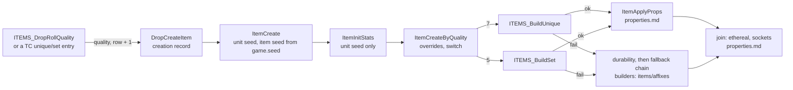
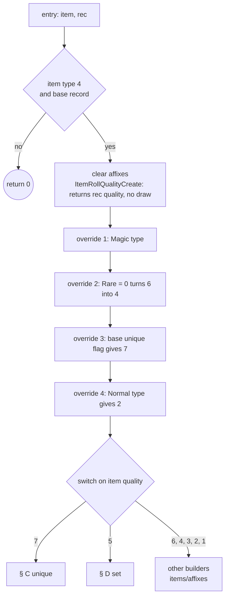
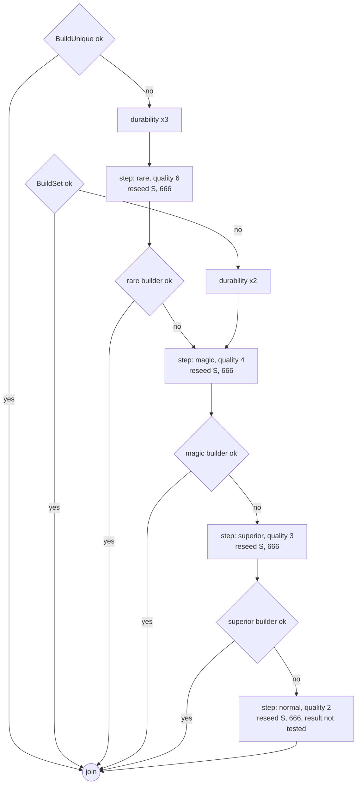
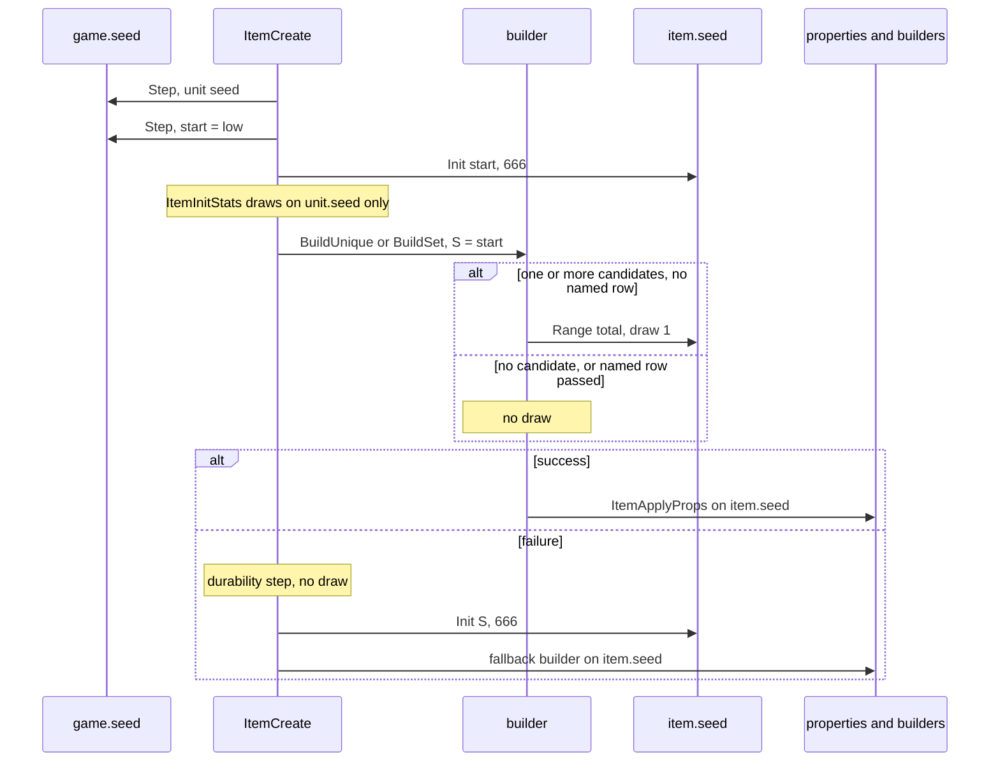

## Purpose

Once a dropped item reaches item creation with quality 7 (unique) or 5 (set), this spec says which
`UniqueItems` or `SetItems` row it becomes, what that choice draws, and what the item turns into when no row
fits. The choice is made in `ItemCreateByQuality`. It runs four pre-switch overrides, filters the
rows for the item's base, ilvl and version, and makes one weighted draw on the **item seed**. A unique row is also
tested against the game's made-uniques set. A failed build raises durability and falls back down the chain rare →
magic → superior → normal (unique) or magic → superior → normal (set), and each fallback step first restores the
item seed. The spec ends where the property code (`items/properties`) and the affix builders (`items/affixes`)
take over. It starts where [items/quality](../quality/) and [items/tc § H](../tc/#h-item-pick-and-hand-off) end.
Primitives are those of [rng](../../spec-rng/overview/).



## Entry points

| When | Function | Tag |
|---|---|---|
| A drop's item is created with quality 7 or 5 (from the quality roll or a TC unique/set entry) | `DropCreateItem` → `ItemCreate` → `ItemInitStats` → `ItemCreateByQuality` | [C] |
| The unique case of the switch | `ITEMS_BuildUnique` | [C] |
| The set case of the switch (item version ≠ 0) | `ITEMS_BuildSet` → `ITEMS_BuildSetPick` | [C] |

- [C] On every one of the 1 823 logged creations (304 stock, 1 519 forced), `ItemCreateByQuality` was entered
  once per item with the item seed at `{ItemData+0x10, 666}`, and the model of this spec reproduced the switch
  quality, the builder chain and the seed at the join.
- [C] Vendors, gambling, the cube and quest rewards call the same builders through other paths, and the same model
  reproduces what they build: the vendors' stock and gamble creations (8 787 through the item chain, a unique gambled
  in Normal and three set picks that failed to magic among them), the cube's 140 creations and the quest scripts'
  1 856, the quality-7 hammers among them. This spec covers the builders as a drop reaches them; those callers belong
  to [items/vendors](../vendors/), `items/cube` and `items/quest-drops`. The version-0 builders and the restore path
  (`rec+0x2C` ≠ 0) are named in § B and § C only.
- [I] The cube changes the made-uniques set through one path only: a `usetype` output with `reg` whose input 1 is a
  unique. `RecipeOutputCreate` rebuilds that unique by row; when the row's made bit was clear before
  the rebuild, it clears the bit that the unique builder set, so the set is left as it was. A bit already set stays
  set (the made test of § C may then fail and fall back, § E). No stock `CubeMain` row has `reg`. (`RecipeOutputCreate`, `Game+0x1B24`; specified as step E7 of
  [items/cube § E](../cube/#e-building-one-output--recipeoutputcreate))

## Inputs

### Tables

| Anchor | Used for |
|---|---|
| `UniqueItems.txt:version` (u16 `+0x24`) | version test: a row ≥ 100 is skipped when the item version is < 100 |
| `UniqueItems.txt:enabled` (`+0x2C` bit 0), `UniqueItems.txt:ladder` (bit 3), `UniqueItems.txt:nolimit` (bit 1) | candidate filter; `nolimit` only after the pick |
| `UniqueItems.txt:code` (`+0x28`) | must equal the base's `code` |
| `UniqueItems.txt:lvl` (`+0x34`, read as i16) | `lvl` ≤ ilvl |
| `UniqueItems.txt:rarity` (`+0x30`, i32) | weight, `max(1, rarity)` |
| `SetItems.txt:item` (`+0x28`), `SetItems.txt:lvl` (`+0x30`, i16), `SetItems.txt:rarity` (`+0x34`), `SetItems.txt:set` (`+0x2C`, u16) | set filter and weight |
| `Sets.txt:version` (`+0x04`), copied at load into each member's `setitems` `+0x22` | set version test |
| `Weapons.txt:code` (`+0x80`), `Weapons.txt:unique` (`+0x129`), `Weapons.txt:quest` (`+0x12A`), `Weapons.txt:durability` (`+0x112`), `Weapons.txt:nodurability` (`+0x113`) | the base (same offsets in Armor and Misc) |
| `ItemTypes.txt:Magic` (`+0x14`), `ItemTypes.txt:Rare` (`+0x15`), `ItemTypes.txt:Normal` (`+0x16`) | the pre-switch overrides |
| `TreasureClassEx.txt:Item1` (a cell naming a unique or set row) | the TC-named preference (§ F) |

Not read: `carry1`, `lvl req` (either table), `Sets.level` (not compiled) and ItemRatio.

- [C] The builder never reads `carry1` (`+0x2C` bit 2) or `lvl req`: an instruction scan of `ITEMS_BuildUnique`,
  `ITEMS_UniqueMarkMade` and the two made tests (450 instructions) finds the flag byte tested only against the
  `enabled`, `nolimit` and `ladder` masks and no `lvl req` displacement, and every unique candidate list reproduces
  without the two columns. (`UniqueItems.txt:carry1`, `UniqueItems.txt:lvl` req)
- [C] No set level exists at run time: `sets.bin` has no `level` field (a full-table probe finds the column at no
  offset), and the only set level test reads `SetItems.lvl`, with which every set candidate list reproduces.

- [C] The rows are walked in table order (record index, separator rows already dropped by the compiler), the
  index into `g_pUniqueItems` (stride 0x14C) and `g_pSetItems` (stride 0x1B8). The logged candidate lists, in
  order, match a table-order walk of the stock records in every build.

### Runtime state

| State | Type | Source |
|---|---|---|
| `item.seed` | `Seed` at `ItemData+0x04`; on entry `{start, 666}` | set by `ItemSeedInit` from one game-seed draw |
| `item.start` | u32 at `ItemData+0x10` | the same draw's `low`; rewritten by every fallback step |
| `item.quality` | u32 at `ItemData+0x00` | written by the switch, the overrides and the fallbacks |
| `item.fileIndex` | i32 at `ItemData+0x28`; −1 none | the chosen `UniqueItems` or `SetItems` row |
| `ilvl` | i32 at `ItemData+0x2C`; `ITEMS_GetItemLevel` raises it to 1 and writes it back | the resolver's item level |
| `itemVersion` | u16 at `ItemData+0x30`, copied from `Game+0x78` | ≥ 100 in an expansion game, 1..99 in a classic game, never 0 on a drop |
| `rec` | the 0x84-byte creation record, `ItemCreateRec` | `+0x2C` restore flag (0 on drops), `+0x30` quality, `+0x40` row + 1 (0 none; the row itself on the restore path, C2), `+0x80` flags (bit 0: `hellbovine` source) |
| `game.gameType` | u8 at `Game+0x6A` | 3 in single player, 2 in TCP/IP (logged) |
| `game.ladder` | at `Game+0x74` | 0 in the runs |
| `game.uniqueMade` | 128 × u32 at `Game+0x1B24`, bit `row` | cleared by `GameCreate` |
| stats 72 (`durability`), 73 (`maxdurability`) | i32, the unit's stats as `ItemInitStats` set them (unit seed) | read and rewritten by the durability step |

### Constants

| Name | Value | Tag |
| --- | --- | --- |
| `INIT_HIGH` | 666 (`0x29A`), the `high` word of every item-seed reset | [C] |
| `VERSION_EXP` | 100: a row or set with `version` ≥ 100 is expansion-only | [C] |
| `DUR_K_UNIQUE`, `DUR_K_SET` | 3, 2 | [C] |
| `DUR_CAP` | 255 | [C] |
| `MADE_BITS` | 4096 (128 dwords) | [C] |
| `SET_COW` | set 29, members only from a `hellbovine` source (monster class 391) | [C] without the source flag; [I] with it |

- [C] Each constant above is what the model uses, and the model reproduces every logged build, failure and
  durability value with it. The set-29 rule is met from one side only: two set picks on Cow King bases with the
  source flag clear left the set-29 row out although it passed every other test; no set-29 row was built on a
  flagged record.

### Inputs and oracles

Every confirmed statement of this spec holds under them. [C]

| Input | Kind | What this spec needs | Owner | Tag |
|---|---|---|---|---|
| `ItemApplyProps` mode 3 (unique) and mode 4 (set) | modelled (a seed oracle) | entry seed = the seed after the pick draw (or the builder entry seed for a TC-named row); it draws the row's properties on the item seed | [items/properties § B](../properties/#b-itemapplyprops-modes-and-blocks) | [C] |
| the superior builder `ITEMS_BuildSuperior` | specified in [items/affixes](../affixes/); entered as a fallback at `{S, 666}` after a failed rare and a failed magic step and chained (nine `throw` creations); never reached from a failed unique or set | as above | `items/affixes` | [C] fallback entry; [I] from a failed unique or set |
| the normal builder `ITEMS_BuildNormal` | specified in [items/affixes](../affixes/); as a fallback never reached | as above | `items/affixes` | [I] |
| stats 72 and 73 before the durability step | value input | the values `ItemInitStats` set on the unit seed | [items/properties § A](../properties/#a-base-stats-on-the-unit-seed) | [C] |
| `ItemData+0x10` (`start`) | value input | one game-seed draw in `ItemSeedInit` | [rng/seeds](../../spec-rng/seeds/#algorithm) | [C] |
| quality and `rec+0x40` | value input | the quality roll's code, or 7/5 and row + 1 from a TC entry | [items/quality](../quality/), [items/tc § H](../tc/#h-item-pick-and-hand-off) | [C] |

## Algorithm

All arithmetic is signed 32-bit unless a step says otherwise. Section A fixes the item seed, B is the switch and
its overrides, C the unique builder, D the set builder, E the failure path, F the TC-named row.
[I]

### A. The item seed at entry

```
A1. game draw: unit.seed ← Init(Step(game.seed).low)                    [C]
A2. game draw: Step(game.seed); item.start ← game.seed.low              [C]
    Init(item.seed, item.start)                                         ; item.seed = {start, 666}
A3. ItemInitStats: quantity, durability, defense, picture (properties § A) [C]
    ; draws on unit.seed only; item.seed is untouched
A4. ItemCreateByQuality(game, item, rec)                                 ; § B
```

Step notes:

- A3. The entry seed of `ItemCreateByQuality` was `{ItemData+0x10, 666}` in all 1 823 logged creations, so the
  unique or set pick is the **first draw on the item seed**. [C]
- A3. Exception: an item of type 11 has a setup (called from `ItemInitStats` on an exact type test)
  that draws on the item seed first. No stock item is of type 11: its one base, `elx`, is named by no TC cell, cube
  output or vendor column. [I]

### B. `ItemCreateByQuality`: the creation roll, the overrides and the switch



```
B1. if item.type ≠ 4 or base(item) = none: return 0                       [I]
B2. ITEMS_SetAutoAffix(item, 0); clear prefix[0..2], suffix[0..2], rareName[0..1]   [I]
B3. q ← ItemRollQualityCreate(item, rec)                                   [C]
    ; on a drop: itemVersion ≠ 0 and rec.quality ≠ 0, so q = rec.quality, NO draw
    if rec.quality ≠ 0: q ← rec.quality
    item.quality ← q
B4. overrides, in this order, each writing item.quality only:            [I] order; [C] item.quality only (all of B4a–B4d; note B4)
B4a.  if ItemTypes[item.type].Magic:
        if base.quest: item.quality ← 7
        else if item.quality ∉ 4..9: item.quality ← 4
B4b.  if not ItemTypes[item.type].Rare and item.quality = 6: item.quality ← 4
B4c.  if base.unique: item.quality ← 7
B4d.  if ItemTypes[item.type].Normal (or the type has no record): item.quality ← 2
B5. switch item.quality:                                                   [C]
      7 → § C1;  5 → § D1;  6, 4, 3, 2, 1, 8, 9 → their builders (items/affixes);  else return 0
```

Step notes:

- B3. The creation-side roll's drawing body (item seed, `ITEMRATIO_Select`) runs only for an item of version 0 or
  a record of quality 0, which no drop produces. Every builder entry seed in the runs equals the seed the model
  carries with no draw here. [C]
- B4. A later rule overwrites an earlier one: a base with `unique` whose type is `Normal` ends at 2. The rules do
  not write `rec.quality`. For a type with no `ItemTypes` record, `Magic` and `Rare` read as 0 and `Normal` as 1.
  [I]
- B4. A model of the four rules predicted the switch quality of all 1 823 logged creations. Only B4d wrote (1 325
  times), and always over a quality already 2. [C]
- B4. [C] **The rules write the item's quality only.** Two stock quest creations (`j34`, `mss`) are turned from 2 to
  7 by the base `unique` rule, and the record's quality at the switch stays 2. No creation has two rules writing, so
  their order is read from the code.
- B4. **On a drop through the quality roll, no override changes the quality**: the roll's early returns already
  give what the rules would write (a `Normal` type returns 2, a `unique` base or a `Magic` type with a quest base
  returns 7, a `Magic` type never gets below 4, a type with `Rare` = 0 skips the rare test). A TC entry that forces
  7 or 5 still passes through the rules: its quality becomes 2 when the base's type is `Normal`. All 9 336 drop
  creations of the S2b log sets reach the switch with the record's quality, and for each of the 659 bases and each
  result the drop roll can return for it the four rules write the same value (the bases no TC holds left out). [C]

### C. The unique builder

```
C1. item.fileIndex ← −1                                                    [C]
    S: u32 ← item.seed.low                                                  ; saved for the fallbacks (§ E)
    ok ← BuildUnique(game, item, rec)
    if not ok: go to E1 with k = 3, chain = [rare, magic, superior, normal]
    go to join

BuildUnique(game, item, rec) → bool:
C2. if base(item) = none: return false                                      [I]
    ; version 0 and the restore path (rec.restore ≠ 0) are not reached by a drop: see step notes
C3. n: i32 ← 0; total: i32 ← 0; named: i32 ← −1                           [C] (all of C3–C4)
    for row in 0 ..< nUniqueItems:
      u ← UniqueItems[row]
      if u.version ≥ 100 and itemVersion < 100: continue                    ; u16 compare
      if not u.enabled: continue
      if u.code ≠ base.code: continue
      if u.ladder and game.gameType = 0 and game.ladder = 0: continue
      if (i16) u.lvl > ITEMS_GetItemLevel(item): continue                   ; signed compare
      if rec.rowPlus1 ≠ 0 and rec.rowPlus1 − 1 = row: named ← row          ; § F
      cand[n] ← (row, cumBefore: total)
      n ← n + 1;  total ← total + max(1, u.rarity)                          ; rarity i32
C4. if n = 0:                                                               [C]
      if base.unique: return true                                           ; [I] no row, no properties
      item.fileIndex ← −1; return false
C5. if named < 0:                                                           [C]
      r: u32 ← RNG.Range(seed: item.seed, n: total)                         ; draw#1, the only draw of the builder
      c ← 1
      while c < n and r ≥ cand[c].cumBefore: c ← c + 1
      row ← cand[c − 1].row
    else:
      row ← named                                                           ; [I] no draw
C6. if not base.quest and game ≠ none                                       [C]
       and (row > 4096 or game.uniqueMade bit row is set):
      item.fileIndex ← −1; return false                                     ; no re-pick
C7. if row < 0 or row ≥ nUniqueItems or UniqueItems[row].code ≠ base.code:   [I]
      return false
C8. item.fileIndex ← row                                                    [C]
    if not UniqueMarkMade(game, item): item.fileIndex ← −1; return false
    ; UniqueMarkMade: unless UniqueItems[row].nolimit, set game.uniqueMade bit row
C9. item.flags.identified ← 0                                               [C] (note C9)
    ItemApplyProps(mode 3, item)                                            ; items/properties § B
    return true
```

Step notes:

- C2. For an item of version 0 (never a drop) the builder first multiplies stats 72/73 by 5 (cap 255) and takes the
  first matching row in table order with no `lvl` test and no draw. Drops do not reach it. On the restore path
  (`rec.restore` ≠ 0) the row is set with no filter and no draw. The restore flag's only constant store is in `ItemCreateFromOldRec`, whose two calls sit in helpers called only from the
  reader of a version-`0x47` item list, so only an old-format save reaches the restore path. [I]

- C2. [C] **The restore path takes the row itself.** Loading a tool-built version-71 save with two uniques,
  `ITEMS_BuildUnique` was entered with `rec+0x2C` = 1 for each and took the restore branch, with `rec+0x40` = 0 for The
  Gnasher and 1 for Deathspade, and the write-back held unique rows 0 and 1, where a row + 1 reading would have
  written 1 and 2. The items came from `ItemCreateFromOldRec`, called by the version-71 item-list reader.
  The item version the builder tested was 3 for both, so the version-0 branch is not exercised by it.

- C3. The five tests run in the order written and short-circuit. `ITEMS_GetItemLevel` is called only for a row that
  passed the first four, and it raises `ilvl` to 1 when below 1 and writes it back. [I]
- C3. **The ladder test.** A `ladder` row is excluded only when both `Game+0x6A` and `Game+0x74` are 0. Single
  player has `Game+0x6A` = 3, so `Djinnslayer` (290, `7sm`) and `Leviathan` (317, `uld`) were picked there. [C]

- C3. **Rows never reached**: label rows (blank `code`) never match a base code; the `nobase` and disabled rows,
  `Darkfear` (346, `enabled` blank) included, fail `enabled`. Full table: the 14 rows with a blank `code` and the 3
  disabled rows all have `enabled` 0, no base has a blank code, and none of them is a candidate in any logged pick.
  [C]
- C3. **Weights apply in classic games too.** No version test touches the weight. A classic `rin` at ilvl 53 had
  candidates 120/121/122 at 15/15/1 (Worked example 1b). [C]
- C3. The candidate list is the global `g_UniqueCandidates`, 8-byte pairs `(row, cumBefore)`: the pairs logged
  there equal the model's in every unique pick, and a raw scan finds the address only in `ITEMS_BuildUnique`. [C]

- C5. `RNG_RangeOffset(seed, 0, total)` is `0 + Range(seed, total)`: one `Step`, then `low mod total`. Here
  `total ≥ n ≥ 1`, so the draw always happens. The walk returns the first candidate whose cumulative weight
  **including its own** exceeds `r`. The draw value, the seed after it and the row matched every logged pick. [C]

- C6. **The made test comes after the pick.** A marked row stays among the candidates and is drawn with its full
  weight; drawing it fails the whole build, and the item falls back to rare. The game's bit set, read at every
  unique builder entry, equalled the model's set of rows built in that game every time. A quest base skips the test
  ([I]: no quest base was built). [C]
- C6. The bound test admits row 4096, which would read the dword after the set, and fails rows above it. Stock
  data has 402 rows. [I]
- C8. `nolimit` is blank in every stock row (all 402), so every unique a drop builds is marked. Nothing on the drop
  path clears a bit: the made set's twelve sites are the two game constructors, which clear it whole, the set in
  `ITEMS_UniqueMarkMade`, the cube's clear in `RecipeOutputCreate`, and the builder's and the two made
  tests' reads, and of the writers only `ITEMS_UniqueMarkMade` is in `ItemCreateByQuality`'s call graph. [C]

- C8. [I] A function copies the 0x200 bytes at `+0x1B24` between two structures (`rep movsd`); which structures, and when, is not read.
- C8. **Every path that builds a unique marks it.** `ITEMS_UniqueMarkMade` has one call in the image, from this
  builder, so any caller that reaches `ITEMS_BuildUnique` marks the row. A unique shown in a gamble
  window is marked when the window is built, bought or not. [I]

- C4. With no candidate on a base whose `unique` flag is set, the build succeeds as a quality-7 item with file
  index −1 and no properties. Not reached in the runs. [I]
- C9. The builder clears the identified flag (`0x10`) of every unique it builds: every unique built with a row has
  the flag set at entry and clear at the return (1 stock, 61 forced), while normal and superior items keep it. [C]

- C9. **A quest unique is identified afterwards.** `ItemInitStats` runs after `ItemCreateByQuality` returns, and for a base with both `quest` and `questdiffcheck` set it writes stat 356 (the difficulty) and then
  sets flag `0x10`, undoing the builder's clear. [I]
- C9. Every stock base with the `unique` flag and `quest` (17 bases) has `questdiffcheck` 1, so every stock quest
  unique is created identified; `std`, with the `unique` flag and no `quest`, is not identified by this rule. [C]

- C9. **`nolimit` plays no part in identification.** Its one reader is `ITEMS_UniqueMarkMade`, and none of the 22 sites
  that set or clear the identified flag tests the UniqueItems row: they decide on the base, the quality or their
  caller. [I]

### D. The set builder

```
D1. item.fileIndex ← −1                                                    [C]
    S: u32 ← item.seed.low
    ok ← BuildSet(item, rec)                                                ; version ≠ 0 → BuildSetPick
    if not ok: go to E1 with k = 2, chain = [magic, superior, normal]
    go to join

BuildSetPick(item, rec) → bool:
D2. ilvl ← ITEMS_GetItemLevel(item)                                         [C] (all of D2–D3)
    n: i32 ← 0; total: i32 ← 0; named: i32 ← −1
    for row in 0 ..< nSetItems:
      s ← SetItems[row]
      if s.setVersion ≥ 100 and itemVersion < 100: continue                 ; Sets.version, copied at load
      if (i16) s.lvl > ilvl: continue
      if s.item ≠ base.code: continue
      if s.set = 29 and not (rec.flags & 1): continue                        ; hellbovine source only: [C] flag clear, [I] flag set (note D2)
      if rec.rowPlus1 ≠ 0 and rec.rowPlus1 − 1 = row: named ← row          ; § F
      w: i32 ← s.rarity if s.rarity ≠ 0 else 1                              ; a negative value is kept
      cand[n] ← (row, w); total ← total + w; n ← n + 1
D3. if named < 0:                                                           [C]
      if total = 0: return false                                            ; no draw
      r: u32 ← RNG.Range(seed: item.seed, n: total)                         ; draw#1, the only draw of the builder
      c ← 0
      while c < n and r ≥ cand[c].w: r ← r − cand[c].w; c ← c + 1
      if c = n: return false
      row ← cand[c].row
    else:
      row ← named                                                           ; [I] no draw
D4. item.fileIndex ← row; item.flags.identified ← 0                         [C]
    ItemApplyProps(mode 4, item)                                            ; items/properties § B
    return true
```

Step notes:

- D1. `ITEMS_BuildSet` sends an item of version 0 to `ItemBuildSetV0` instead (doubles 72/73 itself,
  one start draw, walks the classic sets' member lists, keeps the last match). No drop reaches it. [I]

- D2. Test order: version, `lvl`, code, set 29. `ilvl` is read once, before the loop. The candidate list is a
  256-pair stack array (`sub esp, 0x814`) with no count test: a `setitems` table with more than 256 rows matching one
  base would overwrite the frame; stock data has 127 rows in all, at most 9 per base. [I]
- D2. **A set item has no version of its own.** The loader copies its set's `version` into the member row at
  `+0x22`, so a classic game (item version < 100) sees only the members of the 16 classic sets (`setitems` rows
  0..61). Full table: sets 0–15 have `version` < 100 and their members are rows 0–61. In five forced classic picks
  the version test removed an expansion-set row that passed `lvl` and code, and all 44 classic set picks (10 stock)
  have only classic-set candidates. [C]
- D2. **No `enabled`, ladder or once-per-game test exists for sets**: a set item can drop any number of times in
  one game. `setitems` has no such column, and in a forced run one set row was built twice in one game. No stock
  game built a set row twice. [C]
- D2. Set 29 (`Cow King's Leathers` in stock data) is filtered by the record's flag bit 0, which
  `DropCreateItem` sets when the source is monster class 391 (`hellbovine`). [C] Without the bit,
  set-29 rows are not candidates: two forced set picks on Cow King bases (`vbt`, `xap`) left out the set-29 row,
  which passed the version, `lvl` and code tests; the bit is set on all 221 stock drops from a `hellbovine`. Stock
  had no set pick on a set-29 base with the bit clear.
- D2. [I] A set-29 row taken on a flagged record: no cow drop of a set-29 base reached the set builder.

- D3. The draw value, the seed after it and the row matched every logged set pick, among them `amu` with nine
  candidates (Worked example 2). With weights ≥ 1 the subtracting walk picks the same row as the unique walk; the
  `c = n` exit is unreachable then. [C]
- D3. **No candidate, or `total` = 0**: return false with no draw. Every logged set failure was of this kind. [C]

- D4. The set builder does not consult `game.uniqueMade`: none of the made set's twelve sites lies in
  `ITEMS_BuildSet` or `ITEMS_BuildSetPick`, and the made bits read at a later unique build are exactly the unique rows
  built, set builds in the same game included (1 stock, 48 forced). [C]
- D4. [C] The file index and the identified flag: every set build writes the row as the file index (17 stock, 93
  forced), and 65 forced set items have the flag set at entry and clear at the return.


### E. Failure: durability and the fallback chain



```
E1. Durability(item, k):                                                    [C]
      if ItemHasDurability(item) and itemVersion ≥ 1:
        v72: i32 ← k × GetUnitStat(item, 72);      if v72 ≥ 255: v72 ← 255
        v73: i32 ← k × GetUnitBaseStat(item, 73);  if v73 ≥ 255: v73 ← 255
        SetStat(item, 72, v72); SetStat(item, 73, v73)
E2. for q in chain:                                                         [C]
      ClearAffixes(item)                                                    ; 3 prefixes, 3 suffixes, 2 rare names, fileIndex −1
      item.start ← S
      Init(item.seed, S)                                                    ; item.seed = {S, 666}, no draw
      ItemRollQualityCreate(item, rec)                                       ; returns at once on a drop, no draw
      item.quality ← q; rec.quality ← q                                     ; 6, 4, 3 or 2
      if q = normal: NormalBuilder(item); go to join                        ; result not tested
      S ← item.seed.low                                                     ; = S, nothing drew since the reseed
      if Builder_q(item, rec): go to join                                   ; items/affixes (an oracle in 's check)
```

Step notes:

- E1. `ItemHasDurability` holds when the base's `nodurability` is 0, its `durability` is non-zero, the unit has a
  stat list and stat 152 is below 1. The cap is a signed compare (`cmp 0xFF; jl`), so 255 and above become 255.
  Stat 72 is read with `GetUnitStat` and 73 with `GetUnitBaseStat`; both are the values `ItemInitStats` set. A
  base without durability skips the step with no write. [C]
- E2. `S` is the low word saved in C1 or D1, before the failed builder. On a drop it equals `item.start`, so every
  fallback step starts from exactly the state the failed builder started from, and **the failed builder's draw is
  discarded** (Worked example 3b). [C]
- E2. Every logged failure went through one step only: 39 unique failures to rare (38 with no candidate, 1 with
  an already-made row) and 47 set failures to magic (3 of them stock). Each fallback builder's entry seed was
  `{S, 666}`, and each succeeded. [C]
- E2. [I] A superior step that fails, and so the normal step, and the rare builder's at-once failure when the type's
  `ItemTypes.Rare` is 0, were not reached.
- E2. [C] Every fallback step writes its quality into `rec.quality`, and the fallback item has no row: at the join
  the record quality is the last step's quality in all 358 logged chains (51 stock), and the file index is −1.

- E2. [I] That `ClearAffixes`, not the case's own `SetFileIndex(−1)` before the builder, is what resets the index (no
  chain separates the two), and that the post-switch steps read `rec.quality`.

### F. A row named by the TC

```
F1. A TC cell naming a UniqueItems or SetItems row resolves to             [I]
      an entry (base = Items[code of the row], aux = row, flags 0x11 unique / 0x12 set);
    the resolver passes quality 7 or 5 and rec.rowPlus1 = aux + 1.
F2. In C3 or D3 the named row is taken with NO draw only if it passed every     [I]
    filter test for this item. Otherwise the ordinary weighted pick runs over the
    base's candidates.
```

Step notes:

- F1. **Duplicated names**: each loader inserts every row's `index` in row order into a name tree keyed by the
  lower-cased name cut to 32 bytes; an equal name is freed, not linked, so the **first** row of a name wins.
  `Rainbow Facet` resolves to record 392 and `Azurewrath` to record 29 (the disabled `crs` row). A hit of 0 is
  rejected, so row 0 (`The Gnasher`) cannot be named. A forced-path log with edited TC cells agrees (`Azurewrath`:
  record `+0x40` = 30, base `crs`); it stays inferred, because the edited cells are the claim's own input. [I]

- F2. A named row must pass `enabled` (unique) and `lvl` ≤ ilvl like any other: a named row whose `lvl` exceeds the
  drop's ilvl yields another unique of the same base, and with no other candidate the build fails. A named unique
  that is already made fails C6. The forced-path log agrees: `The Oculus` (284) was taken with no draw three times, its
  second named creation in a game found the row made, and `Azurewrath` (29, disabled) found no `crs` candidate and fell
  back to rare six times. Only edited data reaches a named row, so this stays inferred. [I]

- F2. In stock data the only cells naming a row are `Annihilus` in `ROP (N)` and `ROP (H)`. No run reached them:
  `rec+0x40` was 0 at every logged entry. [C] That absence is logged; the path itself stays inferred.


### Draw order on the item seed



- [C] Between the item-seed initialisation and the first oracle the item seed is stepped **at most once**: the
  pick draw, made only when there is at least one candidate (unique) or a positive total (set) and no named row
  passed the filter. The creation roll, the overrides, the filters, the made test and the durability step draw
  nothing.
- [C] A failure discards that draw: the fallback builder starts from `{S, 666}`, the same state the failed builder
  started from.
- [C] The game seed and the unit seed are not stepped from the entry of `ItemCreateByQuality` to the return of the
  builder chain, oracles aside: the game seed is unchanged at the join and at the returns in 1 043 of 1 043
  creations, and the unit seed in the 993 built by other builders; the low-quality builder's durability draw
  (an oracle of this spec, items/affixes G2) is the only unit-seed step, one in 44 low builds and none in 6, in no
  builder or fallback of this spec.

## Outputs

At the join, before the post-switch steps:

| Outcome | `item.quality` / `rec.quality` | `item.fileIndex` | Item seed | Extra | Tag |
|---|---|---|---|---|---|
| unique built | 7 / 7 | the row | ItemApplyProps's exit seed | row marked in `Game+0x1B24` (unless `nolimit`); unidentified, except a quest base, which `ItemInitStats` then identifies (C9 notes) | [C] |
| unique, no candidate, base `unique` flag | 7 / 7 | −1 | the entry seed | no properties | [I] |
| set built | 5 / 5 | the row | ItemApplyProps's exit seed | unidentified | [C] |
| failed unique | 6 / 6 (or lower down the chain) | −1 | the fallback builder's exit seed | stats 72/73 ×3, cap 255 | [C] |
| failed set | 4 / 4 (or lower down the chain) | −1 | the fallback builder's exit seed | stats 72/73 ×2, cap 255 | [C] |

- [C] Every logged creation's seed, quality, record quality and file index at the join matched the model.

- [C] After the join, still in `ItemCreateByQuality` and outside this spec: an expansion item may take one ethereal
  draw on the item seed. Quality 5 is excluded, so **a set item is never ethereal while a unique can be**, and a
  failed set (now 4) can be: on weapons and armour with durability, quality 5 made no draw (12 stock, 56 forced),
  quality 7 drew (8 stock, 40 forced; the stock Hell Forge Hammers skip as a quest base), quality 4 drew (308 stock),
  failed sets included. Then qualities 1..3 get the socket roll, and every quality except 5 and 7 gets the
  base's automagic group in an expansion game; see [items/properties § F](../properties/#f-ethereal-and-sockets).


## Worked example

Seeds are `low:high` in hex.

### Example 1: a unique pick (stock)

Expansion Hell, item 308 `hlm`, ilvl 84, item version 101, quality 7 from the drop roll (`CPRE item=308 q=7`). [C]

| Step | Log line | Value |
|---|---|---|
| A, entry | `IC0 … "seed":"fc763d51:0000029a","start":4235607377 …` | item seed `{start, 666}`, start = `0xfc763d51` |
| B | `ICQ {"q":7,"iq":7,"rq":7}` | no override changes 7 |
| C3 | `UMADE {… "rows":[]}` | nothing made yet in this game |
| C3 | `UPK {"row":73,"n":1,"total":1, … "cand":[[73,0]] …}` | one candidate: row 73 `Coif of Glory` (`hlm`, version 0, `lvl` 19, `rarity` 1) |
| C6–C9 | `PROPS {"mode":3,"seed":"c020c1ef:694cc79b"}` | not made, marked, oracle entered with the post-draw seed |
| join | `ICJ {"seed":"c020c1ef:694cc79b","q":7,"rq":7,"fi":73}` | unique, file index 73 |

A single candidate still costs one draw. [C]

### Example 1b: a weighted unique pick in a classic game (forced path)

Classic Nightmare, item 522 `rin`, ilvl 53, item version 2, entry seed `1a7316d0:0000029a`. [C]

| Candidate | Row | `lvl` | `rarity` | `cumBefore` |
|---|---|---|---|---|
| 0 | 120 `Nagelring` | 10 | 15 | 0 |
| 1 | 121 `Manald Heal` | 20 | 15 | 15 |
| 2 | 122 `The Stone of Jordan` | 39 | 1 | 30 |

Total 31. Draw#1 steps the seed to `dc4590aa:0b082b6a` (`UR {"r":20, …}`), `r = 0xdc4590aa mod 31 = 20`. The walk
stops at candidate 2 because `20 < 30`, so the row is candidate 1, **121**
(`UPK {"row":121,"n":3,"total":31, … "cand":[[120,0],[121,15],[122,30]] …}`). `PROPS` is entered with
`dc4590aa:0b082b6a`. This is a classic game, so the weights apply there too. [C]

### Example 2: a set pick (forced path)

No stock set build succeeded (the stock run's three set builds all failed), so this one is from the forced run, quoted for the filter and the draw only. Expansion Hell, item 520 `amu`, ilvl 84, item version 101, entry seed `22dab5d4:0000029a`. [C]

`SPK {"n":9,"total":45, … "cand":[[1,7],[9,7],[20,7],[28,7],[33,7],[53,7],[58,1],[77,1],[95,1]] …}`: the nine
`amu` set rows, classic and expansion, all with `lvl` ≤ 84, in table order with their weights.

| Walk | Candidate row | Weight | `r` before | Outcome |
|---|---|---|---|---|
| 0 | 1 `Civerb's Icon` | 7 | 23 | 23 ≥ 7, r ← 16 |
| 1 | 9 `Iratha's Collar` | 7 | 16 | 16 ≥ 7, r ← 9 |
| 2 | 20 `Vidala's Snare` | 7 | 9 | 9 ≥ 7, r ← 2 |
| 3 | 28 `Cathan's Sigil` | 7 | 2 | 2 < 7 → **row 28** |

`PROPS {"mode":4, …}` is entered with that seed, and the join has quality 5, file index 28. [C]

### Example 3: a failed set (stock)

Expansion Hell, item 149 `9p9`, ilvl 84, quality 5 from the drop roll (`CPRE item=149 q=5`), entry seed `b6157de2:0000029a`. [C]

| Step | Log line | Value |
|---|---|---|
| D2 | `SPK {"n":0,"total":0, … "cand":[] …}` | no `SetItems` row has `item` = `9p9` |
| D3 | `BRET {"k":"set","ret":0,"fi":-1,"seed":"b6157de2:0000029a"}` | failure, no draw |
| E1 | `DUR` lines: `has` 1, `ver` 101, `s72` 20, `s73` 25, `w72` 40, `w73` 50 | ×2: 20/25 → 40/50 |
| E2 | `FB {"k":"magic","S":3054861794,"seed":"b6157de2:0000029a"}` | S = `0xb6157de2` = the start |
| E2 | `BLD {"k":"magic","seed":"b6157de2:0000029a","q":4,"rq":4,"fi":-1, …}` | magic builder (oracle) entered at `{S, 666}` |
| join | `ICJ {"seed":"09d0db43:562ac9ae","q":4,"rq":4,"fi":-1}` | magic; seed = the oracle's exit |

### Example 3b: a unique already made in the game (forced path)

The one case where a failed builder had drawn. Classic Nightmare, item 320 `brs`, ilvl 52, entry seed `83255370:0000029a`; row 86 `Venomsward` was built earlier in the same game (line 1550). [C] 

| Step | Log line | Value |
|---|---|---|
| C3 | `UMADE {… "rows":[6,7,33,84,86,100,121]}` | 86 is marked |
| C5 draw#1 | `UR {"r":0,"seed":"d34837ca:36b32d94"}` | one candidate (86), drawn anyway |
| C6 | `UPK {"row":86, … "made":1 …}`, `BRET {"k":"unique","ret":0,"fi":-1,"seed":"d34837ca:36b32d94"}` | made → failure, no re-pick |
| E1 | `DUR` lines: `s72` 34, `s73` 50, `w72` 102, `w73` 150 | ×3 |
| E2 | `FB {"k":"rare","S":2200261488,"seed":"d34837ca:36b32d94"}` | S = `0x83255370`, the seed still holds the failed pick's draw |
| E2 | `BLD {"k":"rare","seed":"83255370:0000029a","q":6,"rq":6, …}` | reseeded to `{S, 666}`: the draw is discarded |
| join | `ICJ {… "q":6,"rq":6,"fi":-1}` | rare |

## Reimplementation notes

- **One draw, on the item seed, not the source unit's seed.** The quality roll steps `src.seed`; the pick steps
  `item.seed`, which a game-seed draw created. Drawing the pick from `src.seed` shifts every later TC pick of the
  drop. [C]
- **A single candidate still draws.** `Range(1)` returns 0 but steps the seed, and the properties then start from
  the stepped seed. [C]
- **The made test comes after the pick.** Do not drop made rows from the candidate list and re-pick; the game
  draws with them in and fails the build when one comes up. [C]
- **Restore the seed before each fallback.** Each step reinitialises the item seed to `{S, 666}` and rewrites
  `ItemData+0x10`; a failed builder's draws must not leak into the fallback. [C]
- **Ladder uniques drop in single player and TCP/IP.** 1.14d has one `ladder` bit, ignored whenever
  `Game+0x6A` ≠ 0. The ladder-season columns of D2R's table do not exist in 1.14d; do not port them. [C]

- **`rarity` weights in classic games.** A community note says it works only in expansion games; in 1.14d no
  version test touches the weight. Do not "correct" it. [C]
- **A TC-named unique still needs `enabled` and `lvl` ≤ ilvl.** D2R's documentation says a disabled row can still
  drop from a TC; in 1.14d it falls to the ordinary weighted pick. [I]
- **Set items take their version from their set,** and have no `enabled`, ladder or once-per-game test. [C]
  (`Sets.txt:version`; D2 notes)
- **The `lvl` comparisons are signed 16-bit** (`movsx`) against an `ilvl` raised to at least 1. [I]

- **Durability is ×3 or ×2 of the current values, each capped at 255, and only for a base with durability.** The
  step uses `GetUnitStat` for 72 and `GetUnitBaseStat` for 73. [C]
- **Set weight 0 counts as 1, a negative weight is kept.** A total of exactly 0 returns at once, before any draw
  (`test esi, esi; je`). Only a negative total reaches `RNG_RangeB`, which returns 0 with no draw (rng §
  Algorithm, `n < 1`); the walk then picks the first row whose weight exceeds the running remainder, or runs off the
  end and fails, leaving the seed unchanged. Stock weights are 1, 3 and 7, so this only matters for modded data. [C]
  Emulated reproduction of `ITEMS_BuildSetPick` over 3 000 calls on synthetic tables: 1 842 weight-0 candidates counted as 1, 2 452 negative weights
  kept, 1 878 zero totals and 458 negative ones.
- **Item version 0 builds by other rules** (first match, no draw, ×5 durability for uniques; set membership walk
  for sets). A reimplementation that creates only drops never reaches them. [I]

## Evidence

- Tables: UniqueItems, SetItems,
  Sets, ItemRatio (not read on this path),
  ItemTypes, Weapons, Armor,
  Misc, TreasureClassEx.
- Specs: [rng](../../spec-rng/overview/) (`Step`, `Range`, `Init`), [rng/seeds](../../spec-rng/seeds/) (step 7a),
  [items/tc](../tc/) (hand-off), [items/quality](../quality/) (the code and § F). Downstream:
  [stats/aggregate § J](../../spec-stats/aggregate/#j-set-bonuses) (a set item's bonuses once worn).
