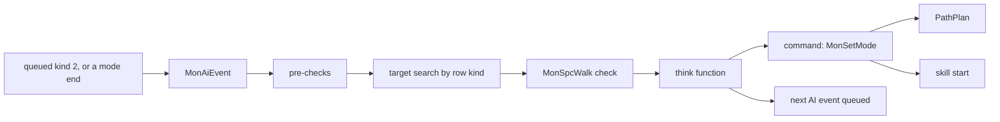
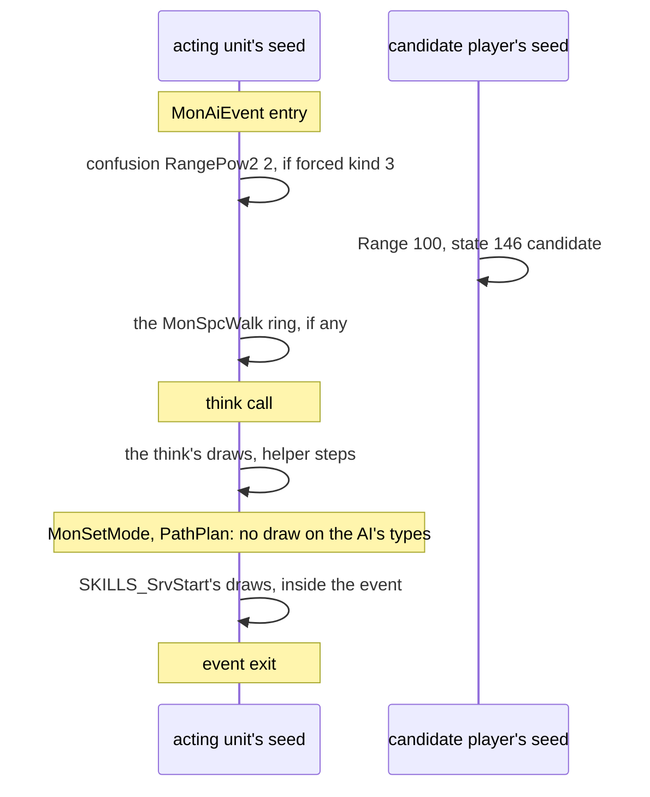
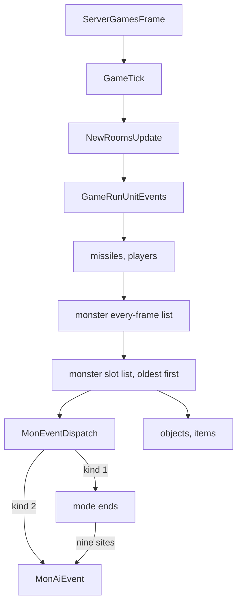
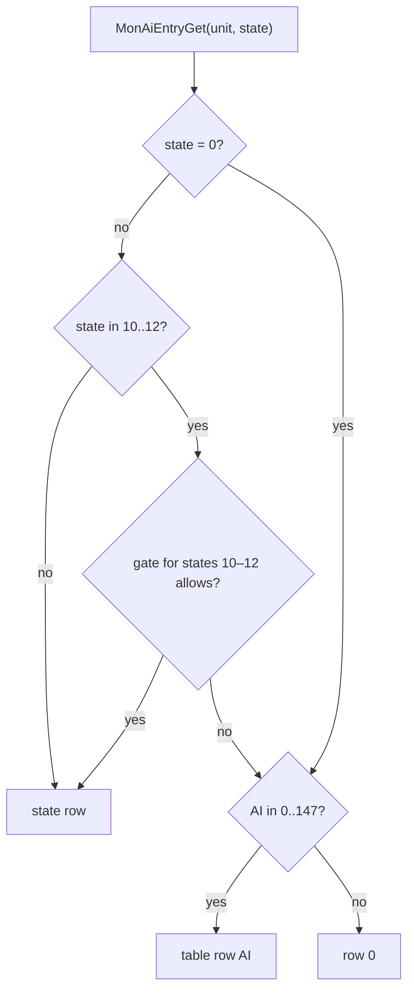
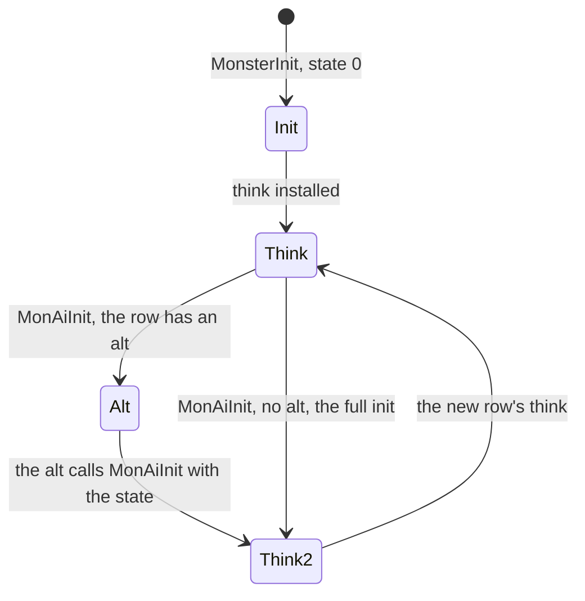

## Purpose

A monster, a summon or a hireling does not think on every frame. It has an **AI event**, monster event kind 2, which
comes due on a frame or is called at a mode's end. One event runs the pre-checks, the target search, a walk check and
then the unit's **think function**, chosen from the AI table by MonStats `AI` and the unit's AI state. The think draws on
the acting unit's seed and gives one command: a mode, a skill, a path request, or a wait until the next event.

This page is the tick, the AI's clock, the table and its dispatch, the state a unit carries, the event kinds with their
seeds and how far each is evidenced. [machinery](../machinery/) is the target search, the command, the path request, the
following, and the think function of each of the 18 tier AIs. The other rows of the table and the 18 state rows are
[the catalogue](../catalogue/), one entry each.

Boundaries of this spec: the mode's frames are [anim/timing](../../spec-anim/timing/)'s; the skill behind a command is
[skills/dispatch](../../spec-skills/dispatch/)'s; the planners behind a path request are
[path/search](../../spec-path/search/)'s, reading the live grid; the composed frame is [sim/frame](../../spec-sim/frame/)'s.



## Entry points

| When | Function | Tag |
|---|---|---|
| A kind-2 event comes due in the monster slot pass | `MonAiEvent`, from `g_MonEventFuncs[2]` | [C] |
| A mode ends, nine direct calls of the same slot | `MonModeEndGeneric` (seven), `MonModeEndToS1`, `MonModeEndToS1b` | [C] nine loads of the slot, each followed by `call eax`, seven in `MonModeEndGeneric` and one in each `MonModeEndToS1` form |
| A monster is created, or its AI state changes | `MonAiInit`, first from `MonsterInit` | [C] `MonAiInit`'s 33 direct calls, three tools, include `MonsterInit`'s with state 0 |

## Inputs

### Tables

| Anchor | Used for |
|---|---|
| `MonStats.txt:AI` | the row of the AI table, s16 at `+0x1E` |
| `MonStats.txt:aidel` | the delay after a neutral start, u8 at `+0x4F` plus difficulty under one condition (C1) |
| `MonStats.txt:aidist` | the search range, u8 at `+0x52` plus difficulty |
| `MonStats.txt:aip1` | `aip1..8`, the think function's parameters, s16 at `+0x56 + 6(K−1) + 2·difficulty` |
| `MonStats.txt:opendoors` | whether a unit opens doors (F2) |
| `MonStats.txt:isMelee` | the `MonSpcWalk` check (F4) |
| `Levels.txt:MonSpcWalk` | the same check |
| `Skills.txt:auratargetstate` | which curse sets which AI state (E5) |
| MonAI | the index of the 148 rows and which MonStats records name them |

### Runtime state

| State | Type | Source |
|---|---|---|
| the frame `T` | i32, `Game+0xA8` | `GameTick` |
| difficulty `d` | u8, `Game+0x6D` | the game |
| the unit's seed | the two words `Unit+0x20/+0x24` | [rng/seeds](../../spec-rng/seeds/) |
| `AiCtl` | 0x40 bytes at `MonsterData+0x28` | § E |
| `MonPathCtl` | 0x24 bytes at `MonsterData+0x2C` | [machinery § D](../machinery/#d-the-path-request) |
| `AiCtx` | 9 dwords on `MonAiEvent`'s stack | § B |

### Constants

| Name | Value | Tag |
| --- | --- | --- |
| table rows | 148 of 16 bytes, as bytes | [C] |
| state rows | 18 of 16 bytes | [C] dumped with a second tool against `MonAiInit`'s signed `< 18` bound |
| default `aidel` | 15 when the cell is 0 | [C] emulated for a monster already in NU, 35 cases |
| stunned delay | 45 under state 21 | [C] emulated, 37 cases |

## Algorithm

### A. The event kinds and their seeds



| Event | Entry | Draws | Seed | Tag |
|---|---|---|---|---|
| events that end before the think | `MonAiEvent`: pre-check, search, `MonSpcWalk` | § F, [machinery § A](../machinery/#a-target-search) | acting unit; a candidate player for state 146 | [C] 14 645 of 32 324 logged events reach the think call and 17 679 end before it, with `AiCtl.state` 0 at all of them |
| a decision | the think call | the entry's own, in [machinery § T](../machinery/#t-the-tier-ais) | acting unit | [C] every logged point (entry, think call, boundaries, `MonSetMode`, `PathPlan`, skill start, exit) follows the previous one by whole steps of the acting unit's own seed, 0 to 7 steps, 0 violations in 14 645 decisions; the search's state-146 candidate draw is on another seed and is not logged |
| the path plan | `PathPlan` under `MonSetMode` | none on the AI's types | — | [C] the unit seed is unchanged on all 9 618 plan calls with an exit line inside decisions, path types 2, 5, 6, 7, 13, 15; type 1 was not requested in the run |
| a skill start | `SKILLS_SrvStart` inside the decision | [skills/dispatch § P](../../spec-skills/dispatch/#p-draws-and-seeds-per-event-kind) | acting unit | [C] 899 skill starts of the decision's unit between the think call and the exit, each entered at the decision's last logged seed advanced 0 to 12 steps (0 steps 791 times) and each exiting with the event's exit seed |
| a mode's frames | [anim/timing § N](../../spec-anim/timing/#n-draws-and-seeds-per-event-kind) | none of the animation's but an object's start | — | [I] |

- A1. [C] **The commands logged at the AI's sites of `MonSetMode`** are led by modes 2 (WL) 6 133, 15 (RN) 1 533, 4 (A1) 712,
  5 (A2) 425, 14 (SQ) 289, 8 (S1) 375, with path type byte 101 for every-frame modes and 100 otherwise; modes 9 (S2) 58, 11 (S4) 53,
  7 32, 10 (S3) 18 and 1 (NU) 4 also occur.

- A2. [C] **Decision pairs on one seed.** A decision's exit seed equals the same unit's next decision's entry seed in
  12 368 pairs of the first run, 9 687 of them with draws. Over the three kept batches every tier AI but two has at
  least 20 drawing pairs: Fetish has 22, and the other 15 have 58 or more.
- A3. [I] **Chaining short by name:** Andariel has 8 drawing pairs of the 20 asked and BatDemon 1 of 300 pairs, so the
  chaining of those two kinds stays a reading.
- A4. [C] **The H1 gaps, new ones.** With the AI log lines beside the skills log lines, 41 of the 49 monster gaps of six
  replayed sessions close: every entry seed on the way agrees with the walking seed, and the next skill event starts
  inside the unit's own decision, at 0 steps from that decision's last boundary line. All 41 are AI row 13, and the
  resumed model reproduces every decision between the two events (91). Logged paths only: the seed movement is the
  decision's, and the callee that starts the skill is a boundary.
- A5. [C] **The rest of H1.** The other 8 stop at an `AD0` whose attacker is the gap's monster, its seed 1 step (5 gaps),
  3 (2) or 4 (1) past the walking seed; which draws those are is not examined. The 331 gaps of the earlier skills runs cannot be re-walked, as their logs
  hold no AI line and a replay does not reproduce them; they have the same shape, which is all their logs can say: 330
  are of classes 58 and 59, and the first disagreement is `MAS0` in 257 and `AD0` in 70. The frame model's walk re-chains none of
  the 331.

- A6. [C] **A summon's owner skill damage,** for class 419 and skill 221 at level 20 in sessions with one player, is
  [skills/dispatch § M](../../spec-skills/dispatch/#m-monster-skill-use) (M2), not restated here.

### B. The tick



```
B1. the frame:                                                    [C] the pass order [sim/frame B1](../../spec-sim/frame/#b-gametick) raises, 0 inversions on the kept checks, and `fr = pre + 1`; [I] the act passes and `NewRoomsUpdate`'s place against them
      GameTick increments Game+0xA8, runs its act passes and NewRoomsUpdate,
      then GameRunUnitEvents, the client room sync and the timers.
B2. the pass:                                                     [C] every-frame before slot (4 637 pairs), slot records at their frame oldest first (4 566 `MDS` pairs), the type order; [I] the `frame & 63` store, the objects' and items' walks (no event logged), the free
      write frame & 63 into the event control
      for each type in missiles, players, monsters, objects, items:
        run its every-frame list, with no frame test
        run its slot list: records whose frame = Game+0xA8, oldest first, each freed after its run
B3. MonEventDispatch(kind, a, b):                                 [I]
      if the unit has state 1 (freeze) and is alive and kind not in {3, 4, 5, 8, 12}: drop the event
      call g_MonEventFuncs[kind]
B4. MonAiEvent(game, unit):                                       [C] in 14 063 `AID` lines `ctx+0x00` is the `AiCtl`, `+0x1C` the MonStats record, `+0x04`, `+0x0C`, `+0x10` zero; 18 076 `AIN` events end before the think; [I] `+0x20`, the order of the three pre-steps, the `IsBadCodePtr` test
      ctx.ctl ← MonsterData+0x28;  ctx+0x04..+0x18 ← 0
      ctx+0x1C ← the MonStats record of Unit+0x04
      ctx+0x20 ← the MonStats2 record of MonStats +0x18
      if either record is missing: return
      if MonAiPreChecks(...) ≠ 0: return                          ; § F
      if MonAiTargetByKind(...) ≠ 0: return                       ; § D
      if MonSpcWalkCheck(...) ≠ 0: return                         ; § F
      AiCtl.think(game, unit, &ctx)                               ; IsBadCodePtr test first, fatal
```

- B1a. [C] Every frame is run by `ServerGamesFrame` over its 1 024 game slots, and `GameTick`'s other caller,
  `GameTickAlt`, has its one call in an unreferenced stub; the monsters' every-frame walk runs before their slot walk,
  slot records in queue order; every logged `Idle` and `Delay` has n ≥ 1. [I] That the AI
  event is always queued at a frame `T + n` with n ≥ 1 is the reading of the 30 queue sites (C5), so it runs in the
  monster slot pass, after every monster's every-frame event of that frame, in the order the events were queued.
- B3a. [I] **A frozen monster loses a due AI event**, and `COMBAT_ApplyFreeze` queues a new one at `T + length + 1`.

- B5. [C] **The nine direct calls** are all mode ends: seven in `MonModeEndGeneric` and one each in `MonModeEndToS1` and `MonModeEndToS1b`, read with three tools. [I] Each is skipped while frozen and alive. There the AI runs inside the mode-end event of that frame, not from
  the queue. The event's two arguments are not read.
- B6. [C] `AiCtx`'s fields as the first-boundary comparison reads them: the think call is where a decision
  begins, and its `ctx` words, the control words and the block a pointer argument addresses are compared with the model.


### C. When the next AI event comes

```
C1. MonModeStartNeutral (mode NU, and MonSetMode's refusal fallback):      [C] for a monster already in NU, to the queue call: the signed `> T` test, the `Game+0x6A`/`+0x74` test, the difficulty byte, the return with no MonStats record (240 cases); [I] a unit in another mode, and everything after the queue call
      if UnitEventFirstFrame(2) ≤ T:                     ; no AI event pending later than now (signed)
        if state 21 (stunned): n ← 45
        else:
          if MonsterData has no MonStats pointer: return 1, nothing queued
          a: u8 ← MonStats+0x4F
          if Game+0x6A ≠ 0 or Game+0x74 ≠ 0: a ← the byte at MonStats+0x4F + difficulty
          n ← a, or 15 when a = 0
        queue kind 2 at T + n
C2. MonAiIdle(n):                                                          [C] the next AI event at `T + n` after 2 358 of 2 573 last-call `Idle(n)`, n ≥ 1 in all; [I] the form at n ≤ 0 (C2b), the mode NU command
      m ← 1 when n = 0, else n                            ; a negative n is kept
      mode NU unless the unit is already NU;  cancel kind 2;  queue kind 2 at T + m   ; 32-bit add
C3. MonAiDelay(n):                                                         [C] the next AI event at `T + n` after 294 of 318 last-call `Delay(n)`, no mode command inside any of the 318; [I] the form at n ≤ 0 (C2b)
      m ← 1 when n = 0, else n                            ; a negative n is kept
      cancel kind 2;  queue kind 2 at T + m;  the mode is unchanged          ; 32-bit add
C4. MonAiDelayEarlier(n):                                                  [C] to the queue call, 240 cases; [I] `UNIT_CancelEvents`' unlink path
      m ← 1 when n = 0, else n                            ; a negative n is kept
      keep the pending event when one is pending, it is not due at T,
        and its frame is below T + n (unsigned compare);
      otherwise: cancel kind 2;  queue kind 2 at T + m
```

- C2a. [C] **Another queue can come first.** After 68 of the 2 573 last-call `Idle(n)` decisions the unit's next AI
  event comes 1 to 7 frames before `T + n`, in mode NU; which queue wins is not attributed.
- C2b. [I] **C2 and C3 share C4's rule at n ≤ 0.** Both helpers open with the idiom C4's emulation confirmed: a zero
  `n` becomes 1 and a negative `n` falls through unchanged, so the frame is the 32-bit sum `T + n` and a negative `n`
  queues the AI event at a frame below `T`. Neither helper rewrites the count before the add. No logged call has
  n ≤ 0 and only C4 was emulated, so the form stays read from the code; what the queue does with a frame below `T` is
  under *Open questions*.
- C2c. [I] **`MonAiIdle`'s mode test** skips the NU command only for a present unit already in mode 1; a null unit
  still takes the mode path.
- C5. [C] **The queueing sites:** `UnitQueueEvent` has kind 2 at 30 call sites and `UNIT_CancelEvents` at 66, two walkers
  agreeing; the 30 are the sites below with `MonAiIdle`, `MonAiDelay`, `MonAiDelayEarlier` and two of
  `MonModeStartNeutral` (C1 to C4), and the frame offsets the walker resolves hold: `T + 2` twice, 15, 25, 15, 13 twice,
  1, 20 and 20. [I] The other sites' offsets, as read: `MonAiTargetOrWait` (`T + 20`); `MonKnockbackEnd` (`T + 1`,
  `T + 15`), an unnamed site (`T + 15`), freeze (`T + length + 1`), three unnamed sites (`T + ebx`, `T + eax + 1` and
  `T + 51`); `SpawnOwnedMonster` (`T + 25`), `RoomInactiveUnitsRestore` (a saved delay), an unnamed function (`T + 2`,
  twice), `UnitInteract` and an unnamed site (`T + 1`); `SkillReviveDo` (`T + 25`), `SummonFinish` (`T + 15`), an unnamed
  site and `SkillDo126ImpInferno` (`T + 13`), `SkillDo44BladeSentinel`, `SkillDo71Taunt`, `MonFleeFrom` (`T + 1`),
  `SkillDo49Shadow` and `SkillDo16Valkyrie` (`T + 20`), and two AI helpers, `AiSt11` and `AiSt12` (`T + 1`).

- C6. [C] **What this means.** After a last-call `Idle(n)` or `Delay(n)` the next AI event comes at `T + n` (C2, C3). [I] A monster that commands a mode usually gets its next AI event from that mode's end
  (`MonModeStartNeutral` at `T + aidel`, or a direct call at one of the nine mode ends); an idle monster with no target
  gets it from the idle delay of its row kind (D3); an AI function may also queue it while a mode runs (`MonAiDelay`),
  and then the AI's next command replaces that mode.
- C7. [I] **What ends a mode, from the AI's side.** The AI commands only from its event, and every command goes through
  `MonSetMode`, which replaces the current mode. A mode ends, from this side, (a) when the AI event fires during it, an
  event queued by `MonAiDelay`, `MonAiDelayEarlier`, `MonAiTargetOrWait`, a skill or a restore while the mode runs, and
  the think commands, or (b) at its own end, whose neutral start queues the next AI event.

### D. The AI table and its dispatch



```
D1. MonAiEntryGet(unit, state: u32) → row:                                 [C] (all of D1) code's map: states 10–12 through the gate and 18 and past with no bound, 240 cases, the others in D1a
      if state ≠ 0 and (state not in 10..12 or the gate allows):
        return g_MonAiStateRows + 16·state                ; no bound on state here
      ai: i16 ← MonStats[class].AI
      return g_MonAiTable + 16·ai   when 0 ≤ ai < 148,  else g_MonAiTable
```

- D1a. [C] This row-address map, for states 0–9 and 13–17 and `AI` over the s16 range, matches the emulation in all 554
  cases; the control without the upper bound fails all 143 cases that separate it. (`entry`)
- D1b. [C] **The gate for states 10–12** is true for a class allowed by `MonModeAllowed` with MonStats
  `+0x0C` bit 6 (`boss`) clear and `+0x0E` bit 0 set; when false, the lookup falls through to the class's row. Emulated:
  the `gate` family's 240 cases and `entry`'s 71.
- D2. [C] **A row** is `{+0 searchKind, +4 init, +8 think, +C alt}`, the words `MonAiInit` and `MonAiTargetByKind`
  read. It is dispatched in two steps: `MonAiInit` copies
  `think` (or `alt`) into `AiCtl.think`; on each AI event the `searchKind` of the row for the stored state runs the
  target search, then `AiCtl.think(game, unit, &ctx)` runs. 147 distinct think functions over 148 rows: rows 106 and
  143 share theirs. 146 rows are named by a MonStats row; `None` and `ShadowMasterNoInit` are not. Rows 0 (`ret 4`) and 1
  (`Idle`: with a room, `MonAiIdle(200)`) are bare.
- D3. [C] **The row kind** (`MonAiTargetByKind`, a switch on `+0` of `MonAiEntryGet(unit, AiCtl.state)`): the stock
  kinds below read twice; the 8 496 decisions of kind-1 states all have a target, and kinds 0 and 5 think without one
  (5 003 and 340 decisions). [I] The *No target* column and
  kinds 3 and above 5 are the reading:

  | Kind | Search | The think runs | No target |
  |---|---|---|---|
  | 0 | none | always | — |
  | 1 | `MonAiTargetOrIdle` | only with a target | the ring walk or the idle below, event ends |
  | 2 | `MonAiFindTarget` | either way | — |
  | 4 | `MonAiTargetOrWait` | only with a target | the ring walk or `T + 20`, event ends |
  | 5 | the same search | either way | — |
  | 3, above 5 | | stops the event (no stock row) | |

  The target goes to `ctx+0x08`, the distance to `ctx+0x14`, the melee test to `ctx+0x18`. Stock: kinds 0 (26 rows), 1
  (104), 2 (16), 4 (1), 5 (1).
- D4. [I] **No target, kind 1** (`MonAiTargetOrIdle`), each ring walk only if `MonModeAllowed`:

  ```
  if MonsterData+0x54 ∈ {3, 19}, or the unit's cell fails the collision pattern test (mask 0x40):
    MonAiWanderRing(5)
  else: d ← the nearest checked player head's distance
    MonAiIdle(10)      when d < 25
    MonAiIdle(d − 10)  when 25 ≤ d < 35
    MonAiIdle(25)      when d ≥ 35
  ```

  Kinds 4 and 5 (`MonAiTargetOrWait`): the same collision ring walk, else the AI event at `T + 20` with the mode
  unchanged.

### E. The AI state on the unit



```
E1. MonAiInit(game, unit, ctl, state: i32):                                [C] to the `IsBadCodePtr` call, 200 cases; [I] the stores after a non-zero init return, and the fatal branch after `IsBadCodePtr`
      if UNIT_HasState(unit, 54): fatal                     ; before the null tests
      if game, unit or ctl is null, or state ≥ 18 (signed), or unit is no monster: return
      if the class is at or past the MonStats count: state ← 1
      if AiCtl.think ≠ 0
         and AiCtl.think = think of MonAiEntryGet(unit, AiCtl.state)
         and that row has an alt:
        AiCtl.state ← state;  AiCtl.think ← alt;  return
      clear AiCtl+0x14, +0x18, +0x1C;  free the parameter records of MonsterData+0x28's control
      r ← MonAiEntryGet(unit, state)
      r.init(game, unit, &blk)     ; blk laid out as an AiCtx: ctl, six zeros, MonStats, MonStats2;
                                   ; returns without setting anything more when a record is missing
      AiCtl.state ← state
      AiCtl.think ← r.think, or AiIdle when 0
      if IsBadCodePtr(AiCtl.think) ≠ 0: fatal               ; KERNEL32, not run
```

- E1a. [I] A unit with state 54 takes a fatal path. The `< 18` test is signed, so a negative argument
  passes it and would index below the second table; no stock caller found passes one. Writes to `AiCtl+0x00` other than
  `MonAiInit`'s two stores are not scanned.
- E2. [C] **The alt as a one-event bridge.** A `MonAiInit` call while `AiCtl.think` is the current row's think and that
  row has an `alt` sets the new state and installs the `alt`, and stores nothing else (23 cases); any other non-zero
  think takes the full init (53). [I] The `alt` then calls `MonAiInit` with that state while
  `AiCtl.think` is the `alt`, so the full init runs and installs the state's think.
- E3. [I] **The blocks.** `MonsterInit` allocates into `MonsterData+0x28/+0x2C/+0x30` the `AiCtl` (0x40 bytes, zeroed,
  `+0x0C = −1`, `+0x10 = 1`, `+0x2C = −1`, `+0x30 = 1`), the `MonPathCtl` (0x24 bytes, zeroed) and a third,
  then calls `MonAiInit(ctl, 0)`.
- E4. [I] **`AiCtl`'s fields**.

  | Offset | Width | Meaning |
  |---|---|---|
  | `+0x00` | i32 | the state |
  | `+0x04` | u32 | the think |
  | `+0x08` | u16 | flags: `0x08` set by the search when it finds a target and the searcher is not alignment 2; `0x40` set by `MonAiMove`'s flag 1 on a refused move, a one-shot that forces the search's line test on, cleared by the search; `0x10` `MonAiBossSightPause`'s once only; `0x20` the unique-mod teleport flag; `0x01`, `0x02` set by the owner functions, not followed here |
  | `+0x0C`, `+0x10` | i32 | a unit to keep near and its type |
  | `+0x14`, `+0x18`, `+0x1C` | i32 | AI variables, `v14`, `v18`, `v1C` in [machinery § T](../machinery/#t-the-tier-ais) |
  | `+0x20`, `+0x24` | ptr | the parameter records |
  | `+0x28`..`+0x34` | | the owner and the minion list |

- E5. [C] **The state rows and who sets them.** `MonAiInit` has 33 direct calls: 21 push an immediate, 12 a register,
  the same with both walkers. [I] The *Setter read* column is the
  reading of those sites.

  | State | Think | Kind | Setter read |
  |---|---|---|---|
  | 0 | the class's row | the class's | `MonsterInit` and the sites sending a unit back |
| 1 | `AiIdle` | 0 | `MonAiInit`'s class bound |
| 2 | — | 1 | none (see E7) |
| 3 | init | 1 | none (see E7) |
| 4 | alt | 0 | none by an immediate; the table's `Hireable` pair |
| 5 | — | 0 | `Hireable`, class 271 |
| 6 | — | 0 | `Hireable`, other classes |
| 7 | — | 0 | none by an immediate; the `NecroPet` think |
| 8 | — | 1 | none (see E7) |
| 9 | — | 1 | none (see E7) |
| 10 | — | 1 | `CloakAreaCb`; a curse with `auratargetstate` 23 |
| 11 | init | 1 | `MonFleeFrom`; a curse with `auratargetstate` 56 |
| 12 | — | 0 | a curse with `auratargetstate` 27 |
| 13 | — | 1 | one `SuperUniqueSpawn` case |
| 14 | — | 1 | none (see E7) |
| 15 | — | 1 | `WhipChangeClass` |
| 16 | init | 1 | `ImpAttach`, two sites |
| 17 | — | 2 | none (see E7) |

  The words of the table are bytes of the image; what they do is the reading above.

- E6. [C] **States seen live.** In the logged lines of the 21 sessions of the third AI run (Normal, 34 980 frames, 27
  caps; 7 539 decisions, 10 721 events) the state is 0 everywhere except two sessions: `s-necro-curse` has 10 in 38
  decisions and 11 in 78, and `s-barb-howl` 11 in 20 decisions and 41 events and 12 in 56 decisions. States 1 to 9 and
  13 to 17 occur in 0 of those lines. Over the 17 logs of the rev 5 AI run the states are 0 in 5 894 decisions, 10 in
  594 and 11 in 36, with 12 absent. This is a statement about those logged lines: the word is read only at a decision or
  an event, and the curses not cast, Nightmare and Hell are outside it.
- E7. [C] No immediate call passes 2, 3, 8, 9, 14 or 17 (both walkers), and `SpawnOwnedMonster` has 15 direct calls. [I] **"No setter" stays a reading:** the register sites give no new value, and `SpawnOwnedMonster`'s
  block `+0x0C` is 0 at all 15 callers; states 4 and 7 meet the same scan. No spec calls
  those rows dead on that.

- E8. [I] **Which curse sets which state.** `CurseSetAiState`, `CurseApplyCb`'s one callee, passes 10, 12 or 11 for a
  skill whose `auratargetstate` (Skills `+0x82`) is 23, 27 or 56, else 0. The states' think functions are the catalogue's.

- E8a. [C] **Not the only setter.** States 10 (594 decisions) and 11 (36) occur in the Countess launches of
  the rev 5 AI run with no curse cast, so E8 is one route among E5's setters, not the only one.
- E9. [I] **The inactive save and restore** keep, of all this, only the saved point of parameter record 10 for
  `isSpawn`/`isMelee`/`interact`-class rows and three named classes, the owner link of classes 68 and 543, and a
  `MonsterData+0x0E` byte for classes 311 and 312; the state word and think function are rebuilt by `MonAiInit` on
  restore.
- E10. [C] **Who has which row.** Hireling's 120 rows name four classes, all of row 61 `Hireable`. The 32 Skills
  `summon` classes resolve to rows: Raise Skeleton, Skeletal Mage, the three golems and Valkyrie row 67; Dopplezon 1;
  Bone Wall 84; Hydra 86; the druid rows 107 to 112; the assassin rows 101, 102, 104, 105 and 106; Overseer's whip 117;
  Impregnate 69. [I] A monster's row is its record's. Bone Prison takes row 1: its `summon` cell names
  `bonewall` (row 84) while `boneprison1`–`4` are row 1, and `SkillSummonClass`'s mapping is unread. Summons enter like
  any monster, by `SpawnOwnedMonster` → `MonAiInit`, and the target lists by `TargetListAttach`.


### F. The pre-checks and the walk check

```
F1. MonAiPreChecks:                                                        [C] to its boundaries, 200 cases: state 21 → `MonAiIdle(3)`, `MonAiOpenDoor`'s `+0x0C` bit 3 test before its collision read, `MonAiKeepNear` whole; [I] the 1 returned after each boundary, the door path past the collision read
      if state 21: MonAiIdle(3); stop the event
      if MonAiOpenDoor stops: stop the event
      if MonAiKeepNear stops: stop the event                      ; machinery § E
F2. MonAiOpenDoor:                                                         [I]
      for a MonStats opendoors row (+0x0C bit 3 of ctx's record, ctx+0x1C, tested first)
      whose cell has collision bit 0x800:
        o ← search kind 8                      ; the nearest object passing an unnamed mode-0 test
        if o's Objects record +0x16D ≠ 0: operate it (arguments 2, guid); MonAiIdle(5); stop    ; the operate call
F3. MonAiBossSightPause:                                                   [I]
      for class 250, a champion or unique, or a boss,
      at distance below 20 (unsigned) from a player target, with AiCtl flag 0x10 clear:
        UnitSetEvent(U, 16, 0);  set flag 0x10;  MonAiIdle(20);  stop
F4. MonSpcWalkCheck, only with a target:                                   [I]
      MonAiBossSightPause
      UModTeleportTry                                             ; drlg/lifecycle; up to two draws, machinery § F
      for an isMelee class allowed its mode, in a level with MonSpcWalk ≠ 0, the distance above it (unsigned):
        if AiApproachPointTest(unit, target) passes: go on, target unchanged
        else search kind 11:
          a found unit replaces the target and the distance in ctx
          none: MonAiWanderRing(4) and stop
```

## Outputs

One event gives at most one command, the unit-seed steps of the entry, changes to `AiCtl` and the next kind-2 record. The entries' pseudocode says
which helper returns and which falls through.

## How far this is evidenced

### G. The first boundary

A **decision** is the call of the think function. Its **first boundary** is the first call, from the think code, of a function the emulation of that think treats as a boundary. The comparison is of the first callee, its call site (the return address), registers, stack words, the seed, the control words and the block a pointer argument addresses. It stops there: what the callee returns and everything after it is the next section's.

- G1. [C] **Floor, first run.** Over every row logged, 14 645 decisions, 12 614 compared, **0 mismatches** at each
  decision's first boundary; 10 374 are compared with an emulated map and 2 240 with a map read by hand. The 18 tier AIs
  hold 9 823 of the 14 645, per the table below, each at 50 or more. Outside the 0: 2 016 decisions in rows with no model,
  15 Scarab decisions the rev 2 window could not compare and the 17 679 events that end before the think call.
- G2. [C] **Later batches, every row logged.** 7 539 decisions, 6 272 compared, 0 mismatches; 6 524 decisions, 4 476
  compared (3 538 modelled, 938 by hand maps), 2 048 in rows with no model, 0 mismatches. Controls
  fail as required in both.
- G3. [C] **What the 0 tests.** 3 313 of the 4 476 compared decisions of the rev 6 batch sit in the 16 thinks with one
  first call: they confirm that call and its words, no branch choice. The site control fails every decision by
  construction, and the melee control fails 767 of 4 476 and separates nothing in 16 rows. 1 163 decisions have a choice
  of first call. By row, 9 tier AIs have one outcome there (rows 6, 13, 28, 29, 30, 35, 37, 61, 64) and 7 more than one.

- G4. [C] **The log's own fault, found and bounded.** The first rev 5 logs of the Far Oasis had 36 first-boundary
  mismatches, all Scarab, all the call of `GameFindUnit` inside a pending `MonsterOwner`, which rev 5's
  pending rule hid. They are exactly the rev 5 decisions with the `MonsterOwner` call at one site; rev 6 logs that one line again,
  and no model changed. On the logs written after the fix the model's words at that call held in all 43 decisions that
  reach it, 24 from a seed that did not exist at the fix.
- G5. [I] **A hand map stays a reading.** For rows 6, 13, 28, 29's think and 35, G1's map is the first-callee map read from the
  code, not emulated. The logged first call equals it, and that equality is what G1 confirms; the map
  as a rule of the code is not raised.

The per-AI table, decisions and distinct predicted first boundaries of the first run (the logs of `AI_CAP_ROW` 200 per
game; the mercenary dominates because it thinks every few frames):

| Row | Tier AI | Decisions | First boundaries | Map | Tag |
|---:|---|---:|---|---|---|
| 2 | Skeleton | 357 | 4 | emulated | [C] |
| 6 | Fallen | 1 393 | 1 | by hand | [C] |
| 9 | Wraith | 70 | 3 | emulated | [C] |
| 13 | FallenShaman | 363 | 2 (358 and 5) | by hand | [C] |
| 20 | Scarab | 180 (15 not comparable) | 5 | emulated | [C] |
| 21 | Mummy | 168 | 5 | emulated | [C] |
| 22 | GreaterMummy | 71 | 3 | emulated | [C] |
| 28 | Vampire | 279 | 1 | by hand | [C] |
| 29 | BatDemon | 115 (110 think, 5 alt) | 1 | think by hand, alt emulated | [C] |
| 30 | Fetish | 130 | 1 | emulated | [C] |
| 34 | Andariel | 64 | 5 | emulated | [C] |
| 35 | CorruptArcher | 95 | 1 | by hand | [C] |
| 37 | SkeletonBow | 278 | 1 | emulated | [C] |
| 61 | Hireable | 5 697 | 1 | emulated | [C] |
| 64 | SkeletonMage | 226 | 1 | emulated | [C] |
| 67 | NecroPet | 184 | 1 | emulated | [C] |
| 89 | Megademon | 98 | 1 | emulated | [C] |
| 125 | BloodLord | 55 | 5 | emulated | [C] |

A row with one first boundary shows that callee, its registers, stack words and seed, not a branch choice. No think past
that first call, nor any branch a callee's result decides, is claimed by this table. The Fallen map's mode 0 and 12 return
branch was never taken.

### H. Past the first boundary

A resumable model walks the code from the think call, taking each boundary call's seed asserted on entry where known and its logged exit seed and `EAX`. Where a branch reads a value the log does not hold, the model forks. A model that forks on unknowns cannot fail there, so the number of calls matched is not the evidence.

- H1. [C] **The rule's sentence.** For the decisions of the table below, and those only, on the logged paths only: *in
  each of these decisions no branch the model ran depended on an unknown value; with the logged inputs and the logged
  results of the boundary calls as oracles, the game's code gives exactly one sequence of boundary calls, it equals the
  logged one in callee, call site and every word the model knows, and the code then returns with no further call.* This
  raises no role, no symbol and no reading of a catalogue finding, and the other side of a one-way branch is not
  compared. It assumes that an opaque callee changes no known memory but `Unit+0xC4` and its pointer arguments, and known
  words exclude synthetic stack and path pointers.

- H1b. [C] **State 13's row, three given words.** For that row alone the "logged inputs" include three words the stock model does not load: the list's count at `AiCtl+0x38`, 4, the points of LvlPrest `Def` 159's `File1` path; DataTables `+0xA78`, the logged `ms` minus class × 0x1A8, which is the log's own read of that word; DataTables `+0xBA0`, 357, the records of skills.bin. They are not unknown: the model does not fork on them, and wrong ones fail, a count of 3 in 6 decisions, a count of 5 in 138, a Skills count of 321 or below in 21. A Skills count above 321 cannot fail, so only that bound is tested. The list's points stay unknown in this census; [S13e](../catalogue/) compares them with the file. Without the words the census has 1 of 160 with no fork.
- H2. [C] **What the resumed 0 tests.** On the rev 6 batch 6 438 decisions are resumed with 0 mismatches and 86 stopped
  (row 32's `call esi` 80, a return site not armed 5, a log's end 1), 46 832 boundary calls matched past the first. Of the
  resumed, 3 055 have no branch on an unknown value; the other 3 383 hold 42 304 of the 46 564 calls past the first of
  completed decisions, where a model that forks cannot fail at the fork, and rows 6 and 61 alone hold 39 340 of them. So
  the large number is a consistency check, and the sentence applies only to the table's fork-free decisions. Controls:
  reversed branches fail 6 174 of 6 524, a seed one step off 6 521 of 6 524.
- H3. [I] **Past the first boundary, a consistency check only:** rows 6 Fallen, 61 Hireable and 67 NecroPet, which have a
  branch on an unknown value in every resumed decision, and the other 5 of row 37 and 12 of row 64. Which call the code
  takes where an unknown decides is not compared: Fallen 8 661 of 24 738 later steps, Hireable 2 095 of 31 037, NecroPet
  21 of 449, SkeletonMage 12 of 148, SkeletonBow 5 of 284. Fallen's later calls are not breadth: 21 620 of its 24 738 are
  one call site, `GameFindUnit` in its loop. The unknowns: Fallen's `GameFindUnit` loop reads the found
  unit's mode and position, Hireable a word through `EDI` that picks its first arm in every decision, NecroPet the words `+0x32`/`+0x34` through `[ebp-0x8]` and a found unit's `+0xC4`.

- H4. [C] **Rows 20, 2, 9 and 125.** Row 20 Scarab's two-way site, which clears `AiCtl+0x14` and returns
  with no call after it, is told apart by the unit's next `AID` word `+0x14`: 0 where the step's low word mod 100 is
  above 10 (59), unchanged where not (11), 70 of 70; so row 20 meets H1's rule and is in its table. Rows 2 Skeleton
  (260 decisions), 9 Wraith (92) and 125 BloodLord (38, under the floor of 50) make the block's one call and no other,
  the exit seed the call's, so there is nothing past the first to claim.
- H5. [I] Everything an entry of [machinery § T](../machinery/#t-the-tier-ais) states past its first boundary outside those
  logged paths stays the code reading of its catalogue finding.

## Worked example

The AI distance and one think, for test vectors. These follow from the rules above with no recorded seed; the kept logs' tests are the checkers over the logs named.

- [C] `AiDistToPoint` with `dx = 10`, `dy = 3` gives `(2·10 + 3) / 2 = 11` in the floor the emulation confirms.
- [C] `MonAiIdle(5)` at frame 1 000 gives the unit's next AI event at frame 1 005, as C2's 2 358 logged calls do, unless
  another queue comes first (C2a).
- [I] It cancels any kind-2 record of the unit first, and `MonAiIdle(0)` queues one for frame 1 001: no `Idle(0)` is
  logged, and C2b reads the form at n ≤ 0.

## Reimplementation notes

- [C] **The AI has two entries, the queue and a mode end.** At a mode end it runs inside that mode-end event, so its draws
  come at that event's place in the frame, not at the kind-2 record's: the two frame runs count the AI's draws by event kind, 447 in
  monsters' kind-0 events and 992 in kind-2. [I] Those mode-end entries are the nine call sites of B5, each skipped while the
  unit is frozen and alive. The per-unit order on a shared seed is [sim/frame § D and § E](../../spec-sim/frame/#d-the-unit-events-the-control-the-pass-the-runners)'s.

- [I] **`Idle` queues; a think that queues nothing leaves no kind-2 record**, so such a unit next thinks at a mode's end.
  Row 6 cancels its pending event on every decision (T6).
- [C] **`MonAiEntryGet` is not bounded on the state branch:** 112 emulated cases from 18 to 2³² − 1, the row address
  wrapping. [I] The bound is `MonAiInit`'s, and it is signed.

- [C] **The row kind follows the stored state**, not the class: a unit in state 12 (kind 0), when the gate of D1b allows it,
  skips the search even when its class's row has kind 1. In 56 logged state-12 decisions, each unit's class row of kind
  1, the `ctx` target, distance and melee word are 0 in all.

## Evidence

- MonAI, MonStats.
