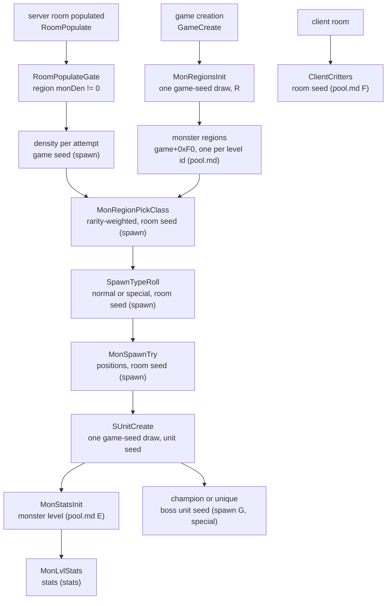

## Purpose

This subsystem specifies how the game decides which monsters exist: which classes each level can host,
where and how many are placed, which become champions, uniques or superuniques, and what level and stats
they get. Four stages are written so far: the level pools with the monster level, the random population of
a room, the special monsters (mods, minions, superuniques, names), and the stats each monster is created with. This page is the
map: the order of the stages, which seed each one steps, and what each passes on. Primitives are those of
rng; seed owners are in rng/seeds.

## Files

| File | Covers | Status |
|---|---|---|
| [pool.md](../pool/) | the monster regions built at game creation (pool pick, appearance sets, copied Levels fields), the monster level rule, client critters | reviewed |
| spawn.md | random population of a room: gate, density, class pick, normal or special, groups, champion packs, unique and MonStats minions, placement | reviewed |
| [special.md](../special/) | champion or unique mods, mod handlers, unique minions and `xfer`, pack members, superuniques, MonPlace 2 and 3, the client name roll | reviewed |
| — | the AI tick, the AI table and state, target search, the command, the path request, following, the 18 tier AIs | reviewed |
| [stats.md](../stats/) | hit points, defence, experience, resistances and block from `MonStats` × `MonLvl` per difficulty, the player count (at creation only), the classic nightmare/hell factors, the stat callback, MonProp, the mod handlers' stat effects | reviewed |

## Data flow

- [C] **Population draws from three seeds.** The server pass that runs on a room's first activation draws its
  class picks, type roll and positions from the active room's seed (`+0x6C`), its density rolls and one step per
  creation from the game seed, and group sizes, minion counts and the champion roll from the leader's or boss's
  unit seed. The type roll only decides normal or special; champion or unique comes later, from the boss's seed.

- [C] **Each monster unit is seeded from the game seed.** Server monsters are created by the server unit
  constructor, one game-seed draw each: across 10 782 logged `SUnitCreate` calls the game seed moved exactly one step.
  (rng/seeds step 7a)
- [C] **The monster level is set at unit creation**, from the class and the level the monster is created in,
  before the stats are read from `MonLvl.txt`: MonStats `Level*`, or the area's `MonLvlEx` in expansion nightmare
  and hell. The logged cases are listed in pool.md § E, including the four hireling classes that have a `Hireling`
  row (class 560 has none, so no hire or load creates it on stock data); `boss` and the classic-normal
  path stay inferred there.
- [C] **Stats are set once, at creation.** `MonStatsInit` draws the hit points on the unit seed, scales them, defence
  and experience by the `MonLvl` row of the level and the player count of that moment, and the special-mod handlers then
  add their bonuses. A later `/players` change does not rescale a live monster.
- [C] **Critters are not population.** They are a client-side draw per client room from the room seed, and
  they never read the pool.

## Entry points

| When | Function | Tag |
|---|---|---|
| Game created: all monster regions built | — | [C] |
| Server room populated | — | [C] |
| Spawn class picked | — | [C] |
| Normal or special decided (1 folded into 2) | — | [C] |
| Champion or unique decided, on the boss's unit seed | — | [C] |
| Superunique placed from a preset | — | [C] |
| Server monster initialised: region entry, level, stats | — | [C] |
| Client room's critters | — | [C] |

## Downstream

- `items/tc` reads a monster's class and level stat when it drops.
- spawn.md starts from the regions of [pool.md](../pool/#outputs). [special.md](../special/) starts from the
  specials it creates, and [stats.md](../stats/)
  from the unit seed after `SUnitCreate`.
- [stats.md](../stats/) starts from the level set in [pool.md § E](../pool/#e-the-monster-level-monstatsinit).
- [C] A mercenary is a monster of class 271, 338, 359 or 561, created at MonStats `Level` 1 (pool.md E2) and then
  given its level, stats and skills from `Hireling.txt` by `MERC_SetLevel`, which overwrites what MonStatsInit set.
