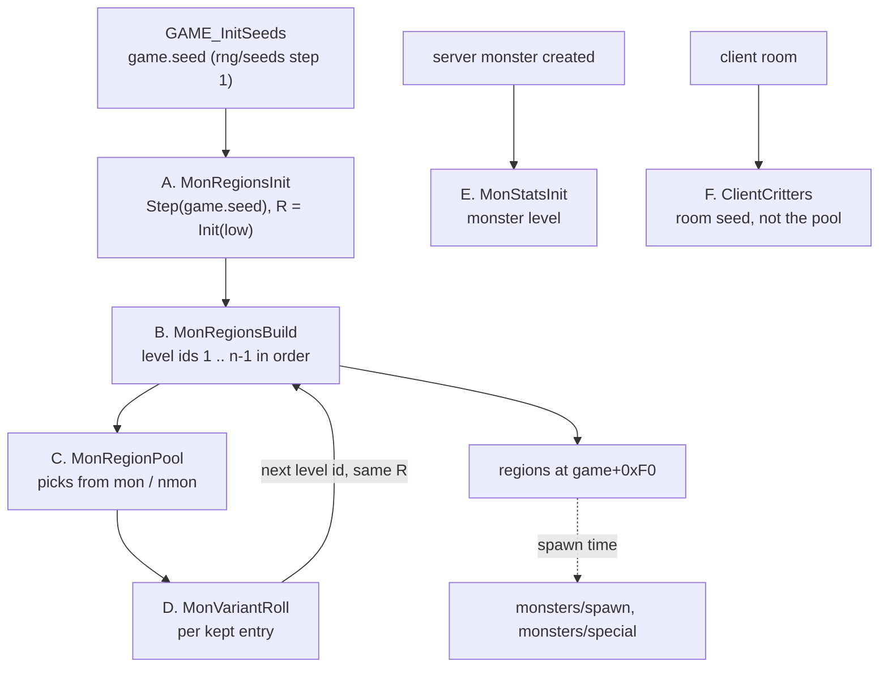
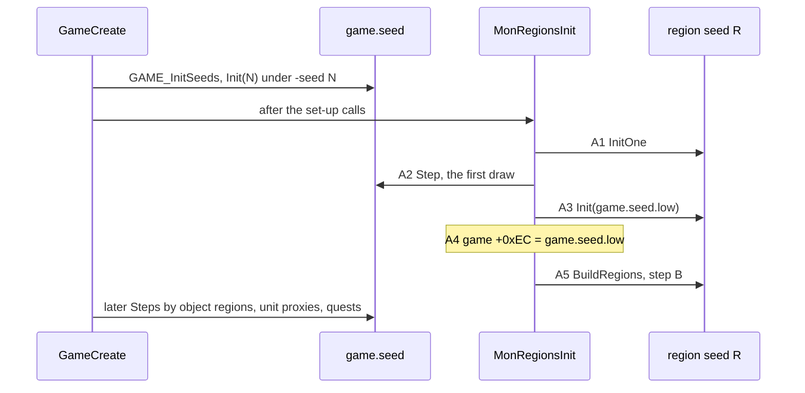
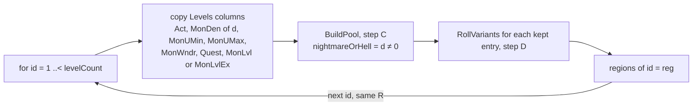
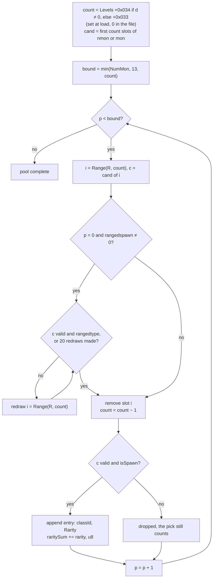
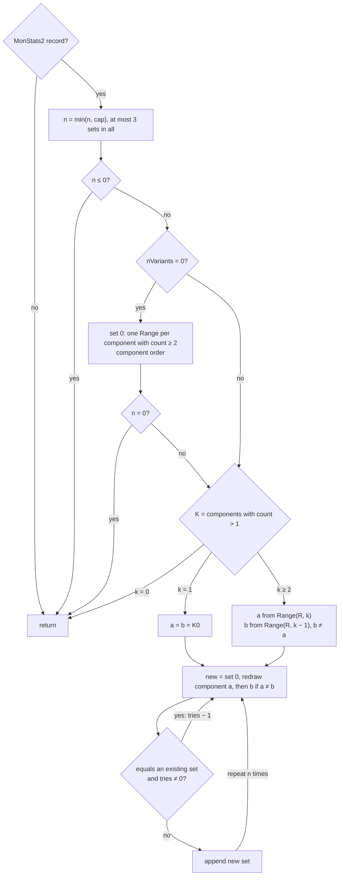
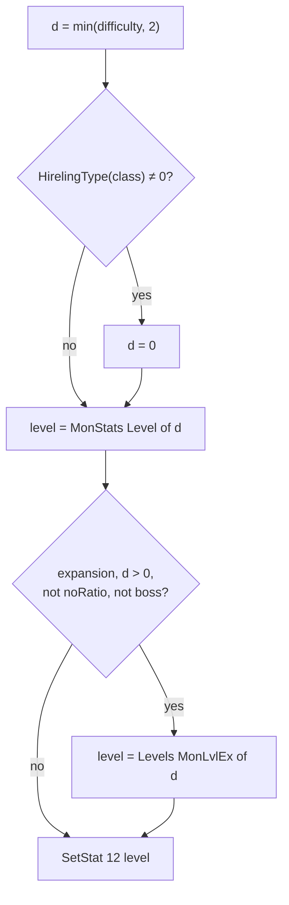
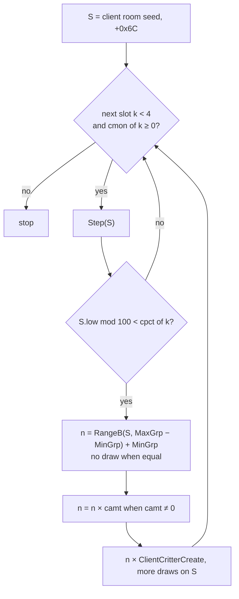
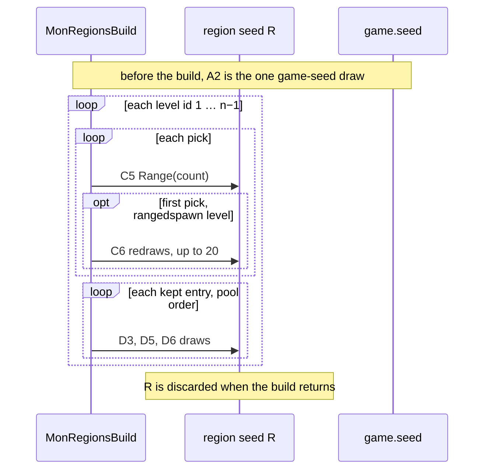
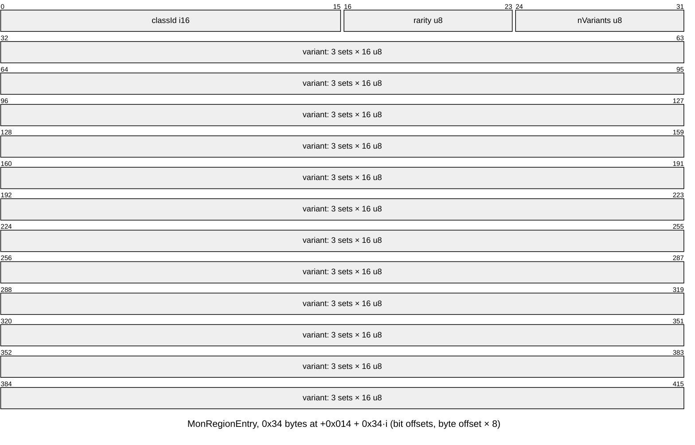

## Purpose

At game creation the server builds one **monster region** for every level id, all from one region seed
that comes from the game seed's first draw. A region holds the level's **monster pool**: up to 13 classes
picked from the level's `mon` (normal) or `nmon` (nightmare, hell) candidates, each with a rarity weight
and up to three appearance sets. It also copies the level's density and unique-count columns. The
spawn code later picks classes from it. This spec also gives the **monster level** rule that runs when
any server monster is created, and the client **critter** draw, which does not use the pool.
Primitives (`Step`, `Range`, `RangeB`, `Init`, `InitOne`) are those of rng. The game
seed is defined in rng/seeds step 1.

## Entry points

| When | Function | Tag |
|---|---|---|
| Game created (single player): calls the region init after `GAME_InitSeeds` and the set-up calls listed below | — | [C] |
| Game created, other path (same order after `GAME_InitSeeds`, three middle calls absent); no reference to it in the image, so no stock run reaches it (step note below) | — | [I] |
| Region seed: one game-seed draw | — | [C] |
| All regions built, level ids 1 … n−1 | — | [C] |
| One level's pool | — | [C] |
| One entry's appearance sets | — | [C] |
| Server monster created: the monster level | — | [C] |
| Client room's critters | — | [C] |

## Inputs

### Tables

All tables are the compiled `.bin` records, indexed by **record position**.
A monster class is a MonStats record position (the stored distinct-Id ordinal, used as a position).

| Anchor | Used for |
|---|---|
| `Levels.txt:mon1` | `mon` slots, 25 × i16 at `+0x036`: normal candidates |
| `Levels.txt:nmon1` | `nmon` slots, 25 × i16 at `+0x068`: nightmare and hell candidates |
| `Levels.txt:umon1` | `umon` slots, 25 × i16 at `+0x09A`: counted at load only; read at spawn time (`monsters/special`) |
| `Levels.txt:NumMon` | u8 at `+0x032`: the pick bound |
| `Levels.txt:rangedspawn` | u8 at `+0x031`: first-pick ranged rule |
| `Levels.txt:Act` | u8 at `+0x003`: copied into the region |
| `Levels.txt:MonDen` | i32 × 3 at `+0x01C`: copied, `[difficulty]` |
| `Levels.txt:MonUMin`, `Levels.txt:MonUMax` | u8 × 3 at `+0x028`, `+0x02B`: copied, `[difficulty]` |
| `Levels.txt:MonWndr` | u8 at `+0x02E`: copied |
| `Levels.txt:Quest` | u8 at `+0x030`: copied |
| `Levels.txt:MonLvl1`, `Levels.txt:MonLvl1Ex` | i16 × 3 at `+0x010` / `+0x016`: region copy (classic / expansion); `MonLvl*Ex` is the monster level in expansion nightmare and hell |
| `Levels.txt:cmon1`, `Levels.txt:cpct1`, `Levels.txt:camt1` | 4 × i16 each at `+0x0CC`, `+0x0D4`, `+0x0DC`: critters |
| `MonStats.txt:isSpawn` | `+0x00C` bit 0: a picked class is kept only if set |
| `MonStats.txt:noRatio`, `MonStats.txt:boss` | `+0x00C` bits 2 and 6: keep the MonStats level |
| `MonStats.txt:rangedtype` | `+0x00F` bit 4: the ranged rule's test |
| `MonStats.txt:Rarity` | u8 at `+0x02E`: the entry's weight |
| `MonStats.txt:MonStatsEx` | i16 (signed) at `+0x018`: the class's `monstats2` record; a blank cell would store −1, and stock data has none (0..603 in all 734 records, MonStats) |
| `MonStats.txt:Level` | i16 × 3 at `+0x0AA` (`Level`, `Level(N)`, `Level(H)`): the monster level |
| `MonStats.txt:MinGrp`, `MonStats.txt:MaxGrp` | u8 at `+0x02F`, `+0x030`: critter count |
| `MonStats2.txt:HDv` … `S8v` | u8 × 16 at `+0x015..+0x024`: the counts of the sixteen component lists; u8 at `+0x025`: Σ(count − 1), computed by the compiler, the set-cap exponent |
| `MonStats2.txt:TotalPieces` | `+0x0EC`: the `> 2` test of the region append (§ Consumers) |

- [C] The candidate counts are computed at load, not at build: `DRLG_LoadLevels` stores one count each for
  `mon`, `nmon` and `umon` as u8 at `+0x033`, `+0x034`, `+0x035`, bytes that have no `.txt` column, and the
  pool reads them there; the run reproduces every pool from these counts.
- [I] The count is the number of **leading** non-negative slots (of 25), up to the first negative one, not the
  number of set slots. Stock data has no blank before a set slot, so the two agree and the run cannot tell them
  apart; the rule rests on the code read.
- [I] `enabled` (MonStats) is not tested by the pool code.
- [C] No pool cell names a class with `enabled` 0 in stock data (table survey; none of the 831 `mon`, `nmon` and
  `umon` cells), so no run can show the column ignored and the line above stays a code reading.


### Runtime state

| State | Type | Source |
|---|---|---|
| game seed | `Seed` at game `+0xD0` | rng/seeds step 1; under `-seed N` it is `Init(N)` |
| region seed `R` | `Seed`, a local of `MonRegionsInit` | step A |
| `game.monRegionSeedLow` | u32 at game `+0xEC` | step A |
| difficulty | u8 at game `+0x06D`, 0 normal, 1 nightmare, 2 hell | game creation |
| expansion | u32 at game `+0x070`, non-zero in an expansion game | game creation |
| `regions[id]` | pointer array at game `+0xF0`, one `MonRegion` per level id, `[0]` unused | step B |
| client room seed | `Seed` at active room `+0x6C` (client copy) | rng/seeds step 6 |

### Constants

| Name | Value | Anchor | Tag |
|---|---|---|---|
| `POOL_MAX` | 13 entries per region | — | [C] |
| `SLOTS` | 25 slots per `mon`/`nmon`/`umon` array | `DRLG_LoadLevels` | [C] |
| `RANGED_REDRAWS` | 20 | — | [C] |
| `SETS_MAX` | 3 appearance sets per entry | — | [C] |
| `DUP_TRIES` | 3 | — | [C] |
| `MONSTATS_REC` | `0x1A8` bytes | — | [C] |
| `REGION_SIZE` | `0x2E4` bytes | `MonRegion` | [C] |
| hireling classes | 271, 338, 359, 560, 561 (`roguehire`, `act2hire`, `act3hire`, `act5hire1`, `act5hire2`) | — | [C] for 271, 338, 359, 561; [I] for 560 (no `Hireling` row) |

## Algorithm



### A. The region seed (`MonRegionsInit`)



```
A1. InitOne(R)                                                   [C]
A2. Step(game.seed)                                              ; game-seed draw (the first after GAME_InitSeeds)
A3. Init(R, game.seed.low)                                       ; R = {low, 666}
A4. game.monRegionSeedLow ← game.seed.low                        ; +0xEC
A5. BuildRegions(R, game.difficulty, game.expansion)             ; step B
```

- [C] The game-creation calls after this one also step the game seed, one draw each, in this order: object
  regions (`OBJRGN_Create`, draw 2), the store (`NPCSTORE_CtlCreate`, draw 3) and quests (`QUESTS_InitGame`,
  draw 4). They are specified in rng/seeds step note 7a, not here.

- [C] `R` is a local of `MonRegionsInit`; nothing else draws from it, and it is not kept after the build.
  Only the game seed's single draw is visible to the rest of the game.

### B. The region build (`MonRegionsBuild`)



```
B1. Init(R, game.seed.low)                                       [C]
                                                                 ; the same value again: no effect on the result
B2. if DifficultyRecord(difficulty) = none: fatal error          [I]; never exercised
B3. d: u8 ← difficulty
    for id: i32 in 1 ..< levelCount:                             [C]
                                                                 ; levelCount: Runtime state, g_nLevels (step note B3)
B4.   L ← Levels[id]                                             ; LEVELS_GetRecord, record position
      reg ← new MonRegion, 0x2E4 bytes, all zero
      reg.act      ← L.Act                                       ; u8
      reg.levelId  ← id
      reg.monDen   ← L.MonDen[d]                                 ; i32
      reg.monUMin  ← L.MonUMin[d];  reg.monUMax ← L.MonUMax[d]   ; u8
      reg.monWndr  ← L.MonWndr;     reg.quest   ← L.Quest        ; u8
      reg.nRooms   ← −1;            reg.unk2D4  ← −1             ; +0x00C, +0x2D4
      reg.monLvl   ← reg.monLvl2 ← (expansion ≠ 0 ? L.MonLvlEx[d] : L.MonLvl[d])   ; i16 sign-extended to i32
B5.   BuildPool(R, L, reg, nightmareOrHell: d ≠ 0)               ; step C
B6.   for i in 0 ..< reg.nPool:
        RollVariants(R, reg.entries[i], n: 3)                    ; step D
B7.   regions[id] ← reg
```

Step notes:

- B3. [C] The regions of levels 1–136 are what every run logs and reproduces: 136 regions per game
  (all 136 levels; the 1360 regions of ten games).

- B3. [C] Level 0 (*Null*) gets no region. Levels are processed in id order, and each level's pool **and**
  its appearance sets are complete before the next level's first draw, so one level's data changes every
  later level's pool.
- B4. [C] Both arms of the `monLvl`/`monLvl2` copy are logged as written: `MonLvlEx[d]` in every expansion game,
  `MonLvl[d]` (classic) in the classic nightmare and hell games, which the model predicts region for region.

- B4. [C] `monLvl`/`monLvl2` (`+0x2DC`/`+0x2E0`) are not read: `.text` has no other displacement `0x2DC`/`0x2E0`
  access, and access watchpoints armed on both fields once each region was built hit nothing while the level's
  monsters were created, roamed and fought (levels 104, 107, 111, 78, 46, 6 and classic 2; seven sessions, 2 678
  creations). The monster level comes from step E. In the classic games the region holds the classic `MonLvl`
  while the monsters take MonStats `Level*` (step E).

### C. The pool pick (`MonRegionPool`)



```
C1. count: i32 ← nightmareOrHell ? L[+0x034] : L[+0x033]         [C]
                                                                 ; load-time bytes, 0 in levels.bin: a reader of the
                                                                 ; file computes them (step notes C1)
    cand: i16[] ← first `count` slots of (nightmareOrHell ? L.nmon : L.mon)
C2. bound: i32 ← min(L.NumMon, 13, count)
C3. for p: i32 in 0 ..< bound:
C4.   if count < 1: stop                                         ; never true in stock data (bound ≤ count)
C5.   i: u32 ← Range(R, count)                                   ; draw, guarded Range (inlined, pow2 mask)
      c: i16 ← cand[i]
C6.   if p = 0 and L.rangedspawn ≠ 0:                            [C]
        for t in 0 ..< 20:
          if Valid(c) and MonStats[c].rangedtype: break
          i ← Range(R, count);  c ← cand[i]                      ; draw (redraw, same count)
C7.   remove cand[i], shifting the later slots down;  count ← count − 1
C8.   if Valid(c) and MonStats[c].isSpawn:                       [C]
        e ← reg.entries[reg.nPool]
        e.classId ← c;  e.rarity ← MonStats[c].Rarity
        reg.raritySum ← (u8) (reg.raritySum + e.rarity)
        reg.nPool ← reg.nPool + 1;  reg.nEntries ← reg.nEntries + 1

    Valid(c) = 0 ≤ c < nMonStats;  MonStats[c] = g_pMonStats + 0x1A8 × c   [C]
```

Step notes:

- C1. [C] **The two counts are not in the file.** `+0x033` (`mon`) and `+0x034` (`nmon`) are bytes with no `.txt`
  column; every shipped `levels.bin` record holds 0 there, and `DRLG_LoadLevels` writes them when the table is
  loaded; the run reproduces every pool from the counts so filled. Reading the stored bytes gives a count of 0 and
  an empty pool for every level.
- C1. [I] A reimplementation that reads the `.bin` records therefore fills both bytes itself, once, before the
  build: each is the number of **leading** slots of its 25 (`mon`, `nmon`) holding a value ≥ 0, up to the first
  negative one (§ Inputs, the two bullets under the table; the note *Candidate count stops at the first blank*).
  The rule is a code reading; on stock data it equals the number of set slots.
- C1. [C] Classic nightmare and hell games use the same column set (`nmon`) as expansion ones: the pool code
  reads no game-type flag, and the classic games of the second run build the same regions as the expansion
  games of the same seed and difficulty, apart from the copied `monLvl` fields (B4).

- C1. [C] A classic **normal** game reads `mon` like an expansion one: a classic normal game (`-seed 4806`) logged
  all 136 regions and matched every value; in 23 of the 27 levels 110–136 the `nmon` slots
  would have given another pool.
- C5. [C] `count` is the **remaining** candidate count, so the draw ranges shrink by one per pick. A slot
  is never taken twice, but a class named in two slots can be taken twice; every run has 6–10 regions holding
  one class twice.
- C6. [C] The ranged rule applies to the **first pick only**. The test comes before each redraw, so a first
  draw that is already ranged makes no redraw, and after 20 redraws the last class drawn is taken whatever it
  is. All 20 `rangedspawn` levels are built with it in every run. Both ends are exercised: of the 200 ranged
  first picks of the run (20 levels × 10 games), 76 needed no redraw and 42 used all 20 redraws without
  finding a ranged class and kept the last one drawn; every one of those regions and its seed after is
  reproduced.
- C8. [C] A picked class with `isSpawn` 0 is dropped **after** it was picked: the pick still counts against
  `bound` and its slot is still removed. *Mountain Top* (three `ancientbarb*`, all `isSpawn` 0) therefore builds
  an empty pool, as do the ten levels with `NumMon` 0.
- C8. [C] There is no weighting at pick time: `Rarity` is only copied into the entry and summed, for the
  weighted pick at spawn time.

### D. Appearance sets (`MonVariantRoll`)



Each kept entry gets up to three **appearance sets**: one byte per `monstats2` component (16 of them,
`HD` … `S8` by data), each the index of one of that component's variants.

```
RollVariants(R, e, n: i32 = 3):                                  [C]
D1. m2 ← MonStats2 record of e.classId (MonStats +0x018)
    if m2 = none: return
D2. comp: u8[16] ← m2[+0x015 .. +0x024]
    cap: i32 ← (1 << (m2[+0x025] & 31)) − e.nVariants            ; +0x025 = Σ(count − 1), see below
    n ← min(n, cap)
    if e.nVariants + n > 3: n ← 3 − e.nVariants
    if n ≤ 0: return
D3. if e.nVariants = 0:
      for c in 0 ..< 16:                                         ; in component order
        set0[c] ← comp[c] < 2 ? 0 : Range(R, comp[c])            ; draw only where comp[c] ≥ 2
      e.sets[0] ← set0;  e.nVariants ← 1;  n ← n − 1
D4. if n = 0: return
D5. K ← [c for c in 0 ..< 16 if comp[c] > 1]  (in order);  k ← |K|
    if k = 0: return
    if k = 1: a ← b ← K[0]
    else:
      u ← Range(R, k);  a ← K[u];  K[u] ← K[k − 1]               ; draw
      b ← K[Range(R, k − 1)]                                     ; draw; b ≠ a
D6. repeat n times:
      tries: i32 ← 3
      loop:
        new ← copy of e.sets[0]
        new[a] ← Range(R, comp[a])                               ; draw
        if a ≠ b: new[b] ← Range(R, comp[b])                     ; draw
        dup ← false
        for each s in e.sets[0 ..< e.nVariants]:
          if s = new: tries ← tries − 1;  dup ← true
        if not dup or tries = 0: exit loop
      e.sets[e.nVariants] ← new;  e.nVariants ← e.nVariants + 1  ; appended even if still a duplicate
```

- D1. [I] `m2` is none when the class's `MonStatsEx` index (read signed) is not a `monstats2` record position, that
  is `< 0` or `≥` the `monstats2` record count, the form the same lookup takes inline in `MonSpawnTry`
  (`i2 < 0 or i2 ≥ nMonStats2`, then a null record). `MonStats2Rec`'s own test is not read yet.

- D1. [C] No stock class reaches the "none" exit: every `MonStatsEx` holds 0..603 and `monstats2` has 609 records,
  so on stock data the bound decides nothing and a reimplementation may use any out-of-range rule. (table survey;
  `MonStats.txt:MonStatsEx`, MonStats § Columns, MonStats2)
- [C] These draws sit between one level's pool picks and the next level's, on the same `R`, so a
  reimplementation must make them even if it never draws monsters, or every later pool is wrong.

- [C] Every new set differs from set 0 in at most the two components `a` and `b`, chosen once per entry.

- [C] `+0x025` has no `.txt` column: the table compiler stores Σ over the sixteen component lists of `count − 1`
  for each count ≥ 2 when it handles the last list (`S8v`; `cmp eax, 0xF`, counts ≤ 1 skipped). The pinned game compiled `monstats2.txt` under `-direct -txt` into a `.bin` byte-identical to the
  shipped one, so its own compiler wrote every `+0x025` byte.
- [I] The sum is capped at 254; the largest stock sum is 49, so the cap is never met.

- [C] The stock `+0x025` byte equals that sum in all 609 `monstats2` records (0 in 461, up to 49), so a
  reimplementation computes it from the `HDv` … `S8v` lists.
- [C] With `+0x025` 0 an entry holds set 0 only, with 1 the cap `1 << 1` binds at two sets, and with 16 or more
  it never binds: over the 3040 logged regions, the 3360 entries with 0 hold one set, the 220 with 1 hold two, and
  the 1273 with 16 or more hold three.
- [I] That for `+0x025` 0 the cap, and not the `k = 0` stop of D5, ends the entry: no stock class has `+0x025` 0
  with a component count above 1, so the two cannot be told apart.

### E. The monster level (`MonStatsInit`)



Not part of the region build: it runs at every server monster creation, from the monster's class and the level of the room it is created in. logs the level chosen and the `d` used for creations outside town where the two sources differ; the branches it did not reach are marked inferred line by line.

```
MonsterLevel(game, class, levelId) → i32:                        [C]
E1. d: u32 ← min(game.difficulty, 2)
E2. if HirelingType(class) ≠ 0: d ← 0                            [C]; logged for 271, 338, 359, 561
E3. level: i32 ← MonStats[class].Level[d]                        ; i16 at +0x0AA + 2d, sign-extended
E4. if game.expansion ≠ 0 and d > 0                              [C]
       and not MonStats[class].noRatio
       and not MonStats[class].boss:                             [C]; the boss test
      level ← Levels[levelId].MonLvlEx[d]                        ; i16, sign-extended; 1 if levelId has no record (step notes)
E5. SetStat(unit, 12 /* level */, level)
```

- [C] So in an **expansion** game, nightmare and hell monsters take the area level `MonLvl2Ex`/`MonLvl3Ex`,
  and `noRatio` classes (player summons and pets) keep MonStats `Level(N)`/`Level(H)`. Normal-difficulty
  monsters take MonStats `Level`. In a **classic** nightmare or hell game the monsters take MonStats `Level(N)`/
  `Level(H)`. The logged cases, each where the two sources differ: expansion hell and nightmare, *Jail Level 1*
  (29), classes 384 `skmage_fire2` and 57 `goatman5` get 71 / 41 (`MonLvl3Ex`/`MonLvl2Ex`), not MonStats
  70 / 40; classic hell and nightmare, same level and classes, 70 / 40; expansion normal, *Stony Field* (4),
  class 6 `zombie2` gets MonStats `Level` 2, not `MonLvl1Ex` 4; a Clay Golem (289, `noRatio`) cast in *Jail
  Level 1*, expansion hell, gets MonStats `Level(H)` (blank, 0), not 71. 61 creations separate the sources, all
  as E1–E4 say.
- [C] In the logged classic nightmare and hell games and in expansion normal, no area-level column gives the
  monster level. *Jail Level 1*'s classic `MonLvl2`/`MonLvl3` are 35 / 60, and the classic games' monsters there
  take 40 / 70 (MonStats). In the expansion normal game, *Stony Field*'s `MonLvl1Ex` and classic `MonLvl1` are both
  4, and class 6 there takes 2 (MonStats `Level`), so neither column is used there.

- [C] `boss` classes keep MonStats `Level(N)`/`Level(H)` in expansion nightmare and hell: the test is the byte
  `MonStats+0x00C & 0x40` (mask `g_BitMask32[6]`) next to `noRatio`'s `& 0x04` at the same branch. Andariel (156, `boss`) was created in an expansion nightmare game at level 49 (`Level(N)`,
  not `MonLvl2Ex` 43 of her level 37) and in hell at 75 (`Level(H)`, not 73)
  reproduces both with every other monster level of those games (23 306 of 23 306).

- [C] The other `boss` classes take the same test. Four more, created in an expansion nightmare game, keep
  `Level(N)` where the area level differs: Blood Raven (267, level 17: 43, not `MonLvl2Ex` 36), Radament (229,
  level 49: 49, not 44), Mephisto (242, level 102: 59, not 55) and Nihlathak (526, level 124: 70, not 64), with
  Andariel again (156, level 37: 49, not 43); five of the 25 `boss` classes are met. The instruction tests the
  class's own flag byte with no class compare, and hell takes the same branch (its other tests are the expansion
  word and `d` > 0), logged for Andariel at `Level(H)` 75 above.
- [C] A classic **normal** game takes MonStats `Level` like an expansion one (E4 needs `expansion ≠ 0`): 163 of 163
  creations of a classic Normal game (*Stony Field*, *Cold Plains*), 77 of them where `MonLvl1` and `MonLvl1Ex`
  differ from `Level`.
- [I] When the monster's level id has no `Levels` record, `LevelMonLvl` returns 1; never
  exercised.
- [C] A hireling takes normal's `Level` whatever the difficulty, because E2 sets `d` to 0 before both E3 and
  E4: the mercenary (271 `roguehire`) loaded in an expansion hell game is created with `d` = 0 and level 1
  (MonStats `Level`; `Level(H)` is 67).
- [C] Class 560 (`act5hire1`) is recognised by the test but is never created as a mercenary on stock data: every
  hire, free-mercenary and load path takes the class from a `Hireling` row, and the stock `Class` column holds only
  271, 338, 359 and 561 (all 120 rows). Non-hireling creation paths are not covered by this claim.

- [I] Town NPCs created in an expansion nightmare or hell game get their town's `MonLvl*Ex`, which is blank
  (stored 0). The town NPCs of every logged game (the 47, normal; the Act I camp of
  every -p2 game) take 0, which their MonStats `Level*` (0) also gives, so they don't tell the sources apart.

- [C] `MonLvl.txt` is not read for the level. It is read right after, at row = the level, for hit points, defence,
  to-hit, damage and experience (`monsters/stats`): `MonLvlStats` of all 4571 creations
  is reproduced at levels 0–85, the level itself from MonStats or Levels alone.

- [I] The row is `min(level, nMonLvl − 1)`: no stock MonStats `Level*` exceeds 110 and no Levels area level does,
  so the clamp is never met.
- [C] Champion, unique and minion level bonuses are applied after this by the special-monster code
  (`monsters/special`), not here: stat 12 at `MonStatsInit`'s exit is this step's level, and the handlers then add
  +2 to 92 champions, +3 to 106 uniques and superuniques and +3 to 266 group members.


### F. Critters (`ClientCritters`): not from the pool



```
Critters(room, levelId):                                         [C]
F1. S ← room.seed                                                ; client active room +0x6C
F2. for k in 0 ..< 4:
      cls: i16 ← Levels[levelId].cmon[k];  if cls < 0: stop
F3.   Step(S)                                                    ; draw, inlined, no guard
      if S.low mod 100 < (u32)(i32) Levels[levelId].cpct[k]:     ; unsigned compare
F4.     n: u32 ← RangeB(S, MaxGrp − MinGrp) + MinGrp             ; MonStats[cls] +0x030, +0x02F; guarded: no draw if equal
F5.     if camt[k] ≠ 0: n ← n × camt[k]
F6.     repeat n times: ClientCritterCreate(room, cls)           ; draws more from S (monsters/spawn)
```

- [C] Critters are a separate, client-side draw per client room, from the room seed; nothing here reads
  the region or its pool. The `[C]` covers F2–F5 from a given room seed and the fact that the pool is not
  used: the run takes each room's entry seed from the log (`CR0`), a boundary oracle on the room seed, and checks every room to its first creation (or to its exit seed when it has no critter).

- [C] F4 is `RangeB(MaxGrp − MinGrp) + MinGrp`, so `MaxGrp` itself is never reached when the two differ,
  and when they are equal no draw is made. The no-draw case is exercised: in all 12 rooms of the run where a
  slot passed the `cpct` test, the class (`chicken` 149, `bug` 268) has `MinGrp` = `MaxGrp`, and the room seed at
  the first creation matches with no draw for the count. The `MinGrp` < `MaxGrp` case was not reached.
- [I] The draws inside `ClientCritterCreate` (placement, the client unit seed) are not read, so
  the slots after the first slot that creates critters are not predicted.
- [C] `camt` is 0 in every stock row and `cpct` is 2..100 on every named slot, so F5 never fires and the
  sign of `cpct` never matters in stock data.

### Draw order on `R`



- [C] All draws on `R` happen in one pass at game creation, in this order: for each level id 1 … n−1, the
  pool picks C5 (with the C6 redraws on the first pick), then for each kept entry in pool order its D3, D5
  and D6 draws. Nothing else draws on `R`, and `R` is gone when the build returns. The only other seed the
  build touches is one draw of the game seed (A2).

## Outputs

`regions[id]` for `id` in 1 … n−1, a `MonRegion` of `0x2E4` bytes. Fields set by the build, all little-endian:



| Offset | Field | Type | Value | Tag |
| --- | --- | --- | --- | --- |
| `+0x000` | `act` | u8 | `Levels.Act` | [C] |
| `+0x00C` | `nRooms` | i32 | −1 | [C] |
| `+0x010` | `nPool` | u8 | kept pool entries (0 … 13); spawn picks range over these | [C] |
| `+0x011` | `raritySum` | u8 | sum of the entries' `rarity`, mod 256 | [C] |
| `+0x012` | `nEntries` | u8 | = `nPool` after the build; spawn time may append | [C] |
| `+0x014 + 0x34·i` | `entries[i].classId` | i16 | MonStats record position | [C] |
| `+0x016 + 0x34·i` | `entries[i].rarity` | u8 | `MonStats.Rarity` | [C] |
| `+0x017 + 0x34·i` | `entries[i].nVariants` | u8 | 0 … 3 | [C] |
| `+0x018 + 0x34·i` | `entries[i].variant[3][16]` | u8 | appearance sets | [C] |
| `+0x2B8` | `monDen` | i32 | `Levels.MonDen[d]` | [C] |
| `+0x2BC`, `+0x2BD` | `monUMin`, `monUMax` | u8 | `Levels.MonUMin[d]`, `MonUMax[d]` | [C] |
| `+0x2BE` | `monWndr` | u8 | `Levels.MonWndr` | [C] |
| `+0x2C0` | `levelId` | i32 | `id` | [C] |
| `+0x2D4` | `unk2D4` | i32 | −1 | [C] |
| `+0x2D8` | `quest` | u8 | `Levels.Quest` | [C] |
| `+0x2DC`, `+0x2E0` | `monLvl`, `monLvl2` | i32 | B4; not read (watchpoints) | [C] |

Every other byte is 0. The `[C]` rows are the fields the run logs for every region and reproduces; the last row is written in expansion and classic games and unread under the watchpoints of step note B4.

### Consumers (named only)

- [C] Random population (`RoomPopulate`) runs only when the region's `monDen` ≠ 0
  (`RoomPopulateGate`), so *Mountain Top* and normal-difficulty *Siege 1* get no random
  population whatever their pool: 267 logged passes on levels whose region `monDen` is 0 closed the gate, *Mountain
  Top* (120) and Normal *Siege 1* (110) among them, besides the towns 1, 75 and 103.

- [C] The spawn-time class pick `MonRegionPickClass` draws `RangeB(roomSeed, raritySum) + 1`
  and walks the entries subtracting `rarity`. For champions and uniques in **normal** difficulty it picks from
  `umon` instead (`umon[Range(count)]`, count at Levels `+0x035`); in nightmare and hell they come from the region
  pool. 2229 first picks and 205 special picks (19 from `umon` in Normal, 186 from the pool in Nightmare and Hell)
  are reproduced. Specified in `monsters/spawn` and `monsters/special`.
- [I] So a `Rarity` 0 entry is never picked, and with `nPool` = 0 nothing spawns. No stock region has either (the
  only `Rarity` 0 pool cells are *Mountain Top*'s `isSpawn` 0 classes, which are dropped).
- [C] `MonRegionFindAdd` (from `MonsterInit`) appends a class not yet in its level's
  region when MonStats2 `TotalPieces` (`+0x0EC`) is above 2, and rolls its sets from the **unit** seed, not from
  `R`. Over 4568 creations it found the class 4216 times, appended 39 (19 drawing 8–18 unit-seed steps, 20
  single-set classes drawing none) and did not append 313 with `TotalPieces` ≤ 2; the unit seed at `MonStatsInit`
  entry and every appended set are reproduced, and the region equals the model in 1145 snapshots.

- [I] The append raises `nEntries` (`+0x012`) but not `nPool` (`+0x010`), so the spawn pick never sees the entry, and
  the roll is `MonVariantRoll(&unit.seed, entry, 3)` (the reading the model follows). Its other returns, none met: a region already holding 13 entries returns no entry (the largest
  snapshotted region held 10); classes 0xC3, 0xC4, 0x126 and 0x128 (`act2male`, `act2female`, `act3male`,
  `act3female`) get no entry; with `TotalPieces` ≤ 2 it returns the next slot unwritten, whose `nVariants` is 0, so
  `MonStatsInit` takes the per-component draws.
- [C] The object-region code reads the pool too: `RegionActClass` takes the level's region from
  `game + 0xF0` and walks its `nPool` entries by `classId`. Its callers are the object trap's spawn and its region
  test, the casket and the barrel. The two logged barrel spawns (level 29, Normal, pool `[39, 22, 384]`) created
  class 384, which a walk over the pool gives and a walk over the level's whole `mon` list does not.

- [I] `RegionActClass` returns the first class of a fixed range that holds a pool entry: for each entry in pool
  order it tests `[base, base + 5)`, `base` 0x60 (`mummy1`) in Act II and 5 (`zombie1`) elsewhere, then
  `[b, b + 4)` for `b` in 0, 0xAA, 0x112, 0x17B, 0x17F, 0x183, and returns `base` or `b`. With no match it returns
  0xEA (`flyingscimitar`). The result is cached per level in the object region's level record (`+0x1C`, −1 at
  creation) and returned at once when it is a valid class. The caller maps it through
  `LevelClassVariant` to the level's `mon` class of the same `BaseId`.


## Worked example

`check` compares the same values with every logged region (1557/1557 for the run). The individual draws
below come from stepping the same model; each can be re-derived with rng step 1. Seeds are
`low:high` in hex.

**A.** Game seed `Init(1)` = `00000001:0000029a`. A2: `1 × 0x6AC690C5 + 0x29A = 0x6AC6935F`, so the game seed
becomes `6ac6935f:00000000` (logged `MPS gseed`), and `R = Init(0x6AC6935F)` = `6ac6935f:0000029a`.

**Level 1** (*Act 1 - Town*): `NumMon` 0, so `bound` = 0. No draw; `R` stays `6ac6935f:0000029a` (logged).

**Level 2** (*Act 1 - Wilderness 1*): `mon` = [5 `zombie1`, 19 `fallen1`, 63 `quillrat1`], `NumMon` 3, so
`bound` = 3 and every candidate is taken; the draws still happen.

| draw | call | `R` after | result | taken |
|---|---|---|---|---|
| 1 | `Range(R, 3)` | `2f2edab5:2c890afd` | 0 | 5 `zombie1` (rarity 2) |
| 2 | `Range(R, 2)` | `f09b2846:13adff7a` | 0 | 19 `fallen1` (rarity 2) |
| 3 | `Range(R, 1)` | `a3df5d58:645adebe` | 0 | 63 `quillrat1` (rarity 2) |

Appearance sets, in entry order:
- `zombie1`: `comp` = [3,3,3,3,3,0,0,0,3,3,3,0,0,0,0,0], cap exponent 16. D3: eight draws (components 0–4,
  8–10) give set 0 = `00 00 00 00 00 00 00 00 01 01 02 00 00 00 00 00`. D5: `K` = [0,1,2,3,4,8,9,10],
  `Range(R, 8)` = 2 → `a` = 2, `K[2]` ← 10, `Range(R, 7)` = 3 → `b` = `K[3]` = 3. D6: set 1 draws (a, b) = (1, 1),
  set 2 draws (2, 2); no duplicate. 14 draws.
- `fallen1`: `comp` = [0,1,0,0,0,3,0,4,2,1,0,0,0,0,0,1], exponent 6. D3: components 5, 7, 8 give (0, 1, 0).
  D5: `K` = [5,7,8], `Range(R, 3)` = 1 → `a` = 7, `K[1]` ← 8, `Range(R, 2)` = 1 → `b` = 8. D6: set 1 (a, b) = (0, 0),
  set 2 = (2, 1). 9 draws.
- `quillrat1`: exponent 0, so the cap is one set; no component has a count ≥ 2, so set 0 is all zero with no
  draw.

Region 2: `nPool` 3, `raritySum` 6, `monDen` 520, `monUMin`/`monUMax` 0/0, `monWndr` 1, `monLvl` 1 (`MonLvl1Ex`),
`R` after = `d52ffc3b:270b4ee5` (26 draws; logged).

**Level 3** (*Act 1 - Wilderness 2*): `mon` = [28 `brute1`, 43 `corruptrogue1`, 58 `fallenshaman1`,
165 `cr_lancer1`], `NumMon` 3: four candidates for three picks, so the draws decide the pool.

| draw | call | `R` after | result | taken | remaining |
|---|---|---|---|---|---|
| 1 | `Range(R, 4)` | `b67b984c:58eb3a1c` | 0 | 28 `brute1` (rarity 1) | [43, 58, 165] |
| 2 | `Range(R, 3)` | `8e7a2c98:4c1cb7d9` | 1 | 58 `fallenshaman1` (rarity 2) | [43, 165] |
| 3 | `Range(R, 2)` | `16c688d1:3b6d1988` | 1 | 165 `cr_lancer1` (rarity 1) | [43] |

`corruptrogue1` is left out. Appearance sets: `brute1` and `fallenshaman1` have exponent 0 and no component
count ≥ 2: one all-zero set each, no draw. `cr_lancer1` (`comp` = [3,3,3,3,3,3,0,0,3,3,3,0,0,0,0,0], exponent 18):
- D3: nine draws give set 0 = `00 01 00 01 01 02 00 00 00 02 02 00 00 00 00 00`.
- D5: `K` = [0,1,2,3,4,5,8,9,10], `Range(R, 9)` = 3 → `a` = 3, `K[3]` ← 10, `Range(R, 8)` = 2 → `b` = 2.
- D6, set 1: (a, b) = (1, 1): differs from set 0 at component 2, appended.
- D6, set 2: (1, 0) equals set 0 (a duplicate, `tries` 3 → 2), redrawn: (1, 2), appended.
- 17 draws in all (9 + 2 + 2 + 2 + 2).

Region 3: `nPool` 3, `raritySum` 4, `monUMin`/`monUMax` 1/1, `monLvl` 2, `R` after = `679fafd2:63e02d41` (logged).

Classes 384 `skmage_fire2` and 57 `goatman5` (MonStats `Level`/`Level(N)`/`Level(H)` = 10/40/70 each) created in *Jail Level 1* (29; `MonLvl1Ex..3Ex` = 10/41/71, classic `MonLvl1..3` = 10/35/60):

| difficulty | expansion game | classic game |
|---|---|---|
| nightmare | **41** (`MonLvl2Ex`), logged | **40** (MonStats `Level(N)`), logged |
| hell | **71** (`MonLvl3Ex`), logged | **70** (MonStats `Level(H)`), logged |

Normal difficulty was logged in *Stony Field* instead: class 6 `zombie2` gets 2 (MonStats `Level`; `MonLvl1Ex` 4).

**Monster level, model only** (not logged for this class; the model's prediction). A `cr_lancer1` (class 165,
MonStats `Level`/`Level(N)`/`Level(H)` = 2/36/67) created in level 3 (`MonLvl1Ex..3Ex` = 2/36/68):

| difficulty | expansion game | classic game |
|---|---|---|
| normal | 2 (MonStats `Level`) | 2 |
| nightmare | 36 (`MonLvl2Ex`) | 36 (MonStats `Level(N)`) |
| hell | **68** (`MonLvl3Ex`) | **67** (MonStats `Level(H)`) |

## Reimplementation notes

- **Every pool depends on every earlier level.** One `R` runs through all levels in id order, including
  their appearance-set draws. Leaving out a level that draws, or the appearance sets of any entry, shifts
  every later pool. [C]
- **The game seed is shared.** The region init's single draw (A2) is one step in the game seed's sequence;
  the object regions, the store, quests and every server unit created later step the same seed after it
  (rng/seeds step 7a). [C]
- **A dropped class still costs a pick.** `isSpawn` is tested after the pick and the slot removal (C8).
  [C]
- **Positions, not names.** A pool cell is a MonStats record position. Resolving it by `Id` name lands on
  the first `cr_lancer8` for 723 instead of the second. [C]
- **Candidate count stops at the first blank.** The count is the number of leading non-negative slots (out of
  25), not the number of set slots; the two agree in stock data only. [I]
- **`raritySum` is a u8.** The field is one byte. [C] It cannot
  overflow in stock data (13 × 2 at most); with large `Rarity` values it would wrap mod 256, which no run
  exercised. [I]
- **Duplicate check in D6 tests `tries = 0`, not `≤ 0`.** When two existing sets both equal the new one, one
  try costs two, so `tries` can pass from 1 to −1 and the loop then runs until a non-duplicate is drawn. Under
  emulation 3 000 of 3 000 calls give the model's seed and entry bytes; in 192 a set went past 0 and the loop went
  on (ending at −1 to −13), and a `tries ≤ 0` control differs in exactly those 192. [C]
 Since
  `nVariants + n ≤ 3`, that case needs an entry of exactly two equal sets; the loop ends once a draw differs in `a`
  or `b`, which a varying component always allows, so it ends with probability 1 but has no bound on its draws.
  [I]
- **Critter count excludes `MaxGrp`.** `RangeB(MaxGrp − MinGrp) + MinGrp` (F4). [C]
- **Monster level ignores `Levels.MonLvl1..3`.** The classic area-level columns are copied into the region
  (B4, never read). In the logged classic nightmare and hell games the monsters take MonStats `Level*`, not
  `MonLvl2`/`MonLvl3`, and in expansion normal they take MonStats `Level`, not `MonLvl1` or `MonLvl1Ex`.
  [C] Classic normal takes MonStats `Level`
  too (§ E). [C] The no-record fallback (1) has
  no stock case: every creation is in a level with a record. [I]
- **Hirelings use normal's level.** `d` is forced to 0 before the MonStats read and the area-level test, so a
  hell mercenary is created at its MonStats `Level` (1), in expansion and classic alike, and only then levelled by
  `MERC_SetLevel`. [C] Class 560 has no `Hireling` row, so no hire or load creates
  it on stock data. [C]

## Evidence

- Tables: MonStats2,
  Levels,
  MonStats, MonLvl.
- Upstream: rng, rng/seeds, [data/excel](../../spec-data/excel/#h-monster-references).
