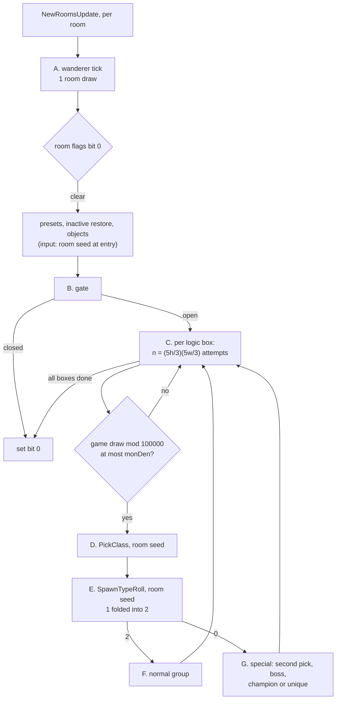
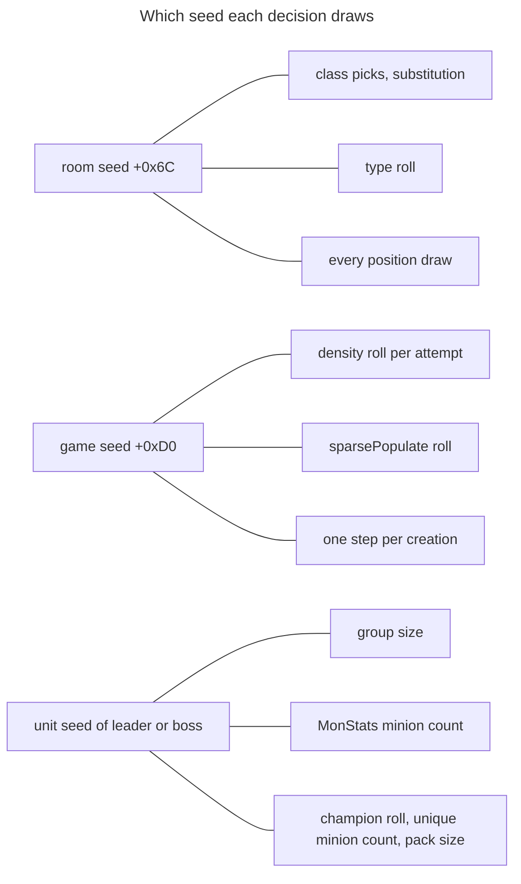
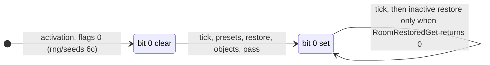
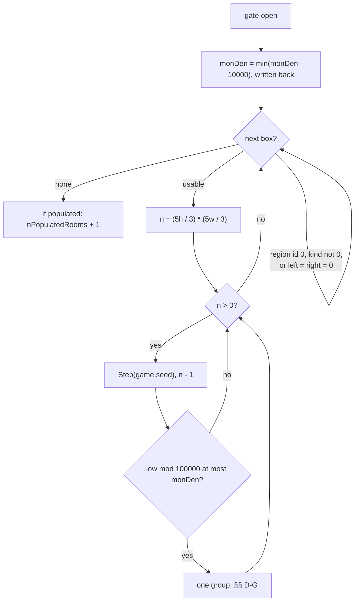
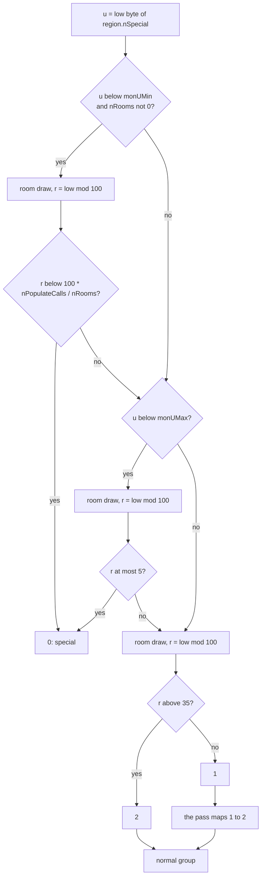
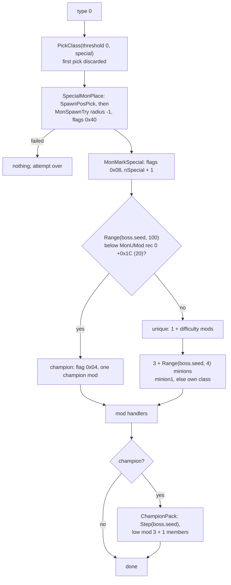
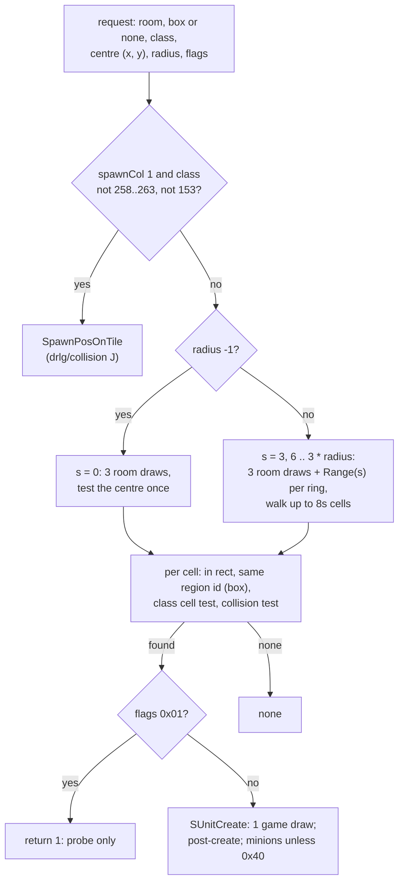
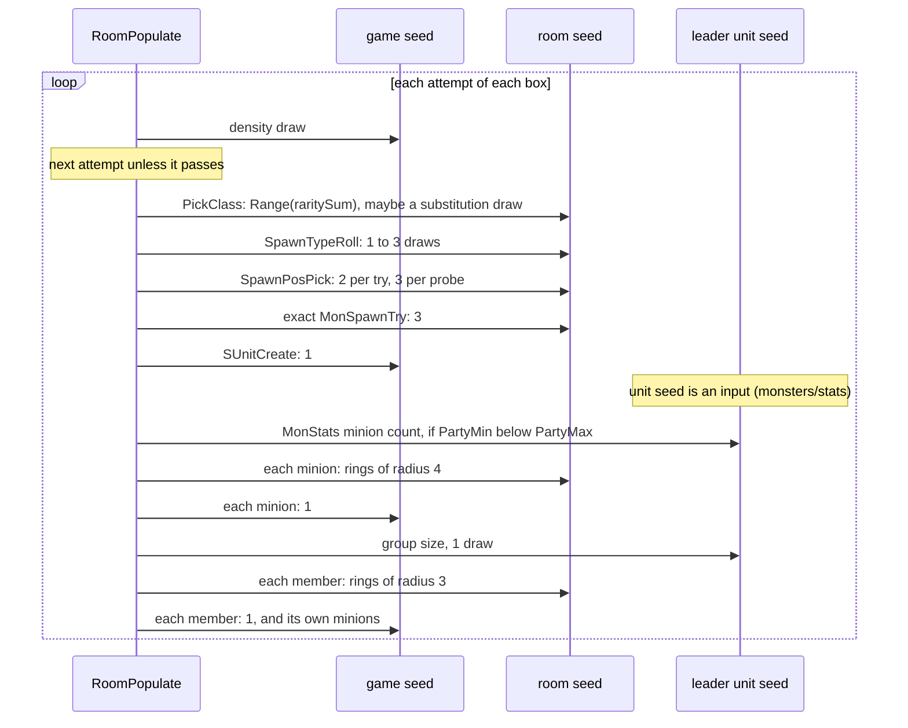

## Purpose

When the server activates a room for the first time, the population pass fills it with random monsters
taken from the level's monster pool. It splits the room into its logic boxes, makes a
number of attempts per box that depends on the box size, lets each attempt through with a density chance,
picks a class, decides whether the group is normal or special, and places the leader, the group members
and their minions. A special boss then becomes a champion with a pack, or a unique with minions. This spec gives
the pass with its exact draw order on the three seeds it uses: the **room seed**, the **game seed** and the
**unit seeds** of the monsters it creates. The modifiers, names and superuniques belong to
[monsters/special](../special/), and hit points and damage to `monsters/stats`. Primitives (`Step`, `Range`, `Init`) are those of
[rng](../../spec-rng/overview/); `RangeB` in our symbol names is the second compile of `Range` and behaves the same.

## Entry points

| When | Tag |
| --- | --- |
| New rooms of an act are updated (server), per room: wanderer tick, then on first activation presets, inactive units, objects, **the pass** | [C] |
| The same sequence for one room (three server callers, step note A1) | [C] |
| The population pass | [C] |
| Its gate | [C] |
| Class pick | [C] |
| Normal or special | [C] |
| Normal group | [C] |
| Special boss, then its champion pack | [C] |
| Every creation: position search and create | [C] |

- [C] The pass and everything below it run on the server only; their game argument is the server game. Each
  run of `NewRoomsUpdate` walks the act's room list and treats each room as in § A.
- [C] The client never runs this pass. `RoomPopulate` has three direct references and no stored pointer:
  `RoomUpdateOne`, `NewRoomsUpdate` and a tail jump in a fragment that nothing references; `NewRoomsUpdate`
  is called only by `GameTick` and `RoomUpdateOne` only by three server functions. In all 55 logs that hold
  the pass (4 154 passes) every pass carried the server game's pointer. A client room's own content is the critter draw of
  [pool.md § F](../pool/#f-critters-clientcritters-not-from-the-pool).

## Inputs

### Tables

All tables are the compiled `.bin` records, indexed by record position. A class is a
MonStats record position.

| Anchor | Used for |
|---|---|
| `Levels.txt:MonDen` | density per difficulty, through the region (`monDen`, `+0x2B8`) |
| `Levels.txt:MonUMin`, `Levels.txt:MonUMax` | the special catch-up and cap, through the region (`+0x2BC`, `+0x2BD`) |
| `Levels.txt:umon1` | `umon` slots (i16 × 25 at `+0x09A`) and their count at `+0x035` (filled at load): the special class in normal difficulty |
| `Levels.txt:WarpDist` | `+0x0C`: the warp-distance rejection of `SpawnPosPick` |
| `Levels.txt:MonWndr` | `+0x2E`: the wanderer gate only (§ K) |
| `Levels.txt:Act` | `+0x03`: the wanderer table row (§ K) |
| `MonStats.txt:BaseId` | `+0x02`: fallen/scarab rule, class-cell test, tentaclehead minions |
| `MonStats.txt:placespawn`, `MonStats.txt:spawn` | `+0x0E` bit 7 and i16 `+0x20`: the pick-time substitution |
| `MonStats.txt:MinGrp`, `MonStats.txt:MaxGrp` | u8 `+0x2F`, `+0x30`: normal group size |
| `MonStats.txt:sparsePopulate` | u8 `+0x31`: the group's game-seed roll |
| `MonStats.txt:minion1`, `MonStats.txt:minion2` | i16 `+0x26`, `+0x28`: MonStats minions; `minion1` also for unique minions |
| `MonStats.txt:PartyMin`, `MonStats.txt:PartyMax` | u8 `+0x2C`, `+0x2D`: MonStats minion count |
| `MonStats.txt:SetBoss`, `MonStats.txt:BossXfer` | `+0x0C` bits 4, 5: minion linking (named only) |
| `MonStats.txt:neverCount`, `MonStats.txt:Align` | `+0x0E` bit 2, `+0x4C`: post-create setup (named only) |
| `MonStats.txt:MonStatsEx` | `+0x18`: the MonStats2 record |
| `MonStats2.txt:SizeX` | s8 `+0x08`: collision footprint size |
| `MonStats2.txt:spawnCol` | u8 `+0x0A`: collision mask and the tile placement |
| `MonStats2.txt:objCol` | `+0x06` bit 2: the evil hut object |
| `MonUMod.txt:constants` | record 0, u32 `+0x1C` (20): the champion chance |

### Runtime state

| State | Type | Source |
|---|---|---|
| room seed | `Seed` at active room `+0x6C` | [rng/seeds](../../spec-rng/seeds/) step 6c, then the draws of § A |
| room flags | u32 at active room `+0x34`; bit 0 = populated | rng/seeds step 6c |
| room rectangle | i32 x, y, w, h at active room `+0x4C`, subtiles | DRLG |
| game seed | `Seed` at game `+0xD0` | rng/seeds step 1, then every earlier consumer |
| difficulty | u8 at game `+0x06D` (0 normal, 1 nightmare, 2 hell) | game creation |
| region | `MonRegion` of the room's level, game `+0xF0` | [pool.md § Outputs](../pool/#outputs) |
| `region.nPopulateCalls` | i32 `+0x004`: rooms of the level that reached the gate | § B |
| `region.nPopulatedRooms` | i32 `+0x008` | § C |
| `region.nRooms` | i32 `+0x00C`, −1 until the first gate call | § B |
| `region.nPool`, `region.raritySum`, `region.entries[]` | u8 `+0x010`, u8 `+0x011`, `+0x014 + 0x34·i` | pool.md |
| `region.monDen`, `monUMin`, `monUMax` | i32 `+0x2B8`, u8 `+0x2BC`, u8 `+0x2BD` | pool.md |
| `region.nWanderers` | i32 `+0x2C4` | § K |
| `region.nSpecial` | i32 `+0x2C8`, compared through its low byte | § E |
| unit seed | `Seed` at unit `+0x20` | the creation (§ J) |
| unit flags | monster data flags: `0x01`, `0x04` champion, `0x08` special, `0x10` minion | § G |

### Constants

| Name | Value | Anchor | Tag |
|---|---|---|---|
| `DEN_SCALE` | 100000 (density roll modulus) | — | [C] |
| `DEN_MAX` | 10000 (density clamp, written back) | — | [C] |
| `SUBST_NORMAL`, `SUBST_SPECIAL` | 20, 0 (substitution thresholds) | — | [C] |
| `UMAX_LIMIT` | 5: special iff `r ≤ 5`, so 6 of 100 | — | [C] |
| `TYPE_SPLIT` | 35: type 1 iff `r ≤ 35` (folded into 2 anyway) | — | [C] |
| `POS_TRIES` | 20 random points in `SpawnPosPick` | — | [C] |
| `UNIQUE_MINIONS` | 3 … 6 | — | [C] |
| `PACK_MOD` | 16, the mod `ChampionPack` passes to each member (`push 0x10`) | — | [C] |
| collision mask by `spawnCol` | 0 and other: `0x3C01`; 2: `0x3F11` | — | [C] |
| collision mask by `spawnCol` | 1: `0x01C0` (on the ring path; most `spawnCol` 1 classes take `SpawnPosOnTile` instead, H2); 3: 0 | — | [C] |
| `EVILHUT`, its object | class 528, object 562 | — | [I] |
| wanderer class list | Act I: one class, 270 `rogue2`; other acts none | — | [C] |

### Inputs and oracles

The pass reads state that other subsystems own. The spawn run took each of them from the log as a boundary oracle: a **value oracle** is a predicate whose result is taken (the room and game seed were asserted unchanged across each call, and its arguments were asserted); a **seed oracle** is a callee that steps a seed, whose exit seed is taken. A reimplementation supplies these from the owning subsystem. Every `[C]` below holds under these inputs. [C] Later the four position predicates and the tile placement were replaced by the model of [drlg/collision](../../spec-drlg/collision/), which runs on the grid snapshot at pass entry, the logic-box grids and the level's warp points; those are now the inputs, listed with their owners in [drlg/collision § Inputs and oracles](../../spec-drlg/collision/#inputs-and-oracles). The rerun predicted 1764 `CollisionTest`, 2665 `LogicRegionIdAt`, 1782 `SpawnClassCellTest`, 1645 `NearWarpTest` and 195 `SpawnPosOnTile` calls with 0 mismatches. The spawn run's logs carry no snapshot, so on them the predicates stay value oracles. [C]  Then the special-mods and mod-handler seed oracles were replaced by the model of [monsters/special](../special/): the mod picks, the unique-minion count, the handlers of a boss and of each pack member, and the superunique and MonPlace 2/3 spawns inside the presets window are predicted, with 0 mismatches on the logs of this spec's run as well. [C] 

| Input | Kind | What the pass needs | Owner | Tag |
|---|---|---|---|---|
| room seed at pass entry | modelled by [objects](../../spec-objects/overview/) in logs that carry the object-region seed; else a seed oracle (the window before the pass) | `+0x6C` after the wanderer tick, the DS1 presets, the inactive-unit restore and the objects (§ A). On the spawn run's logs: predicted from `-seed` through the tick in 516 of 516 rooms, at pass entry end to end only where the presets/objects window drew nothing, 176 of 516 rooms (11 of 169 populated). On the logs of the objects run the window is the [objects](../../spec-objects/overview/) model (the room, object-region and game seeds at `RW4`), and 338 pass entries were predicted end to end from the map seed on four logs, 0 mismatches; now the window's preset monsters and `InitFn` 46 are modelled too, and the other monster-creating `InitFn`s stay seed oracles; the second chain run predicts 2 189 populations end to end from the game seed with no seed taken in the window or the pass | [objects](../../spec-objects/overview/) (presets window objects, restore, object population); `drlg/preset` (the walk); the superunique and MonPlace 2/3 spawns in the window are modelled by [monsters/special § G–H](../special/#g-superuniques) from their own entry | [C] |
| game seed at pass entry | run-time state | `+0xD0` after every earlier consumer in the game | every game-seed consumer ([rng/seeds](../../spec-rng/seeds/) step note 7a) | [C] |
| gate's DRLG parts | value input (read, asserted at every gate) | `RoomPopLevelId` (0 when DRLG room `+0x28` has bit), the level's DRLG room count, the Chaos Sanctuary quest test | `drlg/preset`, `drlg/overview`, [quests/progression § Word 26](../../spec-quests/progression/#word-26-diablo-the-seals-and-the-harrogath-portal-quest-object-23) | [C] |
| logic boxes | DRLG state | the list at DRLG room `+0x64` → `+0x30`: per box the tile rectangle `+0x10`, kind `+0x20`, region id `+0x28`, next `+0x2C`. Built by the room's `Logicals` builder, [drlg/collision § G](../../spec-drlg/collision/#g-logic-regions) | `drlg/collision` | [C] |
| grid snapshot at pass entry | value oracle | the u16 collision grids of the room and the rooms within two hops: the tile stamp of activation plus every mark made before the pass (preset units, objects, players, walk-ins). The object marks are modelled: [objects](../../spec-objects/overview/) gives each object's class, position and mode and [drlg/collision § F](../../spec-drlg/collision/#f-unit-marks) makes its mark, and all 1847 object marks of the objects run are predicted. What stays a value oracle is the rest of the snapshot: the marks of players, walk-ins, items and corpses (oracle 20). With every chain model in, the composed grid equals the snapshot in 4 723 of 4 883 pass rooms of the second chain run | `drlg/collision`, [objects](../../spec-objects/overview/) | [C] |
| `CollisionTest(room, x, y, size, mask)` | modelled, [drlg/collision § E](../../spec-drlg/collision/#e-collisiontest-by-size) | 0 = free; the grid snapshot plus the marks of the monsters the pass has created | `drlg/collision` | [C] |
| `LogicRegionIdAt(room, x, y)` | modelled, [drlg/collision § G](../../spec-drlg/collision/#g-logic-regions) step G4 | region id of the logic box at a subtile, −1 if none, 0 if no room holds it | `drlg/collision` | [C] |
| `SpawnClassCellTest(class, room, x, y, 1)` | modelled, [drlg/collision § H](../../spec-drlg/collision/#h-spawnclasscelltestclass-room-x-y-flag) | an extra cell test for five `BaseId`s, true for every other class | `drlg/collision` | [C] |
| `NearWarpTest(room, x, y)` | modelled, [drlg/collision § I](../../spec-drlg/collision/#i-nearwarptestgame-room-x-y-and-its-side-effects); the level's warp points from [drlg/warps § E](../../spec-drlg/warps/#e-warp-points), the type-11 point from the log | point within `WarpDist` of one of the level's warp points or of its waypoint point. Not pure: it can activate a room and step the level seed. In the collision run's logs the warp points are predicted at all 1646 calls: the outdoor rooms' points of levels 4 and 44, logged until an earlier phase, now follow from the out rooms' flags. The spawn run's logs hold no warp points, so there it stays a value oracle | `drlg/collision`; the points [drlg/warps](../../spec-drlg/warps/), outdoor rooms' bits [drlg/outdoor](../../spec-drlg/outdoor/#b-the-cell-grid-and-its-bits) | [C] |
| `SpawnPosOnTile(room)` | modelled, [drlg/collision § J](../../spec-drlg/collision/#j-spawnposontileroom-spawncol-1) | the `spawnCol` 1 tile placement: one room draw, then a scan | `drlg/collision` | [C] |
| seed of another room at its first request in a pass | chain state (a seed oracle before) | a frog demon placed on a near room's tile: its group and minions draw from that room's seed, which the chain carries ([chain § Algorithm](../../spec-chain/overview/#algorithm) D6; 2 calls) | [rng/seeds](../../spec-rng/seeds/), [chain](../../spec-chain/overview/) | [C] |
| unit seed after `SUnitCreate` | modelled (a seed oracle in this spec's run) | the new monster's `+0x20`. The game-seed step is in scope (§ J); the unit seed is 2 steps past `Init(step(game).low)` on 914 of 916 creations, 6 and 15 on the other two (a class appended to the level's region, note J1). The chain predicts it from the region append and `MonStatsInit`'s draws ([chain § Algorithm](../../spec-chain/overview/#algorithm) E1–E3): 12 580 of 12 580 creations | `monsters/stats`, [monsters/pool § D](../pool/#d-appearance-sets-monvariantroll) | [C] |
| special mods after the champion roll, the unique-minion setup, the mod handlers of a boss and of each pack member | modelled, [monsters/special § A–F](../special/#a-champion-or-unique) | the mod picks on the unit seed, the minion count and transfer, one `rndname` step per special; room and game seed unchanged by the handlers | [monsters/special](../special/) | [C] |

- [C] `CollisionTest`, `LogicRegionIdAt` and `SpawnClassCellTest` draw nothing and change nothing. `NearWarpTest` draws on
  neither the pass room's seed nor the game seed, but its waypoint lookup can activate a room inside the pass and, in a level with
  `Position` set, step the level seed once.
  The grid the collision test reads is stamped from DT1 sub-tile bytes at activation and marked by every unit placed
  before, objects and earlier monsters of the same pass included.

## Algorithm





- [C] The pass draws on three seeds. The **game seed** gives the density roll of every attempt, the
  `sparsePopulate` roll and one step per creation. The **room seed** gives the class picks, the substitution
  roll, the type roll and every position draw. The **leader's or boss's unit seed** gives the group size, the
  MonStats minion count, the champion roll, the unique minion count and the champion pack size.


### A. When the pass runs, and the room seed before it



```
A1. NewRoomsUpdate(game):                                         [C]
      for act in game.acts[0 ..< 5] with act[+0x54] ≠ 0:
        for room in the act's room list (next = room +0x7C):
          RoomWandererTick(game, room)                            ; § K, one room draw, always
          if room.flags & 1 = 0:
            RoomPresetUnits(game, room)                           ; objects spec § B, § I; monsters: drlg/preset, monsters/special
            RoomInactiveUnitsRestore(game, room)                  ; objects spec § B: no draw here
            RoomObjectsPopulate(game, room)                       ; objects spec §§ C–F
            RoomPopulate(game, room)                              ; §§ B–J
            room.flags ← room.flags | 1
          else if RoomRestoredGet(room) = 0:
            RoomInactiveUnitsRestore(game, room)
        act[+0x54] ← 0
```

Step notes:

A1. The wanderer tick runs every time a room is in a new-rooms walk, populated or not, so a room's seed keeps
moving after its population: 4 785 ticks logged at the tick call, 4 044 on a room with bit 0 set, each exactly one
step. That matters only to later consumers of the same room seed. [C]
`RoomUpdateOne` runs the same body for one room: the decoded instructions give both the same three call paths, with
the same arguments and the same bit test and set. [C]
 Its three callers are read: `PortalPartnerGet` (a
unit's room change: the room at the unit's target point, added when there is none), `PortalPartnerCreate` (the room of
a level's type-11 preset point, before a unit is placed there) and `A2Q6_TownPortalPos` (the same for a type-12 point of
level 40, after a test on quest 13's record); none passes anything but the server game. [I]


A2. The room seed at pass entry is `rng/seeds` step 6c, one tick step (plus the wanderer roll's draws in the rare case of § K), then whatever the presets and object population drew. Those consumers are out of scope here and are inputs (*Inputs and oracles*). In the reproduction the window drew nothing in 176 of 516 rooms, and only in those is the pass-entry seed predicted from `-seed` end to end. [C] The window's draws are specified in [objects](../../spec-objects/overview/) (§§ B–I there): the slot loop and three of its handlers on the room seed, the rest on the game-wide object-region seed, one game-seed step per object created. Run on the logs, that model predicts the room and game seeds at pass entry, 338 pass entries end to end from the map seed on four logs with 0 mismatches in this pass's checks. [C]

### B. The gate

```
B1. Gate(game, room) → bool:                                      [C]; guards no logged call took are marked below
      region ← game.regions[level id of room]
      if region = none: return false                              ; [I] never taken: every level has a region
      region.nPopulateCalls ← region.nPopulateCalls + 1           ; before any other test
      lvl ← RoomPopLevelId(room)                                  ; input: 0 if DRLG room +0x28 &
      if lvl = 0: return false
      if region.nRooms < 0:
        region.nRooms ← LevelRoomCount(act of region, lvl)        ; input, read once
      if region.monDen = 0 or region.nRooms = 0: return false     ; taken on MonDen 0; [I] nRooms = 0 never seen
      if level id of room = 108 and quest byte ≠ 0: return false    ; [I] Chaos Sanctuary; only byte 0 (open) logged
      return true
```

- [C] `nPopulateCalls` counts every gate call, so it is the number of rooms of the level that have had their
  first activation, the current one included; § E uses it as "rooms visited". `nRooms` is the level's DRLG room
  count.
- [C] A level whose region `monDen` is 0 gets no random population. The run saw 37 closed gates, on levels 1, 75
  and 110.
- [C] The Chaos Sanctuary test was met 91 times in level 108, all with byte 0 and each
  followed by an open gate. The closed state (the
  byte non-zero once the three seal bosses are dead) was not logged: Lord De Seis was never created (*Open
  questions*). [I]
- [C] Two of the three writers of DRLG room bit are a preset room with `Populate` 0 and
  `DRLG_RoomNoPopNearTown`, both `drlg/preset`. The third is `HiddenWarpTilesAdd`, which writes it: 63 writes in
  11 levels, 24 of them on a room that did not have the bit. [C]

### C. Density: attempts per logic box



```
C1. RoomPopulate(game, room):                                     [C]; guards no logged call took are marked below
      if not Gate(game, room): return
      box ← first logic box of room                               ; input
      if box = none: return                                       ; [I] never taken in 2 889 passes
      region ← game.regions[RoomPopLevelId(room)]
      region.monDen ← min(region.monDen, 10000)                   ; i32, stored back
      populated: bool ← false
      for each box in the list:
        if box.regionId = 0 or box.kind ≠ 0: continue
        (left, top, right, bottom): i32 ← box.rect                ; tiles
        if left = 0 and right = 0: continue                       ; [C] 35 boxes skipped
        n: i32 ← ((5·bottom − 5·top) ÷ 3) × ((5·right − 5·left) ÷ 3)    ; ÷ truncates toward zero
        while n > 0:
          n ← n − 1
          Step(game.seed)                                         ; game draw: density
          r: u32 ← game.seed.low mod 100000                       ; unsigned
          if (i32) r > region.monDen: continue                    ; signed compare: passes iff r ≤ monDen
          (class, rec) ← PickClass(game, region, room, 20, false) ; § D
          if rec = none: return                                   ; [I] no record: leave at once, no +0x08
          t ← SpawnTypeRoll(region, room)                         ; § E
          if t = 1: t ← 2
          if t = 0: populated ← SpecialGroup(…) or populated      ; § G
          else:     populated ← NormalGroup(…) or populated       ; § F
      if populated: region.nPopulatedRooms ← region.nPopulatedRooms + 1
```

Step notes:

C1. One attempt passes with probability `(monDen + 1)/100000`, and the attempt count grows with the box area in
subtiles: an 8 × 8-tile box (40 × 40 subtiles) gets `13 × 13 = 169` attempts. [C] A box of the list is a DRLG logic region; only its second rectangle (`+0x10`) is read: in 125
boxes whose `+0x00` and `+0x10` rectangles differ, the first would give another attempt count, and every pass's attempt
count is reproduced from `+0x10`. [C] The `MonDen` clamp is a store into the region,
so a value above 10000 behaves as 10000 from then on; the stock maximum is 2200. [C]

### D. The class pick

```
D1. PickClass(game, region, room, threshold: u8, special: bool) → (class: i16, rec):   [C] except the lines tagged [I]
      if special and game.difficulty = 0:                         ; normal difficulty only
        L ← Levels[region.levelId];  c: u8 ← L[+0x035]            ; umon count, filled at load
        if c = 0: return (0, none)                                ; [I] never taken in the run
        class ← L.umon[Range(room.seed, c)]                       ; room draw; no substitution
      else:
        if region.nPool = 0: return (0, none)                     ; [I] never taken in the run
        w: i32 ← Range(room.seed, region.raritySum) + 1           ; room draw
        i ← 0
        while i < region.nPool:
          w ← w − region.entries[i].rarity
          if w ≤ 0: break
          i ← i + 1
        class ← region.entries[i].classId
        rec ← MonStats[class] if 0 ≤ class < nMonStats else none
        if rec ≠ none and rec.spawn ≥ 0 and rec.placespawn:
          Step(room.seed)                                         ; room draw: substitution
          if room.seed.low mod 100 > threshold: class ← rec.spawn ; unsigned mod, signed compare
      return (class, MonStats[class] if 0 ≤ class < nMonStats else none)
```

- [C] Thresholds are 20 for the pass's pick and 0 for the special pick, so a `placespawn` class (stock: the three
  `crownest`) turns into its `spawn` class with probability 79/100 and 99/100. The run took the substitution 14
  times and kept the class 5 times.
- [C] In normal difficulty the special class is `umon[Range(c)]`, 9 picks in the run; the count `c` at Levels
  `+0x035` is 0 in `levels.bin` and set at load to the number of leading non-blank `umon` slots. Every level with
  a non-zero normal `MonDen` has `umon1`, so the stock data never reaches the `c = 0` exit through the pass.

- [C] The walk stops at the first entry that brings `w` to 0 or below, and `w` starts at 1 or more.

- [I] So a `Rarity` 0 entry is never picked, read from that walk and from `raritySum` not wrapping.
  No stock region has one, so no run met the case.

### E. The type roll, and the 1 → 2 fold



```
E1. SpawnTypeRoll(region, room) → 0 | 1 | 2:                      [C]
      u: u8 ← region.nSpecial & 0xFF                              ; unsigned compares
      if u < region.monUMin and region.nRooms ≠ 0:
        Step(room.seed);  r: u32 ← room.seed.low mod 100          ; room draw
        if (i32) r < (region.nPopulateCalls × 100) ÷ region.nRooms: return 0     ; i32 idiv
      if u < region.monUMax:
        Step(room.seed)                                           ; room draw
        if room.seed.low mod 100 ≤ 5: return 0
      Step(room.seed)                                             ; room draw, always reached here
      return 2 if room.seed.low mod 100 > 35 else 1
E2. In RoomPopulate:  if t = 1: t ← 2                             [C]
```

Step notes:

E1. While the level has fewer specials than `MonUMin`, an attempt that passed density is special with probability `⌊100·visited/rooms⌋/100`, roughly the explored fraction, so the catch-up grows as the level is explored; it is not a guarantee. Below `MonUMax` a flat 6/100 applies. With `MonUMin = MonUMax = 0` neither draw happens and the level gets no random champions or uniques. [C] (`Levels.txt:MonUMin`, `Levels.txt:MonUMax`: 346 type rolls, 115 `MonUMin` draws, 252 `MonUMax` draws, one special at exactly `r = 5`)

E2. **There is no type-1 group.** The pass turns 1 into 2 before its switch, so both values give a normal group.
The champion branch for 1 (one `ARoomSeedStep` draw, then `FormationGroup`)
is unreachable in 1.14d. The last draw of the roll still happens, and its value only decides 1 or 2, which
changes nothing. A reimplementation draws it and ignores it; in the spawn run a break on that branch never hit. [C]


E3. **The count is live.** `nSpecial` (`+0x2C8`) is raised by `MonMarkSpecial` once for each monster not yet flagged `0x08`: a random special boss, each champion-pack member, a preset special and a superunique. It is lowered when a monster with flag `0x01` leaves its level, and is never reset, so the "per-level count" builds up over the game and is not fixed at level creation. [C] (30 increments, each checked; no decrement inside a pass) The preset and superunique increments and the decrement are logged too: `MonMarkSpecial` raised the count for 18 superuniques, 4 MonPlace 2 bosses and 26 MonPlace 3 champions and members; the 188 decrements all come outside a pass, each lowers the live count by one from its logged value on a unit logged earlier with flag `0x01`, and 7 910 region snapshots equal the count those lines give. [C]

### F. The normal group

```
F1. NormalGroup(game, room, box, class, rec) → leader | none:     [C] except the lines tagged [I]
      if MonStats[class].BaseId ∈ {19 fallen1, 91 scarab1}: (min, max) ← (1, 1)
      else: (min, max): (u8, u8) ← (rec.MinGrp, rec.MaxGrp)
      if rec.sparsePopulate ≠ 0:                                  ; [I] never reached in stock data
        Step(game.seed)                                           ; [I] game draw
        if game.seed.low mod 100 > rec.sparsePopulate: return none     ; [I] nothing in its place
      return SpawnGroup(game, room, box, class, min, max)

F2. SpawnGroup(game, room, box, class, min: u8, max: u8) → leader | none:   [C] except the lines tagged [I]
      if min = 0 or max = 0 or max < min: return none             ; [I] never taken: stock MinGrp ≥ 1
      (x, y) ← SpawnPosPick(game, room, box, class, avoidWarp: true)   ; § H; on failure return none
      leader ← MonSpawnTry{room, box, class, (x, y), radius −1, flags 0}   ; § H; creates, then MonStats minions (§ I)
      if leader = none: return none                               ; [I] never taken in 5 516 creations
      if MonStats2(class).objCol and class = 528:                 ; [I] evilhut only, not reached
        create object 562 at the leader                           ; [I] SUnitCreate type 2
      k: i32 ← (min − 1) + Range(leader.seed, max − min + 1)      ; leader-seed draw, always (n ≥ 1)
      repeat k times:
        MonSpawnTry{near leader, box, class, radius 3, flags 0}   ; failures ignored
      return leader
```

- [C] The group is the leader plus `k` members, uniform in `[min, max]` before placement failures. The size draw
  is on the **leader's** unit seed and comes **after** the leader's own MonStats minions (§ I), which drew first on
  the same seed.
- [C] Fallen and scarab classes (by `BaseId`) always form a one-monster group; their party comes from
  `PartyMin`/`PartyMax` (§ I), with `minion1` the class itself on 22 pool classes. A shaman-type class brings
  its own party for each member.
- [C] The pass counts the room as populated when `SpawnGroup` returns a leader.
- [I] The `sparsePopulate` roll uses the **game** seed after the type roll; the group spawns iff
  `low mod 100 ≤ sparsePopulate`, with probability `(v + 1)/100`. A failed roll ends the attempt: no leader, no
  members, no minions, and no other class in its place.
- [C] Stock data never reaches that roll through the pass. Only `evilhut` (40) has `sparsePopulate`, and it is in no
  `mon`, `nmon` or `umon` column of the 137 `levels.txt` rows and is no class's `spawn` target; it appears only as a
  MonPreset entry, which the preset path places without `SpawnGroup`.

### G. The special group: boss, champion or unique



```
G1. SpecialGroup(game, region, room, box) → bool:                 [C]
      (class2, _) ← PickClass(game, region, room, 0, true)        ; § D; rec not checked
      boss ← SpecialMonSpawn(game, room, box, class2, allowChampion: true, x: 0, y: 0, avoidWarp: true)
      if boss = none: return false
      ChampionPack(boss, box, class2)
      return true

G2. SpecialMonSpawn(…) → boss | none:                             [C] except the guard tagged [I]
      (x, y) ← SpawnPosPick(game, room, box, class2, avoidWarp: true)    ; § H; on failure return none
      boss ← MonSpawnTry{room, box, class2, (x, y), radius −1, flags 0x40}   ; 0x40: no MonStats minions
      if boss = none: return none                                 ; [I] never taken in 5 516 creations
      MonMarkSpecial(boss)                                        ; flags |= 0x08, region.nSpecial + 1 if not already set
      boss.flags ← boss.flags | 0x01
      SpecialModsRoll(boss, game, allowChampion: true)            ; G3
      SpecialModsApply(boss, box, 3, 6, minions: true)            ; G4
      return boss

G3. SpecialModsRoll, the part in scope:                           [C]
      c: u32 ← MonUMod record 0, u32 at +0x1C                     ; 20 in stock data; 0 if the table is empty
      if Range(boss.seed, 100) < c:                               ; boss-seed draw
        boss.flags ← boss.flags | 0x04                            ; champion
        … one champion mod                                        ; special.md § A–B: one boss-seed draw
      else:
        … Range(boss.seed, 1), then 1 + difficulty unique mods    ; special.md § A–B: one boss-seed draw each

G4. SpecialModsApply, the part in scope:                          [C]
      if boss.flags & 0x04 = 0:                                   ; unique
        m ← minion1 of class2 if it is a valid class else class2
        repeat 3 + Range(boss.seed, 4) times:                     ; boss-seed draw: 3 … 6
          u ← MonSpawnTry{near boss, box, m, radius 3, flags 0x40}
          if u: u.flags ← u.flags | 0x10                          ; minion
      the mod handlers run next                                   ; special.md § C: one boss-seed step (rndname)

G5. ChampionPack(boss, box, class2):                              [C]
      if boss.flags & 0x04 = 0: return
      Step(boss.seed)                                             ; boss-seed draw
      repeat (boss.seed.low mod 3) + 1 times:                     ; unsigned mod: 1 … 3 members
        u ← MonSpawnTry{near boss, box, class2, radius 4, flags 0}    ; flags 0: MonStats minions (§ I)
        if u: ChampionMemberMark(u, 16)

G6. ChampionMemberMark(u, mod: u8):                               [C] except the lines tagged [I]
      if u is a monster with data and u.flags & 0x04 = 0:          ; [I] otherwise nothing: never taken in the run
        MonMarkSpecial(u);  u.flags ← u.flags | 0x05
        if (number of mods of u) < 9:                              ; [I] otherwise no append and no apply: never taken in the run
          append mod to u's mods
          SpecialModsApply(u, no box, 0, 0, minions: true)        ; champion: no unique minions; mod handlers only (special.md § F)
```

- [C] **Champion or unique is decided after the boss is placed, on the boss's unit seed**, not by the type roll:
  the boss is a champion when `Range(boss.seed, 100) < 20`, 20 of 100. The run logged 24 such rolls, champion
  exactly when `r < 20` (`r` = 0, 9, 4, 15).
- [C] By data, MonUMod `+0x1C` is the `constants` column, and row 0 holds 20 (43 of 43 rows match `monumod.txt`;
  MonUMod).
- [C] The special class is a **second** pick: from `umon` in normal difficulty, from the region pool with
  substitution threshold 0 in nightmare and hell. The first pick of the attempt only decided whether a record
  exists.
- [C] A unique gets 3 … 6 minions of `minion1` (or its own class), independent of `PartyMin`/`PartyMax`; `minion2` is
  not used on this path. The boss itself gets no MonStats minions (request flags `0x40`).
- [C] A champion pack is the boss plus 1 … 3 members of its class. Each member counts as special (`nSpecial` + 1),
  is flagged champion, receives mod 16 when it has fewer than 9 mods, and has its mod handlers run. Members are
  created with flags 0, so a member of a class with `minion1` brings MonStats minions. The run had 4 packs, with
  the live count checked across every member.

### H. Placement: `SpawnPosPick` and `MonSpawnTry`



```
H1. SpawnPosPick(game, room, box, class, avoidWarp: bool) → (x, y) | none:    [C] except the guard tagged [I]
      if box: (x0, y0) ← (5·box.left + 1, 5·box.top + 1);  (w, h) ← (5·box.right − x0, 5·box.bottom − y0)
      else:   (x0, y0) ← (room.x + 1, room.y + 1);         (w, h) ← (room.w − 1, room.h − 1)
      repeat 20 times:
        x ← x0 + Range(room.seed, w)                              ; room draw
        y ← y0 + Range(room.seed, h)                              ; room draw
        if avoidWarp and NearWarpTest(room, x, y): continue       ; input (value oracle)
        if box and LogicRegionIdAt(room, x, y) ≠ box.regionId: continue    ; input (value oracle); [I] never taken in the run
        if MonSpawnTry{room, box, class, (x, y), radius −1, flags 0x01} = 1:   ; probe: 3 room draws
          return (x, y)
      return none

H2. MonSpawnTry(R) → unit | 1 | none:                             [C] except the guards tagged [I]
      if R.class < 0 or R.class ≥ nMonStats or MonStats[R.class] = null: return none   ; [I] never taken in the run
      i2: i16 ← MonStats[R.class].MonStatsEx
      if i2 < 0 or i2 ≥ nMonStats2 or MonStats2[i2] = null: return none            ; [I] never taken in the run
      m2 ← MonStats2[i2]
      mask ← collision mask for m2.spawnCol (Constants)
      (L, T, Rt, B) ← 5 × R.box.rect if R.box else (room.x, room.y, room.x + room.w, room.y + room.h)   ; a null room gives (0, 0, 0, 0)
      if R.room = null: return none                               ; [I] after the rectangle, before the radius; never taken in the run
      (s, smax): (i32, i32) ← (0, 0) if R.radius < 0 else (3, 3·R.radius)
      if m2.spawnCol = 1 and R.class ∉ 258 … 263 and R.class ≠ 153:   ; [C] the frog demons
        (x, y) ← SpawnPosOnTile(room)                             ; [C] drlg/collision § J: RangeB(room.seed, nTiles), then a scan
      else:
        if smax < s: return none                                  ; [I] radius 0 only, never taken in the run
        found ← none
        while s ≤ smax and found = none:
          Step(room.seed)                                         ; room draw
          if room.seed.low is odd: dx ← s;  dy ← Range(room.seed, s);  dir ← (0, 1)
          else:                    dx ← Range(room.seed, s);  dy ← s;  dir ← (1, 0)
          Step(room.seed);  if room.seed.low is odd: dx ← −dx      ; room draw
          Step(room.seed);  if room.seed.low is odd: dy ← −dy      ; room draw
          (x, y) ← (R.x + dx, R.y + dy)
          (l, t, r, b) ← (R.x − s, R.y − s, R.x + s, R.y + s)
          repeat max(8·s, 1) times:
            if (x, y) = (l, t): dir ← (1, 0)
            if x = r: (if y = t: dir ← (0, 1));  (if y = b: dir ← (−1, 0))
            if x = l: (if y = b: dir ← (0, −1));  (if y = t and x = r and y = b: dir ← (0, 0))
            (x, y) ← (x, y) + dir                                 ; move, then test
            if not (L ≤ x < Rt and T ≤ y < B): continue
            if R.box and LogicRegionIdAt(room, x, y) ≠ R.box.regionId: continue      ; input; [I] never taken in the run
            if not SpawnClassCellTest(R.class, room, x, y, 1): continue              ; input
            if CollisionTest(room, x, y, m2.SizeX, mask) ≠ 0       ; input
               and R.flags & 0x80 = 0: continue                   ; [C] the 0x80 bypass, outside a pass only
            found ← (x, y);  break
          s ← s + 3
        if found = none: return none
        (x, y) ← found
      if x = 0 or y = 0: return none                              ; [I] never taken in the run
      if R.flags & 0x01: return 1                                 ; probe: nothing created
      unit ← SUnitCreate(type 1, R.class, x, y, game, room, mode 3 if R.flags & 0x20 else 1, …)   ; § J
      if unit = none: return none                                 ; [I] never taken in the run
      post-create setup (named only, draws nothing in the run); it refreshes the unit's collision mark (drlg/collision § F)
      if R.flags & 0x40 = 0: MinionsSpawn(unit)                   ; § I
      return unit
```

- [C] The `0x80` bypass: of the 651 requests with flag `0x80` (all outside a pass), 115 created their unit on a cell whose
  `CollisionTest` had returned non-zero; no request without the flag did (17 848 refused cells skipped in the modelled
  passes and preset windows).

Request wrappers fix the room and box. `SpawnAtPos` takes no box, `SpawnInBox` takes a box, and
`SpawnNearUnit` centres on the unit's position in the unit's room, with a box (the group members of § F, unique
minions and pack members). `SpawnNearUnitNoBox` does the same without a box (the MonStats minions of § I). [C]


Step notes:

H1. Placing a leader or boss costs `2 × tries` room draws in `SpawnPosPick`, then 3 for the probe, then 3 more for
the exact `MonSpawnTry` that creates it at the returned point: **an exact placement (radius −1) still makes 3
room draws**, because `Range(…, 0)` draws nothing and both sign draws happen. With `s = 0` the corner rules end
on direction (0, 0), so the centre is tested once. [C] The warp test rejects a point whose squared distance in subtiles to one of the **level's** warp points (`level+0x1E0`,
up to 9 entries; per level, not per room) or to the level's type-11 point is below `WarpDist`. [C]
 The test has two side effects, both
specified in [drlg/collision § I](../../spec-drlg/collision/#i-nearwarptestgame-room-x-y-and-its-side-effects): when no warp point is near, its waypoint
lookup can activate the room that holds the point inside the pass (17 times in the run, `Position` 0 levels), and in a level with
`Position` set it steps the level seed once per lookup (Tristram, 20 lookups). It runs only for a try that reaches it. [C]


H2. **The early exits.** The class, MonStats record, MonStats2 index and MonStats2 record tests come before the
mask lookup; the null-room test comes after the rectangle is built (the room rectangle of a null room is all zero)
and before the radius; a null unit from `SUnitCreate` returns none. Stock play reaches none of them. [I]


H2. A ring walk starts at a random cell of the ring and **moves before it tests**, so the start cell is tested last if at all. The start direction runs against the corner turns on two of the four edges, so the walk reverses at the first corner and tests some cells twice (the worked example shows it). Cells outside the rectangle are skipped without a predicate call; `PtInRect` excludes the right and bottom edges. Positions are subtiles. [C] (every tested cell of 916 creations in order)

H3. The collision test dispatches on the footprint size (`SizeX`): 2 tests the cell and its four neighbours, 3 the
3×3 square. Each cell is `grid[(y − y0)·w + x − x0] & mask` on the u16 grid of the room that holds it, and a footprint
cell in no room reachable from the request's room adds `0x27`, unmasked.
[C] Sizes 0 and 1 test one
cell: in the presets window 26 size-0 tests (classes 327, 517 and 545 `baaltaunt`) and 10 size-1 tests (228
`sarcophagus`, 371) are predicted, results 0 and non-zero in both, and in 5 of them a plus test of the same cells would
give non-zero where the game gave 0. [C] Other sizes return `0xFFFF`; no MonStats2 record has one (609 records: sizes 0–3
only). [I]

H4. **What blocks.** The default mask `0x3C01` reads tile bit 0, objects, doors and the `0x1000`/`0x2000` centre marks, but not the monster bit `0x100`. A monster the pass has created therefore blocks later placements only through its `0x1000` cells: its centre for size 1 or 2, its plus for size 3. A **wraith** is created with pattern 5 (the plus of `0x100`, no centre mark), but the post-create refresh turns that into pattern 1 before the next test, so a created wraith blocks through its `0x1000` centre like any size-2 monster. Only a size-0 monster blocks nothing. [C] (`COLL_PatternMark`: 410 creations, 4 `wraith2`, 67 placements accepted with a `0x100` cell in their footprint)

H5. `SpawnClassCellTest` passes every class except five `BaseId`s, which test an offset cell: 206 `crownest1`, 228 `sarcophagus`, 298 `vilemother1`
(passes on this path), 334 `suckernest1`, 528 `evilhut`. [C] for 206, 298 and the pass-through [C] for 528 and 228, whose offset-cell tests are predicted in the presets window: 73 `evilhut`
calls (results 0 and 1) and 4 `sarcophagus` calls. [I] for 334:
no stock source creates a `BaseId` 334 class, so it has no observable.

### I. MonStats minions

```
I1. MinionsSpawn(unit):                                           [C]
      rec ← MonStats[unit.class]
      if rec.minion1 is not a valid class: return
      if rec.BaseId = 261 (tentaclehead1): TentacleMinions(unit), the separate branch    ; [C]
      lo, hi: u8 ← rec.PartyMin, rec.PartyMax
      n ← lo if lo ≥ hi else lo + Range(unit.seed, hi − lo + 1)  ; unit-seed draw only when lo < hi; lo = hi: 38 times, no draw
      k ← 0
      repeat n times:
        m ← (rec.minion1, rec.minion2)[k]
        MonSpawnTry{near unit, no box, m, radius 4, flags 0x40}
        k ← k + 1;  if k > (1 if rec.minion2 is a valid class else 0): k ← 0
      with SetBoss, each minion is linked to its leader; BossXfer is passed to the link (named only)

TentacleMinions(head):                                            ; tentaclehead BaseId 261
      n ← RandRangeIncl(PartyMin, PartyMax) on head.seed          ; as above
      o ← 1 if the head's request flags have bit 2 clear else 0
      Step(head.seed);  j: u32 ← head.seed.low mod 6              ; unsigned
      repeat n times:
        (dx, dy) ← pair o·6 + j of the table; 3 × 6 pairs of i32
        MonSpawnTry{no box, minion1, (head.x + dx, head.y + dy), radius −1, flags 0x40}
        j ← (j + 5) mod 6
```

- [C] Minions run for **every** creation without request flag `0x40`: each normal-group leader and member and each
  champion-pack member. Leaders, members and pack members of a class with `minion1` therefore each bring their
  own party. Bosses, unique minions and minions themselves (all `0x40`) bring none. The run created or tried 163
  MonStats minions.
- [C] A `tentaclehead` takes its own branch, `TentacleMinions`: over the kept logs 16 heads (8 with each value of `o`) and
  81 limb requests are reproduced, and each head's seed at the exit is one step past the count. The heads are preset
  units, so these requests sit in the presets window; no pass creation of one was met.
- [C] `PartyMin` = `PartyMax` takes no draw: 38 minion counts of `fetishblow3` (2/2, level 78) with the count and the
  leader's seed checked.
- [C] Minions take no box, so their cells skip the region-id test.
- [C] Group size, minions and density do not scale with players: the 342 passes at `/players 3` and 542 at `/players 8`
  (expansion Normal, Nightmare and Hell, classic Nightmare and Hell) are reproduced by the same model as the 2 005 at 1.
 No read of the player count, party size or
  `/players` exists in the code read for this pass; not read: `SUnitCreate`, the mod handlers and the post-create
  helpers. [I]

### J. Creation and the unit seed

```
J1. SUnitCreate(type 1, class, x, y, game, room, …) → unit, as seen by this pass:   [C]
      Step(game.seed)                                             ; exactly one game draw per creation (rng/seeds 7a)
      unit.seed ← input                                           ; monsters/stats; see note J1
      room and game seed are unchanged by everything else in the creation and by the post-create setup
```

Step notes:

J1. `rng/seeds` step 7a sets `unit.seed ← Init(game.seed.low)` after the step. The seed the pass then draws on is **2 steps past** that value on 914 of 916 logged creations, and 6 and 15 steps past it on the other two (a `goatman1` unique boss, level 4; a `fallen1` minion of a `fallenshaman1`, level 3). The steps happen inside `SUnitCreate`. This spec takes the unit seed after `SUnitCreate` as an input owned by `monsters/stats`. [C]  The two usual steps are named there: the appearance pick and the HP draw of `MonStatsInit` ([stats § B](../stats/#b-monstatsinit-in-order) B2 and B7). [C] The extra steps come from the level's monster region. `SUnitCreate` reaches `MonsterInit`, which calls `MonRegionFindAdd` before `MonStatsInit`. A class not yet in the level's region, with MonStats2 `TotalPieces` above 2, is appended to it, and `MonVariantRoll(&unit.seed, entry, 3)` rolls its sets on the **unit** seed. So the unit seed is the variant roll's draws plus the usual 2 steps past `Init`. This is the variant-roll rule of the level pool (pool 22) states for the region. [C] The three kept logs of the run hold 1 786 creations (towns and unwatched levels included). 1 725 take 2 steps and 47 take 3 (a stale entry: `TotalPieces` ≤ 2, one draw per component with a count of at least 1, then the HP draw). The other 14 are appends at 6, 10, 11, 13, 14, 15 or 16 steps, and every one has the exact count our pool model's variant roll predicts from its seed; the `goatman1` (6) and the `fallen1` (15) are among them. The confirmation rests on those 14. The region state is not modelled, so the 2- and 3-step creations fit the rule without showing which branch each took. [C]

J2. Every draw this pass makes on a unit seed comes after that input, in this order: the MonStats minion count
(§ I, inside the creation), then the group size (§ F) for a leader; the champion roll (§ G3), then, after the
mod picks, the unique minion count (G4) and, after the mod handlers, the pack size (G5) for a boss. [C]


J3. **A skill's summon is created the same way**, outside this pass: in 219 summons of the skills run (207 Ravens of Skills row 221, 12
`necroskeleton` of Raise Skeleton) the game seed steps once in the summon's `SUnitCreate`, the new unit's seed is
`Init` of that step's low word, and its life and defence are what `MonStatsInit`'s draws give on that seed. [C]
`SpawnOwnedMonster` itself adds no draw, and its fallback creation in mode 4 is the reading. [I]


### K. Wanderers (the tick)

```
K1. RoomWandererTick(game, room):                                 [C] for the first draw, the roll's draw and its no-spawn branch, and the gate's mask width, the room +0x78 test, the Levels MonWndr ≠ 0 test and the region count test (signed) as the code's map; [I] for the spawn branch's spawn (bullets below)
      Step(room.seed)                                             ; room draw, every tick
      if room.seed.low & 0x7FFF = 0 and room[+0x78] = 0 and Levels[level].MonWndr ≠ 0:
        WandererRoll: Step(room.seed)                             ; room draw
          if room.seed.low mod 100 < 3 and region.nWanderers < 3:
            WandererSpawn: class ← list[Range(room.seed, count)] for the level's act    ; room draw
              SpawnPosPick(no box, no warp test), SpawnAtPos, then region.nWanderers + 1
```

- [C] The tick's first draw happens on every tick, and the run checked it on 516 rooms. The wanderer roll never fired
  in that run (1 in 32768 ticks).
- [C] It fired once in the first monsters sweep: in the Chaos Sanctuary (108, `MonWndr` 1) a tick's step left a
  low word whose low 16 bits were 0 (high half `0xD17D`), `WandererRoll` was entered on exactly that seed, stepped it once more (mod 100 = 82) and, since
  82 ≥ 3, drew nothing further, so that tick took two steps. Over 7 184 ticks of that run and 4 785 of the kept logs, no
  tick whose step left the low 15 bits 0 went without a roll and no roll came on any other tick. The code tests
  `low & 0x7FFF`, room `+0x78` = 0 and Levels `+0x2E` ≠ 0, then `low mod 100`
  (unsigned) against 3 and the region's `+0x2C4` against 3.
- [C] Not separated by that one case, and separated under emulation (the code's map): the mask's width (its low
  word had 16 zero bits, so `0x7FFF` and `0xFFFF` agree; 32 emulated cases with bit 15 set and bits 0–14 clear pass to the
  roll), the room `+0x78` test and the Levels `MonWndr` ≠ 0 test, and the region count test, signed: families `wtick` and `wroll`, 300 cases each, 0 mismatches. [I] The spawn branch in a game (a roll below 3, `WandererSpawn`'s
  draws and placement).
  The lifecycle run checked the first draw on 11 064 more walked rooms, re-activated ones included. What room `+0x78`
  is, and so in which rooms the gate can pass, is [drlg/lifecycle § I](../../spec-drlg/lifecycle/#i-the-wanderer-tick).
- [C] The class list has an entry for Act I only: one class, 270 `rogue2`. `WandererSpawn` returns for an act ≥ 5, reads the act's `(start, count)` byte pair at `pairs + 2·act` and the class at `classes + 4·(start
  + i)`, two tables of the image; the image holds class 270 and the pairs `(0, 1), (0, 0), (0, 0), (0, 0), (0, 0)`, and
  the only instructions naming these tables are three readers, no write. A count
  of 0 returns before any spawn.
- [C] `MonWndr` reaches the game only through this gate. Two tools find two readers of Levels `+0x2E`: the region build,
  which copies it to `+0x2BE` (the only `+0x2BE` operand in `.text` is that write, so nothing reads the copy), and this
  tick; every other Levels access lies in the accessors. It does not decide whether monsters roam or stand still.

  [C] Watchpoints on the byte for five played levels hit only the region-build read while their monsters were
  activated, roamed and fought.
- [C] `MonSpcWalk` is read only by a pathing helper and plays no part in spawning: access watchpoints on the byte of
  level 107 (nightmare) and 78 (normal) hit 769 and 449 times, every hit inside `MonSpcWalkCheck`.


### Draw order across the three seeds



The diagram shows the normal branch. The special branch replaces the leader by the boss and adds the boss-seed
draws of G3–G5 and of [monsters/special](../special/#draw-order-on-the-unit-seed).

## Outputs

- [I] **The AI of a created monster.** `MonsterInit` allocates its AI blocks and runs `MonAiInit(ctl, 0)`; `UniqueMinions` sets a minion's follow pair to its boss. What it does from then on is [monsters/ai](../../spec-monster-ai/overview/#e-the-ai-state-on-the-unit) and [machinery § E](../../spec-monster-ai/machinery/#e-following).

- Monsters created in the room through `SUnitCreate` (type 1), each with class, subtile position and unit
  seed; specials flagged `0x08` (and `0x04` for a champion, `0x01` for boss and pack members), minions of a unique
  flagged `0x10`. [C]
- The room seed and the game seed advanced by exactly the draws above; the room flags bit 0 set by the caller. [C]

- Region updates: `nPopulateCalls` + 1 on every gate call, `nRooms` set once, `monDen` clamped, `nPopulatedRooms` + 1
  when a leader or boss was placed, `nSpecial` + 1 per special monster. [C]
- Downstream: [monsters/special](../special/) (mods, names, minion transfer, superuniques), `monsters/stats`
  (the unit seed's own draws, level and stats; [pool.md § E](../pool/#e-the-monster-level-monstatsinit)),
  `items/tc` (drops from these monsters, [items/tc](../../spec-items/tc/)) and `drlg/collision` (the grid marks they leave).

## Worked example

Source: the spawn run, its session 3: `-seed 1`, an expansion hell game, level 5 *Dark Wood*, one room of it. It is one of the 11 populated rooms whose pass-entry room seed is predicted end to end. Our
spawn model lists its groups as `[('normal', 64, 3), ('normal', 64, 1), ('normal', 20, 1)]`; the room passes with every
other room of the log (29 853 checks, 0 mismatches). Every value below was re-derived with our reference model of the
primitives from the seeds named, and each matches the log line. Seeds are `low:high` in hex. Positions are subtiles.

**The room seed from `-seed 1`.**

| Step | Operation | Value |
|---|---|---|
| rng/seeds 3b | `levelSeedBase` = `Step(Init(1)).low` | `6AC6935F` |
| rng/seeds 4 | level 5 seed | `Init(6AC69364)` |
| rng/seeds 5, drlg/overview | DRLG room `+0x04` (predicted by our DRLG model) | `8E44259B` |
| rng/seeds 6a–6b | `Init(8E44259B)`, k = 122 room-type draws (our tile model) | `0A8F2A48:218010C7` |
| rng/seeds 6c | activation draw, `Init(low)` | active-room seed `4D241A2F:0000029A`, flags 0 |
| A1 | wanderer tick: one draw (`low & 0x7FFF` = `0x18C5`, no roll) | `61DC98C5:202CC863` |
| A1 | presets, inactive restore, objects | no draw: still `61DC98C5:202CC863` at pass entry |
| input | game seed at pass entry (run-time state) | `444E14BD:29F916E8` |

**Region and box.** Region of level 5, hell: `nPool` 3, `raritySum` 5, entries (20 `fallen2`, rarity 2),
(166 `cr_lancer2`, 1), (64 `quillrat2`, 2); `monDen` 520, `monUMin` 7, `monUMax` 9, `nSpecial` 7, `nRooms` 58,
`nPopulateCalls` 36 → 37 at the gate. One logic box, tile rectangle (3104, 1122)–(3112, 1130), region id 1, kind 0:
`n = (40 ÷ 3) × (40 ÷ 3) = 169` attempts. The `SpawnPosPick` range is `x0 = 15521`, `y0 = 5611`, `w = h = 39`.

**Attempt 46** (attempts 1–45 drew `r > 520`): game draw → `A79BB8F8:065EAFCC`, `r = 504`, passes.

| Room draws | Result | Room seed after |
|---|---|---|
| `Range(5) + 1` | 4: 4 − 2 = 2, 2 − 1 = 1, 1 − 2 < 0 → class 64 `quillrat2` (no `placespawn`) | `3F3B27FC:28D13F37` |
| type roll | `u` = 7 is not below `monUMin` 7: no catch-up draw. Below `monUMax` 9: `r` = 51 > 5. Last draw `r` = 24 ≤ 35 → 1, folded into 2: normal | `D7082900:26AE17A7` |
| `SpawnPosPick` try 1 | `Range(39)`, `Range(39)` → (15557, 5612); not near a warp, region 1 | `6ACFCF66:62DC2E94` |
| probe, radius −1 | 3 draws, collision 0 | `052B8A21:1F9AB280` |
| create, radius −1 | 3 draws; `SUnitCreate`: game → `590F86A4:45E87BD0`; leader seed (input) `D496D6A5:212B878A` | `8ED5D56C:09A88AA0` |

`quillrat2` has no `minion1`, so no minion draw. Group size: `MinGrp`/`MaxGrp` 1/3, `k = 0 + Range(leader, 3) = 2`
(leader seed → `E7998483:58AB59C2`).

- Member 1, ring `s = 3`: even → `dx = Range(3) = 1`, `dy = 3`, signs +, + → start (15558, 5615), direction (1, 0).
  Tested: (15559, 5615) collision 39; (15560, 5615) is outside the box (right edge excluded) and is the ring's
  corner (r, b), so the direction turns to (−1, 0); (15559, 5615) again, 39; (15558, 5615) 0 → created. Room seed
  `7F5E6B22:2560059C`, game `956F5804:2525821F`.
- Member 2, ring `s = 3`: `dx = −2`, `dy = −3` → start (15555, 5609), above the box. The walk runs along the top
  edge and down the right edge outside the box, turns at (15560, 5615), and tests (15559, 5615) 4135,
  (15558, 5615) 4096 (member 1 stands there), (15557, 5615) 4096, (15556, 5615) 0 → created. Room seed
  `EB2F2AF7:5D62BD2A`, game `806E7D33:3E540311`.

**Attempt 90**: `r = 31`. `Range(5) + 1 = 5` → class 64. Type: 70, then 17 → 1 → 2. Position (15538, 5643), probe and
create (room seed `958E183B:1FCBF491`, game `D83794A8:13967392`), leader seed `A9FB49BA:14283A3D`, `k = Range(3) = 0`:
a group of one.

**Attempt 100**: `r = 520`, equal to `monDen`, passes. `Range(5) + 1 = 2` → 2 − 2 = 0 → class 20 `fallen2`. Type: 34,
then 92 → 2. `fallen2` has `BaseId` `fallen1`, so (min, max) = (1, 1). Position (15552, 5642), probe and create
(room `9F393120:283BBFB8`, game `02EDC268:262F9B10`), leader seed `013AE0B5:2C86C396`. Inside the creation,
`MinionsSpawn`: `minion1` = `fallen2`, `PartyMin`/`PartyMax` 2/4, `n = 2 + Range(leader, 3) = 2` (leader seed →
`0xFB397EDF:0x00835546`). Minion 1, radius 4, no box: `dx = 0`, `dy = +3` → tested (15553, 5645) 1, (15554, 5645) 1,
(15555, 5645) 0 → created (game `90F0B518:0138B80B`). Minion 2: `dx = 0`, `dy = −3` → (15553, 5639) 1, (15554, 5639) 0 →
created (room `E1A856E7:21B1C714`, game `F0E19383:3C74171E`). Then the group size: `k = 0 + Range(leader, 1) = 0`, one
draw (leader seed → `219966E1:68C8AB12`).

**Exit.** Attempts 101–169 all draw `r > 520`. Game seed `4832CBF3:4D9E1F18`, room seed `E1A856E7:21B1C714`. Seven monsters:

| Group | Class | Positions |
|---|---|---|
| 1 | 64 `quillrat2` × 3 | (15557, 5612), (15558, 5615), (15556, 5615) |
| 2 | 64 `quillrat2` × 1 | (15538, 5643) |
| 3 | 20 `fallen2` + 2 `fallen2` minions | (15552, 5642); (15555, 5645), (15554, 5639) |

`nPopulatedRooms` 14 → 15, `nSpecial` stays 7, the region's live monster count 117 → 124.

## Reimplementation notes

- **Do not implement a type-1 champion group.** `SpawnTypeRoll` can return 1, but the pass folds it into 2 before
  dispatch; the type-1 branch and `FormationGroup` are dead code. Keep the roll's last draw. [C]
- **Champion or unique is not part of the type roll.** It is `Range(boss.seed, 100) < 20` after the boss is placed. [C]

- **`MonUMax` is per attempt and 6/100.** A community page says each room attempts a unique at 5/100 and that `MonUMax`
  caps successful attempts. In 1.14d the roll is made for each attempt that passed density, succeeds for `r ≤ 5`, and
  compares the cap with the live special count, which includes pack members, preset specials and superuniques. The
  run settled this with a special at exactly `r = 5`. [C]
- **`MonWndr` is not a roam/stand flag.** A community page says it decides whether unactivated monsters roam. In 1.14d it
  gates only the wanderer roll (§ K): two static reads agree, and the run's watchpoints saw no other reader. [C]

- **The leader's seed serves its minions first.** The MonStats minion count is drawn inside the leader's creation,
  before `SpawnGroup` draws the group size on the same seed. [C]
- **`Range(x, 1)` draws.** The group size of a one-monster group still steps the leader's seed (`n = 1` passes the
  `n < 1` test). `Range(x, 0)` does not, which is why an exact placement costs 3 draws, not 4. [C]
  ([rng](../../spec-rng/overview/) step 2)
- **The density test is `≤`.** `r = monDen` passes, as attempt 100 of the worked example shows. [C]
- **The probe costs draws.** `SpawnPosPick` probes the point with a full radius −1 `MonSpawnTry` (3 room draws) and the
  caller creates there with a second one (3 more). [C]
- **A failed placement still consumes its draws.** Ring draws and `SpawnPosPick` tries are spent whether or not a
  cell is found; failed members are simply missing. [C]
- **The collision grid changes as the pass runs.** Each monster placed marks cells that later members test (member 1
  blocks member 2 in the worked example). A reimplementation needs [drlg/collision](../../spec-drlg/collision/) and the unit footprints,
  or it diverges on the first contested cell. [C]
  Only the `0x1000` centre marks block a default spawn, and a wraith has one once the post-create refresh has run (H4). [C]

- **The special count is compared through its low byte.** `nSpecial` is an i32 compared as a u8 with `MonUMin`/`MonUMax`.
  [C]
- **No class record ends the whole pass.** When the first pick of an attempt returns no record, the pass returns at once
  and does not count the room as populated. [I]
- **No expansion branch.** The pass and its callees do not test the expansion flag; it enters only through the region
  and the champion mod pick of [monsters/special](../special/#b-the-weighted-picks). The 399 passes of the classic games
  (Normal, Nightmare and Hell) are reproduced by the model the expansion passes use. [C]

## Evidence

- Tables: MonStats § Spawn columns,
  Levels § Spawn survey, MonStats2,
  MonPreset.
- Upstream: [rng](../../spec-rng/overview/), [rng/seeds](../../spec-rng/seeds/), [monsters/pool](../pool/), [drlg/preset](../../spec-drlg/preset/),
  [drlg/collision](../../spec-drlg/collision/) (the position tests, the marks and the tile placement),
  [objects](../../spec-objects/overview/) (the presets/objects window before the pass).
