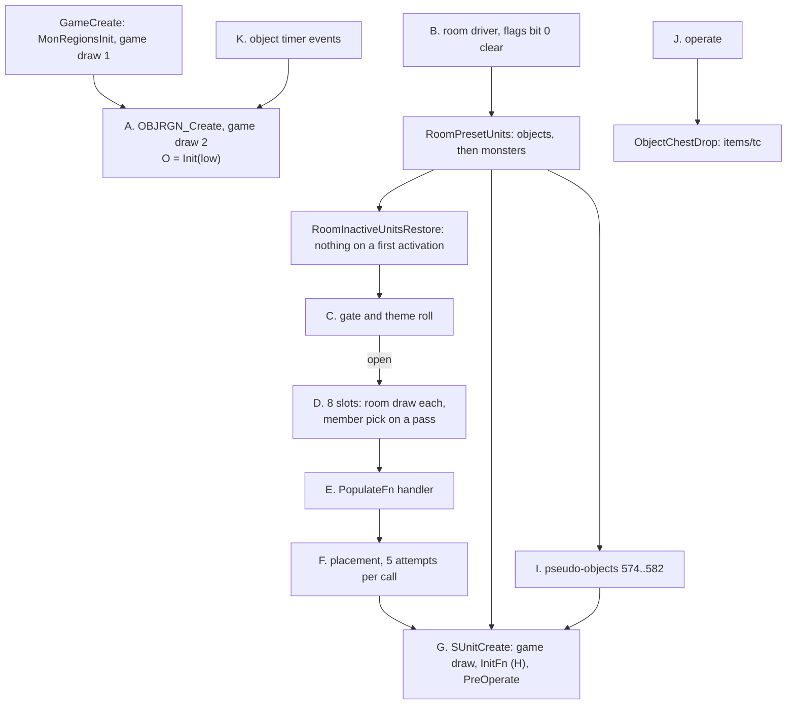
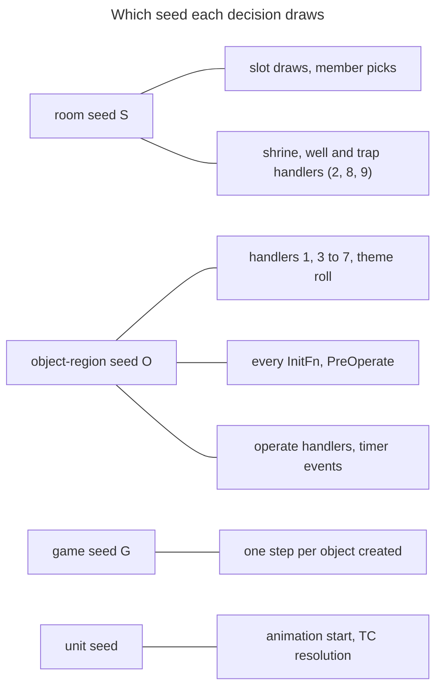
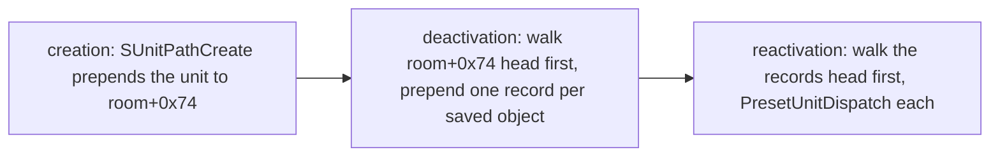
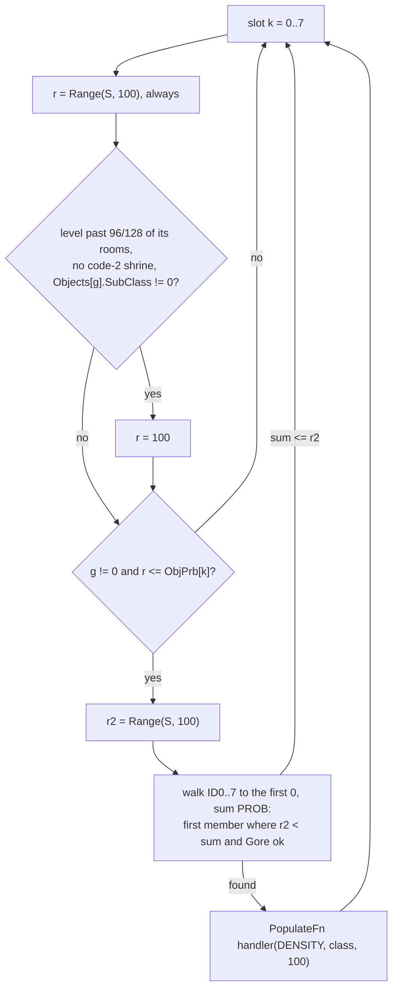
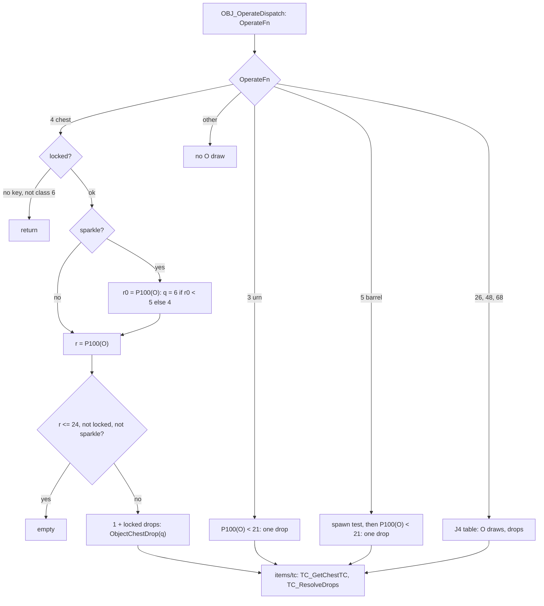
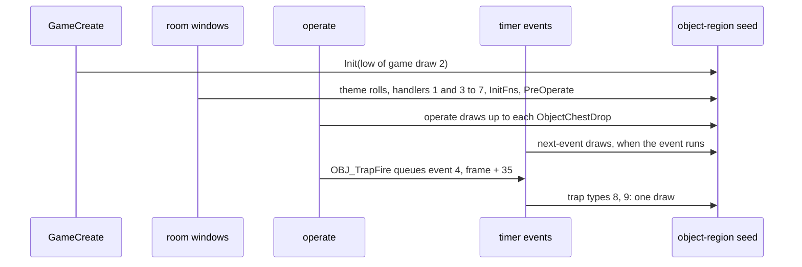

## Purpose

When the server activates a room for the first time it creates the room's objects in three steps: the DS1 preset
objects, the inactive-unit restore (which does nothing on a first activation) and the random object population,
which walks the eight object-group slots of the room's level, picks a group member, and places it with a handler
chosen by the member's `PopulateFn`. Every object created then runs its creation rolls (unit seed, `InitFn`,
`PreOperate`). This spec gives that whole window with its exact draw order on its four seeds: the **room seed**,
the game-wide **object-region seed**, the **game seed** and each object's **unit seed**. It also gives the operate
path of chests and containers up to the call into item creation; the treasure class chosen there and everything after
it belong to [items/tc](../../spec-items/tc/). What a shrine, a well, a trap or any other object *does* is game simulation
 and is only named. Primitives (`Step`, `Range`, `Init`) are those of [rng](../../spec-rng/overview/).

## Entry points

| When | Function | Tag |
|---|---|---|
| Game creation: the object region and its seed (right after the monster regions) | `OBJRGN_Create`, called | [C] |
| First activation of a room, in the room driver: presets, restore, objects, then the monster pass | — | [C] |
| DS1 preset units of the room (objects first, then monsters) | — | [C] |
| DS1 pseudo-objects 574..582 | `OBJ_PresetPseudoDispatch` | [C] |
| Inactive-unit restore (nothing on a first activation; a full re-creation on a revisit) | — | [C] |
| Random object population of the room | — | [C] |
| Every object creation | → `OBJ_ServerInit` | [C] |
| A player operates an object | `OBJ_OperateDispatch` | [C] |
| A chest or container drops (into items/tc) | → `TC_ResolveDrops` | [C] |
| An object timer event runs from the game's event queue | `g_ObjEventFns` | [C] |

- [C] Everything here runs on the server; the room driver calls the window only while the room's flags bit 0 is clear,
  and the monster population pass follows it.


## Inputs

### Tables

All tables are the compiled `.bin` records, indexed by record position.

| Anchor | Used for |
|---|---|
| `Levels.txt:ObjGrp0`, `Levels.txt:ObjPrb0` | u8 × 8 at `+0x0E5` and `+0x0ED` (`..7`): the eight slots, group index and chance (§ D) |
| `Levels.txt:Themes` | `+0x210`: the theme roll in the gate (§ C) |
| `Levels.txt:MonLvl1` | u8 `+0x010`, the normal-difficulty column in **every** difficulty: trap and lock chances (§ H) |
| `Levels.txt:Act` | `+0x003`: the act of each object-region level record (§ A) |
| `ObjGroup.txt:ID0` | u32 × 8 at `+0x00`: member classes (Objects record indices); the walk stops at the first 0 (§ D) |
| `ObjGroup.txt:PROB0` | u8 × 8 at `+0x28`: cumulative percentages against one draw (§ D) |
| `ObjGroup.txt:DENSITY0` | u8 × 8 at `+0x20`: the count factor passed to the handler; ≥ 128 is fatal (§ D, § E) |
| `Objects.txt:PopulateFn`, `Objects.txt:InitFn`, `Objects.txt:OperateFn` | u8 `+0x1B2`, `+0x1B1`, `+0x1B3`: handler indices (§ E, § H, § J) |
| `Objects.txt:SizeX`, `Objects.txt:SizeY` | `+0xD0`, `+0xD4`: placement sizes and the mark (§ F, § G) |
| `Objects.txt:SubClass` | `+0x167`: read by the forced-slot rule **at the group index** (§ D) |
| `Objects.txt:Gore` | `+0x172`: member skip against the gore limit (§ D) |
| `Objects.txt:Orientation` | `+0x13C`: the shrine placer (§ F) |
| `Objects.txt:Xspace`, `Objects.txt:Yspace` | `+0x162`, `+0x163`, read as **u8**: barrel and crate cluster steps (§ E) |
| `Objects.txt:Lockable` | `+0x171`: the lock roll of `InitFn` 3 (§ H) |
| `Objects.txt:PreOperate` | `+0x13D`: the 1/14 opened roll (§ G) |
| `Objects.txt:Sync`, `Objects.txt:FrameDelta0` | `+0x175`, `+0xF8 + mode`: the animation-start draw on the unit seed (§ G) |
| `Objects.txt:Selectable0` | `+0xC4 + mode`: the selectable flag (§ G) |
| `Objects.txt:Parm0`, `Objects.txt:Parm1` | s32 `+0x178`, `+0x17C`: shrine class and forced-shrine class (§ E, § H) |
| `Objects.txt:Mode1` | `+0x140`: a chest's mode after operating (§ J) |
| `Shrines.txt:effectclass` | u8 `+0xB2`: which pick list a code is in (§ A, § H) |
| `Shrines.txt:LevelMin` | u32 `+0xB4`, compared with the Levels **Id** (§ H) |

Not read by any code of this spec: ObjGroup `SHRINES` and `WELLS`, Shrines `rarity`, Objects `SpawnMax`, `TrapProb`, `Act`. In the bodies of the 109 functions this spec names, an operand scan of the decoded instructions at those columns' offsets (`+0x30`, `+0x31`, `+0x11`, `+0xC3`, `+0xCC`, `+0x170`) finds 10 operands and none is a table-record read (stack arguments, inactive-unit save records, stores, a function pointer stored at `+0xCC`). [C] [I] Beyond this spec: `SpawnMax` (`+0xC3`) and `Act` (`+0x170`) have no reader in the whole image as far as an operand scan can tell (no `+0xC3` displacement at all; the one byte operand at `+0x170` is a stack array), and none of the 89 functions that fetch an Objects record or read the table pointer reads `TrapProb` (`+0xCC`). A reader through a computed address, a wider read or a record pointer kept elsewhere is not excluded.

### Runtime state

| State | Type | Source |
|---|---|---|
| room seed `S` | `Seed` at active room `+0x6C` | [rng/seeds](../../spec-rng/seeds/) step 6c, then the wanderer tick |
| object-region seed `O` | `Seed` at `*(game+0x10F0)` | § A; one stream for the whole game |
| game seed `G` | `Seed` at game `+0xD0` | [rng/seeds](../../spec-rng/seeds/) |
| unit seed | `Seed` at unit `+0x20` | § G |
| level record `L` | `ObjRgnLevel` (0x90 B) per level id, `objrgn+0x48 + 4·id` | § A: `roomsVisited` `+0x04`, `roomCount` `+0x08`, `+0x0C`, `healthShrines` `+0x10`, `nShrinePos` `+0x14`, `nWellPos` `+0x18`, shrine and well positions |
| shrine lists | per `effectclass` 0..7: the Shrines codes in record order | § A |
| room rectangle | `rect = {x, y, w, h}` in subtiles | DRLG |
| object data | `interact` u8 at ObjectData `+0x04`: shrine code, or trap type (bits 0–6) and locked (bit 7); sparkle flag at unit `+0x78` | § G, § H |
| difficulty, expansion | game | game creation |

### Constants

| Name | Value | Tag |
| --- | --- | --- |
| slot count | 8 | [C] |
| forced-slot threshold | `roomsVisited·128 ÷ roomCount > 96` (signed) | [C] |
| gore limit | byte 2, no writer: the address occurs once in the image, the read | [C] |
| placement attempts per placer call | 5 | [C] |
| position-test masks | `0x3F11` (box test), `0xC01` (padded box) | [C] |
| shrine spacing, well spacing | 50, 100 subtiles on **each** axis | [C] |
| shrine cap per level, its `> roomCount ÷ 8` half | `nShrinePos > roomCount ÷ 8`: met twice in Catacombs (`roomCount` 15, two shrines placed), returning after the handler's `P100(S)` draw and before any placement draw (E2) | [C] |
| shrine cap's `= 10` half, well cap per level | `nShrinePos = 10`; `nWellPos = 4` or `> roomCount ÷ 8`; not reached | [I] |
| `PreOperate` chance | `Range(O, 14) = 0` | [C] |
| handler tables | `g_ObjInitFns` 80, `g_ObjPopulateFns` 10, `g_ObjOperateFns` 101, `g_ObjTrapFns` 10, `g_ObjPseudoFns` 9 entries | [C] |
| eight directions | `dx = −1, 0, 1, −1, 1, −1, 0, 1`, `dy = −1, −1, −1, 0, 0, 1, 1, 1` | [C] |

### Inputs and oracles

The reproduction of the objects run models this whole spec on the four seeds, with the object-region seed predicted from game creation and carried across every room, operate and timer event; the window RW1 → RW4 of each room is predicted from its entry, 1265 windows with 0 mismatches in 142 540 checks. The rows below are what it took from the log, except the two collision rows, which moved onto the grid model (150 338 checks, 0 mismatches); a reimplementation supplies them from their owners. Every `[C]` of this spec holds under these inputs. [C]

| Input | Kind | What it holds | Owner | Tag |
|---|---|---|---|---|
| the gate's DRLG parts | value oracle, read and asserted at every gate of the second chain run | room flags `0x30000`, `RoomPopLevelId`, the preset test, the town test, `LevelRoomCount` on first read | `drlg/preset`, `drlg/overview` | [C] |
| `COLL_WHTest` results at the seven object call sites and at the gold piles | modelled, [drlg/collision § E6](../../spec-drlg/collision/#e-collisiontest-by-size) | 0 = free; predicted on the room grids (the activation stamp, the object marks below, the logged monster and gold-item marks): 5767 placer calls and 92 gold-pile calls, 4816 blocked and 1043 free, 0 mismatches | [drlg/collision](../../spec-drlg/collision/#inputs-and-oracles) | [C] |
| object marks in the collision grid | modelled, § G and [drlg/collision § F](../../spec-drlg/collision/#f-unit-marks) | the mark each created object makes (G1, G4): all 1847 predicted (1835 inside a window, matched with their CM lines; 12 under preset monsters, compared inside the monster's seed oracle); 742 creations with `HasCollision` 0 in their mode made none, as predicted; 433 creations of the revisit restore are applied without a line to compare | `drlg/collision` | [C] |
| preset monsters of the presets window | modelled (a seed oracle in this spec's run) | `PresetUnitDispatch` of type 1 (the class case, the MonPlace fixed rows, the objects under catapults 432 and 433), and the superunique and MonPlace spawns, through the monsters chain ([chain § Algorithm](../../spec-chain/overview/#algorithm) D2); MonPlace rows 5, 10 and 11 stay seed oracles | [monsters/spawn](../../spec-monsters/spawn/), [monsters/special](../../spec-monsters/special/), [chain](../../spec-chain/overview/) | [C] |
| monster and quest `InitFn`s | seed oracle, but `InitFn` 46 | `InitFn` 46 is modelled now (§ H row 46); 47, 54, 55, 62, 66, 68, 69, Zoo 79, pseudo-object 582, and 18, 19, 25, 43, 49, 50, 52, 60 and 71 stay seed oracles; in the second objects run 66 and 71 each made one monster creation and no `O` draw, 47 and 25 neither (§ H) | monsters, quests | [C] |
| state `InitFn`s | value oracle | the mode or `interact` value that `InitFn`s without draws set from game state (4, 6, 8, 9, 12, 14, 16, 17, 22, 26 in the run); the unit-seed draw of the mode change is predicted | game state | [C] |
| `TC_ResolveDrops` | seed oracle in the run; modelled by [items/tc](../../spec-items/tc/), chained since | draws the dropping object's **unit seed**; it left the object-region seed alone in all 59 calls. In the chain the object's unit seed after the drop is the resolver's exit seed and the game seed after it is two steps per item | `items/tc` | [C] |
| gold drop of `InitFn` 28 | modelled (a seed oracle in the run) | one item per drop: two game-seed steps, the item's unit seed, its `0x200` mark, no object-region draw (71 of 71); the spot read from the code and predicted for 69 of 71 | items | [C] |
| operate monster spawn | input (the operate is a player action) | the spawn draws no object-region draw (2 spawns); its creation is not run by the chain's model: a creation outside the model, counted | monsters | [C] |
| when a player operates which object | input | simulation | game | [C] |
| when an object timer event runs | input | simulation; its draws are modelled (§ K), the trap event's `OBJTRAP_MonsterSpawn` draw included | game | [C] |
| trap effects, types 1 to 7 | modelled up to the effect (K2) | `g_ObjTrapFns[t]`, run by object event 4: the function chosen (the level remap included) and the seeds around it; the trap monsters of types 1–4 and 6 are seed oracles that leave `O` unchanged (6 events), and the two `fire` creations of `OBJTRAP_ObjectCreate` (types 5, 7) are predicted with the game seed after them (4 events). What the effect then does is game simulation | game simulation | [C] |
| trap effects, types 8 and 9 | not reached | `OBJTRAP_MonsterSpawn`'s draw and spawns (K2): no container of type 8 was operated below level 75 | game simulation | [I] |
| room and game seeds at each revisit re-creation | logged | the monster and item restores that run before the objects (§ B5) are specified in [drlg/lifecycle § H](../../spec-drlg/lifecycle/#h-the-restore), not in this spec's model; the object re-creations' own draws are this spec's | `drlg/lifecycle` | [I] |
| populate windows inside an operate | — | a portal-like operate handler that activates a room runs that room's window (§ B) inside the operate; those draws are the window's. Not reached: the 19 operates of the Arcane Sanctuary's pads (`OperateFn` 27) in the second objects run activated no room before their exit | this spec | [I] |

## Algorithm





- [C] The window draws four seeds. The **room seed** gives the slot draws, the member picks and every draw of the
  shrine (2), well (8) and trap (9) handlers' room part. The **object-region seed** gives the other handlers, the theme
  roll, every `InitFn`, the `PreOperate` roll, the operate handlers and the timer events. The **game seed** steps once
  per object created. The **unit seed** gives the animation-start draw and, through `TC_ResolveDrops`, the drop.


### A. The object-region seed and level records (game creation)

```
A1. OBJRGN_Create(game):                                          [C]
      Step(G); v: u32 ← G.low                                      ; game-seed draw 2 after Init(N)
      Init(objrgn.seed, v)                                         ; O = {v, 666}
      for id in 1 ..< nLevels:
        L[id] ← { act ← Levels[id].Act, roomCount ← 0x7FFFFFFF, +0x1C ← −1, all else 0 }
      for c in 0 ..< 8:
        shrines[c] ← the Shrines codes whose effectclass = c, in record order
```

- A1. [C] `GameCreate` calls `OBJRGN_Create`, right after `MonRegionsInit` (game-seed draw
  1, [rng/seeds](../../spec-rng/seeds/) step note 7a); no call sits between the two, so the object region takes game-seed draw
  2.
- A2. [C] `OBJRGN_GetSeed(game, room)` returns the region's seed and ignores the room: there is **one object-region
  stream per game**, advanced by every room's objects in activation order, every operate and every timer event.


### B. The window in the room driver, and the revisit

```
B1. per room of the act's new-rooms walk, after the wanderer tick, if room.flags & 1 = 0:   [C]
      RoomPresetUnits(game, room)          ; RW1 → RW2: non-monsters first (objects: § G, § I), then monsters (oracle)
      RoomInactiveUnitsRestore(game, room) ; RW2 → RW3: no record on a first activation, no draw
      RoomObjectsPopulate(game, room)      ; RW3 → RW4: §§ C–F
      ... monster population pass (monsters/spawn), then flags |= 1
```

- B1. [C] A preset object goes `PresetUnitDispatch` → `SUnitCreate(x, y, game, room, flags 1, mode = DS1 mode)` and
  makes the creation draws of § G and **no room-seed draw**, unless its `InitFn` spawns monsters. The walk order (all
  non-monsters, then all monsters) and the per-level walk filters are [drlg/preset § 6](../../spec-drlg/preset/#6-handover-to-the-server-spawners-boundary).

- B2. [C] On a first activation the inactive-unit restore leaves the room, game and object-region seeds unchanged (2090
  first activations of the three earlier runs, and every window of the objects run).

- B3. [C] **Revisit.** When a room that went inactive is activated again (flags bit 0 already set, so outside the
  window above), the restore re-creates each saved object through `PresetUnitDispatch` with **every creation draw**
  of § G (one game-seed step, its `InitFn` on the object-region seed, the `PreOperate` roll), then restores the saved
  `interact` byte, mode and sparkle flag. A chest locked at its first creation stays locked even when its new `InitFn`
  3 roll did not lock it. 548 re-creations reproduced.



```
B4. Saving, when the room driver deactivates a room:             [C] for SaveTest on the branches the runs met, [I] for the rest
      ; the room's unit list room+0x74 is newest first: every creation prepends (unit+0xE8 ← room+0x74; room+0x74 ← unit)
      for u in room+0x74, head first:
        if u.type = 2 and SaveTest(u): prepend a 0x34-byte record to the room's record list (+0x10, next at +0x30)
      SaveTest(object) holds when all of:
        the level flag Levels.SaveMonsters (leveldefs +0x94) or the preset flag 0x2000000 (set by PresetUnitDispatch) is set;
        Objects.Restore ≠ 0;  (sparkle byte & 0x02) = 0;  Objects.RestoreVirgins = 0 or mode = 0
      classes 59, 60 (portals): always saved, the unit kept alive and flagged 0x100 (unit +0xC8)
      record: x, y (+0x0, +0x4); type, class (+0x8, +0xC); mode (+0x10; mode 1 is saved as 2 when Objects +0x109 = 0
        and Objects +0x141 ≠ 0); game frame (+0x14); unit flags +0xC4, +0xC8 (+0x18, +0x1C); for a shrine its pending
        event time (+0x20/+0x24), otherwise the sparkle byte (+0x24); the interact byte (+0x28); unit +0xB8 (+0x2C)

B5. RoomInactiveUnitsRestore(game, room), on a revisit:           [C]
      InactiveMonstersRestore(room)                                ; drlg/lifecycle § H; not modelled here
      recs ← InactiveRecordTake(room)                              ; unlinks the record matched on the room's x, y
      InactiveItemsRestore(recs)                                   ; items: a separate list, drlg/lifecycle § H
      for rec in recs.units, head first:                           ; = the earlier creation order, oldest first
        if rec.type = 1 or rec.flagsC8 & 0x100: continue           ; a kept unit (portal) is only moved back
        u ← PresetUnitDispatch(rec.type, rec.class, rec.x, rec.y, mode ← rec.mode)   ; every creation draw of §§ G, H
        restore, no draw:
          a shrine with a saved frame: re-queue its event, interact ← the saved code, unnamed(Shrines[code])   ; unnamed
          a well (SubClass & 0x20): charges from the frames elapsed, refill events queued
          any other object: interact ← rec+0x28, sparkle ← rec+0x24, unit+0xB8 ← rec+0x2C when that is ≠ 0
```

- B4. [C] The save test, with its level flag named `Levels.SaveMonsters`, held on the 3 023 objects of
  the lifecycle run (`Restore` 0: 15; `RestoreVirgins` on a used object: 30), and the records it wrote came back
  through B5. The starting flag was set on all of them
  (653 by the preset flag alone).
- B4. [C] The same rule decides every object of the 190 restores of the objects run: each object created
  earlier inside the room's rectangle, taken at its last state, was put through the test. Of the preset objects 484
  pass and come back and 16 fail and do not; of the populated objects 98 pass and come back and 14 fail and do not.
  The populated ones that came back stood in levels 3, 4, 6, 27, 42, 43, 44, 76, 79, 80, 106, 111 and 113, so the level
  flag was set in all of them.
- B4. [I] Not met, so read from the code only: the refusal for a level flag and preset flag both clear, the sparkle bit
  `0x02` (never set on a tested object), and classes 59 and 60 (kept).
- B4. [C] Saving walks a newest-first list and prepends, so it reverses the order: the record list is oldest first.
  Inside each restore of the objects run the objects came back in their earlier creation order, 392 consecutive
  pairs of 392 counted from the lines.
- B4. [I] Items and monsters are saved to other lists.
- B5. [C] The saved objects are re-created oldest first: in the run every re-creation that followed another one of the
  same restore came after it in the earlier creation order (362 of 362 pairs among the 548 re-created objects). The
  saved id is the **class**, so a DS1 580/581 chest comes back through the plain `SUnitCreate` path, with no 581 class
  draw and no Maggot Lair draw, and its sparkle from the record.

### C. The gate and the theme roll

```
C1. Gate(game, room, lvlRec) → bool:                              [C]
      if DrlgRoom(room).flags & 0x30000: return false              ; input: a waypoint sets it on its room
      pop ← RoomPopLevelId(room)                                   ; input: 0 for Populate 0 or the near-town rule
      if pop = 0 or PresetPopTest(room) or pop ≥ nLevels or LevelIsTown(room): return false   ; inputs
      L ← objrgn.level[pop]
      if L.roomCount = 0x7FFFFFFF: L.roomCount ← LevelRoomCount(act of L, pop)               ; input, once
      L.roomsVisited ← L.roomsVisited + 1                          ; [C] counts gated rooms, not populated ones
      if lvlRec.Themes ≠ 0 and ThemeRoll(game, room, L, lvlRec.Themes) = 1: return false   ; [I] no stock case: no theme runs (C2, g_ObjThemeFns)
      return true

C2. ThemeRoll(game, room, L, themes) → i32:                       [C]
      if L.roomCount < 10 × L[+0x0C]: return 0                     ; +0x0C has no writer: never taken
      r ← Range(O, 100)                                            ; draw
      thr: i32 ← 12
      if L.roomsVisited > L.roomCount ÷ 2: thr ← thr + 5
      if L.roomsVisited > L.roomCount − L.roomCount ÷ 4: thr ← thr + 5
      if r ≥ thr: return 0
      list ← the theme numbers t in 1 ... 7 with themes & (1 << (t − 1)) ≠ 0;  n ← |list|
      i ← Range(O, n)                                              ; draw
      t ← list[i]
      if t < n and g_ObjThemeFns[t] is enabled: return ThemeFn[t](…)   ; never on stock data
      return 0
```

- C1. [C] The gate's DRLG inputs are taken from the log (*Inputs and oracles*). Town windows drew nothing in all 222
  logged town activations. `lvlRec` is the room's **own** level record (`RoomGetLevelId`), while the counters belong
  to the **population** level `pop`.
- C1. [C] **The order of the tests.** Each window's `OG` line logs a test's input only when the test runs. In all 1265
  windows of the objects run the tests ran in C1's order (room flags, population level, preset test, town) and
  each window closed at its first failing test with result 0: the room flags 46 (all waypoint rooms; the test's value
  equals the DRLG room's flags `& 0x30000` in every window), no population level 315, the preset test 35, a town 110;
  759 passed.
- C2. [C] The stock `Themes` values are 8, 48 and 60; each lists only theme numbers ≥ `n` except 60, whose theme 3 has
  no handler, so **no theme ever runs on stock data** and the roll costs 1 or 2 object-region draws per gated room of
  the 39 levels with `Themes` set (20 rolls in the run, 2 of them drew an index). The theme handlers are named only:
  1 an empty room, 2 a barrel grid, 4 an item grid, 5 and 6 bookshelf or weapon-rack rows.
- C2. [C] **Theme 3 is drawn and does not run.** `g_ObjThemeFns` holds 8-byte `{enabled, fn}` entries: themes 1, 2, 4,
  5 and 6 are enabled, 0 and 3 are `{0, 0}`. In the second objects run 4 rolls (Catacombs Level 3, `Themes` 60)
  drew theme 3, below the count 4; nothing ran, and every draw after each matched with no theme run.


### D. The slot loop and the member pick



```
D1. RoomObjectsPopulate(game, room):                              [C]
      lvl ← Levels[RoomGetLevelId(room)]
      if not Gate(game, room, lvl): return
      for k in 0 ..< 8:
        g: u8 ← lvl.ObjGrp[k]
        r: u32 ← Range(S, 100)                                     ; draw, every slot, group 0 included
        L ← objrgn.level[RoomPopLevelId(room)]
        if L.roomCount > 0 and (L.roomsVisited << 7) ÷ L.roomCount > 96
           and L.healthShrines = 0 and Objects[g].SubClass ≠ 0:    ; record index g = the GROUP number (sic)
          r ← 100                                                  ; fails every slot (largest ObjPrb is 90)
        if g = 0 or r > lvl.ObjPrb[k]: continue
        G ← ObjGroup[g]; if G = none: return                       ; [I] only past the 133 records
        r2: u32 ← Range(S, 100)                                    ; draw
        sum: i32 ← 0
        for i in 0 ..< 8 while G.ID[i] ≠ 0:
          sum ← sum + G.PROB[i]
          if r2 < sum and Objects[G.ID[i]].Gore ≤ goreLimit:
            fn ← g_ObjPopulateFns[Objects[G.ID[i]].PopulateFn]    ; PopulateFn ≥ 10 or DENSITY ≥ 0x80: fatal error
            if fn ≠ none: fn(game, room, G.DENSITY[i], G.ID[i], 100)
            break
```

- D1. [C] This order accounts for every room-seed draw of the 1405 drawing windows of the three earlier runs and of
  every window of the objects run: one draw per slot whether or not the group is 0, `r ≤ ObjPrb` passes (so the
  chance is `(ObjPrb + 1)/100`), one pick draw per passing slot, and nothing placed when the `PROB` sum is at most
  `r2` (259 of 2307 passing slots). `PROB` is a percentage against 100, not a weight over the members' sum.

- D2. [C] **The forced-slot rule is a game bug the spec keeps.** It tests `Objects[g].SubClass`, the Objects record
  whose index is the group number, so the slots it suppresses are those whose group index is 1–6, 50–53, 59, 60, 77,
  109, 116, 119, 120, 123, 124 or 129. Phase 2 tracked the counters at every slot and they matched; one slot was forced
  directly (Sewers level 2, slot 2, group 5).
- D3. [C] Group 0 and the memberless groups 30 and 72 cost their draws and place nothing; a `PROB` 0 member is never
  picked; group 69 starts with an empty member slot and never places. The `Gore` test never excludes on stock data
  (`Gore` is 0 or 1, the limit 2). In the objects run group 0 was drawn by 2364 slots and never led to a member
  pick; groups 30 (124 slots, 23 member picks) and 69 (156, 36) led to no handler; the one `PROB`-0 member of
  `objgroup.bin` was never handled. Group 72 was not drawn: like group 30 it has no member (34 groups have none).

- D4. [C] Every handler receives the member's `DENSITY`, its class (the Objects **record index**) and the
  probability 100. The handlers draw their own probability against 100: that draw always passes, but it is made.


### E. The `PopulateFn` handlers

Notation: `R(s, n)` is `Range(s, n)`: 0 with **no draw** when `n < 1`, else one draw and `low mod n`
([rng](../../spec-rng/overview/) step 2). `P100(s)` is `Range(s, 100)`. `RandLoHi(s, lo, hi)` is `lo + Range(s, hi − lo)`, `lo`
without a draw when `hi ≤ lo`. `cnt: i32 ← ((w·h >> 7) · DENSITY) >> 8` with signed shifts. `sx`, `sy` are the class's
`SizeX`, `SizeY` unless noted. Every creation is `SUnitCreate(2, class, x, y, game, room, flags 1, mode 0)` (§ G).
[C]

| Fn | Handler | Seed | Draw sequence | Tag |
|---|---|---|---|---|
| 1 | `OBJPOP_Clusters` | O | `P100`; the class picks a list; clusters while `cnt > 0` and tries remain (E1) | [C] |
| 2 | `OBJPOP_Shrine` | S | `P100`; cap; up to 3 (forced: 30) `OBJ_PlaceByOrientation` calls (E2) | [C] |
| 3 | `OBJPOP_Scatter` | O | `P100`; `cnt` × `OBJ_PlaceRandom` | [C] |
| 4 | `OBJPOP_Barrels` | O | `P100`; `cnt` clusters, `2·cnt` tries, at most 8 objects (E3) | [C] |
| 5 | `OBJPOP_Crates` | O | `P100`; like 4, a class list of five, at most 8 followers (E4) | [I] |
| 6 | `OBJPOP_Corpse` | O | handler 3, then `OBJ_FliesAdd` on its last placement | [C] |
| 7 | `OBJPOP_StickCorpses` | O | `P100`; pattern `R(4)`; ≤ 8 anchor tries; one class draw per placed cell (E5) | [C] |
| 8 | `OBJPOP_Well` | S | cap; `P100`; one `OBJ_PlaceRandomRoomSeed` (E6) | [C] |
| 9 | `OBJPOP_Trap` | S, then O | `P100` on S; `cnt` × `OBJ_PlaceRandom` on O, stopping at the first trap placed | [C] |

- [C] On the room seed, handler 9 draws exactly once, handler 2 draws `1 + 2a` (`a` = placement attempts made), and
  handler 8 draws 0 (cap reached) or `1 + 2a`. Handlers 1 and 3–7 never draw the room seed.


**E1. Handler 1 (urns, caskets, baskets, sarcophagi).** [C] The class chooses a list, the number of tries, and the ring
step and base used to walk away from the first object; the first object of every cluster uses the padded test.

| Class | List | Tries | Step / base | Follower test |
|---|---|---|---|---|
| 3 | 3, 28 | 18 | 5 / 5 | padded |
| 1, 79 | 79, 53, 1 | 12 | 5 / 5 | padded |
| 4 | 4, 9, 52, 94, 95 | 12 | 0 / 1 | tight |
| 89 | 89, 284 | 12 | 5 / 5 | padded |
| 208, 209 | 208, 209 | 12 | 0 / 1 | tight |
| any other | — | — | — | returns after the `P100` |

```
E1. Clusters(class, DENSITY):                                     [C]
      if P100(O) > 100: return                                     ; draw; never taken
      if cnt ≤ 0: return
      while tries > 0:
        cls ← list[R(O, n)]                                        ; n = list length
        x ← rect.x + R(O, w − sx − 1);  y ← rect.y + R(O, h − sy − 1)   ; sx, sy of the member class
        if not PosTestPadded(x, y): tries ← tries − 1; continue
        create(cls, x, y);  k ← 1;  ok ← true
        loop:
          m ← k >> 1
          if m > 0 and R(O, m) ≠ 0: break                          ; the cluster ends with chance 1 − 1/m
          if not ok: break
          ok ← false;  i ← 0;  lim ← 3 × max(cnt, 4)
          while not ok and i < lim:
            Step(O); d ← O.low & 7                                 ; draw
            x ← x + (R(O, step) + base) × dx[d] × 2                 ; R(O, 0) makes no draw
            y ← y + (R(O, step) + base) × dy[d] × 2
            ok ← followerTest(x, y, sx, sy);  i ← i + 1             ; a rejected step still moves the point
          if ok: create(list[R(O, n)], x, y); k ← k + 1
        cnt ← cnt − 1;  tries ← tries − 1
        if cnt ≤ 0: return
```

- E1. [C] Every size in E1 is the **member** class's: the handler fetches `Objects[class]` once, for the class it was
  called with, and never reloads it. So `sx`, `sy` in the first object's two draws, its padded test and every
  follower test (`PosTestTight` or `PosTestPadded` per the table) are the member's `SizeX`, `SizeY`; the class drawn
  from the list only goes to `SUnitCreate`. A follower after a `Casket` (79, 4 × 6) in a group whose member is class
  1 (5 × 3) is tested with 5 × 3. In the second objects run 32 follower walks came after a created class whose
  size differs from the member's (79 is 4 × 6; 53 and 1 are 5 × 3; Catacombs Levels 2–4), and every follower test's
  logged box is the member's size plus the list's margin, which the created class's size would not give.


**E2. Handler 2 (shrines).** [C]

```
E2. Shrine(class, prob = 100):
      r ← P100(S)                                                  ; draw
      forced ← HealthShrineDue(L)                                  ; [C] the due rule
      if forced: tries ← 30
      else: if r > prob: return;  tries ← 3                        ; never returns
      if ShrineCapReached(L): return                               ; nShrinePos = 10 or > roomCount ÷ 8; Constants
      repeat tries times until placed:
        PlaceByOrientation(class, sx, sy, room, Orientation, popLvl, ShrineDistOk)   ; on S, F3
      on a placement:
        if forced and code ≠ 2:                                    ; [C]
          class ← Parm1 if 1 ≤ Parm1 ≤ 572 else 84                 ; the 84 case [I], not reached
          ShrinePick(class 2, level 1)                             ; its draws are made, the result discarded
          code ← 2
        if code = 2 or forced: L.healthShrines ← L.healthShrines + 1
        record the position in the level's shrine list (nShrinePos + 1)
```

- E2. [C] `HealthShrineDue` holds once more than 75 % of the level's rooms have been gated and no code-2 shrine
  stands: it returns `roomCount > 0` and `(roomsVisited << 7) ÷ roomCount > 96` (signed) and `healthShrines = 0`, on
  the population level's record. `RoomObjectsPopulate` inlines the same comparison for its forced slot
  (D1), which held in 4 slots of the objects run with the slot draws and counters
  reproduced.
- E2. [C] **The due rule inside the handler, and the forced conversion.** In the City of the Damned (level 106, 75
  rooms) the handler ran twice with the rule true (rooms visited 58 and 64, no code-2 shrine, two shrines placed
  before each), 30 tries each. The first call placed nothing. The second placed class 231 (code 14) and converted it to
  class 96, its `Parm1`, with code 2, after a `ShrinePick(2, level 1)` whose draws were made and whose result was
  dropped. Every draw of both calls, the conversion and the level counters at the next window match.

- E2. [C] **The shrine cap, its `> roomCount ÷ 8` half:** met twice (Catacombs, `roomCount` 15, two shrines placed); the
  handler returned at the cap with no placement attempt, and the seeds after it match. The `= 10` half needs `roomCount ≥ 80` with ten
  shrines placed and was not reached ([I], *Constants*).

**E3. Handler 4 (barrels).** [C] It
ignores the member class and uses the size and `Xspace`/`Yspace` of record 7 (`Barrel`).
- Each try draws, in order: the class (`low mod 3 = 0` → 11 `BarrelExploding`, else 7), `x = rect.x + R(O, w)`,
  `y = rect.y + R(O, h)`; the tight test decides, and a failure only spends a try (`2·cnt` in all).
- On a success it creates the object and walks a cluster as in E1, each step one draw `d = low & 7`, then
  `x += Xspace·dx[d]`, `y += Yspace·dy[d]` (u8 values), up to 15 steps per follower; each follower draws its class,
  `low & 3 = 0` → 11, else 7.
- The handler returns after 8 objects in all. So the first barrel of a cluster explodes with chance 1/3, each follower
  with 1/4.

**E4. Handler 5 (crates).** [I] For a class other than 46, each try draws
`cls = list[R(O, 5)]` from (4, 9, 52, 94, 95), then `x`, `y` as in E3; on a success it draws the class **again** and
creates that one; followers take the same class with up to `max(4, ringLim)` steps of the member class's
`Xspace`/`Yspace`, `ringLim` starting at `4·cnt` and dropping by 4 per cluster; the handler stops after 8 followers.
Class 46 (`Crate`) skips both class draws. No stock level reaches it (*Open questions*).

**E5. Handler 7 (rogue on a stick), and flies.** [C]
1. `P100(O)` (passes), then the pattern `p = R(O, 4)`.
2. Up to 8 anchor tries: `x = rect.x + R(O, w − sx − 1)`, `y = rect.y + R(O, h − sy − 1)`, padded test with size 5 × 5.
3. For each offset of pattern `p`: the padded test at `anchor + offset` with the class size; on a pass, one draw for
   the class `57 + (low & 1)`, the creation, and `OBJ_FliesAdd`.

`OBJ_FliesAdd` (also handler 6, on the last placement of its handler-3 run) draws `P100(O)` and creates object 103
(`flies`) at the corpse's position when the value is above 70 (chance 29/100). The patterns are written at start-up by
an unnamed initialiser; the file image holds zero counts:

| p | Offsets (dx, dy) |
|---|---|
| 0 | (−4,0) (0,0) (4,0) (8,0) (0,4) (0,−4) |
| 1 | (−8,0) (−4,0) (0,0) (4,0) (8,0) |
| 2 | (0,−8) (0,−4) (0,0) (0,4) (0,8) |
| 3 | (−7,−5) (−5,−3) (−3,−1) (0,0) (3,−1) (5,−3) (7,−5) |

**E6. Handler 8 (wells).** [C]
It returns at once when `WellCapReached` (`nWellPos = 4` or `> roomCount ÷ 8`; the cap itself is inferred, not
reached in either objects run: *Constants*).
Otherwise one room draw against `prob`, then one `OBJ_PlaceRandomRoomSeed` with size `(2·sx + 1) × (2·sy + 1)` and
`WellDistOk`; a placed well's position is recorded.

### F. Placement and the position tests

```
F1. PlaceRandom(class, sx, sy, room) → unit | none:               [C]
      if w < 2 or h < 2: return none
      repeat 5 times:
        x ← rect.x + R(O, w − sx − 1);  y ← rect.y + R(O, h − sy − 1)     ; 2 draws per attempt
        if x ≠ 0 and y ≠ 0
           and rect.x + 1 ≤ x < rect.x + w − 1 and rect.y + 1 ≤ y < rect.y + h − 1     ; compared as u16
           and COLL_WHTest(room, x, y, sx + 6, sy + 6, 0x3F11) = 0:
          return create(class, x, y)
      return none                                                  ; no fallback

F2. PlaceRandomRoomSeed: as F1 on S, plus the handler's extra test (WellDistOk)     [C]

F3. PlaceByOrientation(class, sx, sy, room, orient, popLvl, spacingFn) → unit | none, on S:   [C]
      ; all values i32; ÷ truncates toward zero
      if sx + 2 > w or sy + 2 > h: return none
      repeat 5 times:
        if orient = 1:
          x: i32 ← rect.x + R(S, w ÷ 2) + w ÷ 4                    ; draw first
          y: i32 ← rect.y + RandLoHi(S, 1, 2)                      ; draw; always 1
        else if orient = 2:                                        ; [I] no stock case: no PopulateFn-2 member has Orientation 2
          x ← rect.x + RandLoHi(S, 1, 2)                           ; draw first; always 1
          y ← rect.y + R(S, h ÷ 2) + h ÷ 4                         ; draw
        else:
          x ← rect.x + R(S, w − sx − 1);  y ← rect.y + R(S, h − sy − 1)
        if x = 0 or y = 0: continue                                ; the full 32-bit values
        xl: i32 ← x & 0xFFFF;  yl: i32 ← y & 0xFFFF                 ; the margin is on the low 16 bits, compared signed
        if xl < rect.x + 1 or yl < rect.y + 1: continue
        if xl ≥ rect.x + w − 1 or yl ≥ rect.y + h − 1: continue
        if spacingFn is not a valid code pointer: fatal error 0x634
        if COLL_WHTest(room, x, y, sx + 6, sy + 6, 0x3F11) ≠ 0: continue      ; u16 result
        if (u8) spacingFn(game, popLvl, x, y) = 0: continue        ; called only after a clear test
        return SUnitCreate(2, class, x, y, game, room, flags 1, mode 0)
      return none

F4. PosTestPadded(x, y, sx, sy):                                  [C]
      sx + 2 ≤ w, sy + 2 ≤ h, rect.x + 1 < x < rect.x + w − sx − 2, rect.y + 1 < y < rect.y + h − sy − 2,
      COLL_WHTest(room, x, y, sx + 7, sy + 7, 0xC01) = 0 and COLL_WHTest(room, x, y, sx, sy, 0x3F11) = 0

F5. PosTestTight(x, y, sx, sy):                                   [C]
      w > 1, h > 1, rect.x + 2 < x < rect.x + w − sx, rect.y + 2 < y < rect.y + h − sy,
      COLL_WHTest(room, x, y, sx + 2, sy + 2, 0x3F11) = 0
```

- F1. [C] Accepted attempts in the objects run fell at attempts 1 to 5 (153, 87, 67, 51, 29), and 911 placer
  calls found no spot. When no spot is found the object is not created.
- F3. [C] The margin and tests are the same for every orientation: `OBJ_PlaceRandom`'s one-subtile margin, then the
  box `(sx + 6) × (sy + 6)` with mask `0x3F11`, then the spacing test. Orientation 1 always gives `y = rect.y + 1`,
  which passes the margin whenever `h ≥ 3` (always, since `h ≥ sy + 2`), and its `x` lies in
  `[rect.x + w ÷ 4, rect.x + w ÷ 4 + w ÷ 2 − 1]`, which passes whenever `w ≥ 4`; orientation 2 is the mirror. All 25
  orientation-1 calls of the run (121 attempts) passed the margin, and each attempt made exactly the predicted
  `COLL_WHTest` call. A test `attempt > 4` before the creation can never be true ([I]).

- F3. [I] **Orientation 2 has no stock case.** `OBJ_PlaceByOrientation`'s only call is in `OBJPOP_Shrine`,
  which passes the `Orientation` of the ObjGroup member it was called with; of the 88 member slots of `PopulateFn`-2
  members, 9 have `Orientation` 1 and 79 have 3, none 2. So the orientation-2 branch runs only on modified data.

- F6. [C] `COLL_WHTest(room, x, y, w, h, mask)` tests one cell (`COLL_CellTestNb`) when `w ≤ 1` and `h ≤ 1`, otherwise
  the inclusive rectangle `{x − w/2, y − h/2, x − w/2 + w − 1, y − h/2 + h − 1}` (unsigned halving) with `COLL_RectTest`,
  whose semantics are [drlg/collision § E](../../spec-drlg/collision/#e-collisiontest-by-size). Mask `0x3F11` contains the
  object bit `0x400`, so an earlier object's mark rejects the spot. All 5859 results of the run are predicted on the
  grid model (*Inputs and oracles*).
- F7. [C] `ShrineDistOk` rejects a point when, for some recorded shrine of the level, `|dx| < 50` **or** `|dy| < 50`:
  a second shrine needs both axes 50 subtiles away from every earlier one. `WellDistOk` does the same with 100.


### G. Creation: `SUnitCreate` for an object

```
G1. SUnitCreate(type 2, class, x, y, game, room, flags, mode):    [C]
      Step(G); Init(unit.seed, G.low)                              ; one game-seed draw (UnitSeedInit)
      unit.data ← new ObjectData (0x38 B); objRec ← Objects[class] ; class = record index
      SetMode(unit, mode)                                          ; G2
      ServerInit(unit)                                             ; G3
      path (G4); no draw

G2. SetMode(unit, mode) → UNIT_AnimInit:                          [C]
      if objRec.Sync = 0: Range(unit.seed, objRec.FrameDelta[mode] >> 3)     ; unit-seed draw (none when the value is < 1)

G3. ServerInit(unit):                                             [C]
      sparkle ← 0; interact ← 0
      if objRec.InitFn < 80: g_ObjInitFns[InitFn]({game, unit, room, &O, objRec, x, y})   ; § H
      selectable ← objRec.Selectable[mode]
      if objRec.PreOperate and not (unit.flags & 0x80):
        if Range(O, 14) = 0: SetMode(unit, 2)                      ; draw; opened, chance 1/14

G4. SUnitPathCreate(unit), after ServerInit:                      [C]
      m ← the unit's mode now                                      ; after the InitFn and the PreOperate roll
      if objRec.HasCollision[m] ≠ 0 and objRec.SizeX ≠ 0 and objRec.SizeY ≠ 0:
        RectOrWH(room, x, y, SizeX, SizeY, UNIT_GetCollMask(unit))  ; drlg/collision § F4 and its mask table
```

- G1. [C] `UnitSeedInit` steps the game seed for every non-player unit, objects included; the path step makes no draw
  for an object.
- G1. [C] The class is the Objects **record index**: apart from load and unload, the Objects table pointer is read only
  by `OBJECTS_GetRecord`, which computes `base + i · 0x1C0`, and `Id` is never read. `Id` differs from the
  record index only at records 410–412 (Ids 408–410), so those records are classes 410–412.
- G2. [C] The animation draw touches only the object's own unit seed. Any later mode change (a state `InitFn`, the
  `PreOperate` roll, the operate) makes it again.
- G2. [C] **The draw's value is the object's animation rate**: `+0x4C = clamp(FrameDelta − (FrameDelta >> 4) + draw,
  0, 0x7FFF)` when `Sync` is 0, `FrameDelta` otherwise, with `+0x44 = Start << 8` and `+0x48 = FrameCnt` (725 logged
  starts, 490 with a draw). No server code reads the rate back.

- G4. [C] Every object mark of the objects run is predicted this way (*Inputs and oracles*), by mask `0x400`
  1813, `0x404` 13, `0x806` 7 and `0x8000` 2.
- G4. [C] **A door with neither `BlocksVis` nor `BlockMissile` marks `0x400`:** 60 marks of classes 13 and 14 (`IsDoor`
  1, `BlocksVis` 0, `BlockMissile` 0) matched their `CM` lines in the second objects run, and the logs of
  the objects run held 13 more. **An object with `HasCollision` set and a zero size makes no mark:** class 523
  (0 × 0) in Harrogath's DS1 and the fissure 399 in the City of the Damned were created in mode 0 inside a logged window
  with no `CM` line after either.
- G4. [I] **The door mask `0x804` has no stock case:** `UNIT_GetCollMask` returns it only for a door with `BlocksVis` 0
  and `BlockMissile` non-zero, and the 7 stock `IsDoor` records with `BlocksVis` 0 all have `BlockMissile`
  0.
- G4 (portals). [C] **A portal marks before its path.** `OBJINIT_Portal` (`InitFn` 12) sets a portal that is in mode 0 to mode 1,
  marks it at once (`UNIT_CollMarkRect`, mask `0x8000`) and queues an event; then a
  switch on the room's level id writes object data byte `+4` (no draw). `SUnitPathCreate` marks it again with
  `HasCollision1`, which the OR makes a no-op. These are the two `0x8000` marks of the run (class 60).

- G3. [C] 510 `PreOperate` rolls reproduced; unit flag `0x80` skips the roll. The super-chest pseudo-object (§ I)
  sets that flag only after the chest's creation, so it does not suppress the chest's own roll ([I], § I1).


### H. Draws at creation, per `InitFn`

A callee scan of all 76 distinct `InitFn` handlers to depth 3 found draws only in the rows below. A full-depth walk of
the 80 slots (the decoded instructions) finds every listed handler drawing and nine more that create monsters, `InitFn`
18 and 19 (`jerhyn`), 25 (`gidbinn`), 43 (`darkwanderer`), 49, 50, 52, 60 (`compellingorb`) and 71: these draw as
monster spawns (room and game seeds) when their condition holds. Every draw of the rows is on the object-region seed
`O` unless the row says otherwise. [I]

| InitFn | Objects | Draws, in order | Tag |
|---|---|---|---|
| 1 | 92 shrine rows | H1 | [C] (`OBJINIT_Shrine`, `OBJ_ShrinePick`: 65 shrines) |
| 2 | 37 urns, jars, baskets | `P100(O) < MonLvl1 ÷ 8 + 5` → trap type `RandLoHi(O, 1, 9)` (1..8), else none | [C] (`OBJINIT_TrapByte`, `Levels.txt:MonLvl1`: 397 runs) |
| 3 | 71 chests | `InitFn` 2; then, for a `Lockable` row, `P100(O) < MonLvl1 ÷ 2 + 8` → locked (`interact` bit 7); then one draw `v = low mod 0xFFFE + 1` and `Init(unit.seed, v)` | [C] (`OBJINIT_Chest`, `Objects.txt:Lockable`: 212 runs) |
| 27 | goo pile | one draw: `low mod 1000 > 332` → `interact` 0, else 3 (chance 333/1000) | [C] (`g_ObjInitFns`: 2 runs) |
| 28 | gold-pile dummy (269) | `n = 1 + low mod 9` piles (1..9); per pile two draws, offsets `(dx, dy) = (low & 3, low & 3)`; the running position `(px, py)` starts at the object's cell; if `RoomAtSubtile(room, px + dx, py + dy)` is the object's room, `(px, py) ← (x + dx, y + dy)` and, when `COLL_WHTest(room, px, py, 1, 1, 0x3F11) = 0`, a gold drop at `(px, py)` (the drop only reads the position; its item is modelled since) | [C] (`OBJINIT_GoldPiles`: 14 objects, counts 2–9, 92 tests, 71 drops) |
| 34 | 358, 359 `fire` | one draw, odd → mode 1 | [C] (`g_ObjInitFns`: 20 runs) |
| 57 | 397 `sparklychest`, 455 `specialchest` | `InitFn` 3, then the sparkle flag | [C] (`OBJINIT_SparklyChest`: class 397 in Cave Level 2's treasure room, 3 creations, 3 `O` draws each) |
| 58 | fissure | one draw for a timer | [C] (`g_ObjInitFns`: the fissure 399, 2 creations, one `O` draw each) |
| 79 | Zoo | `RandLoHi` on a quest-held seed, not `O` | [I] |
| 46 | 369 (City of the Damned) | random points and monster spawns 403/404: room, game and `O` draws; modelled now, with the walk and its draws (the direction draw is not stored) | [C] (`OBJINIT_CityDamnedSpawns`: 16 calls) |
| 47, 54, 55, 62, 66, 68, 69; 18, 19, 25, 43, 49, 50, 52, 60, 71 | quest objects; the nine monster-creating handlers of the full-depth walk | monster spawns through `SpawnAtPos`, `SpecialMonSpawn` or `PresetMonSpawn` when the handler's condition holds; seed oracles | [C] the cases reached, none drawing `O`: 47 (class 371, level 25) and 25 (class 252, the Gidbinn altar) no draw and no creation in their quest state, 66 (class 459, Harrogath) and 71 (class 543, Harrogath) one monster creation each; 18 no draw in its 3 calls. [I] the others, and each handler's other branch |
| every other | — | no draw; some (4, 6, 8, 9, 12, 14, 16, 17, 22, 26 in the run) set mode or `interact` from game state, whose mode change draws the unit seed (G2) | [C] no draw for the 13 reached, calls per `InitFn` 4 (1), 5 (6), 6 (5), 8 (499), 9 (1), 12 (1), 13 (1), 14 (4), 16 (14), 17 (122), 22 (164), 26 (12), 51 (13): the room, object-region, game and unit seeds match after each with no draw modelled; [I] no draw for those not reached; [C] the state values as inputs |

Together with § G, one object's creation draws, in order: one game-seed step; G2's unit-seed draw for mode 0 (when
`Sync` is 0); the `InitFn` row above; for a `PreOperate` row the 1/14 roll on `O`, and its mode change's unit-seed draw.
[C]

```
H1. InitFn 1, shrines (object, room):                              [C]
      lid: u32 ← RoomGetLevelId(room)                              ; the Levels Id, not a monster level
      if Parm0 = 0:                                                ; [I] no stock row, unreachable
        N: i32 ← SHRINES_GetCount()
        repeat up to 8 times:
          code ← 1 + R(O, N − 1)                                   ; draw; never 0, so no (0 → 1) here
          if lid ≥ Shrines[code].LevelMin: stop                    ; u32 compare
        ; after 8 failures the eighth code is kept, as in H1a
      else:
        c ← 2 if Parm0 = 1; 3 if Parm0 = 2; else (R(O, 10) = 0 ? 1 : 4)     ; one draw only in the last case
        code ← ShrinePick(c, lid)                                  ; H1a
      if code = 4: code ← 2;  if code = 5: code ← 3;  if code = 16: code ← 18    ; every Parm0
      interact: u8 ← code;  unnamed(Shrines[code])          ; unnamed

H1a. ShrinePick(c: u8, lid: u32) → code:                          [C]
      if c = 0 or c > 4: c ← 2                                     ; [I] callers pass 1..4
      n: i32 ← count[c]                                            ; the effectclass-c list of § A
      if n = 0: fatal error 0x2CC
      tries: i32 ← 8
      repeat:
        i ← R(O, n)                                                ; draw
        code ← shrines[c][i]
        if code = 0: code ← 1                                      ; [I] never on stock data
        if lid ≥ Shrines[code].LevelMin: break                     ; u32 compare
        tries ← tries − 1
      until tries = 0
      return code                                                  ; all 8 failed: the eighth code, no fallback, no ninth draw
```

- H1. [C] `rarity` is not read: the pick is uniform in the class list. Class 0 (holding row 0, `None`) is never asked
  for. So Health Exchange (4), Mana Exchange (5) and Shrine of Enirhs (16) are never placed by a populate pass, and
  Resist Cold (26), Lightning (32) and Poison (21) only in levels whose id reaches those values. The run's 65 shrines
  took codes 1, 2, 3, 6, 7, 8, 10, 11, 12, 13, 14, 15, 18 and 20.
- H1a. [C] When all 8 tries fail `LevelMin`, the eighth code drawn is returned and used. The run reached this once: a
  class-4 shrine in level 3 (Cold Plains) drew 8 codes that all failed and kept code 6 (`LevelMin` 5); its `interact`
  byte and every later draw reproduced. The same keep-the-last rule holds in the `Parm0` 0 branch ([I]).

- H1b. [I] The `(0 → 1)` maps a list entry 0 (Shrines row 0, `None`) to code 1. Row 0 sits in the class-0 list only
  and `ShrinePick` never reads that list (class 0 becomes 2), so on stock data the guard never fires; only data that
  gives row 0 an `effectclass` of 1 to 4 reaches it.
- H2. [C] The trap and lock chances read `MonLvl1` in Nightmare and Hell too: every lock and trap roll of the 212
  chests and 397 containers reproduced on the normal-difficulty column. In Lower Kurast (`MonLvl1` 22) a chest locks
  with chance 19 %.
- H3. [C] `InitFn` 3's re-seed replaces the chest's unit seed, so its drops (§ J) draw from `{v, 666}`, not from the
  game-seed-derived seed of G1.

### I. DS1 preset objects and the pseudo-objects

- [C] `PresetUnitDispatch` sends a type-2 id below 573 to `SUnitCreate` (§ G), does nothing for 573, and sends 574..582
  to `OBJ_PresetPseudoDispatch` (`g_ObjPseudoFns`).

| Id | Handler | What it creates | Tag |
|---|---|---|---|
| 574..579 | `OBJ_PresetFixedShrine` | class 136 in the DS1 mode (its `InitFn` 1 draws first), then `code = lo + R(unit.seed, hi − lo)` with (lo, hi) = (2,6), (7,7), (8,11), (12,12), (1,5), (14,14); 4 and 5 → 2. No stock DS1 places them | [I] |
| 580 | `OBJ_PresetSuperChest` | I1: a random chest as 581 (level 25: class 371), the sparkle flag except in Maggot Lair 62–64, where `P100(O) > 50` skips it; level 25 sets trap type 3; unit flag `0x80`; mode 0 | [C] (`OBJ_PresetSuperChest`: 7 DS1 580 creations at 7 positions, in sessions 3, 13, 29 and 30; the run record's first summary line gives 4) |
| 581 | `OBJ_PresetRandomChest` | one draw on `O`: Act II level 74 `{387, 389, 390, 391}[low & 3]`, other Act II `{87, 88}[low & 1]`; Act III level 83 `{329..332}[low & 3]`, other Act III `{181, 183}[low & 1]`; other acts `{5, 6, 139, 140, 141, 144, 176, 177, 198, 240, 241, 242, 243}[low mod 13]`; mode 0 | [C] |
| 582 | `OBJ_PresetQuestObject` | the class from quest 13's state, else 307; seed oracle | [I] |

```
I1. PresetSuperChest(id 580, x, y, game, room):                   [C]
      lid: u32 ← RoomGetLevelId(room)
      u ← PresetRandomChest(lid = 25 ? 371 : 580, x, y)
          ; (1) one O draw for the class (the 581 row above), made even for 371, which then replaces the drawn class
          ; (2) SUnitCreate(2, class, x, y, game, room, flags 1, mode 0): the game-seed step, then ServerInit:
          ;     the InitFn on O (InitFn 3: trap, lock, re-seed), then the PreOperate roll if the row has one
      if u = none: return none
      if lid − 62 ≤ 2 (unsigned):                                  ; Maggot Lair 1–3
        if P100(O) > 50: goto flag                                 ; (3) draw, after every creation draw; no sparkle
      UNIT_SetSparkle(u, 1)
      if lid = 25: interact ← 3                                    ; [C] trap 3; [I] as a whole-byte write, lock bit cleared
    flag:
      u.flags(+0xC4) ← u.flags | 0x80
      SetMode(u, 0)                                                ; [C] mode unchanged, so no draw
```

- I1. [C] The Maggot Lair draw comes after all of the chest's creation draws (the 581 class draw, the game-seed step,
  the `InitFn` 3 draws, the `PreOperate` roll if any): two of the run's sparkle chests stood in Maggot Lair 1
  (level 62) and drew in exactly this order.
- I2. [C] The closing `SetMode(u, 0)` returns before the animation start when the mode is already 0, so it draws
  nothing: the 7 DS1 580 super chests created in the logs of the objects run reproduce their draws with the call
  made as a no-op.
- I2. [I] It would set mode 0 back (and draw the unit seed if `Sync` is 0) only after a `PreOperate` roll had opened
  the chest, and no class that 581 can pick, nor 371, has `PreOperate`: no stock case.
- I1. [C] **Level 25.** In Tower Cellar Level 5 the DS1 580 made class 371 after the class draw, then sparkle 1 and
  `interact` 3, and the closing `SetMode(0)` left the unit seed unchanged (class 371 has no `PreOperate`). The `interact`
  byte was 0 before, so the run cannot tell a whole-byte write from an OR, which stays inferred (I1's line).


### J. Operate: chests and containers up to the drop



```
J1. OperateDispatch(object, player):                               [C]
      if class ∈ {121, 122, 22}: excluded
      g_ObjOperateFns[OperateFn]({game, object, player, &O (+0xC), class})     ; &O from OBJRGN_GetSeed

J2. Chest, OperateFn 4:                                           [C] except class 397
      if mode ≠ 0: return
      locked ← interact & 0x80
      if locked: needs a key (consumed) or player class 6, else return;  drops ← 2
      else: drops ← 1
      if sparkle: r0 ← P100(O); q ← (r0 < 5) ? 6 : 4               ; draw; forced quality rare or magic
      else: q ← 0
      if class ≠ 397:
        r ← P100(O)                                                ; draw
        if r > 24 or sparkle or locked:
          repeat drops times: ObjectChestDrop(q)
          if sparkle and no item made so far is magic or better:
            up to 10 more ObjectChestDrop(q), until one is
        ; else nothing: 25 % of plain chests are empty
      else:                                                        ; [I] class 397, not operated in either objects run
        q ← 0; sparkle ← 0; r ← Range(O, 10000)
        < 200: ObjectChestDrop(7), once more if not magic+, then F if still not
        < 600: the same with 5;   < 1200: the same with 6
        < 3200: up to 10 drops (4) until 3 are magic+; no item at all → F
        < 6200: up to 10 drops (4) until 2 are magic+; n ← the non-magic items; if n = 0: one drop (0), n ← 1 if it made an item; then 7 − n gold
        else: F
        F: up to 10 drops (4) until one is magic+, then 4 − n drops (0), then 5 'gld ', 2 'hp3 ', 2 'mp3 '
      SetMode(1 if objRec.Mode1 ≠ 0 else 2)                        ; G2's unit-seed draw; mode 1 queues the next event
      OBJ_TrapFire(interact & 0x7F)                                ; [C] last; queues object event 4 at frame + 35 (K2), no draw here

J3. ObjectChestDrop(object, player, q):                           [C] the drop's shape
      v, a, b ← LevelMonLvl of the object's room's level and of the act's two reference levels   ; items/tc J1
      t: i32 ← (|b − a| + 1) ÷ 3                                  ; signed, toward zero
      tier ← v < a + t ? 0 : (v ≥ a + 2t ? 2 : 1)                 ; [C]
      tc ← TC_GetChestTC(difficulty, act, tier)                    ; no draw
      return TC_ResolveDrops(game, src: object, killer: player, tc, ilvl: tier, forcedQ: q, …)   ; draws the object's unit seed; ilvl: tier [C]
```

- J2. [C] The run operated 40 chests: 11 empty (`r ≤ 24`), 6 locked ones opened with two drops each, and 3 sparkle
  chests (DS1 580), all with forced quality 4, which repeated the drop until one item was magic or better (4, 4 and 6
  drops).
- J2. [I] **Mode 1's end.** The chest's mode 1 queues object event 1 at `frame + (FrameCnt1 >> 8) + 1` (the loader
  stores `FrameCnt` `<< 8`); event 1 sets the mode to 2 when the object is still in mode 1 and the row has `Mode2`,
  without `UNIT_SetMode`, so with no animation start and no second unit-seed draw, and unmarks the footprint when
  `HasCollision2` is 0 ([anim/timing § I](../../spec-anim/timing/#i3-objects), I3).
- J3. [C] **The chest drop is the item-creation entry.** `ObjectChestDrop` makes no draw of its own, picks
  `Act N Chest A/B/C` with `TC_GetChestTC` and calls `TC_ResolveDrops` once; the choice of the TC and the resolution
  are [items/tc § J](../../spec-items/tc/#j-object-drops-named-only). Its `EDX` argument is passed on as the resolver's forced
  quality: 0 from the casket, urn and barrel handlers, `q` from the chest; the resolver applies a non-zero forced
  quality in place of the quality roll of [items/quality](../../spec-items/quality/) for every entry that is not a unique or
  set entry ([items/tc § H](../../spec-items/tc/#h-item-pick-and-hand-off), H4). A sparkle chest uses the usual act chest TC
  (`Act 3 Chest B` twice, `Act 1 Chest A` in the run): only its quality is forced.
- J3. [I] A sparkle chest's gold or potion is built as quality 2 whatever `q` is: the last pre-switch override of item
  creation writes 2 for every base whose type has `Normal` = 1 (`gold` and the potion types; `elix` excepted).
- J3. [C] **The tier.** `ObjectChestDrop` takes three values of `LevelMonLvl` (the level's monster level
  for the difficulty, the value [monsters/pool § E4](../../spec-monsters/pool/#e-the-monster-level-monstatsinit)
  calls the area level): the level of the object's room, then the act's two reference levels of the two-level-per-act
  table. The span between the two reference values is cut into thirds as in J3's lines, the arithmetic of
  [items/tc § J](../../spec-items/tc/#j-object-drops-named-only) J1: A, B or C = 0, 1, 2. The model reproduces the TC of all 59
  object calls of the objects run (three difficulties, classic and expansion, tiers 0–2), the level is the chest's
  own room's level in all 59, and both boundaries occur (`v = a + t` in 14 calls, `v = a + 2t` in 5).

- J3. [I] The `|b − a|` and the return-1 guards of `LevelMonLvl` (`d ≥ 3`, an invalid level id) have no stock case:
  `b ≥ a` for every act, difficulty and game type, and every chest's level is a valid id.
- J3. [C] **The tier is also the resolver's `ilvl`.** The call pushes the tier in the `ilvl` slot, and the
  59 chest calls log `ilvl` = the modelled tier in every call, so a chest drop's quality roll runs at `ilvl` 0–2
  ([items/quality](../../spec-items/quality/) C1), while the created item's own level is taken from the source.

- J4. [C] The other handlers that draw `O` themselves do so as follows. The operates behind it: 37 urns, jars and baskets, 11 barrels and 1
  casket in the objects run; 58 caskets, 1 bookshelf, 9 trapped souls and 1 evil urn in the second objects run; so rows
  26, 48 and 68 are confirmed on the branch each operate took and inferred on the other:

| OperateFn | Objects | Sequence | Tag |
|---|---|---|---|
| 3 | urns, jars, baskets | `P100(O) < 21` → one `ObjectChestDrop(0)` (chance 21/100: an urn at `r = 20` dropped), then the trap | [C] |
| 5 | barrels | an effect on the operating player (not read), then `Range(O, 10000) ≥ 8192` → a monster spawn (no `O` draw), then `P100(O) < 21` → one drop | [C] |
| 1 | caskets, sarcophagi | one `ObjectChestDrop(0)`; only if it made an item, `Range(O, 10000) ≥ 8192` (18.08 %) → a monster spawn; then the trap | [C] |
| 26 | 179, 180 bookshelves | in mode 0 only: `SetMode(2)` first (its unit-seed draw), then `r = Range(O, 20)`, then one draw `b = low & 1`; `r ≤ 12` → item code `tsc ` (b = 0) or `isc ` (b = 1), else `tbk ` or `ibk `; then the item drop | [C] the book side: one operate (class 179, Jail Level 3) drew `r = 13`, `b = 1` and made `ibk `; [I] the scroll side `r ≤ 12` |
| 48 | 380, 381 trapped souls | in mode 0 only: `r = P100(O)`; `r < 90` → `ObjectChestDrop(0)`, then mode 5 if it made an item (nothing more if not); `r ≥ 90` → mode 1 and object events 1 and 9 | [C] the item branch: 9 operates of class 380 (City of the Damned), all `r < 90` with an item, then mode 5; [I] the `r ≥ 90` branch and the no-item case |
| 68 | 466 `evilurn` | in mode 0 only: `ObjectChestDrop(0)` first; only if it made an item: mode 1, an event, then `r = Range(O, 255)` and `r ≤ Parm7` (u32; 255 on the stock row, so always) → a special monster from the region (`SpecialMonSpawn`); then `OBJ_TrapFire` | [C] the item branch: one operate (Crystalline Passage) made an item, then mode 1, `r = 120 ≤ 255`, a special monster (no `O` draw), then `OBJ_TrapFire`; [I] the no-item case |

- J5. [C] **The survey of every operate handler.** `g_ObjOperateFns` has 101 slots and 68 hold a handler; slots 0,
  35–38, 60 and 74–100 are null, so the Objects rows with `OperateFn` 35–38 (classes 337–340) have no operate, and no
  row names slot 60 or a slot above 73. In the handler bodies exactly seven step the context seed directly (a load of
  `[reg+0xC]`): 1, 3, 4 and 5 (J2, J4) and 26, 48 and 68 (J4). Seven more step `QUESTS_GetSeed`'s seed: 24, 39, 40,
  41, 57, 58 and 59 (§ L). Read from the image and walked a second time over the decoded instructions.
- J5. [I] The others reach `O` only in these ways:
  - **through an object creation**: the seals (54, 55, 56; classes 392, 394, 396) create class 131 through
    `SealObjectCreate`; its `InitFn` 59 draws nothing and it has no `PreOperate`, so each costs one game-seed step
    and no `O` draw. Handler 73 (566 `Harrogath`) reaches the object creator, whose class is an argument
    not read; its creation draws are those of § G;
  - **through the trap, later**: `OBJ_TrapFire` (called by 1, 3, 4, 14, 51 and 68) queues object event 4, and only
    types 8 and 9 draw `O` there (K2);
  - **through a room activation**: 15 (portals 59, 60), 16, 27, 34, 43, 46, 47 (and 50, which jumps to it), 70 and
    72 move a unit to another room through `PortalPartnerGet` and reach `RoomUpdateOne`; a room they activate gets the
    window of § B inside the operate (*Inputs and oracles*).

Armor stands (19) and weapon racks (20) call other item creators, not the chest TC.
- J6. [C] The other handlers make no draw as read. Three of them were operated in the run, 7 (exploding barrel 11,
  once), 8 (doors, once) and 23 (waypoints, 23 times), and in all 25 operates the object-region seed was unchanged
  from entry to exit.

### K. Object timer events

- [C] The twelve object event callbacks of `g_ObjEventFns` run from the game's event queue, outside every populate or
  operate scope, and some draw the object-region seed: draws `Range(O, 35)` for its next event time at
  every call (3042 draws in the run, all). **When** an event runs is game simulation and an
  input; its draws are modelled and were compared one by one. A reimplementation that advances `O` only through §§ C–J
  drifts as soon as such an object (a periodic effect, e.g. the act-town fires) has run. What the callbacks do is
  named only (`[I]`).
- [I] **Entry 7 is the quest objects' timer.** `OBJ_EventDispatch` calls `g_ObjEventFns[event](game, object)`; entry 7
  is a thunk that jumps to `QUESTS_ObjectEvent`, which switches on the object class and calls that quest's timer
  function (the Hellforge's `ForgeWave`, Wirt's body's `WirtGold`, and others; § L). Some quest operate slots and
  the timer functions themselves queue event 7.
- [C] **The route, for the classes met.** The Hellforge's waves run on it (§ L). In
  the quest-items sweep each of 19 entries of `QUESTS_ObjectEvent` with event index 7 (18 on Wirt's body,
  class 268; one on the Kurast sewer lever, class 367) came from the `call eax` in `OBJ_EventDispatch`,
  whose `eax` is entry 7, `ObjEvent7Thunk`, a single `jmp QUESTS_ObjectEvent` that adds no frame; the dispatch was called by
  `ObjEventsRun`, called by `GameRunUnitEvents`. The class picked the target: 268 →
  `WirtGold`, 367 → `A3Q2_SewerLeverEvent7`. The targets of the other event-7 classes, and who queues each
  event, stay as read.

```
K2. The trap, from operate to effect:                             [C]
      OBJ_TrapFire(object, t: u8 = interact & 0x7F), last in the operate:
        if t ≥ 10 or g_ObjTrapFns[t] = none: return                ; t ≥ 10 [I], not reached
        a code-pointer check on g_ObjTrapFns[t] (fatal)
        if t ∈ {8, 9} and the region's monster class test refuses: return    ; [I] not reached; nothing queued
        queue object event 4 at frame + 35                         ; no draw
        UnitSetEvent(object, 13)                      ; no draw in the operate
      OBJ_TrapEvent (entry 4 of g_ObjEventFns), when the event runs:
        t ← interact & 0x7F;  lvl ← RoomGetLevelId(the object's room);  if t ≥ 10: return   ; [I] not reached
        fn ← g_ObjTrapFns[2]  if t = 8 and lvl ≥ 75                ; [I] not reached
                              or t = 3 and lvl < 40 and lvl ≠ 25   ; [I] not reached
                              or t ∈ {1, 4} and lvl < 40           ; [C] type 4 in level 35; type 1 [I]
             g_ObjTrapFns[t]  otherwise
        fn(game, object)                                           ; a tail jump, after a code-pointer check (fatal)
      g_ObjTrapFns: 0 none; 1 OBJTRAP_Lightning; 2, 6 OBJTRAP_Firebolt; 3 OBJTRAP_PoisonCloud; 4 OBJTRAP_Nova;
                    5, 7 OBJTRAP_ObjectCreate; 8, 9 OBJTRAP_MonsterSpawn
        types 1–4, 6  TrapMonsterAt(MonStats 330 / 326 / 329 / 369 for Lightning / Firebolt / PoisonCloud / Nova):
                      the trap monster at the object, else at a free spot (mask 0x3F11); no O draw
        types 5, 7    OBJTRAP_ObjectCreate: SUnitCreate(2, 162, x, y, …, flags 1, mode 1), then, when x + 1 lies
                      inside the room's x span (y is not tested), SUnitCreate(2, 160, x + 1, y, …, flags 1, mode 1);
                      each one game-seed step and the mode-1 animation draw on the fire's own unit seed (InitFn 22
                      draws nothing, no PreOperate); no O draw
        types 8, 9    OBJTRAP_MonsterSpawn: one draw on O, then (low & 1) + 1 monster spawns   ; [I] not reached
```

- K2. [C] **The trap fires later.** 10 trap events (types 1 to 7) were each queued by `OBJ_TrapFire` as the operate's
  last call (in all 217 operates that called it, 10 with a non-zero type), as event 4 at the operate's frame + 35, and
  ran at that frame; none drew inside the operate.
- K2. [I] **The level remap.** `OBJ_TrapEvent` sends four trap types to entry 2 (`trap-firebolt`) by level: type 8 from
  level 75 on (Acts III–V), type 3 below level 40 except level 25, types 1 and 4 below level 40. So in Act I a trap of
  type 1, 3 (but in the Tower Cellar's level 25) or 4 fires firebolts, and a type-8 trap spawns monsters only in Acts I
  and II. Read from the binary.
- K2. [C] **The cases reached.** A type-4 casket trap in level 35 ran `OBJTRAP_Firebolt` (entry 2), not entry 4's
  `OBJTRAP_Nova`. With no remap: type 1 in level 57 ran `OBJTRAP_Lightning`, type 3 in level 113 `OBJTRAP_PoisonCloud`,
  types 2 and 6 (levels 57, 74) `OBJTRAP_Firebolt`, types 5 and 7 (levels 36, 113) `OBJTRAP_ObjectCreate`; each
  choice matched the model. The 6 events that ran `TrapMonsterAt` left `O` unchanged (the monster creation is a seed
  oracle). The 4 that ran `OBJTRAP_ObjectCreate` each created 162 and then 160 at the predicted positions, with the
  game seed after them as predicted, and `O` unchanged.
- K2. [I] The `UNIT_SetSparkle(…, 2)` on each fire and the missing null test before the second creation are a reading.
  **Types 8 and 9** were not reached (no container of type 8 was operated below level 75); `InitFn` 2 draws the type
  with `RandLoHi(O, 1, 9)`, 1 to 8, so a container never gets type 9 from it.



### L. Quest objects: the Hellforge and the quest-item objects (named only)

A quest object's operate is its `OperateFn` slot like any object's (J1): the quest script **is** the slot's function
(slot 49 the Hellforge, 33 Wirt's body, 24 the `vip` altar, 39–41 and 57–59 the quest chests, 12, 21 and 28 the
Inifuss tree, the Malus and the Lam Esen tome, 25 the orifice). Their later steps (the forge's waves, Wirt's gold
piles) run as object event 7 (§ K), which `QUESTS_ObjectEvent` dispatches by object class. Their item creations draw
the game-wide **quest seed** (`Game+0x10F4` + 0x18), not the object-region seed `O`. What they create, with which
draws, is specified in [items/quest-drops](../../spec-items/quest-drops/); this table only places them.
[I]
[C] For the Hellforge, the quest-seed draw is met: the `QGS` recount of the quest-drops run found 25 of its 28
`QUESTS_GetSeed` fetches in `ForgeWave`, the forge's event-7 waves, each returning the seed the model held, and that
run reproduces every gem and rune draw of the waves on it. The other quest objects are the rows below.


| Object | Operate | What it creates, and the draws | Tag |
|---|---|---|---|
| the Hellforge | the first click places the soulstone (`mss`), a timer readies the forge, three strikes with the Hellforge Hammer held **and** equipped; then a timer | four gem waves (perfect, flawless, flawless, standard; `n` gems each, one quest-seed draw per gem) and, in an expansion game, one rune (`Range(questSeed, 11)`) | [C] for one player in Normal, Nightmare and Hell (the Hell rune from `r15`…`r25`, Hell ilvl 85; the click is slot 49 and the waves are event 7); `n` > 1 is items/quest-drops § D5's, inferred |
| the Act II quest chests (`tr1`, `msf`, `box`) and the altar (`vip`, from object 149 `taintedsunaltar`) | the chest's quest item (one per player its gate passes), then the chest's ordinary drop (§ J3) | then `5 + QuestPick(5)` gold piles on the quest seed | [C] the three chests: five operates in mode 0 logged the item when its gate passed, then `ObjectChestDrop`, one `QUESTS_GetSeed`, then the piles (9 for `tr1`, 5 twice for `box`, 9 twice for `msf`, each the count on the logged quest seed); a held cube refused `box` and the drop and the piles still ran. [I] the altar, not run |
| the Khalim chests (`qhr`, `qey`, `qbr`) | the quest seed and `5 + QuestPick(5)` gold piles **first**, then the chest's part (one per player holding neither the part nor `qf2`), then the chest's ordinary drop (§ J3) | the gold, the part, then the drop | [C] all three chests: each logged `QUESTS_GetSeed`, the gold piles first (8 for the heart, 5 for the eye, 7 for the brain chest, each the count on its logged quest seed), the callback's two `PlayerFindItemByCode` calls (the part and `qf2`, neither found), the part, then `ObjectChestDrop` (with its follow-up). [I] the gate's refusal of a player holding the part or `qf2`, read and not run |
| Wirt's body (268) | the first operate (slot 33: the leg, then event 7) | 10–19 gold piles, `RandLoHi(questSeed, 10, 20)`, one per event-7 timer | [C] the body in mode 0 ran slot 33, created `leg` on the unchanged quest seed, then 18 events 7 ran `WirtGold`, one pile each; the first drew the quest seed once, and `RandLoHi` gives 18 on that seed |
| the objects of `leg`, `bks` (the Inifuss tree), `hdm` (the Malus) and `bbb` | the operate, gated by quest bits | one quest item each, no draw | [C] `leg` (Wirt's body), `bks` (the tree, word 4 clear, neither `bkd` nor `bks` held) and `bbb` (the tome, word 17 clear): one item each on the unchanged quest seed, no draw; `bks` and `bbb`, asked at quality 2, were created at quality 7 (`bbb` in its follow-up). [I] `hdm` (not run), the refusals (the tome's word-17 refusal among them), and the 7 as the base `unique` override |
| the Horadric orifice | opens when the player holds `hst`; placing the staff sets word 10 bits 0 and 13 | no item | [C] the bits: in the kept log of a Duriel session placing the staff wrote word 10 bit 0, then bit 13, both inside `StaffPlaced`. [I] the `hst` gate (no operate without `hst` was logged) and the party credit |

- L. [C] A quest object's item creation leaves the quest seed unchanged and draws no `O`: the Hellforge's 25 creations of
  the run each had the same quest seed on entry and exit, and the gems took the forge's area level (27 in Normal) as
  ilvl; in the owner-played Hell session the gems and rune took ilvl 85, `MonLvl3Ex` of level 107.

- L. [I] The bookshelves (`OperateFn` 26) and create items too but test no quest state: they are § J4's,
  on `O` and the object's seed.

## Outputs

- The room's objects, each with its class, position, mode, `interact` byte (shrine code, or trap type and lock bit),
  sparkle flag and unit seed, and its collision mark when `HasCollision[mode]` is set. [C]
- The room seed at the monster pass entry (`RW4`), which [monsters/spawn § A](../../spec-monsters/spawn/#a-when-the-pass-runs-and-the-room-seed-before-it)
  consumes, and the advanced object-region and game seeds. [C]
- The level records' counters (rooms visited, health shrines, shrine and well positions). [C]
- On operate: the forced quality and the number of `ObjectChestDrop` calls handed to [items/tc](../../spec-items/tc/). [C]


## Worked example

Source: the objects run, checked by our objects model with 0 mismatches. Seeds are
`low:high`, hex; draw values are recomputed with the [rng](../../spec-rng/overview/) step from the logged seeds. Positions are
in subtiles; `COLL_WHTest` results and the marks are predicted on the grid model and equal the logged values.

### 1. One room's object population (Cold Plains)

The objects run's session 2 (seed 2302, Normal, expansion). Level 3 (Cold Plains), room rectangle
(5080, 5600, 40, 40). At `RW3`: `S = F203F612:445A3ECF`, `O = E5E436E7:37A0A321`, `G = C8BE2664:542FC4C8`. The gate is
open (no flag, population level 3, no preset test, not a town; `Themes` 0, so no theme roll); `roomsVisited` 9 after
the increment, `roomCount` 71, so the forced rule does not apply (`9·128 ÷ 71 = 16`). Slots: 0 group 4 `ObjPrb` 3,
1 group 38 `ObjPrb` 22, 2 group 33 `ObjPrb` 22, 3 group 34 `ObjPrb` 22, 4–7 group 0.

| # | Seed | After | Value | Meaning |
|---|---|---|---|---|
| S1 | S | `81BCBAA9` | 17 | slot 0: 17 > 3, fails |
| S2 | S | `BCE20FDD` | 5 | slot 1: 5 ≤ 22, passes |
| S3 | S | `7FED4BB1` | 41 | pick in group 38: `PROB` sums 34, 67 → member 1, class 174 (`loose rock`, `PopulateFn` 3, `DENSITY` 30) |
| — | — | — | — | handler 3: `cnt = ((40·40 >> 7)·30) >> 8 = (12·30) >> 8 = 1` |
| O1 | O | `9BCAD2E4` | 40 | `P100` against 100: passes |
| O2 | O | `DDEF58B3` | 27 | attempt 1: `x = 5080 + R(38) = 5107` |
| O3 | O | `6480C40A` | 36 | `y = 5600 + R(38) = 5636`; inside the margin; `COLL_WHTest(…, 7, 7, 0x3F11)` = 1: rejected |
| O4 | O | `E5A9BB0C` | 20 | attempt 2: `x = 5100` |
| O5 | O | `0206F5D5` | 11 | `y = 5611`; test = 0: accepted |
| G1 | G | `DD738FBC` | — | `SUnitCreate`: unit seed `DD738FBC:0000029A`; `InitFn` 0, `PreOperate` 0, `Sync` 1: no other draw. The 1×1 mark `0x400` at (5100, 5611) matches its CM line |
| S4 | S | `0FDCEB6F` | 31 | slot 2: fails |
| S5 | S | `BCA517A3` | 99 | slot 3: fails |
| S6–S9 | S | `D506A7C1`, `A47055AC`, `8E84AA6F`, `5865A6C4` | 69, 88, 55, 36 | slots 4–7, group 0: drawn, nothing placed |

At `RW4`: `S = 5865A6C4:3B7179C6` (9 room draws), `O = 0206F5D5:5FCA6A9A` (5 draws), `G = DD738FBC:53BA707C` (1 step),
as logged. [C]

### 2. A shrine creation (Jail Level 1)

The objects run's session 24 (seed 2324, Normal, expansion). Level 29 (Jail Level 1, `Themes` 8, `MonLvl1` 10),
room rectangle (17500, 5060, 60, 60). At `RW3` (after the presets window): `S = 3E9F9A6B:140070BB`,
`O = 0163CA78:0EEC6069`, `G = 44AAD1B0:109C952C`.

| # | Seed | After | Value | Meaning |
|---|---|---|---|---|
| O1 | O | `8B6AAEC1` | 77 | theme roll in the gate (`roomCount` 13, `roomsVisited` 2): 77 ≥ 12, no theme |
| S1 | S | `C8707512` | 2 | slot 0, group 51 (`act1 jail shrines`), `ObjPrb` 11: passes |
| S2 | S | `9A6EDFA5` | 77 | pick: `PROB` 12 per member, sums 12, 24, … 84 → member 6, class 77 (`Shrine`, `PopulateFn` 2, `Orientation` 1, size 3 × 3, `Parm0` 1) |
| S3 | S | `D456F2C6` | 38 | handler 2: `P100` against 100; not due (`2·128 ÷ 13 = 19`), so 3 tries; cap not reached |
| S4 | S | `5105E40E` | 28 | orientation 1: `x = 17500 + 60 ÷ 4 + R(30) = 17543` |
| S5 | S | `313512A0` | 0 | `y = 5060 + RandLoHi(1, 2) = 5061`; `COLL_WHTest(…, 9, 9, 0x3F11)` = 0, no earlier shrine: placed |
| G1 | G | `0C22F19C` | — | unit seed `0C22F19C:0000029A` |
| O2 | O | `5F3F7052` | 0 | `InitFn` 1: `Parm0` 1 → class 2 (no draw); `ShrinePick`: list `{2, 4}`, `R(2) = 0` → code 2 (Health Boost), `LevelMin` 1 ≤ 29; no rewrite |

The shrine stores `interact` 2; `PreOperate` 0 and `Sync` 1 add no draw; its 3 × 3 mark matches its CM line. Code 2,
so `healthShrines` becomes 1 and the position enters the shrine list (`nShrinePos` 1), as the next slot's logged counters
show. Slot 1 (group 15, barrels) follows from `S = 313512A0:21CB48CE`, `O = 5F3F7052:3A264FB6`. [C]


### 3. A chest creation and its operate (Jail Level 1)

Same log. A DS1 preset chest, class 241 (`InitFn` 3, `Lockable` 1, `OperateFn` 4, `Mode1` 1), at (17580, 5073) in level
29, created in a presets window with `O = B894D7A0:5DCD3C69` and `G = 93DC1A62:2A937708`. With `MonLvl1` 10, the trap
chance is `10 ÷ 8 + 5 = 6` and the lock chance `10 ÷ 2 + 8 = 13`.

| # | Seed | After | Value | Meaning |
|---|---|---|---|---|
| G1 | G | `BD96E472` | — | unit seed `BD96E472:0000029A` |
| O1 | O | `27612A89` | 5 | trap roll: 5 < 6, trapped |
| O2 | O | `E2A59836` | 6 | trap type `RandLoHi(1, 9) = 1 + 6 = 7` |
| O3 | O | `B53D4896` | 74 | lock roll: 74 ≥ 13, not locked |
| O4 | O | `8F8998B3` | 47047 | re-seed: `v = 47047 + 1 = 0xB7C8`, unit seed `0000B7C8:0000029A` |

The chest holds `interact` 7. Later in the same game the player operates it, with `O = 01E3F721:3AAA3C21` at entry (the
stream has moved through other rooms, operates and timer events since):

| # | Seed | After | Value | Meaning |
|---|---|---|---|---|
| O5 | O | `B79FF886` | 74 | mode 0, not locked, no sparkle (`q = 0`): `r = 74 > 24` → one drop |
| — | unit | — | — | `ObjectChestDrop(0)`: tier 2, TC 387 `Act 1 Chest C`; `TC_ResolveDrops` draws the unit seed from `0000B7C8:0000029A` and makes no item (exit `9BFABC9C:61AE08E7`, logged; items/tc) |

The resolver leaves `O` at `B79FF886:00C9DBB6`; the chest goes to mode 1 (`Mode1` set) and trap type 7 fires (named
only). [C]

## Reimplementation notes

- **One object-region stream per game.** Do not seed it per room or per level. It starts at game-seed draw 2 and
  every theme roll, handler, `InitFn`, `PreOperate`, operate and timer event of the whole game advances it, so the
  order in which rooms activate and objects are operated changes every later object. [C]
- **Draw every slot.** A group-0 slot and a failing slot each cost one room draw; a passing slot costs two even when
  the `PROB` sum leaves nothing. [C]
- **Keep the forced-slot bug.** The rule reads `Objects[groupIndex].SubClass`, not a member's; testing the member (or
  the group's `SHRINES` flag) changes which slots are suppressed. [C]
- **`r ≤ ObjPrb`, `r2 < sum`, `P100 < 21`, `r ≤ 24`.** The comparisons differ by one between the slot test (`≤`), the
  member walk (`<`), the urn drop (`< 21`, so 21 %) and the empty chest (`≤ 24`, so 25 %). [C]

- **Draws whose result is not used.** Each handler's `P100` against 100, `RandLoHi(S, 1, 2)` in the shrine placer
  (always 1), and the discarded `ShrinePick` of a forced conversion are all made. [C] for the first two
 and for the third, met once in the City of the Damned

- **`R(O, 0)` makes no draw.** The cluster ring steps with `step` 0 (urns, classes 208/209) draw only the direction.
  [C]
- **`Xspace`/`Yspace` are unsigned.** A negative `.txt` value is a step of 249..255 subtiles. [C]

- **`MonLvl1` in every difficulty, `LevelMin` against the level Id.** Neither is the difficulty's monster level. [C]

- **A chest drops from its re-seeded unit seed, not from `O`.** The resolver never touches the object-region seed. [C]

- **A revisit re-rolls and then overwrites.** The re-created object makes all its creation draws, but its saved
  `interact`, mode and sparkle win. [C]
- **`ShrinePick` keeps its eighth code.** When no try passes `LevelMin`, the last code drawn is used; there is no
  fallback to an always-allowed shrine and no ninth draw. [C]
- **Handler 1 tests with the member's size**, whatever class the list draw gave. [C]
- **A revisit restores oldest first, as the plain class.** The saved objects come back in their original creation
  order, and a DS1 580/581 chest comes back without its pseudo-object draws. [C]

- **A trap fires later.** `OBJ_TrapFire` only queues event 4; the trap's effect comes 35 frames later, among the
  timer events. [C] Of the
  effects, only types 8 and 9 draw the object-region seed, at the event; they were not reached. [I]

- **The trap's level remap.** Below level 40 a trap of type 1 or 4, and of type 3 outside level 25, fires firebolts;
  from level 75 on a type-8 trap does too. Take the function from the event's level, not from the type alone. [C] for
  type 4 in level 35, [I] for the other remapped cases (K2; `OBJ_TrapEvent`)
- **The guide's numbers that 1.14d does not follow** (cross-check of § Leads used): urns drop at 21 %,
  not 20 %; gold piles are 1–9, not 1–10; a sparkle chest uses the act chest TC. [C]

## Evidence

- Tables: Objects, ObjGroup, Shrines,
  ObjMode, Levels § Object population columns.
- Upstream: [rng](../../spec-rng/overview/), [rng/seeds](../../spec-rng/seeds/), [drlg/preset](../../spec-drlg/preset/),
  [drlg/collision](../../spec-drlg/collision/). Downstream: [monsters/spawn](../../spec-monsters/spawn/) (the room seed at pass
  entry), [items/tc](../../spec-items/tc/) and [items/quality](../../spec-items/quality/) (the chest drop and its forced quality).
