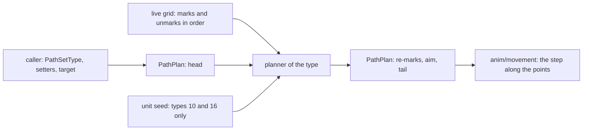
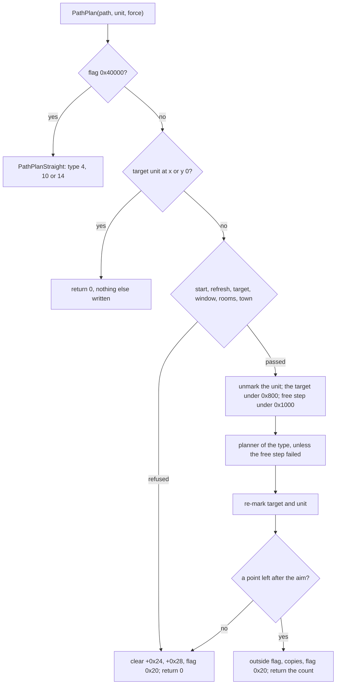
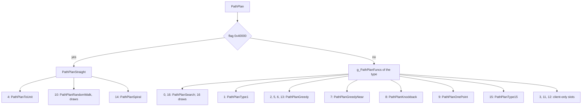
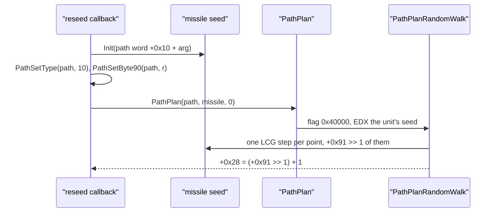
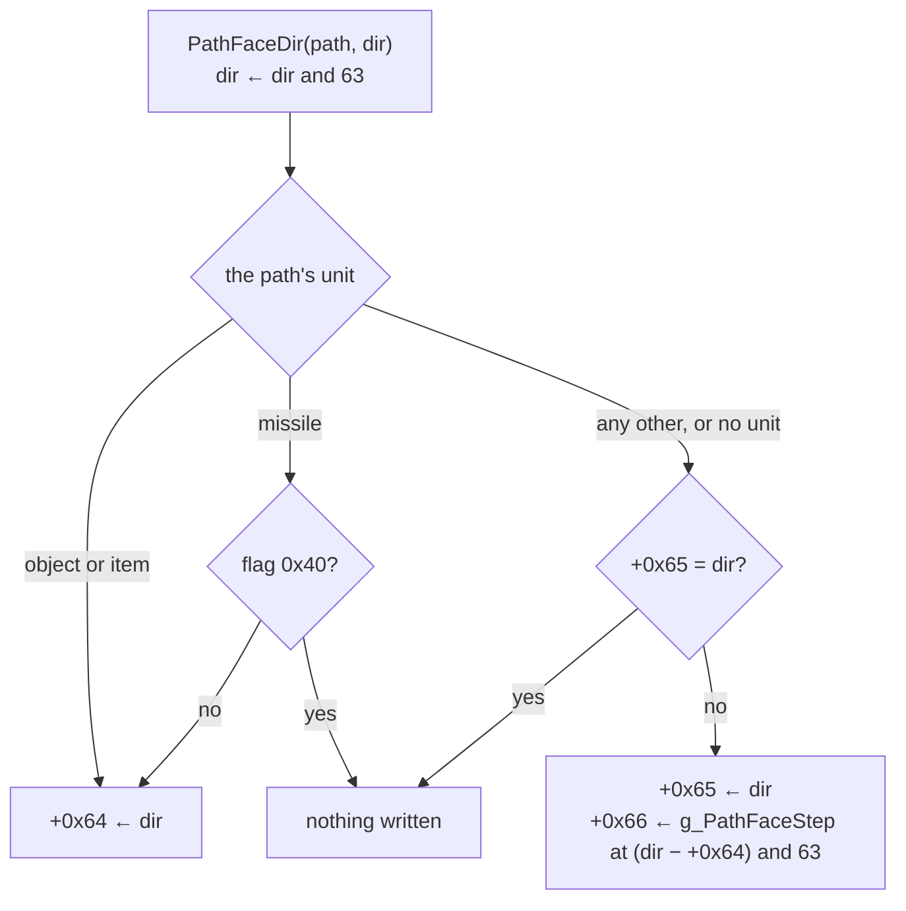

## Purpose

A unit that moves, or a missile that needs a route, holds a path record with a **path type** `0..16`. `PathPlan` takes that record, checks the
request, builds a 0x34-byte context, takes the unit's own marks off the collision grid, calls the type's planner, puts the marks back, and aims the path at
the first point it got. This page is the request, the 17 types, the dispatch, the draws per type and the grid a planner reads. The planners
themselves, as pseudocode, are [path/search](../search/). Who asks for a plan and why is each caller's ([skills/catalogue](../../spec-skills/catalogue/),
[skills/missiles](../../spec-skills/missiles/), [anim/movement](../../spec-anim/movement/), the AI's in [monsters/ai/machinery § D](../../spec-monster-ai/machinery/#d-the-path-request)); the
per-frame step along the points is [anim/movement § B](../../spec-anim/movement/#b-the-per-frame-step). The grid's cells and marks are drlg/collision.



## Entry points

| When | Function | Tag |
|---|---|---|
| Every plan: 68 direct calls in 58 functions, 34 server and 34 client (§ E) | — | [C] |
| A type is set | — | [C] |
| A path is planned again: a blocked step (`PathStepMove`), a path ended short of `+0x18` with no target or a target moved more than 5 (`PathStepTargetCheck`) | — | [I] |
| The record is created | — | [C] (nine calls) |
| A mode reset restores the type | `PathMoveReset` | [C] (300 emulated cases, family `mreset`) |

## Inputs

### Tables

| Anchor | Used for |
|---|---|
| PathTypes (the image's `g_PathPlanFuncs`, `g_PathTypeFlags`, `g_PathTypeParam98`) | planner, flags word and `+0x98` per type |
| PathDirTables (the image's `g_PathDir8`, `g_PathDirTriples`, `g_PathSignTable`, `g_PathDirTable`) | the free-target step (§ C3), the aim's direction |
| `g_PathFaceStep`, given by the rule in § H4 and in PathDirTables | the facing step (§ H) |
| `MonStats2.txt:SizeX` | a monster's size, hence its pattern |
| `MonStats.txt:npc`, `MonStats.txt:inTown` | the town test (§ C2) |
| `Objects.txt:IsDoor`, `Objects.txt:Orientation` | the object target's step (§ C1) |
| `Objects.txt:HasCollision0` | whether an object's rectangle is in the grid (§ F4) |
| `MonStats2.txt:deadCol` | a dead monster's mark (§ F4) |
| `Missiles.txt:Range` | the random walk's length through the reseed callbacks |

### Runtime state

The record's fields are `PathRequestFields`, 0x200 bytes zeroed at creation. Coordinates are subtiles; a point is `x | y << 16` in a u32. [I]

| Field | Type | Meaning |
|---|---|---|
| `+0x00`, `+0x04` | u32 16.16 | the position; `+0x02`, `+0x06` are its subtile words |
| `+0x10`, `+0x12` | u16 | the target point |
| `+0x14`, `+0x16` | u16 | the planned target, copied from `+0x10` after a plan |
| `+0x18`, `+0x1A` | u16 | the target the request used, after the free step |
| `+0x1C` | ptr | the unit's room |
| `+0x24`, `+0x28` | u32 | point index, point count |
| `+0x30` | ptr | the unit |
| `+0x34` | u32 | the flags (bits 8–18 from the type's word; § B) |
| `+0x3C`, `+0x40` | i32 | the type, the saved type |
| `+0x44`, `+0x48` | i32 | size, pattern |
| `+0x4C`, `+0x50` | u32 | `markMask`, `testMask` (§ A) |
| `+0x58` | ptr | the target unit |
| `+0x64`, `+0x65`, `+0x66` | u8 | the facing direction (0–63), the direction to turn to, the turn step (§ H) |
| `+0x6A`, `+0x6E` | i32 | the vector to the next point (§ H) |
| `+0x72`, `+0x76` | i32 | the step per frame (§ H) |
| `+0x7C` | i32 | the speed; it gates a planner's first line |
| `+0x90` | u8 | knockback distance and countdown |
| `+0x91` | u8 | the limit (`ctx.limit`): at most 77, a player 73 and a monster 14 at creation |
| `+0x92` | u8 | the search's last bound (`ctx.b1C`): a player 70 at creation |
| `+0x93`, `+0x94` | u8 | stop range; re-plan budget |
| `+0x98` | i32 | the type's walk parameter |
| `+0x9C` | u32[78] | the points, to `+0x1D3`; `+0x1D4` is anim/movement's crossed-subtile count |

**The context** (`PathPlanCtx`, on `PathPlan`'s stack, passed in `ECX`). [C] `PathPlan` neither stores to nor takes the address of the context's `+0x10`, and in `PathPlan`, its four helpers and the ten planners every store at `+0x10` is to the path record. [I] So `+0x10` is never written: 22 more `+0x10` stores in 10 deeper functions of the planners' graph have bases not traced.

| Field | From | Field | From |
|---|---|---|---|
| `+0x00` start | `+0x02`, `+0x06` | `+0x18` limit (u32) | `+0x91` |
| `+0x04` target | `+0x10`, `+0x12`, moved by the free step | `+0x1C` `b1C` | `+0x92` |
| `+0x08` room | `+0x1C` | `+0x20` type | `+0x3C` |
| `+0x0C` target room | `RoomAtSubtile(room, target)` | `+0x24` size | `+0x44` |
| `+0x14` `refresh` (u8) | § C1's result | `+0x28` pattern | `+0x48` |
| `+0x2C` `testMask` | `+0x50` | `+0x30` path | the record |

### Constants

| Name | Value | Anchor | Tag |
|---|---|---|---|
| point slots | 78 | `+0x9C`..`+0x1D3` | [C] (0x200 bytes allocated and zeroed; `+0x1D4` is its own field) |
| window | ` | dx | `, ` | dy | ` ≤ 100, 100 itself passing | — | [C] (control `cmp` fails all 36 it separates) |
| limit cap of `PathSetByte90` | 77 | — | [C] (control `cap` fails all 20 it separates) |
| town levels | 1, 40, 75, 103, 109 | — | [C] (family `town`) |

## Algorithm

### A. Two masks: what a move tests and what a unit writes

A record holds two masks, and they are not interchangeable. [C] In the `PATH_` functions `+0x4C` is stored only by `PATH_SetMarkMask` and creation, `+0x50` only by `PathSetCollMask` and creation; the mark calls take `+0x4C`, `PathPlan` reads `+0x50`. [I] Readers elsewhere in `.text`, where `+0x4C`/`+0x50` are also the room rectangle's fields, are not resolved.

- `testMask` (`+0x50`, set by `PathSetCollMask`): the bits a planner and the step refuse.
- `markMask` (`+0x4C`, set by `PATH_SetMarkMask`): the bits the unit writes into the grid. `PATH_SetMarkMask` unmarks under the old mask and marks under the new.

| Who | `testMask` | `markMask` | Tag |
|---|---|---|---|
| player | `0x1C09` | `0x80` | [C] (`PATH_DynamicCreate`: every logged plan from `PlrModeStartMove`, 3 999, and Charge, 213; the other 558 are the skill overrides below, Whirlwind's `0xC01`, 158, and the Leap or Leap Attack flight's 0 / 0, 400), the marks at drlg/collision § F |
| monster | `PATH_MonTestMask`: `flying` `0x1804`, `opendoors` `0x3401`, else `0x3C01`; the wraith (`BaseId` 38) `0x804`, `PATH_DynamicCreate`'s own branch, taken before `PATH_MonTestMask` is called | `0x100` | [C] (`PATH_MonTestMask`: mark `0x100` in 21 375 of 21 375 monster plans, the test by this rule in 21 126, the function's three arms 21 099 and the wraith branch 27) |
| a vulture after its take-off | 0: `AiVultureTakeOff` calls `PathSetCollMask(path, 0)` | `0x100` | [C] (the 249 other monster plans, classes 111 and 113) |
| missile | `g_MissileCollideTypes[CollideType].mask` | 0 at creation; `0x40` when Missiles `Collision` ≠ 0 | [C] |
| Whirlwind, the plan (start 38, no target) | `0xC01` | no zeroing found at the start | [C] the test mask, to the boundary |
| Whirlwind, the flight | `0x401`, the old mask kept at `ebp−0x14` | no zeroing found at the start; the end restores it | [I] |
| Jump | not stated here | no zeroing found at the start; the end restores it | [I] |
| packet 0x5F's reach test | `0x409`, restored after | — | [I] |

- [C] Neither Whirlwind mask holds `0x100`, `0x1000` or `0x2000` (`push 0xC01`, `push 0x401`), so no live unit's mark refuses that plan or that flight. A door's `0x800` is tested by the plan's mask only.
- [C] `SizeY` reaches a monster's footprint only through the rectangle functions: eight of `UNIT_GetSizeY`'s ten calls lie on an object's branch (`UNIT_CollMark`'s and `UNIT_CollUnmark`'s among them), and the other two are in `UNIT_CollMarkRect` and `UNIT_CollUnmarkRect`, which have no type test, and `UNIT_GetSizeY` reads a monster's MonStats2 `SizeY`. `AiWussie` and `AiBaalToStairs` call `UNIT_CollUnmarkRect` on their own monster, so those removals clear a `SizeX × SizeY` rectangle. The two columns are equal in every stock row, so the data cannot separate them. [I] The rectangle functions' 7 + 7 client callers are not followed.

### B. Creation, `PathSetType` and the setters

- B2. [C] Type 101, which `SkillDo89Jump` passes before its type-8 and type-9 plans, reads index 101 of both tables, 0 in this image, so it clears bits 8–18 and sets `+0x98 = 0`.
- B4. [C] **`PathMoveReset`** restores the speed from `+0x80` under flag `0x8000`, then sets type 7 for a player (a type-0 unit) and, for any other unit under flag `0x2000`, the saved type `+0x40`; otherwise it returns (300 emulated cases, controls `nospeedflag`, `noplayer` and `flagfirst` separating). [I] So types 8, 9 and 11, whose words hold both bits, are the temporary ones a reset undoes.

### C. `PathPlan`



```
C. PathPlan(path, unit, force) → i32:                              [C] 3–16b, by emulation to the first boundary (plan, plannoop, 1 200 cases, 0 mismatches)
 1.  if path = 0: return 0                                         ; [I] read, not run
 2.  if path.unit ≠ unit: fatal 0x2E8                              ; [I] read, not run
 3.  if path.flags & 0x40000: return PathPlanStraight(path, unit)  ; search § I, J, K; before any other test
 4.  path.w54 ← 0
 5.  t ← path.target;  if t and (UnitGetSubX(t) = 0 or UnitGetSubY(t) = 0): return 0     ; nothing else written
 6.  if path.x = 0 and path.y = 0: goto fail
 7.  ctx: start, size, pattern, testMask, limit ← (u8)+0x91, b1C ← +0x92, path
 8.  ctx.refresh ← PathTargetRefresh(ctx)                          ; C1
 9.  if path.tx = 0 and path.ty = 0: goto fail
10.  ctx.target ← (tx, ty);  if ctx.target = ctx.start: goto fail
11.  dx: i32 ← tx − sx;  dy: i32 ← ty − sy;  if |dx| > 100 or |dy| > 100: goto fail      ; words zero-extended, signed compare
12.  ctx.room ← path.room;  ctx.troom ← RoomAtSubtile(room, tx, ty);  if either is 0: goto fail
13.  if not PathTargetNotTown(unit, ctx) and not force: goto fail  ; C2
14.  ctx.type ← path.type
15.  UNIT_CollUnmark(unit, 0)                                      ; returns at once for a player in mode 0 or 17, a monster in mode 0 or 12
16a. tu ← 0;  if t and UNIT_GetSizeX(t) ≠ 0 and flags & 0x800: tu ← UNIT_CollUnmark(t, 0)     ; shown on units whose unmark returns at once; the grid's half is § F4's T1
16b. go ← 1;  if flags & 0x1000 and Blocked(ctx.room, tx, ty, pattern, testMask): go ← PathTargetFree(ctx)   ; C3
17.  path.fx, fy ← ctx.target;  +0x24 ← 0;  +0x28 ← 0              ; [C] written before the slot read (241 cases)
18.  n ← 0;  if go: n ← g_PathPlanFuncs[ctx.type](ctx)             ; [C] the slot's argument to IsBadCodePtr, every type 0–16; [C] the call, the planner g_PathPlanFuncs[ctx.type] in 24 707 of 24 707 logged calls; [I] IsBadCodePtr ≠ 0: fatal 0x37E, not taken on stock
19.  +0x28 ← n                                                     ; [I] 19–26: past the import, the tail
20.  start changed: fatal 0x389                                    ; a planner may move the target, not the start
21.  if tu ≠ 0: UNIT_CollMark(path.+0x58)                          ; the field read again, not t
22.  UNIT_CollMark(unit)                                           ; [C] also when the free step returned 0 (13 plannoop cases)
23.  if n = 0: flags &= ~0x20;  return 0
24.  PathAimNextPoint(path, 1; 1);  if +0x24 ≥ +0x28: goto fail    ; every point at the position
25.  PathPointsOutsideRoom(path);  +0x14, +0x16 ← +0x10, +0x12;  +0x38 ← 0
     if flag 0x10 is clear and there is no target unit: +0x10, +0x12 ← the last point
26.  flags |= 0x20;  return n
fail: +0x24 ← 0;  +0x28 ← 0;  flags &= ~0x20;  return 0
```

- C. [I] The window tests the request's target, before the free step: a target moved by C3 may lie a few subtiles further, and the planners see the moved one. `RoomAtSubtile` uses the unit's room's near list, so a target in an inactive room refuses.
- C. [C] A target unit at subtile x or y 0 returns 0 before the start test and clears nothing (32 `plan`, 36 `plannoop` cases); the other refusals clear.
- C. [C] A refused request draws nothing: `EAX` 0 and the seed unchanged in all 628 + 814 refusals of the two runs (624 + 814 stock, F1). Of them, the 211 and the 281 whose reason needs the town test, the room or the free step are **observed, not predicted**: their match says only that the game returned 0.

- C. [C] **`PathPointsOutsideRoom` (step 25):** flag bit 0 is cleared, then set when the path has no room or a point of `0 ..< +0x28` lies outside the room's rectangle, `x ≤ px < x + w` and `y ≤ py < y + h`, room words `+0x4C`, `+0x50`, `+0x54`, `+0x58`. A count of 0 leaves it clear. (family `outside`, 300 cases, control `le` 25)

`Blocked(room, x, y, pattern, mask)` is `COLL_PatternTestBool`: [search § A1](../search/#a1-a-cell-read-blocked).

#### C1. The target refresh

```
PathTargetRefresh(ctx) → u8:                                        [C] (405 cases with a target unit; all but where noted)
  no target unit: return 1
  (path.tx, path.ty) ← the unit's subtile position (words);  both 0: return 0
  by the unit's type:
    0, 1: return 1 when path +0x68 = 0                              ; else PathTargetOffsetX87, an x87 offset not read: [I] then return 1
    2:    if record +0x13A (IsDoor): PathTargetObjectStep(ctx);  return 2
    3:    return 1
    4:    return 2
    5: return 1                                                     ; above the table, cmp eax, 4; ja

PathTargetObjectStep(ctx):                                          [C]
  if record +0x13C (Orientation) = 1: target y moves 2 toward the start  ; −2 when start y < the object's +0x10 dword, unsigned compare, else +2
  else: target x likewise on +0x0C                                  ; the step never tests the grid
```

#### C2. The town test

```
PathTargetNotTown(unit, ctx) → bool:                               [C] (family town, 400 cases; controls floor 56, npc 5)
  null unit, not a monster, or MonIsNpc(unit): return 1             ; MonStats npc or inTown, or unit +0xC4 negative
  room ← ctx.troom;  if room = 0: the target's room, found from the room at start + (target − start) ÷ 2   ; ÷ truncates toward zero; PathPlan never takes this branch
  return not RoomIsTown(room)                                       ; the DRLG room's level id in {1, 40, 75, 103, 109}
```

#### C3. The free-target step

```
PathTargetFree(ctx) → 0 or 1:                                      [C] (family free 560 cases and 13 + 13 plannoop; all of C3)
  (d0, d1, d2) ← g_PathDirTriples[PathDirCell(target, start)]       ; main, two alternates; d2 = 255 is none; all in {0, 2, 4, 6, 255}
  m, a, b ← target
  loop:
    if m = start: return 0                                          ; ctx unchanged
    m += g_PathDir8[d0];  if not Blocked(m): ctx.target ← m; break
    a += g_PathDir8[d1];  if not Blocked(a): ctx.target ← a; break
    if d2 ≠ 255: b += g_PathDir8[d2];  if not Blocked(b): ctx.target ← b; break
    d0 ← g_PathDirTriples[PathDirCell(m, start)].main               ; only the main direction is recomputed
  if ctx.target = start: return 0
  if the unit is a player: PathTargetExtendPlayer(ctx)
  return 1

PathTargetExtendPlayer(ctx):                                       [C] (control ext4 fails all 33 it separates)
  dx, dy ← moved target − start
  nothing when |dx| ≥ 5, |dy| ≥ 5 or both 0
  step.x ← sign dx if |dx| ≥ |dy|, else 0                           ; g_PathSignTable[dx + 9 dy]
  step.y ← sign dy if |dy| ≥ |dx|, else 0                           ; g_PathSignTable[dy + 9 dx]
  m ← max(|dx|, |dy|);  p ← the moved target
  while m < 5:
    p ← p + step;  if Blocked(p): stop                              ; u16 adds
    m ← m + 1;  ctx.target ← p
```

`Blocked` here is `COLL_PatternTestBool(ctx.room, x, y, ctx.pattern, ctx.testMask)`; coordinates are u16 adds. `PathDirCell` is [search § A2](../search/#a2-directions).

*Corrected 2026-11-04 (review): the step read `(sign dx, sign dy)`. It moves one axis unless `|dx| = |dy|`: a target at `(3, 1)` from the start steps `(1, 0)`, not `(1, 1)`. The table's rule and index are in PathDirTables; § 5 has the correction.*

#### C4. The replan

```
PathReplan(unit, flag):                                            [C] to the first boundary (family replan, 300 cases, control swap 63)
  p ← unit's path;  if none: return 0
  if not (p.flags & 0x10):
    if the unit is a monster and p.+0x94 = 0: return 0
    UnitMarkUpdated(unit)                                           ; the boundary
    unit +0xC4 |= 1;  PathAddByte94(p, −p.iPoint)                   ; [I] past the boundary
  t ← p.type
  if t in {2, 13, 15}:
    if flag ≠ 0: p.type ← 13
    else:        p.type ← 2;  p.+0x10 ← p.+0x18                     ; the request's own target
    n ← PathPlan(p, unit, 0)                                        ; returns: the boundary, reached in the family with flag 0x10 set
    if n = 0: p.type ← 15;  n ← PathPlan(p, unit, 0)                ; [I] past the boundary; the same call as below
  else:
    n ← PathPlan(p, unit, 0)                                        ; returns: the boundary
  return n                                                          ; [I] past the boundary
```

- C4. [I] `PathReplan` writes `+0x3C` without `PathSetType`, so a re-plan keeps the flags word of the type before it: a 13 re-planned as 2 keeps `0x100`, a 2 re-planned as 15 lacks 15's `0x800`.
- C4. [C] 836 + 889 replans of the two runs reproduce (810 of the 836 stock, `review-s54/logs.txt`), each with a target unit at `PathPlan`'s entry and the seed unchanged. The target revalidation is `PathReplan`'s own code before the call and is not compared: [I].

### D. The 17 types: planner and draws

The table is PathTypes' read from the image; the shape and the point bound are [path/search](../search/). A type with flag `0x40000` has no slot: `PathPlanStraight` chooses by type, and any other type there is fatal 0x207. [C] The counts under *Draw evidence* are the logged plans of each run; F1 says which are stock.



| Type | Flags word | Planner | Draws | Draw evidence | Stock server request |
|---:|---|---|---|---|---|
| 0 | `0x21900` | `PathPlanSearch` | none | [C] | no plan in 46 sessions (§ G3) |
| 1 | `0x01900` | `PathPlanType1` | none | [C] the map; 824 through type 7's switch | no request observed in 46 sessions (§ G2) |
| 2 | 0 | `PathPlanGreedy`, `+0x98` 0 | none | [C] 161 + 476 monster plans, the seed unchanged | yes |
| 3 | 0 | `PathPlanType3` | none | [C], the map doesn't read the seed | none (§ G3) |
| 4 | `0x60000` | `PathPlanToUnit` | none | [C] 2 740 + 3 713 plans, the seed unchanged | yes |
| 5 | 0 | `PathPlanGreedy`, `+0x98` 2 | none | [C] 696 + 626 monster plans | yes |
| 6 | 0 | `PathPlanGreedy`, `+0x98` −2 | none | [C] 655 + 664 monster plans | yes |
| 7 | `0x21900` | `PathPlanGreedyNear` | none | [C] 1 313 + 1 321 monster plans; the player's are in the 0 mismatches | yes |
| 8 | `0x1E600` | `PathPlanKnockback` | none | [C] 282 + 1 303 plans | yes |
| 9 | `0x1E800` | `PathPlanOnePoint` | none | [C] 54 + 346 plans | yes |
| 10 | `0x60000` | `PathPlanRandomWalk` | **`+0x91 >> 1`, on the seed passed** | [C] 654 creations; 698 + 248 plans | yes |
| 11 | `0x1E604` | `PathPlanType11` | none | [C], the map doesn't read the seed | client only (§ G3) |
| 12 | 0 | `PathPlanType12` | none | [C], the map doesn't read the seed | none (§ G3) |
| 13 | `0x00100` | `PathPlanGreedy`, `+0x98` 0 | none | [C] 3 851 + 4 587 monster plans | yes |
| 14 | `0x60000` | `PathPlanSpiral` | none | [C] 27 stock + 233 plans, the seed unchanged | yes |
| 15 | `0x00800` | `PathPlanType15` | none | [C] 1 349 + 3 309 monster plans | yes |
| 16 | 0 | `PathPlanSearch` | at each child and each turn, on `unit +0x20` | [C] 994 022 draws | none: two unreferenced functions (§ G3) |

- D1. [C] **`PathPlan` and everything around it draw nothing:** no `0x6AC690C5` and no call to the 19 RNG functions in `PathPlan`, the refresh, the free step, the town test, the setters, `PathSetType`, `PATH_DynamicCreate`, `PathAimNextPoint`, `PathReplan`; a second tool's direct-call graph under them holds 82 functions, no drawing function and two indirect calls, the slot and the `IsBadCodePtr` import, and `PATH_DynamicCreate`'s, the allocator stopped, 52, none. [C] in the emulated domain the unit's seed is not read. So every draw of a plan is in a planner.
- D2. [C] Under the eight planners 58 functions hold one LCG step, the random walk's, and no RNG call; under the search 46 hold three, type 16's.
- D3. [C] **`SUnitPathCreate`'s callees after the path** (`PlrPlaceEventsInit`, `MonInitMode`, the mode set) reach drawing functions, the nearest at depth 2 (`PlayerModeAllowed` through `PlayerModeCmd`, `MonAttackStats` through `MonSetMode`), and its own body draws nothing: those are the mode machine's and the population's, not the path's, and are unfollowed here. [I] Their number, 118 (a second walker gives 122 with the seven RNG functions).

The type-10 sequence, as the two reseed callbacks run it:



- D5. [C] The callback seeds the new missile with `Init(path word +0x10 + arg, 0x29A)` (`Init(path word +0x10)`), then neither `PathSetType` nor `PathSetByte90` steps the seed: at `PathPlan`'s entry it is still the `Init`, in all 100 of family `h1obs`. In 654 of 654 creations of the game's logs the exit seed is the one predicted from the `Init` and the logged range: 20 for class 458, 38 for class 195, 10 for class 408. The callbacks are [skills/missiles H1 and H4](../../spec-skills/missiles/#h-re-seed-sites).
- D6. [C] **After a type-10 plan, class 458 draws nothing more on that seed within its life.** 68 seeds watched by a hardware watchpoint: each next write is a block write over the unit's memory, and in each the high dword still holds the plan's exit value, which a draw would have changed. The control sees draws: of 14 watchpoints on monsters, 8 lines are the LCG step, and the other 6 are the same block write. That the write is the block's release or reuse is [I].
- D7. [I] **`PATH_CHAIN` for classes 225 and 195, short of the floor of 50 each:** class 225, 216 type-10 plans and 22 seeds watched; class 195, 32 plans and 3 watched; all 25 block writes with the high dword unchanged, 0 of 25 a draw. The earlier run adds one watched seed each.

### E. Who asks: the request register

All 68 direct calls of `PathPlan`, each type read at its site. "Current" plans with the type the path already holds: a missile's 4 unless a callback set 10 or a do function 14, a monster's last request type, a player's 7 after a reset. [C] the missile's: the seven server `PathSetType` calls on a missile's path give 4, 10 or 14. [I] the monster's and the player's, and the direct `+0x3C` stores of G3.

| Owner | Sites | Type at the call |
|---|---:|---|
| player | 2 | 7 or 8 (`PlrModeStartMove`: `PathMoveReset` gives 7, mode 19 sets 8); 15 (packet 0x5F's reach test) |
| mode machine | 5 | the request's type (`MonPathPlanType`), 15 (its fallback), current (`MonModeStartSkill`), 8 (knockback) |
| AI | 3 | 2, test plans that restore the path |
| skill | 10 | 8, 9 (`SkillDo89Jump`), 2 then 1 (`SkillSt48SwarmMove`), 1 (`SkillDo103DiabRun`), current (`SkillSt31Charge`), 14 (`SkillDo73BlessedHammer`), 7 (`SkillSt38Whirlwind`), 9 then 8 (`LeapAttackPath`) |
| missile | 10 | 4 (`MissileCreate`), 10 (the four reseed callbacks), current (`GuidedSetTarget`, do 7, 11, 16, 35) |
| movement | 2 | 13 or 2, then 15 or current (`PathReplan`) |
| unreferenced | 2 | 16 |
| client | 34 | out of scope (owner decision 5): 14 sites with a scanned `PathSetType`, 20 current |
| **All** | **68** | |

- E1. [C] All 33 722 stock plans of the two runs came through sites of this register, by their return addresses, and the first run's other 842 did too: 0 outside them in either run. The kept checks print that line only when it isn't 0; `review-s54/logs.txt` prints the 0. (`2026-11-04-path-check.txt`, `2026-11-04-path-2-check.txt`)
- E2. [C] **The player's move:** `PlrModeStartMove`'s logged plans are type 7 (3 997) or type 8 with `+0x90 = 5` (2), none else. [I] Which new mode gives which: a walk, run or town walk start (modes 2, 3, 6) plans type 7 after `PathMoveReset`; mode 19 plans type 8. The mode is the new one, in `EDI`, set after the plan; the unit's mode at `PathPlan`'s entry is the old one. **Packet 0x5F:** when the server's position is 15–45 subtiles off, a type-15 plan to the client's point with `testMask` `0x409` and limit 77, accepted only when its end is that point; mask, type and `+0x91` restored.
- E4. [C] No Missiles column chooses a type: it is a constant in the do function or callback, 10 in the five reseed callbacks and 14 in `SkillDo73BlessedHammer`, with creation's 4. [I] The direct `+0x3C` stores of unresolved base (G3) are not covered.

### F. The grid a planner reads

#### F1. The planners take the live grid

- [C] **A planner reads the live grid: the cells as they are at the planner call, with the unit's and the target's unmarks of steps 15 and 16a already run.** Given the game's own cells at the call (`PLG`), its context and its record, the models reproduce **33 722 stock plans with 0 mismatches, 20 671 of the second run and 13 051 of the first, on 11 types** (2, 4, 5, 6, 7, 8, 9, 10, 13, 14, 15), each compared on its return, its first `EAX` point words and its exit seed.
- [I] **The first run's other 842 plans** also show 0 mismatches and back nothing here. They come after the probe's first write in two sessions (`k-pal-stony` 532, `k-pal-jail` 310): a breakpoint wrote the start's fraction word, against, so they are not stock. By type: 4 82, 5 47, 6 51, 7 141, 13 369, 14 27, 15 125, and none of 2, 8, 9, 10. A "run 1" count on this page or the next holds them unless it says stock. (`review-s54/logs.txt`)
- [C] **This is not the predicted grid.** The 0 mismatches take the grid from the game. The same planners on a grid predicted as the built map plus the units are F3's claim, which failed. A reimplementation is held to the planners by this count, and to the grid only by drlg/collision § F7's order rule.
- [I] **What the model took from the game:** the planner's address, the context and the record at the call, and the target unit's position. So `PathPlan`'s head, the refresh, the free step, the town test and the slot are inputs here, not predictions, and keep § C's tags. Each context's start equals its record's, and none of the 9 773 plans with a `PLC` in the first run has a record-only refusal reason.
- [C] **The tail** (the aim and the "every point at the position" refusal) agrees in all 13 265 plans of the first run that reached a planner or a straight type, 72 of them with a non-zero count and a return of 0. The aim's writes (`+0x24`, `+0x64`–`+0x66`, `+0x6A`–`+0x7F`) equal the game's record in 19 284 of 19 284 plans with a return over both runs, and in the 154 with a count and a return of 0 apart from `+0x24`, which the fail path zeroes; 17 406 of them changed those bytes after the planner call.

#### F2. The grid is the result of its operations, in order

- [C] **The grid at a planner call is the result of the marks and unmarks in order, not the union of the present holders. A reimplementation runs the operations and never computes a union of holders.** An unmark is the same footprint with AND-NOT and no bit is reference-counted, so it clears a shared bit another holder also set. The rule and its cases are drlg/collision § F7.

#### F3. The counted oracle

- [C] **The tie's prediction is wrong in 11 of 15 663 plans on the hold-out** (the plans with a built map), 2 of type 2, 3 of type 13, 6 of type 15, with the bit `0x1000` alone sufficient in all 11. **The test failed by its own terms:** it asked for 0 wrong plans. The rules were frozen before the run, no rule was changed after it, and the frozen rules' prediction was made **without the seventh caller** of `UnitCorpseColl`, whose unit stays in mode 14.
- [C] The passes on the same logs: frozen own marks 472 wrong, with O1, C1..C3 and T1 72, with W1 62, with L1 11. (`2026-11-04-path-2-grid.txt`)
- [I] What this does not establish: that the grid at a call is a function of the present holders. It is not, by F2. Also not a tag: the wrong-plan count raises nothing, and each raise of F4 rests on its own bit or line.

- [I] So the value-oracle rows of [skills/README](../../spec-skills/overview/) and [skills/missiles](../../spec-skills/missiles/#inputs-and-oracles) retire for the planner and stay for the grid: a checker of this spec feeds the planners the logged live cells, and doesn't take them from a union of holders.

#### F4. Each grid rule at its tag

Corpse cells below are drlg/collision § F5's **server** rows; the client's plus is another copy of the grid and is never what a server planner reads.

| Rule | What the grid holds | Tag and scope |
|---|---|---|
| O1, objects | An object's rectangle is in the grid when `HasCollision[mode]` of its class is set; each operate handler that changes the state marks or unmarks itself; the mode change does not | [C] for the bits `0x400` and `0x800`: 0 cells differ over the 154 780 rooms of the 15 663 plans, against 64 229 and 1 572 with the rule off. [I] the operate handlers' route, as drlg/collision § F. The other object bits, `0x0002` and `0x0004`, keep 626 and 3 708 cells of unnamed source |
| T1, the plan's target | Under flag `0x800`, a target whose `UNIT_GetSizeX` is not 0 is unmarked, whatever its type, and marked again at the tail when the unmark returned non-zero | [C] a targeted object of size 1 or more: with the rule off, 274 `0x400` and 20 `0x800` cells differ and 35 more plans are wrong; with it on, 0 of those cells. [I] the size test's 0 branch and the other unit types as targets, read, not run |
| C1, a dead monster, `deadCol` 0 | `UnitCorpseColl(unit, 1)`: the live mark off and a 3×3 of `0x8000`, the record's mask and pattern unchanged, from mode 0 on | [C] 1 527 `COR` lines, all the full 3×3 |
| C2, `deadCol` 1 | The call is skipped, the live mark stays | [C] classes 403 and 404, 18 distinct dead. [I] class 273 on the server |
| C3, re-created dead | The 3×3, then `SUnitCreate`'s re-mark: record pattern 5, mask `0x8000` | [C] 3 distinct units, as [drlg/lifecycle § H5](../../spec-drlg/lifecycle/#h5-the-grid-marks-of-a-re-created-monster). [I] that the 22 mode-12 lines came: the line doesn't hold the caller |
| The seventh caller | Skill start 43 on class 194 in mode 14: the same call, so corpse cells cannot be predicted from a mode | [C] the call's effect, 35 lines. [I] that it causes the 3 plans of F3 |
| C4, no clear | The server's 3×3 has no paired clear: the cells outlast the corpse until the grid is rebuilt, and the revival routes read re-mark without clearing it (a record at mask `0x8000` loses only its own plus there). `0x8000` is in no immediate move mask scanned, 0 of 53 | [C] nor in a mask built in a register or read from a table: `PathSetCollMask`'s 8 register calls, the two `CollideType` tables, `PATH_MonTestMask`'s 3 returns and creation's 4 stores; [I] the 77 register stores at `+0x50` outside the path module (bases not traced), and the rest of the row. Likely source of the 26 034 differing `0x8000` cells |
| W1, the player after an act change | Unmarked: the first move unmarks and zeroes the room word, the second returns before marking, until a later move or a plan's tail. A level change inside an act keeps the mark | [I]: **7 of 7** act changes unmarked, control **3 of 3** marked, floors of 10 short (7 of 16 and 3 of 9 seen) |
| L1, a reserved landing | Four skill starts mark the landing before the flight; landing unmarks it | [C] the calls at the three reached sites, 128, 237 and 109 lines, and 474 releases. [I] the holding until release (51 plans in the tie), Jump's site (no stock user) and a monster's arm |
| The `0x200` bit | Its source is unknown: 92 597 cells differ on the hold-out and no logged unit holds them | [I] no plan depends on them on these logs; no move mask read holds `0x200`, the spawn mask `0x3F11` does |

drlg/collision § F6 holds the operations of T1, W1 and L1 in order.

### G. What each count tests

#### G1. Per type

Plans are the logged `PathPlan` calls of the two runs, the first run's 842 after the probe's write among them (F1); "ret 0" counts a return of 0 among the plans of the second run that reached a planner or a straight type, the kept check's column (with the refusals, type 15 has 2 563 of 3 599, `review-s54/logs.txt`). A planner's 0 mismatches given live grids says nothing about predicting the grid (F1).

| Type | Plans, run 1 + run 2 | Ret 0, run 2 | Largest return, run 2 | Needs the grid, run 1 | The 0 is | Tag |
|---:|---|---:|---:|---:|---|---|
| 2 | 162 + 476 | 62 | 17 | 161 of 161 | fair: 158 of the first 162 one class | [C] |
| 4 | 2 740 + 3 713 | 0 | 1 | none | weak for its size: one branch, 1 point, no control | [C] |
| 5 | 696 + 628 | 74 | 6 | 150 of 696 | fair: the `+0x98` walk, short lists | [C] |
| 6 | 655 + 664 | 71 | 6 | 192 of 655 | fair: as type 5 | [C] |
| 7 | 2 894 + 4 589 | 64 | 27 | 897 of 2 725 | strong; the 324 boundary and the retry unobserved | [C] |
| 7 through type 1 | 270 + 554 | — | — | — | fair: the switch only; `nostart`, `pool`, `max77` at 0 in the first run | [C] on that path |
| 8 | 282 + 1 303 | 242 | 1 | 90 of 282 | fair: monster knockback, with 2 player plans in run 2, 1 point at most | [C] |
| 9 | 54 + 346 | 0 | 1 | 0 | weak: one branch, 1 point, no grid, no separating control | [C] |
| 10 | 698 + 248 | 0 | 39 | none | strong for count and draws; no grid | [C] |
| 13 | 4 078 + 4 872 | 1 105 | 20 | 2 985 of 3 851 | strong | [C] |
| 14 | 54 + 233 | 0 | 77 | none | weak: the first run's stock plans are one list relative to the start, and `swap` separates | [C] |
| 15 | 1 580 + 3 599 | 2 273 | 29 | 1 182 of 1 349 | strong on those with points; most are the planner's own 0 | [C] |

- G1. [C] The controls: 0 passed a plan it separates in either run; on the second, 7 of 30 separate none (`greedy ctxroom`, `knock ctxroom`, `near le325`, `near noretry`, `onept ctxroom`, `spiral round`, `type15 lim50`), so those claims stay on the emulation. Comparator mutations are reported: `eax` in 19 857 of 19 857. Flipping the first tested cell changes the model's output in 10 938 of 15 261 plans that tested one, so the model does read the live grid. (`2026-11-04-path-2-check.txt`)
- G1. [C] **The AI's no-draw prediction:** monster plans reproduced with the unit seed unchanged, types 2, 5, 6, 7, 13, 15 in D's table, each above the floor of 50; type 1, 0.

#### G2. Type 1

- [C] **The planner:** `PathPlanType1` as a map of what it reads, by emulation to its return (`t1real` 400, `t1syn` 240, `t1stair` 40), and in the game through greedy-near's switch, 270 + 554 plans.
- [C] **No stock request was observed in 46 sessions** (21 + 25): no plan with type 1 at `PathPlan`'s entry, and in the 25 of the second run all seven `T1S` sites count 0 on either side.
- [C] **The seven sites** that request it: `AiPathOverrideSet(1)` at `AiHireFollow` and `AiPetMove`, three in state 13, and `PathSetType(1)` at `SkillDo103DiabRun` and `SwarmMove`'s second plan; two more `PathSetType(1)` pushes are the client's.
- [I] **Two are a retry:** `AiHireFollow`'s and `AiPetMove`'s are reached only when the request before returned 0 and a local word is still 0, and followers planned in these logs without one (a mercenary 103 plans, a clay golem 65). **Five were not staged**, so their 0 says nothing of why.

#### G3. The other short types and stages

- [I] **Type 0:** named for a get-hit, planned where a "current" site holds it. No plan in 46 sessions, no floor. The planner is [C] by emulation only.
- [I] **Types 3, 11, 12:** no server code sets them: no store of an immediate 3, 0xB or 0xC to `[reg+0x3C]` in `.text`. The remainder is 18 server register stores of unresolved base and 4 read-modify-write stores. [C] Ten of those 22 resolve without a reading of the base: the value 0, three pointers, four SHA-1 schedule words, two CRT stack frames; the other twelve rest on a reading of the owner's block.
- [C] **Type 16:** planned only from two functions nothing references; the only `PathSetType(…, 16)` pushes are theirs.
- [I] **Town-follow is short:** attempted in the Rogue Encampment, 313 plans, no hostile monster in the town room. The geometry stays [drlg/lifecycle](../../spec-drlg/lifecycle/)'s.
- [C] **Jump is short:** no stock user. No MonStats skill column and no other excel table holds `Jump`; it occurs in `skills.txt` only, and start 47 is Jump's alone (92 tables scanned).

#### G4. Truncation

- [C] **The spiral truncates toward zero.** The code sets the x87 rounding field to 11 around each `FISTP` (`or eax, 0xC00`), which is toward zero for either sign, and the game's own stored integers agree: 233 natural type-14 plans, read-only, 43 804 stored products, 18 174 of which separate the readings: **18 174 truncate, 0 round.** The formula is [search § J](../search/#j-the-spiral-type-14).
- [I] The earlier probe's 10 of 10 rest on a fraction a breakpoint wrote, so they stay a strong [I] in themselves and are not needed. The p-code `FISTP` rounds, whatever the field says, so the emulator's own 90 spiral cases say nothing about the game.

### H. The aim and the facing step



- H1, H2. [C] The emulated family `aim`, 500 cases, reproduces both; the `face0` control (no facing step) fails all 308 cases it separates and `sar7` all 417. That is the code's map from the bytes it reads over the family's declared cases, not when the game calls it.
- H1. [C] `PathPlanToUnit` and `PathFirstLine` call `PathAimNextPoint(path, 1; 1)`, so where a point remains their aim makes the facing step.
- H1. [I] `PathPlan`'s tail makes the same call (C's step 24, past the import).
- H1. [I] **`PathStep`'s call is `PathAimNextPoint(path, 1; 1)`** (`EDX` = 1, `push 1`), skipped for type 4 and once `+0x24 ≥ +0x28`. With `arg` ≠ 0, every aim after a move step with a point ahead calls `PathFaceDir`, so the facing is aimed at the next point after every such step.
- H2. [I] The names are ours, given at the code reading, not an observed use: `+0x64` the facing, `+0x65` the direction to turn to, `+0x66` the turn step per direction difference. `+0x66` is applied by the client's turn step (H5).
- H3. [C] `PathSetFacing(path, dir)` writes `dir & 0x3F` to both `+0x64` and `+0x65`; a null path writes nothing (200 emulated cases, 120 with dir ≥ 64 and 20 null paths, controls `mask7f` and `oneonly` separating, family `facing`).
- H3. [I] **The other writers of the three bytes.** `PathSetDir(path, dir)` has `PathFaceDir`'s body (H2), the dir on the stack, and takes the fatal path for a dir ≥ 64. `PathFaceXY(path, x, y, now)` takes the direction to a subtile centre; with `now` ≠ 0 it writes `+0x64` and `+0x65` as `PathSetFacing` does, else it calls `PathFaceDir`. With those, `PathFaceDir` and the turn step (H5), the image's stores at `+0x66` on a path are `PathFaceDir`'s and `PathSetDir`'s only. The getters are `PathGetFacing` (`+0x64`, 21 call sites) and `PathGetFacingTarget` (`+0x65`, 5).

```
g_PathFaceStep   i 0..63:   d = ((i + 32) & 63) - 32                  ; -32..31
                            t = (|d| + 7) >> 3
                            element [i] = sign(d) * min(8, t * t)
```

```
H5. PathFaceTurnStep(path):                                         [I] (all of H5)
      if +0x64 = +0x65 or +0x34 & 0x40: return
      s: u8 ← +0x66;  a ← +0x65
      f ← (+0x64 + s) & 63
      r ← (f − a) & 63
      if (r > 31 and s > 63) or (r < 31 and s < 63): f ← a        ; past or at the aim: snap
      +0x64 ← f
```

- H5. [I] A positive step (1, 4 or 8) has reached or passed the aim when `r < 31`, a negative one (248, 252 or 255) when `r > 31`; either way the facing snaps to the aim and the turn ends, and `r = 31` makes no snap. The step is set when the turn is aimed (H2) and not recomputed as the facing moves: a turn of 31 at +8 takes 4 calls.
- H5. [I] **The turn runs on the client only.** Its two references are in `ClientPlayerUpdate` and `ClientMonsterUpdate`, both called by `ClientUnitUpdate` and both calling `ClientPlayerGet`. So no server function steps `+0x64` toward `+0x65`: on the server a player's or a monster's facing changes only through `PathSetFacing`, `PathFaceXY` with `now` ≠ 0, or, for objects, items and missiles, `PathFaceDir` and `PathSetDir`, and a `PathFaceDir` while walking moves only `+0x65` and `+0x66`. This rests on the two references being the only ones and on their callers being client passes (they call `ClientPlayerGet`; their thread was not traced). How often the client pass runs is not read.

## Outputs

`+0x24` the first point not yet at the position, `+0x28` the count, `+0x9C` the points in walking order: the start is one only under types 5 and 6, and type 10's first point is the position; `+0x10`/`+0x12` the target or the last point, by C's step 25; flag `0x20` set; the facing and step as `PathAimNextPoint` left them (§ H). Return: the count, or 0. [C] (19 284 planner plans with a return, the target or last point 9 742, `+0x14 = +0x10` 9 542; a return of 0 clears, 5 423)

## Worked example

A class 225 missile's type-10 plan, line 1633, its exit at line 1634.

- Entry: position subtile (4225, 5126), target (4225, 5125), `+0x91` = 77, flags `0x60020`, seed low `0x00001081`, high `0x0000029A`. So 77 >> 1 = 38 draws; the row's first direction from the start is 6, `(0, −1)`.

| Draw | Low word after | `low & 31` | Add | Direction | Point written |
|---:|---|---:|---:|---:|---|
| 1 | `0x371B45DF` | 31 | +1 | 7 | (4225, 5126), the position |
| 2 | `0x1FC43B7D` | 29 | +1 | 7 | (4227, 5124) |
| 3 | `0xAF222061` | 1 | 0 | 6 | (4229, 5122) |
| 4 | `0x39BF5F03` | 3 | −1 | 5 | (4229, 5120) |
| 5 | `0x1913C626` | 6 | −1 | 5 | (4227, 5118) |

- Exit, logged at line 1634: return 39, last point (4207, 5050), seed low `0x1AE41633`, high `0x59A68177`. No cell is read, so a wall on the way changes nothing in the plan.

## Reimplementation notes

- [C] A planner's grid is the live one after `PathPlan`'s unmarks: a unit doesn't block itself, and a target under flag `0x800` doesn't either (its start cell holds none of its own blocking bits in 8 334 of 8 334 plans with no other unit within 3, a target's none of its own in 1 286 of 1 286; control, a lone other unit holds them in 83 839 of 94 349). [I] Order matters (F2): an unmark there can take a neighbour's `0x1000`, and the re-mark at the tail gives back only the footprint of the unit marked.
- [I] `PathPlan`'s tail re-marks the unit even when the free step returned 0 (C's step 22); a plan's tail is one of the two things that end W1's unmarked state.
- [C] Refusals differ: step 5 clears nothing, the others clear `+0x24`, `+0x28` and flag `0x20`.
- [I] `PathReplan` changes the type without the flags (C4).
- [C] Knockback clears the path's target unit whether or not it finds a point.
- [C] `0x8000` is written but in no immediate move mask scanned and in no mask built in a register or read from a table that the path module passes. [I] The 77 register stores at `+0x50` outside the path module are not resolved; so on what this spec states, a corpse mark is not a blocker (Open questions).
- [C] `unflatDead` changes no grid mark and no move mask: its one direct reader is a client draw-list test (the 40 `MonStats2FlagTest` calls, index `0x14` once), and no direct call on the server reads it.
- [C] The plan of type 14 reads no grid (no grid dump in 260 of 260 plans, 123 of them through cells with the wall bit `0x04`). [I] The hammer's end at a wall is the missile's own step, [skills/missiles § D3](../../spec-skills/missiles/#d-each-frame), with P12's entry on the bit-0 case.

## Evidence

- Tables: PathTypes, MonStats2, Objects, Missiles.
- Specs: drlg/collision §§ F, F5, F6, F7; [anim/movement](../../spec-anim/movement/); [skills/missiles](../../spec-skills/missiles/) H1, H4, D3; [skills/catalogue](../../spec-skills/catalogue/) K11; rng.
