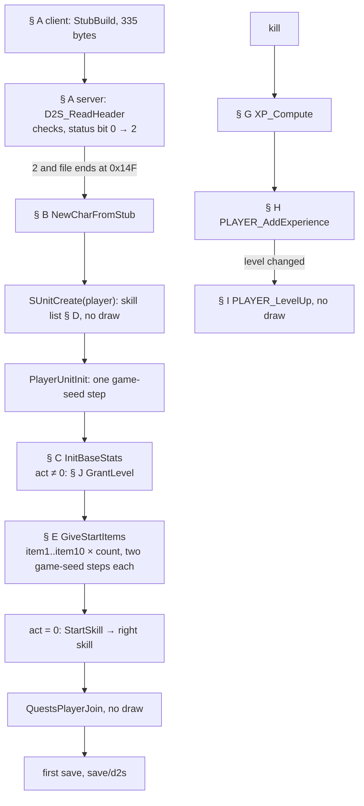
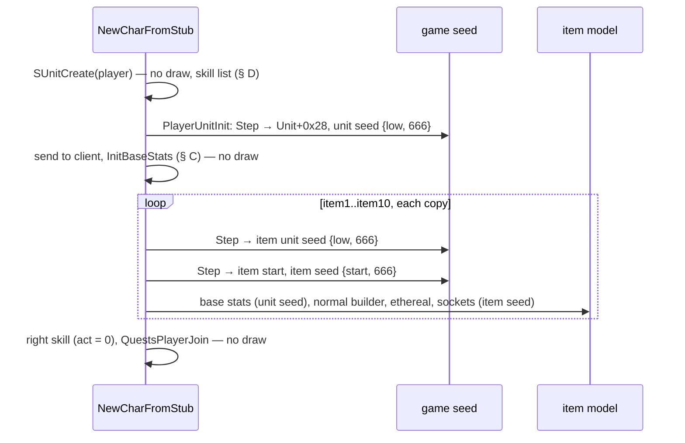
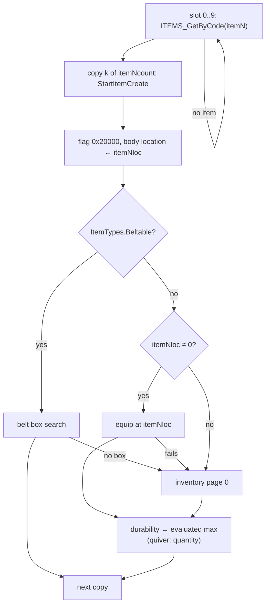
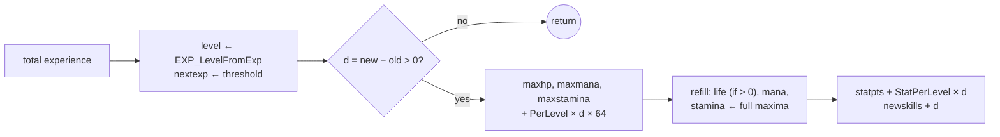

## Purpose

When a single-player character is created, the client writes a 335-byte header-only save (the *stub*); the server
reads it, sees the "new" status bit, and builds the character from its `CharStats` row: attributes, life, mana and
stamina, the skill list, the starting items (each an ordinary normal-quality item creation seeded from the game seed)
and the right mouse skill. This spec gives that path in order, with every game-seed step, then how experience becomes a
level (`Experience`), what a kill is worth to the player (`XP_Compute`), and what a level-up changes. A level-up draws
nothing.

Names of functions and fields are ours. Stat ids are ItemStatCost rows: 0 `strength`, 1 `energy`, 2 `dexterity`, 3 `vitality`, 4 `statpts`, 5 `newskills`, 6/7 `hitpoints`/`maxhp`, 8/9 `mana`/`maxmana`, 10/11 `stamina`/`maxstamina`, 12 `level`, 13 `experience`, 29 `lastexp`, 30 `nextexp`, 70 `quantity`, 72/73 `durability`/`maxdurability`, 85 `item_addexperience`, 107 `item_singleskill`. Life, mana and stamina are stored with 8 fraction bits (`points << 8`). "Game seed" is `Game+0xD0`, "unit seed" a unit's `Unit+0x20`, "item seed" the item data's seed; `Step`, `Range` and `Init` are the primitives of [rng](../../spec-rng/overview/#algorithm). Seeds are written `low:high` in hex.



## Entry points

| When | Function | Tag |
|---|---|---|
| A player joins with a version 92..96 save whose status has bit 0 set and which ends at the header | — | [C] |
| A version < 92 save whose header status has bit 0 set: the legacy reader calls its header section only, then `NewCharLegacy`, and the character is built new from its class (level 1, the class's start stats and kit), not from the file | — | [C] |
| That `NewCharLegacy` takes the same steps as `NewCharFromStub`, and its other caller, `PlayerLoad` | — | [I] |
| The game was started with `-act N` (N = 2..5): inside `PLAYER_InitBaseStats` | — | [C] |
| A monster is killed: experience to the credited player | — | [C] |
| The call above that entry: `UnitKilled` to `KillExpGate`; no call when a unit is null or the victim has flag bit 26 of `+0xC4` | `KillExpGate` | [I] |
| Any experience change that changes the level | — | [C] |
| The Ancients' reward (quest a5q5, Rite of Passage) in Normal: a grant of 1 400 000 experience, cut to the width of the next level | — | [C] |
| The same grant's 20M (Nightmare) and 40M (Hell), and its caller: `A5Q5_AncientDeath` and the summit and party grants (the run did not log which) | `A5Q5_AncientDeath` → `ExpGrantCapped` | [I] |
| Death to a monster with no owner: the loss, then the corpse's share written at the corpse's creation | — | [C] |
| The gate's caller, `PlayerDeath`; no loss when the killer is a player or a player's monster; the share returns on the owner's pickup of the corpse | `PlayerDeath`, `PlayerDeathExpLossGate`, `PLAYER_CorpsePickup` (one caller, `UnitInteract`) | [I] |
| The client's switches behind the create message's class and name bytes: `-ama`, `-pal`, `-sor`, `-nec`, `-bar` set `g_ClientClass` to 0, 3, 1, 2, 4 (later bytes win; classes 5 and 6 have no switch); `-name`, unless `"0"`, copies its first 16 bytes to `g_ClientName`. `-ctemp N` replaces the class byte of the create and join messages, only when `ClientFlagBit8` is set: bit 8 of `g_ClientFlags` is 0 in the image, the two bit-0 setters leave it, and the one whole-word writer `ClientFlagsSet` has one call, in code that reads a message buffer, so the first game of a process can't see it | `g_ClientClass`, `g_ClientName`, `g_CTemp`, `ClientFlagBit8` | [I] |
| An attribute point is spent | — | [C] |

## Inputs

### Tables

| Anchor | Used for |
|---|---|
| `CharStats.txt:str`, `dex`, `int`, `vit`, `stamina`, `hpadd` | starting attributes, life, mana, stamina (§ C) |
| `CharStats.txt:LifePerLevel`, `ManaPerLevel`, `StaminaPerLevel`, `StatPerLevel` | level-up gains (§ I), quarter points |
| `CharStats.txt:LifePerVitality`, `StaminaPerVitality`, `ManaPerMagic` | attribute spending only (§ J), never at creation |
| `CharStats.txt:Skill` 1, … `Skill 10`, `StartSkill` | skill list and right skill (§ D) |
| `CharStats.txt:ToHitFactor`, `BlockFactor` | not read at creation; read at every attack by [combat/to-hit](../../spec-combat/to-hit/) |
| `CharStats.txt:item1`, `item1loc`, `item1count` … `item10…` | starting items (§ E) |
| `Experience.txt:ExpRatio` and the seven class columns | thresholds, level lookup, gain ratio (§ F, § G) |
| `ItemTypes.txt:Beltable` | belt placement (§ E) |
| `Skills.txt:Id` | valid skill ids (§ D) |
| `DifficultyLevels.txt:DeathExpPenalty` | death loss (§ J) |
| `belts.txt` row 2 (the default belt, 4 boxes) | belt box search (§ E) |

The record index of CharStats is the class id 0..6 (`Expansion` marker row not compiled); Experience record 0 is the
`MaxLvl` row and record *L* + 1 the row labelled *L*.

- [I] **Two index spaces with no table behind them in a stock run.** The class id 0..6 is the row index of
  PlayerClass, and CharStats `item1loc..item10loc` (u8, `+0x60 + 8k`) hold the row index
  of BodyLocs (0 `None` .. 10 `Gloves`), which § E passes straight to the body-location
  calls, 0 meaning the inventory. Both code lists load only under `-txt` ([data/excel](../../spec-data/excel/#b-loading-one-table)
  B1); nothing translates the stored numbers through them.

### Runtime state

| State | Type | Source |
|---|---|---|
| game seed | `Seed` at `Game+0xD0` | [rng/seeds](../../spec-rng/seeds/) step 1; the same at the start of every new character of one game process |
| client class, status word, name | u8 at client `+0x08`, u16 at `+0x0A`, string at `+0x0D` | the stub's header (§ A) |
| client act | `client+0x1AC` | `g_StartAct` at client creation: 0, or `N − 1` under `-act N` |
| game item version | `game+0x78` | 101 in an expansion game |
| player unit | `Unit`, class id `unit->classId` | `SUnitCreate(UNIT_PLAYER, class, …)` |
| right / left skill | player data `+0x70` / `+0x74` | § B |
| base and total stats | stat lists of the unit | `STATS_GetUnitStat` reads the total, "base" the unit's own entry |
| full maxima | `UnitGetMaxHp/Mana/Stamina` | base maximum plus item bonuses, **named value inputs** of § I; how they add up is [stats/aggregate § G](../../spec-stats/aggregate/#g-the-maxima-the-rescale-and-the-stat-callback) |

### Constants

| Name | Value | Anchor | Tag |
|---|---|---|---|
| stub size, version, magic | `0x14F`, 96, `0xAA55AA55` | — | [C] |
| default graphics bytes | 16 bytes | — | [C] |
| act start levels | `{1, 15, 20, 26, 32}` | `g_ActStartLevel` | [C] |
| level-difference factors, monster at or below | `256 ×6, 207, 159, 110, 61, 13` (/256) | `g_XpPenaltyBelow` | [C] |
| level-difference factors, monster above | `256 ×6, 225, 174, 92, 38, 5` (/256) | `g_XpPenaltyAbove` | [C] |
| kill experience clamp | — | — | [I] |
| party bonus | `89/256` per extra member | `XP_PartyShare` | [C] (two members; the integer step for n up to 8) |
| party distance² | 6400, from the killed monster, inclusive, unsigned (J4) | `PartyXpCollect` | [C] the code's map |
| party member cap | 8 collected; a ninth that passes every test reaches the fatal path (J4) | — | [C] the code's map |
| starting item creation record | ilvl = level, `+0x18` 4, `+0x28` 1, quality 2, flags `0x0A` | `ITEMS_CreateForStore` | [C] |
| starter item flag | `0x20000` (save flag bit 17) | — | [C] |

### Inputs and oracles

| Input | Kind | Where it is specified | Tag |
|---|---|---|---|
| `ITEMS_RollStaffMods` at the end of the normal builder (the Sorceress's `sst`, the Necromancer's `wnd`) | seed oracle of this run's item model: its exit seed and its `item_singleskill` entries are the logged ones. The roll is modelled in [items/affixes § I](../../spec-items/affixes/#i-staff-mods--items_rollstaffmods), the chained tools' default since; this run's 11 rolls were not re-run through it | [items/affixes § I](../../spec-items/affixes/#i-staff-mods--items_rollstaffmods) | [C] (`ITEMS_RollStaffMods`: 11 of 269 creations) |
| full maxima `UnitGetMaxHp/Mana/Stamina` when items add to them | value input of the level-up refill; the sum is specified in [stats/aggregate § G](../../spec-stats/aggregate/#g-the-maxima-the-rescale-and-the-stat-callback), and this run's values stay oracles (review: none replaced, the logs hold no item lists) | § I, I3 | [C] (`UnitGetMaxHp`: 7 of 20 level-ups) |

## Algorithm

All arithmetic is 32-bit. CharStats fields are unsigned bytes unless a step says otherwise. Experience values are
`u32` and compared unsigned.

### A. The stub and the server's checks

```
A1. Client, StubBuild(name, status, class) → 335-byte image:          [C] (35 stubs)
      0x00 u32 0xAA55AA55;  0x04 u32 96;  0x08 u32 0x14F
      0x14 name;  0x24 status | 1, then | 0x20 when class ∈ {5, 6};  0x28 class
      0x29 16;  0x2A 30;  0x2B level 1;  0x2C and 0x30 time(NULL)
      0x88..0x97 the 16 bytes;  0x98..0xA7 0xFF
      everything else 0 (so act bytes 0xA8..0xAA and map seed 0xAB are 0)
    the checksum at 0x0C is added when the stub is written            [C]
      ; D2S_Checksum(stub, 0x14F) stored at +0x0C before the file is written
A2. Server, D2S_ReadHeader, in this order:                            [C]
      length < 0x14F → fail 4
      checksum (0x0C zeroed) ≠ u32[0x0C] → fail 6
      u32[0x08] ≠ length → fail 5
      version ∉ 92..96 → fail 7
      client name null → fail 3                                       [I] not met: a single-player client always has its name
      name ≠ client name ignoring case → fail 7
      D2S_CheckStatus(status) ≠ 0 → its code                          ; save/d2s § D1
      class byte > 7 → fail 4;  CLIENT_SetClass(class)
A3.   if status & 1:                                                  [C]
        clear bit 0 in the buffer and in the client;  return 2        ; before act, map seed, hot keys are read
A4. D2S_ReadSaveV92: return 2 and the cursor at the file's end        [C]
      → NewCharFromStub(client, game)  (§ B)
    return 2 with bytes after the header → internal 2 → load error 9  [C]
```

Step notes:

- A1. Hardcore is bit 2 (`0x04`) of the status word the character screen passes: it is set in the 3 stubs of the
  hardcore characters and in none of the 32 others, and every class 5 or 6 stub carries `0x20`. [C]
 That the screen also ORs
  `0x20` for class 5 or 6 before the call, as `StubBuild` does, is read from the code: it ORs a bit already set, so no
  value shows it. [I]
- A1. **Where the screen's status bits come from.** In an expansion install (`HasExpansionMpq`), selecting any class
  sets `0x20` (`or word [status+0x1EF], 0x20`); the "expansion" checkbox toggles it (`xor 0x20`, only with the
  expansion MPQ present), and class 5 or 6 forces it again. So a classic character of classes 0–4 is the default
  with the box cleared. The hardcore and ladder checkboxes toggle `0x04` and `0x40`, and the class select also sets
  `0x40` by default when the screen's mode word is 1. The stub then copies the word (A1). [I]
- A4. A stub with 10 bytes after its 335 returned 2 from the header and failed with load error 9; the same stub
  without them made a new character. [C]
- A2. **Class 7 passes the class test** although CharStats has records 0..6 only, and the game then halts: a class-7
  full save and a class-7 stub both passed the header, the class-7 player unit was not made, and
  `PlayerSetClient` stopped on the null unit (from `PlayerUnitInit` for the full save, from
  `NewCharFromStub` for the stub). [C]
  So no class-7 player exists; § J gives what the code would do with one.

### B. `NewCharFromStub`: the order of a new character



```
B1. client.flags3D4 |= 1                                                 [C]
B2. unit ← SUnitCreate(UNIT_PLAYER, client.class, game)                  [C]
      ; type 0: no unit seed, no game-seed draw (rng/seeds 7a); the skill list of § D is built here
B3. PlayerUnitInit(game, unit, client):                                  [C]
      link client ↔ unit;  copy the name into the player data
      Step(game.seed)                                                    ; game-seed draw#1 of the character
      unit[+0x28] ← game.seed.low;  Init(unit.seed, game.seed.low)       ; {low, 666}
      UNIT_SetMode(unit, 1)                                              ; no draw for a player
      player data +0x50, +0x54, +0x58, +0x5C ← 0
B4. send the unit to the client                             [C] no draw
B5. act: i32 ← client.act                                                [C]
B6. PLAYER_InitBaseStats(game, unit, act)                                ; § C
B7. PLAYER_GiveStartItems(unit, game, act)                               ; § E
B8. pd.leftSkill ← 0;  pd.rightSkill ← 0                                 [C] (all of B8–B9)
B9. cs ← CharStats[unit.classId]   (none when classId ≥ 7)
    if act = 0 and cs and cs.StartSkill ≠ 0 and SKILLS_GetUnitSkill(unit, cs.StartSkill):
      PlayerSetSkill(unit, right, cs.StartSkill);  pd.rightSkill ← cs.StartSkill
B10. QuestsPlayerJoin(game, unit, 1)                                     [C] no draw
```

Step notes:

- B1. After the call the word equals its value at the entry of `NewCharFromStub` with bit 0 set (4 new characters).
  Bit 0 was already set at that entry, by `ClientAddPlayerToGame`, so the `or` changed nothing in these sessions. [C] A path that reaches B1 with bit 0 clear was not met. [I]
- B3–B10. **The game-seed budget of a new character is `1 + 2 × (number of item copies)`.** The game seed logged
  after `SUnitCreate`, after the unit is sent, after `PLAYER_InitBaseStats`, after the items and after
  `QuestsPlayerJoin` matched the model on all 35 characters; no RNG-function call inside `NewCharFromStub` is on the
  game seed or the player's unit seed (all 142 are on item unit seeds or item seeds). [C]

- B5. The act is the client's: the six `-act N` characters reached `PLAYER_InitBaseStats` with act `N − 1` and were
  granted that act's level, the 29 others with 0. It is not read from the stub (A3 returns first): all 35 stubs have
  act bytes 0. [C] The client
  record gets the value from `g_StartAct` at creation, which is 0 unless `-act N` set it to `N − 1`; no line logs that
  global. [I]
- B9. A blank `StartSkill` is −1 (`0xFFFF`), so it passes the `≠ 0` test and fails in `SKILLS_GetUnitSkill`. Only
  the Sorceress (36 Fire Bolt) and the Necromancer (70 Raise Skeleton) have one in stock data; under `-act N` the
  right skill stays Attack. [C]
- B. Within one game process every new character starts from the same game seed (the game is re-created from the
  same `-seed`), so the characters of a batch share their item seeds. [C]

### C. Starting attributes — `PLAYER_InitBaseStats`

```
C1. act ← min(act, 4)                                                    [C] (PLAYER_InitBaseStats, all of C1–C4)
    cs ← CharStats[unit.classId];  if none: return                        ; classId ≥ g_nCharStats
C2. SetStat 0 ← cs.str;  1 ← cs.int;  2 ← cs.dex;  3 ← cs.vit;  19 ← 0;  20 ← 0
    hp: i32 ← (cs.hpadd + cs.vit) << 8;   SetStat 6 ← hp;  7 ← hp
    mp: i32 ← cs.int << 8;                 SetStat 8 ← mp;  9 ← mp
    st: i32 ← cs.stamina << 8;             SetStat 10 ← st; 11 ← st
C3. SetStat 12 ← 1;  SetStat 30 ← EXP_GetThreshold(classId, 1)          ; 500 in stock data
    SetStat 68 ← 100;  67 ← 100;  69 ← 100
C4. if act ≠ 0: PLAYER_GrantLevel(game, unit, g_ActStartLevel[act])      ; § J, J1
```

Step notes:

- C2. **No per-point factor applies at creation.** Life is `vit + hpadd` points, mana `int` points, stamina `stamina`
  points; `LifePerVitality`, `ManaPerMagic` and `StaminaPerVitality` are not read here. [C]

- C4. The `act ≥ 5 → 0` test that follows C1's clamp can never fire. [I]

**Starting values per class** (stock CharStats, the formulas of C2; the stored value is the points `<< 8`).

| Class | id | str | dex | int (energy) | vit | hpadd | life = vit + hpadd (stored) | mana = int (stored) | stamina (stored) | life / mana / stamina per level, ¼ pt → pt | Tag |
|---|---:|---:|---:|---:|---:|---:|---|---|---|---|---|
| Amazon | 0 | 20 | 25 | 15 | 20 | 30 | 50 (12800) | 15 (3840) | 84 (21504) | 8 / 6 / 4 → 2 / 1.5 / 1 | [C] |
| Sorceress | 1 | 10 | 25 | 35 | 10 | 30 | 40 (10240) | 35 (8960) | 74 (18944) | 4 / 8 / 4 → 1 / 2 / 1 | [C] |
| Necromancer | 2 | 15 | 25 | 25 | 15 | 30 | 45 (11520) | 25 (6400) | 79 (20224) | 6 / 8 / 4 → 1.5 / 2 / 1 | [C] |
| Paladin | 3 | 25 | 20 | 15 | 25 | 30 | 55 (14080) | 15 (3840) | 89 (22784) | 8 / 6 / 4 → 2 / 1.5 / 1 | [C] |
| Barbarian | 4 | 30 | 20 | 10 | 25 | 30 | 55 (14080) | 10 (2560) | 92 (23552) | 8 / 4 / 4 → 2 / 1 / 1 | [C] |
| Druid | 5 | 15 | 20 | 20 | 25 | 30 | 55 (14080) | 20 (5120) | 84 (21504) | 6 / 8 / 4 → 1.5 / 2 / 1 | [C] |
| Assassin | 6 | 20 | 20 | 25 | 20 | 30 | 50 (12800) | 25 (6400) | 95 (24320) | 8 / 6 / 5 → 2 / 1.5 / 1.25 | [C] |

Every class has `StatPerLevel` 5, `nextexp` 500 and level 1 at creation. [C]

### D. Starting skills

```
D1. SKILLS_InitPlayerSkills(unit), inside SUnitCreate:                   [C] (SKILLS_InitPlayerSkills, SKILLS_AddSkill, all of D1–D2)
      unless the list already holds skill 0 with item ref −1:
        AddSkill(0)                                                      ; Attack
        for k in 1 ... 10: id ← cs."Skill k";  if 0 ≤ id < skills count: AddSkill(id)
      left skill unset → Attack;  right skill unset → Attack
D2. AddSkill(id): append a 0x40-byte entry, level 1, item ref −1,
      entry +0x08 ← the Skills record's byte +0x10 (16 for class 6, skill 5)
D3. StartItemCreate on item1's copies: item_singleskill(StartSkill) ← 1  ; § E, E4
D4. once item1 is equipped, StartSkill appears as the last list entry, base level 0   [C]
```

Step notes:

- D1. **An existing entry is raised by 1** instead of appended (the entry with the same Skills record and item ref
  −1). No stock creation reaches this: no CharStats record repeats a skill in `Skill 1..10` or names Attack. The
  skill-point spend reaches it (`PLAYER_SpendSkillPoint`: `newskills` ≥ the cost, minus the cost, then the add): Ice
  Bolt appended at level 1, then raised 1 → 2, and Frozen Armor raised 19 → 20, the Skills maximum; the other callers
  only appended (467 calls). [C] The test against the maximum (`SKILLS_GetMaxLevel`: Skills `maxlvl`, `+0x12C`, 20 when
  that cell is ≤ 0) is read from the code: a full entry never reached the add, because the client sent no request for a skill
  at its maximum. For a monster unit (type 1) the entry is raised at or above the maximum too. [I]

- D1. Stock lists: every class gets Attack (0), Throw (2), Kick (1), the scrolls and books of Identify and Town Portal
  (217–220) and Unsummon (3); the Barbarian adds Left Hand Throw (4) and Left Hand Swing (5), the Assassin Left Hand
  Swing. A new character's class-skill bytes in the save are all 0. [C]
- D4. The `-act` Sorceress and Necromancer also get the level-0 entry; only the right skill differs (B9). [C]


### E. Starting items — `PLAYER_GiveStartItems`



```
E1. for slot in 0 ..< 10:                                                [C] (PLAYER_GiveStartItems, all of E1–E2)
      it ← cs.items[slot]                                                ; code, loc (u8 bodylocs row), count
      if not ITEMS_GetByCode(it.code, &idx): continue                    ; "0" is no item
      for k in 0 ..< it.count:
        item ← StartItemCreate(player, game, slot, idx)                  ; E3–E5
        set item flag 0x20000;  item.data[+0x44] ← it.loc
        Place(item, it.loc)                                              ; E6
E2.     if not Beltable(item):
          durability (72) ← the evaluated max durability                 ; items/properties § G
E3. StartItemCreate: ilvl ← the player's base level (1; 16/21/27/33 under -act 2..5)   [C] (all of E3–E5)
    rec ← zeroed 0x84-byte creation record:                              ; ITEMS_CreateForStore
      source = player, ilvl, item index idx, +0x18 = 4, +0x28 = 1, +0x2A = game item version,
      quality 2 (normal), no row, no forced affixes, no seed override, flags 0x08 | 0x02
    item ← ItemCreate(game, rec)                                         ; items/uniques-sets § A onward
      ; game draw: Step(game.seed) → item unit seed {low, 666}, Unit+0x28 ← low
      ; game draw: Step(game.seed) → item start, item seed {start, 666}
      ; base stats on the unit seed, normal builder, ethereal and socket steps on the item seed
    set item flag 0x10 (identified)
E4. if the item has a stat list with flag 0x40: remove it
    if slot = 0 and 0 ≤ cs.StartSkill < skills count:
      new list, flags 0x40: item_singleskill(param StartSkill) ← 1
E5. if the base is stackable: quantity (70) ← its max stack
```

```
E6. Place(item, loc):
      if Beltable(item):                                                 [C]
        box ← BeltFreeSlot on the default belt (4 boxes)                 ; E6 notes
        if box found: belt box ← item;  return
        else: inventory (below)                                          [I]
      else if loc ≠ 0:
        ItemEquip(player, item, loc): mode 1, page 0xFF, cell (loc, 0), item flag 0x1   [C]
        if it fails: inventory (below)                                   [I]
      inventory: page 0, the spot search below                           [C]
```

Step notes:

- E6. The belt search and the spot search are [items/inventory §§ F, B](../../spec-items/inventory/#f-belts), which also give their other callers.
- E1–E5. **Order of draws.** Items are created in slot order, the copies of a slot in copy order; each copy takes
  exactly two game-seed steps (unit seed, then start seed), and everything else it draws is on its own unit seed and
  item seed. Each of the 269 item copies of the run reproduced through the item model from the game seed. [C]

- E3. **What a normal starting item draws.** The base stats of [items/properties § A](../../spec-items/properties/#a-base-stats-on-the-unit-seed)
  on the unit seed (a weapon's durability, a shield's durability then defense, nothing for a potion or scroll); then on
  the item seed the normal builder ([items/affixes § H](../../spec-items/affixes/#h-the-normal-builder--items_buildnormal),
  which ends in `ITEMS_RollStaffMods`, an oracle of this run's check, § I there); the ethereal roll returns at flag `0x02` before its draw; the socket
  roll ([items/properties § F](../../spec-items/properties/#f-ethereal-and-sockets), F4) **draws** `Range(item.seed, 100)`
  for a base that can have sockets and only then returns at flag `0x08`, so the draw is consumed and the item gets no
  sockets. [C]
- E3. Under `-act 2..5` the player is already level 16, 21, 27 or 33 when the items are made (C4 runs first), so the
  items get that ilvl. [C]
- E4. **The free drops the creation's properties.** The list removed is the item's main property list (state 0,
  flags `0x40`), unlinked and freed after `ITEMS_CreateForStore` returns, so every property the creation wrote there is
  lost; the item keeps its affix ids. A base whose ItemTypes row has `Magic` = 1 is turned into a magic item by
  `ITEMS_CreateForStore` from the quality-2 request, picks its affixes, and loses their properties here: under an
  edited CharStats that gives a ring, amulet, jewel and small charm, the saves carry magic items at ilvl 1 (the
  player's level) with affix ids over an empty main list (48 items). The stock kits hold no such base. Slot 0's
  `item_singleskill` list is made after the free. [I]
- E4. On `item1` every copy gets the `item_singleskill` list (stock: the Sorceress's staff, the Necromancer's wand;
  the other classes have no `StartSkill`). [C]
- E6. **Belt.** `BeltFreeSlot` first looks for a column whose box among 0..3 already holds the same item and takes the
  first free box down that column, below the belt's box count; failing that, when the item record's byte `+0x131` is
  set, the first free box of 0..3. On the default belt the column search never finds room, so the four `hp1` land in
  boxes 0, 1, 2, 3. [C] The column path, the
  first-free path and the no-box result are each met in play: four potions sent to an 8-box belt took the column
  path at box 4 (the same class in column 0), the first free box at 1 and at 2, and the column path at box 5, and
  every call of the run gave the box the logged boxes predict. [C]
- E6. **Inventory spot.** An item one cell high is placed by `InvSpotFindRow` (columns from the right, rows from the
  bottom), any other by `InvSpotFind` (rows from the top, columns from the left); each candidate that fits is scored by
  `InvSpotScore` (the occupied or outside cells along its four sides, 255 when enclosed), a spot replaces the best only
  when its score is strictly greater, and the search stops at 255. Stock kits: `tsc` at (9, 3), then `isc` at (9, 2).
  [C]
- E2. A quiver (item type 5) gets `quantity` 250 instead of durability, and 100 when it was not equipped. No stock kit
  has one. [I]
- E6. Body locations are `bodylocs` rows: 4 `rarm`, 5 `larm`, 0 none. Stock kits: the class weapon in `rarm`, a
  buckler in `larm` for all but the Sorceress and the Necromancer, four `hp1` to the belt, `tsc` and `isc` to the
  inventory. [C]
- E6. The equip flag `0x1` is clear again in the first save. [C]

### F. The experience table

```
F1. EXP_GetThreshold(class, L) = Experience[L + 1].col[c]                [C]
      ; the experience at which level L + 1 starts; no bound check on L
    c ← class if 0 ≤ class ≤ 6 else 0                                    [I]; no class-7 player reaches it (A2)
F2. MaxLvl(class) = Experience[0].col[c]                                 [C]
F3. EXP_LevelFromExp(class, exp: u32) → i32:                             [C]
      n ← 0
      while n < MaxLvl(class) and exp ≥ Experience[n + 1].col[c]:  n ← n + 1    ; unsigned compare
      return n
F4. EXP_GetRatio(L) → u32:                                               [C]
      if L ≤ 0: return Experience[0].ExpRatio                            ; 10, the shift
      if L > Experience[0].col[0]: return 0                              ; Amazon's MaxLvl
      return Experience[L + 1].ExpRatio
```

Step notes:

- F3. With stock data level 1 is 0..499, level 2 starts at 500, level 99 at 3 520 485 254; values from the row
  labelled 93 on exceed 2³¹, so a signed compare would break the top levels. [C] (`EXP_LevelFromExp`,
  `Experience.txt:Amazon`: level 98 reached at 3 229 426 756)
- F1. **The clamp's reach.** The clamp is read from the code. Its out-of-range inputs are a
  class 7, which no player has (A2), and the −1 of the callers' inlined null-unit test, which no run or reading meets; a null-unit call at any of the 13 `EXP_GetThreshold` callers would be the
  case that reaches it. [I]
- F2. `ExpMaxLevel` reads `[g_pExperience + 4c]`, and `EXP_LevelFromExp`, whose results F3 matches, loads the same
  cell as its loop bound; stock row 0 holds 99 for all seven classes. [C] Its column 0 for a class outside 0..6 is a clamp like F1's, which no class-7
  player reaches. [I]
- F4. `ExpRatio` is 1024 for levels 0–69 and falls to 5 at 99; the run used 1024, 8 (level 97) and 6 (level 98). [C]


### G. Kill experience — `XP_Compute`

```
G0. XP_OnMonsterKill(game, killer, victim), as the code's map:           [C] (XP_OnMonsterKill; one player:)
      if killer or victim is null, or killer's type is not 0 or 1: end
      exp: i32 ← victim's base stat 13;  if exp ≤ 0 (signed): end
      credit ← XpCreditPlayer(killer, game, victim);  if none: end
      mlvl: i32 ← victim's base stat 12
      the mercenary's award                                              ; G6 note: before the party test, whatever the share does
      clvl: i32 ← credit's base stat 12
      if UnitPartyId(credit) = 0xFFFF:                                   ; in no party: no alive test, no distance test
        add ← XP_Compute(exp, clvl, mlvl);  PLAYER_AddExperience(credit, clvl, add)   ; § H
      else:
        XP_PartyShare(credit, exp, game, victim, clvl, mlvl)             ; J4: n = 0 pays nobody, n = 1 pays credit, n ≥ 2 splits
    exp is the killed monster's base stat 13 (monsters/stats)            [C]
    XpCreditPlayer(killer, game, victim) → player or none, as the code's map:   [C]
      if killer's type = 0: return killer                                ; a state on the victim is not read
      owner ← MonsterOwner(killer)                                       ; AI control +0x28 game, +0x2C id, +0x30 type, by GameFindUnit
      s ← none
      if UnitHasExpState(killer): s ← StatListFindFlag(killer, 0x800)
      if UnitHasExpState(victim): s ← StatListFindFlag(victim, 0x800)    ; the victim's wins, even a none
      if s ≠ none: owner ← GameFindUnit(game, type of s's owner, id of s's owner)
      return owner if owner is a player, else none
G1. XP_Compute(exp: i32, clvl: i32, mlvl: i32) → i32:
      if exp > 8388607: exp ← 8388607    ; 2^23 − 1                      [I] (all of G1 not tagged otherwise)
      else if exp ≤ 0: return 1                                          [C] the code's map
G2.   if clvl ≥ MaxLvl(class): return 0                                 [C]
G3.   XP_LevelDiffPenalty:                                               [C] (XP_LevelDiffPenalty, all of G3)
        if mlvl ≤ clvl:            f ← g_XpPenaltyBelow[min(clvl − mlvl, 10)]
        else if clvl ≥ 25 and mlvl > 0:  exp ← MulDiv(exp, clvl, mlvl);  f ← 256
        else:                      f ← g_XpPenaltyAbove[min(mlvl − clvl, 10)]
        if f ≠ 256: exp ← MulDiv(exp, f, 256)
G4.   XP_ApplyExpRatio:  r ← EXP_GetRatio(clvl);  s ← EXP_GetRatio(0)    [C]
        if 1 ≤ s ≤ 31:
          exp ← (exp × r) >> s                                           ; signed, arithmetic shift
          but if exp > (0x7FFFFFFF >> ((r >> s) + s)): exp ← (exp >> s) × r    [I]
G5.   s85 ← stat 85 (item_addexperience) of the player                   [C]
      if s85 ≠ 0: exp ← exp + MulDiv(exp, s85, 100)
G6.: no change for a player (it caps a mercenary's gain)    [C]
      return exp
```

Step notes:

- G3. `MulDiv` is the signed, truncating one of [monsters/stats § A](../../spec-monsters/stats/#a-muldiv-and-monlvlstats). The
  run reproduced the factors `Below[0]`, `[1]`, `[8]`, `[9]`, `[10]`, `Above[10]` (a level-1 character in Hell) and
  the `exp × clvl / mlvl` branch (levels 49 and 50 against a level-67 monster). [C]

- G3. **Use the /256 factors, not percentages.** 207/256 is 80.9 %, 13/256 is 5.1 %; the community's rounded
  percentages give different integers. [C]
- G0. In 145 kills the input of `XP_Compute` equalled the killed monster's base stat 13, read with
  `STATS_GetUnitBaseStat`. [C]
- G0. **The credit, in full.** A player killer is credited itself. A monster killer's owner link is, unless a state in
  the `exp` mask (53 `conversion`, 57 `attract`, 59 `confuse`) sits on the killer and then on the victim: the victim's
  test comes last and wins even when it finds no list. The result counts only if it is a player. [C] the code's map,
  with a mask state outside the three (60) doing nothing; 40 mercenary kills in the game's own logs credit the owner.

- G0. A player as the victim passes this code: its base stat 13 stands for `exp` and its base stat 12 for `mlvl`. [C] the code's
  map No log holds such a kill, and whether play reaches it past the
  gate's flag is not read. [I]
- G1. **An input ≤ 0 returns 1, zero included.** `test esi,esi`, `jg`, `mov eax,1`, `ret 8`. Under emulation 90 negative and 93 zero inputs each returned 1. [C] the code's map
  G0 ends before `XP_Compute` at a monster's `exp` ≤ 0, so only a share's input comes here: past the wrap of J4, or a share that truncates to 0, as for a low member beside a high one on a small `exp` (level 1 beside level 99 at `exp` 50: total 67, `q` = 67 / 100, input 0), and that member then gets the 1. No logged kill had one. [I]
- G2, G5. **The level cap and stat 85 are met.** At clvl 99 (`≥ MaxLvl`) `XP_Compute` returned 0 on 71 of 71 kills.
  With an Annihilus carried (stat 85 = 10, the unique's `addxp` maximum) the term `exp + MulDiv(exp, 10, 100)` was
  added on all 73 kills of that session, each reproduced. [C]
- G6. **The mercenary's award runs before the share and does not depend on it.** Only the credited player's own pet of
  type 7 is paid (the first node with flag bit 0 clear); other members' mercenaries get nothing. `XP_Compute` runs at the monster's
  full experience and the mercenary's level, with MaxLvl from class column 0 and its own stat 85, and ends in `MERC_CapExpGain`: `min(gain,
  (ExpForLevel(L + 1) − ExpForLevel(L)) >> 6)`, unsigned, or 0 with no owner link. Then `gain × 86 ÷ 256`, signed and truncating, unless
  the mercenary is the killer. The owner then takes J4's outcome, whichever it is. [C] the code's map The rest of the award and its run:
  [hirelings § G](../../spec-hirelings/overview/#levelling-in-play-merc_addexp).
- G1, G4 overflow branch. No logged kill reached the clamp, a non-positive experience or the overflow test (largest input
  18 713; 145 of 145 inputs positive). [I]


### H. Adding experience — `PLAYER_AddExperience`

Step notes:

- H1. **The cap is the threshold of level `MaxLvl`** (3 520 485 254 for 99). A level-98 Hell save at `T(98) − 2`
  gained 5 from one kill and ended at `T(98)` exactly, at level 99, through `PLAYER_LevelUp`; every later kill (71)
  returned 0 (G2). [C]

### I. Level-up — `PLAYER_LevelUp`



Step notes:

- I1–I5. **A level-up draws nothing.** Over the 20 level-ups no RNG function was called and none of the 852 LCG
  multiplier sites executed between the handler's entry and its return (the same breakpoints fired 127 times inside
  `NewCharFromStub`), and the game seed and the player's unit seed were unchanged across it. [C]

- I1. Several levels gained at once are one call with `d > 1`: `-act 2..5` gives 15, 20, 26 or 32 levels in one call.
  [C]
- I2. The gains multiply the quarter-point columns by 64, so `× 64` is `÷ 4 << 8`: a Barbarian's `LifePerLevel` 8 adds
  512, 2 life points. [C]
- I3. **The refill reads the full maxima.** Without item bonuses they equal the new base maxima (13 level-ups); with
  item bonuses (7 level-ups, the Sorceress's gear) the run took them as logged value inputs, so this spec states that
  the refill reads `UnitGetMaxHp/Mana/Stamina`, not how the bonuses sum. Current life is refilled only when it is
  above 0; mana and stamina always. [C]
- I2–I3. **What the refill reads.** Each write of I2 reaches the unit's cached full stat at once, and the stat
  callback rescales the current value against the new maximum before I3 overwrites it; `UnitGetMaxHp` then returns
  the cached full stat 7 (and 9, 11), that is the new base plus every item, set and state term. [I]

- I1–I4. The level-up arithmetic adds to whatever base it finds: the level-up characters of the run were built saves
  (8 000 life, level 1 attributes at levels 9, 49 and 97), so the run backs the arithmetic, `XP_Compute` and the
  no-draw result, not what a natural level-*N* character's attributes or life would be. [C]

### J. Other level and experience changes

Step notes:

- J1. The `-act` grants run on game-made characters (no built save), through `PLAYER_AddExperience` and one
  `PLAYER_LevelUp` call each. [C]
- J4. **The distance is to the killed monster, not to the credited player.** `XP_OnMonsterKill` passes the victim as `XP_PartyShare`'s
  second stack argument, which stores it at the collector's block `+0x00`, and the
  collector reads that unit's position. [C] the code's map, separated under emulation (the old reading fails 1 775 cases); no logged kill
  separates it: the two distances decide all 431 logged pairs alike. The logs do give that the argument is the killed monster and that its X is non-zero there.
- J4. **n = 1 pays the credited player, whoever the sole member was.** That arm uses the credited player and the level
  argument, not the block's slot. n = 0 pays nobody. [C] the code's map; no logged kill
  separates it: all 648 partied credited players of the logs were in range, so every sole member there was the credited player.
- J4. What follows in play from those two: a partied player whose hireling or summon kills more than 80 sub-tiles from it
  takes the whole award alone when one other member is near the victim, and with no member near nobody gets any, while an unpartied player in the same place
  gets it all; a dead killer with one living member in range is paid and the living member is not. [I]
- J4. **The party and the level are the credited player's**; the victim's level is not read. A member's level is `STATS_GetUnitStat` (the evaluated list), `clvl` is `STATS_GetUnitBaseStat`; they differ only if a list changes stat 12. [C] the code's map
- J4. **The member's input is not rounded to f32.** `q` is stored as an f32 (`fstp dword`);
  each member's `fild` level is multiplied by that dword on the x87 stack and passed to
  `CRT_ftol2`, whose SSE2 and x87 paths both truncate the unrounded product. A level (≤ 99) times an f32
  needs at most 31 significant bits, so the product is exact in f64: compute `trunc((f64) level_i × (f64) q_f32)`.
  98 inputs of the run separate this from an f32 product (exp 63, levels 81 and 81: 41, where an f32 product gives
  42). [C]
- J4. `q` itself is the quotient rounded once to the nearest f32: the `fidiv` result is rounded to the x87 precision
  and the `fstp dword` rounds it to f32, and at 24-, 53- or 64-bit precision that equals one rounding of the exact
  quotient (an f64 or wider intermediate has at least 2 × 24 + 2 bits), so the f64 division then the f32 cast above
  gives the game's `q`. [I]
- J2. **The grant in Normal, run.** Two kept logs, two grants, 0 mismatches against a model of the steps above (the
  difficulty byte, base stats 12, 13, 29 and 30 and the experience table). At level 26 (experience 2 147 274, `nextexp`
  2 563 061) the first pass granted 640 765 = T(27) − T(26), below 1 400 000, so the cut bound; that pass levelled up
  (`need` 415 787), the second took the short branch (224 978 < `need` 640 765), the third saw G = 0, ending at level 27,
  experience 2 788 039. A grant without the cut would have ended at level 28, experience 3 547 274. At level 81 the
  first pass granted 1 400 000 uncut and took the short branch (`need` 67 254 290): experience 742 731 766 to
  744 131 766. [C]
  Not reached: the Nightmare and Hell amounts (no log has difficulty byte 1 or 2), `G` = `need`, a value at or above
  2^31, the `L ≥ max` return and the `L < max` exit; which of the three callers made the call is not logged. [I]

- J2. **The cut is the width of level L + 1**, `T(L + 1) − T(L)`, not of the current level: `T(L)` is the experience at
  which level L + 1 starts (F1). In Normal the run met it: the cut T(27) − T(26) bound at level 26, one level-up, then
  the short branch. The Normal amount and the cut rest on the run's reproduction of the logged call (evidence
  rule 1). [C]
  The three amounts are immediates of this function only, so no second code path backs them. A player who starts the
  grant inside level L levels up at most once: the `need` of level L is `T(L) − exp` > 0, so
  what is left after that level-up is below `T(L + 1) − T(L)`, the `need` of level L + 1. Where the cut binds is a
  table reading: `T(L + 1) − T(L) < G` in stock data (the seven class columns equal on every
  row) for L 1–35 in Normal, 1–65 in Nightmare and 1–73 in Hell; at level 25 in Normal it is 512 612. [I]
- J2. **The trigger is the Ancients' reward** (quest record word 39, `a5q5`). The quest's monster-death callback acts on
  classes 540–542 (`ancientbarb1`–`3`) and counts them down; when the last dies and the quest is active, the grant goes
  first to the killing player, then to each player standing in level 120 (the Arreat Summit), and, for a player there in
  a party, to each party member in an Act V level. Each player is granted only when its word-39 bit 0 is clear and its
  base level is at least 20·(d + 1) (20, 40, 60), and bit 0 is set before the grant, so a player gets it once per
  difficulty. With J2's cut, the reward is at most one level-up. [I]

- J3. **The loss, reproduced.** Five deaths over three difficulties (four cases: the Nightmare clamp case ran twice),
  each killed by a monster with no owner:
  Normal (penalty 0): loss 0, corpse share 0. Nightmare (penalty 5, span 1 964 461): the loss 98 223 would take the
  experience below `Exp[39]`, so the experience became `Exp[39] + 1` and the amount kept is the clamp's, 1 000
  (`exp − Exp[39]`), not `loss`. Hell (penalty 10, span 4 650 593): loss 465 059, no clamp. A second Nightmare death at
  `Exp[39] + 1` kept 1 and left the experience unchanged. The level never dropped. [C]
- J3. **When the loss is skipped.** `PlayerDeath` calls the gate with the killer; the gate skips the loss when the
  killer is a player (type 0) or a monster whose owner is a player, and otherwise calls `PLAYER_DeathExpLoss`. The run's
  killers were all monsters with no owner, so the skip is read from the code. That the stored amount is the kept one
  shows in the corpse shares (the 75 % note: 750 from the kept 1 000, not from the loss 98 223); the order, client
  `+0x508` written before the stat write, is read from the code. [I]
- J3. **75 % goes on the corpse.** When the death mode ends, `PLAYER_CorpseCreate` makes the corpse unit and writes its
  stat 13 (experience) from `v` = the stored amount, `v·75/100` when `v` ≤ `0x100000` (signed, truncating): shares 750
  (from 1 000), 348 794 (from 465 059) and 0 in the run. [C] Above `0x100000` it is `(v/100)·75`, which no
  death reached; the creation then clears the stored amount and moves the items and gold onto the corpse. [I]

- J3. **The pickup reads the two fields the creation writes.** The share: the creation writes it with
  `UnitSetStat(corpse, 13, share)` (the share logged in all five deaths), the pickup reads
  `STATS_GetUnitStat(corpse, 13, 0)`. The owner: the creation writes the dead player's id into the corpse
  inventory's `+0x24` (`INV_SetOwnerId`), the pickup reads it (`INV_GetOwnerId`) and compares
  it with the picker's id. [C]
- J3. **It returns only to the owner** (the pickup's run, read from the code). `PLAYER_CorpsePickup` has one caller,
  the unit-type-0 case of `UnitInteract`: a click on a corpse in mode `0x11` within distance 8 picks up,
  from 9 to 50 walks there and picks up when the walk ends, beyond 50 does nothing. The pickup needs the permission
  test (returning 0 for the picker and the corpse) and the owner's id; a non-zero stat 13 is then zeroed
  and added with `AddExperienceDirect`, which for a player calls `PLAYER_AddExperience`, so the share
  passes § H's cap. Another player's pickup returns nothing. No run reached a pickup. [I]

- J3. **A saved corpse loses the share.** `D2S_WriteCorpses` writes no stat, and `D2S_ReadCorpses` re-creates each corpse
  (a type-0 unit in mode `0x11`, state 7 `playerbody`, its item list) with no stat write, so the re-created corpse has
  no stat 13. `PLAYER_CorpseCreate`, the only writer of a corpse's stat 13 read so far, runs only at the death mode's end. The
  owner's pickup of a re-created corpse therefore adds no experience: the 75 % is lost once the character is saved
  with its corpse on the ground. [I]
- J5. Four spends in one town session, each reproduced with every base entry 0–11 compared: strength 35 → 36,
  dexterity 25 → 26, vitality 30 → 31 (maxhp and hp + `LifePerVitality` × 64, maxstamina + `StaminaPerVitality` × 64)
  and energy 35 → 36 (maxmana and mana + `ManaPerMagic` × 64), `statpts` − 1 at each. [C]
 The refusal at `statpts` = 0 and the clamp of mana
  to maxmana were not met. [I]
- J. **Class 7.** Every CharStats reader tests `class < 7`, so a class-7 player would get no attributes, no items and no
  start skill, and the experience lookups would read class 0's column. No class-7 player is ever made (A2: the game
  halts first), so this is the code's reading only. [I]

## Outputs

- A player unit with the § C stats, the § D skill list, the § E items placed, the right skill of B9, and the game seed
  advanced by `1 + 2 × copies` steps (stock kits: 7 copies for the Sorceress and Necromancer, 8 for the others, so
  15 or 17 steps). [C]
- The first save after *Save and Exit*, written by [save/d2s](../../spec-save/d2s/): status without bit 0, level, the map
  seed of the game it was made in (the stub stores 0 and returns before the map-seed reuse), act byte `0x80 | act`,
  mouse skills Attack / `StartSkill`, no mercenary, the § C stats, class-skill bytes 0, every item with seed =
  `Unit+0x28`, ilvl, quality 2, durability and quantity as above; the quest, waypoint and NPC sections are the same
  bytes for every new character of a game type. [C] (`D2S_WriteHeader`, `d2s`#flags: 35 first saves predicted field by field)
- From an experience change: stats 13, 29, and on a level change 12, 30, 7/9/11, 6/8/10, 4 and 5. [C]


## Worked example

All, batch 34101 (expansion, Normal, act 0): every character of the batch starts from game seed `5389700c:0f9a1148`. The model reproduces each line. [C]

### Example 1: an expansion Sorceress (staff with the staff-mods oracle)

| Step | Seeds and values |
|---|---|
| B2 `SUnitCreate` | game seed unchanged `5389700c:0f9a1148` |
| B3 `PlayerUnitInit` | Step → `48ac0a84:22d7b3ef`; player `Unit+0x28` = `0x48ac0a84`, unit seed `48ac0a84:0000029a` |
| C | strength 10, energy 35, dexterity 25, vitality 10; life = max = 40 × 256 = 10240; mana 35 × 256 = 8960; stamina 74 × 256 = 18944; level 1, nextexp 500 |
| E `sst` (slot 0) | game Steps → unit seed `9f3e0b83:0000029a`, start `b4da2652`; unit seed: durability `10 + Range(10)` = 15 (max 20), unit seed after `968a8e69:426b34ce`; item seed `b4da2652:0000029a` → `ITEMS_RollStaffMods` **taken from the log** (an oracle of this run's check; [items/affixes § I](../../spec-items/affixes/#i-staff-mods--items_rollstaffmods) specifies it), join seed `78d99fb4:4b6e9add` and no staff-mod entry, as logged; ethereal no draw; socket `Range(100)` = 85, discarded (flag `0x08`) → exit `c1f3c061:3267d8c9`; list `0x40`: `item_singleskill(36)` = 1; equipped `rarm`, flags `0xA2011`, durability ← 20 |
| E `hp1` ×4 (slot 1) | unit seeds `bb44d1e8`, `450d87c4`, `61ad922c`, `6cd49484`; starts `86e6a265`, `21a3dbbd`, `20da2c9a`, `e6ec5b5e`; no draw on either seed; belt boxes 0, 1, 2, 3, flags `0xA2010` |
| E `tsc` (slot 2) | unit `6b5f9eca`, start `3e73ccac`; no draw; inventory (9, 3) |
| E `isc` (slot 3) | unit `e40e20c9`, start `20d2ae4d`; no draw; inventory (9, 2) |
| exit | game seed `20d2ae4d:5f1ebd78` (15 steps); right skill 36; skill list 0, 2, 1, 217, 218, 219, 220, 3 at level 1, then 36 at base level 0 |

### Example 2: an expansion Barbarian (no oracle)

Same batch and the same game seed at entry, so the player and the *n*-th item copy get the same seeds as in Example 1;
the Barbarian has one copy more (the buckler), so only its eighth copy (`isc`) takes new seeds and its exit seed differs.

| Step | Seeds and values |
|---|---|
| B3 | game seed `48ac0a84:22d7b3ef`; player unit seed `48ac0a84:0000029a` |
| C | strength 30, energy 10, dexterity 20, vitality 25; life 55 × 256 = 14080; mana 10 × 256 = 2560; stamina 92 × 256 = 23552 |
| E `hax` (slot 0) | unit `9f3e0b83`, start `b4da2652`; unit seed: durability `14 + Range(14)` = 21 (max 28) → `968a8e69:426b34ce`; item seed: normal builder draws nothing; socket `Range(100)` = 16, discarded although below 33 → exit `78d99fb4:4b6e9add`; equipped `rarm`, durability ← 28 |
| E `buc` (slot 1) | unit `bb44d1e8`, start `86e6a265`; unit seed: durability 10 (max 12), then defense 6 → `817aac35:18cdd4ab`; socket `Range(100)` = 7, discarded → exit `f6f1ca53:384421e8`; equipped `larm`, durability ← 12 |
| E `hp1` ×4 (slot 2) | units `450d87c4`, `61ad922c`, `6cd49484`, `6b5f9eca`; belt boxes 0..3 |
| E `tsc`, `isc` | units `e40e20c9`, `d4d82eb9`; starts `20d2ae4d`, `2f6ab60b`; inventory (9, 3), (9, 2) |
| exit | game seed `2f6ab60b:58c69aea` (17 steps); right skill 0 (Attack); skill list 0, 2, 1, 217–220, 4, 5, 3 |

### Example 3: a Barbarian level-up, 9 → 10 (built save `LvBarB`, session 34421)

| Step | Values |
|---|---|
| G | monster level 1, experience 18; clvl 9: `Below[8]` = 110 → `MulDiv(18, 110, 256)` = 1980 ÷ 256 = 7; `ExpRatio[9]` = 1024: `(7 × 1024) >> 10` = 7; stat 85 = 0 → 7 |
| H | 57 714 + 7 = 57 721 ≥ 57 715 (level 10's threshold) → level 10 ≠ 9; lastexp 7 |
| I1 | level 10, nextexp `EXP_GetThreshold(4, 10)` = 72 144; d = 1 |
| I2–I3 | maxhp 2 048 000 + 8 × 64 = 2 048 512; life 2 047 669 > 0 → 2 048 512; maxmana 128 000 + 256 → mana 128 256; maxstamina 128 000 + 256 → stamina 128 256 (was 127 000) |
| I4 | statpts 0 + 5 = 5; newskills + 1 |
| seeds | game seed `cfef1ae5:26e5b235` and unit seed `88a0c5ac:5b12a22c` unchanged |

### Example 4: a Sorceress level-up in Hell, 97 → 98 (built save `LvSorD`, session 34414)

| Step | Values |
|---|---|
| G | monster level 67, experience 17 376; clvl 97 ≥ mlvl: `Below[10]` = 13 → `MulDiv(17376, 13, 256)` = 882; `ExpRatio[97]` = 8: `(882 × 8) >> 10` = 6 |
| H | 3 229 426 755 + 6 = 3 229 426 761 ≥ 3 229 426 756 → level 98; nextexp 3 520 485 254 (unsigned) |
| I2–I3 | maxhp 2 048 000 + 256; maxmana 2 048 000 + 512; maxstamina 70 400 + 256; refill from the **logged** full maxima (item bonuses): life 2 055 936, mana 2 276 402, stamina 74 496, each above its base maximum |

## Reimplementation notes

- **The socket draw of a starting item is consumed.** Flag `0x08` is tested after `Range(item.seed, 100)`, so a
  weapon or shield still advances its item seed by one step; a reimplementation that skips the roll gets every later
  draw on that item wrong (and the saved seed is the unit's, so the save will not show it). [C]

- **The player unit seed is not in the save.** The only seed of the header is `map_seed`; the player's `Unit+0x28` is
  drawn at creation and lost. Items keep their `Unit+0x28` as the saved seed. [C]
- **`StartSkill` is not a skill point.** It is a skill granted by `item1`'s `item_singleskill`, appearing at base level
  0; the class-skill bytes stay 0. [C]
- **Experience is unsigned.** Thresholds above 2³¹ and the `nextexp` stat (stored as a 32-bit entry) must be compared
  and stored as `u32`. [C]
- **The level is recomputed from the total experience stat**, not the base entry, and `level`/`nextexp` are written
  even when `d ≤ 0`. [C]
- **`XP_Compute` returns 0 at the level cap** (71 kills at level 99). [C] For a non-positive input it returns 1, not 0; no input of the runs was ≤ 0. [I]

- With stock `ExpRatio` (≤ 1024) and shift 10, the shift count `(r >> s) + s` of G4 is 10 or 11: `ExpRatio` is 1024
  in 70 level rows (11), below 1024 in the other 30 (10), and `r` = 0 above `MaxLvl` gives 10. [C]

- **`ToHitFactor` is an attack-rating term, not a level bonus.** The class constant (Amazon 5, Sorceress −15,
  Necromancer −10, Paladin 20, Barbarian 20, Druid 5, Assassin 15) is added to the player's base attack rating
  `(dex − 7)·5 + stat 19` before the percent, and the chance to hit's level term has no class constant. This contradicts
. [C] `BlockFactor` is added to stat 20 in the block chance. [C]

- **`StatPerLevel` is signed.** It is read as an `i8`; stock data holds 5 for every class. [I]

## Evidence

- Upstream: [rng](../../spec-rng/overview/), [rng/seeds](../../spec-rng/seeds/) step 7a, [items/uniques-sets § A](../../spec-items/uniques-sets/#a-the-item-seed-at-entry),
  [items/properties §§ A, F](../../spec-items/properties/), [items/affixes §§ H–J](../../spec-items/affixes/),
  [monsters/stats](../../spec-monsters/stats/) (the monster's experience, `MulDiv`).
- Downstream: [save/d2s](../../spec-save/d2s/) (§ D1 bit 0, the first save); [player/party](../party/) composes § G0, § G6 and § J4 with every player-count reader.
