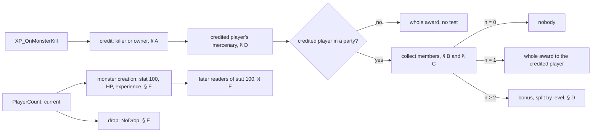
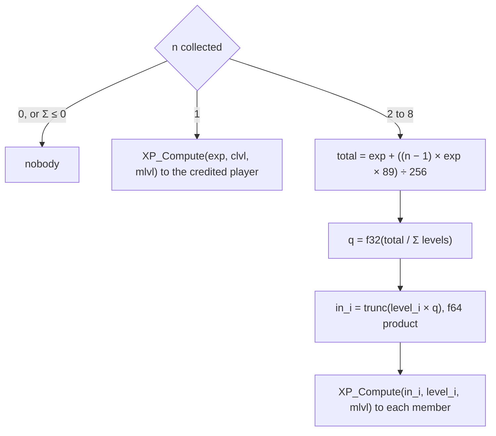
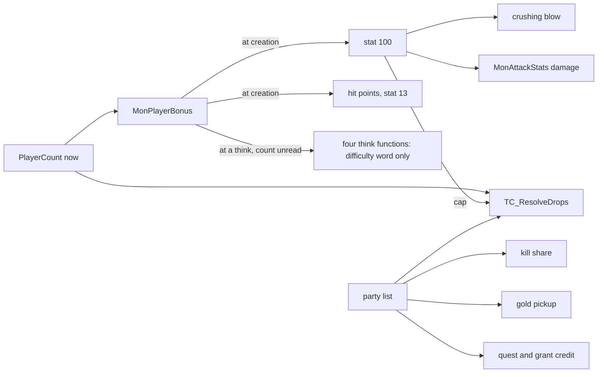

## Purpose

A kill's experience goes to one credited player and, through that player's party, to the members near the killed
monster. Separately, the number of players changes monsters at their creation and drops at their event. This page
composes those rules in one place: who is credited, who shares, how much each gets, and every reader of the player
count with its input. **It owns nothing:** each rule is restated with its tag and a link, and the linked section wins on
any disagreement. The pseudocode of the credit and the share is [player/creation § G](../creation/#g-kill-experience--xp_compute)
(G0) and [§ J](../creation/#j-other-level-and-experience-changes) (J4).

## Entry points

| When | Tag |
| --- | --- |
| A unit is killed: the gate, then the award; read, not run | [I] |
| The award, from its entry | [C] |
| A monster is created: the player count frozen | [C] |
| A treasure class resolves: the count at the event | [C] |

## Inputs

### Tables

| Used for |
| --- |
| the three states that move the credit (§ A) |
| `Align` 0 takes the player bonus, any other gets `players` 1 (§ E) |

### Runtime state

| State | Type | Source |
|---|---|---|
| party root | game `+0x1D2C`, first record at its `+0x04` | § B |
| the monster's player count | stat 100, frozen at creation | [monsters/stats § C](../../spec-monsters/stats/#c-the-player-count-monplayerbonus) |
| the current player count | `PlayerCount(game)`, read at the call | [items/tc § F](../../spec-items/tc/#f-nodrop-scaling) |
| `/players` setting | u32 global of the server's process | `g_PlayersOverride` |

### Constants

| Name | Value | Tag |
| --- | --- | --- |
| party distance² | 6400, from the killed monster, inclusive | [C] |
| party bonus | `89/256` per extra member | [C] |
| member cap | 8 collected | [C] |
| monster hit points and experience | + 50 % per player beyond the first | [C] |

## Algorithm

It covers what the code does with the bytes it reads, not what the game stores there or how often play reaches it, and it does not cover a callee past a declared boundary (`PLAYER_LevelUp`, the fatal call).

A level-up draws nothing. The draws of § E's readers, such as `MonAttackStats`' and the NoDrop picks, are their owning sections'.

### A. Who is credited

Full form: [player/creation G0](../creation/#g-kill-experience--xp_compute).

- [C] The code's map: a player killer is credited itself and a state on the victim is not read.
- [C] The code's map: a monster killer's owner link is credited. A state in the `exp` mask (53 `conversion`, 57 `attract`, 59 `confuse`) on the killer, then on the
  victim, replaces it with the owner of a stat list with flag `0x800`; the victim's test wins even when it finds no list. The result counts only if it is a player.

- [C] In the game's own logs, 40 mercenary kills credit the owner.
- [I] What holds the `0x800` list in play is not settled by this code.
- [I] **The gate's flag, bit 26 of unit `+0xC4`, means "no experience on this death".** The image sets it at 9 sites, clears it at none and reads it at two: the kill gate, and `InactiveMonAiSave`, which only keeps it across a room's deactivation, so the gate is its one consumer and a unit with the bit set gives no experience when killed. The setters, all on monsters: a monster restored from an inactive room (`InactiveMonAiRestore`, the saved bit set again), a caster's previous summon replaced by a new one (`SummonReplaceKill`), a pet its owner's list releases (`PetUnitRelease`), the units of the maggot egg and lay skills (`SkillDo84MaggotEgg` twice, `SkillDo87MaggotLay`), the sand maggot queen's spawn (`AiSandMaggotQueen`) and the two Uber minion spawns (`UberMinionSpawn`, `UberBaalMinionSpawn`). None is on a player. The meaning is the reading's, not a logged outcome.
- [C] The code's map: a player victim passes this code, its base stat 13 as the experience and its base stat 12 as the monster's level.
  The gate's flag is never set on a player, so a player victim passes the gate to this code; no log holds one, so whether it pays in play is not shown. [I]

### B. What a party is

- [I] **Two players are one party only through an accepted invite.** Game creation installs the root at game `+0x1D2C` with no record. A record is made only by `PartyNew` (its id the first ≥ 3 that no record holds) and a member only by `PartyAddMember`, which prepends the player's guid (`+0x0C`), skips a guid already in the list, takes the fatal path for a missing record or a unit that is not a player, and makes no count test. Both are called only by the accept action (party action 8). Each player keeps a relation state per other player: the invite (action 6, A names B) needs A's state for B to be 0 and sets it to 4, and B's for A to 2; the accept (action 8, B names A) needs B's state for A to be 2, then puts A, then B, in a new record when A has no party, else adds B to A's record; the cancel (action 7) needs state 4.
- [I] **Leaving.** `PartyRemoveMember` unlinks the player's node and deletes the record when fewer than 2 members remain; the leave action and `UnitFree` call it, so a freed player unit leaves its party (two other callers, are not read).
- [I] **A list holds at most 8 players.** Its members are distinct player guids, and a game admits at most 8 clients: game `+0x8C` counts them, and both the add path and the join request refuse at 8. This rests on one player unit per client, which was not read.
- [I] The fourth caller of `PartyForEachInLevel`, lies in `PartyLevelSumInLevel`, which the image never references, so no game path runs it.

### C. Who shares

Full form: [player/creation J4](../creation/#j-other-level-and-experience-changes).

- [C] The code's map: **a credited player in no party has no test at all** and takes the whole award at its own level.
- [C] The code's map: **the distance is to the killed monster**, and the credited player is tested like every member. No logged kill separates this from the old reading, because the two distances decide all 431 logged pairs alike.

- [C] The code's map: the edge is inclusive and unsigned (d² = 6400 in, 6401 out), and d² is 32-bit, so it wraps.
- [C] The code's map: the party and the level are the credited player's; the victim's level is not read.
- [I] What follows that call is the fatal path, not run. A list holds at most 8 players (§ B), so no stock game reaches the call: this is the code's path and not a game outcome.

### D. How much

- [C] The code's map: **n = 1 pays the credited player, whoever the sole member was**, at its own level, with no bonus. n = 0 pays nobody. No logged kill separates this: all 648 partied credited players of the logs were in range.
- [I] What the origin and the n = 1 credit lead to in play: a partied player whose hireling or summon kills more than 80 sub-tiles from it takes the whole award alone when one other member is near the victim, and with no member near nobody gets any, while an unpartied player in the same place gets it all. A dead killer with one living member in range is paid, and the living member is not.
- [C] The code's map for n up to 8: `total: i32 ← exp + ((n − 1) × exp × 89) ÷ 256`, every product i32, truncating; past the wrap the total may go negative. An input ≤ 0 makes `XP_Compute` return 1.
- [C] For n = 2: `q` is the f32 quotient and each input is `trunc((f64) level × (f64) q)`, never rounded to f32.
- [C] Each input then goes through `XP_Compute` at that member's level, with the level-difference factor and the ratio of [creation G3, G4](../creation/#g-kill-experience--xp_compute).
- [C] The code's map: a member's level is the evaluated stat 12, `clvl` the base stat 12; they differ only if a list changes stat 12.
- [C] The code's map: **the mercenary's award runs first and does not depend on the share**: only the credited player's own pet of type 7, at the monster's full experience and its own level, capped by `MERC_CapExpGain`, cut to `gain × 86 ÷ 256` unless it is the killer. Other members' mercenaries get nothing.

The death loss and the corpse's share are [creation J3](../creation/#j-other-level-and-experience-changes); they read no party.

### E. Every player-count reader, with its input

`PlayerCount` is one function; a reader takes it **now** (the current count) or **frozen** (the monster's stat 100, written from it at creation). A third group reads the party and no count at all, and four think functions call it and read none of the result.

- [C] `PlayerCount` counts live players, and the `/players` setting is a maximum, not an addition, in single player and on a TCP/IP host, where only the server's setting counts.
- [I] Game type 1 also takes it, and other types do not; the set of states and modes that excludes a player is the code's reading.
- [I] The client's chat parser takes `/players` only in client modes 0, 1, 6 and 8 (`g_ClientGameMode`), with `atol` clamped to 1..8.

| Reader | Input | Read when | What it changes | Tag | Owning section |
|---|---|---|---|---|---|
| `MonPlayerBonus` in `MonStatsInit` | count now | at the monster's creation | stat 100 ← `max(1, players)`, where `Align` 0 takes the count and any other 1 | [C] | [monsters/stats C1](../../spec-monsters/stats/#c-the-player-count-monplayerbonus) |
| a monster's hit points | count at creation, frozen in the value | at creation; never rescaled | `+50 %` per player beyond the first | [C] | [monsters/stats C1, C2](../../spec-monsters/stats/#c-the-player-count-monplayerbonus) |
| a monster's experience, stat 13 | count at creation, frozen in the value | at creation; `XP_OnMonsterKill` reads the stat | `+50 %` per player beyond the first | [C] | [monsters/stats C1, C2](../../spec-monsters/stats/#c-the-player-count-monplayerbonus) |
| crushing blow divisor | frozen stat 100 | at the stat event | `k + MulDiv(k, PlayerHpPct(n), 100)` | [C] | [combat/delivery E1](../../spec-combat/delivery/#e-the-stat-events-crushing-blow-open-wounds-freeze), combat § D |
| `MonAttackStats` damage | frozen stat 100 | at each attack | expansion, Nightmare and Hell: `+ value × b ÷ 128`, `b = 8(n − 1)` for `n < 9` | [C] | [monsters/stats H1](../../spec-monsters/stats/#h-to-hit-and-damage-at-attack-time-reference-only), combat § D |
| NoDrop | count now, and the party count now | at each resolve | `n = party + (PlayerCount − party) ÷ 2`, scaled through the x87 formula | [C] | [items/tc F](../../spec-items/tc/#f-nodrop-scaling) |
| NoDrop's cap | frozen stat 100 of a monster source; an object source has none | at each resolve | `n ← min(n, max(1, stat 100))`; it never acted in a logged call | [I] for the cap's effect; [C] for no cap on an object source | [items/tc F2](../../spec-items/tc/#f-nodrop-scaling) |
| four think functions | no count: `MonPlayerBonus` computes it and they read only the block's difficulty word | at their own run | nothing by the count; a changed `/players` has no effect here (below) | [C] | [monsters/stats C3](../../spec-monsters/stats/#c-the-player-count-monplayerbonus) |
| kill share | party list and positions; no count | at the kill | §§ C, D | [C] the code's map: no traced read touches the count | [creation J4](../creation/#j-other-level-and-experience-changes) |
| NoDrop's party count | party list, same level, alive, no distance test; clamp at 8 | at each resolve | the `party` above | [C] two players; [I] the clamp | [items/tc F1, F3](../../spec-items/tc/#f-nodrop-scaling) |
| gold pickup | party list, through `PartyGoldShare` | at the pickup | a split by the party count; not run; no direct reference to `PlayerCount`, its callees past the party walk not followed | [I] | [items/economy G4](../../spec-items/economy/#g-gold-payment-caps-piles-and-the-death-loss) |
| quest credit | party list, member's current act | at the quest event | the same bits to each member with bits 0 and 1 clear whose level is in the quest's act | [I] the shape; [C] one partied member in the Rogue Encampment | [quests/progression § D](../../spec-quests/progression/#d-shared-shapes-of-the-quest-scripts) |
| the Ancients' grant | killer, players in level 120, their party members in an Act V level | at the last Ancient's death | who gets the grant | [I] | [creation J2](../creation/#j-other-level-and-experience-changes) |
| the forge's `n`, Baal's and the chests' loops | a script's own count of players | at the script | per-player counts, not `PlayerCount` | [I] | [items/quest-drops § Inputs](../../spec-items/quest-drops/#inputs) |

What does **not** read it:

- [C] Group size, minions and density do not scale with players, over passes at `/players` 1, 3 and 8.
- [C] A hireling has `Align` 1, so it gets `players` 1 and no bonus.

**Who calls the count.**

- [C] `PlayerCount` has 2 direct references: `TC_ResolveDrops` (at the event) and `MonPlayerBonus`. `MonPlayerBonus` has 5: `MonStatsInit` (frozen at creation) and the four think functions. `g_PlayersOverride` is named by two instructions, the setter and the reader. No jump or absolute reference names either function; indirect calls not followed. (`g_PlayersOverride`, two tools:)
- [C] **`/players` changed mid-game** changes nothing on a live monster: 302 live monsters kept stats 7, 12, 13 and 100 over 13 changes; monsters created later get the new count. So a change reaches the next creation and the next drop's `PlayerCount`. [I]
- [C] The four: `AiDiabloDecide`, `AiBaalDecideRanged`, `AiCorruptRogue` and `AiDiabloDecideUnref`, which has no reference. All four read only `MonPlayerBonus`' word `+0x0C`, the difficulty, and no other word of the block: `AiCorruptRogue` in its limit; `AiDiabloDecide` and its unreferenced build for the ranged `w9`, `AiBaalDecideRanged` for its `w8`: with the pick's count below 2 and the difficulty below 2 that weight is 0 (§ 2.8). So a changed `/players` has no effect in them, although each call computes the count. (each body names the block twice, its `lea` and the one `+0x0C` read, and `AiDiabloDecideUnref` has no call, jump or absolute reference:)

## Outputs

Experience on the credited player or the members, a mercenary's award, and the values of the readers of § E. This page adds no output of its own.

## Worked example

| Case | Inputs | Steps | Result | Tag |
|---|---|---|---|---|
| n = 2, the f32 trap | `exp` 63, levels 81, 81 | total `63 + (63 × 89) ÷ 256` = 84; `q` = f32(84 / 162) = 0.51851851; 81 × `q` = 41.999999 | each input **41**, where an f32 product gives 42 | [C] |
| n = 3, the integer step | `exp` 100, levels 30, 20, 10 | total `100 + (2 × 100 × 89) ÷ 256` | 169 | [C] |
| n = 3, the float steps | the same, Σ 60 | `q` = f32(169 / 60) = 2.8166666; the products 84.499998, 56.333332, 28.166666 | inputs 84, 56, 28 (`xp_share_inputs`) | [I] |
| n = 8, the wrap | `exp` 3 447 005 | `7 × exp × 89` wraps to −2 147 483 181; ÷ 256 truncates | total **−4 941 601**; each input ≤ 0; `XP_Compute` returns 1 | [C] the total and the return for an input ≤ 0; [I] the input's sign, through the float steps |

## Reimplementation notes

- **Measure the party distance from the killed monster**, not from the killer or the credited player. The logs cannot tell them apart. [C] the code's map
- **With one member collected, pay the credited player**, not that member, at the credited player's level, even when the credited player failed the tests. [C] the code's map
- What that gives in play is odd and is to be kept: a far hireling's kill can pay its far owner alone, and a dead killer can be paid while the living member is not. [I]
- **A player in no party has no alive or distance test**; only the party branch has them. [C] the code's map
- **Eight is not a clip.** A ninth that passes every test reaches the fatal call; do not stop at eight quietly. [C] the code's map, to the call Past the call is unread, and a list holds at most 8 players (§ B), so no stock game reaches it. [I]
- **The edge and the wraps:** `d² ≤ 6400` unsigned and inclusive, d² and the total's product wrap at 32 bits. [C] the code's map

## Evidence

- The owning specs linked in each section: [player/creation](../creation/), [monsters/stats](../../spec-monsters/stats/), [items/tc](../../spec-items/tc/), [combat/delivery](../../spec-combat/delivery/), [items/economy](../../spec-items/economy/), [quests/progression](../../spec-quests/progression/), [items/quest-drops](../../spec-items/quest-drops/), [hirelings](../../spec-hirelings/overview/).
