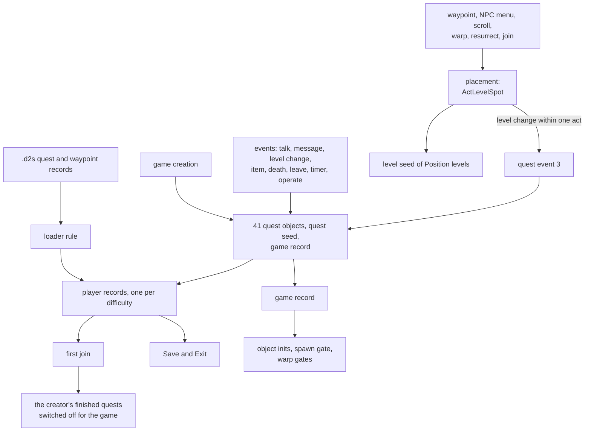

## Purpose

This subsystem specifies the quest state machines and travel of the server: which event sets, clears or reads each bit of a player's
quest record, what the game-wide record holds, which quest events draw on which seed, how a waypoint is activated and
used, how a player changes act, how a town portal opens, works and closes, and where a player lands after any level
change. Quest logic is hardcoded: no excel table the game loads holds quest data, so the specs describe code, with the
tables it reads named where they enter. This page is the map and the shared model; the algorithms are in the two files
below.

## Files

| File | Covers | Status |
|---|---|---|
| [progression.md](../progression/) | the quest record and its load rule, the 41 quest objects and the event dispatch, the join's game-wide pass, timers, NPC interaction, the quest-seed and player-seed draws, a section per quest (bit table and state diagram), the warp and portal gates, the creation-path readers | reviewed |
| [travel.md](../travel/) | placement (`ActLevelSpot`, the level-point lookup, the free-cell search), waypoint activation and travel, act change through an NPC, the Durance and other travel portals, town portals (open, use, close), warps, resurrection and join placement, the real-time gates | reviewed |

Not covered: the quest drops, rewards and item services, the dialogue text and the quest log's presentation, the AI and combat that decide when a boss dies (inputs here).

## Data flow

## Shared model

- [C] **The record.** A player has one quest record per difficulty, 48 words of 16 bits, block *d* for difficulty *d*;
  the loader clears bits 13 and 14 of words 0–41 and sets bit 15 where bit 1 is set, copies words 42–47, and Save and
  Exit writes the record as it stands.
- [C] **The bit grammar, as far as the kept logs test it.** `SetState` and `ClearState` set or clear one bit of the
  word (430 and 38 logged writes, each next write's old word as predicted); bit 0 is done and bit 1 done with a reward
  pending, by their writers (the reward message sets bit 0 and clears bit 1 on words 1, 2, 4, 6, 9, 20, 25, 27 and 37);
  bit 13 is done in this game, on the player and the game record; bit 15 is a reward pending from an earlier game, by
  word 9's first-join clear.
- [I] Bits 2–11 are log steps, bit 12 seen in the log and bit 14 failed in this game; each quest adds its own bits. No
  kept log met a step bit at a `ClearSteps`.
- [C] **The events reach quests in a fixed order**, from quest object 40 down to row 0, and the talk, message and
  level-change events are forced, so they reach a quest the join switched off.
- [C] **The game creator's history shapes the game**: at the first join every quest the joining player had finished is
  switched off for the game and marked in the game record.
- [I] **Draws.** Quest events draw on the quest seed (NPC 331, the eclipse, the cairn order, Anya's reward, the Dark
  Wanderer, the Zoo, and the item draws of [items/quest-drops](../../spec-items/quest-drops/)) and on the player's unit seed
  (NPCs 266 and 377); travel draws on the destination level's seed, the game seed of the portal objects and, for five
  waypoint rows, the object's seed. The draws of kill events (the cairn order aside) are
  read from the code.
- [C] In the 1 111 logged talk, message, level-change and leave dispatches the quest seed moves only at the drawing sites
  named above (NPC 331's talk 45 times, Anya's reward 3, the eclipse 3) and the player seed only in NPC 266's talk (23);
  the cairn-order and Dark Wanderer fetches lie inside timer runs (3 and 4), with one
fetch outside any logged event.
- [C] The quest-seed draws the runs reached (NPC 331's talk, the eclipse arm, the cairn order on the `bkd ` use, the
  Dark Wanderer timer, Anya's reward in the three difficulties) and NPC 266's two player-seed draws were each predicted
  from the seed before them.
- [C] The Zoo's quest-seed draws and NPC 377's player-seed draw are not reached through stock placement: no DS1 places
  object 567, no DS1 that a LvlPrest row names places NPC 377 or its placeholders, and no Levels, SuperUniques or
  Hireling class cell names 377 (two DS1 readers, the tables read as `.txt` and `.bin`). A class computed at run time is
  not excluded.
- [C] **One placement routine.** The waypoint, NPC and join arrivals and the portals' town ends the runs logged went
  through `ActLevelSpot`: a level point, the subtile `5·t + 3`, then the nearest free cell (124 placements).
- [C] A resurrection places the player the same way, at the town's type-0 point with one level-seed step: three in
  Hell.
- [I] The Durance portal places the player the same way, read from the code.

## Inputs and oracles

| Item | Kind | Tag |
|---|---|---|
| the trigger of a quest step (a kill, an operate, a level change, the client's dialogue message) and of a travel (a click, a packet) | input | [C] for the talk steps (41 steps predicted from the logged message) |
| party membership, the players' rooms and near lists, held items | input | [I] |
| `GetTickCount()` at the two travel gates and in Diablo's end timer | input, real time | [C] for the travel gates, one client |
| units, objects, portals and items a quest creates; levels, acts and rooms built on arrival; a town room's first population | oracle | [C] (the portal's population oracle, 9 opens) |
| the collision grid read by a free-cell search | input, logged | [C] (545 searches) |

## Evidence and status

`[C]`: the talk steps reached, the record's load and save, the dispatch order, the join's pass, the quest timers (one-shots), the quest-seed draws of NPC 331, the eclipse arm, the cairn order on the `bkd ` use, the Dark Wanderer and Anya's reward, the NPC 266 draws, the level-entry and item-use steps reached, the portal's three draws and its refusal in a town, placement, Meshif's stepping type-5 return, the Harrogath portal, packet 0x48's clear, the resurrection's move and the "no draw" travel rows. `[I]` for this plan: the kill steps the logs do not hold (party credit, the region tests, most log-state steps), boss events and far operates, the timer re-arm and wrap, the Zoo's draws (the object is placed by no stock DS1), the mode-0 waypoint activation, NPC 367's travel branch, the unreached level-entry rows and the Dark Wanderer's 7-try branch.

## Cross-references

| Spec | What it takes from here |
|---|---|
| [items/quest-drops](../../spec-items/quest-drops/) | the quest bits at kill time and the quest seed's non-item draws |
| objects | the quest `InitFn`s' game-record and private-state reads |
| monsters/spawn | the Chaos Sanctuary gate |
| [monsters/special](../../spec-monsters/special/) | the forced death list and quest hooks |
| rng/seeds | act `+0x094` as the true tomb |
| [items/cube](../../spec-items/cube/) | the cow-portal gate words |
| drlg/collision, [drlg/warps](../../spec-drlg/warps/) | the level-point lookup and warp pairing used by placement |
| save/d2s | the record's load rule and the saved words |
