## Purpose

The game keeps one 48-word quest record per player and difficulty and one game-wide record per game. Quest logic is
hardcoded (no excel table holds it): 41 quest objects receive server events (NPC talks and messages, level changes,
item events, hooked monster deaths, joins, leaves, timers, object operates) and write record bits, create units and
items, and draw on the quest seed or the player's unit seed. This spec gives the record's bit grammar and load rule,
the event dispatch and its order, the join's game-wide pass, the timers, every quest's bit table with its triggers and
a state diagram, the draws, and the creation code that reads the result. When a trigger happens (a kill, a click, the
dialogue line the client reports) is an input; what the server does with it is specified here. Travel is
[quests/travel](../travel/); the overview is [quests](../overview/).

## Entry points

| When | Function | Tag |
|---|---|---|
| game creation: 41 quest objects, the quest seed, the game record | `QUESTS_InitGame` | [C] |
| an NPC talk starts / ends (e0 / e2) | `NpcInteractStart` / `NpcInteractRemove` → `QUESTS_DispatchEvent` | [C] |
| the client reports a dialogue message (packet `0x31`, 9 bytes) (e11) | `Pkt31NpcMessage` → `QUESTS_RaiseNpcMessage` | [C] |
| the player's room changes level (e3) | `ClientRoomSync`, and a portal use from a town | [C] |
| an item is placed / dropped (e4 / e5) | — | [C] the raisers' 7 callers and 1 caller, each into the dispatch with event 4 / 5, three tools agreeing |
| a hooked monster dies (e8) | `UnitKilled` → `QUESTS_MonsterDeathEvent` | [C] its one caller, in `UnitKilled`, three tools agreeing |
| a player leaves (e9 per quest item carried, then e10) | `QuestsInvItemEvent` | [C] each of the 3 logged leaves raised one e10, dispatched; [I] the e9 per quest item and its order before e10: no leave carried one |
| a player joins (e13 first, e14 later) | `QuestsPlayerJoin` | [C] |
| every 20th game frame | `QUESTS_TimersRun` from `GameTick` | [C] |
| a quest object is operated, or its timed object event 7 fires | `g_ObjOperateFns[OperateFn]`, `QUESTS_ObjectEvent` | [C] |
| an NPC menu service (imbue, socket, personalise, Hell respec, travel) | `NPC_MenuAction` | [C] `ImbueDone`, `RespecDone`, `SocketDone` and `PersonalizeDone` each have one call, inside `NPC_MenuAction`; `NpcTravelMove` has four there and one in the Harrogath portal's operate; three tools agreeing |
| the client opens a quest-log entry (packet `0x58`) | `Pkt58QuestSeen` | [C] |

## Inputs

### Tables

| Anchor | Used for |
|---|---|
| `MonStats.txt:TCQuestId`, `MonStats.txt:TCQuestCP` | the quest TC switch reads the killer's bits |
| `MonStats.txt:zoo` | the Zoo's class draw (word 40) |
| `Levels.txt:QuestFlag`, `Levels.txt:QuestFlagEx` | the portal quest gate |
| `Misc.txt:quest` | the quest an item belongs to (e9) |
| `Objects.txt:InitFn`, `Objects.txt:OperateFn` | which quest handler an object runs |

### Runtime state

| State | Type | Source |
|---|---|---|
| player quest record | 48 × u16 bit field (bit `16q + s` = word *q* bit *s*), player data `+0x10 + 4·difficulty` | [save/d2s](../../spec-save/d2s/); § A |
| game record | 48 × u16, `QuestControl+0x0C` (`QuestControl+0x0C`) | `QUESTS_InitGame`; § A |
| quest object | 0xF8 bytes (`QuestObject+0x00`): `+0x09` active, `+0x0A` gets events, `+0x0B`/`+0x0C` log state, `+0xA0 + 4·e` callbacks, `+0xE0` word, private data | `QUESTS_InitGame`; § B |
| quest seed | Seed, `QuestControl+0x18`-area (`QuestControl+0x18`) | game-seed draw 4 |
| player's unit seed | Seed, `Unit+0x20` | the player unit |
| control tick and timer list | u32, list of `{fn, quest, due, period}` | § E |
| difficulty `game+0x6D`, expansion `game+0x70`, game type `game+0x6A` | u8 | the game |

### Constants

| Name | Value | Tag |
| --- | --- | --- |
| quest objects | 37 main-table + 4 NPC-introduction objects (ids 37–40) | [C] 41, ids 0 to 40, in each of the 54 logged games' first object list; ids 37 to 40 carry word 42 and acts I, II, III and V; [I] their NPC-introduction role (§ Act I, Act II, Act III and Act V rows) |
| record words | 48 per record; words 0–41 under the loader rule, 42–47 copied | [C] |
| timer cadence | every 20th frame (`frame mod 20 = 0`) | [C] (the pass adds 1 to the tick and has one caller; logged tick = frame // 20 at frames 567 to 7 500, runs on frame mod 20 = 0) |
| LCG multiplier | `0x6AC690C5` ([rng](../../spec-rng/overview/) step 1) | [C] |

### Inputs and oracles

| Item | Kind | What it is | Tag |
|---|---|---|---|
| the trigger: a kill, an operate, a level change, a packet | input | game simulation decides when it happens | [I] |
| the client's dialogue message id (packet `0x31`) | input | the client picks the line from the message index the server sent at e0 | [C] (41 talk steps predicted from the logged message) |
| party membership, the players' rooms and near lists, held items | input | read by credit passes and item tests | [I] |
| units and items a quest creates (spawns, objects, portals, rewards, hirelings) | oracle | they draw on their own seeds: [monsters/spawn](../../spec-monsters/spawn/), [objects](../../spec-objects/overview/), [items/quest-drops](../../spec-items/quest-drops/), [quests/travel § G](../travel/#g-town-portals) | [C] (13 dispatches whose game-seed change is a created unit) |
| the log state bytes `+0x0B`/`+0x0C` where they gate no bit | oracle | presentation of the quest log | [I] |
| `GetTickCount()` in Diablo's end timer | input | real time | [I] |

## Algorithm

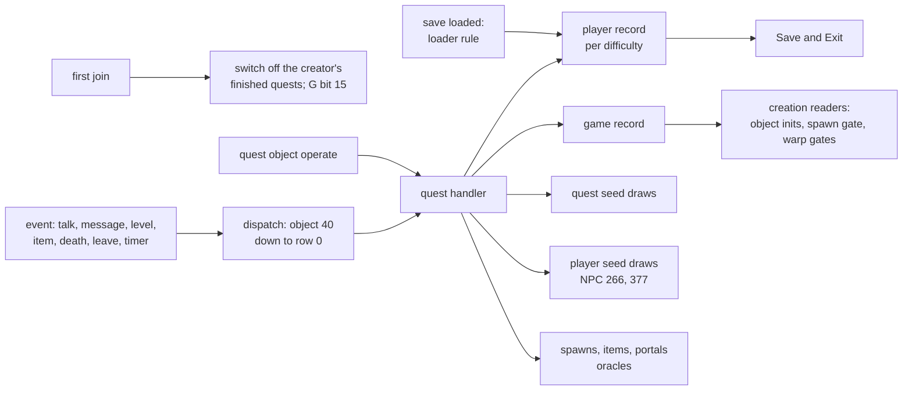

### A. The quest record

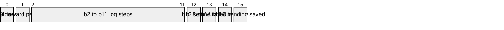

```
A1. GetState(rec, q, s) = bit 16q + s of rec;  SetState / ClearState set or clear it   [I]
A2. ClearSteps(rec, q): for s in 2 ... 11: clear bit 16q + s       [C]
A3. Load(rec, bytes) — QUESTRECORD_LoadBytes(…, 0x60, flag 1):     [C]
      for q in 0 ..< 42:
        w: u16 ← saved word q
        clear bits 13 and 14 of w
        if bit 1 of w: set bit 15 of w
        rec[q] ← w
      for q in 42 ..< 48: rec[q] ← saved word q                      ; copied
A4. Save: each record is written as it stands at Save and Exit      [C]
A5. Packet 0x58 {u16 q}: if q < 42: SetState(rec, q, 12)            [C]
```

| bit | meaning in the code | set by | cleared by | Tag |
|---|---|---|---|---|
| 0 | done (reward taken, or no reward) | the reward message or the completing event | only word 9's first-join check | [C] |
| 1 | done in a game, reward not yet taken | the completing event (`QUESTS_ListSetPending` sets 13 and 1 together) | the reward | [C] `ListSetPending` wrote bit 13 then bit 1 back to back at the Den of Evil's logged completion, its only caller being; the reward clears bit 1 and sets bit 0 (the 65 logged service rewards, § F) |
| 2–11 | log steps (quest-log progress) | each quest's StepBits by log state | `ClearSteps` at the rewards of words 1, 20, 25 and 35 among the logged rewards, not at those of words 2, 4, 6, 9, 27 and 37 | [C] for where `ClearSteps` runs; [I] for the setters by log state (§ D) |
| 12 | the quest-log entry was seen | packet `0x58` | never | [C] |
| 13 | done in this game | with bit 1 or bit 0 | the loader | [C] |
| 14 | failed in this game (another player finished it) | each quest's FailOthers | the loader; word 11 | [C] for the loader; [I] for the writers |
| 15 | reward pending from an earlier game | the loader, from a saved bit 1; in the game record, the join | word 9's first-join check | [C] for the loader; [C] for word 9: its first join cleared bits 0, 1, 15 and 5 exactly when the joiner had bits 0 and 5 and no `ass ` (of the 3 logged joins with bits 0 and 5, the 2 without `ass ` cleared and the one holding it did not; none of the 51 others cleared) |

Step notes:

- A1. [C] `SetState` and `ClearState` set or clear bit *s* of word *q*: in 430 logged `SetState` and 38 `ClearState`
  calls the next write's old word is the one predicted (389 and 17 of them changed the word).

- A2. [C] `ClearSteps` clears bits 2–11 with `BITFIELD_Clear` and calls no `QUESTRECORD_ClearState`; the saved words match
  only with it applied.
- A3. [C] The join's logged record equalled the loader rule's in all 16 compared sessions, for all three records.

- A4. [C] The written save holds, word by word in all three difficulties, the loaded record after every logged server
  write to the player's record (`SetState`, `ClearState`, `ClearSteps`), in order: 16 sessions, 2 304 word checks, 115
  writes applied. The other two difficulties' records are written as loaded.
- A5. [C] The handler tests nothing but `q < 42`: 53 packets set bit 12 of the word named, for the 26 words the stock
  client's quest log shows (words 1–6, 10–14, 17–22, 25–27, 35–40). Word 33 has no quest-log entry, so the stock client
  never sends it.
- A6. [C] **The game record** has the same shape. It is written only by `QUESTRECORD_SetState` from `GameQuestSet`
 and from the join (§ C): a control-flow taint from each of the 53 loads of the quest control
  (`game +0x10F4`, 55 sites agreeing three ways) into callees to depth 3 finds no other write. It is read through
  `GameQuestGet` and, whole, by `QUESTS_SendGameRecord`, which serialises it with `QUESTRECORD_SaveBytes`; the quest objects' log-state callbacks are handed it as stack argument 1 and never read it.

- A6. [I] Both `GameQuestSet` and `GameQuestGet` are fatal before the first join. Bit 13 of word *w* marks "this game's
  step done" for that quest (set at the same event as the players' bits), bit 15 "the creator had it done" (§ C), and
  word 4 bit 11 "the cow portal was opened". It is sent to the clients after every NPC message.

- A7. [C] Words written by no quest object as its own word: 7, 15, 23, 28 (the act-travel words, [quests/travel § E](../travel/#e-act-change-through-an-npc)),
  34, 41 (the Hell respec, written by quest object 1's scripts as their second word, § Word 41), 42 (carried by the
  introduction objects, never written); 43–47 are never addressed. No quest script writes word 33 (only packet `0x58` could).
  By immediate word over the 332 `SetState`, 46 `ClearState`, 12 `ClearSteps` and 40 `GameQuestSet` calls (two walkers
  agreeing): 7 and 15 only by `NpcActTravel`, 23 only by `DuranceActTravel`, 28 by `NpcActTravel` and the Harrogath
  portal's operate (quest object 23's script, as a second word), 41 only by quest object 1's scripts, 33, 34 and 42–47 by
  none; the 50 writes whose word is not an immediate take `[obj+0xE0]`, `[obj+0xE4]`, an argument, packet `0x58`'s word
  or the join's descriptor word, none in an object-29 script.

### B. Events and dispatch

#### The registry

| row | quest object | act | word (`+0xE0`) | init | Tag |
|---|---|---|---|---|---|
| 0 | 0 | I | 0 | — | [C] |
| 1–6 | 1–6 | I | 1–6 | — | [C] |
| 7 | 30 | I | 29 (descriptor word 41) | — | [C] |
| 8 | 7 | II | 8 | — | [C] |
| 9–14 | 8–13 | II | 9–14 | — | [C] |
| 15, 16 | 26, 27 | II | 30, 31 | — | [C] |
| 17 | 14 | III | 16 | — | [C] |
| 18–23 | 15–20 | III | 17–22 | — | [C] |
| 24 | 28 | III | 16 in `+0xE0`; the code uses word 32 | — | [C] (stores 16 against descriptor word 32; no A3Q7 record call takes `[obj+0xE0]`, its word-32 calls are immediates) |
| 25 | 21 | IV | 24 | — | [C] |
| 26–28 | 22–24 | IV | 25–27 | — | [C] |
| 29 | 25 | I | 29 | — | [C] |
| 30 | 29 | IV | 33 | — | [C] |
| 31–36 | 31–36 | V | 35–40 | — | [C] |
| second table | 37, 38, 39, 40 | I, II, III, V | 42, never written | — | [C] (count 4; each init stores `+0xE0` = 42; no record call writes word 42) |

- B1. [C] In each of the 54 logged games the join's first list runs 40, 39, 38, 37, then the main rows from the last to
  row 0; main objects enter it with `+0x09` = `+0x0A` = 1, the second table's with `+0x09` = 0, `+0x0A` = 1; `+0xE0` is
  29 for rows 7 and 29 and 16 for row 24, the only rows whose `+0xE0` is not the descriptor word (the init stores, read
  three ways, agree).
- B1. [I] `QUESTS_InitGame` builds one object per main-table row, then one per second-table row (ids 37–40), each linked
  at the head, so **the list runs from quest object 40 down to row 0's object**. Main-table objects start active
  (`+0x09` = 1); second-table ones start with `+0x09` = 0 and `+0x0A` = 1. Each init fills its callbacks, `+0xE0`,
  `+0x0A` = 1 and its private data. Rows 7 and 29 share one init, which writes `+0xE0` = 29 for both objects; descriptor
  word 41 is used only by the join's bit-15 pass (§ C). Row 24's `+0xE0` = 16 clashes with word 16's quest only in the
  quest log.

#### Events

| event | slot | raiser | dispatch | block (`QuestEvent+0x00`) | Tag |
|---|---|---|---|---|---|
| e0 talk start | `+0xA0` | `NpcInteractStart`; re-dispatched by quest scripts (`QUESTS_RedispatchNpcTalk`, which then sends the game record) | all quests, forced, act filter | `+0x08` NPC, `+0x0C` player | [C] |
| e2 talk end | `+0xA8` | `NpcInteractRemove` | all, forced, act filter | `+0x08` NPC | [C] |
| e3 level change | `+0xAC` | room sync, for a level change within one act; the portal operate from a town; `NpcActTravel`'s Warriv branch calls quest object 6's slot directly (its word-6 bits 13 and 0 test read from the code, [quests/travel E3](../travel/#e-act-change-through-an-npc)) | all, forced, any act (the direct call: quest 6 only) | `+0x0C` player, `+0x14` level left, `+0x18` level entered | [C] (the direct call) |
| e4 item placed | `+0xB0` | 7 sites | the item's hooks, unforced | `+0x08` item, `+0x0C` player | [C] |
| e5 item dropped | `+0xB4` | — | the item's hooks, unforced | `+0x08` item | [C] |
| e8 hooked death | `+0xC0` | `QUESTS_MonsterDeathEvent` after the drop | the monster's hooks; forced for a fixed list | `+0x08` monster, `+0x0C` killer player | [C] |
| e9 quest item of a leaving player | `+0xC4` | client removal | that item's quest (`Misc.quest` − 1), direct call | `+0x08` item, `+0x0C` player | [C] `QuestsInvItemEvent` calls the item's quest's `+0xC4` slot itself (`call eax`); its one caller is `ClientRemove` |
| e10 player leaves | `+0xC8` | the same, after the item loop | all, forced, any act | `+0x0C` player | [C] |
| e11 NPC message | `+0xCC` | packet `0x31` `{u32 npc id, u16 message}` | all, forced, act filter | `+0x08` NPC, `+0x0C` player, `+0x14` NPC class, `+0x18` u16 message | [C] |
| e13 first join / e14 later join | `+0xD4` / `+0xD8` | `QuestsPlayerJoin`, direct | every quest | the player | [C] |

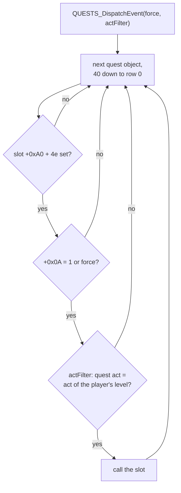

```
B2. QUESTS_DispatchEvent(block, force: bool, actFilter: bool):      [C]
      for quest in the object list (40 down to row 0):
        slot ← quest.callbacks[block.event]
        if slot = none: continue
        if not force and quest.+0x0A ≠ 1: continue
        if actFilter and quest.act ≠ act of the player's level: continue
        call slot(block)                                             ; each call guarded by IsBadCodePtr
B3. QUESTS_DispatchUnitEvent(block, force): the same over the unit's hook list (+0x74, head-inserted)   [I]
```

Step notes:

- B2. [C] The order, the slot test, the act filter and "a forced event runs a quest whatever its `+0x0A`" held in 503
  dispatches (e0 103, e2 101, e3 235, e11 64; the act filter on in 268) with 8203 callbacks; every raiser of e0, e2, e3
  and e11 pushes force 1 (4631 callbacks of switched-off quests ran). The unforced half (a `+0x0A` = 0 quest skipped by
  e4, e5 and e8 outside the forced list) was not logged and stays `[I]`.
- B2. [C] e10 and the re-dispatched e0 also push force 1, and e4 pushes force 0:
  32 e10s, 28 re-dispatched e0s (each after an e11 inside its talk) and 7 e4s logged.
- B2. [I] e5 pushes force 0 too; no e5 was logged.
- B4. [I] Other hooked deaths reach only quests with `+0x0A` = 1. A pet or hireling killer is first resolved to its owner, and in a game of
  type 3 with no killer the event takes a client's player.
- B5. [I] **Hooks.** `QUESTS_HookMonster(questId, unit)` adds the quest to the unit's list (for quest 4 with object class
  61, quest 8 with monster 229 and quest 12 with 250 it first records the unit); `QUESTS_LevelHookMonster` hooks every
  monster of a room to the quest named by its level's Levels `+0x30` byte; item hooks are made by the script that creates
  the item.
- B6. [C] Events 1, 6, 7 and 12 have no live raiser (the wrappers have no caller or
  pointer), so the `+0xB8` handlers of words 3 and 4 are dead: the dispatchers' 12 calls pass 0, 2, 3, 4, 5, 6, 8, 10
  and 11, 6 only, and the server-range slot calls outside the dispatchers are e9, e13, e14 and
  `NpcActTravel`'s e3 (three tools). Object operates reach quest code through
  `g_ObjOperateFns` and timed object event 7 through `QUESTS_ObjectEvent`.


### C. The join and the game creator's history

Step notes:

- C1. [C] **The creator's finished quests are switched off for the game.** In 11 first joins with `rejoin` 0 and the byte
  set, every flag-0 row whose word had bit 0 or 15 in the joiner's record was switched off and its game-record word got bit
  15, in descriptor order: 176 quests (26 for a creator with every quest done, 0 for fresh creators); run 2 switched off 464
  more the same way. Later players' records never feed this pass.
- C1. [I] The branches with the byte clear or a rejoin were not met with a deactivation pass.
- C2. [C] **What "switched off" means.** The forced events (e0, e2, e3, e10, e11, the forced deaths) still reach a
  switched-off quest's handlers; only the item hooks and unforced deaths skip it. Whether a handler then writes depends on
  its own tests. Quest 11's NPC-331 message handler tests only the NPC class and the message and writes word 12 bit 8 with
  the quest off (44 writes, one per talk), and the NPC-talk reward handlers test the word's own bits, not `+0x09`, and write
  the same with the quest off (every reward talk of run 2 ran so). `[C]` for the handlers and branches the runs reached;
  per handler `[I]` for the rest.
- C3. [C] **`rejoin` means "made just now".** It is 1 at the two new-character builders and 0 at the two save readers; a
  character made from a header stub joins twice: first from `NewCharFromStub` with `rejoin` 1 and `recordReady` 0, then
  from the save reader with `rejoin` 0 and `recordReady` 1, so neither call runs the deactivation pass and the second runs
  the later-join callbacks.
- C3. [I] The version < 92 reader joins twice the same way; `PlayerLoad`'s own no-save branch joins once.

- C4. [C] **The FirstJoin restore is per quest**, not one map: quest 13 (word 14) restored its log state from the
  creator's bit 3 as `+0x0B` = 5 (x-talk2), and quest 19 (word 21) wrote no log state from bit 4 (`+0x0B` = 0 in x-talk3,
  x-talk3b and h-talk3).
- C4. [I] The FirstJoin callbacks restore a quest's log state from the creator's step bits when the creator has neither
  bit 0 nor 15, and several write bits (per quest below). Quest 13's map as read: bit 2 → (`+0x0B`, `+0x0C`) = (1, 2),
  bit 3 → (5, 5), bit 4 → (6, 5); quest 19 has no bit-4 branch. The other quests' maps are not read.


### D. Shared shapes of the quest scripts

Each quest has its own copy of these helpers; the per-quest tables below name them by their effect.

- D1. [C] **StepBits** writes keep the gate: 35 logged writes at the StepBits sites of seven functions (A1Q1 bit 4,
  A1Q6 bits 3 and 4, A2Q1 bit 4, A2Q6 bit 2, A3Q6 bit 9, A5Q6 bit 2), each on a player record whose old word had bits 0
  and 1 clear.
- D1. [I] **StepBits** (per player, when bits 0 and 1 are clear): set the step bit chosen by the quest's log state
  (state 2 → bit 2; state 3 → bit 3 or 4 by `+0x0B`; …); no logged write separates the choice or a refusal. Steps gate
  nothing outside the quest's own log code.
- D2. [I] **Near credit**: every player whose room is the event's room or in that room's near list
  (`DUNGEON_GetNearRooms`), with the quest's bits clear, gets the credit bits. **Level credit**: every player in a named
  level.
- D3. [I] **PartyCredit**: for a credited player in a party, each member whose bits 0 and 1 are clear **and whose current
  level is in the quest's act** (`DRLG_ActFromLevelId`) gets the same bits.
- D4. [I] **FailOthers**: every other player whose bits 0 and 1 are clear gets bit 14 and a message (`QUESTS_SendFailMsg`).

- D5. [I] **ChainNext** (`+0xF0`): if the quest is active and below its last log state, start it (`+0x0C` ← 1) and
  return 1; else call `+0xF0` of the quest whose id it holds (`+0x10`). The join starts one chain per act (§ C), so each
  act's next quest is offered when the previous one finishes.
- D6. [I] **The NPC gate** (`+0xEC`): when a talk starts with an NPC whose MonStats `+0x0D` bit 1 is set,
  `QUESTS_NpcHasQuest` asks `+0xEC` of each quest of the player's act whether it has something for that NPC class; the
  first yes sends the "quest available" mark. Presentation.
- D7. [C] **The reward half.** The reward message, with bit 1 set, sets bit 0 and clears bit 1 (logged for words 1, 2,
  4, 6, 9, 20, 25, 27 and 37); among the logged rewards `ClearSteps` runs at those of words 1, 20, 25 and 35, not at
  those of 2, 4, 6, 9, 27 or 37.
- D7. [I] **Reward pattern** (most quests): a completing event sets bits 13 and 1 (or 13 and 0 when there is no reward
  talk).

### E. Timers

```
E1. QUESTS_TimerAdd(fn, quest, period: u32):                        [C] for the append
      append {fn, quest, due ← control.tick + period, period}; adding while the list runs is fatal   ; the fatal case: read, not run
E2. QUESTS_TimersRun, when frame mod 20 = 0:                        [C] for one-shot timers
      control.tick ← control.tick + 1
      for each timer: if due < control.tick:
        if fn(quest) = 1: remove the timer
        else: due ← control.tick + period                            ; not reached: E4
      when control.tick reaches 0xFFFFFFFF: every due ← −1 − due      ; not reached: E4
```

- E3. [C] A timer first runs at `control.tick = due + 1`, on a frame with `frame mod 20 = 0`, so *p* + 1 boundaries after
  the last 20-frame boundary before it was added; a run returning 1 is not repeated. Seven timer runs in four games (the
  eclipse timer three times, the Dark Wanderer's four) held this.
- E4. [I] A timer whose run returns 0 runs again every *p* + 1 boundaries (20·(*p* + 1) frames), and the tick wrap
  rewrites every `due`; the two quest timers reached are one-shots, so neither branch ran.

### F. NPC interaction, server side

- F1. [I] A talk raises e0 at the start (after the hireling list and the store), e11 for each message the client reports,
  and e2 at the end. Quest state changes in e11 handlers keyed by `{NPC class, message id}`; each checks the NPC class, the
  player's bits and often a held item. The client picks which message to report from the quest-message index the server
  sent at e0 (`QUESTS_SetNpcMessage`); no dialogue text is involved.
- F1. [C] Each of the 222 logged talks opens with e0 (no talk open with that unit), each of the 187 e11s lies inside its
  unit's open talk, 28 re-dispatched e0s follow an e11 inside it, and e2 closes each talk.
- F2. [C] Each NPC-talk step of the per-quest tables tagged confirmed fired at its call site from the logged NPC class, message
  and word, and wrote nothing when its condition was off: 41 talk steps over 20 rows, in Normal and Hell expansion and
  classic Normal.
- F3. [C] Each logged imbue (19), socket (24) and personalisation (22) was followed by bit 0 set then bit 1 cleared on its
  word (3, 35, 38) at the done function's sites, with bit 1 set and bit 0 clear before.
- F3. [I] Item services and the Hell respec are `NPC_MenuAction` actions: imbue (word 3 bit 1), socket (word 35 bit 1),
  personalise (word 38 bit 1), the Hell respec (word 41), and the act travel.
  The services' item effects are [items/quest-drops § F](../../spec-items/quest-drops/#f-npc-item-services-and-given-items).


### G. The draws

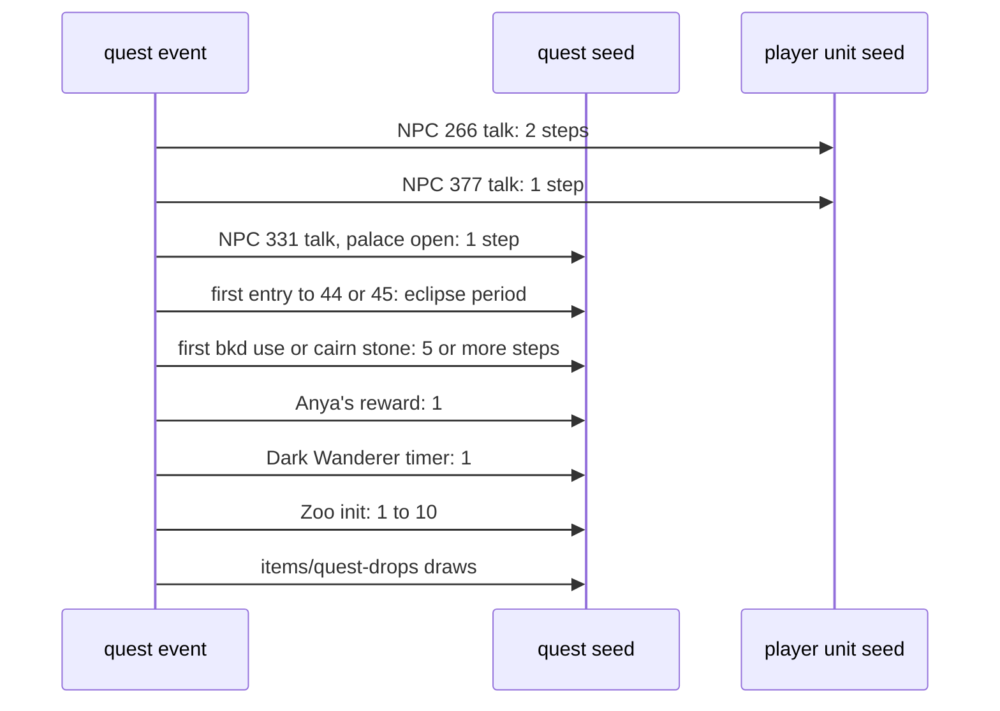

| event | draw | seed | Tag |
| --- | --- | --- | --- |
| e0 talk to NPC 266 | two runs of one handler (quest objects 25 and 30), each one draw: `Range(2)` or an inline `Step` (§ Word 29) | player unit seed | [C] |
| e0 talk to NPC 377 | one draw per talk (§ Word 30) | player unit seed | [I] |
| e0 talk to NPC 331 with the palace open | one inline `Step`, message `low mod 3 + 8` | quest seed | [C] |
| e3 entry to level 44 or 45 with word 11's state 0 | `RandLoHi(15, 17)`: one `Step`, period `15 + (low & 1)` (15 or 16), once per game by the state (W11) | quest seed | [C] for level 44 |
| first use of `bkd ` (or first cairn-stone operate, `[I]`) | inline `Step`s, `low mod 5`, until five distinct slots are filled (W4) | quest seed | [C] for the `bkd ` use |
| e11 Anya's reward | `Range(count[class])` (W37) | quest seed | [C] (Normal, Nightmare, Hell) |
| the Dark Wanderer timer | one inline `Step` (W32) | quest seed | [C] |
| the Zoo (`InitFn` 79) | 1–10 `RandLoHi(1, nMonStats)` (W40; object 567 is placed by no stock DS1) | quest seed | [I] |
| quest chests, Wirt, Andariel, Baal, the Hellforge, the Cow King | [items/quest-drops](../../spec-items/quest-drops/#draw-order-on-the-quest-seed) | quest seed | as there |
| every other quest event | none in quest code | — | [C] for the talk, message, level-change and leave events logged: in 1 111 dispatches the quest seed moved only at the sites above and the player seed only in NPC 266's e0; [I] for kills, operates and item events, and for the game-seed steps inside 14 reward e11s, whose callee is not logged (`QUESTS_DispatchEvent`; § 11) |

```
G1. The quest seed: Init(questSeed, game seed low after one Step at QUESTS_InitGame)   [C]
G2. QuestPick(n) = Step(questSeed); return questSeed.low mod n       [C]
G3. RandLoHi(s, lo, hi) = lo + Range(s, hi − lo)                    [C] (RNG_RandLoHi; G3 note)
```

Step notes:

- G1. [C] The quest seed and its start value are [items/quest-drops § A](../../spec-items/quest-drops/#a-the-quest-record-and-the-quest-seed)'s
  (game-seed draw 4, `{low, 666}`).
- G3. [C] Baal's gold draw is `1500 + Range(qs, 1500)` = 2 178 on the logged seed, the seed after it equal to the logged
  one; the `hi − lo + 1` reading would give 2 668.
- G4. [C] The NPC 331 step chained: 44 talks, 42 chained pairs, one step per talk, each talk's exit seed the next talk's
  entry in Normal and Nightmare.
- G4a. [C] The eclipse arm, the cairn order on the `bkd ` use, the Dark Wanderer timer and Anya's reward were each
  predicted from the quest seed before it (W11, W4, W32, W37). (§ 11)
- G5. [C] The quest seed is one chain per game: of its 24 589 consecutive logged observations every pair is equal except
  56 one step after a `QUESTS_GetSeed` draw and 3 inside the cairn bracket; 0 moved elsewhere.
- G5. [I] **Chaining.** The quest seed's value at any draw depends on which of the drawing
  events above, and the item draws of [items/quest-drops](../../spec-items/quest-drops/), ran before. The player-seed draws of
  NPCs 266 and 377 chain with every other user of the player's unit seed. A reimplementation asserts the quest seed on
  entry to each drawing event.
- G6. [C] In 108 logs the quest seed moved only after a `QUESTS_GetSeed` fetch: 388 observations, 56 moves, each after
  a fetch.
- G6. [I] Spawns, objects, portals and items that quest events create draw on their own seeds (`SpawnAtPos` and the
  monster spawners, `SUnitCreate`'s game seed, `PortalObjectCreate`, item creation) and are oracles here.


### H. The quests

Conventions: "rec" is the event player's record for the game's difficulty; "w*q* b*s*" is bit *s* of word *q*; "G w*q*
b*s*" is the game record. "Steps" are bits 2–11 (§ D1); "near", "party", "fail others" and the reward pattern are § D.
NPC, monster and object numbers are `monstats`, `objects` and `levels` rows; the names in brackets are table row names,
labels only. A row tagged confirmed holds for the branch the run reached (the condition shown); every other row is read from
the code, and every write site was checked at the pushed constants of its call.

Each state diagram shows the record bits of the event player's word; the log state bytes and private flags are left out
unless they gate a bit.

#### Act I

##### Word 0: Warriv's introduction (quest object 0)

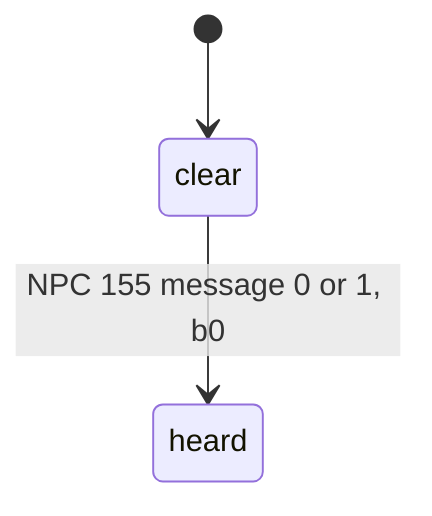

| bit | set/clear | trigger and condition | Tag |
| --- | --- | --- | --- |
| b0 | set | e11 NPC 155 (`warriv1`), message 0 | [C] (x-talk1, h-talk1, c-talk1) |
| b0 | set | e11 NPC 155, message 1 | [I] |

- [C] Word 0 bit 0 gates only NPC 155's quest message (e0 and the NPC gate). It is no act-travel gate: `NpcActTravel`
  tests word 7. Word 0 is read by two calls, `A1Q0_NpcTalk` and `A1Q0_NpcGate`, both bit 0
  (two walkers).

##### Word 1: the level-8 monster region, and the Hell respec offer (quest object 1)

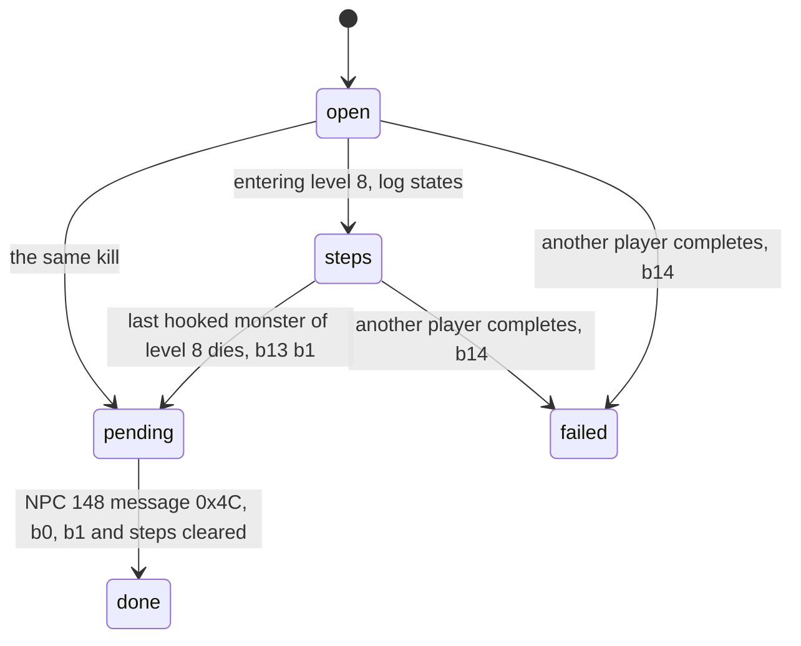

| bit | set/clear | trigger and condition | Tag |
| --- | --- | --- | --- |
| b13, b1 | set | the same kill: party members in Act I | [C] for a partied member in the Rogue Encampment (den-a2); [I] for the act test and an unpartied player |
| b14 | set | the same kill: fail others | [I] |
| G b13 | set | the same kill | [C] |
| b0; b1 clear; steps clear | set / clear | e11 NPC 148 (`akara`) message 0x4C with b1 set | [C] (x-talk1, h-talk1, c-talk1) |
| w41 b13, w41 b1 | set | the same message (word `+0xE4` = 41): the respec offer | [C] (in the saved words) |
| b2, b3, b4 | set | StepBits by log state (2; 3; 4 when `+0x0B` ≠ 1) | [C] for b4: 8 writes in the four den host logs, old b0, b1 clear; [I] for b2, b3 and the `+0x0B` choice |

- [C] The reward also adds 1 to stat 5 of the player (`UnitAddStat(player, 5, 1, 0)`): stat 5 rose by 1 in
  c-talk1 (level unchanged) and by 2 in x-talk1 and h-talk1, beside a level-up's 1.

##### Word 41: the Hell respec (quest object 1's second word)

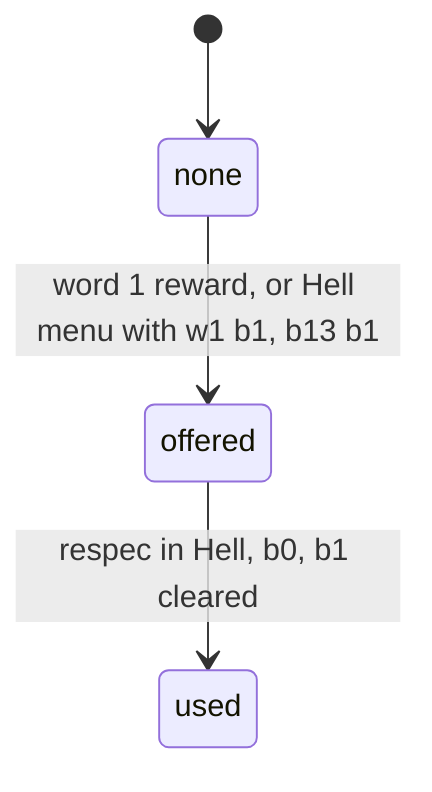

| bit | set/clear | trigger and condition | site | Tag |
|---|---|---|---|---|
| b13, b1 | set | word 1's reward (above) | — | [C] |
| b13, b1 | set | `NPC_MenuAction` in Hell (`game+0x6D` = 2): w1 b1 set and w41 b0, b1 clear | — | [I] |

##### Word 2: the hooked Act I boss and the free hireling (quest object 2)

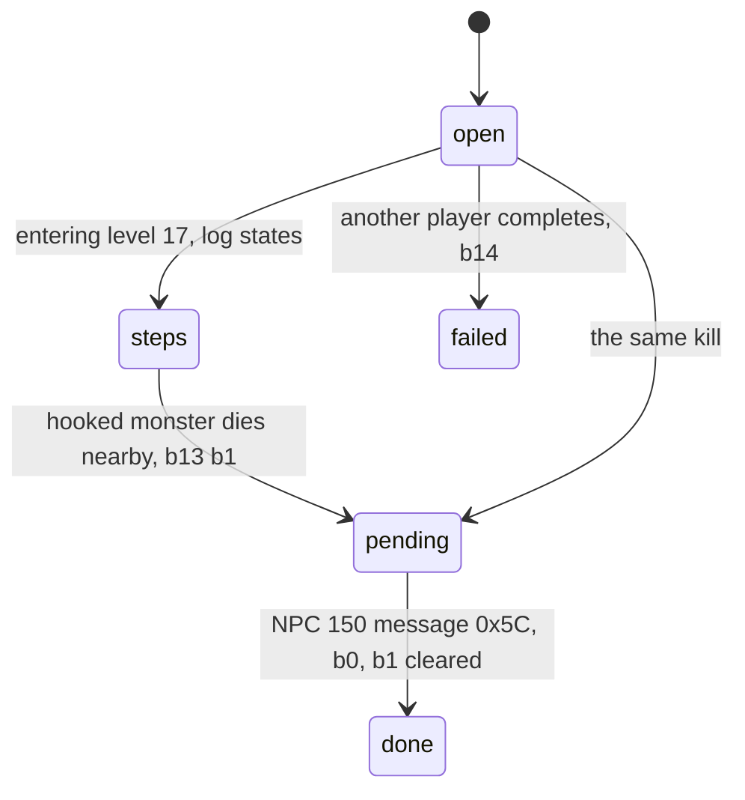

| bit | set/clear | trigger and condition | Tag |
| --- | --- | --- | --- |
| b13, b1 | set | e8 hooked monster: near credit (the dead monster's room or its near list), b0, b1 clear | [I] |
| b13, b1 | set | party members in Act I | [I] |
| b14 | set | fail others | [I] |
| G b13 | set | e8 | [I] |
| b0; b1 clear | set / clear | e11 NPC 150 (`kashya`) message 0x5C with b1 set; then `HIRE_GiveFreeMerc(150)` (game seed: oracle); no `ClearSteps` | [C] (x-talk1, h-talk1, c-talk1) |
| b2, b3, b4 | set | StepBits | [I] |

##### Word 3: the Malus and the imbue (quest object 3)

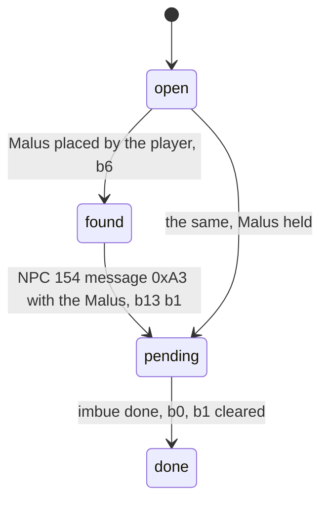

| bit | set/clear | trigger and condition | Tag |
| --- | --- | --- | --- |
| b6 | set | e4 on the hooked `hdm ` (Malus), first time | [I] |
| b13, b1 | set | e11 NPC 154 (`charsi`) message 0xA3, b0 clear, the player holds `hdm ` (then removed) | [I] |
| b13, b1 | set | party members in Act I | [I] |
| G b13 | set | the same message when the log state `+0x0C` = 4 | [I] |
| b0; b1 clear | set / clear | `NPC_MenuAction` imbue done; if b15 is clear, quest object 3's `+0x0A` ← 0 | [C] for the write: 19 logged imbues, each followed by b0 set then b1 cleared at these sites, old 0x8002; [I] for the b15 test and `+0x0A` |
| b2, b3 | set | StepBits | [I] |

- [I] The talk offers the hand-in (message 3) only at clvl (stat 12) > 7 with the Malus held and b0 clear; the e11
  handler tests only the Malus and b0, so the level gate is the dialogue the client is given.

##### Word 4: Cain, the cairn stones, Tristram and the Cow King (quest object 4)

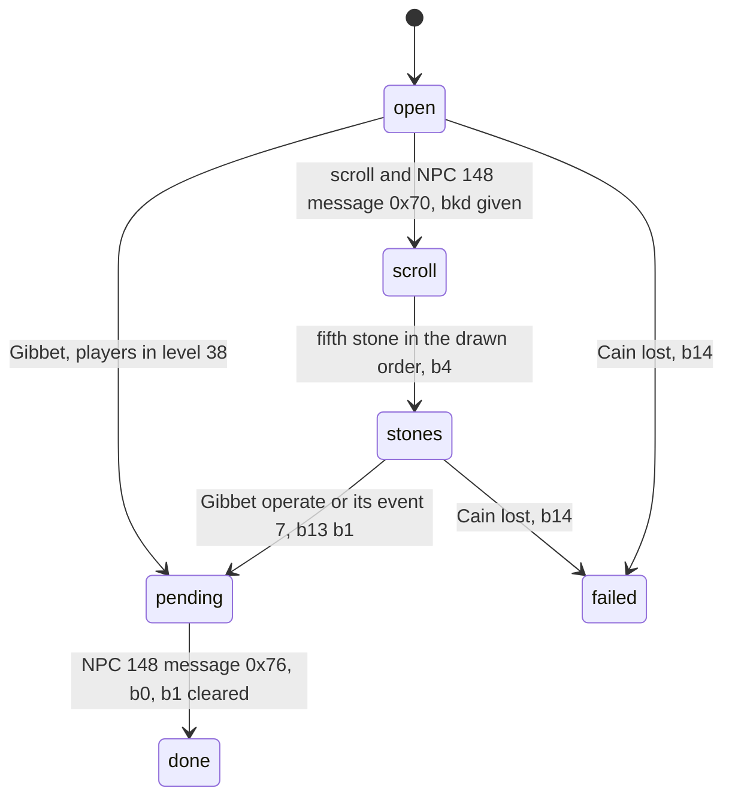

| bit | set/clear | trigger and condition | Tag |
| --- | --- | --- | --- |
| b4 | set | operate of the fifth cairn stone in the drawn order (W4 below) while holding `bkd `, only if `+0x0B` < 4; also party members in Act I with b0, b1 clear | [I] |
| b13, b1 | set | `Gibbet` operate (object 26, `OperateFn` 10) by a player with b0, b1 clear; party members in Act I | [I] |
| b13, b1 | set | the Gibbet's object event 7 (frame + 17): every player in level 38 with b0, b1 clear, and their Act I party | [I] |
| b14 | set | the same event: fail others | [I] |
| b14, G b13 | set | Cain lost, the other paths: e3 entry to level 40 (from a level of Act II: an act change dispatches no e3) by a player with b0, b1 clear while Cain is not rescued (`+0x50` = 0, `+0x0C` < 6), and from the Warriv travel branch | [I] |
| b0; b1 clear | set / clear | e11 NPC 148 message 0x76 with b1 set; the ring reward (oracle) | [C] (x-talk1, h-talk1, c-talk1) |
| G b13 | set | the same message: if G w4 b13 was clear (then `+0xF0`), and if the creator had b15 | [I] |
| G b13 | set | FirstJoin when the creator has b0 | [C] (written inside the join exactly when the joiner had w4 b0: 44 of 44 joins with it, 0 of 10 without) |
| b10 | set | the Cow King's death: the killer has b10 clear **and** w26 b0 (classic, `game+0x70` = 0) or w40 b0 (expansion) | [I] |
| b10 | set | the same death: every player then in level 39 | [I] |
| G b11 | set | the cow portal opened | [C] (both logged cow-portal openings, 3361 and 3506; is the only `GameQuestSet` caller with (4, 11); `CUBE_CowPortalOpen`) |
| b2, b3 | set | StepBits | [I] |

```
W4. StoneOrderDraw (first use of the decoded scroll `bkd `, or first stone operate; once per game, private +0x4A):
                                                                    [C] for the `bkd ` use
      QUESTS_GetSeed once
      order[0 ..< 5] ← empty;  next: i32 ← 17                        ; stone classes 17–21
      while some slot is empty:
        Step(questSeed)                                              ; draw (inline LCG)
        i: u32 ← questSeed.low mod 5
        if order[i] is empty: order[i] ← next;  next ← next + 1
      ; then each operated stone whose class = order[k] advances k; the fifth: dummy 61 to mode 6,
      ; bkd removed, MissileCreateAt(0, 1, 288, x + 6, y − 3) at stone 21, its room pinned
```

- W4. [C] The draw count is at least 5 and variable (draws that hit a filled slot are spent); the slot drawn takes the
  next class of 17…21, so the classes go in fill order. In three first uses of `bkd ` the logged order and the quest seed
  after it were predicted from the seed before (28 steps in all: 15, 6, 7), and a second use (private `+0x4A` set) drew
  nothing and left the order. (x-entry, x-entry2, h-entry)
- W4c. [C] `MissileCreateAt` takes five stack arguments: its 17 callers each push five (two walkers) and it returns with
  `ret 0x14`; at the four constant sites the third argument is a missile id (625, 288, 332, 347).

- W4c. [I] **`MissileCreateAt(a, b, missile, x, y)`** (game in `ECX`, the source unit in `EDX`) creates a missile at a
  point. With x = y = 0 it first takes a point; with no point, or one more than 100 from the source
  (`UnitDistance`), it returns 0. Otherwise it fills a zeroed `0x5C`-byte request (`+0x00` = 1, `+0x04` the source,
  `+0x10` the missile, `+0x14`/`+0x18` x and y, `+0x2C` = a, `+0x30` = b) and returns `MissileCreate`'s result. The
  quest calls create Missiles rows 288 `cairnstones` (the fifth stone, `0x120`), 332 `towerchestspawner` (each of the
  Countess's recorded chests, `0x14C`) and 625 `baalfx control` (Baal's death); each does its work in its server
  do-function (17, 18 and 36 of the server do-function table): 17 and 18 are read (the next note), 36 is not.

- W4c. [C] **Do 17 and do 18, up to their boundary calls.** Do 17 (`cairnstones`), with `left` the frames left and
  `Range` the raw column: while `SubMissile1 > 0` and `Param1 < left < Range − Param1`, it runs the re-seeding scatter
  helper with period `Param2` and radius `r = Param3`; on a frame whose elapsed count is a multiple of the period, with
  an owner and a room, the helper re-seeds the missile's seed to `(SubX + elapsed, 666)` and draws two
  `RNG_RangeB(seed, 2(r − 1))`, each minus `r − 1`, for the sub-missile's x and y offsets (no step when `2(r − 1) ≤ 0`).
  Separately from that window, when `Param4 ≥ 0`, `+0x28` is 0 and `left ≤ Param5 + Param1`, it calls
  `PermPortalAtUnit(game, m, Param4)`. Do 18 (`towerchestspawner`): at `left == 1` it gives the chest
  (guid `+0x28`) unit event `0x5C`; at `left == Range − Param1` it runs the chest's drop on that chest and sets the gold
  phase `+0x2C = 1`, also when the chest is gone; in the gold phase, on each frame with `left % max(4·Param2, 1) == 0`
  (32-bit), it draws two `RNG_RangeB(seed, 2·Param3 + 1)`, each minus `Param3`, on the missile's seed (no re-seed) and
  passes the offset point to the free-spot search. Nothing after a boundary call is covered: the cell test's refusal
  and the sub-missile's creation, the portal function's, the unit event's and the chest drop's own work, the gold item
  after the free spot.
- [I] **Items.** Message 0x70 with `bks ` held removes it and gives `bkd ` (`QUESTS_GiveItem(bkd, 0, 2, 1)`); message 0x76
  gives the ring of [items/quest-drops § F](../../spec-items/quest-drops/#f-npc-item-services-and-given-items); the Inifuss
  tree drops `bks `; Wirt's gold draws `RandLoHi(questSeed, 10, 20)`.
- [I] **Cain.** The Gibbet event spawns monster 146 at the gibbet (+3, +3) by `SpawnAtPos`, retried once at a free spot,
  and opens a class-59 portal to level 1 at (+6, +6) if both fail; in town, the e3 entry to level 1 spawns monster 265
  near the dummy-189 position (up to 22 tries, radius 5, 10, 15). Oracles.

##### Word 5: the Countess (quest object 5)

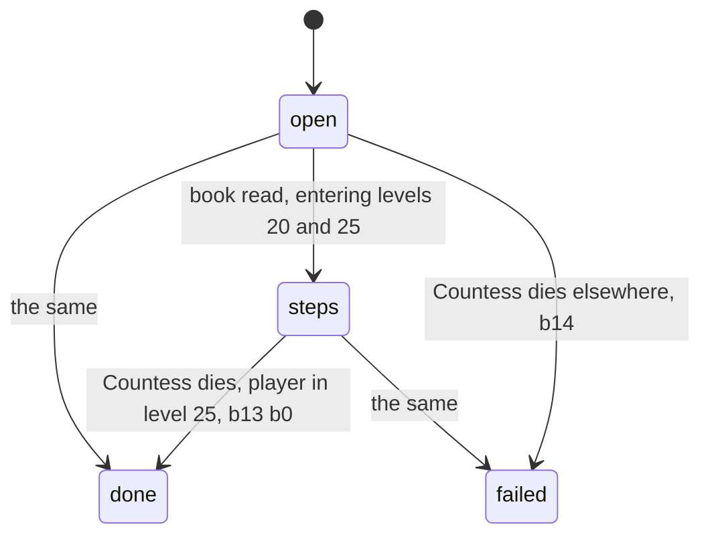

| bit | set/clear | trigger and condition | Tag |
| --- | --- | --- | --- |
| b13, b0; b1 clear | set / clear | e8 the Countess: every player in level 25 with b0 clear (done at once, no reward step) | [I] |
| b14 | set | the same death: players elsewhere; fail others | [I] |
| b0, b13 | set | the same death: players in level 25 with b0, b1 clear | [I] |
| b13, b0 | set | the same death: players in the private list `+0x80` with b0 clear | [I] |
| b13, b0 | set | party members in Act I | [I] |
| G b13 | set | the same death (twice) | [I] |
| b2–b6 | set | StepBits by log state | [I] |

##### Word 6: Andariel (quest object 6)

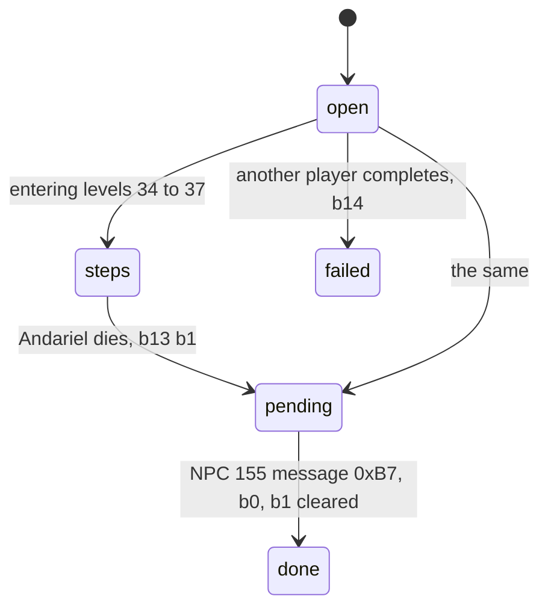

| bit | set/clear | trigger and condition | Tag |
| --- | --- | --- | --- |
| b13, b1 | set | e8 Andariel: the killer (b0, b1 clear); then every player in level 37 with b0 and b15 clear, so a killer standing there is written again; then party members in Act I | [C] for the killer and the level pass: each of 7 credited kills wrote b13, b1 twice, first with old 0x18 (the killer), then with old 0x201A (b1 already set; the level pass, `CreditInLevel`); no write in the kills with b1 and b15 set (3345) or b0 set (3347, 3350); [I] for the party members |
| b14 | set | fail others | [I] |
| b1 clear; b0 | clear / set | e11 NPC 155 message 0xB7 with b1 set | [C] (x-talk1, h-talk1, c-talk1) |
| G b13 | set | the same message when b13 is set | [C] at Warriv's report in r3 and r4 with the player's word 0x201A (b13 set, b0 clear), the only (6, 13) caller; [I] the message with b13 clear |
| b2, b3, b4 | set | StepBits | [C] for b3 (10 writes) and b4 (9), old b0, b1 clear; [I] for b2 |

- [I] After the death a timer (period 1) gives each player in level 37 a class-59 portal to level 1 at his position
  (`PortalObjectCreate(room, x, y, 1, 0, 59, 0)`); the chain timer has period 20. Andariel's gems draw on
  the quest seed.

##### Word 29: NPC 266's talk (quest objects 25 and 30)

No record bit is written: the two objects are dialogue selectors whose one handler draws on the player's unit seed.

```
W29. NpcTalk266(event) — the e0 handler A1Q29_NpcTalk, run once for each of quest objects 25 and 30:   [C] for the draws; [I] for the branch test
       if event.npc class ≠ 266: return
       if G w1 b13 clear and this quest object is active and the player's w1 b0, b13 and b1 are clear:
         msg ← Range(player.unitSeed, 2)                              ; draw: 1 Step
       else:
         Step(player.unitSeed);  msg ← player.unitSeed.low mod 3 + 2   ; draw: 1 Step (inline)
       QUESTS_SetNpcMessage(266, msg)                                 ; presentation
```

- W29. [C] **Two draws per talk.** The dispatch runs the handler once for each object, and each run steps the player's
  unit seed once: 23 talks, 22 chained pairs (each talk's exit seed the next one's entry).
- W29. [I] Which branch a run takes (the conditions above) does not change the draw count.
- [C] NPC 266 (`navi`) is in the server unit list only once the Blood Moor's border preset room near the camp
  ([drlg/preset](../../spec-drlg/preset/) step note 1, `Def` 4–7, file index 3) is active, for the map seed met (45).


##### Word 42: the Act I introductions (quest object 37)

- [C] No record bit is written: no record call writes word 42 and no write with a computed word lies in a second-table
  script, whose four inits store `+0xE0` = 42 (two walkers).
- [I] e0 sends NPCs 147, 148, 150, 154 and 155
  a greeting index while the player's per-NPC introduction flag is clear; e11 sets that flag (the save's
  NPC section). No draw.

#### Act II

##### Word 8: Jerhyn's introduction (quest object 7)

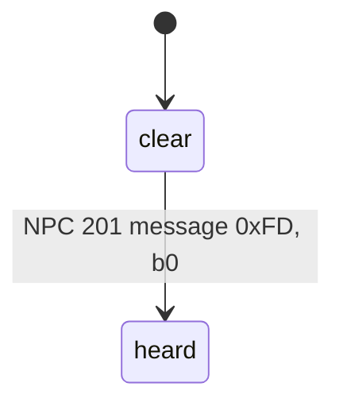

| bit | set/clear | trigger and condition | Tag |
| --- | --- | --- | --- |
| b0 | set | e11 NPC 201 (`jerhyn`) message 0xFD | [C] (x-talk2) |
| G b13 | set | the same message; first join of a player with b0 | [C] for the message: e11 NPC 201 message 0xFD wrote G w8 b13 in both logged talks; [I] for the first join: no joiner had w8 b0 |

##### Word 9: Radament and the Book of Skill (quest object 8)

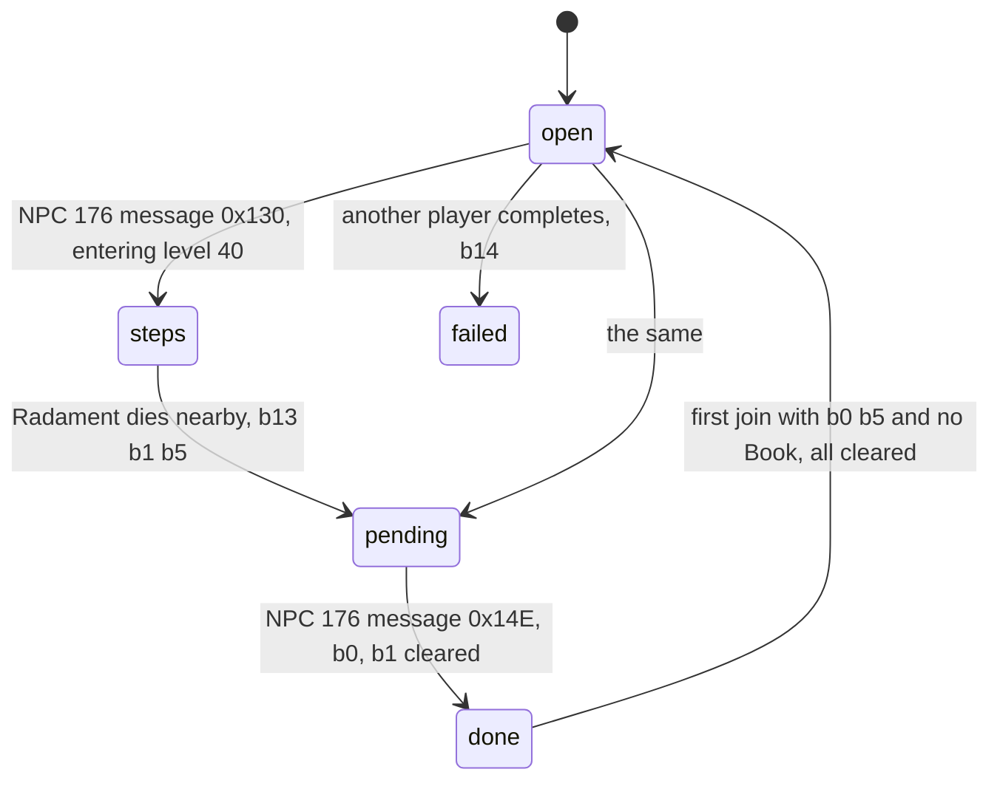

| bit | set/clear | trigger and condition | site | Tag |
|---|---|---|---|---|
| b2, b3, b4 | set | per player with b0, b1 clear, by log state (2; 3 with `+0x0B` = 1; 3 otherwise) | in `A2Q1_NpcGate` | [C] for b4: one logged write, old 0 (4904-radament4); [I] for b2, b3 and the choice by log state |
| b13, b1, b5 | set | e8 Radament: near credit, b0, b1 clear; party members in Act II | near credit; party | [C] for the near credit: b13, b1, b5 at its three sites, old 0x10 (4904-radament4); [I] for the party members |
| b14 | set | e8: every other player with b0, b1 clear | — | [I] |
| b0; b1 clear | set / clear | e11 NPC 176 (`atma`) message 0x14E with b1 set | — | [C] (x-talk2) |
| b0, b1, b15, b5 | clear | e13: the first joiner has b0 and b5 and holds no `ass ` | — | [C] (the four clears in the 2 logged first joins with b0, b5 and no `ass `; none in the join holding `ass ` or in the 51 others) |
| b5 | clear | the player uses the item `ass ` (Book of Skill): the item-use code tests the code, removes the book and clears b5 when set | — | [C] for the branch reached, b5 set (x-book) |
| G b13 | set | Radament's death; message 0x14E while the quest is off; first joiner with b0 | — | [C] for the death: G w9 b13 right after Radament's credit, at a death only of the three (9, 13) callers running (4904-radament4); [I] for the message and the first joiner's condition |

- [C] So a creator who saved with the Book unread **loses the quest** at his next first join: his word 9 lost b0, b1, b15
  and b5 at that join in x-lut and nm-lut.

##### Word 10: the Horadric Staff (quest object 9)

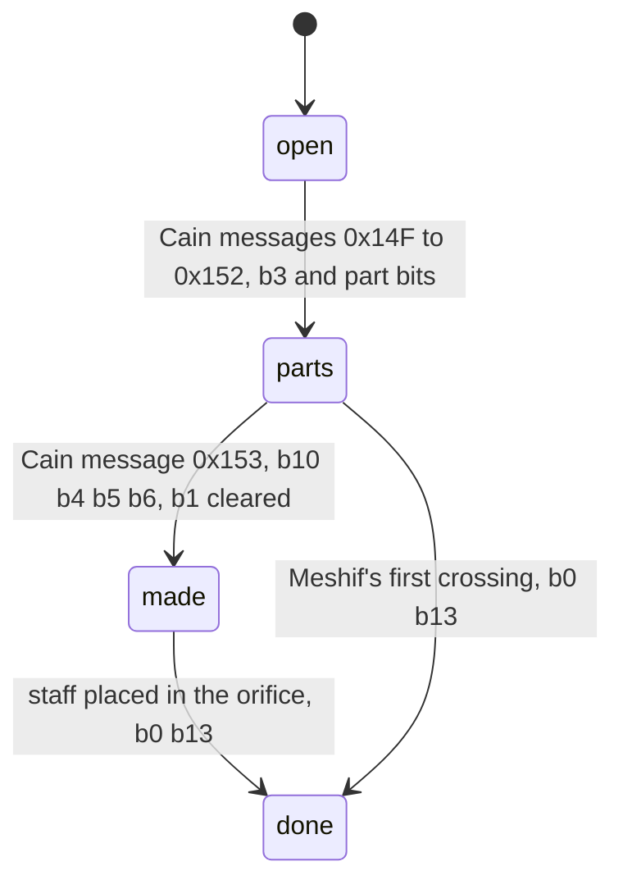

| bit | set/clear | trigger and condition | Tag |
| --- | --- | --- | --- |
| b3 | set | e11 NPC 244 (`cain2`) messages 0x14F–0x153 (0x14F removes `tr1 `) | [I] |
| b4, b5, b6 | set | e11 messages 0x150–0x152 (`SetState(10, msg − 0x14C)`); 0x153 sets all three | [I] |
| b10; b1 clear | set / clear | e11 message 0x153 | [I] |
| b4 / b5 / b6 | clear | e5: `vip ` / `msf ` / `box ` dropped on the ground; e13: the part not held (b0 clear, quest active, no `hst `) | [I] |
| b11 | set | the cube makes `hst ` | [I] |
| b0, b13 | set | the staff placed in the orifice: the placer | [C] |
| b0, b13 | set | `NpcActTravel`, NPC 210, the first crossing (w15 b0 clear) with w10 b0 clear; removes `msf `, `vip ` (not `hst `) | [I] |
| b9 | clear | word 14's e13 and e14 (every join); no constant setter found | [C] for the clears: every logged first join cleared w10 b9 once, 53 at the e13 site, x-newchar's second join at the e14 site; its first join, the record not ready, logged none; [I] for "no constant setter" |

- [C] The three quest chests (`OperateFn` 39–41, objects 354–356) take one quest-seed step each for their gold count; no record write: five logged operates (slots 39 twice, 40, 41 twice), one
  fetch each, then 5 to 9 gold piles, no record write up to the last pile.

##### Word 11: the altar and the eclipse (quest object 10)

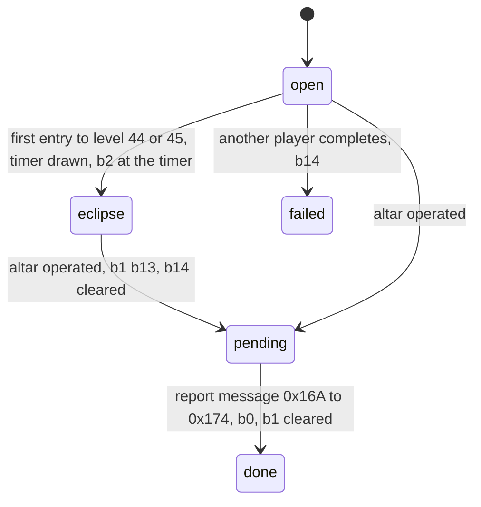

| bit | set/clear | trigger and condition | Tag |
| --- | --- | --- | --- |
| b2 | set | per player with b0, b1 clear, at quest state ≥ 1: reached from the eclipse timer at state 1, one client | [C] (x-entry, x-entry2, h-entry) |
| b3, b4 | set | the same pass at quest state = 2, = 3 | [I] |
| b1, b13; b14 clear | set / clear | altar operate (`OperateFn` 24, object 149), the operator with b0 clear | [I] |
| b13, b1 | set | the same: every player in the altar's level with b0, b15 clear; party | [I] |
| b14 | set | other players with b0, b1 clear | [I] |
| b0; b1 clear | set / clear | e11 report (messages 0x16A–0x174, any NPC) with b1 set | [I] |
| G b13 | set | altar; first join with b0 or b1; report | [I] |

- W11. [C] Three arms (x-entry and x-entry2 in Normal, h-entry in Hell; periods 15, 16, 16): the draw and the period were
  predicted from the quest seed at the e3 entry to level 44 by waypoint, the timer ran once at `tick = due + 1`, the
  eclipse started and b2 was set at state 1. A second entry to 44 in the same game drew nothing: what keeps the arm once
  per game is the state (1, and the e3 test needs 0), not private `+0x01`, which the timer cleared.
- [I] The level-45 entry takes the same branch (not logged), and the b3/b4 branches (states 2, 3) and the altar's
  states were not reached.

- [I] The altar refuses (unit event) a player who already has b1 or b0 and (w10 b0, or holds `vip ` or `hst `);
  otherwise it turns the eclipse off, takes one quest-seed step for 5–9 gold piles and registers timer
  (period 10). The eclipse flag is re-armed on act entry while the private flag is set.

##### Word 12: the palace, Horazon's journal and the Canyon portal (quest object 11)

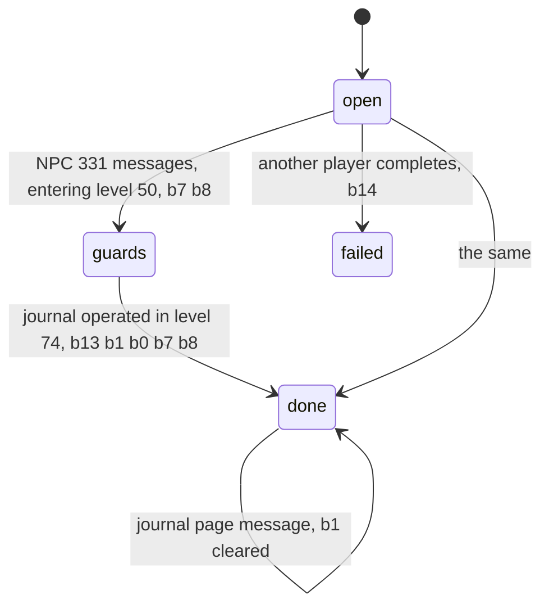

| bit | set/clear | trigger and condition | Tag |
| --- | --- | --- | --- |
| b8 | set | e11 NPC 331 (`act2guard2`) messages 0xBB–0xBD; no `+0x09` test, so also with the quest switched off | [C] (44 writes, quest off) |
| b7 | set | e11 NPC 331 message 0xBA | [I] |
| b8, b7 | set | e3 entering level 50, b8 then b7; no state, bit or `+0x09` test on the path, read from the code (a part 2 development log, not part of the record, met it with the quest switched off) | [C] for the branch reached, quest 11 active and word 12 = 0 (x-entry, x-entry2) |
| b2–b5 | set | per player with b0, b1 clear, by quest state | [I] |
| b13, b1, b0, b8, b7; steps clear | set / clear | the journal operate (`OperateFn` 42, object 357): every player in level 74 with b0, b1 clear; party members in Act II | [I] |
| b14 | set | the journal: every other player with b0, b1 clear | [I] |
| b1 | clear | e11 journal pages, messages 0x18D–0x197 | [I] |
| G b13 | set | the Canyon portal made; first joiner with b0 or b1 | [I] |

```
W12. NpcTalk331 — e0 for NPC 331:                                   [C] for the open branch; [I] for msg 7
       if private +0x0E = 0: msg ← 7                                   ; no draw
       else: Step(questSeed);  msg ← questSeed.low mod 3 + 8           ; one draw
```

- W12. [C] One quest-seed step per talk with the palace open (private `+0x0E` = 1, set by the join from w11 b0): 44
  talks, 42 chained pairs.
- [I] b0 and b1 are set together at the journal, so the quest completes on reading; message 0x18C (journal read), once
  and in the journal's room, opens the Canyon portal: a free spot (size 2, mask `0xBE11`, 8 tries) and
  `PortalObjectCreate(room, x, y, level 46, 0, class 60, 0)`.
- [C] No word-12 bit gates level 74's waypoint or the Arcane portal 298: `A2Q4_ArcanePortalInit` and `OBJINIT_Waypoint`
  and their callees to depth 2 call no record reader; the portal's init reads quest object 11's private `+0x42` and
  `+0x44` through `QUESTS_FindById`. Scope: direct calls to depth 2.

- [I] The palace is opened by removing the harem
  blocker object 318 (NPC 177 message 0x175, or e13 with w11 b0, w12 b0/b1, a held `hst `, b2–b5, or w10 b0).


##### Word 13: the Summoner (quest object 12)

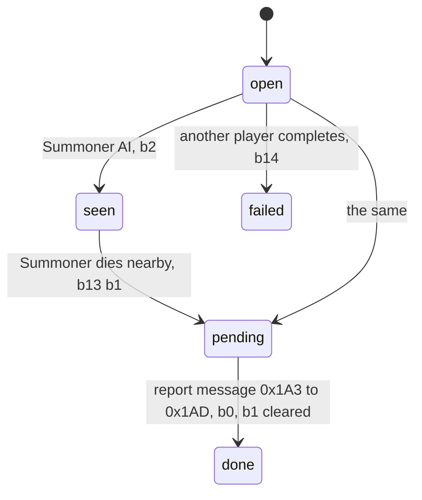

| bit | set/clear | trigger and condition | Tag |
| --- | --- | --- | --- |
| b13, b1 | set | e8 the Summoner: near credit, b0, b1 clear; party | [I] |
| b14 | set | e8: other players | [I] |
| b2 | set | per player at the state broadcast of the Summoner AI hook | [I] |
| b0; b1 clear | set / clear | e11 report with b1 set | [I] |
| G b13 | set | the report when b13 is set | [I] |

##### Word 14: Tal Rasha's tomb and Duriel (quest object 13)

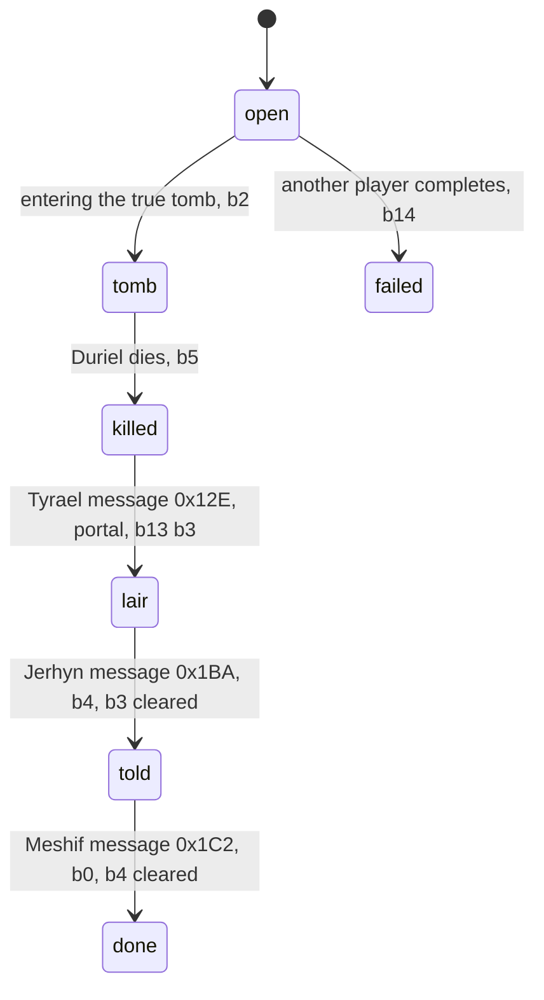

| bit | set/clear | trigger and condition | Tag |
| --- | --- | --- | --- |
| b2 | set | e3 entering the true tomb `T = act+0x094`, or e2, with b0 clear and state > 1 | [C] for the write: b2 in 3364, old 0; [I] for the trigger and the state test |
| b5 | set | e8 Duriel: the killer, party in Act II, players in level 73; each with b0, b3, b4, b5 clear | [C] for the killer: b5 in 3364 (old 0x4: b0, b3, b4, b5 clear), none in the kills with b0 set (3368) or b5 set (3371); [I] for the party and the level-73 pass |
| b13, b3 | set | e11 NPC 251 (`tyrael1`) message 0x12E, once: the portal made; players in level 73 with b13, b3, b4 clear; their party | [I] |
| b14 | set | the same: others with b0, b3, b4 clear | [I] |
| b4; b3 clear | set / clear | e11 NPC 201 message 0x1BA with b3 set | [C] (x-talk2) |
| b0; b4 clear | set / clear | e11 NPC 210 (`meshif1`) message 0x1C2 with b4 set | [C] (x-talk2) |
| — | — | the same message with w10 b0 set removes `hst `, `vip `, `msf ` | [I] |
| b6–b11 | set | e11 messages 0x1BD, 0x1BE, 0x1C1, 0x1BC, 0x1C4, 0x1BF ("talked to NPC") | [I] |
| G b13 | set | e11 NPC 210 with b13 | [I] |

- [I] Tyrael's portal is class 59 to level 40, opened at the player (`PortalObjectCreate(room, x, y, 40, 0, 59, 0)`); its
  town end goes to level 40's point type 12 while private `+0x3C` = 1.


##### Word 30: NPC 377's talk (quest object 26)

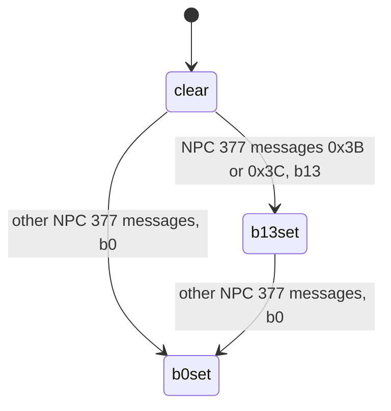

| bit | set/clear | trigger and condition | Tag |
| --- | --- | --- | --- |
| b13 | set | e11 NPC 377 (`act2guard4`) messages 0x3B, 0x3C | [I] |
| b0 | set | e11 NPC 377, other messages | [I] |

```
W30. NpcTalk377 — e0, one draw per talk:                            [I]
       if b0, or w9 b0, b13 or b1, or G w9 b13:  Step(player.unitSeed);  msg ← low mod 3 + 2
       else if quest object 8 is switched off:   msg ← Range(player.unitSeed, 3) + 2
       else if b13 clear:                         msg ← Range(player.unitSeed, 2)
       else:                                       Step(player.unitSeed);  msg ← low mod 3 + 2
```

- [C] **No stock data places NPC 377**: no DS1 that a LvlPrest row names holds it or its placeholders (two DS1 readers
  agree on 2 274 files; the 3 such units are in `lut2.ds1`, which no LvlPrest row names), no Levels, SuperUniques or
  Hireling class cell names it (`.txt` and `.bin`), and none of the 14 instructions with the immediate 0x179 spawns it.
  So the draw above is not reached through stock placement; a class computed at run time is not excluded.
  (`npcplace` scan)

##### Word 31: NPC 378 (quest object 27)

| bit | set/clear | trigger and condition | Tag |
| --- | --- | --- | --- |
| b0 | set | e11 NPC 378 (`act2guard5`) message 0x12F | [I] |

```mermaid
stateDiagram-v2
  [*] --> clear
  clear --> set: NPC 378 message 0x12F, b0
```

- [I] The message is offered while quest object 13 is active below state 2, G w11 b13 is set and w14 b1, b0 are clear.
  No draw.

##### Word 42: the Act II introductions (quest object 38)

- [C] No record bit, no draw: quest object 38's callbacks (e0 77 times, e11 56) wrote no record bit in their 133
  logged dispatches; 88 left the quest and player seeds unchanged and the other 45 are NPC 331's e0, whose step is quest
  object 11's fetch.
- [I] As quest object 37: per-NPC introduction flags only.

#### Act III

##### Word 16: Hratli's place (quest object 14)

```mermaid
stateDiagram-v2
  [*] --> clear
  clear --> heard: NPC 253 message 0x1D1 or 0x1D2, b0
```

| bit | set/clear | trigger and condition | Tag |
| --- | --- | --- | --- |
| b0 | set | e11 NPC 253 (`hratli`) message 0x1D2 | [C] (x-talk3, h-talk3) |
| b0 | set | e11 NPC 253 message 0x1D1 | [I] |
| G b13 | set | the same messages; first joiner with b0 | [C] for message 0x1D2: e11 NPC 253 wrote G w16 b13 in both logged talks; [I] for message 0x1D1 and the first joiner: no joiner had w16 b0 |

##### Word 17: Lam Esen's tome (quest object 15)

```mermaid
stateDiagram-v2
  [*] --> open
  open --> steps: leaving town, entering level 79
  steps --> done: NPC 254 message 0x234 with the tome, b13 b0, stat bonus
  open --> done: the same, player in Act III
  open --> failed: tome handed in elsewhere, b14
  steps --> failed: the same
```

| bit | set/clear | trigger and condition | Tag |
| --- | --- | --- | --- |
| b2 | set | e3 leaving town 75 in state 2 or 3, or e11 message 0x225: players with b0, b1 clear | [I] |
| b13, b0, b1 | set | e11 NPC 254 (`alkor`) message 0x234 with `bbb ` held (removed): **every player in Act III** with b0, b1 clear; once per game | [I] |
| b1 | clear | right after: each player with b1 gets `UnitAddStat(player, 4, 5, 0)` (+5 to stat 4) and a message, then b1 cleared | [I] |
| b14 | set | the same pass: each player still with b0, b1 clear (not in Act III) | [I] |
| G b13 | set | the reporter has b13; first joiner with b0 | [C] for the first joiner: G w17 b13 was written inside the join exactly when the joiner had w17 b0 (48 of 48 joins with it, 0 of 6 without); [I] for the reporter: no word-17 report was logged |

- [I] The tome object (193) refuses a player with b0. No
  draw.

##### Word 18: Khalim's Will (quest object 16)

```mermaid
stateDiagram-v2
  [*] --> open
  open --> told: Cain messages 0x21F to 0x224, b2 to b7
  told --> done: second counted orb hit with qf2, b0 b13
  open --> done: the same
```

| bit | set/clear | trigger and condition | Tag |
| --- | --- | --- | --- |
| b2 | set | e11 NPC 245 (`cain3`) message 0x21F | [I] |
| b6 / b3 / b4 / b5 / b7 | set | e11 Cain messages 0x220 / 0x221 / 0x222 / 0x223 / 0x224 | [I] |
| b0, b13 | set | Compelling Orb operate (object 404, `OperateFn` 53) in mode 0 with `qf2 ` as primary weapon: the second counted hit | [C] (x-orb, 2 operates) |
| b0, b13 | set | the same hit: party members in Act III (a member who had b0 only loses the five items) | [I] |

```
W18. CompellingOrbOperate(object, operator):                        [C] for the counted half
       if the operator's primary weapon is not qf2: return            ; before the counter
       private +0x38 ← +0x38 + 1
       if +0x38 = 2:
         SetState(rec, 18, 0);  SetState(rec, 18, 13);  remove qf2
         if the operator's w21 b4: SetState(rec, 21, 0)
         kill the orb monster (oracle);  object mode 1, object event 1;  council "orb broken" ← 1
         send every record;  +0xF0;  the party pass
```

- W18. [C] Each operate in mode 0 with `qf2 ` grew the counter by one; the second wrote b0 and b13 and left the object in
  mode 1; the game seed moved inside the completing hit (the orb monster's death, an oracle).
- W18. [I] An operate without `qf2 ` counts nothing; it was not reached on the server (the client sent no operate).


##### Word 19: the Gidbinn (quest object 17)

```mermaid
stateDiagram-v2
  [*] --> open
  open --> handed: Ormus message 0x24B with the Gidbinn, b6
  handed --> ring: Ormus message 0x251, b8
  handed --> merc: Asheara message 0x24D, b7
  ring --> done: Asheara message 0x24D, b7 b13 b0
  merc --> done: Ormus message 0x251, b8 b13 b0
  open --> failed: handed in by another player, b14
```

| bit | set/clear | trigger and condition | Tag |
| --- | --- | --- | --- |
| b2–b5 | set | per player: b5 holding `g33 `; b4 (and b2 if b3 clear) when the dagger is out; b3 at quest state 2 | [I] |
| b6 | set | e11 NPC 255 (`ormus`) message 0x24B with `g33 ` held (removed), b5 set, b8 clear; party members in Act III with b0, b6, b7, b8 clear | [I] |
| b14 | set | the same message: every player with b0, b6, b7, b8 clear and no `g33 ` | [I] |
| b8 | set | e11 Ormus message 0x251 with b6 set, b8 clear (and b7 clear); `QUESTS_GiveItem('rin', ilvl 21/35/75, quality 6)` (oracle) | [C] (x-talk3, h-talk3) |
| b13, b0 | set | after b8 when b7 is already set | [I] |
| b7, b13, b0 | set | e11 NPC 252 (`asheara`) message 0x24D with b7 clear and b8 set; `HIRE_GiveFreeMerc(252)` (oracle) | [C] (h-talk3) |
| b7 | set | the same message with b8 clear | [I] |
| b0 | set | e13: the first joiner has b6, b7, b8 and not b0 | [I] |
| b9 | set | e4 on `g33 `, once per player | [I] |
| G b13 | set | message 0x24B, quest active | [I] |

##### Word 20: the Golden Bird (quest object 18)

```mermaid
stateDiagram-v2
  [*] --> open
  open --> told: Cain messages 0x20F and 0x213, b2 b4
  told --> pending: Alkor message 0x216 with the golden bird, b1
  pending --> done: Alkor message 0x21A, b0 b13 b5, b1 and steps cleared
```

| bit | set/clear | trigger and condition | Tag |
| --- | --- | --- | --- |
| b2 | set | e11 Cain message 0x20F (and party) | [I] |
| b4 | set | e11 Cain message 0x213 (and party) | [I] |
| b1 | set | e11 NPC 254 message 0x216 with `g34 ` held (removed), b0, b1 clear (and party) | [I] |
| b1 clear; b0, b13; steps clear; b5 | clear / set | e11 NPC 254 message 0x21A with b1 set, b0 clear; `QUESTS_GiveItem('xyz', 0, 2, 1)` (oracle) | [C] (x-talk3b, h-talk3) |
| b6 | set | e4 on `j34 `, once per player | [I] |
| G b13 | set | after message 0x21A when the reporter has b13 | [C] for the reporter with b13: e11 NPC 254 message 0x21A wrote G w20 b13 in both logged talks, beside QC w20 b1 and QS b0, b13, b5 on the player; [I] for the arm without b13 |

- [I] NPC 264's (`meshif2`) message 0x211 with `j34 ` held turns it into `g34 ` (no bit). The figurine `j34 ` drops from the
  first Act III pack monster hooked while the quest is active.
  No draw.

##### Word 21: the High Council (quest object 19)

```mermaid
stateDiagram-v2
  [*] --> open
  open --> steps: entering level 82, leaving town
  steps --> pending: last council member dies, orb not broken, b4 b13
  steps --> done: last council member dies, orb broken, b0 b13
  pending --> done: Cain message 0x272 or the orb, b0, b4 cleared
  open --> failed: another player completes, b14
```

| bit | set/clear | trigger and condition | Tag |
| --- | --- | --- | --- |
| b2 / b3 | set | per player at quest state 2–3; b3 when the council was seen | [I] |
| b4 or b0, and b13 | set | the last council member's death: every Act III player in its room or near list; b0 if w18 b0 is set, else b4 | [I] |
| b4, b13 | set | party members in Act III | [I] |
| b14 | set | players with b0 and b4 clear | [I] |
| b0; b4 clear | set / clear | e11 Cain message 0x272 with b4 set (the five Khalim items removed if w18 b0) | [I] |
| b0 | set | the orb's completing operate (operator, party) when b4 is set | [I] |
| G b13 | set | Cain message 0x272 (reporter has b13), first join, the last council death | [I] |

- [I] Up to six council members (levels below 108) are recorded by the council hook; on each non-council death the quest
  drops once per game `qf1 ` (quality 7) and then `box ` to each Act III player lacking them (oracles). No draw.


##### Word 22: Mephisto and the Durance portal (quest object 20)

```mermaid
stateDiagram-v2
  [*] --> open
  open --> steps: leaving town, levels above 97, 100, 102
  steps --> killed: Mephisto dies, b13 b0 b11
  open --> killed: the same
  killed --> reported: any NPC message 0x291 to 0x297, b11 cleared
  open --> failed: another player completes, b14
```

| bit | set/clear | trigger and condition | Tag |
| --- | --- | --- | --- |
| b2–b9 | set | every player at the state pass: state 2 → b2, 3 → b3, 4 with `+0x0B` 2/3/4 → b4/b5/b6, 5 with 2/3/4 → b7/b8/b9 | [C] for b9: written in four Mephisto sessions, old 0; [I] for the other states and bits |
| b13, b0, b11 | set | e8 Mephisto: the killer if b0 clear; every player on level 102 with b0, b11 clear; party members in Act III of credited players | [C] for the killer: b13, b0, b11 at the three sites in 3356 (old 0x200: b0 clear), none in 3501 (b0 set); [I] for the level-102 pass (the killer stood there, already credited) and the party |
| b14 | set | players with b0 and b11 clear | [I] |
| b11 | clear | e11 any NPC message 0x291–0x297 (the kill reported) | [I] |
| G b13 | set | the death (always); first joiner with w22 b0, b11 or w23 b0 | [C] for the death: G w22 b13 after both logged Mephisto kills, also with the game bit already set (3356 old 0x2000, 3501 old 0xA000); at a death only of the two (22, 13) callers runs; [I] for the first joiner's condition |

- [I] The Durance portal reads w22 b13 or b0;
  b13 is cleared at load, so a reloaded character passes through b0. Mephisto's death opens the portal object (mode 1)
  and arms the bridge object 341, which lowers (mode 0 → 1 → 2) as a player comes within distance 18, re-queued every 24
  frames.

##### Word 32: the Dark Wanderer (quest object 28)

```mermaid
stateDiagram-v2
  [*] --> unseen
  unseen --> seen: the timer fires, players in Act III, b0
```

| bit | set/clear | trigger and condition | Tag |
| --- | --- | --- | --- |
| b0 | set | the Dark Wanderer timer fires: every player in Act III with b0 clear, before the step | [C] for one player (x-entry, x-entry2, h-entry, x-wpact3r-0) |
| G b13 | set | e13: the first joiner has b0 (and then no Dark Wanderer this game) | [C] for the write: `GameQuestSet(32, 13)` under the joiner's w32 b0 test (`cmp eax, 1; jne`, then `lea edx, [eax+0x1f]`), two walkers; [I] for "no Dark Wanderer this game" |

- W32. [C] Four games (a save with word 32 = 0, the Kurast Docks by waypoint, the player next to the Dark Wanderer at
  the Spider Forest edge): the timer ran once at `tick = due + 1`, b0 was set, the quest seed stepped once (the logged
  low word one step of the seed before, `QUESTS_GetSeed`) and the targets were tried from `low & 1` in
  order, one free-spot search each. `low & 1` was 0 in all four (8 tries). (x-entry, x-entry2,
  h-entry, x-wpact3r-0)
- [I] The 7-try branch (`low & 1` = 1) was not reached.
- [I] Beyond these and the join's bit-15 pass, word 32 holds no bit.
- [C] The init writes `+0xE0` = 16 although the code uses word 32: no A3Q7 record call takes `[obj+0xE0]`,
  and `g_ObjInitFns[43]` is `A3Q7_WandererSpawnInit`. Only the quest log is affected.
- [I] `InitFn` 43 spawns the Dark Wanderer at (x + 7, y) while the private flag is set.

##### Word 42: the Act III introductions (quest object 39)

- [C] No record bit, no draw: quest object 39's callbacks (e0 28 times, e11 16) wrote no record bit in their 44 logged
  dispatches, the quest and player seeds unchanged in all 44.
- [I] Per-NPC introduction flags only (player data `+0x60 + 4·difficulty`).


#### Act IV

##### Word 24: Tyrael's introduction (quest object 21)

```mermaid
stateDiagram-v2
  [*] --> clear
  clear --> heard: NPC 367 message 0x298, b0
```

| bit | set/clear | trigger and condition | Tag |
| --- | --- | --- | --- |
| b0 | set | e11 NPC 367 (`tyrael2`) message 0x298 | [C] (x-talk4, h-talk4, c-talk4) |

##### Word 25: the hooked Act IV monster and the skill points (quest object 22)

```mermaid
stateDiagram-v2
  [*] --> open
  open --> steps: NPC 367 message 0x29E, entering level 103
  steps --> pending: the hooked monster dies, b13 b1
  open --> pending: the same
  pending --> done: NPC 367 message 0x2A4, b0, b1 and steps cleared
  open --> failed: another player completes, b14
```

| bit | set/clear | trigger and condition | Tag |
| --- | --- | --- | --- |
| b1, b13; steps clear | set / clear | e8 the hooked monster: the killer, near credit, party members in Act IV; b0, b1 clear | [I] |
| b14 | set | the rest of the game | [I] |
| b2, b3, b4 | set | log state 2 → b2; 3 → b3 or b4 | [I] |
| b5 | set | e11 NPC 406 message 0x2A3 | [I] |
| b0; b1 clear; steps clear | set / clear | e11 NPC 367 message 0x2A4 with b1 set | [C] (x-talk4, h-talk4, c-talk4) |
| G b13 | set | the same message when the player also has b13 | [I] |

- [C] The reward also adds 2 to stat 5 (`UnitAddStat(p, 5, 2)`): stat 5 rose by 2 in x-talk4, h-talk4 and
  c-talk4 with the level unchanged.

##### Word 26: Diablo, the seals and the Harrogath portal (quest object 23)

```mermaid
stateDiagram-v2
  [*] --> open
  open --> steps: entering levels 103 and 108
  steps --> done: Diablo dies nearby, b13 b0, classic also b6 b7
  done --> told: NPC 367 message 0x4E20 in expansion, b9, portal
  done --> told: NPC 246 message 0x4E21, b8
  open --> failed: another player completes, b14
```

| bit | set/clear | trigger and condition | Tag |
| --- | --- | --- | --- |
| b13, b0; steps clear | set / clear | e8 Diablo (class 243): near credit (Diablo's death room), b0, b1 clear; party members in Act IV with b0 clear | [I] |
| b6, b7 | set | the same, classic games only (`game+0x70` = 0) | [I] |
| b14 | set | the rest | [I] |
| b2, b3, b4 | set | log state 2 / 3 | [I] |
| b7 / b6 | clear | e11 NPC 367 message 0x2AC / NPC 246 message 0x2AD | [I] |
| b9 | set | e11 NPC 367 message 0x4E20 in an expansion game (no `+0x09` test); then the Harrogath portal (oracle) unless private `+0x45` | [C] (x-talk4, h-talk4); the classic half [I] |
| b8 | set | e11 NPC 246 (`cain4`) message 0x4E21 | [C] (x-talk4, h-talk4) |
| b9 | clear | e13 and e14 in expansion: b9 set and w28 b0 clear | [I] |

- [I] **The Chaos Sanctuary gate**: once the fifth seal is open and the three
  seal bosses (superuniques 36–38, spawned by object 131's event 7) are dead, in either order, room population on level
  108 stops.
- [I] **Classic lock-out:** after Diablo dies in a classic game, the cube button and the trade and interaction packets are
  refused until the game ends. **Progression:** the classic credit raises the client's status progression to
  `step·d + 4` (step 5 with the expansion bit, else 4), never lowering it.
- [C] **The Harrogath portal** (object 566, expansion only) is created near NPC 367 by message 0x4E20; its operate is
  [quests/travel § F](../travel/#f-the-durance-portal-and-the-other-travel-objects)'s and writes w28 b0 then b13 on the
  first trip only (word 28 b0 clear): it, not NPC 367's menu, is the Act IV → V travel in stock play. (x-tyrael3, five trips)

##### Word 27: the Hellforge (quest object 24)

```mermaid
stateDiagram-v2
  [*] --> open
  open --> stone: NPC 246 messages 0x2A6 and 0x2A7, soulstone given
  stone --> pending: third forge strike, b13 b1
  open --> pending: the same, player in Act IV
  pending --> done: NPC 246 message 0x2A8, b0, b1 cleared
  open --> failed: another player completes, b14
```

| bit | set/clear | trigger and condition | site | Tag |
|---|---|---|---|---|
| b13, b1; steps clear | set / clear | the third strike: the striker, and every player in Act IV with b0, b1 clear (each loses `hfh ` and `mss `) | — | [C] |
| b14 | set | the rest | — | [I] |
| b2 / b5 / b3 | set | log state 2 → b5 with the soulstone given, else b2; state 3 → b3 | in `A4Q3_NpcGate` | [I] (the sites' owner) |
| b0; b1 clear | set / clear | e11 NPC 246 message 0x2A8 with b1 set | — | [C] (x-talk4, h-talk4, c-talk4) |

- [I] The forge, its strikes and its draws are [items/quest-drops § D](../../spec-items/quest-drops/#d-special-drops).


##### Word 33: NPC 408's dialogue (quest object 29)

- [C] A dialogue selector for class 408 (reading w27 and w26); no quest script writes word 33, and the stock client never
  sends packet `0x58` for it (A5). `A4Q4_NpcTalk` reads w27 (b0, b1, b13) and `A4Q4_NpcGate` w27 and w26 (b13, b0); no
  record call writes word 33, by immediate or computed word (two walkers).
- [I] No draw.

#### Act V

##### Word 35: the siege boss and Larzuk's socket (quest object 31)

```mermaid
stateDiagram-v2
  [*] --> open
  open --> steps: NPC 511 message 0x4E6D, levels 110 to 112
  steps --> pending: the siege boss dies nearby, b1 b13
  open --> pending: the same
  pending --> offered: NPC 511 message 0x4E7A, b5, steps cleared
  offered --> done: socket done, b0, b1 cleared
  open --> failed: another player completes, b14
```

| bit | set/clear | trigger and condition | Tag |
| --- | --- | --- | --- |
| b1, b13 | set | e8 superunique 42: near credit (b0 clear); party members in Act V with b0, b1, b13 clear | [I] |
| b14 | set | the rest | [I] |
| G b13 | set | e8 | [I] |
| b2, b3, b4 | set | log states | [I] |
| steps clear; b5 | clear / set | e11 NPC 511 (`larzuk`) message 0x4E7A with b1 set | [C] (x-talk5) |
| b0; b1 clear | set / clear | the socket service done | [C] (24 logged socket services: b0 set then b1 cleared at these sites after each, old b1 set, b0 clear) |

- [C] Larzuk is spawned once per game: one class-511 unit per game in the 6 logs that meet him.

- [I] By object `InitFn` 70/71 (`SpawnAtPos(x, y, 511, 1, 5, 0)`, oracle). No draw.


##### Word 36: the prisoners (quest object 32)

```mermaid
stateDiagram-v2
  [*] --> open
  open --> freeing: a cage freed, rescue incomplete, b4
  freeing --> pending: three cages open, at least 12 rescued, b13 b1 and b5 b6 or b7
  open --> failed: more than 4 killed, or under 12 rescued, b14
  freeing --> failed: the same
  pending --> done: NPC 515 message 0x4E8E, runes given, b0, b1 and steps cleared
```

| bit | set/clear | trigger and condition | site | Tag |
|---|---|---|---|---|
| b4 | set | a cage freed with the rescue not complete (prisoner AI) | — | [I] |
| b4 | clear | every join (e13, e14) | — | [C] (each of the 54 logged games cleared w36 b4 at its join: 53 at the e13 call, x-newchar's second join at the e14 call; its first join, the record not ready, logged none) |
| b13, b1 | set | rescue complete: spawned = killed + rescued, all 3 cages open, rescued ≥ 12; the triggering player and party members in Act V | — | [I] |
| b5 / b6 / b7 | set | the same: rescued 15 → b5, 14 → b6, 12–13 → b7 | — | [I] |
| b14 | set | rescue complete with fewer than 12 rescued, or more than 4 prisoners killed | — | [I] |
| b0; b1, steps clear | set / clear | e11 NPC 515 message 0x4E8E with b1 set, after at least one rune was made (3 runes with b5, 2 with b6, 1 with b7) | — | [I] |
| b2, b3 | set | log states | — | [I] |

- [I] Each cage (`InitFn` 62, object 473) spawns its 5 prisoners with up to 25 `SpawnAtPos` tries, each hooked to the
  quest (oracles). No draw.

##### Word 37: Anya (quest object 33)

```mermaid
stateDiagram-v2
  [*] --> open
  open --> pending: Frozen Anya operated with the potion, b13 b1
  pending --> scroll: NPC 513 message 0x4EA4, b8
  pending --> reward: NPC 512 message 0x4EA8, b9 b10, item drawn
  scroll --> done: the second of the two talks, b0, b1 cleared
  reward --> done: the same
  done --> used: the scroll used, b7
  open --> failed: thawed by another, or levels 121 to 124 entered first, b14
```

| bit | set/clear | trigger and condition | Tag |
| --- | --- | --- | --- |
| b13, b1 | set | `OperateFn` 67 on object 558 by a player with b0, b1 clear **holding `ice `** (removed); party members in Act V | [I] |
| b14 | set | the rest of the game at the thaw; entering 121, 122 or 124 at state below 5 | [I] |
| b3 | set | e3 entering level 113 (state to 3): for the player; the entry into 112 before it moves the state to 1 with no write | [C] (x-entry, x-entry2, h-entry) |
| b2 | set | log state | [I] |
| b3 | set | e3 entering 114, or the old-level-109 branch (not reached) | [I] |
| b8 | set | e11 NPC 513 message 0x4EA4 with b1 set, b0 clear: `tr2 ` given | [C] after Malah's `tr2 ` (placed by `QUESTS_GiveItem`), b8 with old 0x8002 (b1 set, b0 clear), in Normal, Nightmare and Hell; [I] the message with b1 clear or b0 set |
| b9, b10 | set | e11 NPC 512 message 0x4EA8 with b1 set, b0 and b10 clear, no `+0x09` test: the reward item made (W37), then b9, and b10 last; a second talk gives nothing (b10) | [C] (x-anya, nm-anya, h-anya, quest 33 switched off) |
| b0; b1 clear | set / clear | the reward talk coming second (b8 already set): b1 cleared, b0 set, between b9 and b10 | [C] (x-anya, nm-anya, h-anya) |
| b0; b1 clear | set / clear | the NPC 513 talk coming second (b9 already set) | [I] |
| b7 | set | the player uses `tr2 ` with b8 set and b7 clear; then builds the resistance list | [C] for the branch reached (x-anya) |

```
W37. AnyaReward — e11 NPC 512 message 0x4EA8:                        [C] for the clvl branch of the table choice; [I] for game+0x6A = 3
       QUESTS_GetSeed
       table ← Nightmare if d = 1 and (game+0x6A = 3 or clvl > 45); Hell if d = 2 and (game+0x6A = 3 or clvl > 65); else Normal
       k ← Range(questSeed, count[class] of table)                    ; one draw
       QUESTS_GiveItem(table[class][k], UnitDropLevel, quality 6, 1)  ; items/quest-drops § F
```

- W37. [C] One reward in each difficulty (Normal, Nightmare, Hell; clvl 80, so each difficulty's own table): the table,
  the count, the draw and the item code were predicted from the quest seed before the talk. The `game+0x6A` = 3 branch
  of the table choice was not separated by the run. (x-anya, nm-anya, h-anya)
- [I] **The scroll's bonus.** counts the difficulty records (Normal, Nightmare, Hell) whose word 37 has b7
  and puts 10 per record into stats 39, 41, 43 and 45 of a stat list linked to the player, at the scroll use and on the
  player load path; so +10/+20/+30 in every difficulty.
- [I] **Creation reader.** `InitFn` 69 (object 462) spawns Nihlathak's superunique only while the quest's private
  `+0x88` = 1, set by Anya's return to town or by a first joiner with b0 or b15.
- [I] A later joiner with w37 b0, b1, b6 clear while quest 34 is active and quest 33 is done or off gets **w38 b14**.


##### Word 38: Nihlathak and the personalisation (quest object 34)

```mermaid
stateDiagram-v2
  [*] --> open
  open --> steps: NPC 512 message 0x4EA9, red portal
  steps --> pending: Nihlathak dies nearby, b1 b13
  open --> pending: the same
  pending --> done: personalisation done, b0, b1 cleared
  open --> failed: another player completes, b14
```

| bit | set/clear | trigger and condition | Tag |
| --- | --- | --- | --- |
| b1, b13 | set | e8 Nihlathak (superunique 60): near credit with w37 b0 or b1 and w38 b14, b0 clear; party | [I] |
| G b13 | set | the same death | [I] |
| b14 | set | the rest at the kill; a joiner as in word 37 | [I] |
| b2, b3 | set | log states | [I] |
| b4 | set | e11 NPC 512 message 0x4EB4 | [I] |
| b0; b1 clear | set / clear | the personalise service done | [C] (22 logged personalisations: b0 set then b1 cleared at these sites after each, old b1 set, b0 clear) |

- [I] **The red portal** to level 121: `PortalObjectCreate(room, x + 10, y + 5, 121, 0, class 60, 1)` at the town Anya
  placeholder, once per game, after message 0x4EA9 (talk end) or object 459's event 7 (every 12 frames until it succeeds);
  a monster-AI path makes it when the first joiner lacked level 123's waypoint.

##### Word 39: the Ancients (quest object 35)

```mermaid
stateDiagram-v2
  [*] --> open
  open --> armed: altar operated, no portal on 120
  armed --> open: a portal opened on 120, or 120 empty
  armed --> done: the third Ancient dies, b0 b13, experience
  done --> told: NPC talks, b4 to b9
  open --> failed: another player completes, b14
```

| bit | set/clear | trigger and condition | Tag |
| --- | --- | --- | --- |
| b0, b13 | set | e8 the third Ancient (540–542): the killer, each player on level 120, their party in Act V; each needs clvl ≥ 20·(d + 1) and b0 clear; each credit grants experience | [I] |
| b14 | set | the rest | [I] |
| b2 / b3 | set | log state 2 / 3, players with clvl ≥ 20·(d + 1) | [I] |
| b4 | set | e11 message 0x4EC9 (`OperateFn` 69, object 561, with b0 set and b4 clear) | [I] |
| b5–b9 | set | e11 from NPC 511 → b5, 520 → b6, 512 → b7, 513 → b8, 515 → b9 | [I] |

- [C] **Experience** in Normal: 1 400 000, capped at `T(L + 1) − T(L)`, the width of the level after the current one
  ([player/creation § J](../../spec-player/creation/#j-other-level-and-experience-changes), J2; two grants reproduced, the cut
  binding at level 26 and not at level 81).
- [I] **Experience** in Nightmare and Hell: 20 000 000 and 40 000 000, under the same cap; no session logged either
  difficulty.
- [I] **Arming and resets.** The altar (`OperateFn` 65) with no town portal on 120 and all statues in mode 0 puts the
  three statues in mode 3 and queues their event 7 (each spawns an Ancient, oracle); with a portal on 120 it first
  closes every player's portal there and then sends its message too, and with the quest active and its step at 4 or
  more it sends nothing. A town portal created on 120 before the quest is done, or no living player left
  on 120, resets the fight.
- [C] **The summit door** (object 564, `OperateFn` 71) reads only quest 35's private "done in this game" byte and refuses
  (message 0x13) while it is 0, whatever the creator had done: 88 refused operates by a creator without w39 b0 and by one
  with every quest done.
- [I] The Worldstone Keep door (`OperateFn` 66) refuses a player with b0 and b1 clear, and everyone while the quest is
  active and not done in this game; a first joiner with b0 or b15 makes it start open.

##### Word 40: Baal, the Worldstone and the Zoo (quest object 36)

```mermaid
stateDiagram-v2
  [*] --> open
  open --> steps: levels above 130, log states
  steps --> done: Baal dies, players on 132, b13 b0
  open --> done: the same
  done --> left: the last portal, or a join, b10
  open --> failed: another player completes, b14
```

| bit | set/clear | trigger and condition | Tag |
| --- | --- | --- | --- |
| b13, b0 | set | e8 Baal: each player on level 132 with b0, b1 clear; party members in Act V | [C] |
| b14 | set | the rest | [I] |
| b2 / b3 | set | log state 2 / 3, players in Act V | [C] for b2: twice in baal-fresh-r2 (old 0, then 0x4); [I] for b3 |
| b4 | set | e11 message 0x4ED2 (jump table, index `msg − 0x4ECF`; no NPC or `+0x09` test) | [C] (x-talk5) |
| b9, b6 | set | e11 messages 0x4ED0 (Anya's talk), 0x4ED3 (Malah's talk) by the same table | [C] (x-anya, nm-anya, h-anya; one Malah talk) |
| b7, b5, b8 | set | e11 messages 0x4ECF, 0x4ED1, 0x4ED4 by the same table | [I] |
| b10 | set | the last portal (object 565) used by a player with b13; a first join or a later join with b0 (or b15 at the first) | [I] |

- [I] Baal's death also calls `MissileCreateAt(0, 1, 625, x, y)` (missile `baalfx control`, W4c); its do-function is
  not read.

```
W40. ZooInit — InitFn 79 (object 567), once per game (private +0xA0):   [I]
       cls: i32 ← 0
       for t in 0 ..< 10:
         c ← RandLoHi(questSeed, 1, nMonStats)                        ; one draw each
         if MonStats[c].zoo: cls ← c;  break
       private +0xA4 ← cls;  the message to every player
```

- [I] Every Baal credit, and the first join of a player with b0 or b15, raises the client's status progression to at least
  `5d + 5`. Baal's gold draws on the quest seed. The consumer of the Zoo's
  class beyond its message is not traced.
- [C] **The Zoo does not run on stock data**: no DS1 places object 567 (2 276 files under the second reader, 2 274 read
  alike by both), no `objgroup` cell names it, and none of the 3 instructions with the immediate `0x237` creates it, so
  W40 and its 1–10 quest-seed draws are not reached through stock placement (a computed class is not excluded).
  (`g_ObjInitFns`; § 10, `objplace`)
- [I] So `+0xA4` stays 0 for the level-109 message.
- [C] The Worldstone Chamber portal moved the player into level 132: an operate of object 563, then the player in 132,
  in both logged Baal sessions.
- [I] The Worldstone Chamber portal (objects 563, 569) moves a player from 131 to 132 only after Baal's AI opened it; the
  warp gate into 132 refuses until then.

- [C] The join of a player with w40 b0 sets b10 at the first-join callback (call): in 40 of the 40 logged joins
  with w40 b0 and in none of the 14 without; the run's save loads logged that write in
  every save with word 40 done, outside the checked rules.

##### Word 42: the Act V introductions (quest object 40)

- [C] No record bit, no draw: quest object 40's callbacks (e0 7 times, e11 13) wrote no record bit in their 20 logged
  dispatches; 17 left the seeds unchanged and the other 3 are Anya's reward e11, whose step is quest object 33's fetch.
- [I] Per-NPC introduction flags for NPCs 512–520 only; messages 0x4E45–0x4E47 also move quest 31 from log state 0 to 1
  (the one 0x4E46 logged met the quest switched off).

### Warp and portal gates

| Gate | Reads | Refuses when | Tag |
|---|---|---|---|
| warp into 73 | an Act II quest object's private byte `+0x0B` | the object is active with that byte 0 | [I] |
| warp into 100 | quest 19's "orb broken" byte; the player's room level | the orb is whole and the player is not on 101 | [C] for the pass: x-orb's warp 83 → 100 after the orb broke called the gate and passed; [I] for the refusal |
| warp into 118 or 128 from 120 | quest 35's `+0x09` and private "done in this game" byte | quest 35 is active and not done in this game | [I] |
| warp into 132 | quest 36's chamber flag | Baal has not opened the chamber | [I] |
| another player's town portal | `Levels.QuestFlag`/`QuestFlagEx` of the destination | the user's word bit 0 is clear | [I] |
| Durance portal | w22 b13, b0 | both clear | [I] |
| NPC act travel | w6, w14, w26 bit 0 | clear | [C] for the pass: NPC 155's 11 act travels with w6 b0 set and NPC 210's 7 with w14 b0 set; [I] for the refusals and NPC 367's w26 |
| the summit door | quest 35's private "done in this game" byte | it is 0 | [C] |

- [C] The orb's completing operate sets the orb-broken byte: x-orb's operate set it (its joiner had w18 b0 clear) and
  the warp 83 → 100 then passed.
- [I] The byte is set game-wide, also by a first joiner with w18 b0, so the Durance entrance opens for everyone once any
  player breaks the orb.
- [C] The waypoint menu and waypoint travel read no quest word on the server; level 74's waypoint and the Arcane portal
  read none either: `WaypointOperate`, `Pkt49WaypointTravel`, `WaypointTravelCheck`, `WaypointTravel` and
  `OBJINIT_Waypoint` and their callees to depth 2 call no quest reader, and `A2Q4_ArcanePortalInit` calls only
  `QUESTS_FindById` for private state. Scope: direct calls to depth 2.

### Creation-path readers

The quest state that the reviewed creation specs take as an input, and the code that reads it:

| Spec | Reader | State read | Tag |
|---|---|---|---|
| [items/quest-drops](../../spec-items/quest-drops/) | the quest TC switch (B6) | the killer's `TCQuestId` word bits 15, 1 and `TCQuestCP`, read before the boss's script writes | [C] (in the 18 logged quest-TC groups the reads precede the boss's credit writes, 10 credited; in the 7 credited Andariel kills the b1 read gave 0 and the credit then set b1; `MONSTER_DropItems`) |
| [objects](../../spec-objects/overview/) | `InitFn` 49/50 (Hratli), 52 (NPC 297), 43 (Dark Wanderer), 55 (Diablo's start point), 69 (Nihlathak), 79 (the Zoo), 44 (hellgate 342), the cairn stones' init (Tristram portal) | G w16 b13, G w22 b13, quest private state | [C] |
| [monsters/spawn](../../spec-monsters/spawn/) | the Chaos Sanctuary gate | quest 23's private `+0x13` (word 26) | [I] |
| [monsters/special](../../spec-monsters/special/) | superunique quest hooks, the forced death list | the hook lists (§ B) | [C] (`QUESTS_HookMonster` has 32 calls in 11 functions, three tools agreeing; the forced list as B4; `QUESTS_HookMonster`) |
| [rng/seeds](../../spec-rng/seeds/) | act `+0x094` | the true tomb: word 14's level-change step, the join's tomb index, `OBJINIT_Portal`'s lair pair; act `+0x484` (maze only), `+0x474` (Kurast gates only) and the level-27 bit are read by no quest code | [C] |
| [items/cube](../../spec-items/cube/) | the cow portal | w26 b0 (classic) or w40 b0 (expansion), G w4 b11 | [C] for the expansion side: G w4 b11 with the opener's w40 b0 set in both logged openings; [I] for w26 b0 in a classic game and the refusal |
| [drlg/collision](../../spec-drlg/collision/) | the Arcane Sanctuary waypoint | no quest bit gates level 74 or portal 298 | [C] (no record reader in `A2Q4_ArcanePortalInit` or `OBJINIT_Waypoint` and their callees to depth 2) |
| [save/d2s](../../spec-save/d2s/) | the quest record of difficulty *d* | `+0x10 + 4·d`; the loader rule A3 | [C] |

## Outputs

- The player's quest records (all three difficulties) and the game record, word by word, as § A and the per-quest tables
  write them; what Save and Exit writes is the record of A4. [C] for the save
- The quest objects' active flags (`+0x09`, `+0x0A`) after the join, read by the scripts. [C] for the branch reached

- Draws on the quest seed and the player's unit seed (§ G): [C] each logged quest-seed fetch lies inside its drawing
  event (in e0 45 times, in e11 3, in e3 3, in timer runs 3
  and 4), one fetch outside any logged event.
  Units, items, portals and timers created by the scripts, and their seeds: [I]

## Worked example

Seeds are `low:high` in hex; `Step` is [rng](../../spec-rng/overview/) step 1.

### 1. Two talks to NPC 331 (session x-lut)

- [C] **Inputs.** Expansion Normal, `QuestBookLost`. At `QUESTS_InitGame` the game seed `b2799e07:619294cf` steps to low
  `41772032`, so the quest seed is `41772032:0000029a`. The join switches quest 11 off and sets its private `+0x0E` from
  w11 b0, so the palace is open. Nothing else draws on the quest seed before the first talk.
- [C] **Talk 1.** `Step(41772032:0000029a)` = `fd73e914:1b4e1a7c`; message `0xfd73e914 mod 3 + 8` = 8.
- [C] **Talk 2.** The entry seed is talk 1's exit; `Step(fd73e914:1b4e1a7c)` = `e613b6e0:69b6957c`; message
  `0xe613b6e0 mod 3 + 8` = 9.

### 2. One talk to NPC 266 (session x-navi)

- [C] The player's unit seed on entry to the e0 dispatch is `d9ddb5fe:693e5c66`. Quest object 25's run steps it to
  `b5ae48dc:5adeca0a`, quest object 30's run to `a5209b56:4bc715b5`, the exit value; the e11 dispatch that follows draws
  nothing. The two runs take one `Step` each whichever branch of W29 they take.

### 3. Word 1's reward and the saved words (session x-talk1)

- [C] The save holds word 1 = `0x0002` (b1 only) and word 41 = `0x0000`. The loader turns word 1 into `0x8002` (A3). The
  first join switches quest 1 off and sets G w1 b15. Akara's message 0x4C (b1 set) then writes b0 → `0x8003`, clears b1 →
  `0x8001`, sets w41 b13 → `0x2000` and b1 → `0x2002`, and `ClearSteps` leaves `0x8001`. Save and Exit writes word 1 =
  `0x8001` and word 41 = `0x2002`; at the next load word 41 becomes `0x8002` (bit 13 cleared, bit 15 from bit 1).


## Reimplementation notes

- **Dispatch order is observable.** Within one event the quests run from object 40 down to row 0, so later acts first; a
  handler that re-dispatches e0 (`QUESTS_RedispatchNpcTalk`) runs the whole list again inside the first pass.
- **"Switched off" is not "inert".** The forced events reach a switched-off quest, and handlers that test only the NPC,
  the message or the word's bits still write. Model each handler's own tests.
- **Two quest objects share one handler.** NPC 266's talk runs the same e0 handler twice and so draws twice.
- **Bit 15 survives.** The loader sets bit 15 from a saved bit 1 and never clears it; only word 9's first-join check
  does. A character that saved with a reward pending carries bit 15 forever after.
- **The eclipse period is 15 or 16**, not up to 17: `RandLoHi(lo, hi)` is `lo + Range(hi − lo)`.
- **Real time in Diablo's end timer.** The 75/90/95-second steps compare `GetTickCount()`, not frames.
- **Word 32's object is labelled word 16.** Row 24's `+0xE0` is 16; use word 32 for its bits.

## Evidence

- Tables: MonStats, Levels § Travel,
  Objects, Misc.
