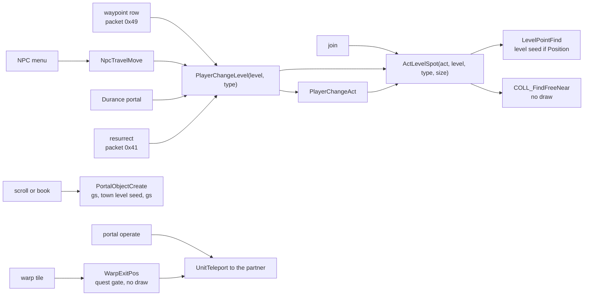
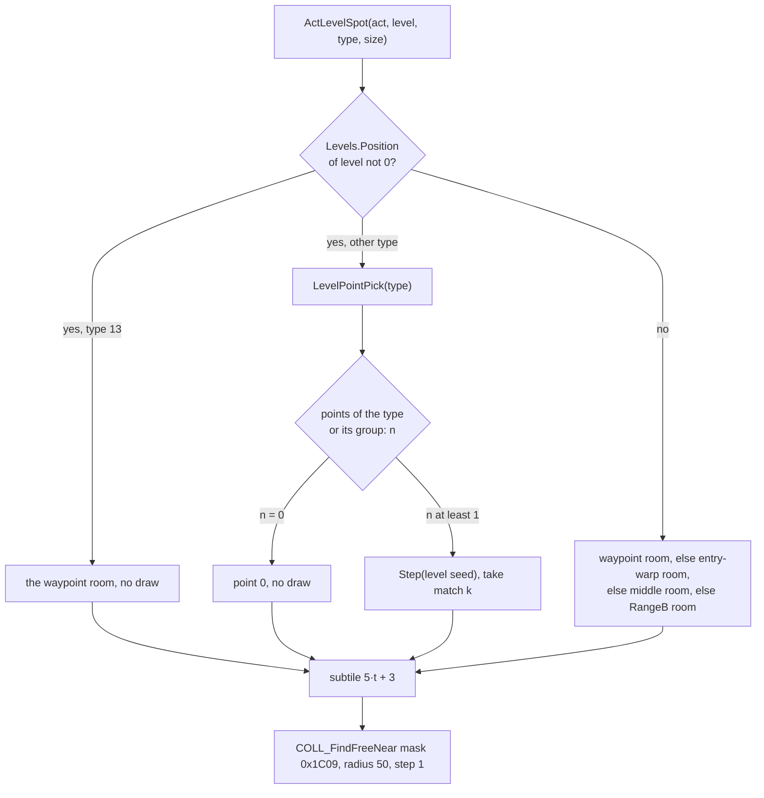
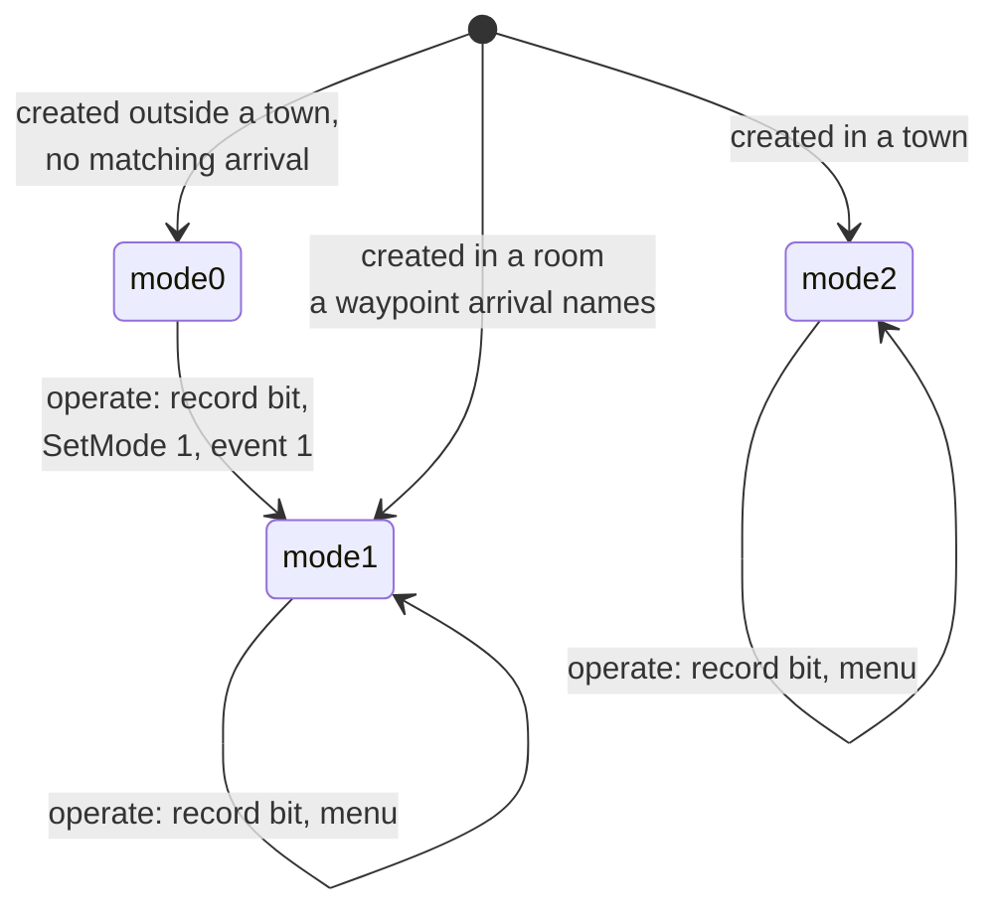
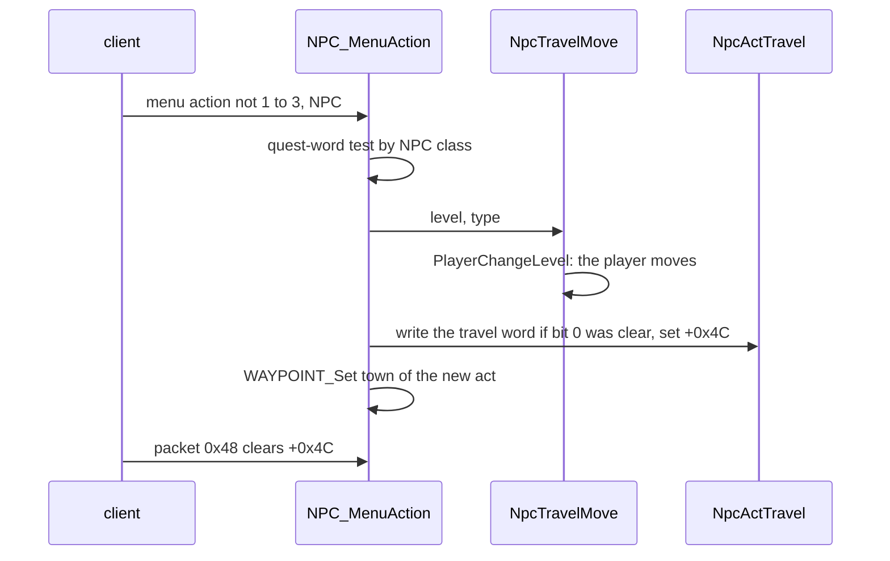
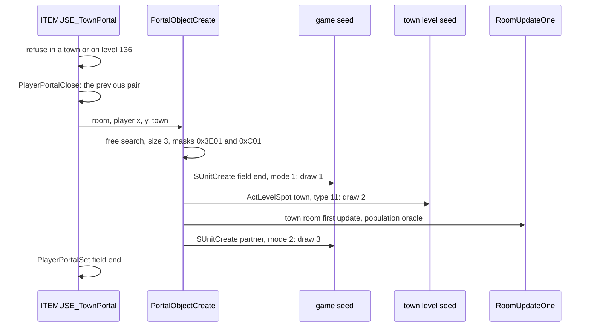

## Purpose

This spec covers how a player moves between levels on the server: activating and using a waypoint, changing act through
an NPC or the Durance portal, opening, using and closing a town portal, taking a warp tile, and where the player lands
after each of these and after a resurrection or a join. The inputs are a click or a client packet, the player's quest
and waypoint records and the tables. The outputs are the player's new room and position, the record writes and the
seed draws. Every placement goes through one routine (§ A), and the only draws are the destination level's seed, the
game seed of created portal objects and, for five waypoint rows, the object's own seed. The quest side of the same
events (quest words written, quest gates) is [quests/progression](../progression/); the overview is
[quests](../overview/).

## Entry points

| When | Function | Tag |
|---|---|---|
| the client picks a waypoint row (packet `0x49`, `{u32 object id, u16 level}`) | `Pkt49WaypointTravel` → `WaypointTravel` | [C] each of the 155 logged waypoint travels lies inside a packet-0x49 handler, called |
| an NPC menu action other than 1–3 (13-byte packet) | `NPC_MenuAction` → `NpcTravelMove` | [C] the call: 35 logged `NpcTravelMove` runs came from `NPC_MenuAction` (returns), each with one level change; [I] the 13-byte packet and the action-code test |
| the player uses an item whose `Misc.pSpell` is 2 (`tsc`, `tbk`) | `g_ItemUseFns[2].use` = `ITEMUSE_TownPortal`, by the dispatch of [items/use § C](../../spec-items/use/#c-the-dispatch-itemuse) | [C] the slot holds, `tbk` and `tsc` are the only Misc rows with `pSpell` 2 (152 rows), and the 68 logged uses came from one call site (return); [I] the use's refusals other than in a town (G1) |
| click on a warp tile (unit type 5, distance below 5) | `UnitInteract` case 5 → `WarpExitPos` | [C] 114 of the 115 logged warps came from `UnitInteract` (return) with the player within 4.5 of the warp; [I] the refusal at distance 5 or more (none logged) and the one warp, at 8.1 |
| the dead player presses "resurrect" (packet `0x41`, mode 17 only) | `Pkt41Resurrect` | [C] the 3 logged resurrections came from the packet dispatch (return) and returned 0 (h-death3); [I] the mode-17 test and the refusals |
| a player joins the game | `PlayerPlaceInAct` (callers) | [C] the 54 logged placements came from the first caller (return); [I] the other two callers |
| the client reports its act loaded (packet `0x48`) | `Pkt48ActChangeClear` | [C] the 3 logged packets 0x48 (x-meshif, x-meshifw, x-tyrael3) came from the packet dispatch (return) and returned 0 |

## Inputs

### Tables

| Anchor | Used for |
|---|---|
| `Levels.txt:Position` | a non-zero value makes the level-point lookup draw on the level seed (§ A); 18 levels: 1, 38, 40, 46, 54, 73, 74, 75, 102, 103, 109, 121, 125, 126, 127, 132, 134, 135 |
| `Levels.txt:Waypoint` | the waypoint index of a level (`WAYPOINT_IndexFromLevel`): 39 indices, Act I 0–8, II 9–17, III 18–26, IV 27–29, V 30–38 |
| `Levels.txt:QuestFlag`, `Levels.txt:QuestFlagEx` | the quest word another player's portal into this level requires (classic, expansion) |
| `Objects.txt:OperateFn`, `Objects.txt:InitFn` | waypoints (`OperateFn` 23, `InitFn` 17), town portals (59: `OperateFn` 15, `InitFn` 11; 60: `InitFn` 12), the lair and Arcane portals (43, 34), the Durance portal (46) |
| `Objects.txt:Sync`, `Objects.txt:FrameDelta` | whether a mode change draws the object's seed, and its bound |
| `Misc.txt:pSpell` | 2 selects the town portal use function |
| `LvlWarp.txt:ExitWalkX`, `LvlWarp.txt:ExitWalkY` | the walk after a warp |

### Runtime state

| State | Type | Source |
|---|---|---|
| level seed (level `+0x1C4`) | Seed | [rng/seeds](../../spec-rng/seeds/); drawn by `LevelPointPick` |
| game seed | Seed | drawn by `SUnitCreate` of every created object |
| object seed | Seed, `Init(game seed low)` at creation | drawn by `UNIT_AnimInit` for `Sync` 0 rows |
| player's unit seed (`Unit+0x20`) | Seed | drawn only by the walk command under state 42 (§ H) |
| waypoint record | 16-byte bit field, player data `+0x1C + 4·difficulty` | [save/d2s](../../spec-save/d2s/) |
| quest record | 48 words × 16 bits, player data `+0x10 + 4·difficulty` | [quests/progression § A](../progression/#a-the-quest-record) |
| own portal id | u32, player data `+0x48` (`PlayerTravel+0x48`) | `PlayerPortalSet` |
| act change in progress | u32, player data `+0x4C` (`PlayerTravel+0x4C`) | § E |
| tick stamp | u32, player data `+0x160` (`PlayerTravel+0x160`) | `PlayerTickSet`, only from the hostility declaration |
| `GetTickCount()` | u32 milliseconds, real time | the OS: an input |
| difficulty `game+0x6D`, expansion `game+0x70` | u8 | the game |

### Constants

| Name | Value | Tag |
| --- | --- | --- |
| waypoint travel wait | 10 000 ms after the stamp | [C] (one client; a declared stamp) |
| portal use wait | 5000 ms after the stamp | [C] (one client; a declared stamp) |
| placement mask, radius, step | `0x1C09`, 50, 1 | [C] (313 logged spot searches: size 2 (245) or 3 (68), both masks `0x1C09`, radius 50, step 1, no fallback) |
| act-change second search | mask `0x1C89`, radius 50, step 5 | [C] (87 logged act-change searches: size 2, masks `0x1C89`, radius 50, step 5) |
| portal field end search | size 3, masks `0x3E01`/`0xC01`, no fallback | [C] (62 logged field ends: size 3, masks `0x3E01`/`0x0C01` with the point, radius 50, step 1, fallback 0) |
| portal town end search | mask `0xBE11`, radius 50, step 5 | [C] (62 logged town ends: size 3, masks `0xBE11`, radius 50, step 5) |
| portal-use state | state 102 for 75 frames | [I] |
| point-type groups (`{has, group}`) | type 0 → group 0; types 5–9 → group 1; type 11 → none | [C] |

### Inputs and oracles

| Item | Kind | What it is | Tag |
|---|---|---|---|
| the click, the packet, the NPC menu action | input | which travel the player asked for | [I] |
| `GetTickCount()` at the two gates | input | real time, never game frames | [C] (61 and 122 gate reads) |
| the collision grid around a search | input (logged) | [drlg/collision](../../spec-drlg/collision/)'s grid; the search reads it | [C] (545 searches) |
| a level or act built on first arrival, a room activated by the lookup | DRLG oracle | its draws are [drlg](../../spec-drlg/overview/)'s and [drlg/collision § I](../../spec-drlg/collision/#i-nearwarptestgame-room-x-y-and-its-side-effects)'s | [I] |
| the town room's population when a portal's town end first updates it | boundary oracle | game-seed draws between the two portal creations | [C] (41 draws in 9 opens) |
| party membership, hostility, a second player's portal | input | two-client cases | [C] for hostility and for the no-party refusal; [I] for the different-ids compare and the quest-word test |

## Algorithm



### A. Placement



```
A1. ActLevelSpot(act, level: i32, type: i32, size: i32) → (room, x: i32, y: i32):   [C]
      (room, tx, ty) ← LevelPointFind(act, level, type)             ; A2
      x ← 5·tx + 3;  y ← 5·ty + 3                                    ; tile → subtile, centre offset
      room ← COLL_FindFreeNear(room, (x, y), other none, size, 0x1C09, 0x1C09, fallback 0, radius 50, step 1)   ; § B
      if room = none: fatal
      return (room, x, y)

A2. LevelPointFind(act, level, type) → (room, tx, ty):              [I]
      ensure the level exists and is initialised                     ; DRLG oracle when absent
      if Levels[level].Position ≠ 0:
        if type = 13: room ← LevelWaypointRoom(level); the point is that room's waypoint
        else: (tx, ty) ← LevelPointPick(level, type)                 ; A3
      else:                                                          ; type is ignored
        room ← the room holding the waypoint, else the first DRLG room with a warp flag and a set warp id,
               else the room holding the level's middle column, else: RangeB(level seed, level+0x08)
        the point is the room's centre when no point was given
      RoomActivateB(the room holding the point)                      ; drlg/collision § I2
      return

A3. LevelPointPick(level, type) → (tx, ty):                         [C]
      g ← group of type (constants table); n: u32 ← count of the level's points whose type = type or whose group = g
      if n = 0: return point 0                                       ; no draw
      Step(level.seed);  r: u32 ← level.seed.low
      k ← r & (n − 1) if n is a power of two else r mod n            ; equal results
      return the k-th matching point (0-based, in point order)

A4. PlayerChangeLevel(level, type):                                  [C]
      if act(level) ≠ the player's act:
        TownLevelLeave(old level, level);  PlayerChangeAct(level, type);  return
      (room, x, y) ← ActLevelSpot(act, level, type, UnitSizeX(player))
      if room: UnitTeleport(player, room, x, y, noSearch 0, 0)       ; its own free search finds (x, y) free and returns

A5. PlayerChangeAct(level, type):                                    [C]
      if the act does not exist: ActCreate                           ; DRLG oracle
      (room, x, y) ← ActLevelSpot(act, level, type, size)
      room ← COLL_FindFreeNear(room, (x, y), size, mask 0x1C89, radius 50, step 5)
      move the unit to the new act; client act; unit act byte; path flags 0x10000
```

Step notes:

- A1. [C] In 124 placements (81 `PlayerChangeLevel`, 32 `PlayerChangeAct`, 11 joins) the player ended on the cell of
  the last search, and `UnitTeleport`'s own search returned at once.
- A2. [C] The type-13 lookup on a `Position` level draws nothing: 28 waypoint arrivals in towns and on levels 46 and 74.

- A2. [C] On a level without `Position` the lookup draws nothing in the waypoint-room, warp-room and middle-room
  branches: 1958 lookups (waypoint arrivals and `NearWarpTest`'s type-11 lookups).
- A2. [C] On a `Position` level the 42 logged type-13 arrivals took the level's waypoint room and the other types ran
  `LevelPointPick` (types 0, 5 and 11 logged); the level entered was the one asked in all 191 logged level changes.

- A2. [I] The last fallback, `RangeB(level seed, level+0x08)`, never ran in either run.
- A3. [C] Types 0 and 11 step the level seed once on a `Position` level when a point matches: type 0 in 22 lookups,
  type 11 in 334, 343 chained pairs of one level's seed (each lookup's exit seed the next one's entry); the type-11
  case was already [drlg/collision § I2](../../spec-drlg/collision/#i-nearwarptestgame-room-x-y-and-its-side-effects)'s
  `[C]`.
- A3. [C] Type 5 with no point of group 1 takes point 0 with no draw: NPC 175's return to level 1, 11 lookups.

- A3. [C] Type 5 with a group-1 point on the level steps the seed once, as types 0 and 11 do: Meshif's return to level
  40, six westward trips, each found a point, stepped Lut Gholein's level seed once and picked the point
  `LevelPointPick` predicts, the level seed chained from one trip to the next, no other seed moved.
  (x-meshifw)
- A3. [C] Type 5 on Harrogath (109), whose one point is of type 0, takes that point with no draw (`LevelPointPick`'s
  n = 0 exit), the level seed unchanged: five trips through the Harrogath portal. (
: x-tyrael3)

### B. The free-cell search

```
B1. COLL_FindFreeNear(room, pos, other, size, maskA, maskB, fallback, radius: i32, step: i32) → room:   [C] (COLL_FindFreeNear; B1 notes)
      base ← RoomAt(room, pos)                                       ; kept even when none
      if base ≠ none and CollisionTest(base, pos, size, maskA) = 0 and (no other or Walk(base, pos, other, maskB) = 0):
        return base                                                  ; pos unchanged
      best: i32 ← −1
      (x0, y0) ← pos;  xl ← x0;  xh ← x0;  yl ← y0 − 1;  yh ← y0 + 1;  w: i32 ← 2
      while (xh − x0 + 1) < radius:
        for y in yl, yl + step, … while y ≤ yh:                       ; the two side columns
          for x in xl − 1, xl − 1 + w, … while x ≤ xh + 1:  Try(x, y)  ; left, then right
        for x in xl, xl + step, … while x ≤ xh:                       ; the two end rows
          for y in yl, yl + w, … while y ≤ yh:  Try(x, y)              ; top, then bottom
        if best ≠ −1: break
        xl ← xl − step;  xh ← xh + step;  yl ← yl − step;  yh ← yh + step;  w ← w + 2·step
      if best = −1 and fallback = 0: return none
      return RoomAt(base, pos)                                       ; pos unchanged when nothing was found

Try(x, y):
      r ← RoomAt(base, x, y);  if r = none: skip
      base ← r                                                       ; moved before the tests
      if CollisionTest(r, (x, y), size, maskA) ≠ 0 or (other given and Walk(r, (x, y), other, maskB) ≠ 0): skip
      if best = −1 or |x − x0| + |y − y0| < best:  pos ← (x, y);  best ← |x − x0| + |y − y0|

RoomAt(base, x, y) → room:
      no base: none;  base holds the cell: base;  else the first room of base's near list, in list order, that holds it;  else none

Walk(r, (x, y), origin, mask) → 0 or 1:
      loop:
        if the cell (x, y) looked up from r has no room, map or cells, or its bits & mask ≠ 0: return 1
        (x, y) ← (x, y) + the step of the field byte at row 128 + y − origin.y, column 128 + x − origin.x
        if the byte at the new cell is 8: return 0                    ; the origin itself is tested only when the walk starts on it
```

Step notes:

- B1. [C] The first-cell test and the cases that moved the cell agree with this search, logged in the game: 545 searches
  inside travel events, 541 in place and 4 moved; 323 searches, 54 moved. Those runs do not separate the
  ring order, the moving base or the walk.
- B1. [C] **`Walk`** to its return, family `line`. A walk step with no room, no
  map or no cells counts as blocked. The field is `expfield.d2`, 256 × 256 bytes after a 10-byte header; byte `d` steps
  `dx[d]`, `dy[d]`, with `dx` = 0, 1, 1, 1, 0, −1, −1, −1, 0 and `dy` = −1, −1, 0, 1, 1, 1, 0, −1, 0, and 8 is the centre. In a check of the whole file every cell walks to the one byte 8, each walk as long as
  the Chebyshev distance.
- B1. [C] The centre is row 128 and column 128: `FieldLoad` stores `height >> 1` and `width >> 1`, the two words `FieldStep` adds; each word has 5 references, all in `FieldLoad`, `FieldFree` and
  `FieldStep` (three tools agree), and `expfield.d2`'s header gives 256 × 256 (65 546 bytes = 10 + 256 × 256).

- B1. [C] In the game, the model above reproduces all 1 102 logged searches of the travel events, at the sizes and steps
  the logged callers passed (2 and 3; 1 and 5): size 2 at step 1 moved in 64 (2 portal, 62 warp), size 3 at step 1 with the walk moved in 62 field
  ends, every other search in place; step 5 never moved a search (149) and the walk never changed a field end's cell
  (a walk-free model finds the same cell in all 62).
- B1. [I] Of the travel callers only the field end of G2 passes an `other`; the moving base applies to all of them.

- B1. [C] The search draws nothing, logged in the game: the game, quest and player seeds were unchanged across every
  placement it ran in.

### C. Waypoint activation



```
C1. WaypointOperate(game, object, player) (OperateFn 23):          [C] for modes 1 and 2; [I] for mode 0
      n ← WAYPOINT_IndexFromLevel(level of the object's room)
      if n is valid: WAYPOINT_Set(player's waypoint record, n)       ; on every operate, before the mode test
      if object.mode = 0:
        SetMode(object, 1)                                           ; draws the object seed if Sync = 0 (C3)
        queue object event 1 at frame + (Objects[class].+0xDC >> 8) + 1
      else if object.mode ∈ {1, 2} and not PlayerIsBusy(player):
        send message 0x63 {object id, the 16-byte record};  the player interacts with the object (type 2)

C2. OBJINIT_Waypoint (InitFn 17):                                    [I]
      for each entry {room, x, y} of the object region's arrival list (+0x1110):
        if entry.room = the object's room or (x, y) lies inside it:
          if object.mode = 0: SetMode(object, 1);  queue event 1 at frame + (Objects[class].+0xDC >> 8)
          free the entry;  arrival list ← empty;  return
      if RoomIsTown(the object's room): SetMode(object, 2)
```

Step notes:

- C1. [C] For a waypoint already in mode 2 the operate sets the record bit, keeps the mode and draws on no seed (the game,
  quest and player seeds and the object's seed): 61 operates in run 1 and 47 in run 2.
- C1. [I] For a waypoint in mode 0 the first operate both sets the bit and starts the animation (mode 1, object event 1),
  and the menu opens only from the next operate. No mode-0 operate was logged in the three runs: every waypoint met was
  already in mode 2, or the walk did not reach it (the Spider Forest and Great Marsh waypoints were logged in mode 0;
  run 3's three attempts, from the Rogue Encampment and the Kurast Docks, reached no mode-0 waypoint). This stays `[I]`
.
- C2. [I] Over the 45 logs of the three runs, a field waypoint first seen after a waypoint arrival in its level was in
  mode 1 (87) or already 2 (8), and one first seen with no arrival was in mode 0 (4); the object lines are periodic, so
  first seen is not the creation, and the reading of `InitFn` 17's creation mode is not raised. (`OBJINIT_Waypoint`)
- C1. [C] There is no proximity or touch test of the waypoint's own: activation is the operate, gated only by the generic
  operate tests (§ J). `WaypointOperate` has no direct call (three tools); its two absolute references are slot 23 of
  `g_ObjOperateFns` and a compare in `WaypointTravel` that tests a target's slot without calling it, so the
  activation runs only through `OBJ_OperateDispatch`. `WAYPOINT_IndexFromLevel` maps through `Levels.Waypoint`: it reads
  the Levels record's byte `+0xE4` and fails on 0xFF, and the column is equal in `.txt` and
  `.bin` over all 137 rows, 39 of them with an index.
- C3. [C] Of the 16 waypoint rows (`InitFn` 17, `OperateFn` 23), exactly five have `Sync` 0: 429, 494, 496, 511, 539,
  each with `FrameDelta` 200 for mode 1 and 100 for mode 2; the other eleven have `Sync` 1 (`Objects.txt` and its `.bin`
  read alike).
- C3. [I] **The draw.** `SetMode` → `UNIT_AnimInit` draws `RangeB(object seed, FrameDelta[mode] >> 3)` when the row's
  `Sync` is 0 ([objects § G](../../spec-objects/overview/#g-creation-sunitcreate-for-an-object) step G2), so the eleven `Sync` 1
  rows never draw, and operating one of the five in mode 0 draws once on its seed, at its `SetMode(object, 1)`; so does
  C2's arrival match.
- C3. [I] **The change to mode 2 draws nothing.** Object event 1, which C1 and C2 queue, is `ObjEvOperateEnd`:
  for an object in mode 1 whose Objects row has `Mode2` set it writes mode 2 directly, not through `UNIT_SetMode`, so it
  starts no animation and draws on no seed whatever the row's `Sync`; then, when the row's `HasCollision2` is 0, it unmarks
  the object's footprint. All 16 waypoint rows have `Mode2` 1 and `HasCollision` 0 in every mode, so for a waypoint the
  event is the mode write and an unmark of a footprint it never marked. C2's town `SetMode(object, 2)` goes through
  `UNIT_SetMode` and is not this event.
- C3. [C] On the kept log of the Rogue Encampment waypoint (class 119, `Sync` 1), created in mode 1 by C2's arrival match
  and found in mode 2 at its one later operate, a model that runs event 1 before an operate past its due frame predicts
  that mode 2: 1 case, 0 mismatches, and the 93 other kept logs with a waypoint check the same as before. Scope: that one
  waypoint, whose `Sync` 1 does not separate a draw.
- C4. [C] Other writers of the waypoint record: `NPC_MenuAction` after an NPC act change (levels 40, 75, 109; § E),
  `DurancePortalOperate` (103; § F) and the Harrogath portal (109; § F). `WAYPOINT_Set` has 6 calls, three tools
  agreeing: `NPC_MenuAction` 3, `DurancePortalOperate`, `WaypointOperate`
  (the activation) and `A4Q2_HarrogathWaypointSet`; `WAYPOINT_Load` is called only by the two
  save readers and the client's menu.

### D. Waypoint travel

```
D1. Pkt49WaypointTravel(player, objectId: u32, level: u16):          [C]
      if GetTickCount() < PlayerTickGet(player, 0) + 10000: cancel;  return     ; u32, real time (§ J)
      r ← WaypointTravelCheck(objectId, level)
      if r ≠ 0: return r
      WaypointTravel(objectId, level)

D2. WaypointTravelCheck(objectId, level) → code:                     [I]
      object missing → 1;  object in another act → 2;  player not near the object → its code
      level = 0 → 0, and no travel follows;  level ≥ the levels count or its waypoint bit clear → 2 or 3

D3. WaypointTravel(objectId, level):                                 [C]
      require: the object's OperateFn slot is WaypointOperate; level ≠ the current level; level ≠ 0; its bit is set
      type ← 13 if LevelIsTown(level) or level ∈ {46, 74, 133, 134, 135, 136} else 0
      PlayerChangeLevel(level, type)                                 ; A4
      if the player's new room is the room of the target's type point: walk command, message 0x1072
      WaypointArrivalAdd(the player's room)                          ; C2
```

Step notes:

- D1. [C] With one client the stamp is 0 in every read and the gate passes when `stamp + 10000 ≤ GetTickCount()`
  (unsigned): 61 gate reads in run 1, 47 in run 2. A non-zero stamp needs a hostility declaration, a two-client case.

- D1. [C] **With a declared stamp** the gate compares against `stamp + 10000` on every logged compare (4 of 4): the
  declarer's waypoint travel was refused 4.4 s after its declaration and passed 33 s after.
- D2. [C] Code 0 in the 148 logged packets 0x49 that named a level, each followed by its level change; the 7 packets
  with level 0 changed no level.
- D3. [C] Waypoint travel reads no quest word and draws nothing but the destination's level seed of § A: the game, quest
  and player seeds were unchanged across 108 travels (61 + 47).
- D3. [C] The arrival type is 13, with no draw, for the towns and levels 46 and 74 the runs reached; [C] type 0 for the 106 logged field arrivals; [I] for levels 133–136.
- D3. [C] The act tabs of the waypoint menu are a client gate: of the target, the server tests only its waypoint bit.
  `WaypointTravelCheck`'s 17 calls (three tools) include no quest reader; the target level reaches
  only `WAYPOINT_IndexFromLevel` → `PlayerWaypointRecord` → `WAYPOINT_IsSet`, and no test
  reads the target's act. Besides, the check refuses (code 2) when the operator's and the waypoint's rooms lie in
  different acts (`cmp bl, al`) and tests the player's position (`PktPosFar`).


### E. Act change through an NPC



Step notes:

- E1. [C] NPC 155 moved the player to level 40 at type 0 (11 trips) and NPC 210 to level 75 at type 0 (7), each move
  before its `NpcActTravel` in the frame.
- E1. [C] The player is moved before the travel word is written: 22 Warriv trips (11 east, 11 west) in run 1, and Meshif
  east in run 2.
- E1. [C] In the state logged (expansion, word 26 bit 0, after Tyrael's message 0x4E20), E1's 367 branch was not reached:
  the five Act IV → V trips each logged `NpcTravelMove(109, 5)` from the Harrogath portal's operate (object 566, § F),
  never the branch's `NpcTravelMove(109, 0)`. (x-tyrael3
)
- E1. [I] The client's menus, as screenshotted in the run's development logs, explain it: NPC 367's has only *talk* and
  *cancel* in that state, and Meshif's Act III menu (NPC 264) *talk*, *sail west* and *cancel*. A screenshot is an
  observation of the client, whose menu builder was not read, so the menus' lines, that no stock state offers NPC 367's
  travel line and that the 367 branch is unreachable by stock play are `[I]`. (`NPC_MenuAction`
: the two menu screenshots)
- E1. [I] The quest-word tests of NPCs 155, 210 and 367 were not run on their refusing side; NPCs 175, 264 and 520 test no
  quest word (264 and 520 only for action 0). The NPC classes are `monstats` rows; their names (Warriv, Meshif, Tyrael,
  Cain) are labels only.
- E3. [I] Word 28's branch (reached only through NPC 367's menu branch) and E1's word 26 test for NPC 367
  were read, not run; word 28 is written in stock play by the Harrogath portal (§ F).
- E3. [I] While `+0x4C` = 1, `OBJ_OperateDispatch` and `PlayerIsBusy` refuse, so the player can operate nothing and open
  no waypoint menu until packet 0x48. The Durance portal (§ F) and the Act IV/V quest code that calls
set it too.
- E4. [C] The clear branch has one case per travel word: word 7, word 15 and word 28 (the first trip
  through the Harrogath portal, run 3): `+0x4C` 1 → 0, return 0; trips that wrote no travel word set no `+0x4C` and
  sent no packet 0x48. (x-tyrael3)
- E4. [I] The returns 3 (`a2` ≠ 1) and 2 (`+0x4C` already 0) were not reached. What the client sends 0x48 after is under
  *Open questions*.
- E2. [C] NPC 264's westward return (`NpcTravelMove(40, 5)`) steps Lut Gholein's level seed once per trip and NPC 175's
  return to level 1 draws nothing (A3). (x-meshifw)
- E2. [C] Into another act `NpcTravelMove` calls `PlayerChangeLevel(level, type)`: 40 logged moves to levels 40, 75, 1
  and 109 at types 0 and 5.
- E2. [I] NPC 520's return uses type 5 too, with A3's draw rule (a draw only when the town has a group-1 point); not
  logged.
- E5. [I] `TownLevelLeave(old, new)` marks the old town's store stale and, on
  arrival in town 1, 40, 75 or 109, sends that act's NPC quest flags.

### F. The Durance portal and the other travel objects

| Object (`OperateFn`) | Destination and point type | Quest test | Tag |
|---|---|---|---|
| Duriel's lair portal 100 (43) | class 100 → level 73; class 377 → its object byte; type 0 | none | [I] |
| Arcane portal 298 (34) | 74 → 54 at type 0; 54 → 74 at type 11; then the Act II mode sync | none | [I] |
| Durance portal 342 (46) | 102 → 103 at type 0 | word 22 bit 13 or 0 | [I] |
| Harrogath portal 566 (73), expansion only, made by Tyrael's message 0x4E20 | the player in Act IV; if word 28 bit 0 was clear: word 28 bit 0 then 13, the record sent, `+0x4C` = 1; then every time `NpcTravelMove(109, 5)` (no draw, A3) and the waypoint record | word 26 bit 0 or 13 (else message 0x13) | [C] for the passing side (x-tyrael3, five trips, word 28 written on the first) |
| Baal's portals 563/569 (70) | on 131 → 132 at type 11 once Baal opened it; elsewhere → 131 | quest 36's private flag | [I] |
| the last portal 565 (72) | → 109, `+0x4C` = 1, word 40 bit 10 | word 40 bit 13 | [I] |

- F1. [C] Object 410 `Siege Control` shares `OperateFn` 46 with 342 (`.txt` and `.bin`), but no DS1 unit (two readers,
  2 274 files), no `objgroup` cell and none of the 17 instructions with the immediate 0x19A creates it, so stock data
  never places it.
- F1. [I] On any level but 102 the handler moves no one.
- F3. [I] Each of these objects in mode 0 goes to mode 1 and queues object event 1 when operated. Their destination
  point lookups draw as § A.

### G. Town portals

#### Opening



```
G1. ITEMUSE_TownPortal(player, item):                                [I]
      player units only;  unit +0xC4 |= 0x40
      town ← ActTownLevel(act of the player's level)
      if RoomIsTown(the player's room) or level = 136: refuse
      PlayerPortalClose(player)                                      ; frees the previous class-59 pair (G3)
      if PortalObjectCreate(room, x, y, town, &field, class 59, noSearch 0):
        PlayerPortalSet(player, field)                               ; player data +0x48
        level 120 only: the summit hook A5Q5_SummitPortalAdd for both ends (quests/progression § Word 39)

G2. PortalObjectCreate(room, x, y, dest, &out, class, noSearch) → bool:   [C] for the draws and their order
      if a player is given and RoomIsTown(room) and not (class = 60 and dest ∈ {39, 133, 134, 135, 136}): refuse
      act(dest) must equal act(room's level), else fatal
      unless noSearch: room ← COLL_FindFreeNear(room, (x, y), other (x, y), 3, 0x3E01, 0xC01, fallback 0, radius 50, step 1)
      field ← SUnitCreate(object, class, x, y, mode 1)               ; draw 1: game seed; object seed ← Init(game seed low)
      SetMode(field, 1)                                              ; mode unchanged: no draw
      partner ← PortalPartnerCreate(field, dest, room's level)       ; G2a
      flags |= 3 on both;  RoomPinSet(each end's room, 0)
G2a. PortalPartnerCreate(field, dest, src):                          [C] for the draws and their order; [I] for the level-73 branch
      (room, x, y) ← ActLevelSpot(act(dest), dest, type 11, size 3)   ; draw 2: dest's level seed (Position)
      RoomUpdateOne(room)                                            ; first update: population draws on the game seed (oracle)
      if src = 73 and QUESTS_PortalTownSpot(…):                      ; an Act II quest private byte +0x3C = 1
        (room, x, y) ← ActLevelSpot(Act II, 40, type 12, size 3), then a step-7 search with mask 0xBE11
      else: room ← COLL_FindFreeNear(room, (x, y), 3, 0xBE11, radius 50, step 5); if none, ActLevelSpot again
      partner ← SUnitCreate(object, class of field, x, y, mode 2)    ; draw 3: game seed
      partner data +4 ← src;  flags |= 3;  SetMode(partner, 2)       ; mode unchanged: no draw
      link field ↔ partner
```

Step notes:

- G2. [C] **Three draws, in order:** game seed (the field end's `SUnitCreate`), the town's level seed (`LevelPointPick`
  type 11), game seed (the partner's `SUnitCreate`). Both ends leave `SUnitCreate` already in their mode, with unit seed
  `Init(game seed low)`, so neither the creation nor the following `SetMode` draws on the objects' seeds:
  `UNIT_SetMode` returns without drawing when the mode is unchanged. The `[C]` rests on 57 of the 62 opens logged (53 with
  no population draw, 4 with the oracle's exit logged); in 5 opens the population's exit was not logged.

- G2a. [C] When the town end's room is updated for the first time (`RoomUpdateOne`, after the type-11 lookup), its
  population draws on the game seed between draws 1 and 3: 41 draws in 9 of the 62 opens. It is a boundary oracle: a reimplementation asserts the game seed at its exit.

- G2. [I] With no free cell and no fallback the open fails (the caller after the return, not run).

- G1. [C] The refusal in a town: six uses of the tome in the Rogue Encampment and in Harrogath returned at the town test
with no portal created, the player's portal unchanged and no draw on the game, quest or
  player seed. (`ITEMUSE_TownPortal`: x-entry, x-entry2,
  h-entry, x-anya, nm-anya, h-anya)
- G1. [C] Each of the 62 logged field uses created one class-59 pair and set player data `+0x48` to the new field end's
  id (27 id checks in the logs that carry it); the 6 town uses created none and left it.
- G1. [I] The refusal on level 136 was not reached.
- G2a. [I] A portal from Duriel's lair (73) puts its town end at level 40's point type 12 when quest 13's private byte
  `+0x3C` is 1.


#### Using a portal

```
G3. OBJOP_Portal(game, object, operator) (OperateFn 15):             [I]
      if PlayerIsBusy(operator): refuse
      if PlayerHostileToAny(game, operator) ≠ 0 and the owner is not the operator: refuse   ; the operator is hostile to someone
      if GetTickCount() < PlayerTickGet(operator, 0) + 5000: refuse                     ; the operator's own stamp (§ J)
      if the portal has an owner (≠ −1) who is not the operator:
        if PartyId(operator) = 0xFFFF: refuse                            ; in no party; 16-bit
        owner ← GameFindUnit(game, owner id, player)
        if owner found and PartyId(owner) ≠ PartyId(operator): refuse  ; no owner unit: no compare
      partner ← PortalPartnerGet(object);  dest ← object data +4
      if class = 59 and object ≠ the operator's own portal and a partner exists and partner ≠ the operator's own portal:
        q ← Levels[dest].QuestFlagEx if expansion else Levels[dest].QuestFlag
        if q > 0 and word q bit 0 of the operator is clear: refuse
      target ← the partner's room and position, or with no partner ActLevelSpot(act(dest), dest, 0, size 3)
      object flags |= 5
      if RoomIsTown(the operator's room): raise quest event 3 (new level, operator)
      room ← COLL_FindFreeNear(target room, target, size, 0x1C09, fallback 0)
      if room is null: return 0                                      ; no refusal call
      UnitTeleport(room, x, y, 0, 0)
      walk command to (x + 5, y + 5)                                 ; § H
      if no partner or class = 60: if the object is in mode 1, queue object event 1
      else if PlayerPortalGet(operator) = partner id:                 ; the owner, through the town end
        free both ends;  RoomPinSet(their rooms, 1);  summit hook A5Q5_SummitPortalRemove
      timed state 102 on the operator for 75 frames
```

Step notes:

- G3. [C] A use raises quest event 3 exactly when the operator stands in a town: 122 logged uses, 61 from a town each
  with one event 3 inside the use, 61 from the field with none; the operator moved in all 122.
- G3. [C] A portal use draws on no seed of its own: the game, quest and player seeds were unchanged across 122 uses; a
  room activated by the arrival is an oracle.
- G3. [C] With one client the 5000 ms gate passes on every read: stamp 0, `stamp + 5000 ≤ GetTickCount()` (unsigned),
  122 reads.
- G3. [C] **With a declared stamp** the gate compares against `stamp + 5000` on every logged compare (4 of 4): a
  portal use 2.4 s after a declaration and withdrawal was refused, and uses at 62 s and 84 s passed.
- G3. [C] **A hostile operator is refused on another player's portal before the gate**: the hostile joiner's click on
  the host's portal was refused with no gate compare, while the hostile host's use of its own portal went on to the
  gate.
- G3. [C] **An operator in no party is refused on another player's portal; an operator in the owner's party passes.**
  With neither player in a party, the joiner's click on the host's town portal passed the 5 s gate and was refused;
  in the host's party, the same click 22.5 s later passed and arrived at the field end. Scope: one refusal and one pass,
  outcome only; the party test itself was not logged. The branch is the code's, held by the run: the other refusals
  after the gate (two null-record guards, the quest gate, which tests nothing for level 3, and the free-spot search)
  read no party state, and the partied click passed them at the same end; with both ids `0xFFFF` the id compare would
  pass, so the refusal is the operator's `0xFFFF` test, which comes before the compare. The party id read at the test
  comes, which returns `0xFFFF` for a unit that is not a player and otherwise jumps to `PartyIdOfUnit`,
  `0xFFFF` for a unit in no party (read from the code).
- G3. [I] The compare of two different party ids needs a third player, since two players hold at most one party; the
  pass with no compare when the owner unit is not found (the owner gone from the game) and the skip for an owner id of
  −1 or the operator's own are read from the code.
- G3. [I] When the free-spot search at the destination finds no room, the use returns 0 with no refusal call; the
  runs did not meet it.
- G3. [I] The quest-word test needs a second player (MP27).
  The stock `QuestFlag`/`QuestFlagEx` values: level 39 26 / 40; 46 and 66–73 13; 50–54 and 74 11; 100–102 21;
  128–132 39. The owner, and anyone using the owner's own end, is not tested.

#### Closing and permanent portals

- G4. [I] A player's class-59 pair is freed when (a) the owner goes through the town end; (b) the owner opens a new
  portal (`PlayerPortalClose` at the start of G1); (c) the owner unit is freed; (d) the hostility declaration
runs; (e) the Ancients' altar on level 120 closes every portal standing there. Class-60 portals are never closed by these paths.
  (callers)
- G4. [C] The owner's use of the town end is followed, at the next open, by a new pair being created, consistent with (a)
  and (b); the field end of a still-open pair was not re-checked.
- G5. [I] **Permanent portals (class 60).** `OBJINIT_Portal` (`InitFn` 12) sets the destination from the level the
  portal stands on: 1 ↔ 39, 4 ↔ 38, 46 ↔ 74, 109 ↔ 121, 111 ↔ 125, 112 ↔ 126, 117 ↔ 127, the true tomb (act `+0x094`) → 73
  and 73 → the true tomb; on 111, 112 and 117 a changed destination queues object event 11. They are created by
  `CUBE_CowPortalOpen`, the quest scripts and
  `PermPortalAtUnit`.

### H. Warps

```
H1. UnitInteract case 5: a warp unit within distance 5 → WarpExitPos(player, warp)   [I]
H2. WarpExitPos(player, warp):                                       [C] for the placement with no draw; [I] for the gate
      dest ← UnitWarpDestRoom(room, warp class): the paired warp unit  ; drlg/warps § F
      (x, y) ← its subtile position
      room ← COLL_FindFreeNear(dest room, (x, y), size, 0x1C09, fallback 1)
      if dest level ∈ {73, 100, 118, 128, 132} and QUESTS_WarpGate(src level, dest level) ≠ 0: refuse
      UnitTeleport(room, x, y, 0, 0);  walk command to (x + ExitWalkX, y + ExitWalkY)
H3. QUESTS_WarpGate(src, dest) → refuse:                             [I]
      73: refuse while an Act II quest object is active with its private byte +0x0B = 0
      100 → DuranceWarpGate: refuse unless the player's room level is 101 or the orb is broken in this game
      118 or 128 with src 120: refuse while quest 35 is active and not done in this game
      132: refuse until Baal opened the chamber
      else 0
H4. The walk command PlayerModeCmd(0, 2, x, y, 0) first calls PlayerModeAllowed:   [I]
      if the player is in state 42 and the current skill's Skills flag byte +7 has bit 7:
        Range(player unit seed, 100) against stat 164 of that state's list
      otherwise no draw
```

Step notes:

- H1. [C] 114 of the 115 logged warps came through `UnitInteract`'s case 5 with the player within 4.5 of the warp unit
  (largest coordinate distance 4).
- H2. [C] The quest gate is called exactly when the destination is 73, 100, 118, 128 or 132: 115 logged warps, the one
  call 83 → 100.
- H2. [C] A warp draws on no seed: the game, quest and player seeds were unchanged across 106 warps (the sewer-dock pair,
  LvlWarp rows 20 and 21, 100 times; row 64 into 100; row 76 into 120; 2 in run 1), and the free search after each is
  § B's.
- H3. [C] The gate into 100 passes once the orb is broken: x-orb's warp 83 → 100 after the orb broke called
  `QUESTS_WarpGate(83, 100)`, which returned 0.
- H3. [I] The gates are quest code.
  The gate into 100 was logged allowing once (after the orb broke) and never refusing; level 120's warp tiles (WRP rows 82
  and 83) were never taken, so the 118/128 branch never ran.
- H3. [C] The way back from 120 that the runs met is the summit door (object 564, `OperateFn` 71), not a warp tile: it
  refused every operate while quest 35's private "done in this game" byte was 0, whatever the creator had done (88
  operates).
- H4. [I] The state-42 draw was not met in either run.

### I. Death, resurrection and joining

```
I1. Pkt41Resurrect(player), player in mode 17:                       [C] for the move and the draw; [I] for the writes
      life, mana and stamina ← their maxima;  unit +0xC4 |= 2;  state 54 set and cleared   ; not logged (I1 notes)
      PlayerChangeLevel(ActTownLevel(act of the player's level), type 0)   ; a town is a Position level: one level-seed step
      a mode command;  the skills re-selected
I2. PlayerPlaceInAct(player, given = 0):                              [C]
      level ← act+0x08 of the player's act (ActStartLevel)
      (room, x, y) ← ActLevelSpot(act, level, type 0, size)
      the player's hireling: created there (MERC_Create), or moved to the town's type-0 spot if it exists
    with a given position: the player is put there
```

- I1. [C] Three resurrections in Hell (the character killed in the Cold Plains, Escape each time) each moved the player
  to level 1 by `PlayerChangeLevel(1, type 0)` with one step of the town's level seed, chained from one death to the
  next, the free search as predicted, and no game, quest or player seed draw across the handler.
  (h-death3)
- I2. [C] 11 joins placed the player at A1's cell; the hireling branch was not separated.

### J. Operate gates and real-time gates

- J1. [I] `OBJ_OperateDispatch` refuses when the player is interacting with an NPC, has `+0x4C` set, or holds a cursor
  item (except class 267), and never operates classes 121, 122 and 22; it fetches the object-region seed before calling
  the handler.
- J2. [C] Both real-time gates (waypoint travel, 10 000 ms; portal use, 5000 ms) read `GetTickCount` against the
  operator's own player data `+0x160` (`PlayerTickGet(player, 0)`), with one client (stamp 0) and with a stamp a
  declaration wrote (two clients).
- J2. [I] No portal is exempt from the gate, the operator's own included (G3 tests the stamp before the owner).

- J3. [C] **The hostility declaration** (hostile = 1) writes the pair's stamp `now + 60000` and the
  declarer's `+0x160` ← `now`, and refuses a second declaration while the pair's stamp is ahead: in the two-client run
  both declarations wrote both stamps as predicted (2 of 2), and one made 50 s after the first was refused with the
  stamp 9.3 s ahead and no new stamp written. The community lead's single 10 s delay holds for waypoints and is
  contradicted for portals (5 s, G3).
- J3. [I] Its other conditions and effects are read from the code: the declarer must stand in a town, and both
  players' base level (stat 12) must be 9 or more; toward a player not yet hostile the other's full level must be 9 or
  more too; it closes the declarer's portal pair (G4 d) and leaves the party when both share one. The stock client
  sends no declaration outside town ("Must be toggled in town."), so the server's town test is not reached with it, and
  the level-below-9 case was not run.
- J3. [I] **The withdrawal** (hostile = 0) left the declarer's `+0x160` unchanged in the one case run, so
  the 5 s portal gate still runs from the declaration after a withdrawal; that path's code is not read.

### Draws by event kind

| Event | Draws, in order | Chaining | Tag |
|---|---|---|---|
| waypoint operate, mode 2 | none | — | [C] |
| waypoint operate, mode 0 | rows 429, 494, 496, 511, 539: `RangeB(object seed, FrameDelta[1] >> 3)`; others none | the object's own seed | [I] |
| waypoint object event 1, mode 1 → 2 | none, for every row | — | [I] |
| waypoint travel | the destination level seed, one step if `Position` and type ≠ 13; a level or room build when absent (oracle) | per level seed, with the population pass's lookups | [C] |
| NPC act change | the destination town's level seed, one step (type 0; type 5 only with a group-1 point) | per level seed | [C] for type 0 and Meshif's stepping type 5 |
| Harrogath portal | none: type 5 on 109 takes its one type-0 point with no draw (A3) | — | [C] (x-tyrael3) |
| Durance, lair, Arcane portals | the destination level seed when `Position` | per level seed | [I] |
| town portal open | game seed, town level seed (type 11), game seed; population oracle between | game seed with every unit creation; level seed per town | [C] |
| portal use | none | — | [C] |
| warp | none (the state-42 walk aside) | — | [C] |
| resurrection | the town's level seed, one step | per level seed | [C] (h-death3) |
| join | the start town's level seed, one step | per level seed | [C] |

## Outputs

- The player's new room and subtile position, the client's act on an act change: [C] the level entered was the one
  asked in all 191 logged level changes.
  A walk command after a waypoint arrival, a portal use or a warp: [I].
- Record writes: the act-travel words 7 (Warriv), 15 and word 10's first-crossing bits (Meshif), bit 0 then bit 13 each,
  and 28 (the Harrogath portal): [C]. Word 23 and the waypoint bit (operate, NPC act change, Durance and Harrogath
  portals): [I].
- Objects: the portal pair and player data `+0x48` [C] (62 field uses, 6 town uses; `ITEMUSE_TownPortal`); player data `+0x4C` and state 102 on a portal user [I].
- Seed draws as tabulated above. Quest event 3 for every level change within one act, none for an act change: [C] each of the 341 logged same-act level changes
  (101 waypoint, 115 warp, 122 portal, 3 resurrection) was followed by one dispatched event 3 naming the
  old and the new level, a portal used in a town raising one more inside the use (G3), and none of the 87 act changes
  (40 by NPC, 47 by waypoint) was. [I] The guard
  that skips the act change is not read. NPC 155's act change calls quest object 6's event-3 slot directly, not through
  the dispatch, when word 6 bits 13 and 0 are set (E3).

## Worked example

Seeds are `low:high` in hex; `Step` is [rng](../../spec-rng/overview/) step 1 (multiplier `0x6AC690C5`).

### 1. A town portal opened on level 29, Act I

- [C] **Inputs.** The player stands at subtile (17764, 5102) on level 29; the act's town is level 1 (a `Position`
  level). Game seed on entry `c806df78:2ad0ed85`; level 1's seed `ffc121cf:119fbf81`; level 1's points are
  `(1132, 1162, type 0)`, `(1134, 1162, type 10)`, `(1136, 1169, type 11)`.
- [C] **Draw 1.** The field-end search moves the portal to (17762, 5102); `SUnitCreate` steps the game seed to
  `7c9e64dd:536dfef6`, and the field end's seed is `Init(0x7c9e64dd)` = `7c9e64dd:0000029a`, created in mode 1.

- [C] **Draw 2.** `LevelPointPick(1, type 11)`: one matching point (`n` = 1, type 11 has no group); `Step` takes level 1's
  seed to `605d33cc:6aac5801`, `k = low mod 1 = 0`, the point (1136, 1169), subtile (5·1136 + 3, 5·1169 + 3) =
  (5683, 5848); both free searches leave it there.
- [C] **Draw 3.** The town room was already updated (no population draw); `SUnitCreate` steps the game seed to
  `d6fbed07:33fa3ebe`; the partner's seed is `d6fbed07:0000029a`, created in mode 2 at (5683, 5848).

- [C] **Chaining.** The next portal of the session opened from level 29 found level 1's seed at `605d33cc:6aac5801`, the
  value draw 2 left, and stepped it to `874ff3fd:28315607`: no other user of level 1's seed ran in between.


## Reimplementation notes

- **Real time, not frames.** The two travel gates compare `GetTickCount()` with a stamp. With one player the stamp stays
  0 and both gates always pass; a reimplementation that models frames only must still keep the stamp and the
  millisecond clock for the multiplayer case.
- **The level-seed step is per placement.** Every arrival on a `Position` level (all towns) by waypoint at type 0, NPC,
  resurrection or join, and every town portal open, steps that level's seed once; the population pass's own waypoint
  lookups step the same
  seed. A waypoint arrival into a town (type 13) does **not**.
- **The portal pair draws three times, not five.** The objects are created already in their final mode; calling
  `SetMode` with the same mode must not draw.
- **Move first, write second.** An NPC act change moves the player before it writes the travel word (E1). It dispatches
  no event 3 (Outputs); a level change within one act does. NPC 155's branch instead calls quest object 6's event-3 slot
  itself, after the word's write and only when word 6 bits 13 and 0 are set (E3, read from the code). A reimplementation
  that dispatches event 3 for an act change runs quest handlers the game does not run there.
- **`+0x4C` blocks operates** until the client sends packet 0x48; it is set only when a travel word was newly written.
- **Point 0 without a draw.** A type-5 lookup on a town without a group-1 point returns the first point and draws
  nothing; do not draw `Range(0)`.

## Evidence

- Tables: Levels § Travel, Objects § Waypoints and
  portals, Misc,
  LvlWarp.
- Upstream: [rng](../../spec-rng/overview/), [rng/seeds](../../spec-rng/seeds/), [drlg/collision](../../spec-drlg/collision/),
  [drlg/warps](../../spec-drlg/warps/), [objects](../../spec-objects/overview/). Downstream: [quests/progression](../progression/).
