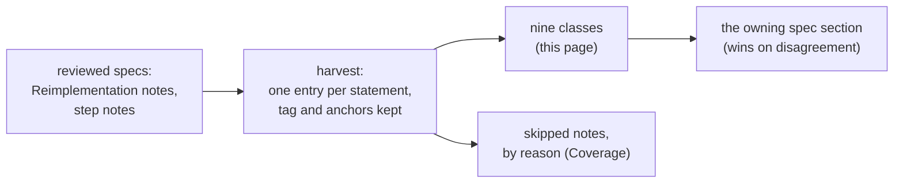

## Purpose

A careful reimplementer "fixes" some behaviour of the 1.14d `Game.exe` by accident: an unsigned divide made signed, a
draw skipped because its result is thrown away, a `≤` turned into `<`, a table edge read the "sensible" way. The reviewed
specs state these traps, scattered over their *Reimplementation notes* and step notes. This page lists them in one
place, by class, so that a reimplementation can be checked against the whole list.

This is an **index, not a spec of its own** (owner decision 1). Each entry restates one statement of a reviewed spec, with that statement's tag and anchors, and links the section that holds it. It claims nothing new. **The owning spec wins on any disagreement**: read the linked section before you implement an entry, because the one-line restatement leaves out the conditions the spec gives in full.

## How to read an entry

| Column | Meaning |
|---|---|
| Id | `Q<n>`, permanent from the Phase 1 review on: golden-trace cases cite it, so an id is never renumbered or reused; a new entry takes the next free id at the end of its class, and a removed entry's id is retired. Q1–Q435 are in class order |
| Quirk | the behaviour to keep, restated in one or two sentences |
| Tag | the tag the source statement carries; a source note that holds two tags gives two entries |
| Anchors | anchors copied from the source statement (functions, addresses, runs, table columns) |
| Source | the owning spec's section; `nK` is the K-th bullet of that spec's *Reimplementation notes*, counted from 1 |

What counts as a quirk (owner decision 2): behaviour a reimplementer would plausibly "fix" or get wrong, in eight
classes, plus deliberate oddities that look like bugs and the community descriptions that 1.14d does not follow. Left
out: presentation (displayed names, strings, the quest log); a note whose whole content is a wall-clock rule (a
`GetTickCount` compare), while a branch that merely has a wall-clock threshold stays (Q387); and the table-loading
rules of data/excel and data/calc's pools, with two row-index and code-resolution notes of hirelings and
items/properties, which a loader built to those specs implements as written (read
[data/excel's notes](../../spec-data/excel/#reimplementation-notes) whole when writing the loader). Crash and hang paths are
listed as the specs state them: six from code readings (inferred) and three reached in kept runs
(confirmed): Q89, a fault logged on one crafted row, Q437, the fatal path reached on three paths under emulation, and Q448, the party's ninth member under emulation; none was
provoked for this page (owner decision 5).

The check does not tell which clause of a note holding both tags an entry restates; those entries were read by hand at the Phase 1 review. The entry tables are the machine-readable form (five fixed cells per row, read, and `list` prints them as JSON Lines); there is no second file (review).

## Entries

| Class | Entries | C | I |
|---|---|---|---|
| [1. Arithmetic width and sign](#1-arithmetic-width-and-sign) | 26 | 20 | 6 |
| [2. Rounding and float](#2-rounding-and-float) | 21 | 17 | 4 |
| [3. Wrap and overflow](#3-wrap-and-overflow) | 10 | 3 | 7 |
| [4. Bounds, comparisons and table edges](#4-bounds-comparisons-and-table-edges) | 79 | 62 | 17 |
| [5. Draw order and dead draws](#5-draw-order-and-dead-draws) | 144 | 124 | 20 |
| [6. Data-dependent branches](#6-data-dependent-branches) | 135 | 116 | 19 |
| [7. Timing and frame edges](#7-timing-and-frame-edges) | 28 | 20 | 8 |
| [8. Multiplayer edges](#8-multiplayer-edges) | 23 | 17 | 6 |
| [9. Deliberate oddities that look like bugs](#9-deliberate-oddities-that-look-like-bugs) | 72 | 44 | 28 |
| **Total** | 538 | 423 | 115 |

### 1. Arithmetic width and sign

| Id | Quirk | Tag | Source |
| --- | --- | --- | --- |
| Q1 | The RNG's `low` is `u32` and the range reduction divides unsigned; a signed `low` is wrong for `low ≥ 2^31`. | [C] | rng/README n4 |
| Q2 | The seed's `high` word is not the constant 666 after `Init`: each step overwrites it with the carry word, so all 64 bits are state. | [C] | rng/README n3 |
| Q3 | The animation rate divides `(spd × X) mod 2³²` by 100 unsigned for cast, get-hit, block, attack and default; only the moving branch divides signed, so a negative factor gives the fastest rate (unreachable on stock data). | [I] | [anim/timing](../../spec-anim/timing/#reimplementation-notes) n3 |
| Q4 | Calc opcode `04` reads its variable index unsigned (0–255): `04 80` is variable 128. | [C] | [data/calc § B](../../spec-data/calc/#b-the-encoding); [data/calc](../../spec-data/calc/#reimplementation-notes) n7 |
| Q5 | `manashift` shifts by `manashift & 31` (the processor's masking of a byte that can reach 255); mask explicitly where shifts past 31 are undefined or saturate. | [C] | [data/calc](../../spec-data/calc/#reimplementation-notes) n9 |
| Q6 | The string-table hash takes key bytes as signed chars: a byte ≥ 0x80 gives another home slot than the unsigned ELF hash (a miss walks `max_probes` nodes whatever the slot). | [C] | data/strings n4 |
| Q7 | DR and MDR come before the resistance; a field they push negative skips the resistance and stays negative. | [C] | [combat/reductions](../../spec-combat/reductions/#reimplementation-notes) n1 |
| Q8 | Outdoor sizes, footprints and the mid cell divide signed; the preset rotation uses signed `%`. | [C] | [drlg/outdoor](../../spec-drlg/outdoor/#reimplementation-notes) n12 |
| Q9 | Trade prices divide the stat and staff-mod sums by `n` unsigned and the affix accumulators signed: with `n > 1` a negative stat sum divides as a large unsigned value. | [C] | [items/economy](../../spec-items/economy/#reimplementation-notes) n4 |
| Q10 | Unique and set `lvl` comparisons are signed 16-bit (`movsx`), against an ilvl raised to at least 1. | [I] | [items/uniques-sets](../../spec-items/uniques-sets/#reimplementation-notes) n9 |
| Q11 | A region's `raritySum` is one byte. | [C] | [monsters/pool](../../spec-monsters/pool/#reimplementation-notes) n7 |
| Q12 | The live special count `nSpecial` is an i32 compared through its low byte with `MonUMin`/`MonUMax`. | [C] | monsters/spawn n11 |
| Q13 | Objects `Xspace`/`Yspace` are unsigned: a negative `.txt` value is a step of 249..255 subtiles. | [C] | objects n7 |
| Q14 | Experience is unsigned: thresholds above 2³¹ and `nextexp` compare and store as `u32`. | [C] | [player/creation](../../spec-player/creation/#reimplementation-notes) n4 |
| Q15 | With stock `ExpRatio` and shift 10, the kill-experience shift count `(r >> s) + s` is 10 or 11 (11 on the 70 rows at 1024, 10 elsewhere and above `MaxLvl`). | [C] | [player/creation](../../spec-player/creation/#reimplementation-notes) n7 |
| Q16 | `StatPerLevel` is read as an `i8`. | [I] | [player/creation](../../spec-player/creation/#reimplementation-notes) n9 |
| Q17 | The item bitstream's width clamp is unsigned: a negative value written into an `n`-bit field becomes `2^n − 1`, not 0. | [C] | save/d2s n8 |
| Q18 | The `gf` stats writer clamps signed instead: a negative value of an unsigned stat becomes 0. | [I] | save/d2s n8 |
| Q19 | An item property's param is read unsigned (a 9-bit 270 stays 270). | [C] | save/d2s n13 |
| Q20 | `CSvParam` is read signed in the `gf` list; no stock row reads one. | [I] | save/d2s n13 |
| Q21 | Missile function numbers are tested as s16, `> 0` first, so row 568's hit function does not run. | [C] | [skills/missiles](../../spec-skills/missiles/#reimplementation-notes) n1 |
| Q22 | The regeneration tick adds stat 74 whatever its sign: positive heals up to the maximum, negative (poison) bleeds the player. | [C] | stats/states § E |
| Q436 | Signed and unsigned tests: a blank `SubMissile1` (−1) passes the `≠ 0` test of mdo 21, 22, 23, 25 and 26; class 0 passes do 68's test while do 73 and 80 refuse it; do 31 tests `pettype` signed, do 49 unsigned, and do 44 and 45 turn a bad one into 0. | [C] | skills/catalogue n7 |
| Q475 | Store the Inventory `gridX` and `gridY` as bytes: the Hireling second-set rows hold 255 from blank cells. | [C] | items/inventory n7 |
| Q476 | Row 13's kind-9 bound compares an AI distance with a square, and row 22's bounds are 32-bit signed `imul` squares of an i16. | [I] | [monsters/ai/machinery](../../spec-monster-ai/machinery/#reimplementation-notes) n3 |
| Q477 | `PathDirCell`'s `& 1` is not a sign: it changes the cell only for an even non-zero minor term. | [C] | [path/search](../../spec-path/search/#reimplementation-notes) n4 |

### 2. Rounding and float

| Id | Quirk | Tag | Source |
| --- | --- | --- | --- |
| Q23 | `MulDiv` is signed and truncates toward zero in every branch; the 32-bit branch is the one every stock `MonLvlStats` call at creation takes. | [C] | [monsters/stats § A](../../spec-monsters/stats/#a-muldiv-and-monlvlstats) |
| Q24 | Kill-experience level penalties are /256 factors (207/256, 13/256 …), not the community's rounded percentages. | [C] | [player/creation § G](../../spec-player/creation/#g-kill-experience--xp_compute) |
| Q25 | The party share's quotient is stored as an f32, and each member's input is `trunc((f64) level × (f64) q_f32)`, the product never rounded to f32 (98 inputs of the run separate the two; two-member parties, the run's case). | [C] | [player/creation § J](../../spec-player/creation/#j-other-level-and-experience-changes) |
| Q26 | The chance to hit truncates `100·AR/(AR+DEF)` to an integer before the level factor; one combined expression gives other values. | [C] | [combat/to-hit](../../spec-combat/to-hit/#reimplementation-notes) n2 |
| Q27 | Calc `÷` is C division (toward zero), and a zero divisor gives 0 instead of a fault. | [C] | [data/calc](../../spec-data/calc/#reimplementation-notes) n2 |
| Q28 | The hireling list entry floors (`>> 3`) where `MERC_SetLevel` truncates (`÷ 8`, `÷ 4`); they differ for the negative products every stock row gives below its first band. The skill level floors (`>> 5`) in both. | [C] | [hirelings](../../spec-hirelings/overview/#reimplementation-notes) n4 |
| Q29 | A mercenary's experience: another unit's kill gives `(gain × 86) ÷ 256` truncating, its own kill the full gain, then `MERC_AddExp` adds twice that; at or above its owner's level it gains nothing. | [C] | [hirelings](../../spec-hirelings/overview/#reimplementation-notes) n13 |
| Q30 | Trade prices carry three running values `P`, `S`, `R` through every step, including those the mode discards; the order of terms matters through the later truncations. | [C] | [items/economy](../../spec-items/economy/#reimplementation-notes) n1 |
| Q31 | The skill-based price terms divide `S` by 4096 and `P`, `R` by 1024; all other terms divide all three by 1024. The tables' `Divide` columns are not read. | [C] | [items/economy](../../spec-items/economy/#reimplementation-notes) n3 |
| Q32 | Quality-roll divisions truncate toward zero (`−3 ÷ 2 = −1`), not floor. | [I] | [items/quality](../../spec-items/quality/#reimplementation-notes) n8 |
| Q33 | `NoDrop` is recomputed per pick in floating point; IEEE binary64 with round-to-nearest-even matches all 2 909 logged evaluations. | [C] | [items/tc](../../spec-items/tc/#reimplementation-notes) n4 |
| Q34 | The game computes `1 − q`, not the algebraically equal `p·T/(1 − p)`; on stock data the two never differ. | [I] | [items/tc](../../spec-items/tc/#reimplementation-notes) n4 |
| Q35 | Superior ethereal `dur%`: func 13 runs in the builder, then the ethereal roll halves the base stat 73 to `⌊max/2⌋ + 1` and stat 72 takes the re-evaluated 73. | [C] | [items/properties](../../spec-items/properties/#reimplementation-notes) n13 |
| Q36 | So the `+1` comes before the percentage: `h + ⌊h · dur%/100⌋`, which differs by one from the other order for some values. | [I] | [items/properties](../../spec-items/properties/#reimplementation-notes) n14 |
| Q37 | `MonHpAddPct` truncates before it multiplies once max HP × 256 exceeds `0x100000` (HP > 4 096). | [C] | [monsters/stats](../../spec-monsters/stats/#reimplementation-notes) n4 |
| Q38 | Two hpregen formulas: creation `((hp << 8)·r) >> 12`, the stat callback `((new >> 8)·r) >> 4`; they can differ by one, and a group member keeps the callback's value. | [C] | [monsters/stats](../../spec-monsters/stats/#reimplementation-notes) n5 |
| Q39 | The life rescale truncates a float32, and never takes current life below 1. | [C] | stats/aggregate n5 |
| Q40 | A path step that would pass its point lands on the subtile centre, so frames per point are a ceiling and the next step starts from the centre. | [C] | [anim/movement](../../spec-anim/movement/#reimplementation-notes) n3 |
| Q41 | The missile step direction is a lookup in `g_PathDirTable`, not a trigonometric function. | [C] | [skills/missiles](../../spec-skills/missiles/#reimplementation-notes) n10 |
| Q454 | A monster with few hit points has no regeneration: stat 74 is `((hp << 8) × r) >> 12`, so 0 while `hp × r < 16`. | [I] | [monsters/stats § B](../../spec-monsters/stats/#b-monstatsinit-in-order) |
| Q478 | `calc1` of a healing or mana potion is a total, not a per-frame amount: it is scaled, maybe doubled and divided by `len`, and the division truncates, so a potion can deliver less than its total. | [C] | items/use n1 |

### 3. Wrap and overflow

| Id | Quirk | Tag | Source |
| --- | --- | --- | --- |
| Q42 | The level seed is a `u32` sum that wraps, not a draw from the act seed. | [C] | rng/seeds n3 |
| Q43 | `MulDiv` returns a 64-bit quotient outside the 32-bit range wrapped (its low 32 bits), not saturated. | [C] | [monsters/stats § A](../../spec-monsters/stats/#a-muldiv-and-monlvlstats) |
| Q44 | Crash path: `MulDiv` faults when a 32-bit product wraps to `INT32_MIN` with `c` = −1 (`idiv` overflow). | [I] | [monsters/stats § A](../../spec-monsters/stats/#a-muldiv-and-monlvlstats) |
| Q45 | Crash path: calc `INT32_MIN ÷ −1` raises the processor's divide error; only an edited formula with a variable divisor reaches it. | [I] | [data/calc § D](../../spec-data/calc/#d-the-evaluator--calc_eval) |
| Q46 | `raritySum` wraps mod 256 with large `Rarity` values; stock data cannot reach it (13 × 2 at most), and no run exercised it. | [I] | [monsters/pool](../../spec-monsters/pool/#reimplementation-notes) n7 |
| Q48 | `XP_ApplyExpRatio` switches to `(exp >> s) × r` when `exp × r` would overflow the shift; no kill reached it. | [I] | [player/creation § G](../../spec-player/creation/#g-kill-experience--xp_compute) |
| Q49 | A gold add over a cap writes 0, not the cap; callers clip first, so only paths that skip the clip (the PvP death write) differ. | [I] | [items/economy](../../spec-items/economy/#reimplementation-notes) n8 |
| Q50 | Hang and crash path: a progressive ring's step count is used untested; 0 never ends, a negative count reads below the direction tables until the index wraps. | [I] | [combat/delivery](../../spec-combat/delivery/#reimplementation-notes) n11; skills/catalogue n8 |
| Q446 | The party share's wraps: `d²` is 32-bit, compared unsigned, so a wrapped value inside the bound passes; the total's product is i32, so past its wrap the total may go negative. | [C] | [player/party](../../spec-player/party/#reimplementation-notes) n6; [player/creation § J](../../spec-player/creation/#j-other-level-and-experience-changes) |

### 4. Bounds, comparisons and table edges

| Id | Quirk | Tag | Source |
| --- | --- | --- | --- |
| Q51 | `-seed 0` is impossible: the option applies only when non-zero, so 0 takes the clock path. | [C] | rng/seeds n2 |
| Q52 | The to-hit clamp tests `≤ 5` and `≥ 95`: a rolled attack is never certain and never impossible. | [C] | [combat/to-hit](../../spec-combat/to-hit/#reimplementation-notes) n3 |
| Q53 | The damage maximum is exclusive: `lo + RangeB(hi − lo)` never reaches `hi`. | [C] | [combat/damage](../../spec-combat/damage/#reimplementation-notes) n5 |
| Q54 | Life below 256 is 0: a hit that leaves less than one life point kills. | [C] | [combat/delivery](../../spec-combat/delivery/#reimplementation-notes) n6 |
| Q55 | Resistance: penalty before the cap (a player's 115 % fire in Hell is 15 %, not −15 %). | [C] | [combat/reductions](../../spec-combat/reductions/#reimplementation-notes) n2 |
| Q56 | The floor comes between the penalty and the cap; it changed no logged value. | [C] | [combat/reductions](../../spec-combat/reductions/#reimplementation-notes) n2 |
| Q57 | Monster resistances are never capped: above 100 is immunity. | [C] | [combat/reductions](../../spec-combat/reductions/#reimplementation-notes) n4 |
| Q58 | Pierce does not lower a monster's immunity. | [C] | [combat/reductions](../../spec-combat/reductions/#reimplementation-notes) n4 |
| Q59 | The player-row reduction loop stops at the first monster-only row, so for a player or hireling attacker the steal percents are not scaled by P. | [C] | [combat/reductions](../../spec-combat/reductions/#reimplementation-notes) n6 |
| Q60 | No minimum damage: nothing in the reduction path keeps a hit above 0. | [C] | [combat/reductions](../../spec-combat/reductions/#reimplementation-notes) n7 |
| Q61 | The life tick floors a player at 256 (one point), not 0; a monster's tick can kill. | [I] | stats/states n6 |
| Q62 | The TCEx loader stops at the first empty name, and the item loop at the first empty `ItemN` (an `Item5` after a blank `Item4` is ignored); `Picks` 0 becomes 1. | [I] | [data/excel § G](../../spec-data/excel/#g-treasure-classes); [data/excel](../../spec-data/excel/#reimplementation-notes) n5 |
| Q63 | Monster references after the duplicate `cr_lancer8` are off by one: a pool cell is a MonStats record position (723 is the second `cr_lancer8`), not a name to look up. | [C] | [monsters/pool](../../spec-monsters/pool/#reimplementation-notes) n5; [data/excel § H](../../spec-data/excel/#h-monster-references); [data/excel](../../spec-data/excel/#reimplementation-notes) n7 |
| Q64 | Language id 13 is not `ENG`: ids 0–12 give their entry, only ids ≥ 14 map to entry 0. | [C] | data/strings n8; [data/excel § I](../../spec-data/excel/#i-string-table-keys) |
| Q65 | Crash path: a `use` byte of 13 reads the 0x18 bytes after the language table, and the string-table load would fault; only an edited `use` file holds 13. | [I] | [data/excel § I](../../spec-data/excel/#i-string-table-keys); [data/excel](../../spec-data/excel/#reimplementation-notes) n10 |
| Q66 | A string key lookup returns the lowest entry of a duplicated key and `0xFFFF` for an absent key; an exact-match map can replace the probe walk only if it keeps both. | [C] | data/strings n3 |
| Q67 | Entry 0 of `string` is indistinguishable from "not found" through `GetByKey`. | [C] | data/strings n7 |
| Q68 | Collision: a footprint cell outside every reachable room returns `0x27` or more whatever the mask, so it always rejects (this keeps monsters off rows next to an inactive neighbour). | [C] | drlg/collision n1 |
| Q69 | But a plus whose centre is in no room returns the mask itself; a mask of 0 then accepts. | [C] | drlg/collision n2 |
| Q70 | "Reachable" means the hint room or its near list: a cell of an active room outside the hint's near list is "no room". | [C] | drlg/collision n3 |
| Q71 | DT1 sub-tile rows are reversed: byte row 4 is the top row of the 5 × 5 block. | [C] | drlg/collision n5 |
| Q72 | `SpawnPosOnTile` never tests entry `i − 1`, turns `i = 0` into 1, and returns the tile centre, not the offset cell it tested. | [C] | drlg/collision n11 |
| Q73 | A tile pick sums at most 40 candidates, in DT1-list slot order (no stock key has more than 28). | [I] | drlg/room-tiles n2 |
| Q74 | Read past an end: `Act1/Outdoors/Trees.ds1` is 12 bytes short, and `DS1_Parse` reads its last group's y, w, h past the exact-size buffer (uninitialised heap). | [I] | drlg/room-tiles n4 |
| Q75 | Read the missing `Trees.ds1` bytes as zeros: 26 of 27 logged loads held zeros there, and that group's draws (group, x, y) are reproduced with w = h = 0. | [C] | drlg/room-tiles n4 |
| Q76 | Without `KillEdge` a room walks (w+1) × (h+1) cells, so its right and bottom edges are built by both rooms that share them (the bit-2 scan merges the second build). | [C] | drlg/room-tiles n7 |
| Q77 | The filler test is exclusive (`x < R.x + R.w`), the neighbour test inclusive (`x ≤ N.x + N.w`). | [C] | drlg/room-tiles n8 |
| Q78 | The bit-2 merge table has stride 7 but 8 columns: index `row·7 + old orientation` (column 7 is the next row's column 0), and test `Tr ≥ 0`, `E.o ≤ 7` signed. | [I] | drlg/room-tiles n9 |
| Q79 | For the based maze types an exit mask of 0 gives `base`, not "no change"; only a zero table value leaves the `Def` as it was. | [C] | [drlg/maze](../../spec-drlg/maze/#reimplementation-notes) n6 |
| Q81 | The hireling list level is `playerLevel − 5 + (low mod 5)`, floor 2: 1 to 5 levels below the player, never above. | [C] | [hirelings](../../spec-hirelings/overview/#reimplementation-notes) n6 |
| Q82 | A hireling AR or defence clamped to 0 is not in the stat list at all. | [C] | [hirelings](../../spec-hirelings/overview/#reimplementation-notes) n10 |
| Q83 | The affix pick draws `Range(W + 1)`, so the last candidate in table order gets one extra unit of weight. | [C] | [items/affixes](../../spec-items/affixes/#reimplementation-notes) n2 |
| Q84 | Affix ids are merged indices + 1: subtract the block start and 1 for the `magicprefix` row. | [C] | [items/affixes](../../spec-items/affixes/#reimplementation-notes) n12 |
| Q86 | Cube forced affix ids are block rows + 1, taken with no weighted draw. | [C] | [items/cube](../../spec-items/cube/#reimplementation-notes) n9 |
| Q87 | A forced affix row skips the level window (row 17 took *of Spikes*, level 21, at alvl 19). | [C] | [items/cube](../../spec-items/cube/#reimplementation-notes) n10 |
| Q88 | That it skips only the level window has no separating stock case: the 8 stock forced ids pass every other test. | [I] | [items/cube](../../spec-items/cube/#reimplementation-notes) n11 |
| Q89 | Crash path: on crafted rows 72, 83, 84 and 90 at a low output ilvl, a side with too few groups picks 0 against a filled slot and the duplicate test reads a NULL record; the 1.14d outcome stops there, it does not draw again (the fault logged on row 83 only). | [C] | [items/cube](../../spec-items/cube/#reimplementation-notes) n12 |
| Q90 | Cube `qty=` and `sock=` share one byte; the `sock` flag tells which. | [C] | [items/cube](../../spec-items/cube/#reimplementation-notes) n14 |
| Q91 | The socket count is `start mod cap + 1`, not a draw; keep `ItemData+0x10`, which a fallback rewrites. | [C] | [items/properties](../../spec-items/properties/#reimplementation-notes) n4 |
| Q92 | Durability and quantity draws never reach the top: `[⌊d/2⌋, 2⌊d/2⌋ − 1]` and `[lo, top − 1]`. | [C] | [items/properties](../../spec-items/properties/#reimplementation-notes) n8 |
| Q93 | Crash path: every quality `*Divisor` is a signed `idiv` with no zero test; reject a zero divisor at load or treat it as fatal, never substitute a value. | [I] | [items/quality](../../spec-items/quality/#reimplementation-notes) n9 |
| Q94 | `TCQuestId` is the quest word itself, not word + 1 (Andariel is word 6); the Misc/Weapons `quest` column is quest object id + 1. | [C] | [items/quest-drops](../../spec-items/quest-drops/#reimplementation-notes) n3 |
| Q95 | A runeword row with one rune more than the sockets reads an unwritten `kids[n]` slot. | [I] | [items/sockets-runewords](../../spec-items/sockets-runewords/#reimplementation-notes) n5 |
| Q96 | The TC item count `max` is global to the call (6 for monster drops): the 6th item ends the whole recursion and skips gold find. | [C] | [items/tc](../../spec-items/tc/#reimplementation-notes) n9 |
| Q97 | Unique durability is ×3 or ×2 of the current values, each capped at 255, only for a base with durability (`GetUnitStat` for 72, `GetUnitBaseStat` for 73). | [C] | [items/uniques-sets](../../spec-items/uniques-sets/#reimplementation-notes) n10 |
| Q98 | Set weight 0 counts as 1 and a negative weight is kept; a zero total returns before any draw, a negative total reaches `RangeB` (no draw, 0) and the walk may run off the end. | [C] | [items/uniques-sets](../../spec-items/uniques-sets/#reimplementation-notes) n11 |
| Q99 | Vendor stock level is not clamped to 99 in Nightmare and Hell (`clvl` 99 gives 104), while the gamble `lvl` is clamped to 5..99. | [C] | items/vendors n7 |
| Q100 | A 33rd failure ends the whole vendor build, permanent items included, at the next limit test; no stock build reaches it. | [I] | items/vendors n8 |
| Q101 | A level's monster candidate count is the number of leading non-negative slots (of 25), not the number of set slots. | [I] | [monsters/pool](../../spec-monsters/pool/#reimplementation-notes) n6 |
| Q102 | The variant duplicate check tests `tries = 0`, not `≤ 0`: two equal existing sets make one try cost two, `tries` passes 0, and the loop runs on (a `≤ 0` control differs in exactly those 192 of 3 000 calls). | [C] | [monsters/pool](../../spec-monsters/pool/#reimplementation-notes) n8 |
| Q103 | That loop ends with probability 1 but has no bound on its draws. | [I] | [monsters/pool](../../spec-monsters/pool/#reimplementation-notes) n8 |
| Q104 | The critter count excludes `MaxGrp`: `RangeB(MaxGrp − MinGrp) + MinGrp`. | [C] | [monsters/pool](../../spec-monsters/pool/#reimplementation-notes) n9 |
| Q105 | The spawn density test is `≤`: `r = monDen` passes. | [C] | monsters/spawn n7 |
| Q106 | Object comparisons differ by one: slot test `r ≤ ObjPrb`, member walk `r2 < sum`, urn drop `P100 < 21` (21 %), empty chest `r ≤ 24` (25 %). | [C] | objects n4 |
| Q107 | `ShrinePick` keeps its eighth code when no try passes `LevelMin`: no always-allowed fallback, no ninth draw. | [C] | objects n11 |
| Q108 | `XP_Compute` returns 0 at the level cap. | [C] | [player/creation](../../spec-player/creation/#reimplementation-notes) n6 |
| Q109 | For a non-positive input `XP_Compute` returns 1, not 0. | [I] | [player/creation](../../spec-player/creation/#reimplementation-notes) n6 |
| Q110 | The eclipse period is 15 or 16, not up to 17: `RandLoHi(15, 17)` is one `Step`, period `15 + (low & 1)` (run for level 44). | [C] | [quests/progression § G](../../spec-quests/progression/#g-the-draws); [quests/progression](../../spec-quests/progression/#reimplementation-notes) n6 |
| Q111 | Simple items have no `n_filled`: their bit 108 is the realm flag. | [C] | save/d2s n10 |
| Q112 | Saved prefix ids are rebased, suffix ids are not. | [C] | save/d2s n11 |
| Q113 | Grouped properties (17, 48, 50, 52, 54, 57) carry one id, followed by the next ids' values with no id and no param. | [C] | save/d2s n12 |
| Q114 | The save reader stops at 8 KiB (`0x2000` bytes). | [C] | save/d2s n14 |
| Q115 | The writer's buffer is 8 KiB; no write passed it. | [I] | save/d2s n14 |
| Q116 | Missile `LevRange` counts every level: `LevRange · lvl + Range`, not from level 2. | [C] | [skills/missiles](../../spec-skills/missiles/#reimplementation-notes) n8 |
| Q117 | The path's tenth subtile crossing is unchecked: a very fast step can pass a blocked subtile after ten free crossings. | [C] | [anim/movement](../../spec-anim/movement/#reimplementation-notes) n4 |
| Q437 | Crash path on reachable data: `MissNovaCreate` with `n ≥ 41` (mhit 38, 45), do 123's class at or past the Missiles count and st 20's item class past the item count reach the fatal path. | [C] | skills/catalogue n4 |
| Q447 | The party distance's edge is inclusive and unsigned: d² = 6400 shares, 6401 does not. | [C] | [player/party](../../spec-player/party/#reimplementation-notes) n6; [player/creation § J](../../spec-player/creation/#j-other-level-and-experience-changes) |
| Q449 | Past Q448's call is unread, and a party list holds at most 8 players, so no stock game reaches the call. | [I] | [player/party](../../spec-player/party/#reimplementation-notes) n5; [player/creation § J](../../spec-player/creation/#j-other-level-and-experience-changes) |
| Q455 | The crushing-blow cut is `cb − MulDiv(cb, min(stat 36, 100), 100)` for a positive stat 36, logged at 15 to 90 on a monster defender. | [C] | [combat/delivery § E](../../spec-combat/delivery/#e-the-stat-events-crushing-blow-open-wounds-freeze) |
| Q456 | At stat 36 of 100 or more the cap makes `cb` 0, no run met it, and the cut has no branch on the defender's kind, so a player there takes no crushing blow: the same cut, after the player's divisor 10. | [I] | [combat/delivery § E](../../spec-combat/delivery/#e-the-stat-events-crushing-blow-open-wounds-freeze) |
| Q457 | `MAX_DROP` stops a monster's call at 6 items against `Picks` 7, the act bosses' rows, logged on Duriel's; do not raise it to the picks. | [C] | [items/tc](../../spec-items/tc/#constants) |
| Q458 | The TC level walk reads `TC[idx+1]` with no bound check; stock data never reaches the table's end, by a full-table check. | [C] | [items/tc § C](../../spec-items/tc/#c-level-upgrade--tc_dropbyindex-and-tc_getbyindex) |
| Q479 | `MonAiEntryGet` is not bounded on the state branch; the bound is `MonAiInit`'s, and it is signed. | [I] | monsters/ai/README n3 |
| Q480 | AI row 125 uses the constant mode 5 and no sign test on `Skill1`. | [C] | [monsters/ai/machinery](../../spec-monster-ai/machinery/#reimplementation-notes) n4 |
| Q481 | Path type 15 reads the byte `+0x91`, not `ctx.limit`, and `lim` is 40 at least under a target unit. | [C] | [path/search](../../spec-path/search/#reimplementation-notes) n3 |
| Q482 | The search's `cell(n)` takes `g` before the bound test, and the cells survive between passes, so a later pass can refuse a cell an earlier one wrote. | [C] | [path/search](../../spec-path/search/#reimplementation-notes) n6 |

### 5. Draw order and dead draws

| Id | Quirk | Tag | Source |
| --- | --- | --- | --- |
| Q118 | The `n < 1` guard is not everywhere: `Range`/`RangeB` return 0 without drawing for `n < 1`, but `RangePow2` and inlined constant-modulus draws (the `% 7` of `DRLG_ActCreate`) have no guard and step anyway; each consuming spec states the form per site. | [C] | rng/README n1 |
| Q119 | Reduce the new `low`: the step comes first and the result is taken from the updated state. | [C] | rng/README n2 |
| Q120 | `RangePow2Plus` has no caller, and 14 inlined draw sites lie in 9 bodies with no static reference; a count of reachable draw sites leaves them out. | [I] | rng/README § Algorithm |
| Q121 | Two roots: maps derive from the map seed `game+0x7C`; the game seed `+0xD0` feeds every server unit, not the act → level chain. | [C] | rng/seeds n1 |
| Q122 | The Act II tomb draws use an unguarded `mod 7`, not `Range`; every rejected pair costs two act draws and the loop is unbounded in principle. | [C] | rng/seeds n4 |
| Q123 | Activation re-seeds the DRLG room from `+0x04`; carrying the generation seed over is wrong. | [C] | rng/seeds n5 |
| Q124 | A DRLG room failing the `RoomTile` data test is not activated and makes no activation draw. | [C] | rng/seeds n6 |
| Q125 | `InitOne` before `Init` is dead: it is overwritten at once and neither initialiser draws. | [I] | rng/seeds n8 |
| Q126 | The missile pierce count seeds a local stack seed with `Init(baseStat(owner, 328))` and steps it at most four times; it touches no game, unit or missile seed. | [I] | rng/seeds n10 |
| Q127 | Skill and missile code re-seeds a missile's seed (or a local one) from creator values, positions or stored words, and Armageddon's period re-seeds the caster's seed from a word kept per skill entry; the version-0 set builder re-seeds an item seed from its saved low word. | [I] | rng/seeds n11 |
| Q128 | The callback sets the new missile's seed to `Init(w + arg)` and its `PathPlan` steps it before returning (20 steps for each of 442 Firestorm sub-missiles, 38 for each of 8 class-195 missiles). | [C] | rng/seeds n11 |
| Q129 | Skill do 124 makes one `RNG_Range(caster+0x20, 0x10000)` on the caster's seed after its record, `aurastate` and used-skill tests and bit 6, before `STATLIST_Alloc` or `StatListSetEnd`. | [C] | rng/seeds n12 |
| Q130 | Do 124 stores that `r` on the used skill node, and Armageddon's first period re-seeds the caster from it when no other writer of `+0x18` runs between; Hurricane is stored the same `r` and does not re-seed. | [I] | rng/seeds n12 |
| Q131 | Two seeds per combat event: the attacker's draws to-hit, build, stat events, leech and stun; the defender's draws the defence rolls (the block) and the cold, every time a chill is applied. One combat RNG desynchronises both units. | [C] | combat/README n1; [combat/to-hit](../../spec-combat/to-hit/#reimplementation-notes) n4; [combat/delivery](../../spec-combat/delivery/#reimplementation-notes) n5 |
| Q132 | Draws whose results are discarded still happen: the player's build on a miss, the builder's `RangeB(1)` for players and monsters, the leech overlay `Range(2)` (only when both life and mana gains ran), the cold shatter roll on a monster that cannot shatter. | [C] | combat/README n2; [combat/damage](../../spec-combat/damage/#reimplementation-notes) n1 n2; [combat/delivery](../../spec-combat/delivery/#reimplementation-notes) n4 |
| Q133 | Draws that do not happen: a chance of 0 (block, dodge, deadly strike, crushing blow, open wounds) and a degenerate damage range `hi ≤ lo` draw nothing, on the paths the run checked; the monster HP roll differs (it draws `RangeB(hi − lo + 1)`). | [C] | combat/README n3; [combat/damage](../../spec-combat/damage/#reimplementation-notes) n4 |
| Q134 | Elements are built in the order fire, lightning, cold, magic. | [C] | [combat/damage](../../spec-combat/damage/#reimplementation-notes) n3 |
| Q135 | `COMBAT_PrgFinisher` peeks: it saves the attacker's seed words, steps the seed and writes the words back, so advancing the real seed there shifts every later attacker draw. | [C] | [combat/delivery](../../spec-combat/delivery/#reimplementation-notes) n8; combat/README n4 |
| Q136 | The finisher's entries 37, 39, 41 and 143 step the attacker's seed once at entry, before their record test, even when they create nothing. | [C] | [combat/delivery](../../spec-combat/delivery/#reimplementation-notes) n9; [skills/dispatch](../../spec-skills/dispatch/#reimplementation-notes) n4; combat/README n4; skills/catalogue n1 |
| Q137 | Entry 38 draws two or three times on the attacker's seed after delivering the queued hit. | [I] | [combat/delivery](../../spec-combat/delivery/#reimplementation-notes) n9; combat/README n4 |
| Q138 | A weapon-share missile steps its owner's seed at least once for stat 337, whatever its value. | [C] | [skills/missiles](../../spec-skills/missiles/#reimplementation-notes) n3; combat/README n5; [skills/README](../../spec-skills/overview/#reimplementation-notes) n2 |
| Q139 | The missile's deadly-strike step needs a non-zero stat 141, a negative one stepping the seed with no chance of success; its mastery step, with no used skill, needs a value above 0. | [C] | combat/README n5 |
| Q140 | Do not merge the two critical chains: the missile's (stat 337 first, Q138) is not the melee build's. | [C] | [skills/README](../../spec-skills/overview/#reimplementation-notes) n2 |
| Q141 | A stat-event handler draws on its own unit's seed: shiver armour (3) and skill on get-hit (21) on the defender's, skill on death (30) on the dying unit's, knockback, howl, stupidity, skill on attack or hit and reanimate on the attacker's. | [I] | [combat/delivery](../../spec-combat/delivery/#reimplementation-notes) n12 |
| Q142 | Defence comes before the block: a miss draws no block; a running defender skips the to-hit draw but still draws the block. | [C] | [combat/to-hit](../../spec-combat/to-hit/#reimplementation-notes) n6 |
| Q143 | Stat 328 (the request counter) rises on every skill request, before the checks, and seeds every pierce count: a refused request still changes later pierce counts. | [I] | [skills/dispatch](../../spec-skills/dispatch/#reimplementation-notes) n1; [skills/README](../../spec-skills/overview/#reimplementation-notes) n3 |
| Q144 | Both ternary branches of a calc formula run: every read, call and `rand` draw of the unused branch still happens. | [C] | [data/calc](../../spec-data/calc/#reimplementation-notes) n1 |
| Q145 | Re-initialise the level seed in `LevelInit`; continuing from `PresetLevelCreate`'s draw is off by one draw per preset level. | [C] | [drlg/README](../../spec-drlg/overview/#reimplementation-notes) n1 |
| Q146 | A preset with `Files = 1` still consumes one level draw (`Range(1)`); `Files ≤ 0` consumes none. | [C] | [drlg/README](../../spec-drlg/overview/#reimplementation-notes) n2 |
| Q147 | Overwritten draws still count: an outdoor cell's preset index and a maze rotation replace the instance draw, which was still made. | [C] | [drlg/README](../../spec-drlg/overview/#reimplementation-notes) n3 |
| Q148 | A rotating maze def's first use yields `(RangeB + 1) mod Files`, not the drawn value; reset the counters at every `LevelInit`. | [C] | [drlg/README](../../spec-drlg/overview/#reimplementation-notes) n4 |
| Q149 | `LvlSubRoll` draws on the room seed, at creation, before the activation re-seed; its draws never count in k. | [C] | [drlg/README](../../spec-drlg/overview/#reimplementation-notes) n6 |
| Q150 | Lists are newest first: the maze growth pick indexes the list from the head, and the specials, merges, themes and the conversion walk it from the head; a maze level's activated rooms are all preset (type 2) rooms. | [C] | [drlg/maze](../../spec-drlg/maze/#reimplementation-notes) n10; [drlg/README](../../spec-drlg/overview/#reimplementation-notes) n5 |
| Q151 | Maze growth takes its direction from the picked room's own seed, not the level seed. | [C] | [drlg/maze](../../spec-drlg/maze/#reimplementation-notes) n1 |
| Q152 | A failed or locked growth step still spends the level-seed pick, the room-seed direction and, for an unlocked parent, the `RoomCreate`. | [C] | [drlg/maze](../../spec-drlg/maze/#reimplementation-notes) n2 |
| Q153 | Maze probes create real rooms: each probe that passes the cheap tests spends a level draw, so the count depends on list order. | [C] | [drlg/maze](../../spec-drlg/maze/#reimplementation-notes) n3 |
| Q154 | `Merge` draws even at 0 (cannot link) and at 1000 (always links). | [C] | [drlg/maze](../../spec-drlg/maze/#reimplementation-notes) n4 |
| Q155 | The hell start draws on R0's seed, not the level seed. | [C] | [drlg/maze](../../spec-drlg/maze/#reimplementation-notes) n7 |
| Q156 | Unused draws: the Sewers A2 `a` on levels other than 47, and the 31 theme draws when nothing is themed. | [C] | [drlg/maze](../../spec-drlg/maze/#reimplementation-notes) n8 |
| Q157 | Outdoor presets: every first use draws, `Files` 1 included, and the first index is `(RangeB(Files) + 1) % Files`; reset the counters at every build. | [C] | [drlg/outdoor](../../spec-drlg/outdoor/#reimplementation-notes) n1 |
| Q158 | An overwritten border piece still drew: edge pieces placed where corners, seams, rivers and openings later go count their first uses. | [C] | [drlg/outdoor](../../spec-drlg/outdoor/#reimplementation-notes) n2 |
| Q159 | A failed placement still shuffles: `PlaceRandom`, `PlaceNear`, the waypoint and shrine passes make `2N` draws whether or not a cell fits; `PlaceNear` makes `4N` when it falls back. | [C] | [drlg/outdoor](../../spec-drlg/outdoor/#reimplementation-notes) n3 |
| Q160 | `Range(1)` draws in `PlaceList` and in `OutFillRandom` (`hi = lo`). | [C] | [drlg/outdoor](../../spec-drlg/outdoor/#reimplementation-notes) n4 |
| Q161 | The outdoor shrine draw comes first, before the shuffle, even with no interior. | [C] | [drlg/outdoor](../../spec-drlg/outdoor/#reimplementation-notes) n5 |
| Q162 | Act III's jungle layout steps the act seed itself, not the link builder's copy, at act creation. | [C] | [drlg/outdoor](../../spec-drlg/outdoor/#reimplementation-notes) n8 |
| Q163 | Jungle walk: `Step(A) % 3` is drawn only when `run ≠ 0` and the row is not the top one (C short-circuit); on the unpaired branch both further steps are drawn whatever the first gives. | [C] | [drlg/outdoor](../../spec-drlg/outdoor/#reimplementation-notes) n9 |
| Q164 | Preset unit rolls draw in reverse file order: walk from the last file entry. | [C] | [drlg/preset](../../spec-drlg/preset/#reimplementation-notes) n1 |
| Q165 | A kept `place_group` unit places nothing in `PresetMonSpawn`, but its roll is still made and moves the seed. | [I] | [drlg/preset](../../spec-drlg/preset/#reimplementation-notes) n2 |
| Q166 | Roll once per preset instance, on the first room that loads, and only when the map scan has not already rolled on the level seed. | [C] | [drlg/preset](../../spec-drlg/preset/#reimplementation-notes) n3 |
| Q167 | With `Scan` or `Pops` set, each drawing unit costs one level draw before the instance's rooms are created, so later rooms' `+0x04` depend on the DS1's content. | [C] | [drlg/preset](../../spec-drlg/preset/#reimplementation-notes) n4 |
| Q168 | The room-seed roll uses the creation-time room seed, not the re-seeded one, and decides the units of every room of the instance. | [C] | [drlg/preset](../../spec-drlg/preset/#reimplementation-notes) n5 |
| Q169 | A tile pick with one candidate of positive rarity still draws; a key whose candidates all have rarity 0 does not. | [C] | drlg/room-tiles n1 |
| Q170 | `Range(1)` draws in the `LvlSub` group pick, `Range(n ≤ 0)` does not, and a group draw is made even when the group is then too big for the room. | [C] | drlg/room-tiles n3 |
| Q171 | The neighbour re-pick steps another room's seed: keep every built room's seed and entries live after its activation. | [C] | drlg/room-tiles n5 |
| Q172 | Activation order is an input: server and client copies, or two players' walks, give different k for the same room; gameplay uses the server copy. | [C] | drlg/room-tiles n6 |
| Q173 | Each `LevelLinkBuild` steps a fresh copy of the act seed; only level 27's draw touches the act seed itself. | [C] | [drlg/warps](../../spec-drlg/warps/#reimplementation-notes) n1 |
| Q174 | A link pick draws only on its first try; a backtrack resets the entry, which draws again. Three picks draw on every call. | [C] | [drlg/warps](../../spec-drlg/warps/#reimplementation-notes) n2 |
| Q175 | `NearWarpTest` can activate a room (its seed draws and grid) and step the level seed; call it exactly where the game does. | [C] | drlg/collision n10 |
| Q176 | Release: one room-seed draw per mode-12 (dead) monster of a released room, taken before any other test; nothing else on the save path draws. | [C] | [drlg/lifecycle § F](../../spec-drlg/lifecycle/#f-the-save-rule); [drlg/lifecycle § Draw order](../../spec-drlg/lifecycle/#draw-order-across-the-seeds); [drlg/lifecycle](../../spec-drlg/lifecycle/#reimplementation-notes) n3 |
| Q177 | A restored item record takes two game-seed draws even though its start seed is then overwritten. | [C] | [drlg/lifecycle § Draw order](../../spec-drlg/lifecycle/#draw-order-across-the-seeds); [drlg/lifecycle](../../spec-drlg/lifecycle/#reimplementation-notes) n6 |
| Q178 | A re-created monster is a new unit for the seeds: a new game-seed step, a new unit seed and a new `MonsterInit`, with only its id, class, cell, stats 13, 7 and 6 and its mods from the record. | [C] | [chain](../../spec-chain/overview/#reimplementation-notes) n4; [drlg/lifecycle](../../spec-drlg/lifecycle/#reimplementation-notes) n5 |
| Q179 | So a restored minion's stat 12 is its level plus the handlers of mods 1–4 and its saved mods (a first instance at the pool level comes back 3 higher, later restores unchanged), and a restored champion's is the flag-1 handlers' result (+ 2). | [C] | [drlg/lifecycle § H](../../spec-drlg/lifecycle/#h-the-restore) |
| Q180 | The player's walk is an input: two games from one seed agree on level and room seeds, but their game seed and `O` diverge once rooms activate or populate in another order. | [I] | [chain](../../spec-chain/overview/#reimplementation-notes) n1 |
| Q181 | `O`, the object-region stream, is one seed for the whole game, starting at game-seed draw 2; every theme roll, handler, `InitFn`, `PreOperate`, operate and timer event advances it. | [C] | [chain](../../spec-chain/overview/#reimplementation-notes) n2; objects n1 |
| Q182 | A room's seed outlives its pass: a later request on its tile, from another room's pass, draws from where the earlier pass left it. | [C] | [chain](../../spec-chain/overview/#reimplementation-notes) n3 |
| Q183 | The region append is chain state: a class appended outside the model rolls its sets then, and later creations of that class read them. | [C] | [chain](../../spec-chain/overview/#reimplementation-notes) n6 |
| Q184 | Vendors and hirelings share the store seed: the hire build draws on it, and it must run at a seller's first interaction start, before any menu action. | [C] | [hirelings](../../spec-hirelings/overview/#reimplementation-notes) n1; items/vendors n5 |
| Q185 | A hire build draws a seed for every name before any pick: always `n + 10` draws. | [C] | [hirelings](../../spec-hirelings/overview/#reimplementation-notes) n2 |
| Q186 | Draw 1 of every affix pick is spent, even when `mustRoll` makes its bit irrelevant and even when no candidate exists. | [C] | [items/affixes](../../spec-items/affixes/#reimplementation-notes) n1 |
| Q187 | A failed rare pick does not use up the slot: close that side and retry on the other, with no side step once a side is closed. | [C] | [items/affixes](../../spec-items/affixes/#reimplementation-notes) n6 |
| Q188 | Magic properties are rolled inside each pick, rare properties after all picks. | [C] | [items/affixes](../../spec-items/affixes/#reimplementation-notes) n7 |
| Q189 | The automagic pick runs after the ethereal and socket rolls, on the same item seed and alvl. | [C] | [items/affixes](../../spec-items/affixes/#reimplementation-notes) n9 |
| Q190 | The low-quality durability draw is not on the item seed. | [C] | [items/affixes](../../spec-items/affixes/#reimplementation-notes) n10 |
| Q191 | That draw is a `RangeB` on the unit seed. | [I] | [items/affixes](../../spec-items/affixes/#reimplementation-notes) n10 |
| Q192 | Superior draws are not a fixed count: redraw a tried row, stop when every row of the range is tried. | [C] | [items/affixes](../../spec-items/affixes/#reimplementation-notes) n11 |
| Q193 | A quality-0 cube output still draws its quality roll, and its first fallback step draws it again from `{S, 666}`. | [C] | [items/cube](../../spec-items/cube/#reimplementation-notes) n5 |
| Q194 | Cube copies (`useitem`, `mod`) take two game-seed steps and roll their mod lines on a new item seed; the unit seed comes back from the source's `Unit+0x28`; a copied child adds two more steps. | [C] | [items/cube](../../spec-items/cube/#reimplementation-notes) n6 |
| Q195 | Count two steps for each child of a copy with several (read from the child loop, not logged). | [I] | [items/cube](../../spec-items/cube/#reimplementation-notes) n6 |
| Q196 | A crafted item makes a side draw every slot, and its count is raised to the tier, never lowered. | [C] | [items/cube](../../spec-items/cube/#reimplementation-notes) n8 |
| Q197 | A sale's copy is created (2 game-seed steps) before a store page is sought, so a copy no page takes still moves the seed; a refused copy moves nothing. | [C] | [items/economy](../../spec-items/economy/#reimplementation-notes) n7 |
| Q198 | The repair armour pick is cyclic from a random start (`u` the start slot, `w` the offset, empty slots skipped without weight); both draws happen whenever `W > 0`. | [C] | [items/economy](../../spec-items/economy/#reimplementation-notes) n9 |
| Q199 | Base stats step the item unit's seed (`Unit+0x20`); the property roll, ethereal and sockets step the item seed (`ItemData+0x04`). | [C] | [items/properties](../../spec-items/properties/#reimplementation-notes) n1 |
| Q200 | A property block with `min = max` draws nothing. | [C] | [items/properties](../../spec-items/properties/#reimplementation-notes) n2 |
| Q201 | Charges always draw, even when `c ÷ 8` leaves a width of 1. | [C] | [items/properties](../../spec-items/properties/#reimplementation-notes) n3 |
| Q202 | `sock` draws even when it then writes nothing (cap < 1), but not when the inventory size is 0. | [I] | [items/properties](../../spec-items/properties/#reimplementation-notes) n5 |
| Q203 | The quality roll draws on the source unit's seed, interleaved with the TC picks; a TC walk cannot be reproduced without the quality model. | [C] | [items/quality](../../spec-items/quality/#reimplementation-notes) n1; [items/tc](../../spec-items/tc/#reimplementation-notes) n3 |
| Q204 | A quality chance below 1 wins without a draw; a chance of 1 to 128 wins with one. | [C] | [items/quality](../../spec-items/quality/#reimplementation-notes) n2 |
| Q205 | Always-magic types still run the unique, set and rare tests, with their draws, before returning 4. | [C] | [items/quality](../../spec-items/quality/#reimplementation-notes) n7 |
| Q206 | TC picks and quality rolls step the source unit's seed; created items get their seeds from the game seed. | [C] | [items/tc](../../spec-items/tc/#reimplementation-notes) n2 |
| Q207 | A sub-TC of total 1 with no NoDrop still steps the seed once per pick (`Range(1)`). | [C] | [items/tc](../../spec-items/tc/#reimplementation-notes) n8 |
| Q208 | The unique pick is one draw on the item seed (created by a game-seed draw), not the source unit's seed. | [C] | [items/uniques-sets](../../spec-items/uniques-sets/#reimplementation-notes) n1 |
| Q209 | A single unique candidate still draws (`Range(1)` returns 0 and steps), and the properties start from the stepped seed. | [C] | [items/uniques-sets](../../spec-items/uniques-sets/#reimplementation-notes) n2 |
| Q210 | The "made" test comes after the pick: made rows stay in the candidate list, and the build fails when one comes up. | [C] | [items/uniques-sets](../../spec-items/uniques-sets/#reimplementation-notes) n3 |
| Q211 | Each fallback step reinitialises the item seed to `{S, 666}` and rewrites `ItemData+0x10`; a failed builder's draws do not leak. | [C] | [items/uniques-sets](../../spec-items/uniques-sets/#reimplementation-notes) n4 |
| Q212 | Scripted quest drops use a quest seed of their own, seeded from one game-seed step at game creation and kept across the game; the TC walk does not draw it. | [C] | [items/quest-drops](../../spec-items/quest-drops/#reimplementation-notes) n4 |
| Q213 | Larzuk draws even when the bound is 1: a magic item with `max` 1 still costs one item-seed step. | [C] | [items/quest-drops](../../spec-items/quest-drops/#reimplementation-notes) n5 |
| Q214 | The Khalim chests give their gold piles first and their part after; the Act II chests give the item, then the chest drop, then the gold. | [C] | [items/quest-drops](../../spec-items/quest-drops/#reimplementation-notes) n6 |
| Q215 | The imbue is a fresh creation on two game-seed steps; only the base, the ethereal state and a personal name carry over. | [C] | [items/quest-drops](../../spec-items/quest-drops/#reimplementation-notes) n8 |
| Q216 | A runeword rolls on the seed of the child whose insert filled the last socket; a loaded rune's seed is `{startSeed, 666}`. | [C] | [items/sockets-runewords](../../spec-items/sockets-runewords/#reimplementation-notes) n2 |
| Q217 | Runeword charges: the func 19 draw is consumed, then the charges are refilled. | [C] | [items/sockets-runewords](../../spec-items/sockets-runewords/#reimplementation-notes) n3 |
| Q218 | A one-value vendor range still draws: `RandLoHi(S, 1, 2)` is `1 + R(S, 1)`; only `hi ≤ lo` skips the draw. | [C] | items/vendors n1 |
| Q219 | An expansion stock entry in a classic game still makes its count draw before it is skipped. | [C] | items/vendors n2 |
| Q220 | Ring and amulet slots 0 and 1 draw `lvl` and a pick, then replace the pick; their `lvl` is kept. | [C] | items/vendors n3 |
| Q221 | The upgrade draw comes before each stock item's creation, after its quality draw (normal copies) or the magic count (magic copies); permanent items make it too in Nightmare and Hell. | [C] | items/vendors n6 |
| Q222 | One region draw `R` runs through all levels in id order, appearance sets included: leaving out any drawing level shifts every later pool. | [C] | [monsters/pool](../../spec-monsters/pool/#reimplementation-notes) n1 |
| Q223 | The region init's single draw is one step of the game seed, which the object regions, the store, quests and every later server unit step after it. | [C] | [monsters/pool](../../spec-monsters/pool/#reimplementation-notes) n3 |
| Q224 | A dropped class still costs a pick: `isSpawn` is tested after the pick and the slot removal. | [C] | [monsters/pool](../../spec-monsters/pool/#reimplementation-notes) n4 |
| Q225 | The `SpawnTypeRoll` result 1 is folded into 2 before dispatch, but the roll's last draw is kept. | [C] | monsters/spawn n1 |
| Q226 | Champion or unique is a separate `Range(boss.seed, 100) < 20` after the boss is placed, not part of the type roll. | [C] | monsters/spawn n2 |
| Q227 | The leader's seed serves its minions first: the MonStats minion count is drawn inside the leader's creation, before `SpawnGroup` draws the group size. | [C] | monsters/spawn n5 |
| Q228 | A one-monster group still draws its size (`Range(x, 1)`); `Range(x, 0)` does not, so an exact placement costs 3 draws, not 4. | [C] | monsters/spawn n6 |
| Q229 | `SpawnPosPick` probes the point with a full radius −1 `MonSpawnTry` (3 room draws) and the caller creates there with a second one (3 more). | [C] | monsters/spawn n8 |
| Q230 | A failed placement still consumes its ring draws and `SpawnPosPick` tries; failed members are simply missing. | [C] | monsters/spawn n9 |
| Q231 | A unique's mod count is `Range(unit.seed, 1) + 1 + difficulty`: the `Range(1)` is a real draw. A superunique's extra picks have none. | [C] | [monsters/special](../../spec-monsters/special/#reimplementation-notes) n2 |
| Q232 | MonPlace 2 skips the champion roll: draw no `Range(100)` for it. | [C] | [monsters/special](../../spec-monsters/special/#reimplementation-notes) n3 |
| Q233 | The minion count comes before `rndname`: the unique minions are made before the handlers run, so their creations fall between the boss's minion-count draw and its name-seed step. | [C] | [monsters/special](../../spec-monsters/special/#reimplementation-notes) n5 |
| Q234 | `rndname` runs for champions and pack members too (mods 1–4 always run): every special's unit seed steps once in `SpecialModsApply`, twice for a superunique whose `Mod1` is `rndname`. | [C] | [monsters/special](../../spec-monsters/special/#reimplementation-notes) n6 |
| Q235 | A superunique with `MinGrp` 0 still makes one `RangeB(1)` draw on its unit seed. | [C] | [monsters/special](../../spec-monsters/special/#reimplementation-notes) n9 |
| Q236 | The aura draw `Range(Init(nameSeed), n)` is local and touches no seed of the game. | [C] | [monsters/special](../../spec-monsters/special/#reimplementation-notes) n10 |
| Q237 | The monster HP range draws `RangeB(hi − lo + 1)`, also when `hi = lo` (one step, result 0); only a reversed range makes no step. | [C] | [monsters/stats](../../spec-monsters/stats/#reimplementation-notes) n1 |
| Q238 | Object population draws every slot: a group-0 or failing slot costs one room draw, a passing slot two even when the `PROB` sum leaves nothing. | [C] | objects n2 |
| Q239 | Draws whose result is not used: each object handler's `P100` against 100, `RandLoHi(S, 1, 2)` in the shrine placer, and the discarded `ShrinePick` of a forced conversion. | [C] | objects n5 |
| Q240 | `R(O, 0)` makes no draw: a cluster ring with `step` 0 (urns, classes 208/209) draws only the direction. | [C] | objects n6 |
| Q241 | A chest drops from its re-seeded unit seed, not from `O`. | [C] | objects n9 |
| Q242 | A revisited object makes all its creation draws again, then its saved `interact`, mode and sparkle win. | [C] | objects n10 |
| Q243 | Of the trap effects, only types 8 and 9 draw the object-region seed, at the event (not reached). | [I] | objects n14 |
| Q244 | A starting weapon or shield still draws its socket roll `Range(item.seed, 100)` before flag `0x08` is tested. | [C] | [player/creation](../../spec-player/creation/#reimplementation-notes) n1 |
| Q245 | NPC 266's talk runs one e0 handler for two quest objects (25 and 30), so it draws twice. | [C] | [quests/progression § G](../../spec-quests/progression/#g-the-draws); [quests/progression](../../spec-quests/progression/#reimplementation-notes) n3 |
| Q246 | Each arrival on a `Position` level by waypoint (type ≠ 13), NPC act change, resurrection or join steps that level's seed once; a waypoint arrival into a town (type 13) does not. | [C] | [quests/travel § Draws](../../spec-quests/travel/#draws-by-event-kind); [quests/travel](../../spec-quests/travel/#reimplementation-notes) n2 |
| Q247 | A town portal open draws three times: game seed, the town's level seed (type 11), game seed. | [C] | [quests/travel § Draws](../../spec-quests/travel/#draws-by-event-kind); [quests/travel](../../spec-quests/travel/#reimplementation-notes) n3 |
| Q248 | The Harrogath portal's type-5 lookup takes its one type-0 point with no draw. | [C] | [quests/travel § Draws](../../spec-quests/travel/#draws-by-event-kind); [quests/travel](../../spec-quests/travel/#reimplementation-notes) n6 |
| Q249 | An object's opened mode is set without an animation start: no start draw at the operate end. | [C] | [anim/timing](../../spec-anim/timing/#reimplementation-notes) n6 |
| Q250 | A damaging aura's run consumes one draw on the caster's seed in each run that draws, even when the state code itself draws nothing. | [C] | stats/states n7 |
| Q251 | Draw once per aura run, not once per unit hit: the one roll's packet is copied to every unit the run hits. | [I] | stats/states n7 |
| Q438 | do 112 (`MonCurseCast`) steps the caster's seed once before any test, so a refused cast still moves the seed by one (the finisher entries' form is Q136). | [C] | skills/catalogue n1 |
| Q439 | Not the caster's seed: mdo 30 draws on the target unit's seed, the shrine entries on the shrine object's, st 55 on a local seed no unit keeps. | [C] | skills/catalogue n2 |
| Q440 | do 55 and do 58 (after their boundaries) draw on the target's seed, and do 81's per-unit roll on each unit's. | [I] | skills/catalogue n2 |
| Q459 | A player's Smite runs its hit test and its draws, then forces the hit bit (`or ax, 1`): the result is ignored, the draws are not, and the defence bits stay in the word. | [I] | skills/catalogue § J |
| Q483 | A potion's draws come before the amount test and run for a zero amount too; they depend on the user's vitality or energy being above 0. | [C] | items/use n2 |
| Q484 | A refused AI move can queue nothing: a helper reaching `MonAiMove` with flag 2 clear returns 0 on refusal with no idle and no draw; only flag 2 adds the draw and the ring or the idle. | [I] | monsters/ai/catalogue n1 |
| Q485 | An AI slot may be read twice: row 7's second `aip(3)` draw is a new draw on the same slot, and each `chance` is one step. | [I] | monsters/ai/catalogue n2 |
| Q486 | `chance(K)` short-circuits as written: row 13's second `chance(1)` is drawn only with a corpse, row 22's `aip3` only with `Skill2 ≥ 0` and a wounded unit. Keep the order of the tests. | [I] | [monsters/ai/machinery](../../spec-monster-ai/machinery/#reimplementation-notes) n1 |
| Q487 | The wanderer tick runs on every room of a walked act, not only on new ones: a frame that creates one room steps every room seed of its act once. | [C] | [sim/frame](../../spec-sim/frame/#reimplementation-notes) n7 |
| Q529 | Act I's `OneOrTwo` makes its second draw on the else branch only: the `(r & 3) = 0` branch places twice and returns, so a call with `s` = 1 makes one `Step` there and two on the other branch. | [C] | [drlg/outdoor](../../spec-drlg/outdoor/#reimplementation-notes) n14 |

### 6. Data-dependent branches

| Id | Quirk | Tag | Anchors | Source |
|---|---|---|---|---|
| Q252 | Calc `02` (Fire Wall's unclosed `(`) ends the evaluation with the top of the stack, like `00`. | [C] | — | [data/calc § B](../../spec-data/calc/#b-the-encoding); [data/calc](../../spec-data/calc/#reimplementation-notes) n3 |
| Q253 | A calc compile can fail where a permissive parser succeeds (`min(-1,lvl)`, `- -5`, a lone space …): the game stores −1 and the formula evaluates to 0. | [C] | `CALC_PushOperator` | [data/calc](../../spec-data/calc/#reimplementation-notes) n6 |
| Q254 | The monster `Crit` doubles every damage field, physical and elemental. | [C] | — | [combat/damage](../../spec-combat/damage/#reimplementation-notes) n6 |
| Q255 | A player's critical or deadly strike doubles only physical damage. | [C] | — | [combat/damage](../../spec-combat/damage/#reimplementation-notes) n6 |
| Q256 | Leech uses the reduced, life-capped physical damage; elemental damage never leeches. | [C] | `COMBAT_Leech` | [combat/delivery](../../spec-combat/delivery/#reimplementation-notes) n3 |
| Q257 | Absorb heals from percent absorb, and only a positive amount. | [C] | `COMBAT_Absorb` | [combat/delivery](../../spec-combat/delivery/#reimplementation-notes) n7 |
| Q258 | Flat absorb heals too. | [C] | `COMBAT_Absorb` | [combat/delivery](../../spec-combat/delivery/#reimplementation-notes) n7 |
| Q259 | The assassin finishing moves (do 42, 46, 50, 52) call the finisher with their own queued hit and then deliver; the call sites and the calls of do 42, 46 (bad-id path) and 50 are confirmed. | [C] | — | [combat/delivery](../../spec-combat/delivery/#reimplementation-notes) n10 |
| Q260 | Do 46 runs the finisher only on a hit but delivers on both paths (its valid-id calls and the deliveries after them). | [I] | — | [combat/delivery](../../spec-combat/delivery/#reimplementation-notes) n10 |
| Q261 | `SKILLS_PayCost` returns 0 for a row with `mana` and `lvlmana` both 0 (scrolls, books, Unsummon). | [C] | `SKILLS_PayCost` | [combat/delivery](../../spec-combat/delivery/#reimplementation-notes) n13 |
| Q262 | None of its three callers tests that return: a failed or zero payment still casts, so a reimplementation that refuses on 0 refuses those skills. | [C] | — | [combat/delivery](../../spec-combat/delivery/#reimplementation-notes) n13 ; [skills/dispatch](../../spec-skills/dispatch/#reimplementation-notes) n2 |
| Q263 | An item Nova, Frost Nova or Chain Lightning runs its `ItemEffect` only from a skill-on-attack, -kill or -hit stat without `ItemTgtDo` (the effect flag only handler 20 sets); from other entries it runs the row's `srvdofunc`. | [C] | — | [combat/delivery](../../spec-combat/delivery/#reimplementation-notes) n14 ; [skills/dispatch](../../spec-skills/dispatch/#reimplementation-notes) n7 |
| Q264 | Classic resistance penalties are the constants −20 (Nightmare) and −50 (Hell), not `DifficultyLevels`' `ResistPenalty`. | [C] | `COMBAT_ResistFor` | [combat/reductions](../../spec-combat/reductions/#reimplementation-notes) n3 |
| Q265 | Cold and freeze lengths use cold resistance; the poison length uses stat 110. | [C] | `g_DamageResistTable` | [combat/reductions](../../spec-combat/reductions/#reimplementation-notes) n5 |
| Q266 | Neither the chance to hit nor the block chance has a difficulty branch; only the block form differs between classic and expansion. | [C] | `COMBAT_ToHitRoll`, `COMBAT_DefenceRoll` | [combat/to-hit](../../spec-combat/to-hit/#reimplementation-notes) n5 |
| Q267 | The collision grid depends on activation order: keep, per room, which near rooms were active at its activation, and never re-stamp a grid when a neighbour activates. | [C] | `COLL_MapBuild` | drlg/collision n4 |
| Q268 | The monster bit does not block a default spawn; only the `0x1000` centre bits do. | [C] | `COLL_PatternMark` | drlg/collision n6 |
| Q269 | A wraith's creation pattern 5 lasts only until the refresh: mark it, then run the refresh before the next test. | [C] | — | drlg/collision n7 |
| Q270 | Unmarks are not reference-counted: clearing one footprint clears the shared bits of an overlapping unit. | [C] | `COLL_PatternUnmark` | drlg/collision n8 |
| Q271 | `LogicBoxSingle` resets the level's region counter: flood ids after a single-box room restart from 1. | [C] | — | drlg/collision n12 |
| Q272 | The collision grid changes as a spawn pass runs: each placed monster marks cells later members test. | [C] | — | monsters/spawn n10 |
| Q273 | A re-created monster marks the grid like a pass creation, outside any window; leaving its marks out fails later position tests. | [C] | `COLL_WHTest` | [chain](../../spec-chain/overview/#reimplementation-notes) n5 |
| Q274 | A restored room is not populated again: the new-rooms walk populates once and restores once per activation. | [C] | — | [drlg/lifecycle § D](../../spec-drlg/lifecycle/#d-the-new-rooms-walk-populate-once-restore-once-per-activation); [drlg/lifecycle](../../spec-drlg/lifecycle/#reimplementation-notes) n4 |
| Q275 | A room reference counts paths, not rooms: a room reached through several near lists at one distance holds one reference per path. | [C] | — | [drlg/lifecycle § B](../../spec-drlg/lifecycle/#b-activation-reference-counts-per-near-list-distance); [drlg/lifecycle](../../spec-drlg/lifecycle/#reimplementation-notes) n7 |
| Q276 | `DefFromExits` unlocks: a locked parent that a later fixed room recomputes becomes unlocked again. | [C] | — | [drlg/maze](../../spec-drlg/maze/#reimplementation-notes) n5 |
| Q277 | The Temple rotation is `mod 3`, and the Tomb rotation comes from the Prev record, not a draw. | [C] | — | [drlg/maze](../../spec-drlg/maze/#reimplementation-notes) n9 |
| Q278 | The seam opening is a cell write (index 3, 4 on level 17, into bits 16–19 after placement), not a rotation index. | [C] | — | [drlg/outdoor](../../spec-drlg/outdoor/#reimplementation-notes) n6 |
| Q279 | Use the link builder's size: Blood Moor and the Barricade levels are not their `Levels` size. | [C] | — | [drlg/outdoor](../../spec-drlg/outdoor/#reimplementation-notes) n7 |
| Q280 | Preset path points stay absolute; only the unit's own position becomes room-relative. | [C] | `DRLG_PresetUnitsToRoom` | [drlg/preset](../../spec-drlg/preset/#reimplementation-notes) n6 |
| Q281 | `Populate` 0 does not suppress preset units. | [C] | — | [drlg/preset](../../spec-drlg/preset/#reimplementation-notes) n7 |
| Q282 | A re-prepared room is not emptied: the second pass adds nothing and the previous unit list stays. | [C] | `DRLG_PresetUnitsToRoom` | [drlg/preset](../../spec-drlg/preset/#reimplementation-notes) n9 |
| Q283 | A released room keeps its DT1 list, neighbour list and `+0x04`, not its entries; neighbours keep what its first build merged into them. | [C] | — | drlg/room-tiles n10 |
| Q284 | Hidden-warp picks are floor picks (orientation 0, key `(0, s & 0x3F, 4 + i)`) whatever the warp cell's orientation. | [C] | — | drlg/room-tiles n11 |
| Q285 | Keep real tile chains (`+0x20` links that the warp steps re-set), not arrays of entries. | [C] | — | drlg/room-tiles n12 |
| Q286 | Cell bit `0x8` follows the merging cell's bit 31: `CellBits` clears it as well as sets it, and a merge runs `CellBits` again on the old word. | [C] | — | drlg/room-tiles n13 |
| Q287 | Pre-fill the room flags with the seam bits (`Warp` −1 slots), even for instances with `Scan` and `Pops` 0, and do not make points of them. | [C] | `DRLG_PresetMapScan` | [drlg/warps](../../spec-drlg/warps/#reimplementation-notes) n3 |
| Q288 | The waypoint flag does not carry to the next room in the warp point build. | [C] | — | [drlg/warps](../../spec-drlg/warps/#reimplementation-notes) n4 |
| Q289 | Warp pairing needs the fallback; rank alone mispairs the Durance and some caves. | [C] | — | [drlg/warps](../../spec-drlg/warps/#reimplementation-notes) n5 |
| Q290 | Reset the warp points at every build: `LevelUnload` clears them and each `LevelInit` rebuilds them. | [C] | — | [drlg/warps](../../spec-drlg/warps/#reimplementation-notes) n6 |
| Q291 | Two hireling rows: `RollEntry` always uses the type's first band (list price and stats), `MERC_SetLevel` the band holding the mercenary's level. | [C] | `HIRELING_RollEntry`, `MERC_SetLevel` | [hirelings](../../spec-hirelings/overview/#reimplementation-notes) n3 |
| Q292 | A Nightmare or Hell hire list uses the Normal row's name range; only the type draw uses the game's difficulty. | [C] | `HIRE_GetNameRange` | [hirelings](../../spec-hirelings/overview/#reimplementation-notes) n5 |
| Q293 | 1.14d has one `Resist`, `Resist/Lvl` pair, applied to the four resistances and divided by 4. | [C] | — | [hirelings](../../spec-hirelings/overview/#reimplementation-notes) n8 |
| Q294 | A loaded mercenary's Id is the saved one: `PETS_SetInfo` overwrites the Id `MERC_Init` derived from the seed and difficulty. | [C] | `PETS_SetInfo` | [hirelings](../../spec-hirelings/overview/#reimplementation-notes) n11 |
| Q295 | A classic save's mercenary is not created outside its act; the header is kept in the save. | [C] | `MERC_Create` | [hirelings](../../spec-hirelings/overview/#reimplementation-notes) n12 |
| Q296 | `magic lvl` bases weight affixes by `frequency × level`, not `frequency`. | [C] | — | [items/affixes](../../spec-items/affixes/#reimplementation-notes) n4 |
| Q297 | `classspecific` does not keep a row off classless items; only the row's `itype` list does. | [C] | — | [items/affixes](../../spec-items/affixes/#reimplementation-notes) n8 |
| Q298 | The cube takes the first fitting row in table order, and the item count is exact: an extra item refuses every stock row, a stack counts as one. | [C] | `CUBE_Transmute` | [items/cube](../../spec-items/cube/#reimplementation-notes) n1 |
| Q299 | A cube input claims every matching item, not `qty` of them, before the comparison. | [C] | `CUBE_MatchInput` | [items/cube](../../spec-items/cube/#reimplementation-notes) n2 |
| Q300 | Input 1 drives all three cube outputs, with output A's flags (its ilvl for `b ilvl`, `c ilvl`). | [I] | — | [items/cube](../../spec-items/cube/#reimplementation-notes) n3 |
| Q301 | An ethereal cube upgrade writes the plain values on the re-based copy; the mod line's `ITEMS_MakeEthereal` applies ×3/2 afterwards. | [C] | `ITEMS_MakeEthereal` | [items/cube](../../spec-items/cube/#reimplementation-notes) n7 |
| Q302 | A matching row that produces nothing (the Pandemonium rows, a refused cow portal) consumes nothing. | [C] | — | [items/cube](../../spec-items/cube/#reimplementation-notes) n13 |
| Q303 | The low quality replaces the automagic accumulators with the halves; it does not add. | [C] | — | [items/economy](../../spec-items/economy/#reimplementation-notes) n5 |
| Q304 | A sale takes the lower of two prices when the item enters the store, so a damaged item does not sell above its repaired copy. | [C] | `NPC_SellItem` | [items/economy](../../spec-items/economy/#reimplementation-notes) n6 |
| Q305 | `ac%` raises the base defense to `maxac + 1` per block, before ethereal ×3/2. | [C] | — | [items/properties](../../spec-items/properties/#reimplementation-notes) n7 |
| Q306 | Quivers ignore `spawnstack`; misc items honour it. | [C] | — | [items/properties](../../spec-items/properties/#reimplementation-notes) n9 |
| Q307 | A property value of 0 writes nothing, and slot 1 then hands prev 0 on, so a later reuse slot draws its own value. | [C] | `PROP_WriteStat` | [items/properties](../../spec-items/properties/#reimplementation-notes) n10 |
| Q308 | `op` is not applied at creation: the lists hold raw values (`<< ValShift`), and `…/lvl` stats hold `par`. | [C] | `PROP_WriteStat` | [items/properties](../../spec-items/properties/#reimplementation-notes) n11 |
| Q309 | The uber key matters for drops through `Normal`/`NormalDivisor` only. | [C] | `ItemRatio.txt:Normal` | [items/quality](../../spec-items/quality/#reimplementation-notes) n5 |
| Q310 | Superior and normal/low ignore magic find and the TC ratio words. | [C] | — | [items/quality](../../spec-items/quality/#reimplementation-notes) n6 |
| Q311 | The difficulty passed to `ITEMRATIO_Select` is unused: do not key rows by difficulty. | [I] | `ITEMRATIO_Select` | [items/quality](../../spec-items/quality/#reimplementation-notes) n10 |
| Q312 | Bit 0 is not one of Duriel's tested quest bits: a character with bit 0 but no bit 5 still gets `Durielq`; only bit 5 (set at the kill) ends it. | [C] | `MonStats.txt:TCQuestCP` | [items/quest-drops](../../spec-items/quest-drops/#reimplementation-notes) n2 |
| Q313 | A scripted quality is not always the item's: a base with Misc `unique` 1 comes back at 7. | [C] | — | [items/quest-drops](../../spec-items/quest-drops/#reimplementation-notes) n7 |
| Q314 | The forge's rune is one per game, and the hammer is found only with stat 356 ≥ the difficulty and must be equipped. | [C] | — | [items/quest-drops](../../spec-items/quest-drops/#reimplementation-notes) n9 |
| Q315 | Runeword properties are applied with the rune as "the item": the seed, the weapon and armour tests and func 23 look at the child; the parent is only the target list. | [C] | `RUNEWORD_Apply` | [items/sockets-runewords](../../spec-items/sockets-runewords/#reimplementation-notes) n1 |
| Q316 | Low quality qualifies for a runeword and ethereal is not tested; quality 9 is excluded with crafted. | [C] | — | [items/sockets-runewords](../../spec-items/sockets-runewords/#reimplementation-notes) n4 |
| Q317 | Classic games accept runes in sockets and apply their group like any rune. | [C] | `ITEMS_InsertSocket` | [items/sockets-runewords](../../spec-items/sockets-runewords/#reimplementation-notes) n7 |
| Q318 | No runeword can form in a classic game: no stock row is classic-legal. | [I] | `Runes.txt:Rune1`, Runes § Survey | [items/sockets-runewords § D](../../spec-items/sockets-runewords/#d-the-runeword-match); [items/sockets-runewords](../../spec-items/sockets-runewords/#reimplementation-notes) n7 |
| Q319 | A loaded socket count is kept above the creation clamps (`SetSocketsOnLoad`). | [C] | `ITEMS_SetSocketsOnLoad` | [items/sockets-runewords](../../spec-items/sockets-runewords/#reimplementation-notes) n8 |
| Q320 | The quality socket clamps belong to creation only (`SetSockets`); no run executed them. | [I] | `ITEMS_SetSockets` | [items/sockets-runewords](../../spec-items/sockets-runewords/#reimplementation-notes) n8 |
| Q321 | The TC level walk is forward-only from the base TC, which is kept even when its level is above mlvl. | [C] | `TC_GetByIndex` | [items/tc](../../spec-items/tc/#reimplementation-notes) n7 |
| Q322 | Classic games differ in the draw total, the entry selection, the throwable re-pick and the Long Sword; the classic sessions reproduce the total, its two clauses, the scan, the refund, and (forced) the bound of 10 and `lsd`. | [C] | `TC_ResolveDrops` | [items/tc](../../spec-items/tc/#reimplementation-notes) n11 |
| Q323 | Classic item rejection and the ratio raises differ too; the expansion-only skip, the scan off the end and the `version` reject have no stock case. | [I] | — | [items/tc](../../spec-items/tc/#reimplementation-notes) n11 |
| Q324 | Set items take their version from their set and have no `enabled`, ladder or once-per-game test. | [C] | `Sets.txt:version` | [items/uniques-sets](../../spec-items/uniques-sets/#reimplementation-notes) n8 |
| Q325 | Item version 0 builds by other rules (first match, no draw, ×5 durability for uniques; a set membership walk for sets); drops never reach them. | [I] | — | [items/uniques-sets](../../spec-items/uniques-sets/#reimplementation-notes) n12 |
| Q326 | Equal-level gamble order is data: use the game's table, not a stable sort of Gamble.txt. | [C] | `g_GambleList` | items/vendors n4 |
| Q327 | `MagicLvl` is a gate, not a cap: the affix level is not clamped to it. | [C] | — | items/vendors n9 |
| Q328 | The monster pool is fixed per game at creation, from the game seed and the difficulty only; map seed and level entry order do not affect it. | [C] | — | [monsters/pool](../../spec-monsters/pool/#reimplementation-notes) n2 |
| Q329 | The no-record fallback of the monster level (1) has no stock case. | [I] | — | [monsters/pool](../../spec-monsters/pool/#reimplementation-notes) n10 |
| Q330 | Hirelings are created at normal's MonStats `Level` (`d` forced to 0), then levelled by `MERC_SetLevel`; class 560 has no `Hireling` row. | [C] | `Hireling.txt:Class` | [monsters/pool](../../spec-monsters/pool/#reimplementation-notes) n11 |
| Q331 | When the first pick of a spawn attempt returns no class record, the pass returns at once and does not count the room as populated. | [I] | — | monsters/spawn n12 |
| Q332 | The spawn pass has no expansion branch; the flag enters only through the region and the champion mod pick (399 classic passes reproduced by the same model). | [C] | — | monsters/spawn n13 |
| Q333 | A pack member is not rolled: every member and every MonPlace 3 champion gets mod 16, not the boss's champion mod. | [C] | — | [monsters/special](../../spec-monsters/special/#reimplementation-notes) n4 |
| Q334 | Copy the boss's `xfer` mods when each minion is created, from the minion's own first free slot, not after the handlers. | [C] | — | [monsters/special](../../spec-monsters/special/#reimplementation-notes) n7 |
| Q335 | A superunique's extra mod picks ignore its post-create mods: `have` holds only the fixed mods. | [C] | — | [monsters/special](../../spec-monsters/special/#reimplementation-notes) n8 |
| Q336 | The expansion flag enters the special path only through `ModEligible`'s `version` test, leaving classic champions `champion` (16) as their only candidate. | [C] | `Game+0x070` | [monsters/special](../../spec-monsters/special/#reimplementation-notes) n11 |
| Q337 | Stat 6 follows stat 7 through the callback, also in the classic halving. | [C] | — | [monsters/stats](../../spec-monsters/stats/#reimplementation-notes) n6 |
| Q338 | Classic Nightmare and Hell use two levels: the base-stat MonLvl row from `Level(N)`/`Level(H)`, the level stat (enchant `DM` row, `leveladd`, aura level) from `Level + 25·d`. | [C] | — | [monsters/stats](../../spec-monsters/stats/#reimplementation-notes) n7 |
| Q339 | Mod order matters: the `resist` count `k` is taken when each handler runs, and `stoneskin` doubles defence before it tests `k`. | [C] | — | [monsters/stats](../../spec-monsters/stats/#reimplementation-notes) n8 |
| Q340 | A champion-pack member is not a group member of its leader: its own flag-1 pass, the champion HP %. | [C] | — | [monsters/stats](../../spec-monsters/stats/#reimplementation-notes) n11 |
| Q341 | Object handler 1 tests with the member's size, whatever class the list draw gave. | [C] | `OBJPOP_Clusters` | objects n12 |
| Q342 | A revisit restores objects oldest first, as the plain class: a DS1 580/581 chest comes back without its pseudo-object draws. | [C] | — | objects n13 |
| Q343 | Trap level remap: a type-4 trap in level 35 fires firebolts. | [C] | `OBJ_TrapEvent` | objects n15 |
| Q344 | The other remaps: below level 40 types 1 and 4, and type 3 outside level 25, fire firebolts; from level 75 a type-8 trap does too. Take the function from the event's level. | [I] | `OBJ_TrapEvent` | objects n15 |
| Q345 | The player unit seed is not in the save (its only seed is `map_seed`); items keep their `Unit+0x28` as the saved seed. | [C] | `D2S_ReadHeader` | [player/creation](../../spec-player/creation/#reimplementation-notes) n2 |
| Q346 | `StartSkill` is a skill granted by `item1`'s `item_singleskill` at base level 0, not a skill point. | [C] | — | [player/creation](../../spec-player/creation/#reimplementation-notes) n3 |
| Q347 | The level is recomputed from the total experience stat, and `level`/`nextexp` are written even when `d ≤ 0`. | [C] | `PLAYER_LevelUp` | [player/creation](../../spec-player/creation/#reimplementation-notes) n5 |
| Q348 | Within one event the quests run from object 40 down to row 0's object (later acts first). | [I] | `QUESTS_InitGame` | [quests/progression § B](../../spec-quests/progression/#b-events-and-dispatch); [quests/progression](../../spec-quests/progression/#reimplementation-notes) n1 |
| Q349 | "Switched off" is not inert: the forced events still reach a switched-off quest, and handlers that test only the NPC, the message or the word's own bits still write (for the handlers and branches the runs reached). | [C] | — | [quests/progression § C](../../spec-quests/progression/#c-the-join-and-the-game-creators-history); [quests/progression](../../spec-quests/progression/#reimplementation-notes) n2 |
| Q350 | The loader sets quest bit 15 from a saved bit 1 (and clears 13 and 14). | [C] | `QUESTRECORD_LoadBytes` | [quests/progression § A](../../spec-quests/progression/#a-the-quest-record); [quests/progression](../../spec-quests/progression/#reimplementation-notes) n4 |
| Q351 | Checksum before size: a save with both wrong fails with 6, not 5. | [C] | `D2S_ReadHeader` | save/d2s n2 |
| Q352 | The save checksum sums the whole file with `0x00C`–`0x00F` as 0, after `file_size` is filled; the reader zeroes the stored copy before summing. | [C] | `D2S_Checksum` | save/d2s n1 |
| Q353 | The header `level` is output only: write it from stat 12, ignore it on load. | [C] | — | save/d2s n3 |
| Q354 | Max life and mana come from the file (stats 7 and 9 are not recomputed at load); current life and mana are restored as read. | [C] | `D2S_LoadFinish` | save/d2s n5 |
| Q355 | Item flags change on the way: the writer clears bit 19 and sets 23; the reader strips 25, sets 19 and clears 13. | [C] | `ITEMS_SerializeBits` | save/d2s n6 |
| Q356 | The saved item seed is the unit seed's initial value: the loaded unit seed is `RNG_SeedInit`'s `{seed, 666}`, whatever state it had reached. | [C] | `RNG_SeedInit` | save/d2s n7 |
| Q357 | Fixed item fields apply `Save Add`. | [C] | — | save/d2s § I; save/d2s n9 |
| Q358 | Neither fixed fields nor followers apply `ValShift`. | [I] | — | save/d2s n9 |
| Q359 | One delay state blocks all delayed skills, not only the one cast. | [I] | `SKILLS_DelayOk` | [skills/dispatch](../../spec-skills/dispatch/#reimplementation-notes) n5 |
| Q360 | A monster's bit 6 is set by its AI; in modes 4, 5, 7, 8, 9 and 16–20 its start leaves it set, so its do runs only through the attack-frame handler, while mode 14's start clears it, so its do runs on a code 1 or 2 like a player's and on the `Unit+0x4E = 4` case. | [C] | — | [skills/dispatch](../../spec-skills/dispatch/#reimplementation-notes) n6 |
| Q361 | A missed piercing missile has spent a pierce. | [C] | — | [skills/missiles](../../spec-skills/missiles/#reimplementation-notes) n6 |
| Q362 | A used pierce keeps the missile: stat 328 falls by 1 and it flies on. | [C] | — | [skills/missiles](../../spec-skills/missiles/#reimplementation-notes) n7 |
| Q363 | A freed missile at a bit-0 or bit-2 own cell does not explode. | [I] | — | [skills/missiles](../../spec-skills/missiles/#reimplementation-notes) n9 |
| Q364 | Do not sum stat lists at read time: model the cache and its propagation order, which is stale by design in places. | [C] | — | stats/aggregate n1 |
| Q365 | op 11 is a percentage of the flat sum, and op 8/9 count only the non-base part of energy and vitality. | [C] | — | stats/aggregate n3 |
| Q366 | A target is written twice when its source recomputes it; the second write changes nothing and fires no callback unless the target is itself a source whose own target took (no stock case). | [C] | — | stats/aggregate n4 |
| Q367 | A state refresh does not rewrite the stats; only the end frame moves. | [C] | `STATE_ApplyTimed` | stats/states n1 |
| Q368 | A lower level of a held state is refused, not queued. | [C] | `STATE_ApplyTimed` | stats/states n3 |
| Q369 | The group test is not in the apply: only callers that run `STATE_GroupClear` exclude a group. | [C] | `STATE_GroupClear`, `STATE_ApplyTimed` (its nine call sites and the closure by a second tool, S4d) | stats/states n4 |
| Q370 | Shrines share the curse slot: a shrine removes the player's curse, and the next curse removes the shrine's state. | [I] | `States.txt:curse`, `STATE_ApplyTimed` | stats/states n5 |
| Q371 | A player's run speed is the walk base plus a +50 stat-67 list that lives while the run lasts; a monster runs at its walk path speed unless its AI command carries a velocity. | [I] | — | [anim/movement](../../spec-anim/movement/#reimplementation-notes) n1 |
| Q372 | Two bases: the path speed moves the unit, the animation base only paces the animation; both take the same factor `X`. | [C] | `UNIT_AnimSetRate` | [anim/movement](../../spec-anim/movement/#reimplementation-notes) n2 |
| Q373 | A shapeshifted player takes the form's record, start frame and rate, with the mode mapped through `g_PlrToMonMode` and the MonStats2 fallback. | [C] | `UNIT_AnimTransform` | [anim/timing](../../spec-anim/timing/#reimplementation-notes) n4 |
| Q460 | Champions and uniques pick from `umon` in Normal only; in Nightmare and Hell they come from the region pool. | [C] | `Levels.txt:umon1` | [monsters/pool](../../spec-monsters/pool/#consumers-named-only) |
| Q461 | Prevent Monster Heal's hook tests for a player attacker, so stat 117 on a mercenary's items applies no state. | [I] | — | [combat/to-hit § A](../../spec-combat/to-hit/#a-the-chance-to-hit-combat_tohitroll) |
| Q488 | The drop's base room moves between lookups: a fixed-room search agrees with all 118 live searches, on open ground, and still fails on declared rooms. | [C] | — | items/inventory n1 |
| Q489 | A player's inventory search and any other owner's differ, in score against first fit and in the one-cell-high order. | [C] | — | items/inventory n4 |
| Q490 | `DropGoldAmount` passes `fallback` 0; every other direct drop passes 1. | [C] | the 20 search sites and the four pair-form drop bodies by a second tool (S4c) | items/inventory n6 |
| Q491 | The AI row kind follows the stored state, not the class: a unit in state 12 (kind 0) skips the search, when the gate allows it, even when its class's row has kind 1. | [C] | — | monsters/ai/README n4 |
| Q492 | A planner's grid is the live one after `PathPlan`'s unmarks: a unit does not block itself, nor a target under flag `0x800`. An unmark there can take a neighbour's `0x1000`, and the tail's re-mark gives back only the marked unit's footprint. | [I] | — | [path/README](../../spec-path/overview/#reimplementation-notes) n1 |
| Q493 | `PathPlan`'s refusals differ: step 5 clears nothing, the others clear `+0x24`, `+0x28` and flag `0x20`. | [C] | — | [path/README](../../spec-path/overview/#reimplementation-notes) n3 |
| Q494 | The search refuses a free straight line and path type 1 accepts one; do not merge their reductions. | [C] | — | [path/search](../../spec-path/search/#reimplementation-notes) n1 |
| Q495 | The line reads the path's fields and the walk the context's; knockback's line starts at `ctx.start`, greedy's at the position. | [C] | — | [path/search](../../spec-path/search/#reimplementation-notes) n2 |
| Q496 | The two copies of the grid mark a corpse differently: a server model takes the 3×3 at the death and keeps the record's pattern and mask; the plus at pattern 5 is the client's. | [C] | — | drlg/collision n9 |
| Q497 | The skill-tab bonus (stat 188) reaches a skill through its SkillDesc `SkillPage`, not through any Skills column. | [I] | `SkillDesc.txt:SkillPage` | [skills/dispatch](../../spec-skills/dispatch/#reimplementation-notes) n10 |
| Q528 | An empty link slot is not a seam: `LevelBorderAdj` makes an adjacency node only for `Vis` ≠ 0 and `Warp` −1, and an empty slot also has `Warp` −1. | [C] | — | [drlg/outdoor](../../spec-drlg/outdoor/#reimplementation-notes) n13 |

### 7. Timing and frame edges

| Id | Quirk | Tag | Anchors | Source |
|---|---|---|---|---|
| Q374 | A scheduled mode's end is `n` frames after its start; the community breakpoint tables count `N = n − 1`. With the stock client a held normal action restarts at `T + N`, held Lightning at `T + n`; the server starts the next action in the frame its request arrives. | [C] | `SUNIT_ScheduleModeEvents` | [anim/timing](../../spec-anim/timing/#reimplementation-notes) n1; [anim/README](../../spec-anim/overview/#reimplementation-notes) n2 |
| Q375 | A scheduled mode does not follow a rate change: its events stay where its start put them; an every-frame monster takes the new rate at its next advance. | [C] | `UNIT_AnimSetRate` | [anim/README](../../spec-anim/overview/#reimplementation-notes) n1 |
| Q376 | Two rate calls per server start: the first, before `+0x48` is written, sees the previous mode's length; the schedule uses the second. | [C] | `UNIT_AnimInit`, `SUNIT_AnimInit` | [anim/timing](../../spec-anim/timing/#reimplementation-notes) n2 |
| Q377 | A monster's frame-function result is ignored: an every-frame attack or skill mode with no end call of its own lasts until another command. | [I] | — | [anim/timing](../../spec-anim/timing/#reimplementation-notes) n5 |
| Q378 | A frozen monster loses its scheduled events (dropped and freed), its mode end among them. | [I] | — | [anim/timing](../../spec-anim/timing/#reimplementation-notes) n7 |
| Q379 | A monster attack and its `MonAttackStats` are two moments: the `El` draws at the attack mode start, to-hit and build at the hit frame, with the monster's AI drawing in between. | [C] | — | combat/README n6 |
| Q380 | A start-built hit (Bash and the other start-32 rows) rolls to-hit, defence and damage when the mode starts and delivers on the action frame; Jab (do 7) does everything at the action frame. | [I] | `SKILL_MeleeDeliverDo` | [skills/dispatch](../../spec-skills/dispatch/#reimplementation-notes) n3 |
| Q381 | A missile steps first on the frame after its creation. | [C] | — | [skills/missiles](../../spec-skills/missiles/#reimplementation-notes) n5 |
| Q382 | The frame pass runs missiles, players, monsters, objects, then the fifth list, so a missile steps before any unit acts in its frame. | [I] | — | [skills/README](../../spec-skills/overview/#reimplementation-notes) n1; [skills/missiles](../../spec-skills/missiles/#reimplementation-notes) n5 |
| Q383 | A missile's weapon terms are frozen at creation: its damage does not follow a weapon swap. | [I] | — | [skills/missiles](../../spec-skills/missiles/#reimplementation-notes) n2 |
| Q384 | Rooms are released one by one as their own idle counts run out, per room, not per level. | [C] | — | [drlg/lifecycle § E](../../spec-drlg/lifecycle/#e-release); [drlg/lifecycle](../../spec-drlg/lifecycle/#reimplementation-notes) n1 |
| Q385 | Count release passes, not frames: a visit between two passes leaves the idle count running. | [C] | — | [drlg/lifecycle § E](../../spec-drlg/lifecycle/#e-release); [drlg/lifecycle](../../spec-drlg/lifecycle/#reimplementation-notes) n2 |
| Q386 | The first kill always gets the quest TC: the drop runs inside the death mode change, before the quest scripts receive the death. | [C] | — | [items/quest-drops](../../spec-items/quest-drops/#reimplementation-notes) n1 |
| Q387 | An act change by waypoint does not reset the old act's stores in single player; it marks stale those built more than 240 000 ms before, a `GetTickCount` test (wall-clock: the act branch is the trap, the clock is kept as the spec gives it). A waypoint within the act resets them at once. | [C] | `NPCSTORE_ActStale` | items/vendors n10 |
| Q388 | A trap fires later: `OBJ_TrapFire` only queues event 4, and the effect comes 35 frames later among the timer events. | [C] | `OBJ_TrapFire`, `OBJ_TrapEvent` | objects n14 |
| Q389 | An NPC act change moves the player before it writes the travel word. | [C] | `NPC_MenuAction` | [quests/travel § E](../../spec-quests/travel/#e-act-change-through-an-npc); [quests/travel](../../spec-quests/travel/#reimplementation-notes) n4 |
| Q390 | While `+0x4C` = 1 the player can operate nothing and open no waypoint menu until packet 0x48. | [I] | `OBJ_OperateDispatch` | [quests/travel § E](../../spec-quests/travel/#e-act-change-through-an-npc); [quests/travel](../../spec-quests/travel/#reimplementation-notes) n5 |
| Q391 | Equipment requirements are checked once per refresh, and the refresh also runs on its own from the act clock pass (idle gap 136 frames in 22 of 28 kept logs). | [C] | — | stats/aggregate n6 |
| Q392 | Queue one end event per state apply and per refresh, and let a stale one fire: it frees only lists whose end frame has passed. | [C] | `EVENT_TimedListExpire` | stats/states n2 |
| Q498 | A monster's drop has `+0x24` 0 and a player's does not, so "items last 10 minutes" holds for one of them only, on the path run. | [C] | — | items/inventory n2 |
| Q499 | The save recomputes a ground item's expiry, so leaving a room can lengthen any item's life, a player's drop too. | [C] | — | items/inventory n3 |
| Q500 | The AI has two entries, the queue and a mode end; at a mode end it runs inside that mode-end event, so its draws come at that event's place in the frame, not at the kind-2 record's. | [C] | — | [sim/frame](../../spec-sim/frame/#reimplementation-notes) n8; monsters/ai/README n1 |
| Q501 | `Idle` queues; a think that queues nothing leaves no kind-2 record, so such a unit next thinks at a mode's end. AI row 6 cancels its pending event on every decision. | [I] | `UNIT_CancelEvents` | monsters/ai/README n2 |
| Q502 | The frame stamp a packet reads is the frame before the one it acts in: handlers run with `Game+0xA8 = N` after tick N, and their effect is seen by tick N + 1's passes. | [C] | — | [sim/frame](../../spec-sim/frame/#reimplementation-notes) n1 |
| Q503 | `EventQueueAt` with frame −1 drops its callback, and a frame at or below the current one is raised rather than refused. | [C] | — | [sim/frame](../../spec-sim/frame/#reimplementation-notes) n2 |
| Q504 | An event slot holds records of later multiples of 64: a walk passes over a record whose frame is not the current one and keeps it. | [C] | — | [sim/frame](../../spec-sim/frame/#reimplementation-notes) n4 |
| Q505 | So a record due at `F`, queued in frame `q`, is passed over `(F − q − 1) ÷ 64` times in the frames after `q`, and once more in frame `q` itself when `F ≡ q (mod 64)` and that frame's walk reaches it. | [I] | — | [sim/frame](../../spec-sim/frame/#reimplementation-notes) n5 |
| Q506 | The new-rooms flag is cleared after the walk, so a room created during its own act's walk waits; do not re-walk. | [C] | — | [sim/frame](../../spec-sim/frame/#reimplementation-notes) n6 |

### 8. Multiplayer edges

| Id | Quirk | Tag | Source |
| --- | --- | --- | --- |
| Q393 | The player count raises the crushing-blow divisor through the monster's stat 100 (its creation count). | [C] | [combat/delivery](../../spec-combat/delivery/#reimplementation-notes) n2; combat/README n7 |
| Q394 | The player count is frozen at a monster's creation: `/players` changes nothing on live monsters, and stat 100 keeps the creation count. | [C] | [monsters/stats](../../spec-monsters/stats/#reimplementation-notes) n3 |
| Q395 | Single player reads the `L-` MonLvl columns (3 954 creations). | [C] | [monsters/stats](../../spec-monsters/stats/#reimplementation-notes) n2 |
| Q396 | The TC party rule is "same level", not "two screens". | [C] | [items/tc](../../spec-items/tc/#reimplementation-notes) n5 |
| Q397 | `/players` is a floor on the player count, not an addition, in single player (type 3) and on a TCP/IP host (type 2), where only the server's setting counts. | [C] | [items/tc](../../spec-items/tc/#reimplementation-notes) n6 |
| Q398 | Game type 1 also takes `/players`; other types do not. | [I] | [items/tc](../../spec-items/tc/#reimplementation-notes) n6 |
| Q399 | Ladder uniques drop in single player and TCP/IP: the one `ladder` bit is ignored whenever `Game+0x6A` ≠ 0. | [C] | [items/uniques-sets](../../spec-items/uniques-sets/#reimplementation-notes) n5 |
| Q400 | The forge makes `n` gems per wave, per credited player. | [I] | [items/quest-drops](../../spec-items/quest-drops/#reimplementation-notes) n9 |
| Q401 | Server units do not use the room seed: the room-seed rule is the client's, and a server-side reimplementation seeds monsters, objects, NPCs and items from the game seed. | [C] | rng/seeds n7 |
| Q402 | The client copy of a preset room has more units: the river objects are added only with the client flag (`flags` bit 0). | [C] | [drlg/preset](../../spec-drlg/preset/#reimplementation-notes) n8 |
| Q403 | The saved map seed survives only in single player, without `-seed`, and only for the difficulty saved in. | [C] | save/d2s n4 |
| Q450 | The party distance is measured from the killed monster, not from the killer or the credited player, and the credited player is tested like every member (the code's map; no logged kill separates it). | [C] | [player/party](../../spec-player/party/#reimplementation-notes) n1; [player/creation § J](../../spec-player/creation/#j-other-level-and-experience-changes) |
| Q451 | With one member collected, the award goes to the credited player at its own level, whoever that member was; with none, nobody gets anything (the code's map; no logged kill separates it). | [C] | [player/party](../../spec-player/party/#reimplementation-notes) n2; [player/creation § J](../../spec-player/creation/#j-other-level-and-experience-changes) |
| Q452 | What Q450 and Q451 lead to in play: a far hireling's or summon's kill can pay its far owner alone or nobody, and a dead killer can be paid while the living member is not. | [I] | [player/party](../../spec-player/party/#reimplementation-notes) n3; [player/creation § J](../../spec-player/creation/#j-other-level-and-experience-changes) |
| Q453 | A credited player in no party has no alive or distance test; only the party branch has them. | [C] | [player/party](../../spec-player/party/#reimplementation-notes) n4; [player/creation § G](../../spec-player/creation/#g-kill-experience--xp_compute) |
| Q507 | `ActsClockPass` refreshes every client's player on any act's clock change, not only that act's clients; only the packet goes to the act's. | [I] | [sim/frame](../../spec-sim/frame/#reimplementation-notes) n10 |
| Q532 | Any inventory move request of a trading player un-accepts both players (state 7), even one the server then refuses: a cube with contents, a belt with potions, a quest code the partner holds. | [C] | [items/trade](../../spec-items/trade/#reimplementation-notes) n3 |
| Q533 | A trade's cancel, close or abort rebuilds the whole inventory from the snapshot taken at opening, not only the offered items: items moved on page 0 go back to their opening cells and every item comes back as a new unit with a new id. | [C] | [items/trade](../../spec-items/trade/#reimplementation-notes) n4 |
| Q534 | A refusal at the trade's commit does not close the trade: `TradeCancel` keeps the records and interactions, empties both offers and the gold, and the window is open again at state 3. | [C] | [items/trade](../../spec-items/trade/#reimplementation-notes) n5 |
| Q535 | A trade's gold offer is clipped when it is made, to the receiver's room under its cap, and the stored amount is what the commit moves. | [C] | [items/trade](../../spec-items/trade/#reimplementation-notes) n6 |
| Q536 | The trade's gold button (8) writes no state: a gold offer alone leaves a partner's accept standing; the stock client's button 7 before each entry is what un-accepts. | [I] | [items/trade](../../spec-items/trade/#reimplementation-notes) n7 |
| Q537 | A player saved mid-trade is saved with the opening snapshot of its item list, not the live list. | [C] | [items/trade](../../spec-items/trade/#reimplementation-notes) n8 |
| Q538 | Waypoint travel ends no trade: the traveller's interaction is cleared and both trade states and records stay. | [I] | [items/trade](../../spec-items/trade/#reimplementation-notes) n10 |

### 9. Deliberate oddities that look like bugs

These are faithful 1.14d behaviour that reads as a mistake, or that contradicts a community description. Keep them.

| Id | Quirk | Tag | Anchors | Source |
|---|---|---|---|---|
| Q404 | No bias correction: the RNG takes `low mod n` directly, with no rejection of the top partial range. | [C] | — | rng/README n5 |
| Q405 | `ToHitFactor` is a class constant added to the base attack rating before the percent; the chance to hit's level term `2·alvl/(alvl + dlvl)` has no class term (contradicts the community description). `BlockFactor` is added to stat 20 in the block chance. | [C] | `CharStatsRec+0x3C` | [combat/to-hit](../../spec-combat/to-hit/#reimplementation-notes) n1; [player/creation](../../spec-player/creation/#reimplementation-notes) n8; combat/README n7 |
| Q406 | Crushing blow is a share of the defender's current life before this hit's damage, 1/4 on uniques and champions, not the community's 1/8 (52 crushing blows on champions took 1/4). | [C] | `STATEVENT_CrushingBlow` | [combat/delivery](../../spec-combat/delivery/#reimplementation-notes) n1; combat/README n7 |
| Q407 | Burning never applies from a plain attack: the builder leaves `burn = 2` with `burnLen = 0`. | [C] | — | [combat/delivery](../../spec-combat/delivery/#reimplementation-notes) n15 |
| Q408 | The fire length is overwritten by the burn length in stat 315. | [C] | — | [skills/missiles](../../spec-skills/missiles/#reimplementation-notes) n4 |
| Q409 | `dm78` lacks the `lvl < 1` guard of the other `dm` codes: at level 0 it gives `min(Par7, Par8)` rather than 0. | [C] | — | [data/calc](../../spec-data/calc/#reimplementation-notes) n8 |
| Q410 | The outdoor road search's step cost is always 2; the 3 for a diagonal step is never taken by its 4-neighbour moves. | [C] | — | [drlg/outdoor](../../spec-drlg/outdoor/#reimplementation-notes) n11 |
| Q411 | `place_group25` keeps 3/4 and `place_group75` keeps 1/4; do not swap them to match the names. | [C] | — | [drlg/preset](../../spec-drlg/preset/#reimplementation-notes) n2 |
| Q412 | The hireling experience curve is cubic, `(L + 1)·L²·Exp/Lvl`, not quadratic. | [C] | `HIRELING_ExpForLevel` | [hirelings](../../spec-hirelings/overview/#reimplementation-notes) n7 |
| Q413 | Affixes use alvl, not ilvl, for the level window and weights; the community "qlvl ≤ ilvl + 2, uniform" rule describes only the version-0 body. | [C] | — | [items/affixes](../../spec-items/affixes/#reimplementation-notes) n3 |
| Q414 | Rares have 3 to 6 affixes, not 2 to 6, and both names are drawn first, independent of the affixes. | [C] | `g_RareAffixCountTable` | [items/affixes](../../spec-items/affixes/#reimplementation-notes) n5 |
| Q415 | Ladder cube rows work offline; op 28 is ≥ the difficulty; the rune socket rows roll 1..6 for every class; the Pandemonium portals do nothing. Each contradicts a community description. | [C] | `CUBE_PandemoniumPortalStub` | [items/cube](../../spec-items/cube/#reimplementation-notes) n4 |
| Q416 | NPC `sell mult` scales `P`, what the player pays (the buy price); `buy mult` scales `S`, what the NPC pays. | [C] | — | [items/economy](../../spec-items/economy/#reimplementation-notes) n2 |
| Q417 | Superior is not "max": funcs 1, 2 and 13 roll in mode 1 (a D2R-era description does not describe 1.14d). | [C] | `PROP_Func01_Roll` | [items/properties](../../spec-items/properties/#reimplementation-notes) n6 |
| Q418 | Magic find is linear up to 10 (`F = mf + 100` for `mf ≤ 10`) in all four tests, `mf·k/(mf + k)` only above; the 1.10/1.11 formula has no linear branch. | [C] | — | [items/quality](../../spec-items/quality/#reimplementation-notes) n3 |
| Q419 | Classic drops use the `Version` 1 ItemRatio rows, not the two `Version` 0 rows of the 1.10 description. | [C] | — | [items/quality](../../spec-items/quality/#reimplementation-notes) n4 |
| Q420 | `gemoffset` is the child's in 1.14d, not the later "starting index into `gems`" reading of the parent's column. | [C] | `ITEMS_AttachToOwner`, `Weapons.txt:gemoffset` | [items/sockets-runewords](../../spec-items/sockets-runewords/#reimplementation-notes) n6 |
| Q421 | Unique `rarity` weights in classic games too; no version test touches the weight. | [C] | — | [items/uniques-sets](../../spec-items/uniques-sets/#reimplementation-notes) n6 |
| Q422 | A TC-named unique still needs `enabled` and `lvl` ≤ ilvl; a disabled row falls to the ordinary weighted pick (D2R's documentation says otherwise). | [I] | — | [items/uniques-sets](../../spec-items/uniques-sets/#reimplementation-notes) n7 |
| Q423 | Monster level ignores `Levels.MonLvl1..3`: logged classic Nightmare and Hell take MonStats `Level*`, expansion and classic Normal MonStats `Level`. | [C] | — | [monsters/pool](../../spec-monsters/pool/#reimplementation-notes) n10 |
| Q424 | `MonUMax` is per attempt and 6/100: the roll is made for each attempt that passed density, succeeds for `r ≤ 5`, and compares the cap with the live special count. | [C] | — | monsters/spawn n3 |
| Q425 | `MonWndr` gates only the wanderer roll, not a roam/stand behaviour. | [C] | — | monsters/spawn n4 |
| Q426 | Dead code: the type-1 champion group (branch, `FormationGroup`) is never dispatched; do not implement it. | [C] | — | monsters/spawn n1 |
| Q427 | Spectral Hit is + 20, and a unique's `strong` uses `ChampionDamageBonus`; 1.14d differs from the community pages. | [C] | — | [monsters/stats](../../spec-monsters/stats/#reimplementation-notes) n9 |
| Q428 | `UniqueDamageBonus` is not read. | [I] | — | [monsters/stats](../../spec-monsters/stats/#reimplementation-notes) n9 |
| Q429 | `MonPlayerBonus` writes the game's difficulty byte to 2 when it is ≥ 3. | [I] | — | [monsters/stats](../../spec-monsters/stats/#reimplementation-notes) n10 |
| Q430 | The forced-slot bug: the rule reads `Objects[groupIndex].SubClass`, not a member's; testing the member or the group's `SHRINES` flag changes which slots are suppressed. | [C] | — | objects n3 |
| Q431 | Objects use `MonLvl1` in every difficulty, and shrines test `LevelMin` against the level Id; neither is the difficulty's monster level. | [C] | `Levels.txt:MonLvl1`, `Shrines.txt:LevelMin` | objects n8 |
| Q432 | The guide's numbers 1.14d does not follow: urns drop at 21 %, not 20 %; gold piles are 1–9, not 1–10; a sparkle chest uses the act chest TC. | [C] | — | objects n16 |
| Q433 | Quest bit 15 survives: only word 9's first-join check clears it, so a character that saved with a reward pending carries it on. | [I] | — | [quests/progression § A](../../spec-quests/progression/#a-the-quest-record) |
| Q434 | The ally test of `StartUsedSkill` is dead: do not add a refusal there. | [C] | — | [skills/dispatch](../../spec-skills/dispatch/#reimplementation-notes) n8 |
| Q435 | The stat take test for ops 2–5 reads the source row's `+0x0DE + 6k` word, `strength` (0) on every stock source; do not "fix" it to `op base`. | [C] | — | stats/aggregate n2 |
| Q441 | Words read before anything writes them: do 57's block word `+0x24` is the frame slot `ebp−0x10`, do 140's class out word is `EBP − 0x1C`, and mhit 52's class word `+0x10` is never written; keep the stale values, which only a logged case gives. | [C] | — | skills/catalogue n3 |
| Q442 | What follows from mhit 52's unwritten class word: its missiles are row 0 by the callee's reading. | [I] | — | skills/catalogue n3 |
| Q443 | Return values that look wrong: mdo 14 with a skill or level ≤ 0 returns 2 without running mdo 1, and do 63 returns 1 for a bad missile class. | [C] | — | skills/catalogue n6 |
| Q444 | do 13 returns 0 on every path. | [C] | — | skills/catalogue n6 |
| Q445 | No Uber event was found in this image to port: classes 704, 705 and 709 have no creator and no Uber-specific driver found, within the limits the source states; keep their class-gated code. | [I] | — | [monsters/special](../../spec-monsters/special/#reimplementation-notes) n12 |
| Q462 | Dragon Talon's knockback chance reads the target's level twice, `level(target) + slvl − level(target)`, so the level difference is `slvl`. | [C] | — | skills/catalogue § M |
| Q463 | Psychic Hammer's knockback chance has the same form: both level reads are the target's. | [C] | — | skills/catalogue § M |
| Q464 | Stat 137 counts twice with boots worn, on the kicks `SkillKickPhysDamage` builds: once alone, once with the boots' values. | [I] | — | [skills/dispatch § I](../../spec-skills/dispatch/#i-the-skill-packet) |
| Q465 | The `ToHit` columns of Power Strike, MonPowerStrike and MonIceSpear do not reach st 6's hit test, which passes an attack-rating percent of 0. | [I] | `SKILLS_GetToHit` | skills/catalogue § H |
| Q466 | Do 150 (Smite) has no access to `Unit+0xC4`, so it does not set the flag `0x40` do 2 sets there; the callees past `COMBAT_ResolveAndQueue` and `COMBAT_DeliverQueued` are unfollowed. | [I] | — | skills/catalogue § J |
| Q467 | A monster's Smite passes mode 5 to `MonAttackStats` whatever mode it used, so it takes its `A2` stats. | [C] | — | skills/catalogue § J; [monsters/stats § H](../../spec-monsters/stats/#h-to-hit-and-damage-at-attack-time-reference-only) |
| Q468 | `El2` and `El3` take `El1`'s minimum, maximum and length, through `MonLvlStats`' mask `0x40 + e`. | [I] | — | [monsters/stats § H](../../spec-monsters/stats/#h-to-hit-and-damage-at-attack-time-reference-only) |
| Q469 | A `manahit` boss takes `256·v` mana where the same value through an `El` column takes `v`, capped by the mana held; `v << 22` wraps i32 at 512. | [I] | `COMBAT_RollElemStat` | [combat/delivery § B](../../spec-combat/delivery/#b-delivery-combat_applydamage); [monsters/stats § G](../../spec-monsters/stats/#g-the-mod-handlers-stat-effects) |
| Q470 | A summon gets its MonLvl defence and to-hit added whole, with no `noRatio` test. | [C] | — | [skills/dispatch § L](../../spec-skills/dispatch/#l-summons) |
| Q471 | A monster's line missile counts stat 19 twice, as the missile's `arPct` from the creation and as the stat at the hit, when the record byte `+0x18B` is set; the dexterity term is not doubled, and the lob form sets no flag. | [I] | `MISSILE_HitUnit`, `COMBAT_ToHitRoll` | [combat/to-hit § A](../../spec-combat/to-hit/#a-the-chance-to-hit-combat_tohitroll); [skills/missiles § E](../../spec-skills/missiles/#e-the-hit) |
| Q472 | Neither skill creator adds a skill's to-hit bonus to a player's missile; do 74 (Double Throw) is the one exception read, and other creators are unfollowed. | [I] | `SKILLS_GetToHit` | [skills/missiles § B](../../spec-skills/missiles/#b-creation); skills/catalogue § K |
| Q473 | Blessed Aim and Penetrate both name `penetrate` in `passivestate`, so a running Blessed Aim removes Penetrate's list from its caster. | [I] | `AURA_ApplyToTarget`, `Skills.txt:passivestate` | skills/catalogue § J |
| Q474 | A monster's drain roll takes the packet's field as its base, and the result is added to that field: `field + max(field + roll, 0) × srcdam ÷ 128`, so a drain already in the packet counts again. | [I] | `COMBAT_RollElemStat` | [combat/damage § A](../../spec-combat/damage/#a-combat_builddamage-in-order) |
| Q508 | `MonItemPercent` loads but no code reads it: a monster's death drop chooses no row, makes no draw and steps no seed for it. Do not gate a drop on `TreasureClassPercent`. | [I] | `TC_ResolveDrops` | [items/tc](../../spec-items/tc/#reimplementation-notes) n1 |
| Q509 | The inventory packet `0x18` sets the page before the placement, so a refused item carries the new page byte. | [I] | — | items/inventory n5 |
| Q510 | `elx` does not read its row's `stat1` and `calc1`. | [C] | — | items/use n3 |
| Q511 | A first identify request consumes nothing; the second, on an unidentified item in the user's inventory, does. `0x27` does not clear the marks first. | [I] | — | items/use n4 |
| Q512 | A belt scroll used on an item does not shift its column, every other belt use does, and a used belt scroll on a target not in a grid is removed unused. | [I] | — | items/use n5 |
| Q513 | Packet `0x61` consumes the cursor item whatever `ItemUse` returned. | [I] | — | items/use n6 |
| Q514 | Do not refuse on a use handler's "3" at the drain: the return is discarded. | [C] | the return read by neither frame (S4b) | items/use n7 |
| Q515 | One life reader: `AiLifePct` is `push ecx; call UnitLifePct; ret`, one map with two calling conventions; AI rows 4, 8, 15 and 122 call it as `AiLifePct`, row 11 as `UnitLifePct`. | [C] | — | monsters/ai/catalogue n3 |
| Q516 | AI row 21's `Idle` does not return: the walk runs in the same event. | [I] | — | [monsters/ai/machinery](../../spec-monster-ai/machinery/#reimplementation-notes) n2 |
| Q517 | A leader's stack block carries four words the code does not write, and row 30 reads `+0x0C/+0x10` of a kind-1 head record for its `GameFindUnit`. | [I] | — | [monsters/ai/machinery](../../spec-monster-ai/machinery/#reimplementation-notes) n5 |
| Q518 | AI row 34's override type 1 plans type 7, so `Ovr(1, …)` is no type-1 request. | [C] | — | [monsters/ai/machinery](../../spec-monster-ai/machinery/#reimplementation-notes) n6 |
| Q519 | `PathPlan`'s tail re-marks the unit even when the free step returned 0; a plan's tail is one of the two things that end the unmarked state. | [I] | — | [path/README](../../spec-path/overview/#reimplementation-notes) n2 |
| Q520 | `PathReplan` changes the path type without the flags. | [I] | — | [path/README](../../spec-path/overview/#reimplementation-notes) n4 |
| Q521 | Knockback clears the path's target unit whether or not it finds a point. | [C] | — | [path/README](../../spec-path/overview/#reimplementation-notes) n5 |
| Q522 | `0x8000` is written but in no immediate move mask scanned: on what the path spec states, a corpse mark is not a blocker. | [I] | `PATH_MonTestMask` | [path/README](../../spec-path/overview/#reimplementation-notes) n6 |
| Q523 | `unflatDead` changes no grid mark and no move mask: its one direct reader is a client draw-list test. | [C] | — | [path/README](../../spec-path/overview/#reimplementation-notes) n7 |
| Q524 | The plan of path type 14 reads no grid; the hammer's end at a wall is the missile's own step. | [I] | — | [path/README](../../spec-path/overview/#reimplementation-notes) n8 |
| Q525 | A greedy walk's oddities are behaviour to keep: the doubled first point, the point short at a turned last step, the reversal's end. | [C] | — | [path/search](../../spec-path/search/#reimplementation-notes) n5 |
| Q526 | Do not reset `g_HitClassCounter` per game. | [C] | — | [sim/frame](../../spec-sim/frame/#reimplementation-notes) n9 |
| Q527 | Events 4 and 8 never fire: keep stat 195's `domissileattack` registration inert; dispatching it on a missile attack adds casts the game does not make. | [I] | `UNIT_DispatchEvent` | [skills/dispatch](../../spec-skills/dispatch/#reimplementation-notes) n9 |
| Q530 | The trade's room test fills scratch grids in the non-player FIRST order, the moves place in the player's BEST order: a test that passes can be followed by a move that fails, and the snapshots then undo the side that already moved. | [C] | — | [items/trade](../../spec-items/trade/#reimplementation-notes) n1 |
| Q531 | The trade's FIRST room test can refuse an offer the BEST moves would place; keep the test, do not replace it with a trial of the real placement. | [I] | — | [items/trade](../../spec-items/trade/#reimplementation-notes) n2 |

## Crash and hang paths

Six from the specs' code readings and three reached in kept runs: Q89, a fault logged on row 83, Q437, the fatal path reached under emulation on three paths of the catalogue, and Q448, the same call reached under emulation by a party's ninth member (Q449: past that call is unread, and a list holds at most 8 players, so no stock game reaches it). The entries are in their classes above: Q44, Q45, Q50, Q65, Q74, Q89, Q93, Q437, Q448; Q50's hang is also the catalogue's endless-loop note.

## Community claims

Agreement with a page raises no tag: each entry states what the code does, in the owning spec's words. Every verdict lands here once; holds this table to the finding's.

### Community claims that do not hold

A reimplementer must not "restore" these. No reviewed statement changes because of them.

| Row | The claim | What the code does | Tag | Statement |
| --- | --- | --- | --- | --- |
| 12 | Melee monsters with life, mana or stamina steal do twice the damage | No field counts twice on the `El` path. A non-hireling monster's life drain is one term of `total`, added to the physical damage, which it does not repeat. | [C] | [combat/reductions § A](../../spec-combat/reductions/) |
| 12 | (the same) | `El` type `life` writes only stats 60 and 61; mana and stamina leave stats 8 and 10 and are not in `total`. What can double is a drain already in the packet (Q474). | [I] | [combat/delivery B4](../../spec-combat/delivery/#b-delivery-combat_applydamage), [combat/damage step 5](../../spec-combat/damage/#a-combat_builddamage-in-order) |
| 20 | Curse resistance cuts every timed list, Fade's among them | The cut on a player target is as stated. | [C] | stats/states B1 |
| 20 | (the same) | The cut runs only `if curse`, the state's `curse` flag, and `fade` has that cell blank. | [I] | stats/states B1 |
| 26 | Hratli's magic level is 1, by a misspelled header | The header is right about the cause, and the value is 0, the absent-column default. | [C] | items/vendors D3 |
| 28 | Eth's target defence reduction goes negative, so it works as "ignores target defence", on bosses too | The percent is clamped to 0..100 and halved on a boss, player, superunique or hireling. | [I] | [combat/to-hit A7](../../spec-combat/to-hit/#a-the-chance-to-hit-combat_tohitroll) |
| 3 | Kick skills receive elemental damage from weapons | Not in 1.14d on the four `Kick` rows: Kick's start 2 skips the build, and `SkillKickPhysDamage` unlinks the damage stats of a `weap` item in either hand before it builds. Elemental stats from other items still reach that build. | [I] | [skills/dispatch I4](../../spec-skills/dispatch/#i-the-skill-packet) |
| 25 | Some runeword property codes are misspelled | Not in 1.14d: 0 unknown codes in 508 `T1Code` cells of 169 rows. | [C] | [items/sockets-runewords E2](../../spec-items/sockets-runewords/) |
| 29 | The "n−1" bug: a ranged modifier never reaches its maximum | Not in 1.14d: `lo + Range(hi − lo + 1)`. | [C] | [items/properties D1](../../spec-items/properties/#d-the-value-roll-and-the-stat-writer) |

## Coverage

One row per spec with a *Reimplementation notes* section: its note count, the notes taken (cited by at least one entry),
and the skipped ones by reason. "Weaker duplicate" is a note that restates, at a weaker tag, a statement another spec
holds raised; the entry takes the raised statement and the disagreement is routed to the spec-writer's backlog
(entry; the three overviews it
named now state the raised clause). Skipped: 32 notes, presentation 5, table rule 12, not a trap 12, wall-clock 3.

Q454–Q473 take the step notes the community verdicts name, and Q474 combat/damage § A's step 5 note: it answers no verdict of its own, and row 12's "does not hold" text points at it.

## Evidence

Every entry links its owning spec section; the specs carry the findings, runs and table docs.
