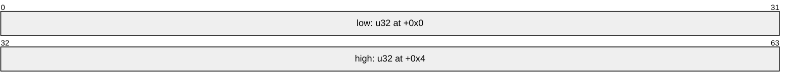
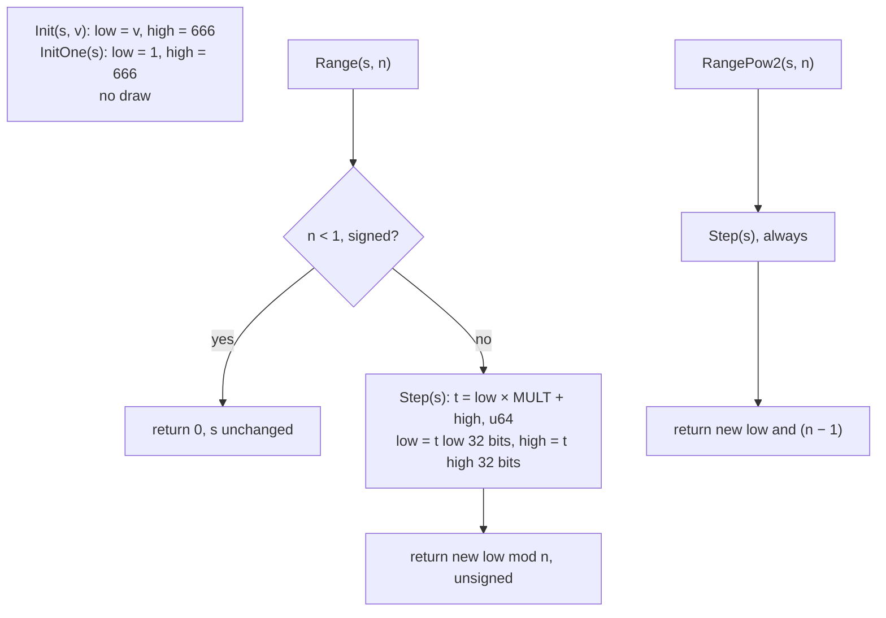

## Purpose

Every random decision in the game is a draw from a **seed object**: 8 bytes of state owned by
one game object (game, act, level, room, unit…). This spec defines the state, the step, the two
range reductions and the two initialisers. Every other spec writes its draws in terms of these.
How seeds are created and passed from parent to child is in [seeds.md](../seeds/).

## Entry points

The primitives exist as out-of-line functions, but most call sites **inline** the step. A spec that
documents a call site states which form it uses (see *Reimplementation notes*).

| Primitive | Function | Static callers | Tag |
|---|---|---|---|
| step | `RNG_Step` | 1 | [C] |
| guarded range | `RNG_Range` | 154 | [C] |
| guarded range (second compile) | `RNG_RangeB` | 114 | [C] |
| power-of-two range | `RNG_RangePow2` | 8 | [C] |
| power-of-two range plus base | `RNG_RangePow2Plus` | 0, dead code | [I] |
| init with value | `RNG_SeedInit` | 103 calls in 76 functions, both initialisers combined | [C] |
| init to one | `RNG_SeedInitOne` | (counted with `init with value`) | [C] |
| inlined step | 852 multiplier immediates, all inside functions (e.g. `DRLG_ActCreate`, `DRLG_RoomCreate`) | — | [C] for 846 sites, [I] for 6 |

All 852 occurrences of the multiplier bytes `C5 90 C6 6A` in the file are `mov r32, imm32` instructions inside
functions, so each one is a draw site: 837 in 427 functions found at first, 4 outside any function the first reading
had defined, and 11 in nine DRLG level-link callbacks reached only through data tables (the `LinkPick` callbacks).
[C] for the count and the instruction form, and for 846 of the sites being inside functions: decoding the file gives 852
instructions with the operand `0x6AC690C5`, every one `mov r32, imm32`, at the 852 raw byte occurrences (the same 852
the first reading counts); a walk from every direct call target, every pointer to an instruction in `.rdata`/`.data`
and every code immediate that names one reaches 836 of them, and 10 more lie in bodies that start after `int3` padding
with a `push ebp` prologue. [I] for the other 6 sites, whose body the walk does not delimit: they are inside functions
on the first reading alone.

Every out-of-line primitive except `RangePow2Plus` takes the seed pointer in ECX and `n` (or the
init value) in EDX. [C] `RangePow2Plus` takes the seed in ECX, `base` in EDX
and `n` on the stack: 3 000 emulated calls with that convention return the modelled value and pop exactly 4 bytes
(`ret 4`). [C]

## Inputs

### Tables

None. The RNG reads no table. [C] The seven primitives' bodies (145 instructions, no calls) address memory only
through ECX (the seed, `[ecx]` and `[ecx+0x4]`) and the stack, with no absolute address operand, and the 5 000-case
emulator run mapped no table.

### Runtime state



| State | Type | Source |
|---|---|---|
| `Seed` | `{ low: u32 @+0x0, high: u32 @+0x4 }`, little-endian, 8 bytes | embedded in its owner; see [seeds.md](../seeds/) for each owner's offset |

### Constants

| Name | Value | Tag |
| --- | --- | --- |
| `MULT` | `0x6AC690C5` (1791398085) | [C] |
| `INIT_HIGH` | `666` (`0x29A`) | [C] |

## Algorithm



```
type Seed { low: u32; high: u32 }

1. Step(s: Seed):                                              [C]
     t: u64 ← (u64) s.low × MULT + (u64) s.high               ; exact, no overflow: max < 2^64
     s.low  ← (u32) (t & 0xFFFFFFFF)
     s.high ← (u32) (t >> 32)

2. Range(s: Seed, n: i32) → u32:                               [C]
     if n < 1:                                                 ; signed test
       return 0                                                ; NO draw: s is unchanged
     Step(s)                                                   ; draw
     return s.low mod (u32) n                                  ; unsigned

3. RangePow2(s: Seed, n: u32) → u32:                           [C]
     Step(s)                                                   ; draw, always
     return s.low & (n − 1)                                    ; u32 arithmetic; callers pass a power of two

4. RangePow2Plus(s: Seed, base: i32, n: u32) → i32:            [C]
     Step(s)                                                   ; draw
     return (s.low & (n − 1)) + base                           ; the sum wraps at 32 bits; n = 0 masks with all ones

5. Init(s: Seed, v: u32):                                      [C]
     s.low ← v;  s.high ← INIT_HIGH                            ; no draw

6. InitOne(s: Seed):                                           [C]
     s.low ← 1;  s.high ← INIT_HIGH                            ; no draw
```

Step notes:

2. When `n` is a power of two the binary computes `s.low & (n − 1)` instead of the division. The
   result is identical, so a reimplementation may use `mod` throughout. [C]. `n` arrives as a register value: `0x80000000`–`0xFFFFFFFF` are negative
   and return 0 without a draw. [C] (edge cases)
4. This helper is dead code in 1.14d: no absolute pointer to it exists anywhere in the file, and no `call` or `jmp`
   rel32 at any `.text` offset reaches it. No spec depends on it, and a reimplementation can omit it. It is defined
   here only for completeness; the emulation of the primitives confirms step 4 (3 000 of 3 000 calls, `n` = 0, 1,
   powers of two and not, wide `base`, the exit seed one `Step` on) and covers the code only. It is not alone: 14
   inlined draw sites lie in 9 bodies with no static reference (no rel32 call or jump, no absolute address),
   `RangePow2Plus` and eight unnamed bodies, the last of them by address with 4 sites, so a count of reachable draw sites leaves them
   out. Having no reference has no observable, so both stay readings of the code. [I]

**What counts as one draw.** In every spec, "draw#k" means one call of `Step` on a named seed
object, whether it happens inside `Range`, `RangePow2`, or inline. A draw is one step of one specific seed
object, and every consumer of that object interleaves in call order. Many seed objects exist (game `+0xD0`,
act, level, DRLG room, active room, unit…), and several consumers share some of them. For example, every
server unit constructor, the object-region and monster-region code and the per-room population pass all step
the game seed `+0xD0`, so a reimplementation must reproduce the order of those calls, not just each formula.
A draw on one seed never changes another seed. [C]

## Outputs

`Step` and `Init*` return nothing. `Range` returns a `u32` in `[0, n)` for `n ≥ 1` and `0` otherwise.
`RangePow2` returns a `u32` in `[0, n)`. Each primitive mutates only the seed it is given. [C]


## Worked example

Source: our reference model of the primitives, which matches the binary's own functions bit for bit on 5,000 cases
of the emulation of the primitives. Values in hex unless noted.

| # | Operation | Result | `low` after | `high` after |
|---|---|---|---|---|
| 0 | `Init(s, 12345)` | — | `00003039` | `0000029A` |
| 1 | `Range(s, 100)` | 87 (dec) | `015B2E77` | `0000141D` |
| 2 | `Range(s, 0)` | 0, no draw | `015B2E77` | `0000141D` |
| 3 | `Range(s, −5)` | 0, no draw | `015B2E77` | `0000141D` |
| 4 | `Range(s, 8)` | 0 | `8B57C5B0` | `0090CE87` |
| 5 | `Range(s, 7)` | 3 | `606EEEF7` | `3A1E6C8A` |

Step 1 in full: `0x3039 × 0x6AC690C5 + 0x29A` is high word `0x0000141D`, low word `0x015B2E77`, and `0x015B2E77 mod 100 = 87`.

## Reimplementation notes

- **The guard isn't everywhere.** `Range` returns 0 *without drawing* for `n < 1`. Inlined draws
  with a constant modulus (for example `% 7` in `DRLG_ActCreate`, compiled as a multiply
  by `0x24924925` plus a correction, which is an exact unsigned `mod 7`) have no guard, and neither
  has `RangePow2`. A table-driven `n` that can be 0 (an empty pool, a zero weight sum) therefore
  draws or doesn't draw depending on the call site. Each consuming spec states the form per site.
  [C] In the 7 emulator cases with `n = 0`, `RNG_RangePow2` stepped the seed every time and returned `low` whole,
  while `RNG_Range` and `RNG_RangeB` returned 0 with the seed unchanged; the inlined `mod 7` of `DRLG_ActCreate`
  draws unguarded ([seeds](../seeds/) step 3c).
- **Reduce the new `low`, not the old one.** The step happens first, and the result is taken from
  the updated state. [C]
- **`high` is not a constant.** `Init` sets it to 666, but each step overwrites it with the carry
  word, so the full 64 bits must be kept. [C]
- **Unsigned modulus.** `low` is `u32` and the division is unsigned. Using a signed 32-bit `low`
  gives wrong results for `low ≥ 2^31`. [C]
- **No bias correction.** The game takes `low mod n` directly, with no rejection of the top
  partial range. Do not "fix" it. [C]

## Evidence

- [seeds.md](../seeds/): who owns which seed, and how children are seeded.
