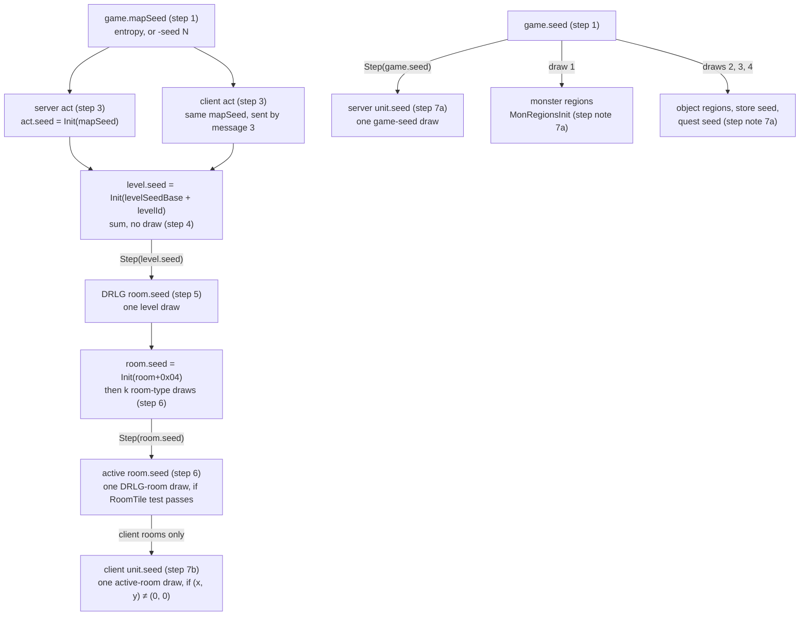
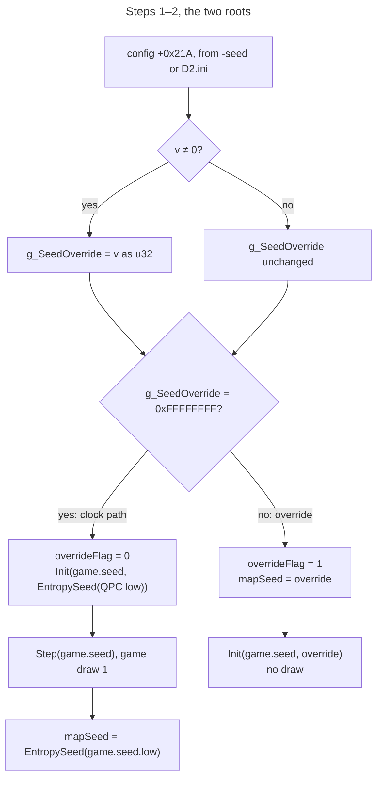
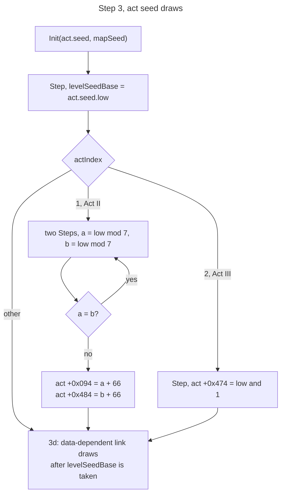
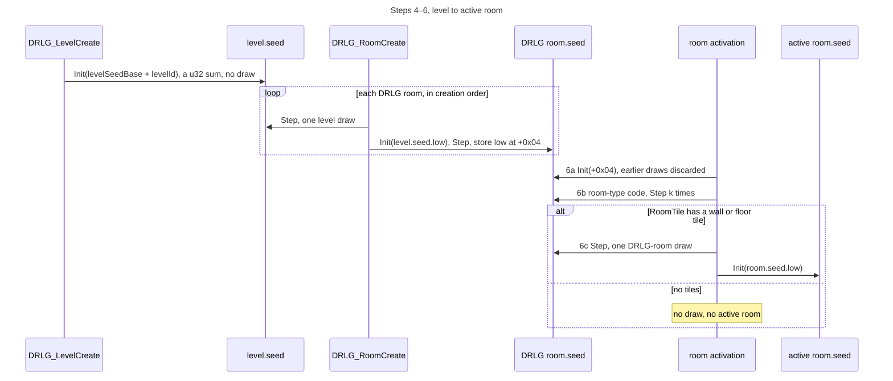
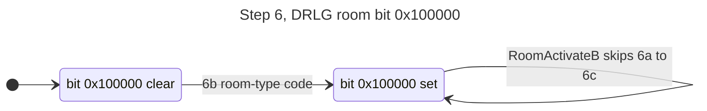
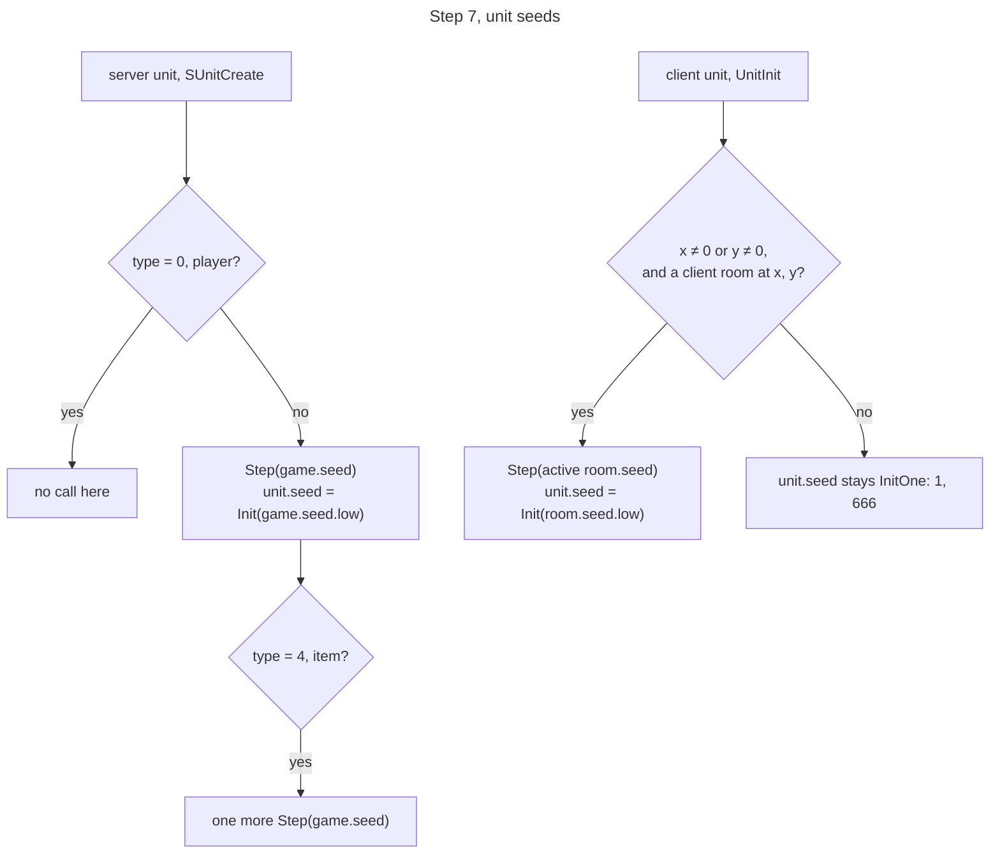

## Purpose

Defines where each seed object is created and what its initial value is, from the game root down to the units of a game. With a fixed map seed, this chain fixes every act's and level's starting seed, and therefore the inputs of the DRLG generators. Two roots exist: the **map seed** feeds acts, levels and rooms, and the **game seed** feeds server units. What happens *inside* item creation, monster spawning and the DRLG room-type code is left to those specs. Primitives (`Step`, `Range`, `Init`, `InitOne`) are defined.

## Entry points

| When | Function | Tag |
|---|---|---|
| Game created | `GAME_InitSeeds` | [C] |
| `-seed N` on the command line, or `D2.ini` | `ApplySeedOption` → `GAME_SetSeedOverride` | [C] |
| Act created, server copy | `ActCreate` → `DUNGEON_ActCreate` → `DRLG_ActCreate` | [C] |
| Act created, client copy | client message handler 3 `PktLoadAct` → `ClientActLoad` → `DUNGEON_ActCreate` | [C] |
| Level created | `DRLG_LevelCreate`, from `DRLG_ActCreate` or one of six get-or-create callers | [C] |
| DRLG room created | `DRLG_RoomCreate` | [C] |
| Room activated | `RoomActivateA` or `RoomActivateB` → `DrlgRoomReseed` → `DRLG_RoomActivate` → `DUNGEON_RoomCreate` | [C] |
| Server unit created (every type but players) | `SUnitCreate` → `UnitSeedInit` | [C] |
| Client unit created | `UnitInit`, `UnitInitB` | [C] |

## Inputs

### Tables

| Anchor | Used for |
|---|---|
| `Levels.txt:Id` | level IDs 66–72 are the seven Act II Tal Rasha tombs, the range of the Act II draw (step 3c) |
| `Levels.txt:DrlgType` | generator dispatch after the level seed is set (step 4) |

### Runtime state

Owner names are ours, taken from the source path each allocation passes to the allocator
(`Drlg.cpp`, `Dungeon.cpp`, `DrlgRoom.cpp`, `SUnit.cpp`, `CUnit.cpp`). Offsets are byte offsets into
the owner. No struct header for them is recovered yet.

| Seed / value | Type | Owner offset | Source |
|---|---|---|---|
| game seed | `Seed` | game `+0xD0` | step 1 |
| map seed | `u32` | game `+0x7C` | step 1 |
| override flag | `u32` | game `+0x84` | step 1 |
| seed option | `i32`, 4-byte slot | config `+0x21A` | step 2 |
| seed override | `u32`, `0xFFFFFFFF` = none | `g_SeedOverride` | step 2 |
| act seed | `Seed` | DRLG act `+0x000` | step 3 |
| act map seed copy | `u32` | DRLG act `+0x458` | step 3 |
| level seed base | `u32` | DRLG act `+0x470` | step 3 |
| act index | `u8`, 0-based | DRLG act `+0x480` | step 3 |
| level seed | `Seed` | level `+0x1C4` | step 4 |
| DRLG room seed | `Seed` | DRLG room `+0x14` | steps 5, 6 |
| DRLG room first draw | `u32` | DRLG room `+0x04` | step 5 |
| DRLG room type | `u32` | DRLG room `+0x48` | step 6 |
| `RoomTile` record | pointer | DRLG room `+0x54` | step 6 |
| active room seed | `Seed` | active room `+0x6C` | step 6 |
| active room flags | `u32` | active room `+0x34` | step 6 |
| unit seed | `Seed` | unit `+0x20` | step 7 |
| unit initial seed value | `u32` | unit `+0x28` | step 7 |

### Constants

| Name | Value | Anchor | Tag |
|---|---|---|---|
| no-override sentinel | `0xFFFFFFFF` (`−1`), the initial value of `g_SeedOverride` | `g_SeedOverride`; `.data` bytes and the compare, one write | [C] |
| entropy LCG multiplier | `0x19660D` | `RNG_EntropySeed` | [C] |
| entropy LCG increment | `0x3C6EF35F` | `RNG_EntropySeed` | [C] |
| first tomb level ID | `66` | `DRLG_ActCreate`, `Levels.txt:Id` | [C] |

## Algorithm













```
1. CreateGameSeeds(game):                                         [C]
     if g_SeedOverride = 0xFFFFFFFF:
       game.overrideFlag ← 0
       InitOne(game.seed)
       Init(game.seed, EntropySeed(salt: QPC low dword))
       Step(game.seed)                                            ; game draw#1
       game.mapSeed ← EntropySeed(salt: game.seed.low)
     else:
       game.overrideFlag ← 1
       game.mapSeed ← g_SeedOverride
       InitOne(game.seed)
       Init(game.seed, g_SeedOverride)                            ; no draw

   EntropySeed(salt: u32) → u32:                                  [C]
     x: u32 ← GetTickCount() + _time32(NULL) + salt               ; every operation wraps mod 2^32
     repeat 3 times: x ← x × 0x19660D + 0x3C6EF35F
     return x & 0x7FFFFFFF                                        ; 31-bit result

2. ApplySeedOption(config):                                       [C]
     v: i32 ← config[+0x21A]                                      ; option {DEBUG, SEED, seed}, type 1 (integer)
                                                                  ; filled by atol(text) from -seed, the text
                                                                  ; cut at the next '-' (step note 2), or
                                                                  ; GetPrivateProfileIntA from D2.ini
     if v ≠ 0: g_SeedOverride ← (u32) v                           ; 0 is never applied

3. CreateAct(actIndex: u8, mapSeed: u32) → act:                   [C]
   3a. Init(act.seed, mapSeed);  act.mapSeedCopy ← mapSeed
   3b. Step(act.seed)                                             ; act draw#1
       act.levelSeedBase ← act.seed.low                           ; +0x470
   3c. if actIndex = 1:                                           ; Act II (index is 0-based)
         repeat:
           Step(act.seed);  a: u32 ← act.seed.low mod 7          ; act draw#2k,   unguarded
           Step(act.seed);  b: u32 ← act.seed.low mod 7          ; act draw#2k+1, unguarded
         until a ≠ b
         act[+0x094] ← a + 66;  act[+0x484] ← b + 66
       else if actIndex = 2:                                      ; Act III
         Step(act.seed)                                           ; act draw#2
         act[+0x474] ← act.seed.low & 1
   3d. further act-seed draws inside DRLG_ActCreate,             [C]
       data-dependent; see step note 3
   The mapSeed argument is game.mapSeed for every act, and every [C]
   act is created twice with it: a server copy and a client copy.

4. CreateLevel(act, levelId: u32) → level:                        [C]
     Init(level.seed, (u32) (act.levelSeedBase + levelId))        ; a u32 sum that wraps, NOT a draw
     dispatch on Levels[levelId].DrlgType:                        [C]
       1 → MazeLevelCreate, 2 → PresetLevelCreate, 3 → OutdoorLevelCreate
     rooms come later, after LevelInit re-seeds the level with the same value:
     see drlg/overview steps 1–2

5. CreateDrlgRoom(level, type: u32) → room:                      [C]
     Step(level.seed)                                             ; one level draw
     Init(room.seed, level.seed.low)
     Step(room.seed)                                              ; room draw#1
     room[+0x04] ← room.seed.low
     dispatch on type: 1 → OutRoomAlloc, 2 → PresetRoomAlloc, else none [C]
                                                                  ; allocation only, no draw: a call-graph closure
                                                                  ; with no drawing function, 876 type-1 and
                                                                  ; 3552 type-2 rooms;
                                                                  ; its 532 indirect calls: 359 import table, 115
                                                                  ; register from it, 58 under (step 5 note)

6. ActivateRoom(act, R: DRLG room) → activeRoom or none:          [C]
   6a. Init(R.seed, R[+0x04])                                     [C]
                                                                  ; re-seed: earlier room-seed draws are discarded
   6b. room-type code for R[+0x48] (1 → OutRoomGridPrepare,      [C]
       OutRoomTilesBuild; 2 → PresetRoomGridPrepare, PresetRoomTilesBuild); sets R[+0x28] |= 0x100000
       Step(R.seed) k times                                       ; k: drlg/room-tiles § k (#k)
   6c. DRLG_RoomActivate(act, R):                                 [C]
         T ← R[+0x54]                                             ; RoomTile record
         if T[+0x18] = 0 and T[+0x20] = 0:
           return none                                            ; no draw, no active room
         flags: u32 ← 4 if R[+0x28] & 0x40000                     [C]
                      else 1 if R[+0x60] & 1
                      else 0
         Step(R.seed)                                             ; one DRLG-room draw (inlined)
         Init(activeRoom.seed, R.seed.low)                        ; +0x6C
         activeRoom[+0x34] ← flags

7a. ServerUnitSeed(game, unit, type: u32):                       [C]
     if type = 0: return                                          ; players: see step note 7a
     InitOne(unit.seed)
     Step(game.seed)                                              ; one game-seed draw
     unit[+0x28] ← game.seed.low
     Init(unit.seed, game.seed.low)
     if type = 4:                                                 ; items
       Step(game.seed)                                            ; one more game-seed draw [C]
                                                                  ; its low word is the item's start seed,
                                                                  ; item.seed = {low, 666} (items/uniques-sets A2)

7b. ClientUnitSeed(unit, x: i32, y: i32):                        [C]
     room ← none
     if x ≠ 0 or y ≠ 0:                                           ; literal predicate: the two position
       room ← the client act's active room at (x, y)              ; arguments are not both zero
                                                                  [C]
     InitOne(unit.seed)
     if room ≠ none:
       Step(room.seed)                                            ; one active-room draw
       unit[+0x28] ← room.seed.low
       Init(unit.seed, room.seed.low)
```

Step notes:

1. Without an override, both the game seed and the map seed depend on the tick count, the clock
   and the performance counter, so they can't be reproduced. A reimplementation that wants
   determinism takes the override branch. [C]
2. `config+0x21A` is a 4-byte signed integer slot: the next option's slot starts at `+0x21E`, and
   the reader loads it as one dword. A `-seed` value wider than 16 bits arrives intact (`34844169` →
   `+0x7C` = 34844169). [C] On the command line, a
   negative value never arrives: the parser copies a switch's text only up to the next `-`, so `-seed -2147483648` (and `-seed -1`) leaves the text empty, `atol` gives 0,
   step 2 applies nothing, and the game takes the clock path. A value of 2³¹ or more saturates at
   `0x7FFFFFFF`. So the seeds reproducible from the command line are `1`…`0x7FFFFFFF`, and no seed of
   `0x80000000` or above reaches step 1 that way. [C] (`ConfigParseCmdLine`, `GAME_InitSeeds`, sessions s9 and s10) This corrects the earlier reading that a seed ≥ 2³¹ could be given as its negative
   decimal, which the run contradicted. What the `D2.ini` route stores for such values is open (*Open
   questions*).
3. All acts of one game get the same map seed, so all acts share the same `levelSeedBase`.
   Act-specific draws (3c, 3d) come after `levelSeedBase` is taken and don't change it. [C]
 The Act II loop draws two distinct tomb
   level IDs in 66–72. Which of the two fields is the real tomb is open. [C] Step 3d: the level-link setup copies the act seed into a local
   link-builder struct, and the link callbacks step **the copy**, which is then discarded. The act
   seed itself is stepped only by the level-link builder when its loop reaches level 6 with link
   value 1 or 3, and by the Act III link code. [C] (`LevelLinkBuild`: the act model equals the logged act seed on all 42
   act creations, Acts I–V, and no other code stepped an act seed) Observed act-seed steps after 3c: Act I 0 (seed 12345) and 1 (seed 777),
   Act III 119 (seed 12345), Acts II, IV and V 0. [C] These draws matter
   only to later consumers of the act seed, never to level seeds.
   Server copy: `ActCreate` passes `game+0x7C`. Client copy: `ClientActLoad`
   gets the map seed from the 12-byte message 3 (act `u8 +1`, map seed `u32 +2`) and stores the act
   in a client global. On game entry both are created, server first, with seed N. [C]

   The two copies have identical DRLG seed trees up to room activation (step 6). [C]
4. A level's seed depends only on the map seed and the level ID, never on the order in which levels
   are built or on which caller builds them. Besides `DRLG_ActCreate`, six functions get a level by
   ID and create it only if it is absent from the act's list. [C] for the sum
   (197 level creations). [C] for three of the six callers, logged by return
   address with no level id created twice in one act: `LevelEnsure` 346, `LevelUnloadCheck` 29,
   `LevelAddRef` 5. [I] for the
   other three, which no run reached.
5. Each DRLG room takes exactly one draw from its level's seed, so the order in which a level's
   rooms are created matters (3102 room creations in the seed-tree run). [C]
   The type dispatch after the room draw draws nothing: the call-graph closure under the two allocators (422 functions)
   holds no drawing function. Its 532 indirect calls split as 359 through the import table, 115 through a register
   whose nearest earlier write is a load from the import table, and 58 left, all under a pool allocator
   (file and line arguments, fatal on failure), which is passed no seed pointer; 0 are unresolved. That
   residue is the closure's stated limit. [C]
   Of the logged activation re-seeds, those whose seed is the room's creation seed are 132 of 132
   type-2 re-seeds and 0 of 25 type-1. [I]
6. The active-room seed is `Init(Step^(k+1)(Init(R[+0x04])).low)`. It doesn't depend on any draw
   made on the room seed between creation and activation, because 6a restarts it from `+0x04`, but
   it does depend on k. Observed in the second seed-tree run: k = 50–376 over 157 activations. [C]

   k is the number of room-seed draws of the `LvlSub` substitutions (type 1
   only) and of the tile picks whose candidates have a positive rarity sum, plus `Orient89Unit`'s rare `Range(3)`
   draws (room-tiles step 11); it
   is defined in [drlg/room-tiles § k](../../spec-drlg/room-tiles/#k), which predicts it for all 520
   activations of its run (k = 0–388). [C] `T[+0x18]`/`T[+0x20]` are the room's wall and floor tile counts after the
   build: 2066 activations equal the model's counts, and 5 exceed it by animation frames. [C]
 So 6c draws iff the
   room got at least one wall or floor tile; a room with neither did not occur in any run, so that
   return is not observed. [I] (`DRLG_RoomActivate`, [drlg/room-tiles](../../spec-drlg/room-tiles/)
   step note 12)
   `RoomActivateB` runs 6a–6c only while `R[+0x28]` bit `0x100000` is clear, the bit 6b
   sets. [C] `flags` bit 0
   marks the active room as already populated: the population pass runs only for rooms whose bit 0
   is clear: in the room-k sweep, 2072 room-driver tests with bit 0 set were followed by no pass, and each of the 558
   passes followed a test with bit 0 clear. [C] In the earlier runs every
   server-act room got `flags` 0 and every client-act room got 4. [C]
   **`R[+0x28]` bit `0x40000` marks a room of the client act copy.** Its only writer is `DRLG_RoomCreate`, when the
   level's `+0x04` has bit `0x10`; `DRLG_LevelCreate` sets that bit when the act's `+0x8C` bit 0 is set, and
   `DUNGEON_ActCreate` passes 1 there for the client copy and 0 for the server copy. Second source: the flags rule held
   on all 2071 activations of the room-k sweep (1332 with flags 4). [C]
   **`R[+0x60]` bit 0 is the "already populated" bit kept across a release.** It is 0 at creation;
   `RoomReleaseWrap` stores the released active room's `flags` bit 0 there, and `LevelRoomStateRestore` ORs it back
   from the array `LevelUnload` saved. So a room populated, released (or unloaded) and activated again comes back with
   `flags` 1 and is not populated a second time. Second source: the room-k sweep (1516 releases all through
   the wrapper with `+0x60` = the active room's bit 0; 25 restores setting the bit on 90 rooms). [C]
   **The server and client copies of one DRLG room can get different active-room seeds**, because
   their k can differ: of the 9 rooms activated in both copies, 6 (seed 12345) and 8 (seed 777) got
   different seeds. Gameplay uses the server copy. [C] The cause is the
   bit-2 tile path, which reads the neighbours already built in that act copy, so k depends on the
   activation order. [C]
   On the server, every room of a new-rooms walk gets one wanderer-tick draw on its active-room seed, and
   on its first activation the DS1 presets, the object population and then the population pass follow.
   The pass draws its class picks, type roll and every position from the active-room seed, and its density
   rolls, the `sparsePopulate` roll and one step per creation from the game seed. [C] The `ARoomSeedStep` room-seed step it
   contains is on the type-1 branch, which never runs: the pass maps type 1 to 2. [C]

7a. **Server units, monsters included, seed from the game seed `+0xD0`, not from a room.** In the second seed-tree run 114 server unit seeds had the parent `game+0xD0` every time,
   type 1 units among them. [C]
   `SUnitCreate` skips the call for type 0. `UnitSeedInit` has five other callers (player creation
   and re-seeding paths), each passing its own pointer plus `0xD0`, and the type-0 (player) server units
   of the runs got their seed from `game+0xD0` through them. [C]
   The two player loads of the save-load sweep took their seed through `PlayerUnitInit`'s call, whose pointer
   is the game (`lea edx, [ebx + 0xD0]` with `EBX` the game, then the call). [C]

   The other four callers logged no line in that session, so
   whether they run, and that the pointer each of them adds `0xD0` to is the game, are not
   established. [I] At runtime the player's seed is the 5th game-seed draw from `Init(N)`, and the starting
   items follow at draws 6, 8, 10…, two draws each. [C] Other consumers
   of the game seed draw in between, so a unit's seed depends on the full call order of every
   game-seed consumer. Draw 1 from `Init(N)` is the monster-region build: `MonRegionsInit`
   steps the game seed once, keeps the low word at `game+0xEC` and builds every level's pool from a
   local seed `Init(low)`. [C]

   The game-creation calls after it, in `GameCreate`'s call order, take one game-seed draw each,
   so draws 2–4 are fixed. [C]
   The object region takes exactly draw 2: `OBJRGN_Create` steps the game seed once and seeds the game-wide
   object-region seed with `Init(low)`. [C]

   **Stored item seeds.** `ItemCreate` replaces the unit seed and the item-data seed with `Init(rec+0x48)` and
   `Init(rec+0x4C)` only when its third argument or `rec+0x2C` is non-zero. Of its 20 call sites, 19 (drops, gold, the
   store, the cube output, the imbue, objects, traps, the missile drop) pass 0 on a zeroed record, so their seeds come
   from the game seed as above. The one that sets `+0x2C` is `ItemCreateFromOldRec`, reached only from the version-`0x47`
   item-list reader of the save readers; a current save restores its items through `ItemCreateFromSave`, which does not
   call `ItemCreate`. So only an item read from an old (version-`0x47`) item list keeps stored seeds this way. [I]

   Draw 3 is `NPCSTORE_CtlCreate`: it seeds the store seed, which is also the hirelings' NPC seed, with `Init(low)`
   ([items/vendors](../../spec-items/vendors/) A1). [C]
   Draw 4 is `QUESTS_InitGame`: it seeds the quest seed `QuestControl+0x18` with `Init(low)`
   ([items/quest-drops](../../spec-items/quest-drops/) A1); in all 53 games of its run the game seed at its entry was three
   steps past `Init(N)`. [C]
   The rest of the order belongs to the item, monster and object specs. A monster created by the
   population pass carries a unit seed 2 steps past `Init(game.seed.low)` by the time the pass draws on it
   (914 of 916 logged creations; 6 and 15 on the other two); the steps happen inside `SUnitCreate`, and
   [monsters/spawn § J](../../spec-monsters/spawn/#j-creation-and-the-unit-seed) takes that seed as an input from
   `monsters/stats`. [C] With a null parent
   pointer, `UnitSeedInit` uses `RNG_EntropySeed(2 × counter)` instead, a non-reproducible path no
   run hit. [I]
7b. **These are the client constructors** (`CUnit.cpp`). They store the client act at `unit+0x1C`,
   and every logged client unit drew from a room of the client act (739 seeds). They don't decide
   drops or spawns. [C] The two
   arguments tested are (x, y). A client unit created at (0, 0) makes no room lookup, gets no room
   draw and keeps `{1, 666}`: 252 such units, against 24 565 that looked their room up. [C]
 The room lookup
   `ClientRoomAt` takes them as a position, returns no room for (0, 0), and its error message names them
   `nX`, `nY`; the caller never asks it for (0, 0), so that return is not observed. [I]
 Type 4 does nothing that draws before the room draw: the
   call-graph closure under `ItemDataAlloc` and `ItemDataSeedInitOne` holds no drawing function, only the
   one initialiser. [C] It is
   the closure of step 5's allocators, with the same split of its indirect calls (step 5 note). Type 1 (monsters) never goes through
   `UnitInit` from the client creator, which sends type 1 to `ClientMonCreate` and every
   other type to `UnitInit`; the 739 logged `UnitInit` hits are all type 2. [C]
   `UnitInit`'s two other callers pass their own caller's type, not traced,
   so the claim for them rests on the case that reaches the error path. [I]

## Outputs

A seed object, initialised as above, in each act (server and client copy), level, DRLG room,
active room, server unit and client unit. The parent seed advances by exactly the draws listed,
except that step 6a overwrites the DRLG room seed. [C]

## Worked example

**Observed.** Every value below was logged in the game with `-seed 12345` (map seed
`0x3039`) and is reproduced by our reference model of the seed tree from N alone. The last block uses `-seed 34844169`. Seeds are `low:high`, hex unless noted.

| Step | Operation | Value |
|---|---|---|
| 1 | game: override flag, map seed, game seed | `1`, `00003039`, `00003039:0000029A` |
| 3a | `Init(act.seed, 12345)` | `00003039:0000029A` |
| 3b | `Step`, `levelSeedBase ←` low | `015B2E77` (act seed `015B2E77:0000141D`) |
| 3c | Act II pair 1: `low mod 7` twice | `3, 3` → equal, retry |
| 3c | Act II pair 2 | `6, 5` → `act[+0x094] = 72`, `act[+0x484] = 71` (dec); act seed `B7A5C418:63A93A78` |
| 4 | level 1 seed | `015B2E78:0000029A` |
| 5 | level 1, rooms 1–3: level seed after each draw | `F61E44F2`, `F3CFFCC1`, `6B277FA8` |
| 5 | room 3: `Init(6B277FA8)`, step, `+0x04` | room seed `F923BEE2:2CB17800`, `+0x04 = F923BEE2` |
| 6a | room 3 activated on the server: re-seed | `F923BEE2:0000029A` |
| 6b | k = 64 room-type draws | `2CE81EC1:55A43D6F` |
| 6c | activation draw, active-room seed | DRLG room `28D677F4:12BAF1A9`, active `28D677F4:0000029A`, flags 0 |
| 7a | player (type 0), seeded by a player-creation caller of `UnitSeedInit` (step note 7a), not by 7a's pseudocode: game-seed draw#5 | unit seed `B7A5C418:0000029A`, `+0x28 = B7A5C418` |
| 7a | first starting item (type 4): draw#6, then draw#7 | unit seed `8F16A0F0:0000029A`; game seed then `FD29EDF2:3BAE5B0E` |
| 3b, 4 | `-seed 34844169`: `levelSeedBase`, level 134 seed | `FFFFFF87`, `0000000D:0000029A` (u32 wrap) |

Under an override, the game seed and the act seed start from the same `Init(N)`, so their sequences
coincide (the player's draw#5 equals the Act II act seed after its five draws). They remain two
separate objects.

## Reimplementation notes

- **Two different roots.** Maps derive from the **map seed** `game+0x7C`. The game seed `+0xD0` is a
  separate object that doesn't feed the act → level chain, but does feed every server unit. [C]

- **`-seed 0` is impossible.** The option is applied only when non-zero, so `0` takes the clock
  path. [C]
- **The level seed is a sum, and it wraps.** Don't implement it as a draw from the act seed, and add
  in `u32`. [C]
- **The Act II tomb draws use an unguarded `mod 7`**, not `Range`. The loop count is unbounded in
  principle, and every rejected pair consumes two act draws. [C]
- **Activation re-seeds the DRLG room.** Carrying the room seed over from level generation gives
  wrong active-room seeds. Restart it from `+0x04`. [C]
- **No `RoomTile` data, no draw.** A DRLG room failing the `T[+0x18]`/`T[+0x20]` test is not activated
  and consumes no activation draw. [C]
- **Server units don't use the room.** The room-seed rule of step 7b is the client's. A server-side
  reimplementation seeds monsters, objects, NPCs and items from the game seed. [C]

- **`InitOne` before `Init` is dead.** It is overwritten immediately, and neither initialiser draws,
  so it has no observable effect. [I]
- **Seeds that are not gameplay seeds.** All 103 initialiser call sites (76 functions) are classified by call shape.
  Besides the tree above, they are: the client automap's global seed `init(0)` (`AutomapTxtLoad`, drawn only by the
  automap cell pick); two title-screen globals from `RNG_EntropySeed`; and local stack seeds in client/server pairs
  (the constant 1397049683, whose four bytes spell `SEIS` high byte first, a unit base stat, or other values). None of these feeds the act, level, room, unit or item
  seeds. The sites that re-seed a unit's `+0x20` or another object's seed lie in the skill and missile code
  (*Skill and missile re-seeds* below). [I]
- **The missile pierce count's seed is local.** `MissilePierceCount`, the server half of the base-stat pair,
  initialises a stack seed with `Init(baseStat(owner, 328))` (for a player, stat 328 is raised by 1 on each of its skill requests) and steps
  it at most four times for the missile's pierce count; it reads and writes no game, unit or missile seed. So it is a
  classified initialiser site, not a re-seed. [I]

- **Skill and missile re-seeds.** The server sites of the skill and missile code re-seed a **missile's** seed or a
  local stack seed, with one exception among the reached sites, Armageddon:

  | Site | Re-seeds | From |
  |---|---|---|
  | missile-creation callbacks `MissCbReseedFromArg`, `MissCbReseedZigzag` (the rings of progressive entries 37 and 143) | the new missile's `+0x20` | the creator's local seed's low word |
  | callbacks `MissCbReseedPathXPlusArg` (Firestorm and others), `MissCbReseedRoll`, `MissCbReseedPathX` | the new missile's `+0x20` | the path position `+0x10`, plus an index for the first two |
  | missile do 28 and 35 | the missile's `+0x20` | the low word kept in `MissileData+0x28`, stored back after the draws |
  | hit 58, do 34 | the missile's `+0x20` | its position (hit 58 its `SubX`, do 34 its path X) |
  | `MissSubNearReseed` (missile do 8, 10, 17, 25) | the parent missile's `+0x20` | its `SubX + elapsed` |
  | Armageddon's periodic function (`srvactivefunc` 146) | the **caster's** `+0x20` | the skill entry's `+0x18` (at the first period, the cast's draw under the conditions of *Armageddon's cast draw* below), then a fresh `RNG_Range(1 000 000)` is stored back there |
  | `UnitSeedFromEntry` | a unit's `+0x20` | a skill entry's `+0x18`/`+0x1C`; no reference in the image |

  So a missile's draws after such a re-seed are a function of the creator's value, not of the game seed, and an
  Armageddon period sets the caster's seed from a stored word: a reimplementation keeps that word per skill entry,
  written at the cast as *Armageddon's cast draw* below states.
  The one other server site that re-seeds from a register, in the version-0 set builder `ItemBuildSetV0`, re-seeds an **item's** seed from
  its own saved low word, restoring it on failure.
  [I]

  The callback `MissCbReseedPathXPlusArg` sets the new missile's seed to `Init(w + arg)`, `w` the u16 at its path's `+0x10` and
  `arg` the creator's argument (low `w + arg`, high `0x29A`), and its own `PathPlan` then steps that seed before it
  returns: in 450 of 450 creations the seed at the callback's return lies on that stream, 20 steps past the `Init` for
  each of 442 Firestorm sub-missiles and 38 for each of 8 class-195 missiles of a monster. [C]

  The callback `MissCbReseedPathX` (catapult spotters' class-408 missiles) sets the new missile's seed to `Init(w)`, `w` the
  same path word, and the same path calls follow: in 36 of 36 creations the seed at `MissileCreate`'s exit lies
  on that stream, 10 steps past the `Init`. [C]
  For both, `PathPlan`'s random walk makes the steps, `+0x91 >> 1` of them, half the range capped at 77: emulated, and
  logged in the game in 654 of 654 creations over the two callbacks. [C]
  The other sites of the table were not reached. [I]

- **Armageddon's cast draw.** Skill do function 124 (`srvdofunc` 124: 249 Armageddon, 250 Hurricane, 349 Diablogeddon),
  after its record test, its `aurastate` range test, its used-skill tests and the setting of bit 6 of the caster's
  `+0xC4`, makes one `r = RNG_Range(caster+0x20, 0x10000)` on the **caster's** seed and keeps `r` in its frame, before its `STATLIST_Alloc` or `StatListSetEnd`. In
  the run's cases it makes no other draw on the caster's seed before that call; the `auralencalc` it evaluates between
  the draw and that call ran on constant programs only, so a calc function's own draws are not covered. [C]
  (up to `STATLIST_Alloc` or `StatListSetEnd`;
  `SkillDo124PeriodicState`)

  After that call, from the reading: a `STATLIST_Alloc` giving 0 makes do 124 return 0 with nothing queued or stored;
  otherwise, after its list steps (`StatListSetEnd`, event 12, `SKILLS_ApplyAuraStats`, stats 350 and 351), it
  cancels the caster's unit events 5 for the skill id, queues unit event 5 at `frame + Param4` with
  `(id, lvl)`, and stores `r` with `UnitSkillSet18(used node, r)`. For Armageddon and Diablogeddon (state 145,
  `srvactivefunc` 146) that event runs the periodic function above, which reads the `+0x18` of
  `SKILLS_GetUnitSkill(caster, id)`'s node and seeds the caster with `Init` of it. So the first period re-seeds the
  caster from the cast's `r` when that node is the used node **and** no other writer of its `+0x18` runs between the
  cast and that period; the setter `UnitSkillSet18` has 85 call sites, which were not followed, and no
  run has logged a first period. Hurricane (state 144, `srvactivefunc` 145) is stored the same `r`, and its periodic
  function does not re-seed. [I]

## Evidence

- [drlg/room-tiles](../../spec-drlg/room-tiles/):
  k (step 6b); [drlg/overview](../../spec-drlg/overview/): the dispatch of step 4 and the room-creation order.
