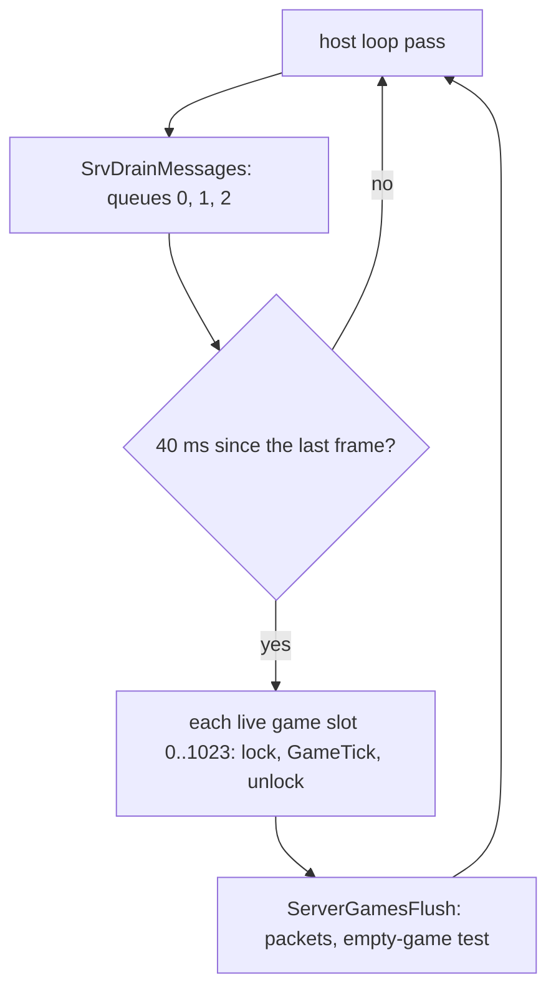
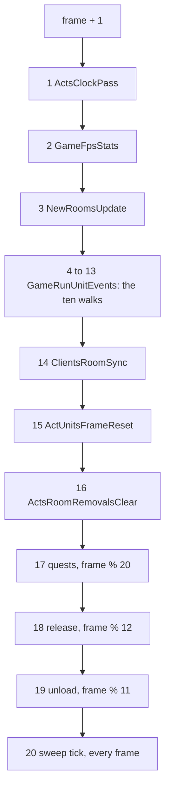
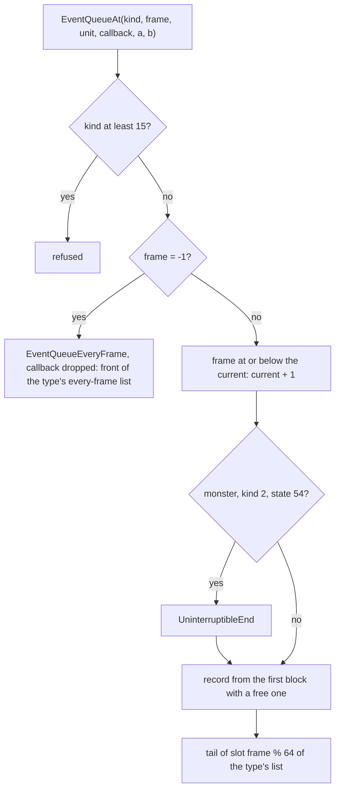
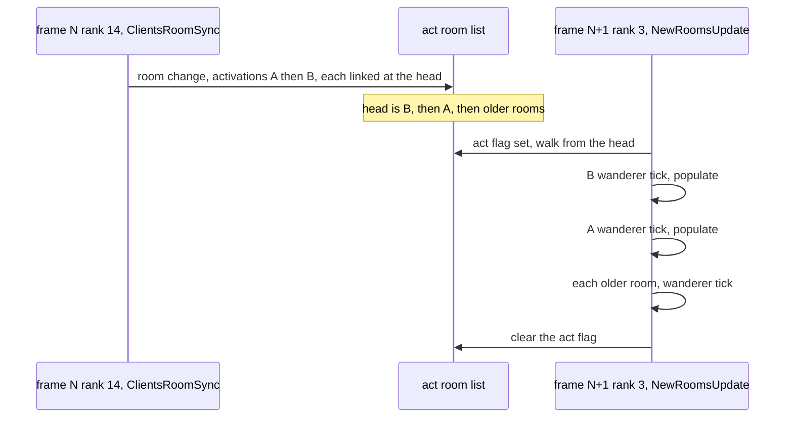
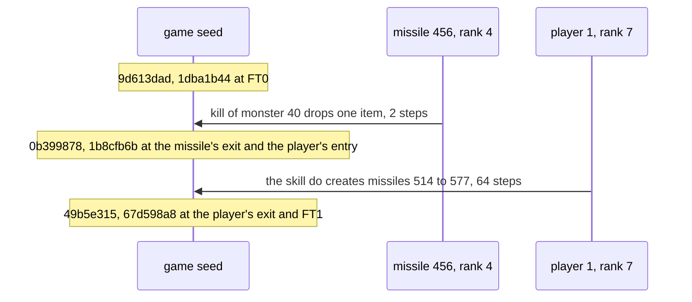

## Purpose

The server advances each game by one frame every 40 ms. This spec gives the order of everything inside a frame: the
passes of `GameTick`, the ten walks over the unit event lists, the order inside a list, how a record is queued, the
periodic timers, the order rooms are activated and populated in, where client messages are applied, and which pass can
draw on which seed. It answers the question that decides draws on a shared seed: *whose draws come first*. The content
of each event (a mode's frames, a think, a skill, a hit, a drop, a population) belongs to the spec that owns it; here it
is an opaque event in a known place. [§ K](#k-what-the-frame-windows-test) states what the windows run on the game test
and what they cannot: read it before relying on a confirmed statement.



## Entry points

| When | Tag |
| --- | --- |
| Each pass of the client's main frame in game modes 0 and 1, or of the open-server thread | [C] modes 0 and 1: 344 drain lines, 0 inside 5 500 ticks, the loop's order read with a second tool; [I] the open-server thread (no run in modes 6 and 8) |
| Before any frame of that pass | [C] (0 drain lines inside a tick over 5 500 frames; each loop's drain before its `ServerGamesFrame(1)`) |
| One interval has passed | [I] |
| Per live game, per frame | [C] one tick per frame (5 500 pairs, consecutive stamps); [I] per live game (one game per process) |
| Pass 4 of the tick | [C] (every unit event after the frame's walk and before its timers, 0 inversions over 58 678 ranked lines); its code's map [C] (§ D) |
| Any code queues an event | [C] for their map (§ E) |

`GameTickAlt` is not an entry point: its one call lies in a stub that no call, jump or pointer reaches, so in this build every frame is run by `ServerGamesFrame`. [C] (a second tool's scan: `GameTick` 2 calls, `GameTickAlt` 1, no reference into the stub)

## Inputs

### Tables

| Anchor | Used for |
|---|---|
| `PetType.txt:partysend` | which pets player kind 11 reports (§ F4); it reads no other table |

No excel table is read by `GameTick`'s own code, the queue or the walks; each event's function reads its own. [C] (none of the 44 table accessors called and no data-tables address named)

### Runtime state

| State | Type | Source |
| --- | --- | --- |
| frame counter | `i32`, only grows by one per tick | § B |
| game seed | `Seed` | [rng/seeds](../../spec-rng/seeds/) |
| event control | `EventCtl`, 0xA20 bytes, § D | game create |
| acts | 5 pointers | § G, § H |
| clients | list, next `+0x4A8`, newest first; count `+0x8C` | § H3 |
| hit class counter | `u8`, process-wide | § J3 |
| act room list, new-rooms flag | list (next room `+0x7C`), `u32` | § H1 |
| act dirty word, removal flag | `u32`, `u32` | § G |
| room's updated list | list, next `Unit+0xE0` | § G3 |
| quest timers | list; running flag `+0x04`, head `+0x10`, tick `+0x14` of the quest control | § I1 |
| wall clock | `timeGetTime() & 0x7FFFFFFF`, `u32` | § A; time is outside the deterministic state |

### Constants

Each is a constant of the code; none is a table a rule could replace, and the one six-value list has its address and reader.

| Name | Value | Tag |
| --- | --- | --- |
| frames per second | 25 in the image; the setter `SetServerFps` has no reference | [C] |
| frame interval | `1000 ÷ 25` = 40 ms, computed by a static initializer | [C] (called from `CRT_cinit`'s table) |
| game slots | 1 024 dwords | [C] (the 16 slot loops' bound) |
| event kinds | below 15, signed | [C] code's map |
| slot ring | 64 per list; slot = `frame % 64`, signed C remainder | [C] code's map |
| event lists | 5 | [C] code's map |
| unit type → list | six dwords, types 0..5: `0, 1, 3, 2, 4, −1`, read by 7 scaled loads in 5 functions: `EventQueueAt`, `EventQueueEveryFrame`, `EventFree` and two list-address helpers | [C]; the five lists' use [C] code's map |
| record block | 600 records of 0x30 bytes, 0x7088 bytes in all | [I] |
| quest timers period | `frame % 20 = 0` | [C] |
| release pass period | `frame % 12 = 0` | [C] |
| level-unload period | `frame % 11 = 0` | [C] |
| expiry sweep period | `frame % 1500 = 0` | [C] code's map |
| empty game close | 300 000 ms, or `1500 < frame < 7500` | [I] |
| player kind 11 | first at placement + 250, then every 30 frames | [C] every 30 frames (186 runs, each re-queued at frame + 30); [I] the first at placement + 250 (no placement in a window) |
| chat record life | `8·n + 125` frames, `n ≤ 254` characters | [I] |

## Algorithm

The ranks below number the frame's places, and § J and § K use them.

### A. The host loop and the frame clock

```
A1. HostLoopPass():                                               [C] modes 0 and 1: the drain, `ServerGamesFrame(1)`, the flush's arguments, read with a second tool, no drain inside a tick; [I] the open-server thread (no run; its 10 ms branch not read)
      SrvDrainMessages()                                          ; § C
      ticked: u32 ← ServerGamesFrame(cap: 1)
      mode 0:  if ticked ≠ 0: ServerGamesFlush(1, 0)
      mode 1:  ServerGamesFlush(0, 0)
      the open-server thread, while its run flag is set: the drain and ServerGamesFrame(cap: 1), then after a tick
        ServerGamesFlush(0, 0) and Sleep(30); else a 10 ms sleep

A2. ServerGamesFrame(cap: u32) → u32:                             [I] (all of A2)
      now: u32 ← timeGetTime() & 0x7FFFFFFF
      if last = 0: last ← now                                     ; a word the store below keeps non-zero after first use
      if (i32)(now − last) < interval: return 0                   ; no game ticks
      debt: u32 ← now − last − interval
      if cap ≠ 0 and debt ≥ interval (unsigned): debt ← interval
      last ← now − debt
      for slot in 0 ..< 1024:
        id ← g_GameSlots[slot]
        if id ≠ 0 and id ≠ −1:
          game ← GameLockById(id)                                 ; game+0x18, per-game lock
          if game ≠ 0: GameTick(game);  leave game+0x18           ; no such game: the next slot
      return the performance-counter ticks spent if a game ticked, else 0
```

- A2. [C] Every caller passes `cap` = 1: three calls, each `push 1`. [I] So one call runs at most one frame per game and the clock owes at most one
  interval: after a stall of any length one call ticks, the next ticks again at once, and the third waits. A slowed game
  runs every frame in order, only later.
- A3. [I] **The flush** returns at once when both arguments are 0 and under 40 ms (`GetTickCount`) have passed since its
  last run. Otherwise, per live game in slot order: every client's queued packets are sent, and a game with no clients
  starts a timer at `Game+0x1DC0` and is closed once 300 000 ms have passed **or while `1500 < frame < 7500`**; a game
  with clients clears the timer. This test is in the flush, after the frame, not in `GameTick`.

- A4. [C] The lag scale `Game+0x1DBC` always stores 0x400: `g_ServerLagFixed` holds 1, and its one reference is the `cmp`
  whose `jne` goes to that store before each `GameTick` call. [I] Its one reader is a host statistics query (a second
  read, copies it between two objects of unread type). It has no game effect.

### B. `GameTick`



```
B1. GameTick(game):                                               [C] the order of ranks 1, 3, 4, 6–9, 14 and 17–20, 0 inversions over 58 678 ranked lines; [I] ranks 2, 5, 10–13, 15 and 16 and the debug switch
      game.frame: i32 ← game.frame + 1
      debug fault switch game+0x1DC8 (1–4)                        ; 0 in a normal game; see B3
  1   ActsClockPass(game)                                         ; § G1
  2   GameFpsStats(game)                                          ; § G2
  3   NewRoomsUpdate(game)                                        ; § H2
  4–13 GameRunUnitEvents(game)                                    ; § D
  14  ClientsRoomSync(game)                                       ; § H3
  15  ActUnitsFrameReset(game)                                    ; § G3
  16  ActsRoomRemovalsClear(game)                                 ; § G4
  17  if frame % 20 = 0: QUESTS_TimersRun(game)                   ; § I1. every % is a signed idiv on the incremented frame
  18  if frame % 12 = 0: RoomsDeactivate(game)                    ; § I2
  19  if frame % 11 = 0: for a in 0 ..< 5: if game.act[a]: ActLevelsUnloadTick(game.act[a])   ; § I3
  20  ExpirySweepTick(game)                                       ; § I4. every frame; works only when frame % 1500 = 0
```

Rank 21 is everything between tick N and tick N + 1, the drain first of all: `GameTick` raises the counter before its
first pass, so a line that reads the stamp N after tick N's passes is at rank 21 of stamp N. [C] 262 of 262 handler lines carry
the last tick's stamp N and the next tick is N + 1. This assumes one thread
runs both the client frame and the ticks, the single-player loop of A1; the open-server thread of modes 6 and 8 would
break it.

- B2. [C] The seven calls from 1 to 16 have no branch between them, and no branch of `.text` targets the run.
- B3. [C] The debug switch's one identified writer has no reference of any kind, so the switch reads as unreachable in the
  stock image; one other function copies the same offset between objects of unread type.
- B5. [C] **A packet handled after tick N carries the stamp N,** scoped to the skill-request handlers: 87 `SKILLS_CanUse`
  calls from `PLRMSG_SkillAtXY` and `PLRMSG_SkillAtUnit` are logged after a missile frame of the same stamp; "the drain
  reads the frame it acts before" fails all 87.

### C. The message drain

```
C1. SrvDrainMessages():                                           [I] (all of C1)
      while (m ← pop queue 0): SrvClientMsgDispatch(m)            ; system: game create 0x67, join
      while (m ← pop queue 1): SrvProcessClientMessage(m)         ; in-game packets of every client of every game
      while (m ← pop queue 2): SrvHostMessage(m)                  ; host control: kinds 1, 0xFD callbacks; 0xFA, 0xFB, 0xFC counters and replies

C2. SrvProcessClientMessage(m):                                   [I] (all of C2)
      game ← the client's game, locked; a client in no game: logged and dropped
      client+0x3D8 ← GetTickCount()
      if the client's player exists and is a player unit (type 0):
        SrvPacketDispatch(packet, len)                            ; the handler of g_SrvPacketTable[opcode], opcode 1..0x66, at once
      unlock
```

- C3. [C] **Each queue is FIFO**: the pop takes the head under the context's lock and returns −1 when empty, and both
  enqueues append at the tail under the same lock. A message arriving while its queue drains is drained in the same pass. **Which drain a
  message falls in is arrival**, a logged input and no claim of this spec.
- C4. [C] **Messages are applied between frames, never inside `GameTick`** (0 of 262 handler lines inside a tick). `SrvPacketDispatch` has one call site, in
  `SrvProcessClientMessage`, that function one, in the drain, and the drain's four call sites lie in three loops: the two of A1
  and `ClientWaitDrain`, which drains with no frame. A loop pass that does not tick still drains, so several drains can
  fall between two frames. A packet applied while the counter reads N takes effect in the state frame N + 1's passes
  start from.
- C5. [C] The mode test `PlayerModeAllowed(1, 0, 0)` applies except for 0x14, 0x15, 0x3C, 0x43, 0x66, and 0x41 only in mode 0x11;
  91 of the types 0x01..0x66 have a handler. [I] The packets of all clients and all games share queue 1, so their
  order is their arrival order (which queue the appends receive is the network layer's).


### D. The unit events: the control, the pass, the runners

| `EventCtl` offset | Field |
|---|---|
| `+0x000` | current slot |
| `+0x004` | slot heads `[5][64]` |
| `+0x504` | slot tails `[5][64]` |
| `+0xA04` | the five every-frame heads |
| `+0xA18` | the walker's saved next |
| `+0xA1C` | the first record block |

[I] Created zeroed with its first block at game create, freed with every block at game free. A block holds 600 records, free list `+0x7080` (initially in address order), next block `+0x7084`. The record is `UnitEvent`.

```mermaid
flowchart LR
  M0["4 missiles every-frame"] --> M1["5 missiles slot"] --> P0["6 players every-frame"] --> P1["7 players slot"]
  P1 --> O0["8 monsters every-frame"] --> O1["9 monsters slot"]
  O1 --> B0["10 objects every-frame"] --> B1["11 objects slot"] --> I0["12 items every-frame"] --> I1["13 items slot"]
```



```
D1. GameRunUnitEvents(game):                                      [C] ranks 4 and 6–9 in this order, 8 818 slot runs at their frame, 48 159 every-frame; [I] ranks 5 and 10–13
      ctl.curSlot: i32 ← game.frame % 64                          ; signed C remainder
  4   MissileEventsRun(mode 0, ctl.everyHead[2])
  5   MissileEventsRun(mode 1, ctl.slotHead[2][curSlot])
  6   PlayerEventsRun (mode 0, ctl.everyHead[0])
  7   PlayerEventsRun (mode 1, ctl.slotHead[0][curSlot])
  8   MonEventsRun    (mode 0, ctl.everyHead[1])
  9   MonEventsRun    (mode 1, ctl.slotHead[1][curSlot])
  10  ObjEventsRun    (mode 0, ctl.everyHead[3])
  11  ObjEventsRun    (mode 1, ctl.slotHead[3][curSlot])
  12  ItemEventsRun   (mode 0, ctl.everyHead[4])
  13  ItemEventsRun   (mode 1, ctl.slotHead[4][curSlot])

D2. Each runner (head, mode):                                     [C] (all of D2) code's map
      ctl.walkNext ← 0
      rec ← head
      while rec ≠ 0:
        ctl.walkNext ← rec.next                                   ; saved before the run
        if mode = 1 and rec.frame ≠ game.frame:                   ; a slot record due 64·k frames later
          rec ← ctl.walkNext;  continue
        rec.flags ← rec.flags | 1
        if rec.callback ≠ 0: rec.callback(game, rec.unit, rec.kind, rec.a, rec.b)
        else:                the type's dispatch (§ F1)
        rec.flags ← rec.flags & ~1
        if mode = 1 or (rec.flags & 8) ≠ 0: EventFree(rec)        ; § E3
        rec ← ctl.walkNext
```

- D3. [I] **A walk reads its list's head when it starts** (each head is loaded right before its call), so a
  record queued during an earlier walk of the frame is found by a later walk of its own list. The windows hold no instance
  (0 of 3 716 every-frame queues ran in their frame); E5a's 658 monster starts are this case for the monsters' every-frame list.

- D4. [C] **The pass and the runners, emulated:** five runners and both modes (`run`, 300 cases, 169 records not due and
  passed over) and the whole pass (`tick`, 100 cases, 33 ending at the first dispatch reached), with the game's own
  `UnitQueueEveryFrame` as the re-entrant callback; "players before missiles" fails the 33 it separates, "next read after
  the run" the 96. This is the code's map: it covers no dispatch or event function and no callback that frees
  another record. It is not the order in a game, which D5 and D6 give.
- D5. [C] **In the counted windows, rank order among ranks 4, 7, 8 and 9 only.** Over 37 977 `UE0` of the seven counted
  windows with `XS` (§ K1), 3 020 adjacent walks of different ranks: 4 → 7 417, 7 → 8 1 975, 7 → 9 203, 8 → 9 425, none inverted.
  Scope: a Blood Moor pack and the Den of Evil, one player, Nova or standing, oracles as § K3 names them.

- D6. [I] **Ranks 5 and 10 to 13 hold no event in any counted window, and rank 6 events in one:** town #2 holds 86 players'
  every-frame events, each before that frame's players' slot walk. So no window tests a missile slot walk or an object
  or item walk, and one window places the player every-frame walk. Their places are the read order D1, with D4's map under it; D7's corpus pairs put one object kind's event after two slot walks and give no object walk a rank.

- D8. [C] For a reimplementer: a unit's events in one frame run in the order (its type's place in the five) × (every-frame
  before timed) × (the list's order, § E): the types' places among ranks 4 and 6 to 9, and every-frame before timed, show 0
  inversions in the windows. [I] Ranks 5 and 10 to 13 are read, and the list's order is E7's. Two units of one type interleave by their records' places in the shared list,
  not by unit. What a unit is or where it stands plays no part.
- D9. [C] The code's map at a negative current frame: the raise of E1 compares a positive frame against a negative
  current one and keeps it (89 cases; control `unsigned` separates 107). At current frame −2 a frame at or below it is raised to
  −1, the every-frame sentinel: `EventQueueAt` then tests the raised frame against −1, takes a null tail, reads and writes the dword at address 0 and sets the type's every-frame head when it
  is empty (6 cases; control `nonull` separates 6). A negative frame of list 0 heads a slot below the
  control, `ctl + 4 + 4·smod64(F)`. (Family `qx`) [I] In the game the access at address 0 is an access
  violation. The frame counter holds for 2 147 483 647 frames (994.2 days at 25 per second) and the next increment wraps
  negative.

### E. The queue



```
E1. EventQueueAt(kind: i32, game, frame: i32, unit, callback, a, b):   [C] (all of E1) code's map
      if kind ≥ 15: return                                        ; signed: a negative kind passes, stored as a byte
      if frame = −1:
        EventQueueEveryFrame(kind, unit, game, callback: 0, a, b)  ; the callback is dropped
        return
      if frame ≤ game.frame: frame ← game.frame + 1               ; signed; at a negative current frame this can give −1, D9
      if unit ≠ 0 and unit.type = 1 and kind = 2 and UNIT_HasState(unit, 54):
        UninterruptibleEnd(unit, 0)                               ; [I] past the UNIT_HasState boundary; E4, the one draw route in the queue
      rec ← EventRecordAlloc(game, unit)                          ; E3
      rec.a ← a;  rec.kind ← (u8) kind;  rec.frame ← frame;  rec.b ← b;  rec.callback ← callback
      lst ← g_UnitTypeEventList[rec.unitType];  s ← frame % 64
      rec.next ← 0;  rec.prev ← ctl.slotTail[lst][s]
      if rec.prev ≠ 0: rec.prev.next ← rec
      ctl.slotTail[lst][s] ← rec
      if ctl.slotHead[lst][s] = 0: ctl.slotHead[lst][s] ← rec

E2. EventQueueEveryFrame(kind, unit, game, callback, a, b):       [C] (all of E2) code's map
      if kind ≥ 15: return
      rec ← EventRecordAlloc(game, unit)
      rec.flags ← rec.flags | 4;  rec.frame ← −1;  rec.kind, callback, a, b as given
      push rec on the FRONT of ctl.everyHead[g_UnitTypeEventList[type]]    ; next = the old head, prev = 0

E3. EventFree(rec):                                               [C] (all of E3) code's map
      if rec.flags & 1: rec.flags ← rec.flags | 8;  return        ; running: the walker frees it after the run
      if rec = ctl.walkNext: ctl.walkNext ← rec.next
      unlink rec from its list (prev.next or the list head; next.prev, or the slot tail when it was the tail)
      if rec.unit ≠ 0: unlink rec from the unit's chain (or Unit+0xDC ← rec.unitNext)
      rec.next ← firstBlock.free;  rec.prev ← 0;  firstBlock.free ← rec;  rec.flags ← 2   ; the FIRST block, always
```

- E1. [C] `qat`, 400 cases, 0 mismatches: 250 kept at their frame, 79 raised, 14 sent to the every-frame list (3 with a
  callback that is dropped), 20 refused, 37 more ending at `UNIT_HasState`, an observed boundary; 241 into a slot that
  already holds records, which "insert at the head" fails. `UnitQueueEvent` and `UnitQueueEventCb` only pass their
  arguments.
- E2. [C] `qef`, 150 cases (138 queued, 12 refused); "append at the tail" fails the 36 it separates.

- E2a. [C] A frame-−1 request through `UnitQueueEventCb` loses its callback: it queues on the every-frame list with callback 0
  (39 emulated cases; control `keepcb` separates 49; family `qx`). [I] Its one caller (`UnitTeleport`) passes a frame not read. A null unit is not a valid input: index 6 of the type list is string bytes, and type
  5 maps to −1, which indexes the tails into the item list's heads; the sites read pass a unit, their unit types not
  enumerated.
- E2b. [C] Who queues every frame: `UnitQueueEveryFrame` has 3 sites, `SUNIT_ModeEveryFrame` (kind 0), `MissileUnitInit`
  (kind 0: every missile runs `MissileDoFrame` every frame) and `ImpAttach` (kind 5). `EventQueueAt`'s frame −1 path is the
  other route; `EventQueueEveryFrame`'s third caller, `UnitQueueEveryFrameCb`, has no reference.
- E3. [C] `free`, 300 cases: 62 running records, 163 slot and 75 every-frame unlinks, 96 where the record is the walker's
  next, which "no advance of the walker" fails. The fields not named are left as they were.
- E3a. [C] **Allocation.** `EventRecordTake` walks the blocks from `+0xA1C` to the first with a free record, pops its free
  list's head and zeroes 0x30 bytes: past an empty first block to the second in 32 emulated cases (family `qx`).
  [I] A new block is linked second, after the first (`EventBlockNew` allocates from the pool; not emulated). The record goes at the **head** of the unit's chain (`Unit+0xDC`, next `+0x24`, prev `+0x28`), with `unit`,
  `guid` (−1 with no unit) and `unitType` (6 with no unit).
- E3b. [C] **Cancel and free-all, the code's map** (`cancel`, 150 cases): `UNIT_CancelEvents(game, unit, kind, a)` frees, in chain order
  (newest first), each record whose kind byte equals `kind` and whose `a` equals `a` when `a` ≠ 0; `UnitCancelEventsByCb`
  the same on the callback, with no zero shortcut; `UnitFreeAllEvents` frees every record, clears its `unit` field and
  sets the chain head to 0. Thin but sufficient: `a` compared even when 0 separates 10, a callback of
  0 taken as "any" 3, the chain walked oldest first 5, and each fails all it separates.
- E4. [I] **The state-54 branch:** `UninterruptibleEnd(unit, 0)` clears state 54 and, if the unit has a game, under state 92
  clears 92 and either kills the unit (`UnitKilled(0, 1)`, when `UnitStoredUnit9C` gives none) or applies a hit from that
  unit (a zeroed 0x70-byte hit with flag 2); then, for a monster, `UNIT_CancelEvents(2, 0)` frees its pending AI events.
  Only then is the new AI record allocated, so it replaces them. 118 RNG functions are reachable.
- E5. [C] **Queued during a pass:** an every-frame record queued into the list being walked or one already walked first runs
  next frame, 3 716 of 3 716 (missiles 3 396, monsters 308, players 12). [I] A timed record never runs in the frame it is
  queued (its frame is at least the current plus 1; no request asked a frame at or below the current). An every-frame record runs
  in this frame only if its type's list is walked later in the frame (E5a's monsters; objects and items unlogged).
- E5a. [C] That every-frame half, for **players and monsters**: 658 monster starts queued during the missile or player
  walks ran in that frame; 2 819 monster starts queued in or after the monster walks and all 6 205 player starts ran in
  the next (9 682 starts, 0 mismatched). The missiles' case is `[C]` from the windows: 3 396 `QF` lines (3 392 in the players' slot walk, 4 in the monsters' every-frame walk), each first run next frame. Objects' and items' stay `[I]`: neither log has a queue line of theirs.

- E5b. [C] **Cross-type queues the kept logs hold:** 926 monster every-frame records queued in an earlier walk than the
  monsters' every-frame walk (79 in the missiles' every-frame walk, 847 in the players' slot walk); players none; no
  every-frame queue line for objects, items or missiles in the 331 corpus logs (the windows log `QF`, E7). The seven counted windows with `XS` hold 0 cross-type
  every-frame runs.
- E6. [C] **Freed during a walk:** `UnitFreeAllEvents` frees every record of the unit and moves the walker's saved next on (50
  emulated cases, records on 1 to 3 lists, 30 with the saved next among them; family `qx`). [I] So a record freed is
  never run after it, and a unit freed during a pass loses all its records at once (from each type's free). A unit moved between rooms
  keeps its records: no record holds a room.
- E7. [C] **List order in the game's own runs, in the counted windows (§ K1):** slot events run in their `QE` order, 1 356
  adjacent events over 659 frames, 0 inverted; 439 of those pairs are one unit's and **126 run against ascending guid**, so
  the test separates queue order from guid order on those 126. Every-frame events run newest `QF` first, 29 300 adjacent
  events over 1 769 frames, 0 inverted; **1 096 run against descending guid**, the same separation. A guid order would pass
  the other pairs.
- E8. [C] The kept corpus agrees: 4 566 `MDS` and 13 `PDS` consecutive slot pairs matched to logged queue calls, 0 inverted,
  "newest queued first" failing all 4 579; 24 652 consecutive pairs of windowed missiles newest first in 4 710 frames,
  which a guid-descending order would also predict.

### F. Dispatch: the event tables, the freeze drop, kinds 6 and 11

| Kind | Players (`g_PlayerEventFuncs`) | Monsters (`g_MonEventFuncs`) | Objects (`g_ObjEventFns`) | Items (`g_ItemEventFuncs`) |
|---:|---|---|---|---|
| 0 | `PlayerModeFrameEvent` | `MonModeFrameEvent` | — | — |
| 1 | `PlayerModeEnd` | `MonModeEndEvent` | `ObjEvOperateEnd` | — |
| 2 | — | `MonAiEvent` | — | — |
| 3 | `RegenEvent` | `MonRegenEvent` | — | `ITEMEVENT_Replenish` |
| 4 | — | — | `OBJ_TrapEvent` | `ItemEvent4Nop` |
| 5 | `StateDoFunc` | `StateDoFunc` | `ObjEvent5ShrineReset` | — |
| 6 | `PlrEvent6Expire` | `MonEvent6Expire` | — | — |
| 7 | — | `MonEvent7UMod` | `ObjEvent7Thunk` (quests) | — |
| 8 | `EVENT_SelectedAuraTick` | `EVENT_SelectedAuraTick` | — | — |
| 9 | `EVENT_ItemAuraTick` | `EVENT_ItemAuraTick` | — | — |
| 10 | — | `MonEvent10TargetClear` | — | — |
| 11 | `PlrEvent11Every30` | — | — | — |
| 12 | `EVENT_TimedListExpire` | `MonEvent12TimedExpire` | — | `ItemEvent12TimedExpire` |
| 13 | `TradeStateTick` | — | — | — |
| 14 | — | — | — | — |

- F1. [C] **The dispatches.** Players and monsters test `kind < 15` unsigned, so a negative kind that `EventQueueAt`
  accepted arrives zero-extended as 241..255 and is dropped, and they skip a null entry; objects and items have no kind
  bound and stop the process on a bad entry (`IsBadCodePtr`); an object's entries 12 to 14 are null. Every missile record, of any
  kind, runs `MissileFrameEvent` → `MissileDoFrame`. Kind 14 has no table entry. [I] It is queued only with a callback
  (`UnitTeleport`). The object handlers left as addresses are not read.
- F2. [C] **The queue sites by kind:** all 269 push a constant kind: 265 `UnitQueueEvent` sites (kind 0: 18, 1: 60, 2: 30,
  3: 18, 4: 1, 5: 5, 6: 6, 7: 45, 8: 7, 9: 7, 10: 3, 11: 3, 12: 42, 13: 20), one `UnitQueueEventCb` at kind 14, and 3
  every-frame sites at kinds 0, 0 and 5. Which unit type each site queues for is not enumerated; a kind's meaning depends on
  it.

```
F3. MonEventDispatch(game, unit, kind, a, b):                     [C] (all of F3) code's map: 500 cases, controls `nofreeze`, `deadignored`, `skipnone` (family `mevd`)
      if (u32) kind > 14: return
      if kind ∉ {3, 4, 5, 8, 12} and UNIT_HasState(unit, 1) and not UnitIsDead(unit): return   ; the freeze drop
      if g_MonEventFuncs[kind] ≠ 0: g_MonEventFuncs[kind](game, unit, a, b)
```

- F3. [C] The drop is in the dispatch, after the runner set the running flag, so a dropped timed record is freed like a run
  one and a dropped every-frame record stays on its list (300 emulated cases of `MonEventsRun`; controls `freeall`, `nofreeze`;
  family `mevr`). [I] It runs again once the freeze ends. A record with a callback is not
  dispatched, so never dropped. Players have no such drop.

```
F4. PlrEvent11Every30(game, player):                              [C] the re-queue: 186 runs, each one kind-11 request at frame + 30 and no draw; [I] the two sends
      PlrPartyStatusSend(game, player)                            ; packets 0x7F, 0x90 to the player's own client
      PlrPetsStatusSend(game, player)                             ; prune dead pets with PetRemove(guid, 0), then 0x7F per partysend pet
      UnitQueueEvent(game, player, 11, frame + 30, 0, 0)

F5. Kind 6 (PlrEvent6Expire, MonEvent6Expire, the same code):     [C] (all of F5) the three branches
      if no unit or no record at Unit+0xA4: return
      if record.endFrame ≤ game.frame (unsigned):
        ChatRecordFree(pool, record)                              ; the boundary; the writes below are [I]
        Unit+0xA4 ← 0;  UnitMarkUpdated(unit);  Unit+0xC4 ← Unit+0xC4 | 0x100
      else: UnitQueueEvent(game, unit, 6, record.endFrame, 0, 0)
```

- F4. [C] **Kind 11 is draw-free in the windows' scenes:** 119 runs in the seven counted windows with `XS`, entry and exit seeds equal
  on every seed logged and no `own` step in any. The windows hold no dead pet, so the prune branch is not run.

- F4a. [C] By its graph kind 11 reaches no RNG function (601 functions; a second tool's walker 478) with `PetUnitRelease` and `UninterruptibleEnd` as
  stops, the first reachable only under a non-zero `PetRemove` argument (kind 11 passes 0) and the second only for
  a monster's kind 2. Its first run is queued 250 frames after a player's placement by `PlrPlaceEventsInit`, with kind 3 at
  frame + 1.
- F5. [I] **Kind 6 is untested in the game: 0 events in every window.** Its draw-free reading is by graph only (565 functions
  each with `UninterruptibleEnd` stopped, unreachable for kind 6). `Unit+0xA4` is the overhead chat record, whose lifetime
  is `8n + 125` frames, written by packet 0x14's handler, `UnitOverheadNumber`, `OBJOP_Shrine` and the object kind-6
  handler.

### G. The other per-frame passes

```
G1. ActsClockPass(game):                                          [C] one `ActClockTick` per frame on the one act, 5 500 of 5 500, 5 non-zero returns each the tick's first ranked line; [I] the change's refresh and packet (all of G1)
      for a in 0 ..< 5 with game.act[a] ≠ 0:
        if ActClockTick(act, a) ≠ 0:
          packet ← 0x53, u32 clock+0x00, u32 clock+0x08, u8 clock+0x30   ; 10 bytes
          for each client of game.clients whose player exists:
            PlayerEquipRefresh(game, player, 1)                   ; every client's player, on any act's clock change
            if client.state = 4 and client.act = a: ClientSendActClock(client, packet)

G1a. ActClockTick(act, a): on the dwords at [act+4]               [C] (all of G1a) code's map
      p ← +0x00 (0..5);  v ← +0x04;  c ← +0x08;  k ← +0x28;  f ← +0x30;  b ← +0x34      ; a null clock returns 0
      c ← c + 1
      if f = 0:
        if a = 3: c ← c + 15
        else if T0[p].type = 2: c ← c + 1;  if a = 2: c ← c + 8
      if c ≥ k × 360: c ← 0                                       ; i32 compare, i32 product
      n: i32 ← 0 if p + 1 = 6, else p + 1
      T ← T0 if f = 0, else (T1 if a = 3, else T2)
      if c > T[n].start × k:                                      ; signed
        p ← n
        (v, c) ← (T0[p].type, T0[p].start × k) if f = 0, else (T2[p].type, T2[p].start × k)
      if k ≠ 0:
        q ← c ÷ k                                                 ; truncating
        if |q − b| > 16: b ← q;  return 1
      return 1 if (p, v) changed, else 0
```

- G1a. [C] `env`, 420 cases, 0 mismatches. The flag-set path compares against `T1` in act index 3 but takes the new values
  from `T2`, as the code does.
- G1b. [C] `T0`, `T1`, `T2` are six rows of three dwords (start, type, a colour word), read only: no store into or through them.
  The products are `i32`: `k × 360` fits up to `k` = 5 965 232 and `start × k`, at the largest start, 350, up to 6 135 667; past that
  the compare runs on the wrapped value, and the cases keep `k` below 5 000. [I] The clock reads as the act's day-and-night light, from the colour word and the packet.
- G1b. [C] The tables' 54 values are in ActClockTables: 42 listed and 12 given by two rules
  (table 2's `start` is `60 × ((p + 5) mod 6)`, table 1's `type` equals table 0's), which the gate survey `actclock` checks against the
  pinned image.
- G1c. [I] **The server's scale and flag.** `k` (`+0x28`), its index (`+0x2C`) and `f` (`+0x30`) have three server writers.
  `DUNGEON_ActCreate` creates every act's clock with `ActClockCreate`: `p` = 2, index 0, `k` = 128, `c` = `k × T0[2].start`,
  `f` = 0. In Act II, the A2Q3 eclipse (`A2Q3_EclipseOn`, and `A2Q3_ActEnter`) calls
  `ActClockEclipseOn`: index 1, `k` = 4, `p` = 0, `f` = 1, the row's values from `T2`; the viper chest
  (`A2Q3_ViperChest`) calls `ActClockEclipseOff`: index 0, `k` = 128, `p` = 2, `c` = 0, `f` = 0. So on the server
  `k` = 128 with `f` = 0 in every act, except Act II's clock during the eclipse, with `k` = 4 and `f` = 1. The scales are the three dwords
  of `g_ActClockScale` (128, 4, 8). `ActClockSet` (which writes `f`, `p`, `c` and `v`, never `k`) has only client callers;
  `ActClockCycleScale`, the stub that copies a scale into `k`, and have no reference in the image.

- G1d. [I] **How often the pass sends 0x53**, from G1a's step run on the image's tables (not logged). At `k` = 128 and `f` = 0, a day (the
  clock back to its start) is 35 846 frames in act indexes 0, 1 and 4, 29 702 in act index 2 and 2 726 in act index 3. Each day `ActClockTick`
  returns 1 on 26 frames, 21 by the bucket test and 5 by a row change; the longest gap between two sends is 2 176 frames (`17 × 128`), 136 in
  act index 3. During the eclipse a day is 1 206 frames with 23 sends, the longest gap 68 frames. A row change can follow a bucket return on
  the next frame.
- G2. [I] `GameFpsStats`: on 1 000 ms or more since `Game+0xB4`, it stores frames × 1000 ÷ elapsed (unsigned) and zeroes the
  frame count. Statistics only, no game effect and no draw.

- G3. [I] Within a room the reset visits units in the reverse of the order they were first marked this frame, and rooms in
  list order. A unit taken out of a room's unit list is unlinked from the updated list and loses bit `0x2000`, so a unit that
  changes room is visited in the new room only. Flag 4 of the room is the client copy's bit, so only server rooms list their
  units. The 78 marking sites are not each read; the order holds for whatever marks a unit.
- G3a. [I] `UnitFrameReset` is the per-frame flag clear: bits of `+0xC4` and `+0xC8` for every unit, the inventory pass, and clears per unit type;
  an item's bit 13 is [save/d2s](../../spec-save/d2s/#item-flag-bit-13-0x2000), the route to `UnitFree` § J's rank 15. No spec names each bit (*Open questions*). `UnitMarkUpdated` on a null unit is a fatal line.

- G4. [I] **Removal notes.** `RoomUnitOp` pushes a 12-byte note `{type, guid, next}` on `room+0x18` and sets the act's `+0x58`.
  `ClientRoomSync` sends each note of the client's near rooms as packet 0x0A, missiles skipped, the client's own player
  excepted. `ActsRoomRemovalsClear` then frees every room's notes of each flagged act. So a removal noted in frame N is sent
  in frame N's sync and gone before frame N + 1.

### H. Rooms: list order, the new-room walk, the room sync, the activation record

The rooms' reference counts and population bodies are [drlg/lifecycle § B](../../spec-drlg/lifecycle/#b-activation-reference-counts-per-near-list-distance)
and [§ D](../../spec-drlg/lifecycle/#d-the-new-rooms-walk-populate-once-restore-once-per-activation); here is their order in the frame.



- H1. [C] **An act's room list is newest first** (the act lists modelled by prepend and unlink equal all 23 later walks). `DUNGEON_RoomCreate`, called only by `DRLG_RoomActivate`, links
  the new room at the head and sets the act's flag `+0x54`; `ActiveRoomFree` unlinks a room in place. So every pass walking
  `ActRoomsHead` goes from the most recently created room to the oldest.

```
H2. NewRoomsUpdate(game):                                         [C] (all of H2, on one act: the windows hold one act per game) a walk exactly in the frames whose act had a room created since its last walk (30), 371 older rooms one seed step, 51 populated, 32 restored
      for a in 0 ..< 5 with game.act[a] ≠ 0 and act.newRooms ≠ 0:
        room ← act's list head                                    ; read once
        while room ≠ 0:
          RoomWandererTick(game, room)                            ; every room, one draw on its own seed, lifecycle § I
          if room.flags bit 0 clear: populate; set bits 0 and 1   ; lifecycle § D
          else if bit 1 clear: restore                            ; lifecycle § H
          room ← room.next
        act.newRooms ← 0                                          ; AFTER the walk
```

- H2. [C] `nru`, 200 cases, a code's map: which act is walked first, the head room reached first and the flag cleared on an act
  with no room. The walk past the first room and the population calls are after the boundary.
- H2a. [C] A client's new rooms are walked at the start of the next frame.
- H2b. [C] **So in one frame's walk,** an act's rooms created since its last walk come first, newest first, then its older
  rooms, and each older room's wanderer tick steps its own seed once per frame in which any room of the act was created.
  `RoomUpdateOne`'s three callers populate one room at once, outside this order.
  (23 walks equal the model, 371 of 371 older rooms one step)
- H2c. [C] **A room created during the walk** is linked before the walk's position, so it is not visited, and its flag is
  cleared at the walk's end: it waits, unpopulated, for the next walk of its act, which needs another room of that act to be
  created. The windows hold 4 such rooms, each first walked at its act's next walk, after another room of that act was created
  (41, 47 and 72 frames later; 1 with no later walk in its window). [I] `NearWarpTest`'s level-point lookup can activate
  one, or `RoomUpdateOne` populate it (the cause of the 4 is not logged). That is a room of the act being walked; one created
  in a later act is walked in the same pass, one in an earlier act in the next frame (one act per game in the windows).
- H2d. [C] `DUNGEON_RoomCreate` calls the act's `+0x4C` with the new room when it is non-zero, before its return; `DUNGEON_ActCreate`
  zeroes the act and stores no `+0x4C`, and the client's two callback pointers are each named once, by the client's
  `DUNGEON_ActCreate` call. [I] A later writer is not read (106 register stores to `[reg+0x4C]`), and this spec
  assumes it is 0 on the server.

- H3. [C] **`SaveGameClients`' position at frame 8192:** in maze 5503 #2 and 5505 #2 one `SV0`/`SV1` pair each, after the
  frame's unit events and before `FT1`, its return address inside `ClientsRoomSync`. It is a boundary oracle: its seeds are
  taken as given, and the save's seed is not read. Those two windows are nearly empty (5.4 and 7.9 lines per frame, 517 and 726
  chained events) and test the position and little else.

**The activation-order record.**

- H4. [I] **Within one room change** rooms are created in the reference walk's order: `DrlgRefAdd(new, 0)` walks the new room's
  near list (which holds the room itself) in list order, each near room recursing to distance 3 before its own enter test, and a
  room is activated at its first enter-1 test that passes while it has no active room. So the creation order is the new room's
  near-list order restricted to rooms not yet active, with enter 2's tail call (a status-3 room whose files become ready) as the
  one other route. **Across one frame:** clients in list order, each client's room change, then the on-demand activations at their
  own passes.
- H5. [I] **What a log-free build takes as input, per frame:** (a) for each client whose player's room at rank 14 is not its client
  room, the new DRLG room, the frame and the client's place in the list; (b) every `RoomActivateB` call (frame, pass, room) and
  every `RoomUpdateOne` call; (c) the room pins, which hold a release back. From these the near lists, § H1, § H2 and
  § I2 give the creations, each act's list order, each frame's population order, the idle counts and the releases.

- H6. [I] **The limit.** The record is not derivable from client messages alone: the room a player stands in at rank 14 is the end
  of its movement in the walks, so (a) stays a logged input until a movement model exists (path and collision:). With such a model (a) follows from the player's position each frame, and (b) still needs the warp and waypoint requests and
  the population's level-point lookups. This is the answer to the activation order of [chain § Runtime state](../../spec-chain/overview/#runtime-state).


### I. The periodic calls

```
I1. QUESTS_TimersRun(game):                                       [C] (all of I1) code's map, given IsBadCodePtr returned 0 ((b))
      if game+0x10F4 = 0: return                                  ; [C] (family `qx`, 25 cases, nothing written) no quest control
      ctl.tick: u32 ← ctl.tick + 1
      if ctl.tick = 0xFFFFFFFF: for each timer: t.due ← −1 − t.due
      ctl.running ← 1
      prev ← 0;  t ← ctl.head
      while t ≠ 0:
        next ← t.next                                             ; read before the callback
        if t.due < ctl.tick (unsigned):
          if IsBadCodePtr(t.fn): fatal                            ; [I] the non-zero branch
          if t.fn(game, t.quest) = 1:                             ; AL
            unlink t from prev or the head;  free t               ; a case ends at the free
            t ← next;  continue                                   ; [I] prev unchanged
          t.due ← t.period + ctl.tick
        prev ← t;  t ← next
      ctl.running ← 0
```

- I1. [C] `timers`, 300 cases, each half with a wrong reading failing all it separates: from the tail 74, `≤` 47, signed 89, no wrap
  23, `due + period` 176, no unlink 76. Not covered: `QUESTS_TimerAdd`, what any real callback does, the free, and what the
  import returns for a registered callback; [I] the non-zero branch is a fatal line.
- I1a. [I] **`QUESTS_TimerAdd` pushes on the front,** so within a pass timers run newest registered first (read, not emulated); it is
  fatal while the list runs. A timer's first run is `p + 1` boundaries after registration, and its period `20·(p + 1)` frames. 26 registration sites name 21 callbacks: 13 reach no RNG function, 2 only through a specified entry,
  6 draw through quest content: the A5Q3 thaw, Izual's ghost, Diablo and the A3Q3 guardians spawn monsters, the Tristram portal
  picks a level point, the Dark Wanderer steps the quest seed once and creates a unit.
- I2. [C] **Release pass,** code's map up to the first room whose count passes 10: the idle counts, the act order and the boundary
  `RoomReleaseAllowed`. The body and its save rule are [drlg/lifecycle § E](../../spec-drlg/lifecycle/#e-release) and
  [§ F](../../spec-drlg/lifecycle/#f-the-save-rule). "At 10 or above" fails 86, "no reset" 263, acts 4..0 77.
- I3. [I] **Level-unload tick.** Each level of the act's list with no reference and built rooms counts down `+0x1D4`; at 0,
  `LevelUnloadCheck` allows the unload or re-arms to 10. It can **build a neighbouring level's record** when one of the eight vis levels is
  not in the act's list (`DRLG_LevelCreate`, that level's seed and preset roll). The level seed does not depend on build order, so this
  creation is invisible to every other seed.
- I4. [C] **The sweep's position:** the third town window and its frame 1500 hold the `S1500` line after that frame's `T20` and `D12`
  and before `FT1`. Scope: position only; that window has no `XS` lines, so it shows no touch.
- I4a. [C] **Its code's map,**: the period 1 500, acts 0 to 4, an act's items (`expiry ≤ frame`, signed) before its inactive
  records (`expiry < frame`, signed), up to the first unit reached or record freed.
- I4b. [I] **Beyond its position,** that the sweep unlinks, sends and frees in a game is a reading; the sweep is the one pass that
  removes units by a frame test alone, so its frames are where an item can disappear with no event. Its lifecycle is
  [drlg/lifecycle § A](../../spec-drlg/lifecycle/#a-the-frame) and [items/inventory § K](../../spec-items/inventory/#k-a-ground-items-life).

- I5. [C] **The periods in a game:** `T20`, `D12` and `U11` are seen at every due frame, complete, in every window of the two batches;
  the town's first window 12 of 12, 21 of 21, 23 of 23. Scope: the line is at the call site, so it shows the call's frames,
  not what the call did.
- I6. [C] Within a frame the four calls run in the order of B1, read from the call sites: 144 frames hold two or more, all in
  that order.

### J. Draws per pass and the shared seeds

| Rank | Pass | Its own code | Route to a draw | Seeds | Tag |
|---|---|---|---|---|---|
| 21, before the tick | drain, packet handlers | none of the queue's | 135 RNG functions reached; per handler not computed; each subsystem's spec | as each spec names | [C] the table's 8-byte records, 91 handlers, the dispatch drawing nothing of its own; [I] the count 135 (a second walker gives 142) |
| 1 | `ActsClockPass` | none (564 functions) | `EquipReqRefresh` per client's player on a clock change, through it `PlayerSetSkill` → `AuraSelect` → `SKILLS_SrvDo`, when a wanted skill differs from the current one and is usable (G1e); which events leave that state is not read | [items/sockets-runewords](../../spec-items/sockets-runewords/), [skills/dispatch](../../spec-skills/dispatch/) | [C] its own code, none by direct reach with `EquipReqRefresh` the stop met (a second walker 441 functions); [I] the route through it |
| 2 | `GameFpsStats` | none (5 functions) | none | — | [C] |
| 3 | `NewRoomsUpdate` | none | the wanderer tick, the population, the restore (2 draws per restored item); level-point lookups | room's own; a neighbour's room seed; game; level; object region | [C] its own code, and the wanderer tick, the population and the restore reach draws; [I] the per-item count, the level-point lookups and the seeds |
| 4 to 13 | the ten walks | none (8 functions, the 10 callback calls unfollowed) | each event's function, [anim/timing § N](../../spec-anim/timing/#n-draws-and-seeds-per-event-kind), [monsters/ai § A](../../spec-monster-ai/overview/#a-the-event-kinds-and-their-seeds), [skills/dispatch § P](../../spec-skills/dispatch/#p-draws-and-seeds-per-event-kind) | the unit's; another unit's (J2 kind 5); game; local | [C] its own code; [I] the seeds |
| any | a queue call | none (563 functions) but E4 | a monster's kind 2 under state 54 | the kill's or hit's | [C] (the one route, after `unit+0 = 1`, kind 2 and state 54) |
| 14 | `ClientsRoomSync` | none (1 180 functions with `LevelInit`, `AutosaveTick`, `UninterruptibleEnd` stopped) | room activations, level builds, `DRLG_PresetUnitDropRolls` through enter 3; **the saves' seed is not read** | room's own, level's; never the game seed by direct reach with the saves stopped | [C] its own code, none with the named stops (a second walker 883 functions), `LevelInit` and `AutosaveTick` reaching 47 and 68 alone; [I] the routes through the entries and the seeds |
| 15 | `ActUnitsFrameReset` | none (614 functions) | `UnitFree` for an inventory item with item flag 1 | the free's | [C] its own code, none by direct reach with `UnitFree` the stop met (a second walker 491 functions); [I] the item-flag-1 condition |
| 16 | `ActsRoomRemovalsClear` | none (549 functions) | none | — | [C] |
| 17 | `QUESTS_TimersRun` | none (548 functions) | six quest callbacks, § I1a | game, quest, level | [C] its own code (a second walker 424 functions, none); [I] the seeds |
| 18 | `RoomsDeactivate` | none (587 functions) | `InactiveUnitSaveTest`, `ActiveRoomFree` | [lifecycle § F](../../spec-drlg/lifecycle/#f-the-save-rule) | [C] |
| 19 | level-unload tick | none (572 functions) | `DRLG_LevelCreate` | that level's | [C] its own code (a second walker 449 functions, none); [I] the seed |
| 20 | `ExpirySweepTick` | none (587 functions) | `UnitFree` of an expired item | the free's | [C] |

- J1. [I] Function counts are RNG call graphs with the later passes and specified entries as stops; indirect calls are not followed
  (54 and 57 in ranks 1 and 15, and so on). So "none" means by direct reach. A frame in which no act clock changes and no listed unit
  frees an item leaves ranks 1, 2, 15 and 16's seeds as they were. [C] In the windows ranks 1 and 2 drew nothing (0 draws before
  rank 3 in 631 frames with draws, the game seed at each tick's start equal to the next one logged, 5 500 of 5 500), and ranks
  14 to 16 nothing in the 589 frames with no activation, release or save; [I] 15 and 16 are not told apart from 14.

**The shared seeds**: a seed two units' or two rooms' draws in one frame can both step, so their order decides the values.

- J2. [C] **The game seed** is stepped by every unit creation at the unit constructor (184 inside the rank-3 walk, 3 099 in units'
  events), by the item constructor (27), and by `RoomPopulate`'s own loop (6 929 inside the walk, on the game seed:
  it loads `[game+0xD0]`; [chain § D5](../../spec-chain/overview/)). [I] Five kinds. (1) **The game seed:** every
  unit creation (`SUnitCreate`), in population and the inactive restore at rank 3, in the unit events, in the quest timers' spawns
  and in the drain's handlers, and `RoomPopulate`'s loop. (2) **Each level's seed:** the DS1 preset rolls of the
  rooms its activations load (rank 14 and on-demand), the level-point lookups inside a population (rank 3) and the Tristram portal
  timer. (3) **The object-region seed,** carried across rooms, operates and timer events.
  (4) **The quest seed,** A3Q7's step. (5) **A unit's own seed drawn in another unit's event:** a defender's in a hit, a dead monster's
  in its killer's event. A room's own seed is stepped by that room's activation, tiles and wanderer tick, and by a neighbour's population,
  as § K4 observes at the `room` sites. The saves at frames `≡ 0 (mod 8192)` are not read for their seed.

- J3. [C] **`g_HitClassCounter` is process state.** It is a byte, 0 at load, named by two instructions, the read and the one store,
  the increment in `HitClassPick`; no game create or close resets it. [I] So the element nibble of a hit depends on the hits picked before it in the process, other games included,
  and only for a hit with two or more of cold, fire, lightning and poison above 0. `GetHitRoll` gives one divisor for every element
  nibble; the other readers of `Unit+0xB0` are not enumerated. A reimplementation carries its value in. Otherwise two games share no
  seed: in `GameTick`'s graph (2 550 functions, 205 draw sites, the 145 indirect calls unfollowed) no absolute address is a seed
  argument within six instructions of a draw, but for one salt store. Windows run in one fresh single-player process and log the counter at
  each `FT0`, 2 500 of 2 500, which shows it was logged and no more.
- J4. [C] **Hand-offs in the kept corpus:** 1 065 396 pairs of consecutive observations of one seed by two events of one frame, in logged
  order: 1 023 086 handed, 42 310 stepped 1 to 4 096 draws on, **0 reversed**, 0 off the stream. On the game seed 440 754 pairs, 4 675 of them
  stepped. A stepped pair says that something unlogged drew on that seed between the two events, and it separates the logged order from
  its reverse.
- J5. [C] **The resynchronised entries re-chained, and how few.** Of 281 player gaps, walked 135 and the frame model 7 more
  (all "nested": an item cast's do event inside a delivery, whose outer exit equals the next entry), so 142, with 139 open. Of 331 monster
  gaps it re-chains **none**: those logs hold no AI line. Of part 1's 3 459 consecutive pairs, 3 155 chain at once, 90 by the walk, 0 more
  here, and 214 stay open.

### K. What the frame windows test

A **window** is a run of consecutive frames in one small scene in which every event, every queue call and every LCG step is logged,
each entry seed asserted against the chain and none resynchronised.

#### K1. The windows, as they stand

| Window | Scene | Frames | Chained events | Tag |
|---|---|---|---:|---|
| 5501 town #1 | Act I town | 501–750 | 413 | [C] |
| 5501 town #2 | Act I town, a walk, 17 `MSG0` | 752–1001 | 573 | [C] |
| 5501 town #3 | Act I town, frame 1500 | 1375–1624 | 557 | [C] |
| 5501 pack1 #1 | Blood Moor, classes 5, 19, 63, Nova | 3486–3985 | 7 766 | [C] |
| 5503 maze1 #1 | Den of Evil, classes 5, 19, 58 | 1897–2396 | 9 973 | [C] |
| 5503 maze1 #2 | Den of Evil, cleared, frame 8192 | 7942–8441 | 517 | [C] |
| 5505 maze1 #2 | Den of Evil, 7 monsters, frame 8192 | 7942–8441 | 726 | [C] |
| 5507 mazeh #1 | Den of Evil | 2094–2593 | 6 775 | [C] |
| 5511 packd #1 | Blood Moor, classes 5, 19, 63, the player standing, no skill and no missile | 1539–2038 | 2 147 | [C] |
| 5511 packd #2 | Blood Moor, classes 5, 19, 63, Nova | 2063–2562 | 8 112 | [C] |

- K1c. [C] **Ten by count, and five carry the traffic.** 5501 #1, 5503 #1, 5507 #1, 5511 #1 and #2 hold 34 773 of the 36 016 chained events. 5503 #2 and 5505 #2 are the Den after it was cleared or nearly so, 517 and 726 events, and test the save's position at frame 8192. The town's three logs hold no `XS` line and were read with no touch allowed, so they test the entry and exit seeds and the order, and no step's site.
- K1b. [C] **No counted window holds Corpsefire.** The plan's scene is "Den of Evil with Corpsefire"; he is `zombie1` with `Mod1` 27, the
  `MON` lines show that class and mod only in 5503, ids 102 to 107, between its first `WEND` and its second `WIN`, and no window's `UE0` holds
  those ids. Two further tries for a window with him near failed: on seed 5513 the pilot found no path to the warp, and on seed 5515 it swept level 8 for 420 s without his class and mod in any `MON` line. So the maze scene is the Den's Fallen, shamans, zombies and brutes and no more, the plan's "Den of Evil with Corpsefire" is short by name, and his row 3 thinks were not exercised as boundary oracles in a window.

#### K2. What the reader asserts

```
K2. For each window, reader rev 2 keeps each chained seed's value:   [I] (all of K2)
      a chained seed is the game seed, or a unit's or room's seed from its first reading in the window
      for each XS line (one at each of the 852 LCG sites) whose low word matches a chained seed: apply Step
      arithmetic  every logged reading equals the kept value exactly
      class       own: that unit's event is open
                  game: the game seed, inside an open pair
                  touch: another unit's event, or a room's RU0, is open: its site and trigger must be listed (K4)
                  no pair open: the site must be listed as a pass draw
      KD          per KD, the steps at ItemSeedInit+0xF (items) are no more than those at UnitSeedInit+0x41 (units)
      first       a missile's first reading is Init of a game-seed low stepped in that event
      order       walks in rank order, slot events in QE order, every-frame events newest QF first
      draw-free   no own step in kind 11 or kind 6
```

- K2a. [C] **The game seed is handed between logged events with no unlogged step on a chained seed,** in the counted windows: 0 arithmetic
  failures over 74 625 entry readings. Scope: chained seeds only, K3's limits applying, with a unit's own draws as oracles.

- K2b. [C] **A missile's first reading is `Init` of a game-seed low** predicted before its reading in 2 178 missiles of the counted windows;
  64 more were created before their window, and 1 is not an `Init`. This agrees with [skills/missiles C3](../../spec-skills/missiles/#c-the-damage-the-missile-carries).


#### K3. A large zero can test little

- K3a. [C] **Most events move nothing** (the counts of this bullet's first sentence recounted by a second reader). Of the 37 977 `UE0`, 37 489 (98.7%) moved neither the game seed nor their own, 452 moved their own,
  and **only 53 moved the game seed** (the player's skill do 34, a missile's event 17, a monster's every-frame event 2); 17 did both, so 488 moved either. [I] So the 36 016 chained
  events mostly say that no seed moved unlogged, and say little about any draw's value. Per window 0 to 25 entries had a seed that moved,
  78 in all, against 74 547 that had not.
- K3b. [C] By place alone the 174 756 `XS` lines lie 152 718 between the ticks (147 314 and § K7's 5 404 client steps), 9 995 in the
  tick with no pair open and 12 043 inside a pair. [I] **A step on no chained seed is not tested at all:** 157 769 of the 174 756 `XS` lines: 147 314 between the ticks at no client row, 9 968 in the tick with
  no pair open (mostly `LvlSubApplyPick` and `DRLG_PickTileByRarity`), 487 inside a pair (`OBJ_PlaceRandom`, `MonStatsInit`, `DRLG_PickTileByRarity`). The pass and
  touch tables bind only a step on a chained seed.
- K3c. [I] **225 readings accepted any of several values.** While a fresh seed shares a low word with a chained one, the reader holds every value
  the seed may have and a reading passes on any of them: 225 readings of the counted windows held more than one, 70 of them the game seed's,
  up to 185 at one reading. There a surplus `XS` is not seen, while a lost one still is. With the rule off, 9 readings fail, all in the first five windows. Dropping one in-tick
  `XS` at random is seen 24 of 25 in the two full maze windows, 4 of 25 in the first pack window, 25 of 25 in the standing window and 14 of 25 in the second Nova window, where most in-tick lines are on no chained seed.

- K3e. [C] **The per-`KD` rule tests almost nothing** (the 54 segments recounted by a second reader). Over 54 `KD` events the item constructor's steps and the unit constructor's are 0 and 0 in 37 and 1 and 1 in 17, 0 failures.
  [I] `SUnitCreate` calls `UnitSeedInit` for every unit it creates and `ItemSeedInit` for type 4 only, so an item step can't come without a unit step, and in a game the rule can fail only on a lost line. The zeros test nothing, and the pairs at 1 and 1 show one path and that no other unit was created in those segments. A sub-missile would add a unit step and pass, and none occurred in a segment. "2 per item" over a kill with several items and "0 on a
  NoDrop" are **not tested**: no segment holds two items, and neither the item count nor a NoDrop is logged. "Two per dropped item" is
  [items/tc H7](../../spec-items/tc/#h-item-pick-and-hand-off)'s.
- K3f. [I] **What the controls separate.** The reader has 26 `window-selftest` controls, and reversing each of its 13 tests turns one red. Control 12
  shows only that a log with no `XS` is read as rev 1, and control 13 places a sub-missile's step at the binary's own `UnitSeedInit`+0x41 in a synthetic log, so a real sub-missile is still not seen to pass.
  The order tests are the plan's own result and hold the separations of § D5 and § E7.

#### K4. Touches: another unit's event or a room's walk drawing on a seed

| Trigger | Sites hit in the seven windows with `XS` | Counted windows | Spec | Tag |
|---|---|---:|---|---|
| kill | `TC_ResolveDrops`; `ITEMS_DropRollQuality` | 122 | [items/tc § D](../../spec-items/tc/#d-the-resolver--tc_resolvedrops), [items/quality](../../spec-items/quality/) | [C] the sites, 124 steps in events holding a `KD`; [I] the count on a chained seed |
| room | `RoomWandererTick`, `MonSpawnTry`, `SpawnPosPick`, `MonRegionPickClass`, `SpawnTypeRoll`, `RoomObjectsPopulate`, the object placement and `OBJPOP_` handlers | 847 | [lifecycle § I](../../spec-drlg/lifecycle/#i-the-wanderer-tick), [monsters/spawn § H](../../spec-monsters/spawn/#h-placement-spawnpospick-and-monspawntry), [objects § E](../../spec-objects/overview/#e-the-populatefn-handlers), [§ F](../../spec-objects/overview/#f-placement-and-the-position-tests) | [C] the listed functions only, 1 720 steps with a walk open; [I] the count on a chained seed |
| owner | `MonCritDouble` with a missile event open, 3 hits, and 2 more on a monster's own seed in its own attack; `COMBAT_ToHitRoll` stepped 19 times, each with the monster's own event open (4 and 22 over the nine windows with `XS`); `COMBAT_ApplyStun` none | 3 | [combat/to-hit](../../spec-combat/to-hit/), [combat/overview](../../spec-combat/overview/) | [C] the sites; [I] the chained reading |
| defender | `COMBAT_DefenceRoll`, `COMBAT_DurabilityLoss`, `ITEMS_DurabilityLossRoll`, 2 each, all in 5511 #1; `COMBAT_ApplyCold`, `GetHitRoll`, `HitClassPick`, `COMBAT_ApplyDamage`: none | 8 | [combat/to-hit § C](../../spec-combat/to-hit/#c-the-hit-test-and-the-defence-rolls), [items/economy § H](../../spec-items/economy/#h-wear-durability-quantity-charges-replenish) | [C] |
| `killev` | `UModPartyDeadDeath` sites: **none hit** | 0 | [items/quality](../../spec-items/quality/) | [I] |

- K4b. [C] **The defender row's 8 steps moved the player's seed, in two hits.** In 5511 #1, with the player standing, `fallen1` ids 20 and 21 at frames 1992 and 2020 each ran `COMBAT_DefenceRoll`, `COMBAT_DurabilityLoss` twice and `ITEMS_DurabilityLossRoll` inside their own attack events. Each of the 8 logged low words matches exactly one kept seed, the player's, and her next entry reading equals her seed with those 4 steps applied, 2 of 2. That agrees with [combat/to-hit C3](../../spec-combat/to-hit/#c-the-hit-test-and-the-defence-rolls) and [items/economy § H](../../spec-items/economy/#h-wear-durability-quantity-charges-replenish).
- K4d. [I] **Two hits on one unit is the whole of that.** That the seed is the player's because she is the defender rests on the specs: no window has another defender at these sites, a monster defender's above all. The rest of J2's kind 5 rests on the specs and on one uncounted pilot reading, monster 28's melee hit, block and wear on the player in the first pack window. `killev` still has no hit. Nova kills at range, so a casting player is rarely attacked.
- K4c. [C] Counted by place, the steps inside a pair are 11 556 beside K3b's 487. [I] **Step classes in the counted windows:** `own` 1 808, `game` 8 768, `pass` 27, `touch` 980 (kill 122, room 847, owner 3, defender 8). `game` is the reader's class,
  not the seed's steps: the game seed's readings give 8 627 steps, and the other 141 are draws at other sites on a fresh seed sharing its low word.


#### K5. Shared-seed pairs

- K5. [C] **2 pairs in the counted windows,** both handed and in pass order, 0 reversed: frame 1961 of 5503 #1 and frame 2095 of 5507 #1 (the worked example
  has the first). The two windows of 5511 add none: in the second, 10 events moved the game seed, never two units' in one frame, and in the standing window none did. Over every frame2, frame3, pilot and development log there are **8**: missile then player 3, missile then missile 4, player then monster 1. A
  pair is two top-level events of different units that each moved the game seed in one frame. **The plan's floor of 20 became the pairs measured, by the owner's decision of 2026-11-04 (option A),**
  so this count, at this tag, is the result and not a short (the pairs recounted by a second reader). No `[C]` here rests on a pair: the rule whose draw comes first follows from
  every game-seed step being logged inside an open event and the events running in the tested order. What is thin is variety among drawing events: § K3a's 53.


#### K6. The hooks: where a function ran

- K6. [I] **Placements say where a hook ran, not where it can.** Of the 65 functions the static reach leaves `universal`, one Den window (5509 #1,
  uncounted for its arithmetic, whole and carried) places **27** at an event by its open-event rank histogram, **4** ran only with no event open (`EquipReqRefresh`,
  `ItemReqCheck`, `MonStatCallback`, `SKILLS_RefreshPassive`), and **34 are not reached, by name, and keep every
  rank.** A static reach cannot narrow them: it has no calling context, and a few hub functions carry every pass into each hook.
- K6a. [C] **Three hooks' passes are separated by logged pairs,** each against its logged neighbours and not as a rank of its set: `PathStep` 3 820 (a monster's
  step after the players' slot walk; the player half stays `[I]`), `UNIT_AnimAdvance` 568, `RunStaminaDrain` 90.

#### K7. Client steps are not evidence

- K7. [I] **Between the ticks the main loop runs client code on client copies of the seeds, outside the frame.** The 5 404 client steps at listed rows
  (`UnitInit`, `ClientMonCreate`, `ClientMonIsChampion`, `ClientCritters`, `UNIT_AnimInit`) are applied to no chained seed and counted apart; 217 have a low word
  equal to a chained seed's at that moment, and those 78 are what "not applied" separates. **They are no evidence of the server's frame order,** and the rows' `fn:`
  names are the neighbouring symbol's for a location past a function's end, not a read function: of the 8 extents' 48 locations 38 lie past it, 9 of those hit in the first batch. Function gets no claim: its
  135 260 lines in the three pack windows lie between the ticks on no chained seed.

### L. Inactive units and the room unlink

- L1. [I] A unit made inactive (released room, `InactiveUnitSaveTest` → `UnitFree`) loses its records with the unit. The saved record carries an event **only for a
  shrine**: the earliest positive kind-5 frame (`UnitEventFirstFrame`; every-frame records are skipped), its high half in record `+0x20` and low half in `+0x24`. At
  the restore, for a shrine whose record's `+0x14` is non-zero with `f = hi << 16 | lo`, `f ≠ 0` and `hi ≥ 0` as signed 16-bit:
  `UnitQueueEvent(5, max(f, frame + 1))`. Another object branch queues `n` kind-2 events at `frame + k·d`, k = 1..n, not read further. The monster restore has no queue
  site of its own, and where a restored monster's first events come from is not read.

## Outputs

- The order of a game's frame: the rank of each event and the order inside each list. [C] ranks 1, 3, 4, 6–9, 14 and 17–20 (§ B1,
  § D1); [I] ranks 2, 5, 10–13, 15 and 16
- The game state after the frame, and the queued packets, flushed after it. [C] Besides them, one direct send: `GameTick` → `ClientsRoomSync`
  → `AutosaveTick` → two unnamed calls, the last of which sends a one-byte packet `0xB0` through the transmit routine at once,
  not through the queue, per client when `AutosaveTick`'s save conditions hold and a global dword is non-zero; `GameTick`'s
  direct-call graph does not reach `ClientFlushPackets`. [I] What sets that dword, so whether single player takes
  that branch, is not read, and nothing else leaves the frame: 751 indirect calls of the graph are not followed.

- For the [chain](../../spec-chain/overview/): the activation-order record, § H5, as an input. [I]

## Worked example

Frame 1961 of window 5503 #1, the first counted shared-seed pair, a test vector for the queue, the game-seed hand-off and a missile's seed. Seeds are `low:high`. Step is [rng](../../spec-rng/overview/)'s. Values below are as logged, and each step is the LCG of the one before.



| Line | Event | Game seed | Note |
|---|---|---|---|
| `FT0` frame 1961 | tick starts | `9d613dad:1dba1b44` | |
| `UE0` type 3 id 456, `ef`, kind 0 | rank 4 | `9d613dad:1dba1b44` | own seed `d269b60f:0000029a` |
| `XS`, then | inside it, after `KD` type 1 id 40 |  | `UnitSeedInit`+0x41 and `ItemSeedInit`+0xF: one item |
| `UE1` id 456 | | `0b399878:1b8cfb6b` | 2 steps on; the monster's kind 12 and kind 1 queued inside |
| `UE0` type 0 id 1, `slot`, kind 0, `a` 1 | rank 7 | `0b399878:1b8cfb6b` | handed |
| `XS` × 64, each followed by a `QF` for a new missile, ids 514 to 577 |  |  | one step per creation |
| `UE1` id 1 | | `49b5e315:67d598a8` | 64 steps on: 66 from the frame's start |
| `FT1` frame 1961 | | `49b5e315:67d598a8` | |
| `UE0` frame 1962, type 3 id 577, then 576, 575, 574 … | rank 4 | `49b5e315:67d598a8` | newest `QF` first. Own seed of 577 `49b5e315:0000029a`, `Init` of the last step's low. Of 514 (`c172cfc3:0000029a`), `Init` of the first step's low: `Step(0b399878:1b8cfb6b)` = `c172cfc3:04ae8e06` |

- [I] The pair is one instance of the rules of § E7 and § K2a, named by count in § K5, and is not a separate proof of them. That the 2 steps are one item's is items/tc H7's reading.

## Reimplementation notes

- [C] **The stamp a packet reads is the frame before the one it acts in.** Handlers run with `Game+0xA8 = N` after tick N, and their effect is seen by tick N + 1's passes (262 handler lines of 13 opcodes).
- [C] **The code's map: `EventQueueAt` with frame −1 drops its callback,** and a frame at or below the current one is raised rather than refused.
- [C] **The code's map: a freed record returns to the first block's free list, last freed first,** whichever block it came from. Allocation order, not time, then decides which record a later queue reuses; that is invisible unless a reimplementation exposes record addresses.
- [C] **The code's map: a slot holds records of later multiples of 64:** a walk passes over a record whose frame is not the current one and keeps it.
- [I] So a record due at `F`, queued in frame `q`, is passed over `(F − q − 1) ÷ 64` times in the frames after `q`, and once more in frame `q` itself when `F ≡ q (mod 64)` and that frame's walk of its list reaches it.
- [C] **The new-rooms flag is cleared after the walk,** so a room created during its own act's walk waits (§ H2c; the windows' 4 such rooms, each first walked at its act's next walk): do not "fix" this by re-walking.
- [C] **The wanderer tick runs on every room of a walked act,** not only on new ones; a frame that creates one room steps every room seed of its act once (23 walks, 371 older rooms).
- [C] **The AI has two entries:** at a mode end it runs inside that mode-end event, so its draws come at that event's place in the frame and not at the kind-2 record's: 447 AI draws in monsters' kind-0 events, 992 in kind-2.
- [C] **Do not reset `g_HitClassCounter` per game:** its one store is the increment.
- [I] **`ActsClockPass` refreshes every client's player on any act's clock change,** not only that act's clients; only the packet goes to the act's.

## Evidence

- Specs the frame composes: [anim/timing § H](../../spec-anim/timing/#h-the-event-queue-and-the-frame-order), [drlg/lifecycle](../../spec-drlg/lifecycle/), [monsters/ai](../../spec-monster-ai/overview/), [skills/dispatch § P](../../spec-skills/dispatch/#p-draws-and-seeds-per-event-kind), [skills/missiles](../../spec-skills/missiles/), [combat/overview](../../spec-combat/overview/), [items/tc](../../spec-items/tc/), [chain](../../spec-chain/overview/).
