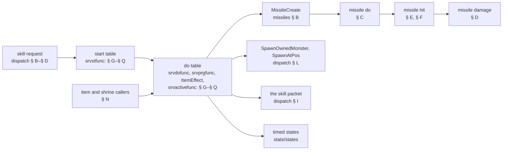
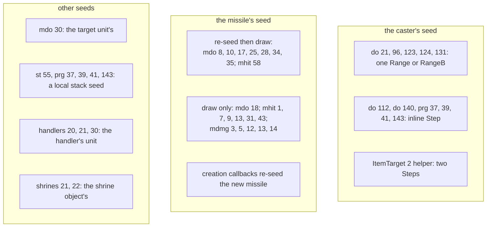
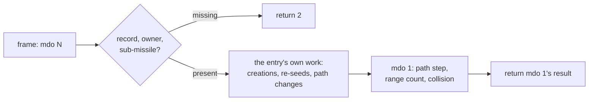
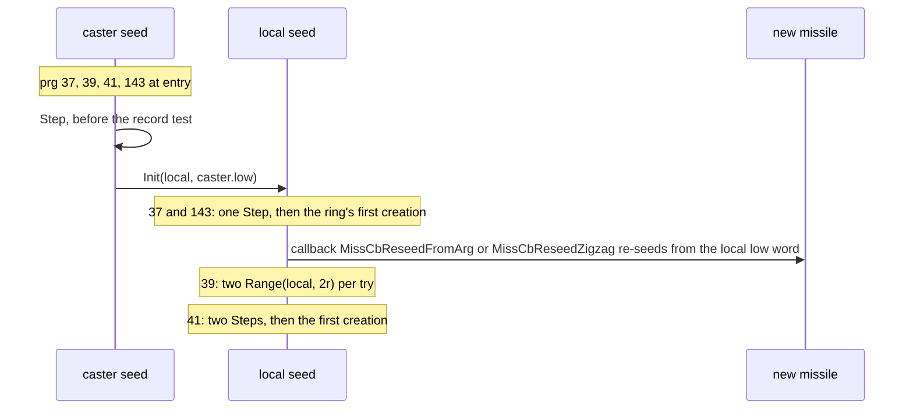
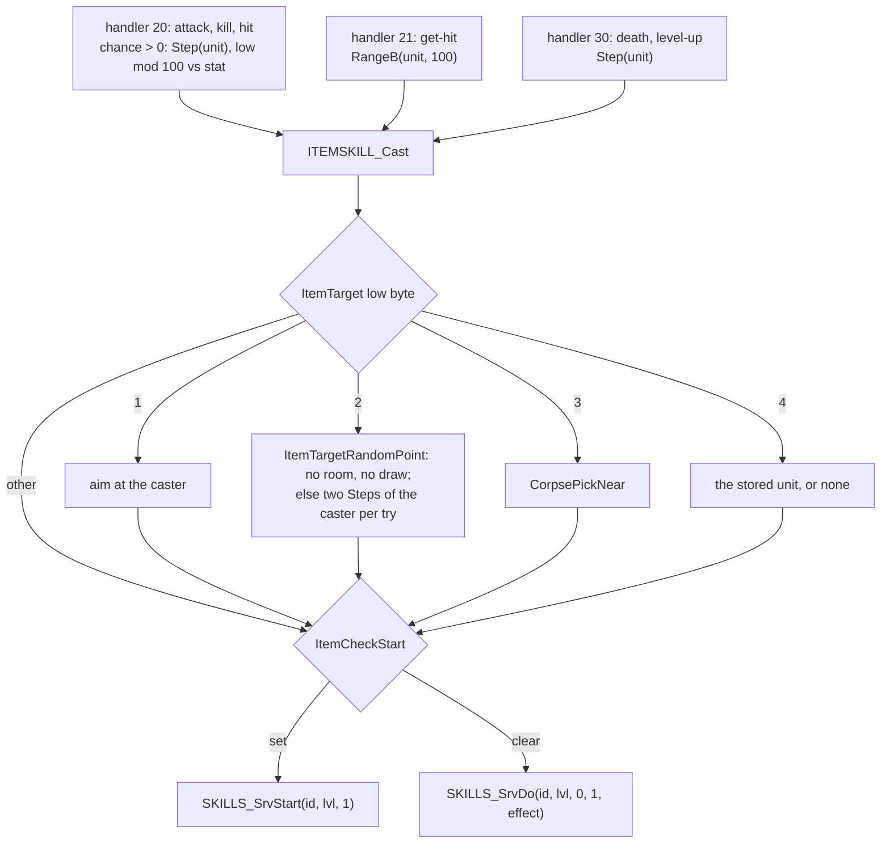
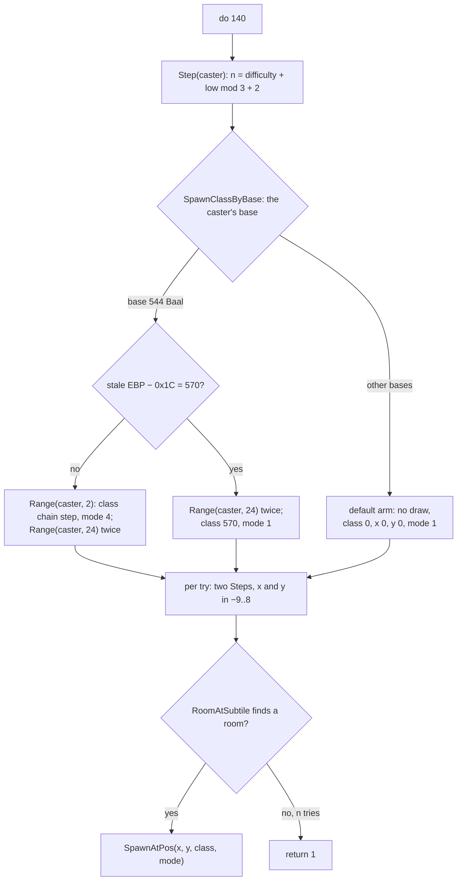

## Purpose

A Skills row names its start function (`srvstfunc`), its do function (`srvdofunc`, or `srvprgfunc1..3` for a progressive row, `ItemEffect` for an item cast, States `srvactivefunc` for a periodic state), and a Missiles row its server do, hit and damage functions. The machinery that calls them, and the 40 tier-A entries, are [skills/dispatch](../dispatch/) and [skills/missiles](../missiles/). This spec gives every other entry a stock row uses: what it tests, what it writes, which missiles, units, states and packets it makes, and **every draw it makes, in order, with its seed**. It is the catalogue: 310 entries, 304 read by its batches and the six `general` tier-A entries, which § A links and does not restate.



## Entry points

| When | Function | Tag |
|---|---|---|
| A skill mode starts | `g_SkillStartFuncs[srvstfunc]` from `SKILLS_SrvStart` | [C] (`g_SkillStartFuncs`, static scan of every batch) |
| A skill's action frame | `g_SkillDoFuncs[n]` from `SKILLS_SrvDo` | [C] (`g_SkillDoFuncs`, static scan of every batch) |
| A missile's frame | `g_MissileSrvDoFuncs[pSrvDoFunc]` | [C] the frame's do entry is the class's `pSrvDoFunc` in all 33 041 windowed frames, do 1, 3, 5 and 23; [I] the other do entries, whose rows no windowed missile had |
| A missile hits a unit, or ends | `g_MissileSrvHitFuncs[pSrvHitFunc]` | [C] (`g_MissileSrvHitFuncs`, the 9d table scan) |
| A missile's damage packet is built | `g_MissileSrvDmgFuncs[pSrvDmgFunc]` | [C] damage function 3 runs between the build and `MISSILE_ApplyDamage`, the missile's seed stepping once there in 13 486 of 13 486 hits, and rows without a damage function step none (4 118); [I] the other damage functions |
| An item stat, a charge or a shrine casts | the callers of § N | [C] up to their boundaries |

## Inputs

### Tables

| Anchor | Used for |
|---|---|
| `Skills.txt:srvstfunc`, `Skills.txt:srvdofunc` | the entry numbers; the rows per number are Skills § Function index |
| `Skills.txt:srvmissilea`, `Skills.txt:summon`, `Skills.txt:pettype` | the missile, the summoned class and the pet type each entry passes on |
| `Skills.txt:aurastate`, `Skills.txt:auratargetstate`, `Skills.txt:auralencalc`, `Skills.txt:aurarangecalc` | the states, lengths and radii |
| `Skills.txt:calc1`, `Skills.txt:Param1` | the calcs (`calc1..4`) and `Param1..8` an entry reads |
| `Missiles.txt:pSrvDoFunc`, `Missiles.txt:pSrvHitFunc`, `Missiles.txt:pSrvDmgFunc` | the missile entry numbers; rows per number in Missiles § Function index |
| `Missiles.txt:Param1`, `Missiles.txt:SubMissile1`, `Missiles.txt:HitSubMissile1` | a missile entry's parameters and sub-missiles |
| `MonStats.txt:BaseId`, `MonStats.txt:spawn` | the bases monster entries test; the class a spawner entry makes |

### Runtime state

| State | Type | Source |
|---|---|---|
| the caster's seed | Seed (unit `+0x20`) | rng/seeds; most entries never touch it (§ B) |
| a missile's seed | Seed (missile `+0x20`) | [missiles § B](../missiles/#b-creation), re-seeded by the sites of § B |
| the used skill node | unit skill record; `+0x18`–`+0x24` words an entry keeps between start and do | [dispatch § D](../dispatch/#d-the-mode-start) |
| the action-done bit | `Unit+0xC4` bit 6 | [dispatch § Runtime state](../dispatch/#runtime-state) |
| `MissileData +0x28`, `+0x2C` | two s32 words a missile entry keeps | [missiles § B](../missiles/#b-creation) |

### Constants

| Name | Value | Tag |
| --- | --- | --- |
| start table | `g_SkillStartFuncs`; stock Skills names 64 distinct `srvstfunc` numbers | [C] (the batches' slot reads, `static.txt`) |
| do table | `g_SkillDoFuncs`; 138 distinct `srvdofunc` numbers, plus the progressive, `ItemEffect` and `srvactivefunc` entries | [C] (the batches' slot reads, `static.txt`) |
| missile hit table | 71 slots; 24 filled in 31–59, 30, 34, 41, 42, 46, 49 and 60–70 null | [C] |
| `g_Circle64X`, `g_Circle64Y` | 64 s32 each: point `i` is `(trunc(30 · cos), trunc(30 · sin))` of `i/64` turns, truncated toward zero, so the radius runs from 28.84 to 30; read once each, at index `i mod 64` | [C] 64 of 64 points (static) |

## Algorithm

### A. How an entry is written

Names: `st N` is start entry N, `do N` skill do entry N (a progressive `srvprgfunc`, an `ItemEffect` and a States
`srvactivefunc` are entries of the same table), `mdo N`, `mhit N` and `mdmg N` the missile do, hit and damage entries.
`Step(s)`, `Range(s, n)`, `RangeB(s, n)` and `Init(s, v)` are rng's; `Init`'s high word is
`0x29A` (666). `caster` is the unit an entry runs for, `m` the missile, `lvl` the skill level, `calcN` the row's
`calcN` evaluated at `lvl`. Divisions are signed and truncate toward zero unless stated;
life and mana are in 1/256 points.

- A1. **Shapes.** Every skill start and do entry read by the class, item and monster batches is
  `(ECX game, EDX unit; skill id, level)` with `ret 8`.
  [C] (`g_SkillStartFuncs`, `g_SkillDoFuncs`, the static text dumps)

  A missile hit entry is `(ECX game, EDX m; unit)` with `ret 4` and returns the result word of
  [missiles § E](../missiles/#e-the-hit) (bit 0 end, bit 1 damage, bit 2 keep and return at once); a damage entry is
  `(ECX game, EDX m; unit, packet)` with `ret 8` and changes only the packet, the missile's seed and (mdmg 8) the
  unit's overlay. The 53 distinct hit entries all end in `ret 4` and the 14 damage entries in `ret 8`. [C]. [I] the write sets ("changes only
  the packet, …") and the result bits
- A2. **How far a `[C]` reaches.** Each entry was run under the emulator on its own code with synthetic and
  stock inputs and negative controls. An entry that returns is `[C]` as a whole map from the bytes it reads. An entry
  that ends at a callee is `[C]` **up to that call** (an observed boundary): its tests, the call's arguments,
  the bytes it wrote before the call and the seeds, nothing after it. The pseudocode marks the boundary with `→` and
  writes what follows under `after:` with its own tag. [C]
- A3. **"No draw" means before the boundary.** Each batch compared the caster's and the target's seed (and the
  missile's, for the missile batches) in every case; an entry with no draw line in § B steps no seed before its
  boundary or return. The cases' calcs are constant programs that call no calc function, so a calc's own draws are
  not covered. [C]
- A4. **Callees are not restated.** `MissileCreate`, `SkillMissileCreate`, `NovaAtUnit`,
  `SpawnOwnedMonster` and `SkillSummonClass`, `STATE_ApplyTimed` and the aura
  pass, `COMBAT_MeleeHitTest`, `COMBAT_DeliverQueued`, `SkillRollPhys`,
  `SKILLS_RollElemDamage` and
  `COMBAT_PrgFinisher` are those specs'. Their
  draws are theirs. [I]
- A5. **The six `general` tier-A entries** (st 1, 2, 65; do 1, 3, 5) and the other tier-A entries are
  [dispatch § O](../dispatch/#o-tier-a-the-start-and-do-functions) and [missiles § G](../missiles/#g-the-function-tables);
  this spec names them in their batch and links there. [I] (`SKILL_AttackDo`, review, ruling 2)

### B. Every draw, by seed

The index a reimplementer needs first: each entry that steps a seed, in its own order. Everything else in §§ C–Q
draws nothing before its boundary (A3).



| Entry | Seed | Draws, in order | Tag |
|---|---|---|---|
| mdo 8, 10, 17, 25 | the missile | `Init(m, SubX + elapsed)`; then `RangeB(m, 2(r − 1))` for x and for y, none when `r ≤ 1` | [C] up to `COLL_CellTestAt` |
| mdo 18 | the missile | per gold drop: `RangeB(m, 2·Param3 + 1)` twice, no re-seed | [C] up to the free spot |
| mdo 28 | the missile | `Init(m, MissileData+0x28)`; `Range(m, 2r + 1)` twice; `+0x28 ← m.low` | [C] up to `MissileCreate` |
| mdo 34 | the missile | each frame from `Param1` on: `Init(m, SubX)`, one `Step(m)` to pick the sub-missile | [C] up to its boundary |
| mdo 35 | the missile | `Init(m, MissileData+0x28)`; one `Step(m)` for the turn's sign | [C] up to its boundary |
| mdo 30 | **the target unit** (named by `+0x28/+0x2C`) | `Range(t, 2·Param2 + 1)` twice | [C] on the path-less cases |
| mhit 1, 9, 13, 31 | the missile | one `RangeB(m, …)` per element roll of `EType` whose two stats are ≥ 1 | [C] |
| mhit 43 | the missile | `RangeB(m, PhysMax − PhysMin)` | [C] |
| mhit 58 | the missile | `Init(m, x)`; `Range(m, 2r + 1)` for x, then for y | [C] up to its creation |
| mdmg 3 | the missile | one `Step(m)` | [C] |
| mdmg 5, 12, 13 | the missile | one `RangeB(m, …)` per element roll whose two stats are ≥ 1 | [C] |
| mdmg 14 | the missile | `Range(m, 100)` when the chance is above 0 | [C] |
| do 21 | the caster | `Range(caster, 100)` after the hostility and town tests | [C] |
| do 96 | the caster | `RangeB(caster, hi − lo)`, none when `hi = lo` | [C] |
| do 112 | the caster | one `Step(caster)` **before any test** | [C] |
| do 123 | the caster | `Range(caster, 0x100)` after the cell test | [C] |
| do 124 | the caster | `Range(caster, 0x10000)` after the used-skill tests | [C] |
| do 131 | the caster | `Range(caster, 100)`, only for a live monster target of base 453 | [C] |
| do 140 | the caster | one `Step` (the try count); Baal's arm: two or three `Range` (§ Q); two `Step` per try | [C] for the count and the tries; [I] the arm |
| prg 37, 143 | the caster, then a local seed | `Step(caster)` at entry, **before the record test**; `Init(local, caster.low)`; one `Step(local)` before the first creation | [C] |
| prg 39 | the caster, then a local seed | `Step(caster)` at entry; `Init(local, caster.low)`; `Range(local, 2r)` twice per try | [C] |
| prg 41 | the caster, then a local seed | `Step(caster)` at entry; `Init(local, caster.low)`; two `Step(local)` before the first creation | [C] |
| st 55 | a local seed from the target's and the caster's guids | `RangeB(local, calc2 − calc1)` | [C] |
| handler 20 | the handler's unit | one `Step(unit)` (a unit, chance > 0, and no packet or packet `+0x00` bit 5) | [C] |
| handler 21 | the handler's unit | `RangeB(unit, 100)` (a unit, chance > 0, packet `+0x04` bit 2) | [C] |
| handler 30 | the handler's unit | one `Step(unit)` for a unit with chance > 0, whatever the packet | [C] |
| `ItemTarget` 2 helper | the cast's caster | none without a room; else two `Step(caster)` before each collision test | [C] |
| shrines 21, 22 | the shrine object | `RangeB(shrine, Arg1 − Arg0)`, none for a range ≤ 0 | [C] |

- B1. **Creation callbacks re-seed the new missile.** The callback in the parameter block's `+0x54` runs inside
  `MissileCreate`: `MissCbReseedPathXPlusArg` (do 17, do 118, do 130) and
  `MissCbReseedPathX` (mhit 38; mhit 45 when `sHitPar2 ≠ 0`) are measured there, `[C]`; `MissCbReseedRoll` (do 102),
  `MissCbReseedFromArg` (prg 37) and `MissCbReseedZigzag` (prg 143) are emulated: each re-seeds the unit in `ECX` at its `+0x20` by
  `RNG_SeedInit` before any boundary, `MissCbReseedZigzag` to its return, the other two to `PathPlan`. [C] That `MissileCreate`
  runs them for prg 37, prg 143 and do 102, past `SUnitCreate`'s allocation, is the reading. [I]
- B2. **Draws after a boundary, from the reading.** These lie past the point the emulator stopped and are the
  reading's order: st 10's elemental `RangeB(caster, max − min)` after its hit test; do 55's and do 58's one
  `RangeB` on **the target's** seed; do 66's one `SKILLS_RollElemDamage` per aura run (the caster's seed); do 81's
  20 % roll per unit by a `Step` of **the unit's** seed; do 82's `Range(caster, 100)` per unit accepts;
  st 35's weapon roll by a `Step(caster)`; do 79's `Range(caster, 100)` against calc1;
  st 32's and st 39's elemental rolls (the caster's); do 69's `Range(caster, 100) < calc1` then the potion pick's
  `Step(caster)`; do 72's two `Range(caster, 100)`; entry 145's `SkillRollPhys` and
  `SKILLS_RollElemDamage`; entry 146's re-seed of the caster;
  do 33's knock roll by a `Step(caster)`, `low mod 100` against a calc by the target's kind; do 42's
  `Range(caster, 100)` at the last charge; do 107's three `RangeB(caster, max − min)`. [I]

### C. Missile do entries (mdo 1–36)

Batches 9a and 9b. An entry returns 1 to keep the
missile and 2 to free it.



- C0. **The shared tail.** Entry 1 of the table is a 5-byte `jmp MissileMoveCollide`, so mdo 1 is
  `MissileMoveCollide`. Every entry of 9a ends in mdo 1 and
  returns its result (mdo 18 after its cookie check); in 9b, mdo 20 and 30 return 1 after mdo 1, mdo 32 ends in
  mdo 7 and mdo 34 in mdo 3; a missing record, owner or sub-missile returns 2. In 9b, entries 19, 21–29, 31, 33, 35
  and 36 also end in mdo 1; do-table entry 37 (inside the Baal effect function's range) is non-null and
  no Missiles row names it. [C] entry 1 is the 5-byte `jmp MissileMoveCollide` and the tails as stated (static).
  [I] Which tests return 2 mdo 1, 3, 5
  and 23 are tier A: [missiles § G](../missiles/#g-the-function-tables). [I]

- C26. **The sub-missile tests differ.** mdo 21, 22, 23, 25 and 26 test `SubMissile1 ≠ 0`, so a blank (−1) passes;
  the other creating entries test `≥ 0`. [C]
- C27. mdo 24 is mdo 23's function and no stock row names it; the unused numbers of 1–36 are in
  Missiles § Function index. [C] entries 23 and 24 are
  both; no row of the `.txt` or the `.bin` names do 24; the unused do numbers are 4, 24 and 37–52 (static)

### D. Missile damage entries (mdmg 1–14)

Batch 9b. They run inside
`MISSILE_BuildDamage`. mdmg 3 is tier A and
emulated here too; 6 is unused. Every entry below is reproduced on returning cases, mdmg 8's overlay call up to
its boundary.

```
D1. mdmg 1:  v ← min(DmgCalc1, 100) when > 0; v % of the physical damage moves to the
                          missile's EType field                                         [C]
D2. mdmg 12: mdmg 1's share, then a fresh roll of the EType element replaces the packet's
                          damage (the fields PacketClearDamage zeroes); one RangeB(m) per roll   [C]
D3. mdmg 2:  freeze length ← MulDiv(stat 56, max(dParam1, 0), 100); cold length ← 0   [C]
D4. mdmg 3 is tier A: missiles § G (one Step(m); low & 0x7F < dParam1 sets result 0x4000)
D5. mdmg 4:  freeze ← cold length; cold ← 0                                  [C]
D6. mdmg 10: freeze ← cold length                                            [C]
D7. mdmg 5:  the EType roll; plus dParam1 % of it against undead, dParam2 % against demons   [C]
D8. mdmg 13: against a monster only: the owner's stat 25 percent added to the physical
                          damage; then mdmg 5                                             [C]
D9. mdmg 7, 9: stun length ← dParam1, else Param1 + (lvl − 1)·Param2 (7)
                          or Param2 (9); hit class 0x60                                   [C]
D10. mdmg 11: poison length ← MissileData+0x28 − frame when in [10, ELen(owner)],
                          else poison 0                                                   [C]
D11. mdmg 14: when the chance c (from dParam1, dParam2 and the target's MonStats2 small/large)
                          is above 0: Range(m, 100) < c sets knockback (result |= 0x8, a 16-bit OR at +0x04)   [C]
D12. mdmg 8 (MissDmg08Overlay): with a record, the unit and ProgOverlay > 0 (s16): → UnitSetOverlayStat(unit, ProgOverlay, 0);
                          else return without a call                       [C]
      after: the overlay as stat 178 on the unit's flag-0x80 list         [I]
```

### E. Missile hit entries 1–29

Batch 9c: 25 entries (5, 6, 11, 23
are named by no row). mhit 2, 3, 14 and 17 are tier A; 3, 14 and
17 are emulated here too. No entry steps the owner's or the target's seed before its boundary (8 400 cases; a
control moving the missile's draws to the owner's seed fails on every case that drew). [C]

### F. Missile hit entries 31–59 and row 568

Batch 9d: 24 table entries are filled
in 31–59 (31–33, 35–40, 43–45, 47, 48, 50–59; mhit 44 is § E's); mhit 2 and 36 are tier A
 and emulated here too. No entry steps the owner's or the target's seed
before its boundary (8 400 cases; the owner-seed control fails 140 and 181 cases). [C]

- F22. **Row 568** (`royalstrikechainlightning`, `pSrvHitFunc` 64 948): every read of the hit table (four sites) is
  behind a signed 16-bit `test ax, ax; jle` of the function word. [C] (`g_MissileSrvHitFuncs`, `static.txt`)
  The tested word is this row's `pSrvHitFunc`, so 64 948 (−588 as an s16) runs no server hit function: the five hit
  and damage tests and the do test are a `movzx` of the record word (`+0xE` hit, `+0x10` damage, `+0xC` do), then
  `test ax, ax; jle`, `movsx` and a compare with the count, by two decoders, and row 568 is the only row above 0x7FFF
  in any of the three columns. [C] (static, `g_MissileSrvHitFuncs`)

### G. Sorceress (st 11–14; do 17–29, 144)

18 entries; do 18, 20, 22, 27, 28 are tier A, 18, 20, 22 and 28 emulated here too, 27 not. One draw before the boundaries in the batch, do 21's; no case steps the target's seed (8 500 cases; moving the draw to the target fails 93). [C] 

### H. Amazon (st 4–10; do 6–8, 10–16)

17 entries, all emulated; no draw before the boundaries (8 300 cases). [C] do 9 is the barbarian's (§ K). st 4, st 5, do 7 and do 8 are tier A; the entries kept below add the batch's map.

### I. Necromancer (st 15–21; do 30–32, 55–63)

19 entries, all emulated; no draw before the boundaries (6 100 cases). [C] st 15, do 30 and do 31 are tier A; the entries kept below add the batch's map.

### J. Paladin (st 29, 31, 35–37; do 64–67, 73, 79–82, 150)

15 entries, all emulated; no draw before the boundaries (4 950 cases). [C] No paladin entry calls: it has two callers, do 31 (Raise Skeleton) and do 58 (Revive), by three tools, and the direct-call closure of the 15 entries (2 136 functions) does not reach it. [C] (static) Nothing in the batch tests the caster's class. [I] st 36, do 65 and do 66 are tier A; the entries kept below add the batch's map.

- J1. **Blessed Aim removes Penetrate.** Both rows name `penetrate` in `passivestate`, and Blessed Aim's `aurastate` is
  its own. Do 65 passes that `passivestate` at block `+0x48`, and `AURA_ApplyToTarget` frees that list and clears the state
  on the unit it applies to, so a running Blessed Aim removes Penetrate's list from its caster
  ([stats/states](../../spec-stats/states/) `+0x48`). The other direction, Penetrate's refresh against the aura, is not read.
  [I] (`AURA_ApplyToTarget`, `SKILLS_RefreshPassive`,
  `Skills.txt:passivestate`, `Skills.txt:aurastate`, row 19)
- J2. **A player's Smite draws its hit test, then forces the hit.** Past the boundary, the player branch of do 150 rolls the
  weapon damage, calls `COMBAT_MeleeHitTest(target, 0, 0)` and does `or ax, 1`: the test's
  draws run, and the hit bit is set whatever it returned. The defence bits it returned stay in the word; how
  `ResolveAndQueue` treats a word with both is not followed. [I]
- J2. **A monster's Smite uses its `A2` stats whatever mode it used.** The monster branch passes mode 5 to
  `MonAttackStats` (`edx = 5`), which tests mode 5 first (mask `0x10`), and mode
  5 selects `A2`; it
  stores the test's word with no `or ax, 1` (the player's `or` jumps past it).
  [C] (static, row 8)
- J2. **Smite sets no flag `0x40`.** Do 150 itself has no access to `Unit+0xC4`, where do 2 does `or [edi+0xC4], 0x40`;
  its direct-call closure (2 085 functions) reaches one of the 124 set sites, `SKILLS_SrvDo`'s, only
  through `COMBAT_DeliverQueued` → `COMBAT_DurabilityLoss` → … → `AuraSelect`, the durability path. [C] (static) Which unit that path sets the bit on, and the 622 indirect calls of the closure, are unfollowed. [I]
  (row 7)

### K. Barbarian (st 32–34, 38–41; do 2, 9, 68–72, 74–78)

19 entries, all emulated; no draw before the boundaries (6 800 cases). [C] st 32 and do 2 are tier A; the entries kept below add the batch's map.

```
K1. st 32 (SkillSt32Hit): the record, the target, the target's room (town → 0); → SkillAttackRateList(ECX caster, EDX calc3)
                                                                         [C]
K2. st 39: → COMBAT_MeleeHitTest(target, SKILLS_GetToHit(caster, id, lvl), 0), a zeroed 0x70-byte packet
                                                                         [C] → COMBAT_MeleeHitTest
      after: st 32's and st 39's elemental SKILLS_RollElemDamage on the caster's seed   [C] for st 32: 73 of 86 Bash starts hold one elemental roll on the caster, 13 none
        st 39, and what the 13 starts without a roll failed               [I]
K3. do 2:                                                 [C] → each call below
      with 0 < srvoverlay ≤ DataTables+0xBC0: a target (→ 0) and a QueuedHitFind node naming the caster and
        the target (none → 1, no delivery); UnitSetOverlayStat(target, srvoverlay, 0) when the
        packet's +0x04 bit 0 is set
      then, auratargetstate in [0, States count): the same two tests; on bit 0, end ← frame + max(auralencalc, 1),
        STATLIST_Alloc(game+0x1C, 2, end, target type, guid) for a target with no list of that state, else
        UnitQueueEvent(ECX game, EDX target; 0xC, end, 0, 0)
      then, aurastate in (0, States count): STATLIST_Alloc(game+0x1C, 4, 0, caster type, guid) or STATE_Set(caster, aurastate, 1)
      else: bit 6 and COMBAT_DeliverQueued(game, caster; target, 0) (no target → 0)
K4. do 9 (SkillDo09Frenzy, Frenzy), do 70 (SkillDo70DoubleSwing, Double Swing): bit 8 of the caster's +0x38 (sar 8, then the mask of bits 31 and 0)
                                                                         [C] → each call below
      do 9: DeliverQueued(target, 0) from two sites; bit 6 only when the bit is 1
      do 70, bit 1: bit 6; NearestUnitInRange(0, 0, reach + 4, 0x20003, target guid, 0)
      do 70, bit 0: st 32, and when it returns, DeliverQueued(target, 0)
K5. st 34 (SkillSt34CorpseTest): CorpseTest(target): a type-1 unit in mode 12 outside the DataTables+0x150 set with
      MonStats2 flag 7                                                   [C]
K6. st 33 (SkillSt33CorpseTest): CorpseTestF12(target) (the same, and MonStats2 flag 12 through MonStats2Flag12), or 0 when the
      target has state 118; neither st 33 nor st 34 reads a skill record [C]
K7. do 69, do 72: the record test and st 33's or st 34's test;
      → STATE_Set(target, 118, 1)                                        [C] → STATE_Set
      after: do 69's Range(caster, 100) < calc1 and the potion pick by a Step(caster); do 72's two
        Range(caster, 100), the second picking the quality by the Param1..4 bands (MonDropNoNoDrop)
                                                                         [I]
K8. do 75 (Grim Ward): → FreeNearFallback(RoomAtSubtile(target room, x; y),
      &{x, y}, 2, 0x1000, 1) at the target's position                    [C] → FreeNearFallback
K9. do 68 (the warcries):                                  [C] → NovaAtUnit's first MissileCreate
      bit 6 before the record test; SrvMissileByCharge; a class in [0, Missiles count) (class 0 admitted);
      {flags 3, owner the caster, class, +0x14/+0x18 the caster's position, +0x1C/+0x20 the first offset pair, id, lvl},
        velocity argument 0
      after: the 64 creations and UnitApplyAuraState       [I]
K10. do 71 (Taunt):                                        [C] → SKILLS_ForUnitsInRange
      auratargetstate in [0, States count); a type-1 target → MonTestN(ECX target, EDX 0xC) inside TauntTargetTest;
      any other or none → SKILLS_ForUnitsInRange(game, caster; 0, 0, 0x14, 0x8783, a filter callback,
        &{0, 2³¹ − 1, x, y, TauntTargetTest}, 0, a static table, 0x2B8) inside NearestByFilter
K11. st 38 (Whirlwind):                                    [C] → each call below
      SKILLS_GetUnitSkill(caster, id); no node, no target point → STATE_Set(caster, 0x12, 0) inside SkillState18Clear;
      state 12 → 0; a target → InMeleeRange(caster, target, 0); else path +0x50 ← 0xC01, PathSetType(path, 7),
        with 0x1C09 (a player) or 0x3C01 at ebp−0x14
K12. st 40:                            [C] → each call below
      the used skill; a monster with a target → MonSkillAttackDo(game); a monster without one:
        node +0x24 ← −1, FreeNearFallback(room, &point, UNIT_GetSizeX(caster), 0x3C01, 0)
      a player: the target point in a room it reaches (not a town room unless Skills +0x05 bit 0);
        d ← max(UnitDistance, 1); when d > range (aurarangecalc): x ← (x − ux)·range ÷ d + ux, y alike
        (32-bit, truncating); FreeNearFallback(RoomAtSubtile(…), &point, size, 0x1C09, 1) inside
K13. st 41:                                 [C] → each call below
      no record test; a target → InMeleeRange inside LeapAttackPoint
      none: (px, py) the path's target point, d ← UnitDistance; 0 → 0; else COLL_PatternTestBool(room,
        (px − ux)·2 ÷ d + px, (py − uy)·2 ÷ d + py, path +0x48, 0x1C09)
K14. do 74 (Double Throw): → UnitGetWeapon's inventory query; no inventory → 0
                                                                         [C] → the inventory query
K15. do 76 (Whirlwind):                                    [C] → each call below
      → WhirlwindEnd(node, id, +0x18, +0x1C) (a word 0, or +0x0C & 3 = 3); RescheduleAt(game, caster; 3) (a live
        player with bit 0); or UnitSetSeqPos(caster, 0) (another live caster)
K16. do 77: → UNIT_CancelEvents(game, caster; 1, 0)      [C] → UNIT_CancelEvents
K17. do 78 (SkillDo78LeapAttack): no record test; → LeapAttackLand (+0x0C bit 8), LeapAttackPath (bit 7), LeapAttackHit (bit 9),
      in that order; else +0x0C ← 0x1000, return 1                       [C]
```

- K14. **Do 74 adds the skill's to-hit to its missile.** Past the boundary, it adds `SKILLS_GetToHit` to the missile's
  stat 19 after creating the missile, the one exception read to
  [missiles B2](../missiles/#b-creation)'s "no to-hit for a player's skill missile". [I] (`SKILLS_GetToHit`, row 18)

### L. Druid (st 56–58; do 114–124; entries 145, 146)

16 entries, all emulated; two draws before the boundaries, both on the caster's seed (8 400 cases). [C] do 114 and 117 are tier A.

### M. Assassin (st 22–28; do 33–35, 42–52, 54; progressive 36–41, 143)

29 entries, all emulated (8 700 cases; the stack seeds compared too). [C] st 23 and do 35 are tier A; the entries kept below add the batch's map.



- M2. **The knockback's level difference is `slvl`.** Dragon Talon's do reads stat 12 of the target (`push edi`) twice,
  so its chance computes `level(target) + slvl − level(target)`: `edi` is `UNIT_GetTargetUnit`'s result, both reads push it with no `edi` write between, and the chance is `s1 + slvl − s2`. [C] (static, row 1)
- M2. Psychic Hammer's do has the same form: both reads are `push ebx`, the target (`ebx` from `UNIT_GetTargetUnit`; the chance). [C] (static, row 2)

### N. Item, charge and shrine callers (st 3, do 4, 113, 151)

Four entries and ten callers, all emulated, five families, 12 000 cases, 0 mismatches.
[C] The cast path itself is
[dispatch § H](../dispatch/#h-item-granted-skills-and-item-event-casts) and the handler table
[dispatch § K](../dispatch/#k-stat-event-handlers).



- N9. **The effect flag.** It is 1 only from handler 20 without `ItemTgtDo`, so `ItemEffect` 36 and 151 (Nova, Frost
  Nova, Chain Lightning) replace the do entry only for the skill-on-attack, -kill and -hit stats, not for on-get-hit,
  on-death, on-level-up, the item-use entries or charges; no other call of `SKILLS_SrvDo` passes 1. [C] the effect
  argument is 0 at seven of `SKILLS_SrvDo`'s eight callers and `ITEMSKILL_Cast`'s own argument at the eighth; the
  chains of `ITEMSKILL_Cast`'s ten callers pass 1 only from handler 20 with `ItemTgtDo` clear, 0 with it
  set, from handlers 21 and 30 and from the item-use casts; handler 20 is ItemStatCost's `item_skillonattack`, `-kill`
  and `-hit`, 21 get-hit, 30 death and level-up (static). The do entry's replacement inside
  `SKILLS_SrvDo` is [dispatch § E](../dispatch/#e-the-do-frame-and-skills_srvdo)'s reading. [I]
- N10. **Whose seed helper 2 steps.** The unit the handler made the caster: the other unit for handler 20 with
  `ItemTgtDo` (54 Teleport, the one stock `ItemTarget` 2 row, has it), the stat's owner otherwise; composed from three
  `[C]` links. [I]
- N11. **Pets above a lowered `petmax`** are removed by `PetLimitRefresh`, which `STATE_DefaultRemoveCB`
  and the skill shrine's own remove callback run for a player when a timed state ends: it recomputes each pet type's
  maximum from the player's skills and calls `PetLimit`. [I]
- N12. **In the game.** Handler 20's item cast fired 166 times (event 7) in the Phase 2 run: 102 failed the roll with
  exactly one draw on the handler unit's seed, 64 passed it and cast Chain Lightning at level 5 (at least the roll's
  draw each); handler 21 fired 16 times with at least one draw each. [C]

### O. Monster skills, Skills rows 156–189 (st 42–53; do 83–98, 110, 111)

Thirty entries, all emulated: five families, 12 600 cases, 0 mismatches; only do 96 draws before its boundary.
[C] Which monster
uses which skill is the monster AI specs'.

### P. Monster skills, Skills rows 190–289 (st 54, 55, 59, 60, 64; do 99–109, 112, 125–127, 141, 152)

22 entries, all emulated: four families, 9 200 cases, 0 mismatches. [C]

### Q. Monster skills, Skills rows 290–338 (st 61–63; do 128–137, 139, 140, 147–149)

18 entries, all emulated: four families, 8 800 cases, 0 mismatches. [C]



- Q7. **Surprises kept as read.** do 148 and 149 differ in one byte; do 132 writes a slot; do 136 tests the point
  before bit 6; three entries have no id test; do 134 returns 0 before its packet for `srvmissilea` −1. They stand
  as code readings inside the map; what the game shows for them is under *Open questions*.
  [C] That the stock row 301 takes that exit is Q6's data join: its `srvmissilea` is blank
  in the `.txt` and 0xFFFF in the `.bin`. [C]

### R. In the game: the Phase 2 sample

One member of each family that has no tier-A member (8a, 8b, 8c, item) was recorded in the game, 12 sessions, and the skills model checks them with **0 mismatches**.

| Family | Member logged | Start events | Do events | Tag |
|---|---|---:|---:|---|
| 8a | 181 Resurrect (do 97) | 66 | 66 | [C] |
| 8a | 160 ShamanFire (do 85) | 39 | 37 | [C] |
| 8b | 282 Imp Inferno (st 59, do 126) | 33 | 1 004 | [C] |
| 8c | 299 Imp Fire Missile (do 132) | 213 | 198 | [C] |
| 8c | 330 Imp Teleport (do 129) | 354 | 347 | [C] |
| 8c | 295 Overseer Whip (do 131) | 61 | 61 | [C] |
| item | 53 Chain Lightning cast by *of Chain Lightning* items (`ItemEffect`, effect argument 1) | 0 | 64 | [C] |

- R1. **What the run checks.** Every creation of the 12 logs (44 773) and every hit end (13 576) is checked by the
  creation and hit-end rows of the checker, and the player rows' caster seeds at `SKILLS_SrvDo` and `SKILLS_SrvStart`
  (2 612 and 2 616 events). The monster rows' caster steps are reported, not checked (no monster row is in the
  checker's modelled list). [C]
- R2. **The `MissCbReseedPathX` re-seed, measured.** In 36 of 36 creations of a class-408 missile (`catapultchargedballbolt`)
  by a catapult spotter (class 516), whose parameter block's `+0x54` is `MissCbReseedPathX`, the new missile's seed at
  `MissileCreate`'s exit lies on the stream of `Init(path word +0x10)`, 10 steps past the `Init` in all 36 (the
  checker row `MC.cbseed2`). [C]
  The 10 steps are `PathPlan`'s random walk, and the `Init`'s low word is path word `+0x10`. [C]
  24 of the 36 lie inside an `end` 1 call of a class-407 missile with hit function 38 (mhit 38). [C]
 Which of the hit entries that pass the callback (mhit 38, mhit 45
) made the other 12, after the log's hit-line cap, is not logged. [I]

- R3. **`ReturnDamage` (stat-event handler 4, Iron Maiden) when its returned damage kills the cursed unit.** In one
  case the cursed monster's seed stepped once between the handler's entry and its return, its life going from 1 173
  to 0 inside the handler. The step is the death's processing or something else the handler calls after the
  damage; which draw is not read. The handler where the unit survives stays a no-draw check. [I]
 **This kill branch is a hole in
  the checker's handler-seed check (`EVH.seed`)**: the checker reports the steps of a `ReturnDamage` call that kills
  its unit and does not check them, so the no-draw `[C]` for handler 4 does not extend to a kill. [I]

- R4. **The monster rows' caster steps per do event**, now a check: do 131 steps the caster once in 61 of 61 do events,
  those with a monster target, as Q2's one draw for a minion target allows, with no nested logged span; do 132 once in
  198 of 198, inside its nested creation; do 129 once in 62 of 347, with no logged line holding it (its `UnitTeleport`
  boundary); do 109 once in 361, inside `COMBAT_MeleeHitTest`, and four times in 634 of 995 (the hit test one, the
  elemental roll one, two with no logged line); the `srvmissile` rows 339, 340, 342 and 345 (do 0) once in 92 of 92,
  inside their creation, where § P's chain places the critical roll; row 167 (do 91) nine times in 1 of 11, with no
  logged line inside; the 14 other logged monster rows none. [C]
 The sources of the unlogged steps (do 129's, do 109's two, row 167's nine) are not read. [I]


## Outputs

Per entry: the accept or result word it returns, the words it writes into the used skill node, the caster's or the
missile's `+0xC4`/`MissileData` words, and the boundary call it ends in with its arguments (a missile, a spawn, a
state, a packet, a delivery). The seeds it steps are § B's. Each boundary's own output is the callee's spec (A4).

## Worked example

do 140 on Hell (difficulty 2) for a caster whose seed is `(low 1, high 666)`, its default arm (no draws; the arm the emulated cases reach: stock Baal, the only stock user, takes Baal's arm, two or three more draws, Q1), base point `(100, 200)`, computed with rng's `Step` from Q1's steps. Both branches below are recorded cases: do 140 emulated on that seed and arm (MonStats base 0, no target) spawns at `(100, 199)` with the seed `(0x280687C4, 0x13ADFE65)` when a room holds try 1's point, and returns 1 with `(0xE778FC3B, 0x49422C1A)` when no room holds any of the four. [C] (cases W1, W2, among 1 200 do 140 cases with 0 mismatches)

| Step | Seed after (low, high) | Value |
|---|---|---|
| count `Step` | `0x6AC6935F`, `0x00000000` | `n = 2 + 0x6AC6935F mod 3 + 2 = 2 + 0 + 2 = 4` |
| try 1, x | `0x2F2ED81B`, `0x2C890AFD` | `x = 9 + 100 − 9 = 100` |
| try 1, y | `0x280687C4`, `0x13ADFE65` | `y = 8 + 200 − 9 = 199` |
| try 2, x | `0xB6AAB839`, `0x10B1BFE6` | `x = 5 + 100 − 9 = 96` |
| try 2, y | `0xBFC793C3`, `0x4C305F9E` | `y = 9 + 200 − 9 = 200` |

If try 1's point has a room, the spawn goes to `(100, 199)` with the seed three steps on (the loop then goes on
through tries 2–4, Q1's `after:`); with no room in all four tries the entry returns 1 with the seed nine steps on (`1 + 2n`).

## Reimplementation notes

- **Draws before tests.** do 112 and prg 37, 39, 41 and 143 step the caster's seed before their record test, so a
  refused cast still moves the seed by one. [C]
- **Not the caster's seed.** mdo 30 draws on the target unit's seed, do 55 and do 58 (after their boundaries) on the
  target's, do 81's per-unit roll on each unit's, the shrine entries on the shrine object's, st 55 on a local seed no
  unit keeps. [C] for mdo 30, st 55 and the shrines; [I] for do 55, 58, 81
- **Words read before anything writes them.** do 57's block word `+0x24` is the frame slot `ebp−0x10`, do 140's
  class out word is `EBP − 0x1C` (Q1), and mhit 52's class word `+0x10` is never written (so its missiles are row 0
  by the callee's reading). A reimplementation that wants the game's behaviour has to model the stale values, which
  only a logged case can give. [C] for the unwritten words; [I] for what follows
- **Fatal paths on reachable data.** `MissNovaCreate` with `n ≥ 41` (mhit 38, 45), do 123's class at or past the
  Missiles count, st 20's item class past the item count reach. [C]
- **Identical bodies.** do 152 is do 95's code; do 148 and 149 differ in one byte; st 59 is st 53 with calc1 for
  calc2. [C]
- **Return values that look wrong.** do 13 returns 0 on every path; mdo 14 with a skill or level ≤ 0 returns 2
  without mdo 1; do 63 returns 1 for a bad missile class. [C] for mdo 14 and do 63 and for do 13: its one `ret` follows `xor eax, eax` with no `EAX` write between and no
  branch lands past the `xor` (two independent readings)
- **Signed and unsigned tests.** A blank `SubMissile1` (−1) passes the `≠ 0` test of mdo 21, 22, 23, 25 and 26;
  class 0 passes do 68's test, and do 73 and 80 refuse it; do 31 tests `pettype` signed, do 49 unsigned, do 44 and
  45 turn a bad one into 0. [C]
- **An endless loop.** The rings of prg 37 and 143 do not test their step count; a count of 0 loops for ever. [C]
  both load the prg's calc into `edi`, scale it by 4 and loop `esi += edi` while
  `esi < 0x100`, and no `edi` operand is a test or compare (static). What a negative
  count does is [combat/delivery](../../spec-combat/delivery/#reimplementation-notes) note 11's reading. [I]


## Evidence

- Tables: Skills, Missiles, MonStats.
- Machinery: [skills/dispatch](../dispatch/), [skills/missiles](../missiles/), rng/seeds.
