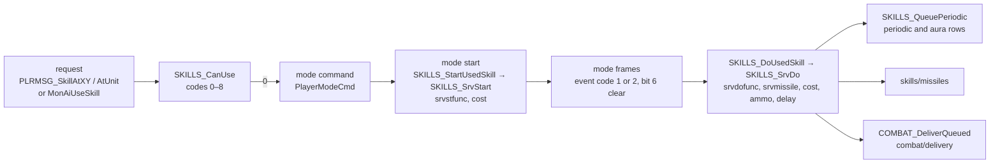
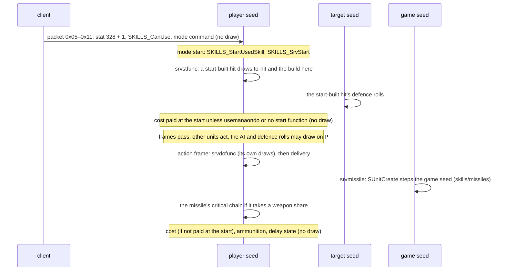
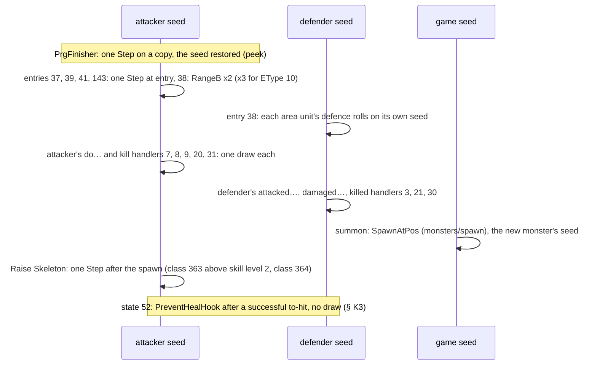
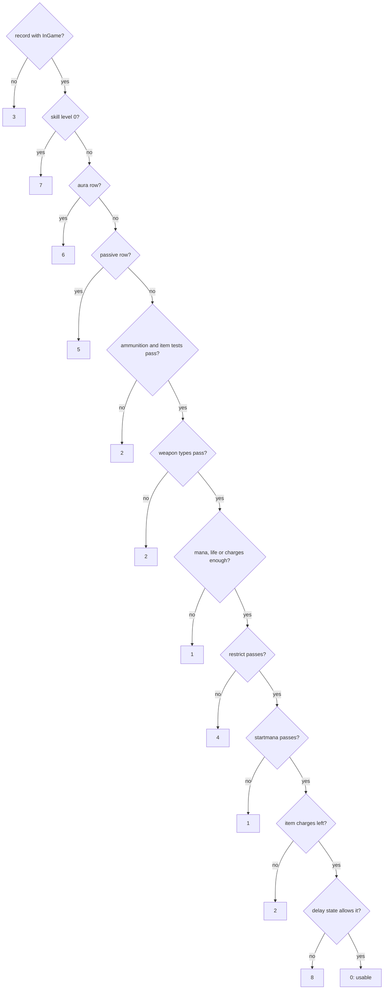
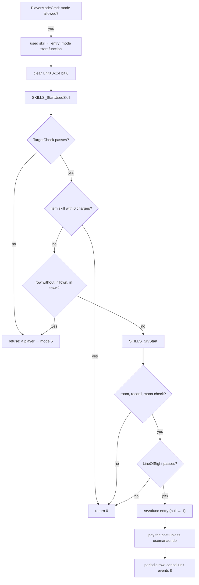

## Purpose

When a unit uses a skill, the server takes the request (a client packet for a player, the AI's command for a monster), checks it, starts the skill's mode, runs the skill's **start function** (`srvstfunc`) at the mode start and its **do function** (`srvdofunc`) on the mode's action frame, creates the skill's missile, pays the cost and sets the delay. This page specifies that machinery for players and monsters, item-granted skills and item-event casts, the skill packet a skill hit builds, progressive charges and the finisher, the stat-event handler table, summons and the pet limit, monster skill use, and ammunition and weapon wear, with every draw named by its seed. Overview and boundary: [skills](../overview/).



## Entry points

| When | Function | Tag |
|---|---|---|
| A player's skill request at a location (packets 0x05, 0x08, 0x0C, 0x0F) | `PLRMSG_SkillAtXY` | [C] the packet ids by `g_SrvPacketTable` read with two tools (0x05, 0x0C call it; 0x08, 0x0F re-read the packet and call them); 2 823 location requests enter at its two `SKILLS_CanUse` sites and reach the start |
| A player's skill request at a unit (packets 0x06, 0x07, 0x09, 0x0A, 0x0D–0x11 but 0x0F) | `PLRMSG_SkillAtUnit` | [C] the packet ids by `g_SrvPacketTable` read with two tools (0x06, 0x0D call it with walk 1, 0x07, 0x0E with walk 0; 0x09, 0x0A, 0x10, 0x11 re-read and call them); 1 521 unit requests enter at its two sites and reach the start in their frame, 12 later after B3's run |
| The request checks | `SKILLS_CanUse` | [C] for codes 0, 1, 6 and 8 and their order (1 340 calls); [I] otherwise |
| A skill mode starts (player modes 7, 8, 10–16, 18; monster modes 4, 5, 7, 8, 9 and 14) | `SKILLS_StartUsedSkill` → `SKILLS_SrvStart` | [C] for the caster's seed in the start events of the rows of § O; [C] the chain `StartUsedSkill` → `SrvStart` for players (5 843 starts, in modes 7, 10–12, 14–16, 18) and monsters (1 984, in modes 4, 5, 7, 8, 9 and 14); [I] the other rows' seeds (the catalogue's) and player modes 8 and 13, which no start met |
| The mode's action frame | `SKILLS_DoUsedSkill` → `SKILLS_SrvDo` | [C] for the caster's seed in the do events of the rows of § O; [C] the chain `DoUsedSkill` → `SrvDo` (14 168 calls, all with pay 1, item 0, effect 0) and `SrvDo`'s other callers by return address: the aura tick and select, `ITEMSKILL_Cast`; [I] the other rows' seeds (the catalogue's) |
| A cost is paid | `SKILLS_PayCost` | [C] (1 798 calls) |
| A periodic or aura skill runs again (unit events 8 and 9) | `EVENT_SelectedAuraTick`, `EVENT_ItemAuraTick` | [C] event 8: `EVENT_SelectedAuraTick` runs `SrvDo` (119 ticks of Might and Holy Fire, each on the 50-frame grid); [I] event 9, `EVENT_ItemAuraTick`, which no session ran |
| An item's chance-to-cast fires | `ITEMSKILL_Cast` | [C] 86 item casts reach `SrvDo` from it, inside handlers 20 and 21 |
| A player's normal attack under a charged progressive state | `COMBAT_PrgFinisher` | [C] its 18 charged calls (Fists of Fire) and 311 uncharged ones all sit inside a `SrvDo` of Attack or Left Hand Swing |
| A stat event fires on a unit | `UNIT_DispatchEvent` | [C] every logged handler call (2 167, of 25 handler and event pairs) runs inside it (/) |
| A skill summons a monster | — | [C] its calls sit inside every summon do event: 207 Raven, 12 Raise Skeleton |
| A monster's AI uses a skill | — | [C] each of its 1 088 calls holds one `SrvStart` of the unit with the call's skill and mode in its frame: modes 4 (68), 5 (12), 7 (62), 8 (444), 9 (16), 14 (486) |

## Inputs

### Tables

| Anchor | Used for |
|---|---|
| `Skills.txt:srvstfunc`, `srvdofunc` | the start and do function numbers (§ D, § E) |
| `Skills.txt:srvprgfunc1`, `prgstack`, `prgcalc1` | progressive entries (§ J) |
| `Skills.txt:srvmissile`, `lob`, `decquant` | the do frame's missile and ammunition (§ E, § N) |
| `Skills.txt:InGame`, `InTown`, `aura`, `passive`, `periodic`, `immediate`, `restrict`, `State1` | the checks (§ C, § D, § G) |
| `Skills.txt:itypea1`, `etypea1`, `range` | the weapon test and the walk-to-range (§ B, § C) |
| `Skills.txt:mana`, `lvlmana`, `manashift`, `minmana`, `startmana`, `usemanaondo` | the cost (§ F) |
| `Skills.txt:delay`, `perdelay` | the delay state and the periodic grid (§ G) |
| `Skills.txt:LineOfSight`, `TargetableOnly`, `TargetCorpse`, `TargetAlly`, `TargetItem`, `AttackNoMana` | the start and request tests (§ B, § D) |
| `Skills.txt:ItemEffect`, `ItemTarget`, `ItemCheckStart`, `ItemTgtDo` | item-event casts (§ H) |
| `Skills.txt:ResultFlags`, `HitFlags`, `HitClass`, `calc1`, `calc2`, `calc3`, `calc4`, `EType`, `SrcDam`, `Kick`, `MinDam`, `MaxDam`, `MinLevDam1`, `DmgSymPerCalc`, `HitShift` | the skill packet (§ I) |
| `Skills.txt:aurastate`, `auratargetstate`, `auralencalc`, `aurastat1`, `aurastatcalc2`, `srvoverlay` | the melee deliver do and the charges (§ I, § J) |
| `Skills.txt:summon`, `summode`, `pettype`, `petmax`, `Param1` | summons (§ L) |
| `PetType.txt:group` | the pet group clear (§ L) |
| `ItemStatCost.txt:itemeventfunc1` | the item-stat handler registrations (§ K) |
| `ItemStatCost.txt:itemevent1`, `itemevent2`; `Skills.txt:auraevent1` … `auraevent3` | the event ids handlers register on, Events row indices (§ K) |
| `Skills.txt:charclass`, `EType`, `skilldesc`; `SkillDesc.txt:SkillPage` | the skill-level bonus (§ C8) |
| `MonStats.txt:SkillDamage` | a summon's owner skill damage (§ M) |
| `MonStats.txt:ResDm`, `Skill1` | the logged Kick targets and the `Kick` branch's monster casters (§ I) |

Column semantics are the table docs': Skills § Dispatch,
Skills § Function index, PetType.

### Runtime state

| State | Type | Source |
|---|---|---|
| skill list | `SkillList`: left skill `+0x08`, right `+0x0C`, used skill `+0x10` | `SkillList+0x10` |
| skill entry | `SkillEntry`: record, mode `+0x08`, flags `+0x0C` (bit 0 move first, bit 1 arrived), `+0x18` a per-entry word, `+0x24` the dual-wield toggle, base level `+0x28`, `+0x30` scroll quantity, owner item guid `+0x34` (−1 own), charges `+0x38` | `SkillEntry+0x34` |
| action-done bit | `Unit+0xC4` bit 6 (`0x40`): the do function has run in this mode | — |
| request counter | the player's base stat 328 (`pierce_idx`), +1 per accepted request | — |
| unit seed | `Unit+0x20`, per unit | every draw below |
| frame | `game+0xA8` | the delay end, the periodic grid |

### Inputs and oracles

| Input | Kind | Tag |
|---|---|---|
| the monster's choice of skill, mode and target | an input here: [monsters/ai/machinery § T](../../spec-monster-ai/machinery/#t-the-tier-ais) for the tier, the catalogue for the rest | [I] |
| the numbered start and do functions outside § O | value oracles of the checker; specified in the catalogue | [I] |
| `SKILLS_ForUnitsInRange`'s and `SkillForUnitsNearTarget`'s unit order, `SkillUnitFilter` | logged as the list of units the callback ran on | [I] |
| the pet chosen for removal | a logged value | [I] |
| a calc's value | [data/calc](../../spec-data/calc/) | [I] |

### Constants

| Name | Value | Tag |
| --- | --- | --- |
| start table | `g_SkillStartFuncs`, bound `0x5B` | [C] `cmp ax, 0x5B; jge` before the indexed read; 92 slots up to the do table, 64 non-null, the highest 65 (static) |
| do table | `g_SkillDoFuncs`, bound `0xBF` (shared by `srvdofunc`, `srvprgfunc1..3`, `ItemEffect`) | [C] `cmp ax, 0xBF`, `cmp eax, []` (= 0xBF); 192 slots, 152 non-null, the highest 152 (static) |
| stat-event table | `g_StatEventFuncs`, 31 handlers (ids 1..31), bound `0x32` | [C] `cmp eax, 0x31; ja`; the non-null slots are exactly ids 1..31 (static) |
| delay state | 121 `skilldelay` | [C] the writer's three state calls push 121 and `SKILLS_DelayOk` tests `UNIT_HasState(121)` (static) |
| blood mana state | 114: its readers and writers are `SKILLS_PayCost` (2 calls), `SKILLS_ManaOk` (1), `BloodManaPay` (3) and `StateDo147Attached` (1), which looks up its stat list | [C] every call of the five state functions with 114 (static) |
| periodic grid floor | `perdelay` 5 when the calc gives less than 6 | [C] both sites clamp the calc as `cmp ecx, 5; jg; mov ecx, 5` (static) |
| charge cap | 3 | [C] `min(old + 1, 3)`, between the get and the set of the same stat (static) |

[C] Every stock Skills row's `srvstfunc`, `srvdofunc`, `srvprgfunc1..3` and `ItemEffect` (> 1) names a non-null
entry of its table: 357 rows, none out of table; 64 non-null start entries among ids 1..65 and 152 non-null do
entries (ids 1..152; 53, 138, 142, 145, 146 and 147 used by no stock row). This is the data join of the tables'
bytes against every row; which column indexes which table is the code reading of §§ D, E and J.

## Algorithm

### A. The skill's life by event kind

The events of one skill use, each with the seeds it touches. The diagrams illustrate the sections named; the
statements are there.

**A1. Request, start and do (a player).**



**A2. A monster.** The AI sets the used skill and bit 6 and starts the mode; the mode start runs
`SKILLS_StartUsedSkill`. In modes 4, 5, 7, 8, 9 and 16–20 the action-frame handler runs `SKILLS_DoUsedSkill` without
an event-code test; mode 14's start clears bit 6, and its frame runs the do on a code 1 or 2 as a player's does (§ E2). A monster pays
no cost, uses no ammunition and gets no delay state (§ M).

**A3. The finisher, a handler, a summon.**



### B. The request

```
B1. PacketSkill(player, packet):                                     [C] (g_SrvPacketTable, all of B1; static)
      entry ← left (SkillList+0x08) for 0x05–0x0A, right (+0x0C) for 0x0C–0x11;  none → return 3
      read the location form (5 bytes: x u16 +1, y u16 +3) or the unit form (9 bytes: type u32 +1 ≤ 5, guid u32 +5)
      baseStat(player, 328) += 1                                     ; every request, before the checks
      0x05/0x0C → SkillAtXY;  0x06/0x0D → SkillAtUnit(walk 1);  0x07/0x0E → SkillAtUnit(walk 0)
      0x08–0x0A, 0x0F–0x11: re-read the packet, then as 0x05–0x07 / 0x0C–0x0E;  0x0B: does nothing

B2. SkillAtXY(player, entry, x, y):                                  [I] (PLRMSG_SkillAtXY, all of B2)
      if player.mode ∈ {0 death, 17 dead}: return
      if UNIT_CanDualWield(player): entry ← DualAttackAlternate(entry)          ; B4
      c: i32 ← SKILLS_CanUse(player, entry)                                       ; § C
      if c ∈ {1, 2, 4} and row.AttackNoMana: entry ← player's skill 0 (Attack); c ← SKILLS_CanUse(player, entry)
      if entry.mode ≠ 0:
        if c = 0: PlayerModeCmd(entry, entry.mode, x, y, force 0)                ; § D
        else if c = 1: send the no-mana message to the client
      ; any other code: nothing

B3. SkillAtUnit(player, entry, type, guid, walk):                    [I] (PLRMSG_SkillAtUnit, SKILLS_GetRangeType, all of B3)
      as B2 up to c, then require c = 0, entry.mode ≠ 0 and (row.TargetItem or type ∈ {0, 1, 3})
      if the target is in state 143 (attached): target ← the unit it is attached to
      if walk = 1 and GetRangeType(entry) = 1 (h2h) and the target is out of melee range:
        run to the target (mode 3), keeping the skill id; return
      PLAYER_ModeCmdUnit(entry, entry.mode, type, guid, 0)
```

- B1. **The table and the request counter, read and logged.** `g_SrvPacketTable`, read by two tools, gives 0x05–0x0A
  the left entry and 0x0C–0x11 the right one, the two forms' lengths and fields, the handlers' calls and walk
  arguments, and 0x0B no call and no store; each direct handler adds 1 to base stat 328 before its call, and in the
  logs the stat rises by the number of requests between two observations (1 660 pairs with a request between, no
  break). [C]
- B2, B3. **The code-0 paths, logged.** A code-0 location request reaches the mode start in its frame (2 823 of
  2 823), a code-0 unit request too (1 521) or, for 12 Kick requests out of melee range, in a later frame with the
  skill kept. [C] The branches after a non-zero code and the death modes of B2, B3's run (mode 3), its state-143 redirect and
  its `TargetItem` and type tests have no logged line; they are the reading. [I]

- B1. The location form refuses a length other than 5 and an invalid point, replying at most once per 25 frames;
  the unit form needs the unit in the same act. [I]
- B1. **The request counter** stat 328 is the seed of every pierce count the player's missiles make. It rises by one on every request (4 367
  calls, 1 660 pairs of observations with a request between). [C] Every
  logged request returned 0, so that it rises whatever the checks then decide is the reading. [I]
- B3. `GetRangeType`: `range` 0 none, 1 h2h, 2 rng, 3 both; `both` gives 2 when the unit has a missile weapon, else 1,
  and 1 for a player in a `meleeonly` state. [I]
- B4. **Dual-wield alternation.** For the Attack entry (skill 0) with a weapon in each hand: when the Attack entry's
  `+0x24` is 0 the request uses the unit's skill 5 (Left Hand Swing) and sets `+0x24 ← 5`; else it uses Attack and
  sets `+0x24 ← 0`. [I] So Attack and Left Hand Swing alternate, request by request: 56 of 56 consecutive pairs
  of a dual-wielding Barbarian's requests. [C]

### C. The request checks (`SKILLS_CanUse`)



```
C1. SKILLS_CanUse(unit, entry) → i32:                                [I] (SKILLS_CanUse, all of C1)
      if no record or not row.InGame:                     return 3
      if SKILLS_GetSkillLevel(unit, entry, 1) = 0:        return 7
      if row.aura:                                        return 6
      if row.passive:                                     return 5
      if not SkillAmmoOk(entry, unit):                    return 2       ; C2
      if not SKILLS_WeaponTypeOk(entry, unit):            return 2       ; C3
      if not SKILLS_ManaOk(entry, unit):                  return 1       ; C4
      if not SKILLS_RestrictOk(entry, unit):              return 4       ; C5
      if not SKILLS_StartManaOk(entry, unit):             return 1       ; C6
      if not SKILLS_ItemChargesOk(unit, entry):           return 2       ; C7
      return SKILLS_DelayOk(unit, entry) ? 0 : 8                        ; § G
```

- C1. **Codes 0, 1, 6 and 8 and their order, measured.** In 1 340 calls (1 126 from the request handlers' four call
  sites, 214 changes of code at the client's per-frame check) the code is the one this order gives for
  the aura test (6, 1 call), the mana test of C4 (1, 8 calls) and the delay test of G2 (8, 76 calls), else 0. [C]

- C1. Codes 2, 3, 4, 5 and 7 are the code reading: no call of the run reached them (C4's to C7's tests are
  emulated, their bullets). No step draws. All 357 stock rows have `InGame`, so code 3 is reached only with no
  record. [I]
- C2. `SkillAmmoOk`: a `scroll` row needs `SkillEntry+0x30` > 0; Throw (skill 2) needs a throwable item in the hand
  (the other hand's when dual wielding and the first is empty), or one with stat 125; Left Hand Throw (4) the same on
  the other hand; Left Hand Swing (5) dual wield and a weapon in the hand; any other skill passes. [I]

- C3. `WeaponTypeOk`: a row with neither `itypea1` nor `etypea1` above 0 passes; else both hands are tested in both
  orders (for skills 4 and 5 with the primary weapon taken out of its hand first). [I]

- C4. `ManaOk`: an item skill (`+0x34` ≠ −1) needs charges `+0x38` > 0. Else
  `lvl: i32 ← clamp(base + C8's bonus, 0, ExpMaxLevel(0))`, then `max(lvl − 1, 0)` into the cost of § F1 (with no
  `minmana` floor); under state 114 `cost ≤ stat 6` (life); else a `srvdofunc` 116 row (the shapeshifts) with
  `Unit+0xC8` bit 3 passes; else `cost ≤ stat 8`. [C]
- C4. **A cost equal to the mana passes.** With `lvl` the entry's base plus its bonus, a cost above stat 8 gives code 1
  (8 calls) and a cost equal to it passes (5 code-0 calls with stat 8 exactly the cost, which a strict test would
  refuse). [C] The clamp, the charges, the state-114
  and `srvdofunc` 116 branches, which the run did not reach, are reached in the emulation, and it separates the level
  term's `− 1` (428 cases differ without it). [C]
- C5. `RestrictOk` (`restrict`): a null unit, entry or record refuses; 0 refuses while the unit is in a restricted
  state; 1 passes; 2 passes only in a restricted state and with one of `State1..3` (the first negative ends the list);
  any other value passes. The restricted test (→) is any common bit between the unit's
  state bits, read only when its stat list has bit 31 of `+0x10`, and the mask words at DataTables `+0x110`. [C]

- C6. `StartManaOk`: a player (type 0) with `startmana` (`+0x184`) > 0 and `stat 8 < startmana · 256` (signed) is
  refused unless in state 12 (`inferno`). [C] The three stock `startmana` rows (Inferno, Arctic Blast, Blade Fury) are the channelled skills: the
  first frame needs `startmana`, later ones the per-use cost only. [I]
- C7. `ItemChargesOk`: a null unit or entry refuses (0); no inventory, or an entry whose item guid (`+0x34`) is −1,
  passes. Else the inventory is walked to its end or to the first node that is not an item (type 4), either of which
  passes like a missing item; the first item with the guid decides: it passes only if the low byte of its stat 204 at
  layer `skill · 64 + (level & 0x3F)` is non-zero, `level` being `SKILLS_GetSkillLevel(unit, entry, 0)`, the entry's
  base `+0x28` in `[0, ExpMaxLevel(0)]` with no bonus. [C]
- C. **No refused request reached the server in the run.** All 1 126 request calls returned 0, while the client's own
  check of the same skills changed to a refusal 85 times (code 8 76, code 1 8, code 6 1); 60 casts in the Rogue
  Encampment gave no request at all. [C]
- C. **A stock client sends no refused request.** The client runs `SKILLS_CanUse` on its own copy of the player for
  the skill buttons every frame and, in the run, sent no request for a refused skill; its sending code is not read.
  So the refusal branches of B2–B3 and the `InTown` refusal of D2–D3 are the server path for a client that sends any
  request, stated from the code reading. [I]
- C. **A monster does not call `SKILLS_CanUse` on its way to the mode start** (§ M): none of its 16 callers, by three
  tools, lies in the monster mode path's functions (`MonAiUseSkill`, `MonModeStartSkill`, `MonSetMode`,
  `MonAttackFrame`, `StartUsedSkill`, `DoUsedSkill`); they are client, request, item-attach, reselect, swap and player
  mode-start sites. [C] (`SKILLS_CanUse`, static) The
  direct-call closure from those functions still reaches it, through `MonAttackFrame` → `COMBAT_DeliverQueued` → the
  defender's durability loss → `HandsRefresh` → `PlrModeStartSkillUnit`: a check of the defender, not of the attacking
  monster, as far as the scan can tell (it does not tell the unit). [I]

**C8. The skill-level bonus.** `SKILLS_GetSkillLevel(unit, entry, 1)`, the level C1 tests,
is the entry's base points plus this bonus, clamped to `[0, max]`;
with `withBonus` 0 it is the base points alone. C4's `ManaOk` adds the same bonus. `stat(id, p)` is the unit's full
stat `id` at layer `p` (`STATS_GetUnitStat`, which keeps only the low 16 bits of `p`); the stat and state names are the ItemStatCost and States rows.

- C8. The cap of 3 on stat 97 (`cmp eax, 3; jle`) applies to a skill of the player's own class and to a
  non-player whose base points are above 0; a player's skill of another class takes stat 97 uncapped. `+0x2C` is a
  per-entry word added as it is; the finding does not follow its writers. Every sum is a plain 32-bit add and the
  cap a signed compare (`jle`), so a negative stat 97 is added as it is; `SkillPage` is loaded with `movsx`, and
  the layer `8·class + page − 1` reaches `STATS_GetUnitStat` as its low 16 bits (`movzx`). No step draws. [I]

- C8. **SkillDesc's `SkillPage` is a server input.** The tab bonus (stat 188) applies to a class skill only when its
  SkillDesc row puts it on a page 1–3; a skill whose `SkillPage` is 0 takes no tab bonus. Outside the calc variables
 this is the server's only read of a SkillDesc record column. [I]

- C8. Callers: `SKILLS_GetSkillLevel`, `SkillLevelClamped`
 and `SKILLS_ManaOk`. [I]

### D. The mode start



```
D1. PlayerModeCmd(entry, mode, x, y, force):                        [I] (PLAYER_ModeCmdUnit, all of D1)
      if not force and not PlayerModeAllowed(mode, 1, entry): return
      if entry: SkillList.used ← entry
      g_PlayerModeStartFuncs[mode].xy(mode, x, y)    ; .unit with the target for PLAYER_ModeCmdUnit
      ; modes 7, 8, 10–16, 18: PlrModeStartSkillXY / …Unit: set the path target,
      ;   Unit+0xC4 &= ~0x40, SKILLS_StartUsedSkill

D2. SKILLS_StartUsedSkill(game, unit) → i32:                        [I] (SKILLS_StartUsedSkill, all of D2)
      entry ← SkillList.used;  if none: return 0
      if not SKILLS_TargetCheck(id, game, unit): refuse; return 0
      lvl: i32 ← SKILLS_GetSkillLevel(unit, entry, 1)
      if entry is an item skill: lvl ← its own level; if charges = 0: return 0
      tgt ← UNIT_GetTargetUnit(game, unit)
      if tgt and not row.TargetAlly and SkillAllyTest(tgt, id): return 0       ; never true here (note)
      if not row.InTown and the unit's room is a town: SkillList.used ← 0; refuse; return 0
      r ← SKILLS_SrvStart(id, lvl, noCost 0)
      if unit is a player and r = 0: refuse
      return r

D3. SKILLS_SrvStart(game, unit, id, lvl, noCost) → i32:             [I] (SKILLS_SrvStart, all of D3)
      if no game, unit or room: return 0
      if no record or (not noCost and not SKILLS_SrvManaCheck(unit)): return 0
      if not row.InTown and (no room or a town room): SkillList.used ← 0; refuse; return 0
      if row.LineOfSight ≠ 0 and SKILLS_GetTargetXY(&x, &y):
        mask: u16 ← {1: 0x0004, 2: 0x1C09, 3: 0x0180, 4: 0x0804, 5: 0x0805}[row.LineOfSight]   ; other values: return 0
        if COLL_LineTest(room, (x, y) → unit position, mask) ≠ 0: return 0
      st: i32 ← row.srvstfunc;  if st < 0 or st ≥ 0x5B: return 0
      if g_SkillStartFuncs[st] = null: r ← 1
      else:
        r ← g_SkillStartFuncs[st](id, lvl);  if r = 0: return 0
        if not row.usemanaondo and not noCost: SKILLS_PayCost(id, lvl)      ; result ignored, § F
      if row.periodic: cancel all the unit's unit events 8
      return r
```

- D1–D3. **The logged path.** A code-0 request leads to the skill mode start in its frame (4 344); `StartUsedSkill`
  calls `SrvStart` (7 827 calls, return); a row with no start function returns 1 (6 216); one payment
  follows exactly when a start function returns non-zero on a row without `usemanaondo` and `noCost` is 0 (1 602,
  none in the other 6 267), with the start's id and level. [C] `PlayerModeAllowed`'s refusal (11 code-0 requests with no start, which the
  logged lines do not explain), D2's refusals, and D3's room, mana-check, town and `LineOfSight` refusals and periodic
  cancel return or act before any logged line; they are the reading. [I]
- D2. `TargetCheck` returns 1 when there is no target: none stored, a stored one `UNIT_GetTargetUnit` no longer
  finds as itself (it re-finds the unit by type and guid), an item in mode 1 or 2, or the caster itself; a skill
  outside `[0, nSkills)` with a target returns 0. A `TargetableOnly` skill (`+6` & 0x10) returns 0 unless one of three
  tests passes, in this order: `UnitsHostile(game, unit, target)`; `SkillPetTest` (the row's `+7` & 2, and the target
  a monster whose owner record names type 0 and the caster's guid); `SkillAllyTest` (a player caster, the row's `+7` &
  4, a player target or a monster owned by a player, and equal party ids). Past those tests every branch returns 1,
  and clears or keeps the target by `+0xC4` bit 1 and `TargetCorpse`:

  | Target's `+0xC4` bit 1 | Target | `TargetCorpse` skill | Other skill |
  |---|---|---|---|
  | clear | any | cleared | cleared |
  | set | a type-1 unit in mode 12 | kept | cleared |
  | set | any other | cleared | kept |

  "Cleared" is `UnitSetPathTargetUnit(unit, 0)`: the caster's path `+0x58` ← 0, and the fatal path for a caster not of
  type 0, 1 or 3. The code does not say what bit 1 means. [C]
- D2. The ally test in `StartUsedSkill` never refuses: it is called only when `TargetAlly` (`+0x07` bit 2) is clear,
  with the same skill, and returns false unless that bit is set. Its other callers (`SKILLS_TargetCheck`, a missile hit
  function) are where it matters. [C] (static)
- D3. `SKILLS_SrvManaCheck` reads the **used** skill (skill list `+0x10`), not the id passed: a non-player passes, an
  item skill needs charges, a null record refuses, else the cost of § F1 with `lvl = max(GetSkillLevel(…, 1) − 1, 0)`
  against stat 8, with the `srvdofunc` 116 exception and **no** state-114 branch (unlike C4). [C]

- D3. A row with no start function pays nothing here: its cost is paid at the do (§ E), as is Plague Javelin's, a
  `usemanaondo` row (6 250 and 45 payments at the do, none at the start). `SKILLS_SrvStart` has four callers, and only
  `ITEMSKILL_Cast` passes `noCost` 1; `StartUsedSkill`, do 83 and do 109 pass 0. [C]
  (`SKILLS_SrvStart`; static) Blade Fury, the other
  `usemanaondo` row, was cast in no session. [I]
- D3. Do functions 83 (Fire Hit) and 109 (MonFrenzy, BloodLordFrenzy) call `SKILLS_SrvStart(id, lvl, 0)` again
  inside the do frame, after delivering or dropping the queued hit, so the start function (and its cost) runs once
  more there. Do 109's 42 restarts are logged. [C] Do 83's restart, which no session met, is the reading. [I]

  Do 83's `COMBAT_DeliverQueued(target, 0)` call is reproduced up to that call. [C] (return address
)
- D3. **No draw in the start machinery.** In the start events the run checked (1 142 in all, the eleven rows of § O among them), the caster's
  seed at `SKILLS_SrvStart`'s return is its entry seed stepped by the nested events' draws only, the payments inside
  them included. [C]

### E. The do frame and `SKILLS_SrvDo`

```
E1. PlayerSkillFrame(unit, event) → i32:                             [I] (all of E1)
      entry ← SkillList.used;  if none: return 2                    ; 2 ends the mode
      if entry.flags bit 0 (move first) and UnitMoveStep() = 2:     ; arrived
        entry.flags |= 2;  SKILLS_DoUsedSkill()
      else if Unit+0xC4 bit 6 clear and event ∈ {1, 2}: SKILLS_DoUsedSkill()
      return dead ? 2 : 1

E2. MonsterAttackFrame(unit):                                        [I] (all of E2)
      ; modes 4, 5, 7, 8, 9, 16–20 (MonAttackFrame):
      no used skill: the plain attack (combat/overview A2)
      move-first entry: as E1;  else SKILLS_DoUsedSkill()           ; no event-code test, no bit-6 test
      ; mode 14 (sequence, MonSeqFrame; its start has cleared bit 6): the move-first branch, then the do
      ;   when Unit+0x4E = 4 (no bit-6 test), or when no move-first do ran, bit 6 is clear and Unit+0x4E ∈ {1, 2}

E3. SKILLS_DoUsedSkill(unit):                                        [I]
      lvl ← SKILLS_GetSkillLevel(unit, used, 1)
      SKILLS_SrvDo(id, lvl, pay 1, item 0, effect 0);  SKILLS_QueuePeriodic(id, lvl, 0)        ; § G

E4. SKILLS_SrvDo(game, unit, id, lvl, pay, item, effect) → i32:      [I] (SKILLS_SrvDo, all of E4)
      actor: bool ← unit.type ∈ {0 player, 1 monster}
      if actor:
        used ← SkillList.used
        if used and not used.flags bit 0 and not row.InTown and (no room or a town room): refuse; return 0
        if not item and (no used, or used's id ≠ id, or GetSkillLevel(unit, used, 1) < 1):
          e ← SKILLS_GetUnitSkill(unit, id);  if no e or GetSkillLevel(unit, e, 1) < 1: return 0
      do: i32 ← row.srvdofunc;  if do < 0 or do ≥ 0xBF: return 0
      if actor and row.usemanaondo and not SKILLS_SrvManaCheck(unit): return 0
      if effect and item and row.ItemEffect > 1: do ← row.ItemEffect                    ; § H
      r ← g_SkillDoFuncs[do] ? g_SkillDoFuncs[do](id, lvl) : 0
      if row.srvmissile ≥ 0 and it names a Missiles row:
        Unit+0xC4 |= 0x40;  (dx, dy) ← (0, 0)
        if item and effect and GetTargetXY(&tx, &ty) and tx ≠ 0 and ty ≠ 0:
          (dx, dy) ← (tx − x, ty − y);  (tx, ty) ← (tx + dx, ty + dy)
        (row.lob ? SkillMissileCreateLob : SkillMissileCreate)(unit, id, lvl, dx, dy, tx, ty, useAmmo 0)
        r ← 1
      else if r = 0: return 0
      if pay:
        if actor:
          if g_SkillStartFuncs[row.srvstfunc] = null or row.usemanaondo: SKILLS_PayCost(id, lvl)   ; result ignored
          if row.decquant: PLAYER_UseAmmo()                                             ; § N
        d: i32 ← SKILLS_EvalCalc(unit, row.delay, id, lvl)
        if d > 0 and unit.type = 0 and (row.anim ≠ 18 or (Unit+0x38 & 0xFFFFFF00) = 0):
          SKILLS_SetDelayState(game, unit, d)                                           ; § G
      return r
```

- E1–E4. **The logged frames.** A player's skill mode start gets one do (5 794 of 5 843; 3 in each of 36 Jab
  sequence starts; 13 modes ended first); a monster's do repeats within one start for skills 176, 178, 282 and 328
  (and Submerge's 4 971 do events in 58 starts), as E2's missing bit-6 test gives; `DoUsedSkill` calls
  `SrvDo(id, lvl, 1, 0, 0)` (14 168); in `SrvDo` a payment follows in 6 295 do events and none in 8 084, the delay
  state is set at the do's frame with the row's `delay` (613, players only), the payment before the delay (613) and
  the `srvmissile` creation before both (487), and a return of 0 comes before any payment (59). [C]
 E1's move-first branch and return value, which
  frame handler ran and `Unit+0x4E` (E2), E3's level source and its `QueuePeriodic` call, and E4's actor town
  refusal, skill lookup, `decquant` use and anim-18 gate have no logged line; they are the reading. [I]

- E1–E2. **Bit 6 makes the do run once per mode.** 124 sites set `Unit+0xC4` bit 6 (84 functions: most do
  functions, the melee deliver do, `SKILLS_SrvDo` once its missile row exists, the monster AI's command
  before `MonSetMode`) and 17 clear it (the player skill mode starts and mode 14's monster start among
  them); 44 of the sets and 7 of the clears lie in client-range functions. The server readers that skip the do on it
  are `PlrModeSkillFrame` and `MonSeqFrame`, so a second code-1 or
  code-2 frame of the same mode does not repeat a do function that set it. [C] (static)
- E2. **A monster's do, by mode.** A monster's AI sets bit 6 itself. The start of modes 4, 5, 7, 8, 9 and 16–20
  (`MonModeStartSkill`, by `g_MonModeRecords`) reaches none of the 17 clears (its closure: 703 functions, 536
  indirect calls not followed), and their frame function `MonAttackFrame` runs the do with no bit-6 test. Mode 14's start `MonModeStartSeq` clears bit 6 and tail-jumps
  to `StartUsedSkill`; its frame `MonSeqFrame` runs the do on `Unit+0x4E` = 4 untested, else with the bit clear on a
  code 1 or 2, as the player frame does. In the logs bit 6 is set at all 1 460 monster starts in modes 4–9 and clear
  at all 566 in mode 14. [C] (static)
- E4. **The missile comes after the do function**, with `useAmmo` 0, so `decquant` is the only ammunition use on
  this path. [I]
  A row with a `srvmissile` and no `srvdofunc` (entry 0 is null) gets only that missile: 48 stock rows,
  among them 36 Fire Bolt, 251 Fire Trauma (lob) and 25 Plague Javelin. Two more rows (307, 325) name only
  `srvmissilea..c` (both the `.txt` and the `.bin`) and get no missile here. [C]
- E4. With an item cast's effect flag the line missile starts at the target point and flies on to twice the
  distance; a lob keeps the caster as its start and aims at the doubled point. [I]
- E4. **No draw in the do machinery.** In the do events checked (1 269 in all: the per-row
  seed-check total of § O, the eleven rows' 947 among them), the caster's seed at
  `SKILLS_SrvDo`'s return is its entry seed stepped by the nested events' draws only (the missile creations'
  critical draws, the to-hit rolls, the defence rolls, an aura's elemental roll), the payments and 251 of the 277
  delay states set (Meteor 30, Firestorm 221) inside them. [C] Plague Javelin's 45 delay states (26 here, 19) lie in do events whose seed check holds. [C]

### F. Costs

```
F1. Cost(row, lvl) → i32:                                            [C] (SKILLS_PayCost: 1 334 payments)
      cost: i32 ← ((i32) row.lvlmana × max(lvl − 1, 0) + (i32) row.mana) << (row.manashift & 31)   ; 1/256 mana

F2. SKILLS_PayCost(unit, id, lvl) → i32:                             [I] (SKILLS_PayCost, all of F2 except as tagged)
      if no unit or unit.type ≠ 0: return 1                         ; only players pay; [C] (205 calls)
      used ← SkillList.used
      if used and used.id = id and used.ownerItem ≠ −1: return UseCharge(unit)     ; charges − 1, no draw
      if row.mana ≠ 0 or row.lvlmana ≠ 0:
        cost ← Cost(row, lvl)
        if cost < row.minmana × 256: cost ← row.minmana × 256        ; the floor, here only
        if UNIT_HasState(unit, 114): return BloodManaPay(unit, cost)
        if cost ≤ stat(unit, 8): stat(unit, 8) −= cost; return 1
      return 0                                                        ; [C] for a row with no cost (259 calls)
```

- F1. `mana` and `lvlmana` are s16, `manashift` the low byte of its field (count & 31), the product and sum s32, the
  shift a left shift of the s32; stat 8 is mana in 1/256. In 1 334 player payments stat 8 fell by exactly this
  amount and the return was 1: 258 of them carry a `lvlmana` term at a level above 1, and the shifts 5, 6, 7 and 8
  occur 19, 21, 117 and 1 177 times. [C]
- F2. `lvl` is the level the caller passes: the start's (1 602 payments) or the do's (6 295). [C]
 The checks of § C and § D recompute it from the
  entry. [I]
- F2. **The floor binds the payment only.** The checks use the unfloored cost. Seven stock rows have a negative
  `lvlmana` (Magic Arrow, Guided Arrow, Dopplezon, Teleport, Bone Prison, Summon Resist, Double Swing): the rows where
  the floor can bind. The run's payments never reached the floor. [I]
- F2. **The result is ignored** by `SKILLS_SrvStart`, `SKILLS_SrvDo` and Blade Fury's start function: after each of
  the three calls every path writes `EAX` whole, or calls a function that writes it, before any read. [C]

  So when the cost exceeds the mana, nothing is taken and the skill still runs. No such refusal occurred in the run.
  [I]
- F2. **Blood mana.** With `cost ≤ stat 6` life falls by `cost`, and when the new life is below `Param5 · 256` of the
  skill that made the state (Blood Mana, `Param5` 40) the state's list is removed; else the state is removed, life is
  set to 256 and the payment fails. Not reached in the run. [I]
- F2. Blade Fury pays per fragment: its start function 26 extends its state-12 list each frame and calls
  `SKILLS_PayCost` after each fragment do 48 makes. [I]

### G. The delay state; periodic, aura and channelled skills

```
G1. SKILLS_SetDelayState(game, unit, d):                             [C] (SKILLS_SetDelayState, all of G1; static)
      a player with d ≠ 0 gets (or reuses) a timed list of state 121, end frame ← frame + d,
      and unit event 12 at that frame (the timed-list expiry, stats/states § C)

G2. SKILLS_DelayOk(unit, entry) → bool:                              [I]
      return not (unit is a player in state 121 and EvalCalc(row.delay, its level) ≥ 1)

G3. SKILLS_QueuePeriodic(unit, id, lvl, selected):                   [I] (SKILLS_QueuePeriodic, all of G3)
      only for periodic or aura rows
      p: i32 ← EvalCalc(row.perdelay);  if p < 6: p ← 5
      cancel the unit's event-8 queue (all of it when selected, else this skill's)
      queue unit event 8 at ((frame − 1 + p) ÷ p) × p + 1 with (id, lvl), or (−1, 0) for the selected right-skill aura
```

- G1, G2. **The header and the gate.** A player with `d` ≠ 0 gets the delay at the do's frame (613 delay states, none
  for a monster); the state is 121 and the expiry is `UnitQueueEvent(12, …)`, both read with two tools.
  [C] (`SKILLS_SetDelayState`; static)
  `SKILLS_DelayOk` returns 1 for a null unit, a unit not a player, a unit not in state 121, a null entry or record,
  up to its `SKILLS_GetSkillLevel` call. [C] The `EvalCalc` of the delay and its `≥ 1` test are the reading. [I]
- G1. **The delay ends at `f + d`.** With `SKILLS_SetDelayState` at frame `f` and delay `d`, a request at frame
  `f + d` passes (16 request calls of Meteor, Firestorm or Plague Javelin), and the client's check of the skill, 8
  from the cast, changes back to 0 at frame `f + d` in 26 delays; a state still on at `f + d` would refuse those 16.
  [C]
- G1. That the state refuses on every frame up to `f + d − 1` rests on the client's check running each frame (only its
  changes are logged); 8 more client changes back to 0 come at `f + d + 1`, the client's frame one behind the
  server's there, which is not read. [I]
- G2. **The delay test applies to a row with a `delay` only.** In state 121 a row with a `delay` is refused (code 8,
  76 calls) and a row without one passes (67 code-0 calls, which a delay test on every skill would refuse). [C]

- G2. **One delay blocks every delayed skill**: the state is one per unit, whichever skill set it, and the test is
  `EvalCalc(delay) ≥ 1` of the row asked for. 23 stock rows have a `delay`. [I]
- G1. A sequence-anim row (`anim` 18) sets its delay only while `Unit+0x38 & 0xFFFFFF00` is 0 (E4). For a player
  `+0x38 >> 8` is the index of the code-1/2/4 event being run, which `PlrModeSkillFrame` writes at each frame event, so
  the delay is set on the sequence's first event ([anim/timing § G](../../spec-anim/timing/#g-sequences), G5). [I]

- G1. **The delay runs from the do**: with Frozen Orb held, 72 of the 73 next casts that start within 3
  frames of the delay state's end start exactly at the `SKILLS_SetDelayState` frame plus `d`, one 3 frames later; the
  frames from the mode start to the do are not part of it ([anim/timing § L](../../spec-anim/timing/#l-the-frame-events-as-gates), L3).
  [C]
- G3. **The ticks, logged.** Might's and Holy Fire's ticks fall on frames `≡ 1 (mod 50)` (119 ticks, `perdelay` 50),
  and after a select the first tick comes at the next grid frame (3 selects off the grid). The floor `p < 6 → 5` is
  the constant's two compares. [C] The queue cancel and the `(−1, 0)` form are the reading. [I]

- G3. The two stock `periodic` rows are 57 Thunder Storm and 277 Blade Shield; the `startmana` rows (41, 230, 266),
  the channelled rows of C6, are none of them `periodic` (`.txt` and `.bin` agree). [C] The grid is the aura grid of
  stats/states § F, and a `periodic` row's start cancels all the unit's event-8 entries
  first (D3). [I]
- G4. **Aura select.** Selecting an `aura` row with an `aurastate` as the right skill: without `immediate` it sets the
  state and a plain list carrying the skill (stat 350) and level (stat 351); with `immediate` it runs
  `SKILLS_SrvDo(id, lvl, 1, 0, 0)` at once; then `SKILLS_QueuePeriodic(id, lvl, 1)`. [I]
 The `immediate` branch and the order are logged: Might (`immediate` 1) runs
  `SrvDo(id, lvl, 1, 0, 0)` at each of its 5 selects, Holy Fire (`immediate` 0) runs none, and the ticks follow on the
  grid. [C] The stat 350/351 list of a select without `immediate` is the reading. [I]

- G5. **`repeat` (Skills `+0x05` bit 3) is not read for a Skills row by any function that makes one:** its four
  mask-form tests are a client site, `MissileDoFrame` on a Missiles row and
  `STATLIST_CacheAdd/Write`, and the 15 immediate-form tests of bit 3 or 1 lie in no function that makes a Skills row.
  [C] (`g_BitMask32`, static) So `repeat` has no server reader, as far as that criterion
  reaches (a row passed in as an argument escapes it); its three stock rows are the three `startmana` rows. [I]


### H. Item-granted skills and item-event casts

- H1. **Charged skills** are entries with `ownerItem` ≠ −1: the mana checks test the charges, `ItemChargesOk` the
  item's stat 204, `StartUsedSkill` refuses at 0 charges and uses the entry's own level, and `SKILLS_PayCost` spends a
  charge. Not reached in the run. [I]
- H2. **Item auras** (stat 151): `ITEMAURA_Start` queues event 9 on the grid and, for an `immediate` row, runs
  `SKILLS_SrvDo(id, lvl, 1, item 1, 0)`; `EVENT_ItemAuraTick` repeats it while stat 151 at that layer is above 0. [I]


```
H3. ITEMSKILL_Cast(caster, id, lvl, target, x, y, effect) → bool:    [I] (ITEMSKILL_Cast, all of H3 except the H3 bullets' [C])
      if id = 0 or row.ItemEffect = 0: return false
      save the caster's target, path point and Unit+0xC4 bit 6;  aim at the given unit or point
      by row.ItemTarget: 1 the caster itself; 2 a random point (H4); 3 a corpse; 4 the attacker or a previous one
        ; each helper may refuse
      if row.ItemCheckStart and not SKILLS_SrvStart(id, lvl, noCost 1): restore; return false
      SKILLS_SrvDo(id, lvl, pay 0, item 1, effect)
      restore the target, the point and bit 6
```

- H3. **The logged casts.** Each of the 86 item casts calls `SrvDo(id, lvl, pay 0, item 1, effect)` with no
  `SrvStart`, no payment and no delay state. Over every Skills row, `ItemEffect` is 36 in 2 rows (Frost Nova, Nova),
  151 in 1 (Chain Lightning), 1 in 69 and 0 in the other 285. [C] That an item cast uses
  no ammunition, the helpers' tries, `ItemCheckStart` and the restore of the
  target, point and bit 6 are the reading, and so is the effect flag's do function `ItemEffect`, which no line logs.
  [I]
- H3. The effect flag is 1 only from handler 20 without `ItemTgtDo` (§ K): handler 20's `ItemTgtDo`-clear path pushes 1
  (after `test [row+7], []; je`), and the other eight item-cast calls push 0.
  So an item Nova, Frost Nova or Chain Lightning runs its `ItemEffect` only on attack, kill or hit. [C] (static)
- H4. **`ItemTarget` 2 draws.** `ITEMSKILL_Cast` gives helper 2 its own caster, whose seed the helper steps twice per
  try before the try's collision test (`low mod 40 − 20` added to x and to y), at most 10 tries until the point is
  free. The first try's two steps are reproduced up to the first collision test. [C] The later tries, from the reading. [I]
 The one stock `ItemTarget` 2 row is Teleport. Helpers 3 and 4 make no draw before their
  boundaries. [I]

### I. The skill packet

A skill melee hit builds a combat packet
in its start or do function and hands it to `COMBAT_ResolveAndQueue`, which builds the weapon damage
 and queues the hit. Start function 32 (Bash, Stun, Concentrate, Conversion,
BearSmite) is the pattern.

```
I1. SkillSt32Hit(game, unit, id, lvl) → i32:                         [I] (all of I1 except as tagged)
      tgt ← UNIT_GetTargetUnit(game, unit);  if no tgt or tgt's room is a town: return 0
      SkillAttackRateList(unit, EvalCalc(row.calc3, id, lvl))        ; stat 68 on a new list
      p ← 0x70 zero bytes
      p.result: u32 ← COMBAT_MeleeHitTest(tgt, arPct: SKILLS_GetToHit(unit, id, lvl), 0)    ; to-hit draw, attacker; defence, target
      if p.result & 1:
        p.result |= row.ResultFlags;  p.flags |= row.HitFlags;  if row.HitClass ≠ 0: p.hitClass ← row.HitClass
        p.edPct: i32 ← EvalCalc(row.calc1, id, lvl)                  ; +0x0C
        if row.EType ≠ 0 and (c4: i32 ← EvalCalc(row.calc4, id, lvl)) > 0:
          p[+0x65]: u8 ← row.EType;  p[+0x68]: i32 ← c4              ; the conversion
        SKILLS_RollElemDamage(unit, p, id, lvl)                      ; I2
      COMBAT_ResolveAndQueue(tgt, p, row.SrcDam ≠ 0 ? row.SrcDam : 128)
      if q ← QueuedHitFind(unit, tgt): q.phys += EvalCalc(row.calc2, id, lvl) << 8     ; after the reductions
      if row.aurastate is valid: its own list (flags 4), STATE_Set, SKILLS_ApplyAuraStats
      return 1

I2. SKILLS_RollElemDamage(unit, p, id, lvl):                         [I] (SKILLS_RollElemDamage, SKILLS_AddElemToPacket, all of I2)
      len: i32 ← SKILLS_GetElemLen(…, 1);  min ← SKILLS_GetElemMin(…, 1);  max ← SKILLS_GetElemMax(…, 1)
      v: i32 ← RNG.RangeB(seed: unit.seed, n: max − min) + min      ; draw#1, the unit's seed (none when max − min < 1)
      AddElemToPacket(row.EType, v, len):
        if EType = 10: Step(unit.seed); EType ← table[low & 3]        ; draw#2, type 10 only; len 50 when < 1
        1 fire +0x10 (hitClass 0x20); 2 lightning +0x1C (0x40); 3 magic +0x20; 4 cold +0x24, coldLen ← len (0x30);
        5 poison +0x28, poisonLen ← len (0x50); 6/7/8 life/mana/stamina steal; 9 stun +0x44 += v + len (0x60);
        11 burn +0x14, burnLen; 12 cold +0x24, freezeLen ← len (0x30); any other: physical +0x08
        ; each adds v to its field
```

- I1, I2. **Start 32 and the elemental roll, logged.** Bash's start runs the to-hit and the hit test (82 of 86
  starts) and, after a hit, the elemental roll (73), and its hit is delivered at the do (82). Draw#1 is one step of the
  unit's seed: in the 11 rolls with no other line of the unit before the event's exit the exit seed is one step on,
  and `n` ≥ 1 in all 866 logged rolls. [C] The attack-rate
  list, the packet fields, the conversion, `calc2` and the `aurastate` of I1, and I2's `v`, its packet field by
  `EType` and the no-draw case `max − min < 1` have no logged line; they are the reading. [I]

- I1. Start 32 is reproduced up to `SkillAttackRateList(unit, calc3)`, after its target and town tests; what follows
  that call is the reading above. [C]
- I1. **The conversion writers.** Fifteen byte stores follow a read of the Skills row's `EType` (`+0x1DC`), each to
  the packet's `+0x65`: start functions 6, 7, 10, 16, 29, 32, 39, 56, do functions 7, 13, 67, 150 and three helpers
  (which lies after `SkillDo75GrimWard`'s `ret` inside that symbol's range).
  Stock rows that convert: Concentrate (`mag`, calc4 `skill('Berserk'.blvl)`), Berserk (`mag`, 100), Vengeance
  (`cold`), Power Strike (`ltng`) and others (`.txt` and `.bin`). [C] (`Skills.txt:EType`, `Skills.txt:calc4`,
  static)
- I1. Start function 6 (Power Strike, Charged Strike, …) has the same shape with to-hit 0 (the attack rating alone),
  no flags, no `calc2`/`calc3`, and `SrcDam` passed as stored (0 not replaced). [I]

- I3. **Start, then do.** Start 32 builds and queues the hit at the **mode start**; its row's `srvdofunc` 2
  (`SKILL_MeleeDeliverDo`, shared by Kick, Power Strike, Impale, Vengeance, Bash, Stun, Concentrate, Berserk, Fire
  Claws, BearSmite and two monster rows) delivers on the action frame: with a `srvoverlay` (`0 < srvoverlay ≤` the
  overlay count) and a queued hit with 0x1 it puts the overlay on the target; with an `auratargetstate` and a hit it
  applies that state for `max(auralencalc, 1)` frames; with an `aurastate` it sets it on the unit; it sets bit 6 and
  calls `COMBAT_DeliverQueued`. So the to-hit, defence and build draws of such a skill fall on the start frame and
  the delivery's on the action frame. [I] For
  Bash this is logged: its to-hit, hit test and elemental roll fall in the start event (82 starts), the delivery in
  the do event (82). [C]
- I3. Do 2 is reproduced up to its calls (`UnitSetOverlayStat`, `STATLIST_Alloc`, `UnitQueueEvent`, `STATE_Set`,
  `COMBAT_DeliverQueued`): each of the overlay and target-state blocks returns 1 **without delivering** (bit 6 not
  set) when `QueuedHitFind(caster, target)` finds no queued hit naming both, and 0 without a target; for Kick, whose
  row fills none of those columns, it sets bit 6 and delivers. [C]
- I4. **Physical damage of a skill** (`SKILLS_GetPhysMin/Max(unit, id, lvl, withWeapon)`). For a row with `Kick` clear and `SrcDam` 0, the minimum is
  `x = MinDam + LevelBands(lvl, MinLevDam1..5)` (bands 2–8, 9–16, 17–22, 23–28, 29+; 0 at `lvl ≤ 1`),
  `x += MulDiv(x, DmgSymPerCalc, 100)` when that calc is set and non-zero, then `x << HitShift`, and the maximum is the
  same with the `Max` columns. For a `Kick` row with an owner, the **minimum** is `(max(x, 1) ÷ 4) << 8` with
  `x = str + dex − 20` for a player owner or `3 · level` for another owner. [C] (emulated inside hit 43,
  `SKILLS_GetPhysMin`, `SKILLS_GetPhysMax`, `SKILLS_LevelBands`)
- I4. For a `Kick` row, the **maximum** is `(max(x, 1) ÷ 3) << 8`, with `x` as for the minimum: `GetPhysMax` loads
  `ESI` from its first argument and returns `SkillKickDamage`'s value with flag 0, which divides by 3 (by
  4 when the flag is set), the floor 1 applied before the division. [C]
- I4. `GetPhysMin/Max` are called by summons, missiles and several do functions (the callers are a code reading,
  outside the emulation's map). With `SrcDam ≠ 0` and `withWeapon`, `w = SrcDam · weaponMin ÷ 128` is added to `x`
  before the synergy step (`GetPhysMin` first calls `SkillSrcDamWeapon(unit, 0)`, where the emulation
  stops). [I]
- I4. **Kick's start hit is not built from these functions**: start 2 takes its target from
  `UNIT_GetTargetUnit` (none: return 0), zeroes the packet, stores result 9 and flags 2, reads the row's `HitShift`
  (`+0x1A4`) and `MinDam` (`+0x1A8`) itself, stores `MinDam << (HitShift & 31)` as the
  packet's physical (`+0x08`) and hit class 1 (`+0x60`), then calls `COMBAT_ResolveAndQueue(target,
  packet, 0x80)`. It makes three direct calls, calls neither `GetPhysMin` nor `GetPhysMax`, and
  reads no row field but those two, so not `MaxDam`. [C] (648 calls, the packet compared) What flag 2 means to
  `COMBAT_ResolveAndQueue` ("no weapon build") is I1's reading.
- I4. **The stock Kick row's damage columns are all zero but `HitShift`**: `skills.bin` row 1 has `HitShift` 8,
  `SrcDam` 0, `MinDam` 0, `MaxDam` 0, `MinLevDam1..5` and `MaxLevDam1..5` 0 and `DmgSymPerCalc` blank (−1), so start
  2's physical is `0 << 8` = 0. [C]
- I4. **The logged Kick hits carry physical 0.** 25 of Kick's 32 do events call
  `COMBAT_ApplyDamage` with the Kicker as attacker, and every one of the 25 packets has result 9, physical 0 and hit
  class 1; the other 7 call `COMBAT_DeliverQueued` and no `ApplyDamage`. The packet is logged at `ApplyDamage`'s entry,
  after the reductions `ResolveAndQueue` runs on a hit;
  the run is on Normal, and the 25 targets are 9 monster classes (`MonStats` rows 15, 19, 20, 28, 44, 53, 58, 165,
  170) whose `ResDm` is 0. On those targets `GetPhysMin`'s `Kick` branch, at least `(400 + 400 − 20) ÷ 4 << 8` = 49 920
  for `SkillsBarH` before reductions, could not give 0, so these 25 deliveries separate start 2's
  `MinDam << HitShift` from that branch. [C]
- I4. The run does not separate a start that stores `MinDam << HitShift` from one that stores no physical (both are
  0 on the stock row); the code above gives the store. Why 7 of the do events reach no `ApplyDamage` is not read:
  `DeliverQueued`'s gates (the target in melee range, the queued result's bit `0x1`, a living attacker;
  [combat/delivery § A](../../spec-combat/delivery/#a-queue-and-delivery) A2) are the candidates, and the log holds none of
  them. [I]
- I4. **Stat 137 counts twice with boots**, on the kicks `SkillKickPhysDamage` builds (not Kick's start 2, which reads
  neither): the kick's minimum and maximum take stat 137, then the boots' values plus stat 137. [I] (row 4)
- I4. **The weapons' damage stats stay out of the kick build.** Kick's start 2 sets flag 2, so `ResolveAndQueue` skips
  the build. Dragon Talon's hit (start 24, do 42) reaches damage only through `SkillKickPhysDamage`, on a hit bit, as do
  Dragon Tail's start 27 and Dragon Flight's do 52: it unlinks the damage stats of a `weap` item in either hand, stats
  48–55 among them, builds, relinks the primary weapon, and its flag 2 stops a second build. Elemental stats from other
  items still reach that build. [I] (`ItemTypes.txt:Code`,
  `ItemStatCost.txt:damagerelated`, row 3)
- I4. The mastery bonus enters a skill hit through the combat build and the missile damage block:
  `SKILLS_GetMasteryBonus` has 13 callers, by three tools: `COMBAT_BuildDamage`, `COMBAT_ToHitRoll`,
  `MissileDamageBlock`, `COMBAT_RollPhysical`, `MissileCritRoll`, `AttackRatingCalc`, `AiBladeCreeper`
  and six client functions. [C] (`SKILLS_GetMasteryBonus`, static) The synergies enter through
  the calcs (`DmgSymPerCalc`, `EDmgSymPerCalc`, the `skill('…'.blvl)` terms of calc1–calc4). [I]

### J. Progressive charges and the finisher

```
J1. PrgChargeHitDo(unit, id, lvl):         (srvdofunc 34: Tiger Strike, Cobra Strike, Royal Strike)   [I] (all of J1)
      needs row.aurastate and row.aurastat1
      p ← zero;  p.result ← COMBAT_MeleeHitTest(tgt, SKILLS_GetToHit)
      COMBAT_ResolveAndQueue(tgt, p, SrcDam or 128)
      if the queued hit has 0x1: AddProgressiveCharge(unit, id, lvl)
      COMBAT_DeliverQueued

J2. AddProgressiveCharge(unit, id, lvl):                             [I] (SKILLS_AddProgressiveCharge, all of J2)
      a timed list of row.aurastate lasting auralencalc frames (refreshed; event 12), stats 350/351 = (id, lvl)
      list[aurastat1] ← min(list[aurastat1] + 1, 3)
      if it changed: list[aurastat2] += aurastatcalc2; set and send the state
```

- J1. `srvdofunc` 35 (Fists of Fire, Claws of Thunder, Blades of Ice) sets or clears bit 6 by the dual-claw test and
  the parity of `Unit+0x38 >> 8`, then runs 34. [I] Do 35 is
  reproduced up to its calls: with an inventory it ends at the hand-item lookup; without one, bit 6 follows bit 8 of
  `+0x38`, and do 34 ends at `MeleeHitTest(target, GetToHit, 0)` after its `aurastate` and `aurastat1` tests. [C]

- J3. **The finisher** (`COMBAT_PrgFinisher`, from the normal attack and from finishing-move do functions 42, 46, 50
  and 52) is specified in [combat/delivery § A3](../../spec-combat/delivery/#a-queue-and-delivery): for each charged
  progressive state it **peeks** the attacker's seed (a step on a copy, the seed restored), runs `srvprgfunc1..n−1`
  (with `prgstack`) and `srvprgfunc n` from the do table, and queues a client message carrying the peeked value. [I]
 In the 18 charged
  calls the attacker's seed is not moved before the entries, and Fists of Fire's `srvprgfunc1..3` (143, 38, 39) run
  from the do table. [C]
  The peek and the client message have no logged line. [I]
- J4. **The entries.** The missile is `srvmissilea/b/c` and the count or radius `prgcalc1/2/3` by the charge count
  (1, 2, 3); for a row without `progressive` it is `srvmissilea`. [I] At charge 3 entry 39 creates `srvmissilec`: 48 creations of class
  557 in 4 calls, Fists of Fire's `srvmissilea/b` being blank. [C]

| Entry | Stock use | What it does | Draws on the attacker's seed |
|---|---|---|---|
| 36 | Claws of Thunder charge 2 | a 64-missile nova from the target's position | none of its own |
| 37 | Claws of Thunder charge 3 | one step at entry; a ring of missiles, each re-seeded from a local seed made from the stepped low word | 1 |
| 38 | Fists of Fire and Blades of Ice charge 2 | delivers the queued hit first, then an area packet: `RangeB` physical, the elemental roll; each area unit rolls its defence on its own seed | 2 (3 for `EType` 10) |
| 39 | Fists of Fire and Blades of Ice charge 3 | one step at entry; `r²` scatter points from a local seed made from its low word, two `Range` each | 1 |
| 40 | Royal Strike charge 1 | one missile at the target point | none |
| 41 | Royal Strike charge 3 | one step at entry; `n` missiles with two inline local steps each | 1 |
| 143 | Fists of Fire charge 1, Royal Strike charge 2 | one step at entry; a ring of missiles as 37 | 1 |

- J4. The table is the reading.
  [I]
  The entries are reproduced up to their boundaries: the step at entry of 37, 39, 41 and 143 comes **before** the
  record test, so it happens even when the entry then does nothing (143 for Fists of Fire, whose `srvmissilea` is
  empty); 36's nova is centred on the target and owned by the caster; 40 has no record test of its own. [C]
 In the charged finisher
  calls, 143 makes one step at entry and no missile (18 calls); 39 one step before its creations, which use a local
  seed (4 calls, 48 creations); 38 delivers the queued hit first, then makes one step, the elemental roll (11). [C]
 Entries 36, 37, 40 and 41, which no session reached, and
  38's physical draw (Fists of Fire's physical range draws nothing) are the table's reading. [I]
- J4. With `prgstack` every entry up to the current count runs: Fists of Fire at three charges runs 143, 38 and 39
  (the 11 calls with more than one entry: `[143 38]` 7, `[143 38 39]` 4). [C] Claws of Thunder and Blades of Ice
  run nothing for their first entry (0); Royal Strike has no `prgstack`, so only the current count's entry runs. [I]

- J4. logged its 56 finisher calls as oracles; the S2a check above counts them with the 273 of
  the other two kept skills runs (329 calls, 18 of them charged). [I]

### K. Stat-event handlers

```
K1. UNIT_DispatchEvent(unit, event, other, packet):                  [I] (UNIT_DispatchEvent, all of K1)
      for each handler record of unit, newest first, whose event = event:
        g_StatEventFuncs[record.fn](unit, other, packet, record.p0C, record.p10)    ; event id still in EDX
        if the record is flagged for removal or has no list: unlink and free it
      ; p0C/p10: (stat << 16 | layer, …) for an item stat; (skill, level) for a skill's auraevent
```

- K1. **The dispatch, logged.** In 2 167 handler calls each handler ran only on its table events (the id in `EDX`),
  with the record's `p0C`: `stat << 16 | layer` for the item stats 78, 81, 86, 108, 112–114, 135, 136, 138, 150, 195,
  198, 201, the skill for the `auraevent` handlers of skills 68, 76 and 82. [C] The newest-first order and the unlink are the reading:
  the logs hold neither the registration order nor the record flags. [I]
- K1. 18 handlers are registered by ItemStatCost `itemeventfunc1/2` (6–10, 13–21, 28–31) and 11 by Skills
  `auraeventfunc1..3` (1–5, 22–27); 11 and 12 are named by no stock row (`.txt` and `.bin` agree). [C]
 A handler's draw, when it has one,
  is on the **handler's unit**, the unit that owns the event: the attacker for the `do…` and `kill` events, the
  defender for `attacked…`, `damaged…` and `killed`. [I]
- K1. **Order inside delivery.** On a melee hit the attacker's `domeleedamage` handlers run before the defender's
  `damagedinmelee` ones (both spans of the logs that hold both), and all 548 logged `kill` handler calls run inside a
  `COMBAT_ApplyDamage` span. [C] On a
  kill the defender's `killed` handlers run before the attacker's `kill`, newest record first; no `killed` handler
  fired in the runs. [I]

**The event ids.** An event id is the row index of Events (0 `hitbymissile` .. 12
`levelup`); ItemStatCost `itemevent1/2` and Skills `auraevent1..3` store that index, and `Events.bin` itself loads only
under `-txt` ([data/excel](../../spec-data/excel/#b-loading-one-table) B1). The 17 calls of `UNIT_DispatchEvent` pass these
ids, each as a constant:

| Id | Events row | Dispatched by |
|---|---|---|
| 0 | `hitbymissile` | `MISSILE_HitUnit` (two sites), `MissDo31SidePair` |
| 1, 2 | `damagedinmelee`, `damagedbymissile` | `COMBAT_ApplyDamage` (one call, the two constants joined) |
| 3 | `attackedinmelee` | `COMBAT_BuildDamage`, `COMBAT_DeliverQueued` |
| 4 | `doactive` | none |
| 5, 6 | `domeleedamage`, `domissiledamage` | `COMBAT_ApplyDamage` |
| 7 | `domeleeattack` | `COMBAT_DeliverQueued` |
| 8 | `domissileattack` | none |
| 9, 10 | `kill`, `killed` | `COMBAT_ApplyDamage`, `MonRegenEvent` |
| 11 | `absorbdamage` | `COMBAT_ApplyReductions` |
| 12 | `levelup` | `PLAYER_AddExperience`, `MERC_AddExp` |
| 13 | no row | `MonDeathEvent`, at a monster's death |

- K1. The table: each site loads its id as a constant (`mov edx, imm` or `xor edx, edx`) before the call, and the
  one join merges 1 and 2. [I]
- K1. **Ids 4 and 8 are never dispatched**, so a handler registered on either never runs. On stock data that is stat
  195 `item_skillonattack`'s `itemevent2` (8, handler 20): chance to cast on attack fires only through its
  `itemevent1` (7, `domeleeattack`), which `COMBAT_DeliverQueued` alone dispatches. [I]
- K1. **Id 13 has no Events row**: it is dispatched at a monster's death, but no table column can register a handler
  on it. [I]
- K1. **Registration bounds.** `AddStatEvent` stores a handler record; its callers read the id as `s16`.
  An item stat's `itemevent1/2` registers only when the id is `> 0`, so a blank cell (stored −1) and id 0
  (`hitbymissile`, which no stock stat uses) register nothing; a skill's `auraevent1..3` registers when the id is
  `≥ 0`, so Chilling Armor's `hitbymissile` (handler 1) registers. Skills `auratgtevent` and `passiveevent` and States
  `cltevent` are read by none of the 11 registrar calls. [I]

| # | Registered by (stock) | Event | Effect | Draws | Tag |
|---|---|---|---|---|---|
| 1 | Chilling Armor | `hitbymissile` | the skill's `srvmissilea` from the unit toward a hostile missile's owner | the creation's | [I] |
| 2 | Frozen Armor | `damagedinmelee` | a packet, result `0x20`, `+0x34 = calc1`, on the attacker | none | [I] |
| 3 | Shiver Armor | `attackedinmelee` | `SKILLS_RollElemDamage` into a packet on the attacker | 1 (2 for `EType` 10) | [I] |
| 4 | Iron Maiden | `domeleedamage` | the cursed attacker takes back a share of its damage | none while the cursed unit survives; one step when the returned damage kills it (1 case, outside the checker's handler-seed check: catalogue § R R3) | [I] |
| 5 | Life Tap | `damagedinmelee`, `damagedbymissile` | the attacker heals `MulDiv(damage, calc1, 100)` | none | [C] draws (2 calls); [I] effect |
| 6 | stat 78 | `damagedinmelee` | physical `stat << 8` to the attacker | none | [C] draws (7 calls); [C] the attacker loses `stat << 8` life (14 calls at stat 3 with the attacker alive after; 8 attackers killed held at most `stat << 8`); [I] that the damage is physical, and the attacker's `+0xC4` bit 2 gate |
| 7 | stat 81 | `domeleedamage`, `domissiledamage` | knockback: `low & 0x7F < c` sets result bit 3, `c` 32 for a MonStats2 `large` class, 128 for a `small` one, else 64 | 1 inline | [C] draws (103 calls); [C] effect: in 246 calls the return is 1 exactly when `low & 0x7F < c` (`c` 64 for every class fails 63 calls, the mask `0xFF` 98), and result bit 3 is set after exactly when the roll passed (66 calls with a later handler on the packet) |
| 8 | stat 112 | as 7 | howl: for a monster other unit whose MonsterData `+0x16` has no bit of `0x0C` and a stat above 0, `RangePow2(seed, 128)` and `low & 0x7F < stat` calls `MonFleeFrom(game, unit; other, 0x82, 0x14, 0x14)` | 1 | [C] draws (103 calls); [C] the gates, the step, the test and the call (296 calls); [I] that the monster flees: `MonFleeFrom` is not run |
| 9 | stat 113 | as 7 | stupidity: `Range(seed, 100) < c` | 1 | [C] draws (65 calls); [I] effect |
| 10 | stat 128 | `damagedinmelee` | lightning `stat << 8` to the attacker, when the other unit's `+0xC4` bit 2 is set and the stat above 0: a packet (`+0x04` `0x4021`, `+0x1C` `stat << 8`, `+0x60` `0x4D`) to `COMBAT_ApplyDamage(other, 1, packet)` | none | [C] the gate, the packet and the call, no step before it (474 calls); [I] the damage dealt and the draws after the call |
| 11, 12 | none | — | fire, cold to the other unit | none | [I] |
| 13 | stat 114 | `damagedinmelee`, `damagedbymissile` | a player gains mana from damage | none | [C] draws (9 calls); [I] effect |
| 14–16 | stats 134–136 | as 7 | freeze, open wounds, crushing blow | 1 inline each | [C] draws for 15 and 16 (182, 138 calls), open wounds' roll (K2); [C] handler 14's one inline draw whenever stat 134 is above 0, and 15's and 16's; the effects are combat/delivery § E's |
| 17 | stat 138 | `kill` | mana `+= stat · 256`, capped | none | [C] draws (172 calls) and the cap (K2); [I] the addition |
| 18 | stat 139 | `kill` | for a demon victim, a stat other than 0, and life (stat 6) below its maximum (stat 7, layer 0): `x = life + (stat << 8)`, floored at 0 and capped at the maximum, then `UnitSetStat(unit, 6, x, 0)`; a negative stat lowers life, a stat of 0 or a full life returns 0 | none | [C] the gates, the sum, its floor and cap and the call (319 calls), and the setter's write with stat 6 present (1 876 cases) |
| 19 | stat 150 | as 7 | slow: `STATE_ApplyTimed` on the other unit, state 24 for 750 frames, its block carrying stat 67 = −v; then stats 68, 69 = −v | none | [C] draws (103 calls); [C] the state, its length and stat 67 = −v in 246 of 246 calls (v 10 in 187, 30 in 59); [I] stats 68 and 69, added after the call, and the caps, which v never reached |
| 20 | stats 195, 196, 198 | attack, kill, hit | skill on event: one inline step, `low mod 100 < stat` casts (§ H) | 1 inline | [C] up to the cast; [C] one draw when the roll is at or above the stat (233 calls), at least one when below and the cast follows (19) |
| 21 | stat 201 | `damagedinmelee`, `damagedbymissile` | skill on get-hit: `RangeB(seed, 100) < stat` casts, effect 0 | 1 | [C] up to the cast; [C] at least one draw (9 calls) |
| 22 | Bone Armor | `absorbdamage` | absorbs physical from `aurastat1`, removes the state at 0 | none | [C] draws (2 calls); [I] effect |
| 23 | Blood Golem | `domeleedamage` | heals the golem and its owner | none | [I] |
| 24 | Energy Shield | `absorbdamage` | moves a share of each element to mana | none | [I] |
| 25 | Cyclone Armor | `absorbdamage` | absorbs fire, cold, lightning from `aurastat1` (K4) | none | [C] K4 up to `UnitMarkUpdated` and `STATE_Set`; [I] the stat-84 write after `UnitMarkUpdated` and the off branch past `STATE_Set` |
| 26 | Blood Golem | `damagedinmelee`, `damagedbymissile` | the owner loses life with the golem, floor 256: for a type-1 unit, packet `+0x4C` > 0, a `MonsterOwner` not dead (`UnitIsDead`) with life ≥ 256 and a MonStats row whose `+0x170` skill is not negative, `loss = MulDiv(+0x4C, Skills[that skill] +0x158, 100)`, the owner's life ← `max(life − loss, 256)` by `UnitSetStat(owner, 6, x, 0)`, then `+0x4C ← max(0, +0x4C − loss)` and a return of 1 | none | [C] the gates, the loss and the call, no step (407 calls), the setter's write and the packet's reduction (2 633 returns) |
| 27 | Clay Golem | `damagedinmelee` | slow by its stat 150: `v` = stat 150 (layer 0) ≠ 0, capped at 50 against a player or a monster whose MonsterData `+0x16` has a bit of `0x0C`, at 90 against another monster (a negative `v` is not capped), nothing against other unit types; `STATE_ApplyTimed(unit, other, 0, 1, 750, 0x43, −v, 0x18, 0)`, then stats 68, 69 = −v | none | [C] the gate, the caps by type and the state call with its block, no step (1 294 calls); [I] stats 68 and 69 and the state itself, past the allocating call |
| 28 | stat 86 | `kill` | life `+= stat · 256`, capped | none | [C] (78 calls; K2) |
| 29 | stat 108 | `kill` | state 172 on the victim | none | [C] draws (78 calls); [I] effect |
| 30 | stats 197, 199 | `killed`, `levelup` | skill on death or level-up: one inline step whatever the packet, `low mod 100 < stat` casts, effect 0 | 1 inline | [C] up to the cast |
| 31 | stat 155 | `kill` | reanimate: for an other unit of type 1 whose MonsterData `+0x16` has no bit of `0x0C`, a stat above 0 and `RangeB(seed, 100) < stat`, the handler unit's player (the unit, or the first type-0 unit up its `MonsterOwner` chain; none returns 0) gets `UNIT_AddEvent(other; 0x0D, the event word's layer, the player's guid, SkillReviveDo, 0, the guid)` | 1 | [C] the gates, the step, the test, the owner walk and the call (299 calls); [I] what the event does, the reanimation |

- K2. Handlers 20, 21 and 30's gates (the chance ≤ 0, the packet bits, the record) are
  [combat/delivery § E5](../../spec-combat/delivery/#e-the-stat-events-crushing-blow-open-wounds-freeze)'s; 21 returns before
  its draw when its packet lacks result bit 2, 30 draws whatever the packet. [C]
- K2. **The handlers' draws, measured.** In 1 303 handler calls (284, 1 019) the handler unit's seed steps by exactly the *Draws* column for the handlers the table marks
  `[C]`: none for 5, 6, 13, 17, 19, 22, 28 and 29, one for 7, 8, 9, 15 and 16, one for 20 when its roll fails and at
  least one when the cast follows, at least one for 21; a reading of 0 for a one-draw handler, or of 1 for a no-draw
  one, fails on every such call. [C]
- K2. **Read by emulation past the logs.** Knockback's `0x7F` mask and its result bit 3 (handler 7 whole), howl's gate
  on the other unit's MonsterData `+0x16 & 0x0C` (8), and handlers 10, 18, 26, 27 and 31 to their boundaries (the
  table). Stupidity (9): `c = 5 · (L_unit + 4 · stat − L_other + 6)` in 32 bits (`L` stat 12), divided by 3 for event
  id 6 when positive, clamped to 1..99; `Range(seed, 100) < c` calls with
  `n = (c − r) ÷ 5 + 1` clamped to 1..20; a stat of 0 returns, a negative one goes on. [C]
- K2. **Heal and mana after a kill.** The event-9 (kill) handler that runs inside delivery is handler 28:
  life `+= stat << 8`, capped at stat 7; handler 17 adds `stat << 8` to mana, capped at stat 9. In 78 heals and 78
  mana gains the cap binds in 154 (the unit at its maximum), and the 2 heals with life more than `stat << 8` below the
  maximum separate the addition. [C] Mana's addition below the cap (every gain
  came at full mana) and overlay 151 are the reading. [I]
- K2. **Open wounds' roll.** `low mod 100` of the attacker's next draw below stat 135 applies state 62 for 200 frames
  (82 of 120 fires); at or above it, nothing (38). [C]
- K3. **State 52 (prevent heal) is not a handler.** `COMBAT_ToHitRoll` calls `PreventHealHook` (attacker, defender) on
  a successful roll: a player attacker (type 0) with stat 117 non-zero and a monster defender (type 1) whose class is
  not 704–709 (`0x2C0`–`0x2C5`) get `STATE_ApplyTimed` of state 52 (`0x34`) for 120 000 frames (`0x1D4C0`) with stat 31
  (`0x1F`) = 0, read with two tools. In the logs each of the 2 372 successful rolls is followed at once by its
  attacker's hook call and none of the 2 221 failed ones, no seed moves from the roll to the hook or inside it, and
  the defender's defence roll is the next draw line in 257. So it sits between the to-hit draw and the defence roll. [C] (static)
- K3. **State 52 by stat 117, no draw.** The hook applies state 52 for 120 000 frames with stat 31 = 0 to the defender
  in 86 of 918 hook calls, exactly those with the player attacker's stat 117 non-zero (*Fleshripper*, *Nature's
  Peace*), and steps neither unit's seed. [C] Every call had a player attacker and
  a monster defender outside 704–709; the type and class tests are separated by emulation of the same function
  (attackers of types 0–2, defender classes 703–710). [C]
- K4. **Cyclone Armor (handler 25).** The handler's list is the `aurastate` list (`UNIT_FindStatListByState`: the
  `+0x3C` chain, then `+0x40`), the pool its base `aurastat1` and the maximum its base `aurastat2` (the base array, not
  the cache); a maximum ≤ 0 returns 0. A positive pool is spent on the packet's fire (`+0x10`), cold (`+0x24`) and
  lightning (`+0x1C`), in that order, each only when positive: a field smaller than the pool is zeroed and the pool
  reduced by it, else the field loses the whole pool. The pool is written back by `STATLIST_SetStat` (no unit mark).
  A pool left ≤ 0 (or 0 on entry) calls `STATE_Set(unit, aurastate, 0)`. Otherwise `pct = MulDiv(pool, 100, max)`;
  when `pct` exceeds the list's base stat 84 by 5 or more, the state's bit is set in the unit's second state bit set
  and the unit marked updated; a smaller change returns 1 with stat 84 unchanged. [C]

  After `UnitMarkUpdated` stat 84 is set to `pct`; after `STATE_Set` the list is unlinked and, when plain, freed. [I]

- K5. **The stat setter** (`UnitSetStat`, behind handlers 18 and 26 and `SkillWeaponWear`). The key is
  `(stat << 16) + (param & 0xFFFF)`; an unchanged value does nothing; 0 removes the base entry (the array shrinks by
  4 slots when more than 8 are spare); the change `value − old` is added to the list's cache and up the parent chain,
  which stops at a list with `0x2000`, or with `0x40000000` for a damage-related row; a cache result of 0 removes
  the entry unless `keepzero`; a positive result on a row with `+0x53` sets list flag `0x20000000`; the stat
  callback runs for a row with `fCallback`; the client's changed-key list skips stats 6, 8, 10, 13 and 14 and takes a
  stat only with `Saved` (`+0x05` bit 4), and a player's change is marked a second time by `UnitSetStat`. [C]
 The paths that insert a new key or
  shrink the array reach the allocator and are the reading. [I]

### L. Summons

```
L1. SkillDo114Summon(unit, id, lvl) → i32:      (Raven; the pattern of the summon do functions)   [I] (all of L1)
      cls ← the row's summon (+0xBC) and summode (+0xBF), or the monster's own
      if cls < 0 or row.pettype is not a PetType row: return 0      ; before bit 6
      Unit+0xC4 |= 0x40
      max: i32 ← EvalCalc(row.petmax)
      m ← SpawnOwnedMonster({owner unit, cls, mode, pettype, max, …})    ; position: the target point
      if m: m.c4 &= ~4; stat(m, 74) ← 0; SummonSetLevel(m, max(calc2, 1), lvl); SummonInitStats(m, id, lvl, 0)

L2. SummonSetLevel(owner, m, lvl, skillLvl):                         [I] (all of L2 except as tagged)
      if lvl ≤ 0:
        L: i32 ← stat(owner, 12)
        lvl ← min(max(trunc(s32(3 × L) ÷ 4) + skillLvl, 1), L)      ; 32-bit product and sums, ÷ toward 0
      if lvl ≠ 0: stat(m, 12) ← lvl                                 ; [C] (8 + 207 summons: 4 more)
      row ← MonLvl[min(lvl, count − 1)];  an index outside [0, count): return
      UnitAddStat(m, 31, row[d + 3x], 0);  UnitAddStat(m, 19, row[d + 3(x + 2)], 0)
        ; d: the game's +0x6D mapped 0 → 0, 1 → 1, ≥ 2 → 2; x: 1 when the game's byte +0x6A or dword +0x74 is non-zero

L3. SpawnOwnedMonster(block) → unit:                                  [I] (all of L3)
      m ← SpawnAtPos(…, mode 0x42, the point)                        ; monsters/spawn: the new unit's seed from the game seed
      if no m and not block.flag 4: m ← SpawnAtPos(…, mode 4, …)
      MonSetOwner(m, owner);  m.c4 |= 0x20000;  queue AI event 2 at frame + 25
      PetAdd(m, pettype, max(petmax, 1))                             ; players only, L4
```

- L1, L3. **The logged summons.** Every one of the 207 Raven do events builds the block (class 419, mode 8, `pettype`
  10, `petmax` 5 at level 20), sets bit 6 by its exit and calls `SummonSetLevel(m, calc2 = 104, 20)`; inside
  `SpawnOwnedMonster`, before its return, `PetAdd(m, pettype, petmax)` runs with (10, 5) for the Ravens and (4, 8) for
  Raise Skeleton (219 of 219). [C] L1's
  `c4 &= ~4`, stat 74, `SummonInitStats` and refusals, and L3's `SpawnAtPos` modes, `MonSetOwner`, `c4 |= 0x20000` and
  AI event have no logged line; they are the reading. [I]
- L1. Do 114 is reproduced up to `SpawnOwnedMonster`, with its block `{0, caster, class, 0, mode, 0, 0, pettype,
  petmax, mode}`, after refusing a negative `pettype` or one at or past the PetType count **before** bit 6. [C]

- L2. **The summon level.** With `lvl` 0 (Raise Skeleton) the level is `min(max(L · 3/4 + skill level, 1), L)`, L the
  owner's level: in 12 of 12 summons with L 86 and skill level 20 (8, 4) it was 84, not the owner's 86 nor a rounded-up 85. A positive `lvl` is taken as given (207
  Raven summons). [C] The
  emulation, with the stat setter whole, gives the rest: `L · 3/4` is `trunc(s32(3L) / 4)` (`cdq`, `and 3`, `sar 2`),
  so a negative `L` rounds toward 0 and `3L` wraps past ±715 827 882; the skill-level term is added in 32 bits; both
  clamps bind (of 6 000 cases, 4 100 at the cap and 823 and 2 036 in the two families above 1); a level of 0 is not written; the MonLvl row is indexed by the
  level clamped to `count − 1`, and an index outside `[0, count)` returns before the stats. [C]

- L2. **No `noRatio` test.** The MonLvl defence and to-hit go on by `UnitAddStat(summon, 31, row[d + 3x], 0)`, then
  `UnitAddStat(summon, 19, row[d + 3(x + 2)], 0)`, with the raw cells (L2's `d` and `x`); the summon's class and
  MonStats are not read, so a summon gets them whole, whatever its class's `noRatio` bit. `UnitAddStat` adds nothing
  for a value of 0 and does not test the unit. [C] (4 011 cases, no unaccounted read, row 16)
- L2. `SummonInitStats(m, id, lvl, n)`: `passivestat1..5` with `passivecalc` on the summon, `aurastat1..6` into a list
  (each stat's `itemevent` registered on the summon), `aurastate` set, maximum life `+= maxhp · calc1 / 100`
  (64-bit when large), `sumskill1..5` with `sumsk*calc`, `sumumod`, `sumoverlay`, and the equipment init. [I]

- L3. The created unit's seed is the spawn's:
  across `SpawnOwnedMonster` the owner's seed is unchanged (219 of 219) and the game seed steps once inside the unit
  creation. [C]
  That it adds no draw of its own on the game seed is the reading: no line observes the game seed at its entry and
  exit. [I]
- L3. **The summon's seed, life and defence, measured.** In 219 summons (207 Ravens of row 221, 12 `necroskeleton` of
  Raise Skeleton) the new unit's seed is `Init(Step(game seed).low)` in its unit creation, the game seed stepped once,
  and its life (stat 6 = stat 7) and defence (stat 31) are what
  [monsters/stats](../../spec-monsters/stats/)' `MonStatsInit` draws give on that seed: one draw per MonStats2 component
  with a count of 1 or more, then the life draw `lo + RangeB(hi − lo + 1)` of the class's raw cells (both classes
  `noRatio`). The Raven's 20–32 range separates in 207. [C]
- L3. The summon's other stats (`SummonInitStats`, the skill's bonuses, the to-hit offset), a summon class without
  `noRatio` (its MonLvl term), the golems and the other summons are the reading. [I]
- L4. **The pet limit** (players only): `PetGroupClear(type)` removes the owner's pets of every other type with the
  same non-zero `group`; `PetLimit(type, max)` stores `max` and, while the owner's count of the type is above it and the
  type is not 7, removes the first pet of the list; type 1 keeps its stored maximum unless `max` is 1. When `petmax`
  later falls (a skill shrine wearing off), `PetLimitRefresh` recomputes each type's limit and runs `PetLimit`. [I]


```
L5. RaiseSkeletonDo(unit, id, lvl):            (srvdofunc 31)        [I] (all of L5 except as tagged)
      SkillClass3SelfHit(…)                                          ; before the record test
      the corpse test; remove the corpse; m ← SpawnOwnedMonster(…)
      SummonSetLevel(m, 0, lvl)                                      ; L2
      SummonClassRoll(caster, m, id, lvl):
        class 363 (necroskeleton): flag ← 0
          if lvl > 2 (signed): Step(caster.seed); flag ← (low mod 100) < Skills[id].Param1 (+0x148)       ; draw
          SummonSetDataBytes(flag, …; EAX 1): copy row 1 of the 9-byte rows into
            MonsterData +4, +5, +0xC, +0xD, +6, +7, +8, and +0x0B only when flag ≠ 0; then +9 from the row
        class 364 (necromage): SummonSetDataBytes(0, …; EAX 1): the same copy (no +0x0B);
          Step(caster.seed); MonsterData +0x0F, +0x10 ← low & 3; call                         ; draw
        other classes: nothing
      SummonInitStats(m, id, lvl, 0);  stat 349 as resistances;  add to the target list
```

- L5. **Do 31's caster draw.** In 12 of 12 Raise Skeleton casts (class 363, skill level 20; 8, 4) the caster's seed steps exactly once between the call of
  `SummonClassRoll` and its return, and nowhere else in the do event. [C]
 The order
  `SpawnOwnedMonster` → `SummonSetLevel(m, 0, 20)` → `SummonClassRoll` holds in the 12 casts. [C]

  `SkillClass3SelfHit`, the corpse test, `SummonInitStats`, stat 349 and the target list have no logged line; they are
  the reading. [I]

### M. Monster skill use

- M1. The AI's command (`MonAiUseSkill`, mode < 16): the used skill becomes the unit's entry for the chosen id with
  owner −1, `Unit+0xC4 |= 0x40`, then the mode is set; the mode start runs `SKILLS_StartUsedSkill` and the action
  frame `SKILLS_DoUsedSkill` (E2). The command is [monsters/ai/machinery § B](../../spec-monster-ai/machinery/#b-the-command); the choice is an input here. [I]
- M1. **The command, logged.** Each of the 1 088 commands starts the chosen skill in the chosen mode inside the call;
  at a logged return bit 6 is set in all 174 of modes 4, 5, 7, 8 and 9 and clear in all 176 of mode 14 (set at the
  call in 70 of those), since mode 14's start clears it (E2); the action frame's do comes from `DoUsedSkill`. [C]
 The entry's owner −1, the order of the bit and the mode set, and the path
  through `StartUsedSkill` (the AI log's start line has no return address) are the reading. [I]

- M2. `MonAttackStats` has six callers: the mode change, start function 42 (Fire Hit), do functions 150, 67 (Charge)
  and 7 (Jab), and `MonSkillAttackDo` (the monster branch of start 40, Leap: `MonAttackStats(mode 4)`,
  `MON_MeleeHit`, `COMBAT_DeliverQueued`, then a leap past the target). Its formulas are
  [monsters/stats § H](../../spec-monsters/stats/#h-to-hit-and-damage-at-attack-time-reference-only)'s; its draws are
  [combat/damage § E](../../spec-combat/damage/#e-a-monsters-attack-stats-monattackstats)'s. [I]
 The six callers, by three
  tools, and `MonSkillAttackDo`'s call order (`MonAttackStats`, `MON_MeleeHit`, `COMBAT_DeliverQueued`) are read
  with a second tool; the mode-4 argument and the leap are not. [C] (static)
- M2. **`MonAttackStats`, measured.** In 26 425 calls (12 732 in ' logs, 13 693 in
') stats 21, 22 and 19 are `MulDiv(MonLvl DM, MinD / MaxD, 100)` and `MulDiv(MonLvl TH, TH,
  100)` of the mode's columns, `A2` for mode 5, `S1` for modes 7 and 8, `A1` for every other (the raw cells for a
  `noRatio` class), at the unit's stat 12 and the game's difficulty; another column set gives other values in 26 383
  of them. A summon's full list adds its other lists to the same stats: the offset at its first call holds over its
  5 693 later calls. The unit's seed steps only by the `El<e>` chance rolls (21 calls with one `RNG_Range(seed, 100)`,
  19 failing and 2 applying an `El1` cold and poison attack; 26 418 with none), and the 516 calls made before the
  unit has a stat list write nothing and leave the seed as it was. [C]
- M2. The remainder is the code reading: the list cleared before the writes, so a stat the call does not write reads 0
  afterwards; `El2` and `El3` applied with `El1`'s minimum, maximum and length (the `MonLvlStats` mask
  `0x40 + e`; no logged call applied one); the `L` columns (the plain ones gave the same
  values in every call), the classic scaling, the expansion bonus, and type 10's redraw. [I]
- M2. **A summon's owner skill damage.** `MonOwnerSkillDamage` returns at once unless the unit is a monster with an
  owner `O = MonsterOwner(unit)`, a class below the MonStats count and a `SkillDamage` `s` with `0 < s ≤ Skills count`
  (`s` equal to the count passes). `SkillDamagePair` then takes the owner for every term: `lvl =
  SkillLevelClamped(O, s)`, then `SKILLS_GetPhysMin(O, s, lvl, 1) >> 8`, `SKILLS_GetPhysMax(O, s, lvl, 1) >> 8` (`sar`,
  arithmetic) and `SKILLS_GetToHit(O, s, lvl)`. The summon's own level is not read. `MonAttackStats` adds the three to
  the attack mode's min, max and to-hit, before the classic and player-count adjustments. [I]

- M2. **That pair measured, for class 419 at one level.** The 2 218 calls of the Raven class 419 that have a stat list
  carry the pair of skill 221 at level 20, the logged level of the sessions' one player, who cast them: the block is
  (21, 23, 385). Of 101 units' first calls with a list, 101 match: no stat 21 or 22 before, afterwards 21 = 21, 22 = 23,
  and 19 raised by exactly 385 from the 1 123 the other lists hold. Level 19, level 21, the summon's level 104, level 0
  and no pair each fail all 101. The other 2 117 calls leave the full stats unchanged and show only that the write
  repeats. The seed does not step in any of the class's 2 320 calls. [C]
- M2. **What those calls do not separate** stays the reading above: that the unit read is the owner (one player in the
  sessions), the clamp in `SkillLevelClamped`, the bands (all 1 in this row), the `sar 8` (`HitShift` 8 cancels it with
  no remainder), the pair's place before the classic and player-count adjustments (`d` and `b` of
  [monsters/stats § H1](../../spec-monsters/stats/#h-to-hit-and-damage-at-attack-time-reference-only) are 0 here, and the
  MonLvl terms 0), the modes (0, 1, 2, 4, whose columns give 0 here), the Kick, SrcDam, DmgSymPerCalc and ToHitCalc branches, and the other three `SkillDamage` classes 420,
  421 and 428. `SKILLS_GetPhysMin`, `GetPhysMax` and `GetToHit` are checked only at this one row and level. [I]


### N. Ammunition and weapon wear

- N1. `PLAYER_UseAmmo` (players only): with a bow or crossbow in use it takes the hand item that is stackable,
  throwable or has stat 125 (the quiver); with any other weapon only the weapon itself; then consumes one. Its callers:
  `SKILLS_SrvDo` (`decquant`, 12 stock rows), the two skill missile creators when their `useAmmo` is set, Impale's weapon wear and start function 8 (Strafe). The full
  gates are [items/economy § H](../../spec-items/economy/#h-wear-durability-quantity-charges-replenish). [I]
 Logged: players only (12 calls for a
  mercenary from `SrvDo`'s `decquant` return 0 and consume nothing), and with a thrown weapon the weapon
  itself (130 calls from the skill missile creation, each taking one off its quantity, 130 to 0); no
  seed moves. [C] The bow and crossbow path and
  Impale and Strafe as callers are the reading above.

```
N2. SkillWeaponWear(unit, chance, amount):     (from start 7, Impale, after its hit: chance calc2, amount calc3)   [C] (all of N2)
      w ← the item given;  if not ITEMS_UnitIsType(w, 45): return              ; the record's type, then its second type when > 0; no draw
      if w is stackable:                                                        ; tested first, no durability test
        if stat(w, 70) > 0: Step(unit.seed); if low mod 100 < chance: PLAYER_UseAmmo()    ; draw
      else if ItemHasDurability(w):                                             ; record +0x113 = 0, +0x112 > 0, stat 73 base and value ≠ 0, stat 152 ≤ 0
        Step(unit.seed)                                                         ; draw
        if low mod 100 (unsigned) < chance (signed):
          d: i32 ← dur − amount                                                 ; 32-bit, may wrap
          if d < 0 or d = 0 (the sign bit or zero): ItemBreak(w)  else: UnitSetStat(w, 72, d, 0)
```

- N2. `SkillWeaponWear` has one caller, in start function 7 (Impale), by three tools. [C]
  (static) Impale's hit: to-hit `SKILLS_GetToHit`, the
  physical roll with `calc1` and `SrcDam`, the elemental roll, `SrcDam` 128 to `ResolveAndQueue`; then the wear with
  `calc2` and `calc3`. [I]

### O. Tier A: the start and do functions

| Row | `srvstfunc` | `srvdofunc` | What runs | Own draws | Tag |
|---|---|---|---|---|---|
| 0 Attack, 5 Left Hand Swing | 1 `SKILL_AttackStart` | 1 `SKILL_AttackDo` | the normal attack or the missile | the attack's | [C] for Attack; [C] for Left Hand Swing's 30 do events |
| 1 Kick | 2: result 9, flags 2, physical `MinDam << HitShift` (0 on the stock row, I4), hit class 1, `ResolveAndQueue(…, 128)` | 2 | start builds, do delivers (I3) | the builder's | [C] for 32 do events; [I] the build |
| 2 Throw, 4 Left Hand Throw | 65: the thrown item | 3, 5 | the throw missile | none | [C] for Left Hand Throw's 36 do events; [C] Throw's one throw missile per do and no own caster step (53 do events); [I] the thrown item of start 65 |
| 25 Plague Javelin, 12 Multiple Shot | 4 | — / 8 | 8: `calc1` missiles fanned perpendicular to the line to the target | the creations' | [C] Multiple Shot's `calc1` = 21 missiles per do at level 20, no own step (36 do events), Plague Javelin's `srvmissile` only (45); [I] the fan's directions |
| 10 Jab | 5: a target | 7 | to-hit, `edPct = calc1`, conversion, elemental roll, `ResolveAndQueue(SrcDam or 128)`, delivery | to-hit, defence, build, 1–2 | [C] to-hit, hit test, elemental roll and delivery inside the do (95 of 108), none at the start (37); [I] `edPct`, the conversion and the build's own steps |
| 70 Raise Skeleton | 15: a monster corpse the raise test accepts | 31 | L5 | 1 (class 363 above skill level 2, class 364) | [C] for one step at class 363, level 20, 12 of 12 |
| 259 Fists of Fire | 23: target in melee range | 35 | J1, the finisher J3 | as J4 | [C] the do's hit test, to-hit and delivery (47 of 53 do events) and the finisher as J3 and J4 log it; [I] J1's charge add |
| 117 Holy Shield, 68 Bone Armor | 36 (a shield) / — | 18 | bit 6, `STATE_GroupClear(1)`, `STATE_ApplyTimed(aurastate, auralencalc)`, the aura and passive stats, stats 350/351, the `auraevent`s | none | [C] the timed state and no draw: Holy Shield's state 101 for 13 250 or 14 500 frames (`auralencalc` at levels 21, 23; 65 do events), Bone Armor's state 14 with length 0 (`auralencalc` blank; 34); [I] the group clear, the aura and passive stats, stats 350/351 and the `auraevent`s |
| 42 Static Field | — | 20 | `ForUnitsInRange(aurarangecalc, aurafilter)` with calc1, calc2, the elemental length, `EType` and the difficulty's `+0x40` | the callback's | [C] no own caster step (303 do events); [I] the callback's parameters |
| 48 Nova, 44 Frost Nova, 130 Howl | — | 22 | bit 6; `NovaAtUnit(unit, srvmissilea, id, lvl, vel + calc1)` | the creations' | [C] 64 missiles per do and no own step (465, 279 and 74 do events); [I] bit 6 and the velocity argument per row |
| 54 Teleport | — | 27 | the target point, room checks, the move | none | [C] no own caster step (1 951 do events); [I] the target point, the room checks and the move |
| 56 Meteor | — | 28 | bit 6; `srvmissilea` at the target point when the cell is free for its size | the creation's | [C] one `srvmissilea` per do and no own step (347 do events); [I] the target point and the free-cell test |
| 66 Amplify Damage | — | 30 | bit 6; `auratargetstate`, the stats and events on the units near the target point | none | [C] state 9 on 0 to 6 units per do and no own step (61 do events); [I] "near the target point", the stats and the events |
| 98 Might | — | 65 | the aura run | none | [C] state 33 per run and no own step (79 do events); [I] the aura run, stats/states § F's |
| 102 Holy Fire | — | 66 | the aura run; one `SKILLS_RollElemDamage` per run, its packet copied to each unit | 1 per run | [C] one elemental roll per run (35 of 35) and one `COMBAT_ApplyDamage` per unit (0 to 15), no own step otherwise; [I] that each unit's packet is the run's copy |
| 221 Raven | — | 114 | L1 | none | [C] L1 as logged and no own draw (207 do events); [I] the rest of L1 |
| 225 Firestorm | — | 117 | bit 6; with `calc1 > 0` one `SkillMissileCreate`, then `calc1 − 1` creations through the re-seeding callback | the creations' | [C] `calc1` = 3 at level 20: one creation, then 2 through the callback, no own step (221 do events); [I] bit 6 and the `calc1 ≤ 0` return |
| 36 Fire Bolt, 251 Fire Trauma | — | — | the `srvmissile` only (E4) | the creation's | [C] one `srvmissile` creation per do and no other caster step (317 and 61 do events; `SKILLS_SrvDo`) |

- O. **No own draw, measured.** For the eleven rows 36, 44, 48, 54, 56, 98, 102, 130, 221, 225 and 12, each met in 30
  or more do events, the caster's seed at `SKILLS_SrvDo`'s and `SKILLS_SrvStart`'s return equals the entry seed stepped
  by exactly the nested events' draws, in their 947 do and 828 start events (98 and 102 have no start event); a
  missing or extra step would be a mismatch. The 1 269 do and 1 142 start events checked in
  all are the per-row seed-check totals: these eleven rows, the five rows below (106, 106), 92 Poison Nova (208, 208)
  and do 31's 8 Raise Skeleton do events. [C]
- O. **The rows once under 30, now over it.** 25 Plague Javelin (45 do events), 66 Amplify Damage (61), 68 Bone Armor
  (34), 251 Fire Trauma (61) and 117 Holy Shield (65), part 1's events with part 2's, hold the same at `SKILLS_SrvDo`'s
  exit. [C]
- O. **Kick, Left Hand Throw and Left Hand Swing**: 32, 36 and 30 do events, the caster's seed unchanged across each
  of their 32, 36 and 30 start events. Left Hand Swing arrives only by the dual-wield alternation of Attack (B4). [C]
 70 Raise Skeleton stays at 12 do events
  (L5). [I]
- O. **Reproduced up to their boundaries**: do 18 up to `STATE_GroupClear`; do 20 up to
  `SKILLS_ForUnitsInRange`, its block `{calc2, calc1, the difficulty record's +0x40, elemental length, EType}` with
  the third word 0 when `game+0x70` is 0; do 22 up to the first creation, its velocity Missiles
  `Vel + VelLev · lvl / 8` plus calc1; do 28 up to the free-cell test; start 4 (no record test, 1 for any non-player);
  do 7 up to `COMBAT_MeleeHitTest` (a monster first at `MonAttackStats(unit, 8)`); do 8 up to its first creation;
  start 15, do 30 up to `SkillForUnitsNearTarget`, do 31 up to the corpse removal; start 36, do 65 and do 66 up to
  `AURA_ApplyToTarget`, the aura values gated by the player's mana test as well; do 117 up to its first
  `SkillMissileCreate`, after refusing a class outside the Missiles count before bit 6. Everything after those calls
  is the reading. [C]

### P. Draws and seeds per event kind

| Event | Entry | Draws | Seed | Tag |
|---|---|---|---|---|
| request | `PLRMSG_SkillAt*`, `SKILLS_CanUse` | none (stat 328 + 1) | — | [C] 4 367 request calls leave the caster's seed unchanged, and stat 328 rises by one per request; its codes per § C |
| start | `SKILLS_SrvStart` | the `srvstfunc`'s; a start-built hit: to-hit, defence, build, elemental roll | unit; target for defence | [C] machinery adds none |
| do | `SKILLS_SrvDo` | the `srvdofunc`'s, the delivery's, the missile creations' | unit, defender, game | [C] machinery adds none |
| cost, delay | `SKILLS_PayCost`, `SKILLS_SetDelayState` | none | — | [C] |
| periodic queue | `SKILLS_QueuePeriodic` | none read | — | [C] the aura tick calls it after its `SrvDo` on both branches, and the caster's seed is unchanged from a tick's exit to the next tick's entry in 89 pairs |
| finisher | `COMBAT_PrgFinisher` | its peek restores the seed; entries per J4 | attacker; area units; local | [C] the attacker's and the local seeds in the 18 charged calls (J3, J4); [I] the area units' seeds and entries 36, 37, 40, 41 |
| handler | `UNIT_DispatchEvent` | per § K | the handler's unit | [C] for the handlers § K marks (1 303 calls); [C] up to their boundaries, one step for handlers 8, 9 and 31, none for 10, 18, 26 and 27, one for 7; [I] otherwise, and the callees' draws past those calls |
| state 52 | `PreventHealHook` | none | — | [C] (918 calls) |
| item cast | `ITEMSKILL_Cast` | none of its own; `ItemTarget` 2: 2 per try | caster | [C] none of its own in 86 of 86 casts; [I] `ItemTarget` 2's tries, which no session reached |
| summon | `SpawnOwnedMonster` | one step of the game seed, then the new unit's `MonStatsInit` draws (L3) | game; the new unit | [C] for 219 summons; [I] otherwise |
| Raise Skeleton | `SummonClassRoll` | 1 | caster | [C] at class 363, level 20 |
| weapon wear | `SkillWeaponWear` | 1 | unit | [C] one step on each way once the gates pass, none before them or between the roll and the three calls (4 000 cases); [I] any draw inside `PLAYER_UseAmmo` or `ItemBreak` |
| Armageddon period | do 146 | re-seeds the caster's seed (P2) | caster | [I] |

- P1. **The caster's seed across skill events.** At a start or do entry the caster's seed equals the same unit's
  seed at its previous start or do exit in 3 155 of 3 459 consecutive pairs. In the other 304 it lies 1 to 33 steps
  further on the same stream (1 ×92, 2 ×64, 3 ×59, 4 ×20, 5 ×12, the rest under 10 each), so something drew on that
  seed between the two events; none lies off the stream within 4 096 steps. [C]
- P1. **The gaps walked draw by draw.** Walking the lines between two skill events of a unit, stepping its seed once
  for each of its own logged to-hit, defence and elemental rolls and taking the logged exit of each span the checker
  models (`MonAttackStats`, a handler, a missile creation, do 31's class roll) or treats as a boundary (a delivery, a
  queued hit, a melee attack, a missile hit), every logged observation of the seed agreeing on the way, reaches the
  next entry in 90 of ' 133 player gaps and 45 of ' 148. [C]

- P1. The rest are listed with their lines: of part 1's 43, 31 with the player a hit's defender between (its defence
  rolls, logged only inside an open span then), 11 with no line naming it, 1 other; of part 2's 103, 60 as a defender,
  17 nested (an item cast of handler 20 or 21 inside a delivery), 11 off the stream within 4 096 steps, 2 with no
  line, 13 other. So between a start-built hit and its delivery, other events draw on the attacker's seed. The 171 +
  160 monster gaps point at the AI, and their logs hold no AI line; with the AI logged, 41 of 49 new gaps of this shape close. [I]
- P1. **What the frame model adds.** Walking from the latest skill-event exit of the unit before the entry re-chains 7 more of
  part 2's player gaps, all of the nested class, so 142 of the 281 player gaps close and 139 stay open. It re-chains
  **none** of the 331 monster gaps, whose logs hold no AI line. Of part 1's 3 459 pairs, 3 155 chain at once, 90 by the
  walk, 0 more by the frame model, and 214 stay open. The order and the windows are
  [sim/frame § J5 and § K](../../spec-sim/frame/#j-draws-per-pass-and-the-shared-seeds). [C]
- P2. **Armageddon re-seeds its caster.** The periodic function of Armageddon and Diablogeddon (do 146) seeds the
  caster's seed with `Init` of its skill entry's `+0x18` word and stores a fresh `RNG_Range(1 000 000)` there; the
  first period's word and its conditions are rng/seeds' *Armageddon's cast
  draw*. [I]

## Outputs

- The unit's mode and used skill; `Unit+0xC4` bit 6 after the do, set by the do functions and by `SKILLS_SrvDo`
 among E1–E2's 124 sites. [C] (`SKILLS_SrvDo`, static)
- A queued combat hit (start- or do-built) for [combat/delivery](../../spec-combat/delivery/); missiles for
  [skills/missiles](../missiles/); timed states for stats/states; summoned monsters for
  monsters/spawn and [monsters/stats](../../spec-monsters/stats/): inside the events the logs hold
  1 599 do events with a delivered hit, 82 start events with a hit test, 3 962 do events with missile creations, 873
  do and 13 start events with timed states, and 219 summons. [C] What the named specs do with them is theirs. [I]

- Stat changes: mana, the request counter stat 328 and the delay state 121 change as logged and read. [C]
  (`SKILLS_PayCost`; static) Life (Blood Mana) and a
  charge are the reading. [I]

## Worked example

**A Raise Skeleton cast** (the Necromancer sessions, Normal; the owner's level L = 86 (stat 12), Raise Skeleton at skill level 20): do 31 removes the corpse and spawns a `necroskeleton` (class 363); `SummonSetLevel(m, 0, 20)` computes `86 × 3 ÷ 4 = 64`, `64 + 20 = 84`, `max(84, 1) = 84`, `min(84, 86) = 84`: the summon's level is 84. `SummonClassRoll` then steps the caster's seed once. The 8 casts of the run all give 84 and one step. [C] The step's use, `low mod 100` against Raise Skeleton's `Param1` (5), was not logged. [I] 

## Reimplementation notes

- **The request counter moves on every request.** Stat 328 rises before the checks, so a refused request still
  changes every later pierce count of the player's missiles. [I]
- **A failed payment still casts.** Keep the payment's result unused: none of its three callers reads it. [C]

  The floor binds the payment, not the checks. [I]
- **A start-built hit draws at the mode start.** Bash rolls to-hit, defence and the elemental roll when the mode
  starts and delivers on the action frame (82 starts); Jab (do 7) does everything at the action frame (95 do
  events). [C] The other start-32 rows do as
  Bash; order the events by frame accordingly. [I]
- **The finisher's entries step even when they do nothing.** 37, 39, 41 and 143 step before any test. [C]

- **One delay state blocks all delayed skills**, not only the one cast. [I]
- **A monster's bit 6 is set by its AI.** In modes 4, 5, 7, 8, 9 and 16–20 its start leaves the bit set, so its do
  runs only through the attack-frame handler, with no event-code test; mode 14's start clears it, so its do runs on a
  code 1 or 2 like a player's, and on the `Unit+0x4E = 4` case untested. [C] (static)
- **`ItemEffect` replaces the do function only with the effect flag**, which only handler 20 without `ItemTgtDo`
  sets. [C] (static)
- **The ally test of `StartUsedSkill` is dead.** Do not add a refusal there. [C] (static)
- **Events 4 and 8 never fire.** Keep stat 195's `domissileattack` registration inert: dispatching it on a missile
  attack adds casts the game does not make. [I]
- **The tab bonus needs the SkillDesc row.** Stat 188 reaches a skill through its SkillDesc `SkillPage`, not through
  any Skills column. [I]

## Evidence

- § 2.3 and § 3.2: the event ids, their
  dispatch and registration bounds (§ K), and the skill-level bonus (C8).
- Tables: Skills, PetType, MonStats,
  ItemStatCost.
