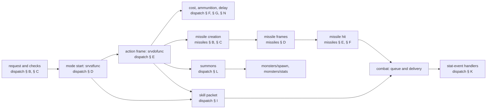

## Purpose

A skill use is a chain of server events: a request, its checks, a mode start that runs the skill's start function, an action frame that runs its do function and creates its missile, the missile's frames, hits and end, the stat-event handlers its hits fire, and the units it summons. Unit stats are inputs; the combat chain a skill hit enters is [combat](../../spec-combat/overview/).

## Files

| File | Covers |
|---|---|
| [dispatch.md](../dispatch/) | the request, the checks, the start and do functions, costs, delay, periodic and aura skills, item skills and casts, the skill packet, progressive charges, the stat-event handlers, summons, monster skill use, ammunition and wear, the tier-A start and do functions |
| [missiles.md](../missiles/) | creation, the damage block, the missile's seed, the frame pass and the do function, motion, collision, the hit and its packet, the function tables, the tier-A missile functions, the re-seed sites, the end of life |

Names are ours. Primitives (`Step`, `Range`, `RangeB`, `RangePow2`, `Init`) are [rng](../../spec-rng/overview/)'s; a calc is [data/calc](../../spec-data/calc/)'s. `MulDiv` is [monsters/stats § A](../../spec-monsters/stats/#a-muldiv-and-monlvlstats)'s. Divisions are signed and truncate toward zero unless stated; life, mana and damage are in 1/256 points.

## Entry points

| When | Tag |
| --- | --- |
| A player asks to use a skill | [C] 4 344 code-0 request calls from both functions' sites, each followed by the player's start of the same skill in the same frame |
| A skill mode starts | [C] for the caster's seed (1 142 start events) |
| A skill mode reaches its action frame | [C] for the caster's seed (1 269 do events) |
| A missile is created | [C] (31 391) |
| A missile steps | [C] (13 335 frames) |
| A missile hits or ends | [C] for the end and the pierce use of a row with no hit function (3 876 hits); [I] otherwise |
| A stat event fires | [C] for the draws of the handlers dispatch § K marks (1 303 calls); [I] otherwise |
| A skill summons a monster | [C] for the new unit's seed, life and defence (219 summons); [I] otherwise |

## Inputs

### Tables

| Anchor | Used for |
|---|---|
| `Skills.txt:srvstfunc`, `srvdofunc`, `srvprgfunc1`, `srvmissile` | the dispatch |
| `Missiles.txt:pSrvDoFunc`, `pSrvHitFunc`, `pSrvDmgFunc` | the missile tables |
| `PetType.txt:group` | the pet limit |
| `ItemStatCost.txt:itemeventfunc1` | the handler registrations |

### Runtime state

| State | Type | Source |
|---|---|---|
| unit seeds | `Unit+0x20` of the caster, the target, each missile, each summon | [rng/seeds](../../spec-rng/seeds/) |
| game seed | `game+0xD0`: every missile and summon creation steps it | `SUnitCreate` |
| the action-done bit | `Unit+0xC4` bit 6 | [dispatch § E](../dispatch/#e-the-do-frame-and-skills_srvdo) |

### The boundary

| Input | Kind | Tag |
|---|---|---|
| the frame on which a mode's do function runs (event code 1 or 2, `Unit+0x4E`) | a logged input until animation timing | [I] |
| a monster's choice of skill, mode and target | an input here: [monsters/ai/machinery § T](../../spec-monster-ai/machinery/#t-the-tier-ais) for the tier, the catalogue for the rest | [I] |
| the numbered functions outside tier A | value oracles, taking the logged exit seeds | [I] |
| the path planner's points | no longer an oracle: [path/search](../../spec-path/search/), every type a stock caller reaches, the draws per type in [path/overview § D](../../spec-path/overview/#d-the-17-types-planner-and-draws) | [C] the planners on the live grid, 0 mismatches over the 11 types of [path/overview § F1](../../spec-path/overview/#f1-the-planners-take-the-live-grid) |
| the live grid at a plan or a step, and a step's cell list | a value oracle, counted: the frozen rules' prediction of the cells, without the seventh corpse caller, is wrong in 11 of 15 663 plans, and the grid is the result of its operations in order | [C] the count; [I] the step's cell list |
| the unit order of the area helpers, the pet chosen for removal | logged values | [I] |
| a unit's final stats | [stats/aggregate](../../spec-stats/aggregate/) | [I] |

## Algorithm

### A. The event kinds and their seeds

| Event | Spec | Seeds drawn | Tag |
|---|---|---|---|
| request | [dispatch § B, § C](../dispatch/#b-the-request) | none | [I]; codes 0, 1, 6 and 8 and their order [C] |
| start | [dispatch § D](../dispatch/#d-the-mode-start) | the start function's: a start-built hit's to-hit and build on the caster, defence on the target | [C] the machinery adds none |
| do | [dispatch § E](../dispatch/#e-the-do-frame-and-skills_srvdo) | the do function's, the delivery's, the missile creations' | [C] the machinery adds none |
| cost and delay | [dispatch § F, § G](../dispatch/#f-costs) | none; the delay ends at `f + d` | [C] |
| finisher | [dispatch § J](../dispatch/#j-progressive-charges-and-the-finisher) | the entries' on the attacker, area units, local seeds | [C] the attacker's and the local seeds in the 18 charged finisher calls (entry 143 one step each; entry 39 one step and 48 creations on a local seed; entry 38 the elemental roll after the delivery); [I] the area units' seeds and entries 36, 37, 40, 41, which no session reached |
| handler | [dispatch § K](../dispatch/#k-stat-event-handlers) | the handler's unit | [C] for the handlers § K marks; [I] otherwise |
| state 52 | [dispatch § K3](../dispatch/#k-stat-event-handlers) | none | [C] |
| summon | [dispatch § L](../dispatch/#l-summons) | game (one step), then the new unit's `MonStatsInit` draws; Raise Skeleton one step of the caster | [C] for 219 summons and the step at class 363, level 20 |
| missile create | [missiles § B, § C](../missiles/#b-creation) | game (one step); owner (critical chain); a local pierce seed; a re-seeding callback | [C] |
| missile frame | [missiles § D](../missiles/#d-each-frame) | the do function's, on the missile | [C] for do 1 |
| missile hit | [missiles § E, § F](../missiles/#e-the-hit) | owner (to-hit); missile (build, knockback, damage function); defender | [C] for the to-hit and the build |

### B. Chaining

- B1. **The game seed chains across the creations of one do event**: 21 860 pairs. [C]
- B2. **The caster's seed chains across its skill events** in 3 155 of 3 459 consecutive pairs; the other 304 lie a
  few steps further on the same stream. Walking the unit's own logged draws between two events reaches the next entry
  in 90 of ' 133 player gaps and 45 of ' 148. [C] The player gaps left are listed (most with the player a hit's
  defender); the monster gaps point at the AI. [I]
- B3. **A missile's seed is private** to the missile, except where a re-seed site sets it from the creator's value; its draws chain across the hits of one frame (110 checks). [C]

- B4. **The stat-event handlers step their unit's seed by their own draws**: 1 303 handler calls of both runs and the
  3 461 fires of earlier combat runs, 0 mismatches. [C]

- B5. **The finisher chains the attacker's seed through its entries**: in the 18 charged calls the seed at entry is the
  first entry's and the seed at return the last entry's, and the 311 uncharged calls leave it unchanged. [C]
 The draw order of entries 36, 37, 40 and 41, which
  no session reached, is the reading. [I]

### C. Branches

| Branch | Where | What changes | Tag |
|---|---|---|---|
| player against monster | costs, ammunition, delay, the request checks | players only; a monster in modes 4, 5, 7, 8 and 9 reaches the start and do through its AI with bit 6 set, while mode 14's start (`MonModeStartSeq`) clears it, so its frame runs the do on a code 1 or 2 as a player's does | [C] for the payment and the request codes 0, 1, 6 and 8; [C] the delay players' only (613 of 613 delay lines), the request checks run for players only (4 367 calls), bit 6 set at 1 460 of 1 460 monster starts in modes 4–9 and clear at 566 of 566 in mode 14; [C] the clear; [I] ammunition, which no skills log records |
| player against monster | missile to-hit | `SkillMissileCreate` passes a to-hit only for a monster owner | [C] its only `or 0x1000` and `+0x48` store sit behind the owner-type-1 test and a non-zero stat 19, two decoders; no player creation of 92 094 carried one |
| player against monster | town | a player's missile ends when the player is in town; a monster's only with `SrcTown` | [I] |
| difficulty | Static Field, curse lengths, summon MonLvl stats | the difficulty record's `+0x40`, `+0x1C`; MonLvl by difficulty | [I] |
| difficulty, expansion, player count | the request, checks, start, do, costs, creation, frame and hit as read | none of their own; a monster skill hit's terms are `MonAttackStats`' | [I] |
| two clients | party auras, player against player | not run | [I] |

## Outputs

Queued combat hits and missile packets for [combat](../../spec-combat/overview/), timed states for [stats/states](../../spec-stats/states/), summoned monsters for [monsters/spawn](../../spec-monsters/spawn/) and [monsters/stats](../../spec-monsters/stats/), `0x40` cell marks for [drlg/collision](../../spec-drlg/collision/), ammunition and durability changes for [items/economy](../../spec-items/economy/). [C] the hits, missiles, timed states and summons inside the events; ammunition: 130 `PLAYER_UseAmmo` calls from the skill missile creation each take one off the thrown weapon; the server's `0x40` cell writers are `MissileCreate` (a `Collision` row's path mark mask), mdo 3 and mdo 5, and `MISSILE_HitUnit` and mdo 31 unmark it (static). [I] the durability changes

## Worked example

The worked examples are in the files: a Raise Skeleton cast and Firestorm's sub-missile seeds, both. [C]

## Reimplementation notes

- **Run the frame pass in order**: missiles, players, monsters, objects, the fifth list. [C] the missiles' walk before
  the players' and monsters' events, the players' slot walk before the monsters' (3 007 pairs), one object event kind
  after both;
  [I] the objects' place in general and the fifth list, which no logged walk ranks

- **Do not merge the two critical chains.** The missile's starts with stat 337, drawn even at 0
  ([missiles](../missiles/#reimplementation-notes) note 3). [C] That chain is not the melee build's: `MissileCritRoll`'s two references are calls in
  `MissileDamageBlock`, whose one caller is `MissileInitDamage`, and `COMBAT_BuildDamage`'s direct-call closure
  (520 functions) reaches neither. [C] (static, `MissileCritRoll`,
  `COMBAT_BuildDamage`)
- **Keep the request counter**: stat 328 seeds every pierce count. [C] stat 328 rises by the request count between
  observations (1 660 separating pairs) and seeds the pierce count (856 creations)
  That it rises before the request checks, so that a refused request still changes later pierce counts, is
  [dispatch](../dispatch/#reimplementation-notes) note 1's reading. [I]

## Evidence

- Tables: Skills, Missiles, PetType.
- Plan: 0045 (Phase 2 accepted 2026-10-27, parts 1 and 2).
