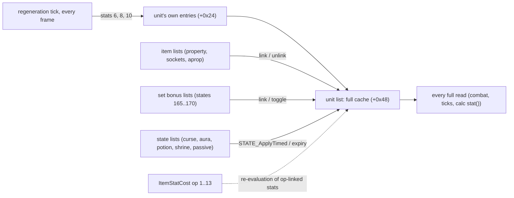

## Purpose

Every unit carries a tree of stat lists: its own base entries, the lists of its equipped items (with their sockets and set bonuses), and the lists of the states on it (curses, auras, potions, shrines, passives). This subsystem specifies how the server keeps the **full value** of every stat of that tree in a cache, how the `ItemStatCost` `op` derivations add terms to it, what the maxima are, which items count, how set bonuses switch on, and, for the states, how a timed state is applied, refreshed, replaced, expired and cleared by group, how the per-frame regeneration tick changes life, mana and stamina, and how auras, shrines and wells put states on a unit. It is phase (2); combat ([combat](../../spec-combat/overview/), phase 1) reads the values this subsystem produces, and a skill's own effect is phase (3).

## Files

| File | Covers |
|---|---|
| [aggregate.md](../aggregate/) | the list tree and the cache, propagation and recompute, `op` 1–13, the reads, the maxima and their rescale, item requirements and the equipment refresh, dual wield, set bonuses, passive stat lists |
| [states.md](../states/) | the state bit and its list, the timed apply (curses, refresh, refuse, replace), expiry, removal, the `group` clear, the regeneration tick, auras, shrines and wells, the draws per event kind |

Names of functions, structs and fields are ours. `MulDiv(a, b, c)` is the helper of [monsters/stats § A](../../spec-monsters/stats/#a-muldiv-and-monlvlstats). Stat values are i32; life, mana and stamina are in 1/256 points. A stat key is `stat << 16 | param`. Time is in game frames, the frame counter at `game +0xA8`.

## Entry points

| When | Function | Tag |
|---|---|---|
| A list is linked under a unit, or unlinked | `STATLIST_LinkToUnit`, `STATLIST_Unlink` | [C] (26 087 links and unlinks) |
| A list entry is added or set (any writer) | `STATLIST_AddStat`, `STATLIST_SetStatEx` → `STATLIST_Propagate` | [C] (101 995 own writes) |
| A full stat is read | `StatListGetValue` | [C] (891 844 reads) |
| An item is equipped, unequipped, or the requirements are refreshed | `ITEMS_AttachToOwner`, `ITEMS_DetachFromOwner`, `EquipReqRefresh`; the body-to-cursor pickup unlinks through `InvItemRemove` instead | [C] for the refresh (972 refreshes); [C] for the entry: 5 973 item links through the attach, 5 695 unlinks through the detach, and the pickup's 260 unlinks with no detach; [I] for the attach and detach bodies |
| A timed state is put on a unit | `STATE_ApplyTimed` | [C] (3 643 applies) |
| A timed list's end frame is reached | `EVENT_TimedListExpire` | [C] (2 749 runs) |
| A player's regeneration tick, every frame | `RegenEvent` | [C] (54 719 ticks) |
| An aura runs | `EVENT_SelectedAuraTick`, `EVENT_ItemAuraTick` | [C] (3 629 runs) |
| A shrine or a well is operated | `OBJOP_Shrine` | [I] (15 operates over, a named shortfall) |

## The boundary

| Kind | What | Tag |
|---|---|---|
| value oracles | a skill's own calc results where the formula reads unit state (data/calc's unit-reading variables); the shrine to-hit and damage values (`SHRINE_StatValue` cases 19 and 21); monster AI; the combat appliers that put a state on the player (poison, cold, open wounds) are inputs; the item's required level and the strength and dexterity the requirement check reads, as the recorded sessions name them | [C] |
| modelled inputs | the passive calcs, evaluated with the level the list records in stat 351 | [C] |
| no remainder (since the 2026-10-20 re-check) | the 180 wearer set lists of the full Trang-Oul's Avatar (full blocks with a `state` and an `oskill` property), taken as logged at the run, are predicted by the kept checker: values stored `<< ValShift`, the `state` block writing stat 98 with param 176 and value 1, so all 5 749 wearer set lists are checked | [C] |

Under this boundary, the model of this subsystem reproduces 18 recorded sessions of six characters with 0
mismatches: every link, unlink, propagation and cache write of the player's tree in order, every read in the 50-frame
windows, the stat callback and its rescale, the requirement checks, the set masks, toggles and lists, the passive
lists, every apply, expiry, tick, aura run and duration, and the shrines and wells reached. [C]

Under the same boundary, the model reproduces 10 further sessions with 0 mismatches, among them curse requests on monsters, the aura ends by the skill switch and the different-state group clears. [C] (the kept run list re-checks byte for byte with the same checker)

Under the same boundary, the model reproduces 14 more sessions with 0 mismatches, among them the curse resistance cut on the player, group 3's nested clears and 296 expiries. [C] (the kept run lists of the two earlier runs re-check byte for byte with its checker)

The stat values that the combat and character specs take as value oracles stay oracles: their recordings hold values, not lists, and their level-up maxima were compared only for consistency (the P2 review ruled that none is replaced). A reimplementation that models this subsystem computes those values; the earlier runs do not yet check that composition.

## Draw order

Events of eight kinds draw nothing: link, unlink, own write, toggle, apply, expire, tick and aura leave the game seed and the acting unit's seed unchanged, except a damaging aura's drawing run below. [C] (seed invariance logged at the entry and the exit of every event, link 12 868, unlink 12 853, own write 101 995, toggle 19 525, apply 6 232, expire 2 749, tick 54 719, aura 2 763 unchanged)

A damaging aura's run (Sanctuary) that draws moves the caster's unit seed by one `RNG_RangeB`, in the elemental damage roll `SKILLS_RollElemDamage` (phase 3's). [C] (`SKILLS_RollElemDamage`, `RNG_RangeB`: 865 drawing runs, 865 steps, each exit asserted against the logged draws; 746 chained pairs, 115 next runs entered elsewhere, 4 drawing runs with no next run in their log, the stats model's counts keyed by the caster unit; the run did not count the units each run hit)

The draw is one per run whatever the number of units hit: do 66 makes its one `SKILLS_RollElemDamage` call before
its target pass, and the pass copies the packet it fills to every unit hit with one `rep movs`. [I] Details:
[states § H](../states/#h-draws-per-event-kind).

## Evidence

- with the Phase 2 review in the  log.
- Tables: ItemStatCost, CharStats,
  States, Skills, Sets,
  SetItems, Shrines, Objects.
- Upstream: [items/properties](../../spec-items/properties/) (the lists an item is created with),
  [items/uniques-sets](../../spec-items/uniques-sets/) (set membership), [player/creation](../../spec-player/creation/) (base
  stats), [monsters/stats](../../spec-monsters/stats/) (a monster's creation stats, the stat callback),
  [data/calc](../../spec-data/calc/) (the passive and aura calcs). Downstream: [combat](../../spec-combat/overview/) (every stat it
  reads), [player/creation § I](../../spec-player/creation/#i-level-up--player_levelup) (the refill maxima),
  [objects](../../spec-objects/overview/) (shrine and well operates).
